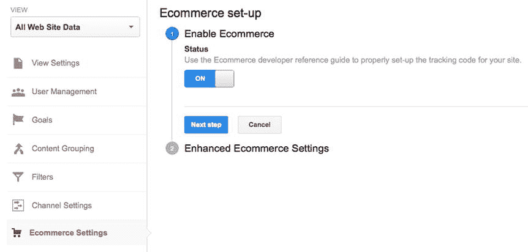
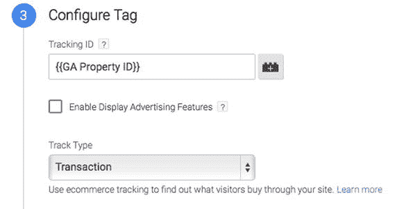
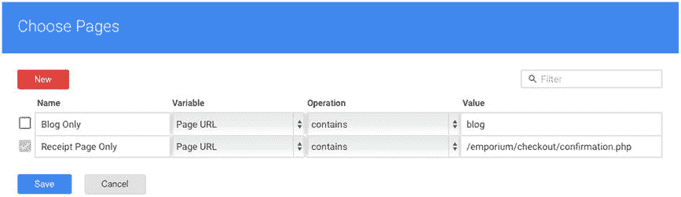
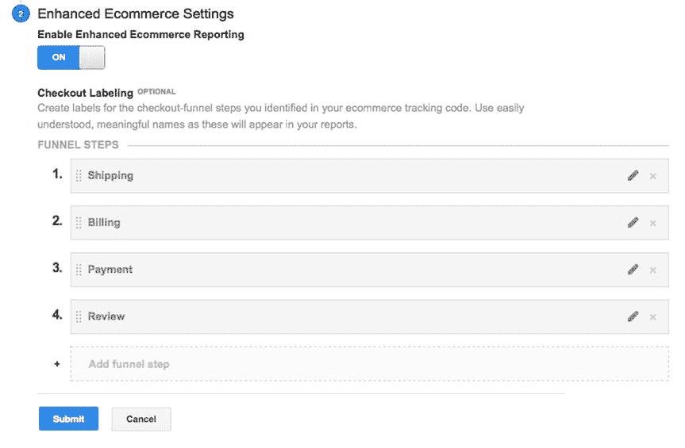
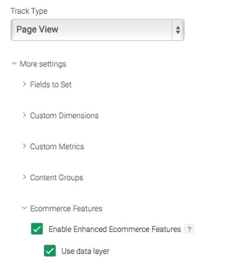
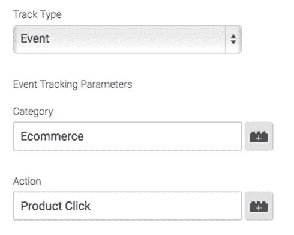

# 7. 电子商务：追踪产品与购买行为

> “如果你从三百六十五里拿走一，还剩下什么？” “当然是三百六十四。” 矮胖子一脸怀疑，“我倒想看看你写在纸上是啥样。” 他说。 ——刘易斯·卡罗尔，《爱丽丝镜中奇遇记》

对于销售产品的网站，您可以收集关于用户在网站上进行购买的额外数据。Google Analytics（谷歌分析）提供了两种电子商务追踪的细节层级：

*   **基础电子商务追踪**仅追踪购买行为。由于它只关心完成的购买，您只需在 GTM（谷歌标签管理器）中对最终的购买确认页面进行修改。
*   **增强型电子商务**提供了对用户在整个站点中与产品互动（从在列表中查看产品、添加到购物车，到最终的购买）的更广泛的追踪。它提供了更丰富的方式来分类和追踪所有类型的产品互动。因此，要充分利用增强型电子商务，您通常需要对网站的绝大部分进行追踪修改。

您应该选择哪一种？如果您只需要非常简单的电子商务追踪，基础选项可能就足够了。然而，对于许多网站来说，增强型电子商务提供了更深入且更具可操作性的数据，因此，如果您有资源去实施它，我们强烈推荐。

无论选择哪种电子商务追踪方案，实施通常都涉及两组任务：

*   对您的网站进行修改，以通过数据层向 GTM 提供电子商务数据。
*   在 GTM 中修改代码，以支持将电子商务数据发送到 GA。

本章将介绍基础型和增强型电子商务的实施流程，包括逐步讲解 GTM 的修改（第二项任务）。对于第一项任务，将详细说明数据层中需要存在何种信息及格式。这通常是通过对网站进行服务器端修改，从而在数据层中提供这些数据来实现的，因此具体实施将取决于您的网站和电子商务平台。

## 面向非电商网站的电子商务追踪

尽管它通常用于衡量购买行为，但 GA 的电子商务追踪功能同样适用于任何类型的交易互动，无论其中是否涉及金钱。这可能包括以下场景：

*   从商品目录或项目库（如电子书、视频或其他内容）中进行选择，并下载、结账或查看此类项目。
*   注册课程或在线课程。
*   申请志愿者或工作机会。
*   选择或配置最终需要线下购买的产品（例如汽车）。

在许多情况下，您可能会发现使用目标（参见第 6 章）来衡量这些场景就足够了。但如果您希望获得关于每笔交易细节的更详细数据，电子商务追踪是一个不错的选择。即使金额为`$0.00`，本章描述的所有电子商务追踪功能也仍然有效。

本章的剩余部分将分为两个小节，分别介绍基础型电子商务和增强型电子商务追踪。实施时，您应选择其中一种方案，只需阅读相关小节即可。

## 基础电子商务追踪

基础电子商务仅追踪已完成的购买。设置基础电子商务涉及三个步骤：

*   在 Google Analytics 中启用电子商务追踪。
*   在网站的数据层中添加电子商务数据。
*   在 Google Tag Manager 中添加一个 Google Analytics 交易代码。

让我们逐步了解整个过程。

### 在 GA 中启用基础电子商务追踪

首先，您需要在 GA 中启用电子商务追踪。这将启用“转化”部分中的电子商务报告，以及整个 GA 中其他报告中可用的电子商务数据。可以在每个数据视图的设置中启用或禁用电子商务报告。

*   在 GA 的“管理”选项卡中，从下拉列表中选择所需的帐户、资源和数据视图。
*   在数据视图的设置（最右侧列）中，选择“电子商务设置”（如下截图所示）。



*   要启用电子商务追踪，将开关设置为“开启”。选择“下一步”按钮。
*   将增强型电子商务的设置保留为“关闭”，然后选择“提交”按钮。

您还可以在此数据视图中设置希望在报告中看到的货币。（如果您拥有多币种商店，GA 将负责货币间的电子商务数据转换；有关详细信息，请参见下方侧边栏。）

*   仍然在 GA 的“管理”选项卡中，在最右侧列选择“数据视图设置”。
*   在此设置页面大约中间位置，有一个货币下拉列表。选择您希望在此视图的报告中看到的货币。
*   选择“保存”按钮。

启用电子商务只是使 GA 中可用的相应报告生效，但您仍然需要发送电子商务数据来填充这些报告。接下来，您需要在数据层中添加一些关于购买的信息。然后，您将创建一个 GTM 代码，将这些数据发送到 GA。


### 数据层中的电子商务数据

有关购买的数据将通过 GTM 的 `dataLayer` 对象，在购买流程的最终确认页面上提供。GTM 指定了 Google Analytics (GA) 所需信息片段的格式和标签。以下是数据层中购买数据的一个示例；我们稍后将对其中的各部分进行分解。

```
<script>
dataLayer = [{
  'transactionId': 'AW699168',
  'transactionAffiliation': 'Mad Hatter\'s Hat Emporium',
  'transactionTotal': 42.98,
  'transactionTax': 3.00,
  'transactionShipping': 3.99,
  'transactionProducts': [
    { 'sku': 'MH342',
      'name': 'Felt Fedora',
      'category': 'Hats',
      'price': 17.99,
      'quantity': 1 },
    { 'sku': 'MH007',
      'name': 'Purple Top Hat',
      'category': 'Hats',
      'price': 24.99,
      'quantity': 1 } ]
}];
</script>
```

**注意：** 你只能在页面中声明一次数据层（使用像 `dataLayer = []` 这样的语句），并且该声明必须位于 GTM 代码之前（GTM 会自动创建一个数据层，如果尚不存在的话）。稍后再次声明数据层会覆盖其先前的值，并可能导致 GTM 行为异常。要在数据层创建后为其提供额外的值，请使用 `dataLayer.push()`（如第 5 章交互跟踪中所见），该方法会向数据层追加内容，而不是覆盖它。在这种情况下，你需要这些值在页面加载时就被包含，因此你会将电子商务数据包含在声明中。

此代码应仅在交易完成时包含——即结帐流程中的最终收据页面。

第一组属性对交易进行了概括：

- `transactionId` 是必需的，用作此特定购买的唯一标识符。
- `transactionAffiliation` 是可选的，可以表示特定的商店（如果你有多家商店）或一个联盟代码。
- `transactionTotal` 是必需的，代表交易的总收入（该总额可以包含或排除运费和税费，具体取决于你希望在报告中查看收入的方式）。
- `transactionTax` 和 `transactionShipping` 是可选的，代表交易的税费和运费。

电子商务数据的下一部分是一个名为 `transactionProducts` 的数组。该数组中的每个条目对应所购买的每个不同产品。每个产品条目包含以下属性：

- `sku` 和 `name` 是必需的，代表产品的标识符和名称。
- `category` 是可选的，表示产品的分类或分组。
- `price` 是必需的，代表产品的单价。
- `quantity` 是必需的，代表购买的数量。它应该是一个整数。

你需要在数据层中为交易中包含的每个产品重复这些信息。在我们的示例中，有两个产品。

如前所述，数据层中的信息值来自你网站的数据，通常使用服务器端代码从你的数据库或电子商务平台中提取这些值。如何实现的具体细节取决于你的网站以及你用来处理这些交易的工具，但只要以这种方式格式化数据，GTM 和 GA 就可以使用它。

**注意：** 由于你是从数据库中插入值到这段 JavaScript 代码中，因此需要注意格式和语法。具体来说，要小心文本字段中的撇号或引号（请注意示例代码中 `'Mad Hatter\'s Hat Emporium'` 里使用反斜杠转义的撇号）。另请注意，货币值是数字，因此应仅包含数字和小数点（不要包含货币符号或逗号）——所以应该是 `1342.57`，而不是 `$1,342.57`。

### 侧边栏：货币换算

如你所见，你可以为 GA 中的数据视图选择一个货币设置，该设置控制报告中显示的货币。如果你拥有单一货币商店，只需将报告设置为显示美元，以美元发送你的价格和交易金额，这些数字就会显示在报告中。

但是，你可能遇到这样的场景：你的商店接受多种货币，或者你有多个特定国家/地区的商店，并且希望跨区域汇总报告。在这种情况下，需要在报告中进行货币换算。

在数据层的交易数据中，你可以使用 `transactionCurrency` 属性（针对交易总额）和 `currency` 属性（针对每个产品）来指定货币。货币值是像 USD 或 EUR 这样的三个字母代码，代表相应的货币。GA 文档中包含 GA 支持的所有货币的完整列表。

```
<script>
dataLayer = [{
  'transactionId': 'AW699168',
  'transactionAffiliation': 'Mad Hatter\'s Hat Emporium',
  'transactionTotal': 42.98,
  'transactionTax': 3.00,
  'transactionShipping': 3.99,
  'transactionCurrency': 'EUR',
  'transactionProducts': [
    { 'sku': 'MH342',
      'name': 'Felt Fedora',
      'category': 'Hats',
      'price': 17.99,
      'quantity': 1,
      'currency': 'EUR' },
    { 'sku': 'MH007',
      'name': 'Purple Top Hat',
      'category': 'Hats',
      'price': 24.99,
      'quantity': 1,
      'currency': 'EUR' } ]
}];
</script>
```

这与之前的交易相同，只是增加了 `transactionCurrency` 和 `currency` 属性来指明使用欧元结算（尽管不同产品使用不同货币的情况不太常见，但你仍需要为交易总额以及每个产品指定货币）。

如果交易数据中包含的货币代码与 GA 中的货币设置不同，则会使用每日汇率进行货币换算，并在报告中显示换算后的金额（汇率取自 Google Billing，是前一天的均值。因此，确切金额可能与你的金融机构实际提供的汇率存在微小差异）。

对于基本的电子商务跟踪，上面描述的数据层对象是你需要添加到网站的唯一额外代码。在下一节中，你将创建用于将此数据发送到 GA 的 GTM 标签。

### GTM 中的基本电子商务标签

对于 Google Analytics 中的基本电子商务跟踪，有一种额外的点击类型用于发送交易数据（就像你之前看到的用于发送页面浏览或事件数据的点击类型一样）。要发送此数据，你需要在 GTM 中创建一个额外的标签。

#### 在 GTM 中创建一个基本电子商务交易标签

你可以按照以下步骤在 GTM 中添加一个 GA 交易标签：

1.  创建一个新标签。选择 **Google Analytics ➤ Universal Analytics** 作为标签类型。
2.  就像你在基本页面浏览标签中所做的那样，使用你之前创建的 `{{GA Property ID}}` 变量（参见第 3 章）填写跟踪 ID。
3.  选择 **Track Type ➤ Transaction**。你会注意到一条消息显示，指示你在数据层中进行相应的设置（请参见下面的截图），而这你已经完成了。选择 **Continue**。

    

4.  对于触发器，选择 **Some Pages**。将显示你之前创建的所有页面触发器的列表。选择 **New** 以创建新的触发器。
5.  给触发器适当命名；例如，`仅结帐收据页面`。
6.  输入一些条件，以便仅当访问最后的结帐页面（你在该页面的数据层中添加了电子商务代码）时触发此标签。通常，你可以使用 `{{Page URL}}` 变量作为条件来实现这一点（请参见下面的截图）。

    

7.  保存触发器。
8.  保存标签，为其命名："GA – 电子商务"。


### 在 GA 中为结账流程创建目标

前面几节的任务是您在 Google Analytics 中启用电子商务报告并收集交易数据所需的全部操作。不过，您可能还想为结账流程设置一个包含漏斗的目标，以便了解用户是如何逐步完成购买的（或未能完成）。第 6 章 描述了如何设置此类目标漏斗。

就是这样！此代码现在（当然，是在测试和发布之后）将在回执页面上触发，它会读取您之前添加到数据层的数据并将其发送到 GA。

### 增强型电子商务跟踪

Google Analytics 中的增强型电子商务功能不仅限于衡量已完成的购买，还能跟踪整个网站内的电子商务互动活动。

您可以收集的数据包括两种类型的互动：与产品的互动（从查看产品到完成购买）以及与内部促销活动（例如横幅广告或其他优惠）的互动。有关所有这些互动的信息将通过向数据层添加信息来处理。GTM 和 GA 期望这些数据采用特定的格式和标签，稍后您将通过详细的示例来了解。GA 报告中`“转化” ➤ “电子商务”`部分有多种报告能反映您发送的数据。

对于产品，互动如下：

-   产品展示（`impressions`）：用户看到了产品列表，例如在分类页面上。
-   产品点击（`click`）：用户点击了某个产品列表项。
-   产品详情查看（`detail`）：用户查看了产品详情页面。
-   从购物车添加和移除产品（`add` 和 `remove`）：用户在购物车中添加或移除了产品。
-   结账（`checkout`）：用户进行了结账流程的各个步骤（您将能够配置步骤的数量和顺序）。
-   购买（`purchase`）：用户成功购买了一个或多个产品。
-   退款（`refund`）：发生了全额或部分退款。

对于促销活动，互动如下：

-   促销展示（`promoView`）：用户看到了促销活动，例如促销横幅。
-   促销点击（`promoClick`）：用户点击了促销活动。

请注意，我们讨论的互动类型分为两类：页面加载时发生的互动，以及用户点击页面某个元素时才发生的互动。

第一类包括 `impressions`、`detail` 和 `promoView`，它们都表示页面上有内容被浏览。对于这些测量，您可以在页面加载时在数据层声明中包含电子商务数据。

后一类包括 `click` 和 `promoClick`，它们都表示点击行为。对于这些互动，您需要在点击发生时将信息推送到数据层（使用与第 5 章中跟踪点击相同的原则）。

其他互动，如 `add`、`remove`、`checkout` 和 `purchase`，根据网站的具体情况，可能属于任一类别。例如，有些网站在添加产品时会跳转到购物车页面，而另一些网站可能仅添加产品而不刷新页面。对于结账流程，每个步骤（账单、运输等）可能是一个单独的页面，或者所有步骤都在一个页面内完成（使用 AJAX）。这两种情况您都可以处理。

最后，`refund` 是一种互动类型，它通常可能发生在网站的常规用户互动之外（例如，可能与客户服务请求同时发生）。您将单独研究如何处理退款。

#### 边栏：分阶段实施增强型电子商务

在考虑实施时，增强型电子商务中可跟踪的互动类型以及支持它们所需的数据量可能会让人感到不知所措。但请认识到，不必一次性全部实施。这些互动类型之间没有依赖关系，因此您可以选择实施其中一部分而不实施其他部分（当然，Google Analytics 报告只会显示您已实施的部分）。

正因如此，通常的做法是先从最重要的互动开始，例如购物车、结账和已完成购买。然后可以逐步加入有关展示和点击的更多信息，最后，如果需要，再处理促销活动和退款。


### 启用增强型电子商务

在发送数据之前，你首先需要在 Google Analytics 和 Google Tag Manager 中启用增强型电子商务。以下是操作流程。

#### 在 Google Analytics 中启用增强型电子商务

首先，让我们在 `GA` 中启用电子商务跟踪。这将启用“转化”部分中的电子商务报告，以及 `GA` 中其他报告中可用的电子商务数据。每个数据视图的设置中都可以启用或禁用电子商务报告。

在 `GA` 的“管理”标签页中，从下拉列表中选择所需的帐号、媒体资源和数据视图。在数据视图的设置（最右侧列）中，选择 `电子商务设置`（参见以下截图）。


要启用电子商务跟踪，将开关设置为**开启**。选择**下一步**按钮。将增强型电子商务的设置更改为**开启**。在**结账标签**设置中，选择**添加漏斗步骤**，并为结账流程中的每个步骤添加一个标签（参见以下截图）。例如，如果结账包含以下步骤，你应该将每一步都作为漏斗中的一个带标签步骤添加：

- 配送
- 账单
- 付款
- 审核

这与目标漏斗设置类似（在第 6 章中有所描述），但专用于增强型电子商务报告。稍后你需要添加代码来指明用户在此流程中处于哪个步骤。请注意，不必将购买确认添加为一步；它通常被视为流程中的最后一步。



选择**提交**按钮以保存设置。

你还可以在此数据视图的报告中设置希望看到的币种。（如果你的商店支持多种货币，`GA` 会在不同货币之间转换电子商务数据；详情请参见下方的边栏。）

仍在 `GA` 的“管理”标签页中，选择最右侧列中的**数据视图设置**。在此设置页面向下滚动约一半，会看到一个币种下拉列表。选择你希望在此数据视图的报告中看到的币种。选择**保存**按钮。

#### 在 Google Tag Manager 中启用增强型电子商务

增强型电子商务会随现有的 `GA` 代码（例如基础网页浏览代码或事件跟踪代码）一同发送额外的电子商务数据。你需要为基础网页浏览代码启用增强型电子商务。本章稍后部分，你将学习需要使用事件或虚拟网页浏览代码的场景。

> **注意：** 不要对增强型电子商务使用 `GA` 的“交易”代码类型。交易代码用于基础电子商务跟踪。在增强型电子商务中，产品数据会随其他匹配（例如网页浏览或事件）一起发送；它不需要额外的代码类型。

在 `GTM` 的代码列表中，选择基础的 `GA` 网页浏览代码进行编辑。点击**配置代码**部分以编辑此代码。在**更多设置 ➤ 电子商务功能**下，选中**启用增强型电子商务功能**复选框（参见以下截图）。



勾选使用数据层的复选框。（另一个选项允许你从变量而不是数据层读取电子商务数据。本章稍后会介绍一个可能需要使用该选项的示例，但对于所有基础代码，你都将使用数据层。）保存对代码的更改。

现在，`GA` 的网页浏览代码已准备好让你向数据层添加电子商务数据。当电子商务数据以预期格式出现时，它将自动随网页浏览一起发送。

### 数据层声明中的电子商务数据

现在你已经启用了增强型电子商务，可以开始将电子商务数据包含在数据层中，这些数据将随 `GA` 网页浏览代码一起发送。这是你在页面加载时获取可用数据时使用的方法。由于数据在页面加载时即可用，你需要在数据层声明（`dataLayer = []`）中包含这些数据。（对于页面加载后通过点击或 AJAX 交互获得的数据，你需要使用 `dataLayer.push()` 来发送数据；详情请参见下一节。）

你可以通过在 `GTM` 容器代码之前将数据层声明包含在页面中来声明数据层。你的电子商务数据将包含在一个名为 `ecommerce` 的对象中。该对象的基本格式如下所示：

```html
<script>
dataLayer = [{
    'ecommerce': {
        'currencyCode': 'USD',   // 可选，用于货币转换
        'action': {              // 其中一个电子商务操作：展示、详情、添加等
              'actionField': {}, // 可选，用于某些操作的选项
              'products': []     // 包含产品详情对象或其他数据的数组
         }
    }
}];
</script>
```

每个操作的详细信息、必需属性和可选属性都略有不同。以下各节为所有操作提供了详细示例。

如前所述，数据层中信息的值来自你网站的数据，通常使用服务器端代码从你的内容管理系统或电子商务平台中提取。具体实现方式取决于你的网站以及你用于处理这些交易的工具体系，但只要你以此格式组织数据，`GTM` 和 `GA` 就能正常使用它。

> **注意：** 增强型电子商务的数据层属性命名和层级结构与基础电子商务不同。如果你是从基础电子商务升级而来，你需要修改数据层中的字段。

#### 边栏：货币转换

如你之前所见，你可以为 `GA` 中的数据视图选择一个币种设置，该设置控制报告中显示的货币。如果你只有一个币种的商店，只需将报告设置为显示美元，并以美元发送价格和交易金额，数字便会出现在报告中。

但是，你可能会遇到商店支持多种货币的情况，或者你有多个针对特定国家/地区的商店，并希望跨地区汇总报告。在这种情况下，就需要进行货币转换以生成报告。

在数据层的交易数据中，你可以使用 `currencyCode` 指定币种。货币值为三个字母的代码，例如 `USD` 或 `EUR`，代表相应的货币。`GA` 文档中包含了 `GA` 支持的完整货币列表。²

如果交易数据中包含的货币代码与 `GA` 中的币种设置不同，`GA` 将使用每日汇率进行转换，并在你的报告中显示转换后的金额。（汇率取自 Google Billing，是前一天的均价。因此，精确金额可能与你的金融机构实际获得的汇率存在微小差异。）


#### 产品数据

许多电商行为都涉及产品数据，从产品展示，到查看产品、加入购物车，直至完成结账。在这一过程中，可以捕获产品的多个核心属性：

```json
{
    "name": "高顶礼帽",
    "id": "MH007",
    "price": "24.99",
    "brand": "疯帽子帽业",
    "category": "帽子/男款",
    "variant": "紫色"
}
```

这些属性描述了产品的不同特征：

- `name` 和 `id` 是必填项，分别代表产品的名称和标识符（SKU）。
- `price` 代表产品的单价。
- `brand`、`category` 和 `variant` 为可选项，用于进一步描述产品并进行分类：
  - `brand` 代表产品的品牌名称或设计师。
  - `category` 代表产品的分类或分组。与基础电商不同，增强型电商支持使用斜杠（`/`）指定最多五级的分层类别。在此示例中，顶级类别为 `Hats`（帽子），子类别为 `Mens`（男款）。通常，你会使用它来表示网站用于组织和展示产品的分类体系。
  - `variant` 代表产品的进一步区分，例如颜色、尺寸等。

此外，还有其他属性，例如 `quantity`（数量），仅适用于特定情况；你将在后续的详细示例中看到它们。另外，如果合适，你还可以使用自定义维度来捕获更多产品信息（更多关于自定义维度的内容，请参见第 11 章）。如前所述，这些属性大多是可选的，但你填写的信息越多，GA 中的电商报告就会越丰富。

**注意**

由于你要将数据库中的值插入到这段 JavaScript 代码中，因此需要特别注意格式和语法。具体来说，要注意文本字段中的撇号或引号（请注意示例代码中 `'Mad Hatter\'s Hat Emporium'` 内的转义撇号）。同时要注意，货币值是字符串，应仅包含数字和小数点（不含货币符号或逗号）——因此应使用 `'1342.57'`，而不是 `'$1,342.57'`。

### 产品展示

`impressions`（展示）操作用于记录用户在整个网站上看到产品时的展示情况。通常，电商网站会在多个地方展示产品列表：主页、分类页面、搜索结果页面以及相关产品推荐中。通过发送这些列表中哪些产品被查看（以及随后哪些产品被点击和购买）的数据，你可以更好地了解每个产品和每个列表的点击和购买行为。

以下是数据层中展示数据的示例：

```html
<script>
dataLayer = [{
    'ecommerce': {
        'impressions': [
              {
                'name': '高顶礼帽',
                'id': 'MH007',
                'price': '24.99',
                'brand': '疯帽子帽业',
                'category': '帽子/男款',
                'variant': '紫色',
                'list': '精选产品',
                'position': 1
              },
              {
                'name': '灰色软呢帽',
                'id': 'MH342',
                'price': '17.99',
                'brand': '疯帽子帽业',
                'category': '帽子/男款',
                'variant': '灰色',
                'list': '精选产品',
                'position': 2
              }
         ]
    }
}];
</script>
```

请注意，`impressions` 是包含展示数据的数组名称。该数组是你希望在此页面上记录展示的产品列表（此示例中仅有两个，但在你的网站上可以按需增加）。这些产品可以包含之前描述的所有核心属性，以及另外两个附加属性：

- `list` 是产品列表的名称。你可以使用任何你想要的名称；选择那些报告用户易于理解的名称来代表你网站上的产品列表，例如“分类页面”、“推荐产品”、“购买了此商品的用户也喜欢”等。
- `position` 是数值，代表产品在列表中的位置（从 1 开始）。

你可以在页面上包含任意多个列表中的任意多个产品。

**注意**

任何 Google Analytics 请求发送的数据量都有 8 KB 的限制（大约 8000 个字符）。通常情况下，这不会构成障碍，但如果一个页面上的展示数过多，你可能会超出此限制。请留意产品数据列表的长度增长情况，必要时可能需要将其拆分为多个请求（使用 `dataLayer.push()` 向 GA 发送包含更多产品展示的附加事件）。

**边栏：使用懒加载或无限滚动的展示**

在某些情况下，网站可能不会一次性加载所有产品，而是仅在用户开始向下滚动列表时才加载，这种效果有时被称为懒加载或无限滚动。在这种情况下，某些产品集的展示数据可能在页面加载后才能获得，因此你将无法将其包含在数据层定义中。

在这种情况下，你可以在页面加载后使用 `dataLayer.push()` 向页面发送额外的产品展示数据。你还需要一个事件来将这些数据发送给 GA。本章后面关于点击和 AJAX 交互的示例提供了在初始页面加载后发送电商信息的例子。

### 产品详情查看

`detail`（详情）操作代表查看产品详情页面。以下是数据层中产品详情查看的示例：

```html
<script>
dataLayer = [{
    'ecommerce': {
        'detail': {
            'products': [{
                 'name': '高顶礼帽',
                 'id': 'MH007',
                 'price': '24.99',
                 'brand': '疯帽子帽业',
                 'category': '帽子/男款',
                 'variant': '紫色'
             }]
         }
    }
}];
</script>
```

对于这组数据，`detail` 是对象的名称，其中包含一个带有核心产品属性的 `products` 数组。（通常，对于产品详情查看，只有一个产品。）

`detail` 操作有一个可选属性 `list`，可以通过 `actionField` 对象提供，如下所示：

```html
<script>
dataLayer = [{
    'ecommerce': {
        'detail': {
            'actionField': { 'list': '精选产品' },
            'products': [{
                 // 同上
             }]
         }
    }
}];
</script>
```

这允许你捕获用户是从哪个列表进入产品详情页面的。（如果你已在跟踪产品展示和产品点击，则此操作并非必需，但如果不捕获这些详细信息，它可能会很有用。）

请注意，数据层中可能包含多种类型的电商数据。例如，在产品详情页面上，可能还有一个带有展示信息的产品列表（例如“相关产品”或“购买了此商品的用户也购买了...”）。你可以将这些合并到数据层中：

```html
<script>
dataLayer = [{
    'ecommerce': {
        'detail': {
             // 同上
         },
        'impressions': [
             // 同上
         ]
    }
}];
</script>
```


#### 购物车添加与移除操作

`add`（添加）和 `remove`（移除）操作可用于追踪被加入或移出购物车的商品。

```
<script>
dataLayer = [{
    'ecommerce': {
        'add': {
            'products': [{
                 'name': 'Top Hat',
                 'id': 'MH007',
                 'price': '24.99',
                 'brand': 'Mad Hatter\'s Hat Emporium',
                 'category': 'Hats/Mens',
                 'variant': 'Purple',
                 'quantity': 1
             }]
         }
    }
}];
</script>
```

操作对象可命名为 `add` 或 `remove`（视情况而定），并包含一个或多个 `products`。产品对象除包含核心属性外，还包含数值类型的 `quantity` 属性，用于指示添加或移除的商品数量。

#### 结账流程

您可以使用 `checkout` 操作来测量结账流程。回想一下，当您在 GA 中启用增强型电子商务时，您标记了结账流程的各个步骤。在示例中，您包含了四个步骤：

配送   账单   付款   审核

最后一步始终是完成购买（这是一个单独的操作，将在下一节介绍）。对于您的网站，您应根据需要包含尽可能多的步骤。您需要在数据层中为每个步骤添加相应的代码，如下所示。

> **注意：** 本示例假设结账流程的每个步骤都是一个独立的页面。对于采用 AJAX 结账流程的网站，请参阅本章后面的“AJAX 购物车与结账交互”部分。

```
<script>
dataLayer = [{
    'ecommerce': {
        'checkout': {
            'actionField': {
                'step': 1,
                'option': '白兔快递服务'
             },
            'products': [
                {
                  'name': 'Top Hat',
                  'id': 'MH007',
                  'price': '24.99',
                  'brand': 'Mad Hatter\'s Hat Emporium',
                  'category': 'Hats/Mens',
                  'variant': 'Purple',
                  'quantity': 1
                },
                {
                  'name': 'Felt Fedora',
                  'id': 'MH342',
                  'price': '17.99',
                  'brand': 'Mad Hatter\'s Hat Emporium',
                  'category': 'Hats/Mens',
                  'variant': 'Grey',
                  'quantity': 1
                }
            ]
         }
    }
}];
</script>
```

操作被命名为 `checkout`，在 `actionField` 对象中，您可以指定两个额外的属性：

- `step` 表示这是结账流程中的第几步。（如果是单步结账，则此项非必需；但在其他情况下，它是必需的。）
- `option` 是一个可选属性，用于指示结账步骤的某些附加特征。例如，它可用于指示配送方式（如本例所示）或支付方式。

产品数据包含所有核心属性，以及一个 `quantity` 属性（与之前的 `add` 和 `remove` 操作类似）。您需要在构成结账流程的每个页面上重复此数据，并根据需要更改步骤编号和选项。

通常，直到下一步骤才能知道 `option` 的值。例如，在配送页面上，用户可以选择不同的配送方式。您无法在配送页面的数据层中预填该选项，因为您此时还不知道用户将选择什么。为适应这种情况，有一个名为 `checkout_option` 的附加操作，可用于更新某个步骤的已选选项：

```
'ecommerce': {
    'checkout_option': {
        'actionField': {'step': 1, 'option': '白兔快递服务'}
    }
}
```

`actionField` 指示 `step`（步骤）和 `option`（选项）的值。通常，您可以在后续页面（本例中为第 2 步）的数据层中包含此项。完整示例如下：

```
<script>
dataLayer = [{
    'ecommerce': {
        'checkout_option: {
            'actionField': { 'step': 1, 'option': '白兔快递服务' }
        }
        'checkout': {
            'actionField': { 'step': 2 },
            'products': [ // 如上所示 ]
         }
    }
}];
</script>
```

#### 购买

最后，当购买成功完成时，您可以使用 `purchase` 操作。

```
<script>
dataLayer = [{
    'ecommerce': {
        'purchase': {
            'actionField': {
                'id': 'AW699168',
                'affiliation': '在线商城',
                'revenue': '55.97',
                'tax':'3.92',
                'shipping': '',
                'coupon': 'FREE_SHIPPING'
             },
            'products': [
                {
                  'name': 'Top Hat',
                  'id': 'MH007',
                  'price': '19.99',
                  'brand': 'Mad Hatter\'s Hat Emporium',
                  'category': 'Hats/Mens',
                  'variant': 'Purple',
                  'quantity': 1,
                  'coupon': 'TOPHAT_SALE'
                },
                {
                  'name': 'Felt Fedora',
                  'id': 'MH342',
                  'price': '17.99',
                  'brand': 'Mad Hatter\'s Hat Emporium',
                  'category': 'Hats/Mens',
                  'variant': 'Grey',
                  'quantity': 2
                }
            ]
         }
    }
}];
</script>
```

对于 `purchase` 操作，`actionField` 对象包含多个用于汇总交易的属性：

- `id` 是必填项，作为此次特定购买的唯一标识符。
- `affiliation` 是选填项，可表示特定店铺（如果您有多个店铺）或联盟营销代码。
- `revenue` 代表交易的总收入。（此总额可包含或不包含运费和税费，具体取决于您希望在报表中查看收入的方式。）如果您未指定 `revenue`，GA 将使用交易中 `products` 的 `price` 总和。
- `tax` 和 `shipping` 是选填项，分别代表交易的税费和运费。
- `coupon` 是选填项，代表应用于整笔交易的优惠券。

然后，将交易中涉及的每个产品（包括核心产品属性和以下属性）作为一个数组包含在 `products` 中：

- `quantity`，如之前在 `add`、`remove` 和 `checkout` 操作中所示，表示该特定产品的购买数量。
- `coupon` 是选填项，代表应用于特定产品的优惠券。

> **注意：** 用于 GA 的相同字段也可用于 Doubleclick 交易标签的购买追踪（但还有一些额外的可选字段可供 Doubleclick 使用）。


### 退款

你也可以使用 `refund` 操作记录退款。可以对整个交易进行退款，如下例所示：

```
<script>
dataLayer = [{
    'ecommerce': {
        'refund': {
            'actionField': { 'id': 'AW699168' }
        }
    }
}];
</script>
```

`id` 属性应与原始交易的 id 匹配。

你也可以只记录交易中特定产品的部分退款：

```
<script>
dataLayer = [{
    'ecommerce': {
        'refund': {
            'actionField': { 'id': 'AW699168' },
            'products': [
                { 'id': 'MH342', 'quantity': 1 }
            ]
        }
    }
}];
</script>
```

此处，`actionField` 对象中的 `id` 应与原始交易的 id 匹配，而 `products` 数组中每个项目的 `id` 和 `quantity` 应代表正在退款的商品。

如本例所示，在数据层中提供退款数据，如果用户可以通过在你的网站上完成一个流程来获得退款，这是一种可行的方法。然而，在许多情况下，退款可能是通过客服流程进行的，该流程发生在网站的用户交互之外（例如，通过在线或电话支持）。在这种情况下，你可以使用 GA 的 Measurement Protocol 处理此类交互，以记录来自非网络应用程序的数据（第 13 章），或者通过电子表格将数据导入 GA（第 12 章）。

### 促销数据

除了产品数据，你还可以提供关于内部促销的信息：例如，宣传某些特价商品的横幅。与产品一样，你可以衡量此类促销的展示次数和点击次数。关于这些促销的数据，以及点击后产生的购买数据，都可以在 GA 的增强型电子商务报告中获取。

促销活动可以包含以下属性：

```
{
    'name': '四月愚人清仓特卖',
    'id': 'PROMO_0401',
    'creative': '呆头呆脑迪伊 v.1',
    'position': '商店首页横幅'
}
```

这些属性描述促销活动如下：

- `name` 或 `id` 至少需要提供一个。它们分别为促销活动提供标签和标识符。
- `creative` 是可选的，描述促销活动的创意内容或形式。
- `position` 是可选的，描述促销活动展示的位置或广告位。

由于促销展示数据在页面加载时可用，你可以像到目前为止看到的所有产品数据一样，将它们包含在数据层声明中。（关于促销点击，请参见本章后面的“产品和促销点击”部分。）

#### 促销展示

促销展示可以按如下方式包含在数据层声明中：

```
<script>
dataLayer = [{
    'ecommerce': {
        'promoView': {
            'promotions': [
              {
                'name': '四月愚人清仓特卖',
                'id': 'PROMO_0401',
                'creative': '呆头呆脑迪伊 v.1',
                'position': '商店首页横幅'
              },
              {
                'name': '免费配送',
                'id': 'FREE_SHIPPING',
                'creative': '白兔送货服务',
                'position': '右侧边栏'
              }
            ]
        }
    }
}];
</script>
```

动作为 `promoView`，`promotions` 数组包含页面上包含的一个或多个促销活动，并具有前述的属性。

## 用户交互中的电子商务数据

在本章之前的所有示例中，你都在页面加载时将增强型电子商务数据包含在数据层声明中。然而，对于某些类型的交互，你可能需要在稍后的时间点发送数据。你可以通过使用 `dataLayer.push()` 在用户交互发生时将信息添加到数据层，并使用事件将其发送到 GA。

首先，你将了解始终是用户交互的两种电子商务操作：产品点击和促销点击。然后，你将查看购物车和结账交互，对于 AJAX 网站，这些交互可能也需要使用这些技术来处理。

### 产品和促销点击

在本章前面部分，你捕获了产品和促销的展示数据（使用 `impressions` 和 `promoView` 操作）。现在，你可以使用 `click` 和 `promoClick` 操作来查看哪些展示带来了点击。你需要在相应的用户交互发生时触发这些操作。

你将采用在第 5 章中使用过的相同方法来捕获用户交互；你只需要将电子商务数据添加到其中即可。你会记得，我们讨论了几种跟踪用户交互的方法：

- 直接在网站中嵌入 `dataLayer.push()` 代码来监听元素上的事件
- 使用 GTM 的自动事件跟踪功能将事件附加到元素上

这两种方法对于产品和促销点击同样适用，因此你将在接下来的章节中逐一了解。


## 网站代码中的显式数据层事件

用于产品点击的电子商务对象如下所示：

```
'ecommerce': {
   'click': {
      'products': [{
          'name': 'Top Hat',
          'id': 'MH007',
          'price': '24.99',
          'brand': 'Mad Hatter\'s Hat Emporium',
          'category': 'Hats/Mens',
          'variant': 'Purple'
        }]
    }
}
```

动作为 `click`，其中包含一个 `products` 数组，内含核心产品属性。（除非你的网站存在特殊逻辑，否则用户每次只能点击一个产品，因此该数组中通常只有一个产品。）

对于促销点击，电子商务对象如下所示：

```
'ecommerce': {
   'promoClick': {
      'promotions': [{
          'name': 'April Foolery Clearance',
          'id': 'PROMO_0401',
          'creative': 'Tweedle Dee v.1',
          'position': 'Store Home Banner'
        }]
    }
}
```

动作为 `promoClick`，其中包含一个 `promotions` 数组，内含促销属性。

对于网站上的每个产品或促销链接，你希望捕获点击交互。为此，你可以在点击链接时调用 `dataLayer.push()` 函数：

```
<a onclick="dataLayer.push({'ecommerce': { // 如上所示 }, 'event': 'ecommerceProductClick' })">...</a>
```

> **注意：** 虽然此示例使用了内联的 `onclick` 属性来调用 `dataLayer.push()` 函数，但该代码也可以用于事件监听器或网站上任何其他现有的 JavaScript 代码。

电子商务对象中的数据将由网站的服务器端代码填充，就像在页面加载时将数据填充到数据层中一样，但只有在点击链接时，该数据才会被添加到数据层。

请注意，你还添加了一个 `event` 属性。这允许你在 GTM 中设置一个触发器，用于触发 GA 事件跟踪代码，该代码将发送数据（就像 GA 页面浏览代码在页面加载时为数据层中的数据所做的那样）。

## 跟踪显式编码的电子商务点击

假设你已经添加了前面描述的 `dataLayer.push()` 代码，你可以创建代码和触发器，以使用这些变量向 GA 发送事件。

创建一个新代码。选择 **Google Analytics** ➤ **Universal Analytics** 作为代码类型。使用之前创建的 `{{GA Property ID}}` 变量作为跟踪 ID。在“类别”和“操作”字段中，输入一些值来描述事件（请参见以下屏幕截图）。该示例使用了“Ecommerce”作为类别，以及“Product Click”作为操作。



在 **更多设置** ➤ **电子商务功能** 下，勾选“启用增强型电子商务功能”复选框（就像之前为 GA 页面浏览代码所做的那样）。勾选“使用数据层”复选框。选择“继续”以为代码指定一个触发器。选择“更多”，然后点击“新建”按钮以创建一个新触发器。选择“自定义事件”作为触发事件。自定义事件允许你通过任何 `event` 名称在 `dataLayer.push` 时触发。在“事件名称匹配”中，输入 `ecommerceProductClick`（与代码中的名称相对应）。点击“创建触发器”按钮，并为触发器命名：“Custom Event – Product Clicks”。GTM 会保存触发器并返回到代码创建页面。保存代码，并为其命名：“GA – Event – Ecommerce Product Clicks”。

此示例专门针对产品点击。你可以为促销点击创建另一个代码（在 `event` 属性中使用不同的名称，该名称将作为该代码的触发器）。

## 使用 GTM 的自动事件跟踪

上一节方法的缺点是（如第 5 章中所述），它迫使你将跟踪 JavaScript 代码包含在网站代码中，而你最初采用 GTM 的原因之一就是将跟踪 JavaScript 从网站代码中移除，并将其控制权集中到 GTM 中。

作为替代方案，你可以使用 GTM 内置的自动事件跟踪来查找特定类型的链接或其他元素，以触发代码。不过，你仍然需要为每个元素提供要发送的电子商务数据，这可以通过使用 `data-` 属性来实现。在 HTML 中，`data-` 属性本质上是一个预留的属性命名空间，用于提供关于元素的附加的、特定于网站的数据。你可以在产品链接上使用 `data-` 属性：

```
<a data-ecommerce='{"ecommerce": { // 如上所示 }}' class="product" href="/products/fedora"> Fedora</a>
```

此处你为该属性选择了名称 `data-ecommerce`。你可以选择任何以 `data-` 开头的名称，但要确保与你网站上已有的任何属性不会发生冲突。该属性的内容是一个对象，包含产品或促销点击的所有电子商务数据。

> **警告：** 尽管在大多数情况下，单引号 (`'`) 和双引号 (`"`) 在 HTML 和 JavaScript 中可以互换使用，但 JSON（JavaScript 对象表示法）规范明确要求使用双引号。JavaScript 的 `JSON.parse()` 函数（你将使用它来访问此值）会遵守此规范，并且仅当内部引号为双引号时，才会将 `data-ecommerce` 属性视为一个对象（否则，它将被解释为字符串）。简而言之：在此示例中不要互换引号样式。

将数据放置在你要跟踪的产品和促销链接上之后，你可以在 GTM 中创建一个变量来读取此数据，然后将其与通过自动事件跟踪设置的事件一起发送。

### 使用自动事件跟踪跟踪电子商务点击

首先，你将创建一个变量来从 `data-ecommerce` 属性中读取电子商务数据。回忆第 5 章中的内容，使用自动事件跟踪会自动向数据层添加一条消息，其中包含一个名为 `{{Click Element}}` 的变量，该变量允许你访问被点击元素的所有属性。你将在一个自定义 JavaScript 变量中使用此变量，以返回 `data-ecommerce` 属性的值。

创建一个新变量。对于变量类型，选择 **自定义 JavaScript**。以下是你要使用的代码：

```
function() {
   var el = {{Click Element}};
   if(el && el.getAttribute) {
       var data = el.getAttribute('data-ecommerce');
       try { return JSON.parse(data); } catch(e) { return data; }
   }
}
```

这使用了现有的 `{{Click Element}}` 变量，并调用名为 `JSON.parse()` 的 JavaScript 函数来检索 `data-ecommerce` 属性，并将该属性的内容作为变量的值返回。只要你按照前面讨论的方式在属性中正确格式化了该对象，它就会被作为 JavaScript 对象返回。

保存变量，并为其命名：“Ecommerce Data Attribute”。

接下来，你可以使用自动事件跟踪来设置一个 GA 事件代码，以跟踪产品或促销的点击。

创建一个新代码。选择 **Google Analytics** ➤ **Universal Analytics** 作为类型。使用之前创建的 `{{GA Property ID}}` 变量作为跟踪 ID。选择 **跟踪类型** ➤ **事件**。填写要发送到 GA 的“类别”、“操作”和“标签”。你需要根据自己的习惯选择希望在报告中看到这些内容的方式，但一个合理的选择可能是：

- 类别：Ecommerce
- 操作：Product Click
- 标签：`{{Click Text}}`（链接的锚文本）


好的，作为高级文档工程师和翻译员，我将严格遵循您的注意事项和示例格式，将以下英文文本翻译成中文。


在 `更多设置` ➤ `电子商务功能` 下，选中启用增强型电子商务功能的复选框。不要像本章其他示例那样选择使用数据层，而是选择您之前创建的 `{{Ecommerce Data Attribute}}` 变量。选择 `继续` 来为标签指定一个触发器。选择 `点击`，然后点击“新建”按钮创建一个新的点击触发器。选择 `部分点击`。指定一些条件，以便在适当的点击上触发此标签。在本示例中，产品链接具有一个值为 `product` 的类属性，因此您可以使用它。（有关自动事件跟踪触发器的更深入讨论，请参见第 5 章）。`{{Click Classes}} – 包含 – product`。命名此触发器。然后选择 `链接点击` 作为触发器类型。筛选触发器应监听产品点击的页面（如果需要）。如果您希望将此触发器限制为仅监听特定页面上的产品点击，您可以使用条件或正则表达式来匹配某些页面。要监听所有页面，请使用正则表达式匹配任意 URL：`{{Page URL}} – 匹配 RegEx – .*`。选择 `创建触发器` 按钮，并为触发器命名：「产品点击」。GTM 会保存该触发器并返回到标签创建页。保存标签，为其命名为：「GA – 事件 – 电子商务产品点击」。

此示例专门用于产品点击。您可以创建一个促销点击的标签（使用不同的触发器来定位适当的链接）。同一个 `{{Ecommerce Data Attribute}}` 变量也可以用于此标签。

### AJAX 购物车和结账交互

在本章前面，您使用了 `add`、`remove`、`checkout` 和 `purchase` 操作来跟踪购物车和结账流程中的交互，并且您假设该流程中的每一步都是一个不同的页面，并在这些页面上的数据层声明中加入了信息。

使用 AJAX 方法的网站可以使用 `dataLayer.push()` 将电子商务对象添加到数据层，以便衡量操作（`add`、`remove`、`checkout`、`purchase`）：

```
<script>
dataLayer.push({
  'event': 'ecommerceCheckout',
  'ecommerce': {
    'checkout': {
      'actionField': {
        'step': 1,
        'option': '白兔快递服务'
      },
      'products': [
        {
          'name': '高顶礼帽',
          'id': 'MH007',
          'price': '24.99',
          'brand': '疯帽子帽子帝国',
          'category': '帽子/男式',
          'variant': '紫色',
          'quantity': 1
        },
        {
          'name': '软呢帽',
          'id': 'MH342',
          'price': '17.99',
          'brand': '疯帽子帽子帝国',
          'category': '帽子/男式',
          'variant': '灰色',
          'quantity': 1
        }
      ]
    }
  }
});
</script>
```

这段代码通常会在页面加载新内容时嵌入到 AJAX 响应中。此代码与本章前面的结账示例相同，只是有两处更改：

- 它使用了 `dataLayer.push()`
- 它包含了一个 `event` 属性

由于页面不会重新加载，因此您不希望声明一个新的数据层（使用 `dataLayer = []`）；相反，您希望在现有数据层上追加数据（使用 `dataLayer.push()`）。在数据层已经存在后再次声明它将覆盖其先前的值，并可能导致 GTM 行为异常。

此外，还添加了一个 `event` 属性。您可以使用此属性来触发事件或虚拟页面浏览标签，以将数据发送到 GA。

> **注意**  
> 此解决方案使用 `dataLayer.push()` 和自定义事件触发器，是跟踪 AJAX 购物车或结账流程的一种方法，可能也是最直接的方法。有关跟踪 AJAX 流程以及 GTM 中其他选项（如表单提交和历史更改触发器）的深入讨论，请参见第 6 章。

#### 跟踪 AJAX 电子商务操作

假设您已经添加了前面描述的 `dataLayer.push()` 代码，您可以创建标签和触发器来使用这些变量向 GA 发送事件。

创建一个新标签。选择 `Google Analytics` ➤ `Universal Analytics` 作为标签类型。使用之前创建的 `{{GA Property ID}}` 变量作为跟踪 ID。选择 `跟踪类型` ➤ `页面浏览` 或 `跟踪类型` ➤ `事件`，具体取决于您是希望使用虚拟页面浏览还是事件来衡量此交互（进一步讨论请参见第 5 章和第 6 章）。填写页面或类别和操作字段（视情况而定）。在 `更多设置` ➤ `电子商务功能` 下，选中启用增强型电子商务功能的复选框。勾选使用数据层的框。选择 `继续` 来为标签指定一个触发器。选择 `更多`，然后点击“新建”按钮创建一个新的触发器。选择 `自定义事件` 作为导致触发器触发的事件。自定义事件允许您通过任何 `event` 名称的 `dataLayer.push` 来触发。要使事件名称匹配，请输入 `ecommerceCheckout`（与代码中的名称对应）。选择 `创建触发器` 按钮，并为触发器命名：「自定义事件 – 电子商务结账」。保存标签，为其命名为：「GA – 电子商务 – 结账」。

此示例专门用于结账操作。您可以创建其他标签用于 `add`、`remove` 或 `purchase` 操作（在您将用作这些标签触发器的 `event` 属性中使用不同的名称）。

## 总结

-   Google Analytics 提供两种电子商务跟踪选项。基础电子商务仅跟踪已完成的购买。增强型电子商务跟踪网站中的许多电子商务交互。两者都必须在 Google Analytics 中启用。您还可以在 Google Analytics 的视图设置中设置首选货币，如果您以不同货币发送数据，它可以自动转换。
-   基础电子商务跟踪需要实施服务器端代码，将电子商务数据添加到网站最终交易页面的数据层中。然后在 Google Tag Manager 中添加一个 Google Analytics 交易标签，使其仅在此最终交易页面上触发，读取数据层中的信息并将其发送到 Google Analytics。这种方法的优点在于简单直接，但能够从数据中得出的洞察类型有限。
-   增强型电子商务跟踪需要实施服务器端代码，将电子商务数据添加到网站的许多页面，以记录诸如产品展示、点击、详情浏览、添加至购物车和从购物车移除、购买和退款、以及内部促销的展示和点击等详细信息。增强型电子商务数据通过从数据层读取电子商务数据，随现有的页面浏览或事件标签一起发送到 Google Analytics。对于触发电子商务操作的用户交互（例如点击或 AJAX 结账流程），您可以应用第 5 章和第 6 章中的自动事件跟踪和虚拟页面浏览量等方法发送电子商务数据。增强型电子商务的优点在于它提供了更广泛的数据池用于分析，但收集这些额外类型的数据需要付出更多努力。

## 脚注
1. [`https://developers.google.com/analytics/devguides/platform/currencies`](https://developers.google.com/analytics/devguides/platform/currencies)
2. [`https://developers.google.com/analytics/devguides/platform/currencies`](https://developers.google.com/analytics/devguides/platform/currencies)


