# 8. 数据清理与丰富

> “我用一个词时，” 矮胖子相当轻蔑地说，“它正是我选择的意思——不多也不少。” ——刘易斯·卡罗尔，《爱丽丝镜中奇遇记》

你正在收集大量数据；前几章已经讨论了如何通过谷歌跟踪代码管理器自定义和扩展发送给谷歌分析的数据类型。然而，在所有这些数据中，有些部分你并不希望出现在报告中——例如，来自测试的内部数据。有时，你希望对数据进行修改以使其更有用——清理 URL、从查询参数中提取重要信息，以及将类似页面分组。

本章首先探讨在 GTM 和 GA 中用于这类数据清理的工具。本章后半部分将详细介绍这些工具最常见用法的几个具体场景，以展示它们的实际应用。

## 数据清理工具

你可以在两个环节删除或修改最终进入 GA 报告的数据：

*   在谷歌跟踪代码管理器中，使用触发器和变量在数据收集时阻止或修改数据。

*   在谷歌分析中，在数据接收后，使用过滤器和其他设置来排除或修改视图中的数据。

让我们来看看可用的选项。

### GTM：阻止触发器与覆盖默认值

首先，我们来谈谈 GTM 如何删除或修改数据。

在 GTM 中，你可以通过恰当地使用触发器来阻止数据被发送到 GA。你还可以使用变量来修改或覆盖 GA 代码或其他 GTM 代码收集的默认值。

#### 阻止触发器

GTM 使用触发器来表示“当……时触发此代码”。这可以是网页浏览量、点击或表单提交等自动事件，或者是推送到数据层的自定义事件。（更多触发器示例请回顾第 5 章。）

你还可以指定阻止触发器。触发触发器与阻止触发器的组合表示“当 X 发生时触发此代码，但 Y 发生时除外”——也就是说，你可以设置一些例外情况来阻止代码触发。

添加阻止触发器的方式与设置触发触发器相同，即在代码设置流程中选择“创建例外”（见图 8-1）。

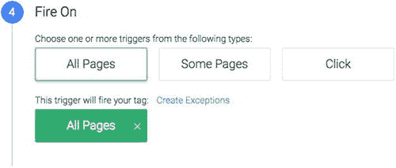

**图 8-1.** 添加阻止触发器

触发器必须始终包含一个推送到数据层的事件。如果选择网页浏览量的触发器类型，则会使用内置的`gtm.js`事件。如果选择点击、表单或其他自动事件选项，则会使用相应的自动事件标签（如`gtm.click`等，参见第 5 章）。如果你指定自定义条件，则需要说明触发器应阻止哪个或哪些事件。

> **提示：** 在许多情况下，触发触发器和阻止触发器会作用于同一事件，例如：“在所有网页浏览时触发，但 URL 包含`/blog`的网页浏览除外”。然而，有时你可能希望基于某个变量来阻止所有事件（网页浏览、点击等）。例如：“在 X（任何触发器）发生时触发，但 GTM 处于预览模式时除外”。在这种情况下，你可以使用自定义事件触发器，并指定一个正则表达式`.*`（匹配任何内容），以便在任何事件发生时阻止。然后，你可以将此触发器作为阻止触发器复用于多种不同类型的代码触发触发器。本章将给出多个示例。

#### 在代码中覆盖默认值

在 GA 代码中，一些字段会自动填充，包括页面和引荐来源 URL、广告系列信息（参见第 9 章）等。但是，如果需要，你可以使用“更多设置” ➤ “要设置的字段”来覆盖这些值（见图 8-2）。

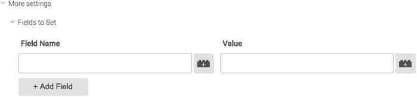

**图 8-2.** 使用“要设置的字段”覆盖 GTM 中 GA 代码的值

你之前已经使用过这些设置来让 GA 执行非默认操作，例如设置跨域跟踪（参见第 2 章）或为虚拟网页浏览创建 URL 标签（参见第 5 章）。任何时候，当你希望手动覆盖 GA 默认使用的某个字段值时，都可以使用“要设置的字段”。

每个字段通过名称指定，你需要提供一个值（通常是变量）来使用。下拉菜单中有一长串可用的字段。本章及本书后续章节将讨论其中的几个，你可以在 GA 文档中找到完整列表。

### GA：过滤器与视图

接下来，让我们看看如何在 GA 中修改数据。

回想一下第 1 章，你网站的跟踪代码对应于 GA 中的一个媒体资源。每个媒体资源可以有一个或多个视图，这些视图是针对该网站的不同数据桶。

创建视图非常简单，只需在谷歌分析“管理”标签页最右侧列的视图下拉菜单中选择“创建新视图”即可（见图 8-3）。请注意，视图从创建之时起开始累积来自媒体资源的数据，但不会追溯填充历史数据。

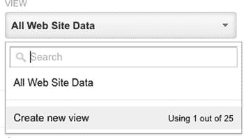

**图 8-3.** 创建新视图

过滤器允许你从视图中包含或排除特定数据（例如，仅包含网站的某一部分，或排除你自己的员工在网站上的互动）。它们还可以让你修改数据（例如清理 URL 格式或其他信息）。

在视图的设置中（最右侧列），你可以看到“过滤器”被列为选项之一（见图 8-4）。每个视图可以应用不同的过滤器，从而产生不同的数据集。你可以在该列表中查看已应用于该视图的任何现有过滤器。从该列表中选择一个过滤器可以对其进行编辑或从视图中移除。

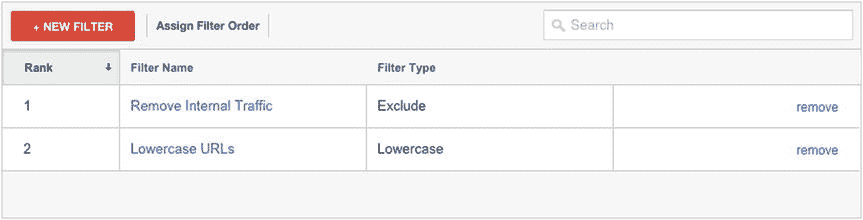

**图 8-4.** GA 管理设置中视图的过滤器列表

可以通过以下两种方式之一将过滤器添加到视图：

*   将帐户中的现有过滤器应用于该视图。

*   创建一个新过滤器并应用于该视图。

过滤器创建后存储在帐户级别。这意味着你可以创建一个过滤器，并将其应用于帐户内的任意多个视图。（这也意味着用户需要拥有帐户级别的“编辑”权限才能创建新过滤器。）你可以在“管理”区域的“帐户”列（最左侧列）下的“所有过滤器”中查看帐户中的所有过滤器，并在此处快速将过滤器应用于多个视图。

要应用现有过滤器或创建新过滤器，请选择过滤器列表顶部的按钮。你可以选择应用一个或多个现有过滤器，或创建一个新过滤器（见图 8-5）。

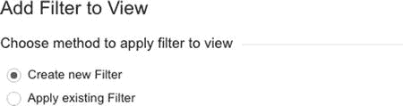

**图 8-5.** 为视图创建过滤器

#### 过滤器的类型

创建新过滤器时，你有两个主要选择：

*   预定义过滤器涵盖了几种常见用例，带有易于使用的下拉菜单来定义过滤器选项。

*   自定义过滤器提供更多灵活性，并允许使用正则表达式匹配模式。

## 预定义过滤器

预定义过滤器通过一系列下拉菜单，让你指定在视图中包含或排除哪些数据，涵盖了一些常见用例，例如排除某个 IP 地址，或仅包含网站的特定子目录。（本章稍后你将看到这两个示例。）

## 自定义过滤器

对于更复杂的需求，自定义过滤器提供了多种选项（见图 8-6）。

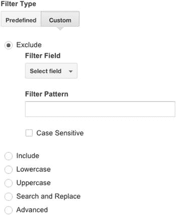

**图 8-6.** 自定义过滤器类型和选项

首先，自定义过滤器有若干不同的类型：

- **排除**：排除与正则表达式匹配的数据

- **包含**：仅包含与正则表达式匹配的数据

- **小写**：将字段中的字母字符转换为小写

- **大写**：将字段中的字母字符转换为大写

- **搜索和替换**：在字段中查找正则表达式匹配项，并将其替换为文本

- **高级**：在一个或两个字段中查找正则表达式匹配项，并重新排列这些字段中的文本

本章稍后，你会看到每种过滤器类型在实际应用中的使用情况。当你选择其中一种过滤器类型时，你会看到 GA 提供的用于过滤的字段下拉列表非常长（见图 8-7）。

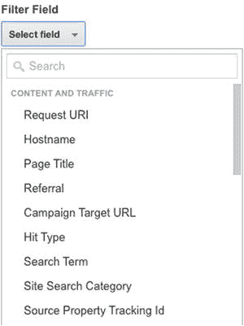

**图 8-7.** 过滤器中可用的字段（部分列表）

此列表包含你可能预期的所有字段，但有一点小挑战：此列表中使用的字段名称，与 GA 报告中相应维度的命名有时并不完全匹配。例如，此菜单包含了`Request URI`，这与 GA 报告中简单称为`Page`的维度是同一个东西。在阅读本章示例时，你会看到此列表中几个最常用的、可能有用的字段；如果你不太确定哪个字段是正确的，GA 文档中有完整的说明。

所有允许你在字段中匹配值的过滤器类型（`包含`、`排除`、`搜索和替换`、`高级`）都使用正则表达式作为输入。这使你既可以做到非常具体（一个确切的值），也可以做到非常宽泛（多个值，或跨值的某种通用模式），按需选择。

**注意**：在正则表达式中，像点号（`.`）和问号（`?`）这样的字符具有特殊含义。然而，有时它们也会出现在你正在匹配的字符串中（例如，考虑一个像 `/alice.html?potion=drink-me` 这样的 URL）。你需要小心，对于任何你想用作原义字符的特殊正则表达式字符，请在其前面加上反斜杠（`\`）。需要反斜杠才能被视为普通字符的字符有：`.?+*(^$`

### 测试和排查 GA 中的视图和过滤器

对于在`GTM`中进行的更改，你可以使用`GTM`的预览模式和其他浏览器工具来检查发送给`GA`的数据（见[第 4 章）。但是，对于在`GA`中使用视图和过滤器所做的更改呢？这些更改是在数据接收后应用的，因此基于浏览器的测试工具对你没有帮助。

在`GA`的管理界面中进行任何更改的关键特性是，它们仅从你进行更改的那一刻起生效。更改不会追溯性地影响视图中报告的数据。这对测试更改有着重要影响。假设你向一个视图添加了一个过滤器，之后（一小时、一天、一周）你发现有一个输入错误，不小心过滤掉了本不想过滤的内容。没有办法在视图数据中追溯性地撤消此操作。你可以修正过滤器中的拼写错误，这将修复之后的数据，但在这错误数据存在的中间一小时、一天或一周内，数据保持错误。

考虑到这个限制，为了帮助测试和排查过滤器及其他视图配置设置，你还需要创建以下视图：

- 一个`未经过滤的视图`，用于排查和备份。如果你正在过滤掉流量，如果没有一组未经过滤的数据进行比较，你怎么知道你移除了什么？一个未经过滤的视图为你提供了一个比较点。创建此视图，并且不对其应用任何过滤器。未经过滤视图的另一个优点是作为备份：如果出现问题，你不小心丢失了一些数据，你总可以查阅未经过滤的视图。

- 一个或多个`测试视图`，用于测试对过滤器和其他视图配置设置的更改，并确保它们正常工作。这样，你有一个地方可以尝试更改，即使犯了错误也不会有不良后果（因为你实际上并不使用这些测试视图中的数据进行工作）。

当然，这些视图是除了你实际用于网站报告和分析的任何视图之外的额外视图。

**提示**：如果你是从零开始搭建一个网站，请在`GA`中设置网站的同时创建这些视图，这样数据可以追溯回最初。如果你接手的是一个之前已经设置好的网站，请立即创建这些视图，以便它们开始收集数据，在你后续进行更改和更新时为你提供帮助。

一旦你创建了测试视图，就可以用它来尝试管理设置中的配置更改，然后查看测试视图报告中的数据，确保它们符合你的预期。

由于`GA`中的数据通常按天报告，且更改仅对未来生效，因此一天之中进行的更改可能会导致当天的数据是混合的（包含更改前后的数据）。为了清晰判断过滤器是否正常工作以及数据是否“干净”，你通常需要等到第二天。这个过程通常如下：

1.  在测试视图中对过滤器或其他视图配置设置进行更改。

2.  等到下一个日历日的某个时间。

3.  检查`GA`中的相关报告，将日期范围更改为当天。

4.  更改是否正确？

    -   如果一切看起来没问题，请将相同的过滤器或更改应用到报告视图中。

    -   如果不对，则从第 1 步开始重复此过程。

**注意**：对于某些类型的数据，你或许可以使用实时报告查看新应用过滤器的效果，但这些报告并未全面覆盖`GA`中的数据类型，并且可能难以用于比较两组数据。

### 划分内部流量

最常见的需求之一是将网站流量区分为内部用户流量和一般公众流量，即你对其网站行为感兴趣的客户和潜在客户。内部用户的行为与客户截然不同，他们被排除在你的营销活动目标之外，并且通常从事网站功能测试。尽管这些活动的数据可能对你有用，但其用途与外部用户的活动数据不同，因此你希望能够将它们分开。

接下来的部分将探讨与此挑战相关的两个主要主题：

- 移除（或分离）内部用户的流量，以避免“污染”你的客户数据。

- 处理用于开发、测试和预发布的多个网站版本，以确保测试活动与你的在线活动网站保持分离。

### 剔除内部流量

“内部流量”包括你所在组织的员工，以及代表你进行网站维护工作的第三方人员，例如广告代理商或网站开发者。通常情况下，这些人员对网站的使用并不属于外部用户——即你的真实受众——的范畴，因此你需要将其排除或分离出来。

有多种不同的方法可以识别并屏蔽这些内部流量（在`GTM`或`GA`中通过 IP 地址进行，或者在`GA`中通过服务提供商进行），你将在接下来的章节中了解这些方法。不同组织对内部流量的定义和处理方式各不相同，因此请评估所有可用选项，以确定最适合你情况的方法。

**注意：** 这些方法都无法做到绝对完美：你的员工有时会出差、在家办公，或处于其他难以将其识别为“内部”人员的情况。请尽力而为，但应预期到无论如何总会有部分数据泄露。

#### 使用 IP 地址

如果你打算针对特定 IP 地址来排除内部流量，有两种可选方案：

-   在`GTM`中为`GA`代码添加一个屏蔽触发器。这可以阻止你的网站发送任何与内部 IP 地址相关的数据。

-   在`GA`中为某个数据视图应用过滤器。这可以让你排除内部流量，同时仍能将内部流量的数据收集到`GA`的未过滤视图中。

如果你的唯一目标是排除内部流量，那么这两种方法都适用。然而，在很多情况下，你可能希望在`GA`的某些视图中仅保留内部流量。例如，假设你运营一个大学网站，并希望根据 IP 地址创建分别针对校内和校外流量的数据视图。在这种情况下，你需要通过`GTM`收集所有 IP 地址的数据，然后在`GA`的数据视图中进行数据过滤（即后一种方法）。

**侧边栏：在非 GA 代码中屏蔽内部流量**

尽管本书主要关注如何在`GTM`中使用`GA`代码，但在`GTM`中使用屏蔽触发器来处理内部流量的方法同样适用于通过`GTM`部署的其他代码。你希望将内部流量排除在其他衡量工具之外，尤其是广告追踪和定向工具。（例如，完全没有必要向自己员工进行营销！）

与`GA`类似，其他工具通常也具备基于 IP 地址或其他特征来过滤或剔除内部流量的能力。但如果需要在每个工具中都单独进行此操作，那将非常麻烦。通过在`GTM`中设置一组屏蔽触发器，你就可以用一种集中的方式来阻止所有你想对内部流量禁用的代码被触发。并且，如果你的 IP 地址发生变化或需要更新，只需在一个地方修改即可。

无论你是在`GA`中还是在`GTM`中分离内部流量，首先你需要知道哪些 IP 地址需要被过滤掉。虽然你可以查询自己的 IP 地址（在谷歌中搜索“我的 IP 地址是什么”即可搞定），但仅凭此你无法得知以下信息：你办公室网络中的所有设备是共享一个独立 IP 还是共享一个 IP 地址段、其他办公地点是否存在额外 IP 地址、以及有关你内部网络的其他细节。你需要从 IT 部门的网络专家那里获取一份全面的 IP 地址列表或地址段，才能可靠地滤除内部流量。

**注意：** 通常一个设备同时拥有内部 IP 地址（由你网络的路由器分配）和外部 IP 地址（路由器在公共互联网上的地址）。你需要使用外部 IP 地址才能在`GA`或`GTM`中进行过滤。内部 IP 地址通常以`10`、`172`或`192`开头，因此如果你收到的列表中包含这些 IP 地址，请再次询问，并务必明确要求提供外部地址。

现在让我们来看看通过 IP 地址排除流量的两种不同方法，首先从在`GTM`中设置屏蔽触发器开始。`GTM`本身没有内置的 IP 地址变量，且该值无法仅通过 JavaScript 获取，因此你需要为`GTM`提供一种访问该值的方法。最自然的做法就是将其直接添加到数据层声明中：

```
dataLayer = [{ 'ipAddress': '93.184.216.34' }];
```

使用任一种服务器端编程语言都可以非常简单地实现这一点。

**注意：** 尽管将 IP 地址作为自定义维度传递给`GA`可能很诱人，但请不要这样做。IP 地址被视为潜在的个人身份信息，禁止包含在`GA`的报告中。（关于自定义维度的更多信息，请参阅第 11 章。）

**在`GTM`中通过 IP 地址阻止数据发送**

首先，你需要一个用于存储 IP 地址的变量。假设它已经按照前述方法存在于数据层中。

在`GTM`中，创建一个新变量。对于变量类型，选择“数据层变量”。对于数据层变量名称，输入`ipAddress`（或者你在数据层中为 IP 地址使用的任何标签）。保存此变量，并为其命名：“IP Address”。

现在您可以基于`{{IP Address}}`变量创建一个触发器。对于触发器类型，需要使用正则表达式匹配所有事件，因为您希望匹配页面浏览量、自动事件触发器以及发生的任何其他事件。

在`GTM`中创建一个新触发器。对于事件，选择“自定义事件”。对于事件名称，选中“使用正则表达式”复选框并输入`.*`（如下面的截图所示）。

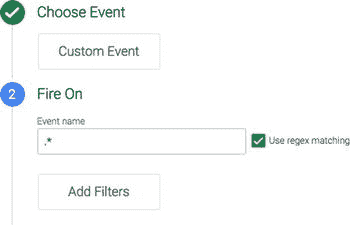

选择“添加过滤器”以应用条件。对于条件，选择`{{IP Address}}`变量以及适当的条件和值，以排除特定的一个或多个 IP 地址（如下面的截图所示）。如果只有一个 IP 地址，“等于”可能是合适的选项；如果要匹配一个范围，可以使用“匹配正则表达式”。

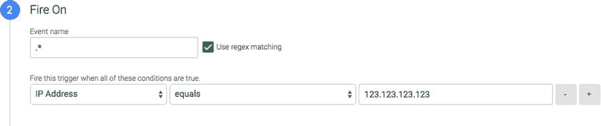

保存触发器，将其命名为“Blocking – Internal IPs”。如果您要排除多个 IP 地址，可以重复上述步骤创建多个触发器。现在您终于可以应用此触发器来阻止标签了。

在 GTM 中选择您的 GA 页面浏览量标签（或任何其他标签）进行编辑。选择“触发条件”编辑标签的触发器。选择“创建例外”。选择您之前创建的 `Blocking – Internal IPs` 触发器。如果您创建了多个阻塞触发器（用于多个 IP 地址），可以选择多个触发器。保存对标签的更改。

别忘了预览并发布对容器的更改，以便新的阻塞触发器生效。

接下来，我们来看看使用 IP 地址的第二种方法——在 GA 中使用过滤器。GA 会自动捕获 IP 地址，因此无需在数据层中为该值设置变量。此外，GA 不仅允许您排除一个或多个 IP 地址，还允许您在视图中仅包含内部流量。

## 在 GA 中按 IP 地址过滤流量

您将在单个视图上创建一个过滤器，但创建后，可以将其应用到任意多个视图。

在 GA 的管理区域中，选择相应的账号、媒体资源和视图，然后点击第三列的“过滤器”以查看该视图的过滤器。选择“新建”按钮以添加新过滤器。选择创建一个新过滤器（而不是应用现有过滤器）。将过滤器命名为 `Exclude Internal IPs`。对于简单的情况（精确 IP、以特定值开头的 IP），您可以使用预定义过滤器；对于多个值或范围，可以使用自定义过滤器来编写正则表达式：

*   选择“预定义”选项卡，使用下拉菜单排除来自某个 IP 地址的流量（参见下面的截图）。“等于”或“开头为”都是非常有用的选项（分别适用于单个 IP 地址和整个 IP 地址段）。

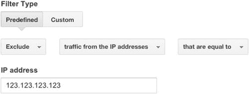

*   或者，选择“自定义”选项卡。选择“排除”作为过滤器类型，选择“IP 地址”作为字段。然后，输入要排除的 IP 地址的正则表达式（参见下面的截图）。

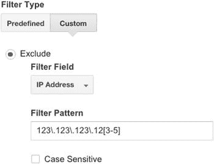

保存过滤器。

请记住，此过滤器仅影响未来的数据。此前从该 IP 地址收集的数据不会受到影响。

如果您希望创建一个仅包含内部流量的视图，只需在此过滤器中将其从“排除”更改为“包含”即可。

`提示`：GA 会先获取该媒体资源的完整数据集，然后应用过滤器来确定剩余的数据。这意味着应用多个排除过滤器是有意义的（例如，同时排除两个不同的 IP 地址）。然而，对同一个字段应用多个包含过滤器则没有意义——包含意味着仅包含。所以，如果您说“仅包含 IP 地址 A”，然后又说“仅包含 IP 地址 B”，结果数据中将不包含任何内容。相反，您必须在单个过滤器中使用正则表达式来匹配多个值。

现在您已经创建了这个过滤器，可以将其应用到任意多个视图。

## 使用服务提供商

Google Analytics 包含另一个有时对过滤内部流量有用的标签：一个名为“服务提供商”的维度。“服务提供商”维度根据用户的 IP 为用户的互联网服务提供商提供一个标签。

对于许多消费者和一些企业，列出的互联网服务提供商将是他们访问互联网的电信公司（电话或电缆公司）。然而，较大的企业、机构和政府机构可能会被列为他们自身 IP 地址段的服务提供商。在这些情况下，您可以在 GA 中使用过滤器来处理服务提供商标签。这种方法的优点是您无需知道 IP 地址范围或使用正则表达式来表达它们。

您可以在 GA 的“受众群体”>“技术”>“网络”报告中查看您的组织是否被列为自己的服务提供商（参见图 8-8）。

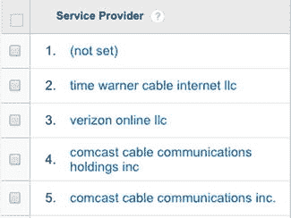

图 8-8. 服务提供商

请注意，许多条目是电信提供商，但您也可能在这里看到自己的公司。使用报告顶部的搜索功能搜索您组织的名称，看看是否能找到自己。（同时尝试使用您组织名称的各种缩写，并注意如果您有多个办公地点或子公司，它们可能会出现在多个条目中。）如果您组织的名称出现在这里，您可以创建一个 GA 过滤器来排除内部流量。（没有找到？请参考上一节关于基于 IP 排除的内容。）

## 在 GA 中使用按服务提供商排除流量的过滤器

在 GA 的管理区域中，选择相应的账号、媒体资源和视图，然后点击第三列的“过滤器”以查看该视图的过滤器。选择“新建”按钮以添加新过滤器。选择创建一个新过滤器（而不是应用现有过滤器）。将过滤器命名为 `Exclude Internal Service Provider`。选择“自定义”选项卡。选择“排除”作为过滤器类型。选择“ISP 组织”作为字段（这是过滤器字段下拉菜单中命名不佳的一个例子，与 GA 中的维度名称相比：这里叫“ISP 组织”，在 GA 报告中叫“服务提供商”）。输入一个正则表达式以匹配服务提供商的值（参见下面的截图）。

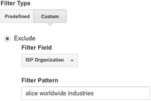

保存过滤器。

请记住，此过滤器仅影响未来的数据。此前从该 IP 地址收集的数据不会受到影响。

如果您希望创建一个仅包含内部流量的视图，只需在此过滤器中将其从“排除”更改为“包含”即可。

现在您已经创建了这个过滤器，可以将其应用到任意多个视图。

## 隔离测试环境与生产环境

在许多情况下，你可能已经处理了在 GA 中排除内部流量的问题（参见本章前一节），这通常包括你的员工或代理机构对网站的测试。然而，你可能希望能够单独查看此类测试流量，以确保一切运行正常——在网站新内容或功能上线前收集相关测试数据，确保它们按预期运行并记录数据。

你的具体设置将取决于你的环境以及你希望如何查看数据。为了便于举例，我们假设你拥有以下环境：

*   `dev.aliceswonderlandresorts.com`
*   `staging.aliceswonderlandresorts.com`
*   `www.aliceswonderlandresorts.com`

你希望将开发和预发布站点中杂乱的内部测试数据，与生产站点上用于分析网站内容和营销的优质、简洁的面向客户数据分隔开。为此，你可以为开发和预发布站点在 GA 中创建额外的媒体资源，并使用 GTM 将数据路由到正确的媒体资源。下一节将详细介绍这个过程。

还有另一种你需要考虑的测试流量：当你使用 GTM 的预览模式（参见第 4 章）对线上生产网站（本例中为 `www.aliceswonderlandresorts.com`）上的代码和触发器更改进行测试时。你可能也想将这些数据分隔到另一个媒体资源中。后面的章节也会讨论这种情况。

### 使用查找表在 GTM 中划分流量

早在第 3 章中，你创建了一个 `{{GA Property ID}}` 变量，用于保存 GTM 中 GA 代码的媒体资源 ID。当时这看起来可能过于复杂（难道不能直接粘贴 ID 值吗？）。然而现在，你将能够用一个新的变量替换该变量，这个新变量会考虑到你的需求：根据代码位于开发站点、预发布站点还是生产站点来更改媒体资源 ID。

GTM 中有一个变量类型叫做查找表。它允许你为输入变量提供多个条件，从而产生不同的输出变量。在本例中，你需要使用 `{{URL Hostname}}` 的值，在你的 GA 媒体资源 ID 之间更改变量的值（参见表 8-1）。

**表 8-1.** 示例网站测试版和开发版的媒体资源

| 主机名 | GA 媒体资源 ID |
|---|---|
| `dev.aliceswonderlandresorts.com` | `UA-12345-2` |
| `staging.aliceswonderlandresorts.com` | `UA-12345-3` |
| `www.aliceswonderlandresorts.com` | `UA-12345-1` |

让我们逐步操作。

#### 使用查找表变量划分测试站点

让我们将现有的 `{{GA Property ID}}` 变量更改为查找表。

1.  在 GTM 中编辑 `{{GA Property ID}}` 变量。
2.  选择类型，将其从“常量”更改为“查找表”。
3.  作为输入变量，选择内置变量 `{{Page Hostname}}`。
4.  在表中添加一行。在输入中，输入一个主机名，例如 `dev.aliceswonderlandresorts.com`。注意：查找表仅支持完全匹配。避免在输入值中使用正则表达式。

5. 在输出中，输入你希望将对应站点数据路由到的 GA 媒体资源 ID。
6. 重复添加行，直到添加了所有开发、测试、预发布等站点的主机名（参见下面的截图）。

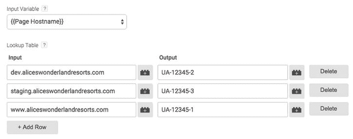

7. （可选）通过勾选复选框并输入一个 GA 媒体资源 ID 来设置默认值。默认值将用于任何与表中任何行都不匹配的主机名。
8. 保存变量。

无需更改代码，因为它们已经使用了这个现有的变量。测试并发布容器，即可开始将你的测试流量路由到不同的媒体资源。

查找表在需要将一个值转换为另一个值的许多情况下都很有用。在本例中，你将主机名转换成了 GA 媒体资源 ID。然而，对于你的生产网站，你还有另一种类型的测试活动：在发布前使用 GTM 的预览模式来测试代码。

你也想捕获此活动，但将其与其余的生产站点数据分开（如表 8-2 所示）。你可以额外添加一个查找表来进一步分隔。让我们看看如何操作。

**表 8-2. 示例站点的测试流量路由，包括 GTM 调试模式**

| 主机名 | 条件 | GA 媒体资源 ID |
|---|---|---|
| `dev.aliceswonderlandresorts.com` | | `UA-12345-2` |
| `staging.aliceswonderlandresorts.com` | | `UA-12345-3` |
| `www.aliceswonderlandresorts.com` | 处于调试模式？ | `UA-12345-4` |
| `www.aliceswonderlandresorts.com` | 未处于调试模式？ | `UA-12345-1` |

## 使用查找表变量划分预览模式

首先，你将创建一个额外的查找表来分隔预览模式。

1. 如果尚未启用，请启用内置变量 `{{Debug Mode}}`。当 GTM 处于预览模式时，此变量值为 `true`。
2. 创建一个新变量。选择类型为“查找表”。
3. 作为输入变量，选择 `{{Debug Mode}}` 变量。
4. 在表中添加一行。在输入中，输入 `true`。
5. 在输出中，输入当 GTM 处于预览模式时，你希望将对应站点数据路由到的 GA 媒体资源 ID。
6. 通过勾选复选框并输入一个 GA 媒体资源 ID 来设置默认值，当 GTM 不处于预览模式时，数据将被路由至此。
7. 保存变量，并为其命名：`GA Property ID – Preview Mode`。

现在，你可以在总的 `{{GA Property ID}}` 变量中使用此值，该变量在上一节中已被更改为查找表。

1. 编辑 `{{GA Property ID}}` 变量。
2. 选择“配置变量”以编辑表格。
3. 在包含线上/生产网站（本例中为 `www.aliceswonderlandresorts.com`）的行中，将输出替换为 `{{GA Property ID – Preview Mode}}` 变量。

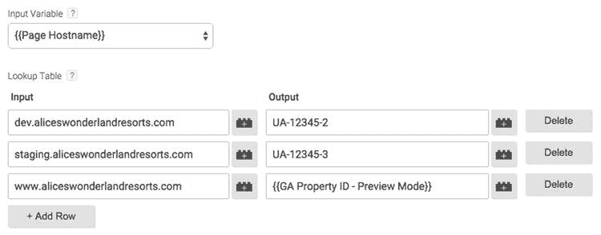

4. 保存对变量的更改。

发布此容器后，GTM 将继续像以前一样路由开发和预发布网站的流量。现在，对于线上网站，如果处于预览模式，它将路由到测试媒体资源，而线上生产数据则继续路由到主媒体资源。

## 清理与分组内容

URL 仅仅是谷歌分析（GA）捕获的众多信息之一，但它们往往是最杂乱的部分。在理想情况下，你的网站应拥有符合以下条件的 URL：
- 易于理解并按逻辑层级分组，
- 不包含无关或不必要的信息，
- 能够唯一代表单个页面。

通常，你无法完全控制网站上 URL 的结构和格式（例如，由于使用了特定软件或历史原因）。在很多情况下，你需要在网站上处理那些为机器而非人类设计的 URL。默认情况下，谷歌分析会捕获浏览器地址栏中显示的 URL，且保持其原样。在 GA 的报告中，这些 URL 会被拆分为两个维度：
- `主机名`，包含域名（不包括协议和标点符号，例如 `http://` 或 `https://`）
- `页面`，包含 URL 的其余部分，包括路径和查询参数，但不包含片段标识符。

因此，举例来说，在以下 URL 中，GA 针对 `主机名` 和 `页面` 维度会显示如下值：
`http://www.aliceswonderlandresorts.com/going/down/?hole=rabbit#lateness`
- 主机名：`www.aliceswonderlandresorts.com`
- 页面：`/going/down/?hole=rabbit`

由于 GA 会原样捕获 URL 中的这些片段，你的数据中可能会出现不理想的不一致情况：一个 URL 的多种变体都对应着网站上本质相同的页面。这些不一致可能包括大小写、查询参数等方面的差异。本节将逐一审视这些问题及处理它们的一些最佳实践，同时也会介绍将 URL 归组的方法，例如按主题类别或内部搜索结果页面进行分组。

**重要提示：** 对 URL 的更改也可能影响基于这些 URL 的目标转化。在通过过滤器对 URL 进行更改后，请务必根据需要更新你的目标配置（参见第 6 章）。

### 强制统一 URL 大小写

从技术上讲，URL 是区分大小写的。也就是说，`http://example.com/jabberwock` 和 `http://example.com/JabberWock` 不一定指向同一个页面。然而，在实践中，网站几乎不会这样使用 URL；通常，你的网络服务器或内容管理系统会提供相同的页面，而不论其大小写。

但是，由于 GA 仅按原样捕获 URL，它可能会在报告中显示同一 URL 的不同大小写形式（见图 8-9）。

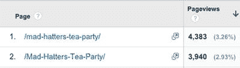

**图 8-9. GA 报告中不一致的 URL**

这非常不方便——如果你只想知道有多少人浏览了该页面，你就得自己进行算术运算。你更希望报告中每个页面都有一个统一的条目，无论其大小写如何。为此，你可以在谷歌分析中对这些数据应用一个过滤器。

#### 使用过滤器将 URL 转换为小写

1. 在 GA 的管理区域中，选择相应的账户、媒体资源和数据视图后，点击第三列的 `过滤器` 查看该视图的过滤器。选择 `新建` 按钮添加一个新过滤器。
2. 选择创建一个新过滤器（而不是应用现有过滤器）。
3. 为过滤器命名：“小写 URL”。
4. 选择 `自定义` 标签。选择 `小写` 作为过滤器类型。
5. 选择 `请求 URI` 作为字段。（这是过滤器字段下拉菜单与 GA 中维度名称不匹配的另一个例子：在这里是 `请求 URI`，在 GA 报告中则是 `页面`。）
6. 保存过滤器。

请记住，此过滤器仅影响之后的数据。过去收集的包含混合大小写 URL 的数据将不受影响。

**提示：** 小写过滤器对于任何可能在某环节涉及人为输入错误的字段都很有用。这包括 URL 的两个部分（`请求 URI` 和 `主机名`）以及广告系列字段（参见第 9 章）。你应该在 GA 报告中查看这些值，并考虑应用小写过滤器以提高一致性。

### 默认 URL

URL 一致性的另一个问题涉及默认页面。对于你的首页或网站上子目录的默认页面，浏览器通常可以通过多个 URL 访问同一页面。例如，你的首页可能通过以下任一 URL 访问：
- `http://www.aliceswonderlandresorts.com/`
- `http://www.aliceswonderlandresorts.com/index.html`

**注意：** 结尾可能因你的内容管理系统和网络服务器而异：`index.html`、`index.php`、`default.aspx` 等。请检查你的网站以了解其实际使用的文件。

这样一来，你的报告又会遇到问题（见图 8-10）。

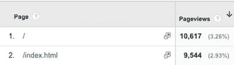

**图 8-10. GA 报告中不一致的默认 URL**

与上一节描述的大小写问题类似，你必须将这些行相加才能了解该特定页面的实际浏览次数。幸运的是，你也可以在 GA 中解决这个问题。根据你希望统一成哪个版本的 URL，有两种选择：
- 有一种视图设置，可以将 `index.html`（或任何适当的文件）附加到以斜杠结尾的 URL 末尾。

- 你可以使用过滤器来移除`index.html`（或任何适当的文件），仅保留尾部斜杠。

你偏好哪种方式主要取决于你希望在报告中看到页面列表的样式选择。

## 使用视图设置将默认页面附加到 URL

GA 提供了一种设置，可以自动将文本附加到任何以尾部斜杠结尾的 URL 末尾。

1. 在 GA 的管理区域中，选择相应的账户、媒体资源和数据视图后，点击第三列的`视图设置`编辑该视图的设置。
2. 向下滚动到`默认页面`设置项。
3. 输入你想附加到任何以尾部斜杠结尾的 URL 末尾的文本。（不要包含斜杠。）
   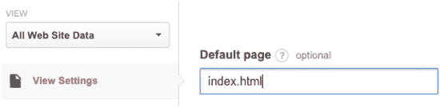
4. 保存对设置的更改。

请记住，此设置仅影响之后的数据。过去为 URL 收集的数据将不受影响。

## 使用过滤器从 URL 中移除默认页面

1. 在 GA 的管理区域中，选择相应的账户、媒体资源和数据视图后，点击第三列的`过滤器`查看该视图的过滤器。选择`新建`按钮添加一个新过滤器。
2. 选择创建一个新过滤器（而不是应用现有过滤器）。
3. 为过滤器命名：“移除 `index.php`”（例如）。
4. 选择`自定义`标签。选择`搜索和替换`作为过滤器类型。
5. 选择`请求 URI`作为字段。
6. 在搜索字符串中，输入一个正则表达式来匹配你想要移除的模式。这可能很简单，如 `index\.html`，或者如果存在多种可能，则使用更复杂的模式——例如 `(index|default)\.(php|html?)`。
7. 在替换字符串中，留空（表示替换为无）。
8. 保存过滤器。

请记住，此过滤器仅影响之后的数据。过去收集的 URL 中包含`index.php`的数据将不受影响。

### 查询参数

URL 中“查询字符串”或“查询参数”部分是指问号之后的内容：

`http://www.aliceswonderlandresorts.com/reservation.php?status=completed&sort=az&sessionid=123456`

查询参数由等号连接的名值对组成，多个参数之间用与号分隔。有时，它们能告诉你关于页面内容或用户选择的非常有价值的信息（`status=completed`），但其他时候它们并不重要（`sort=az`），甚至对你的数据有害（`sessionid=123456`）。

为了解查询参数如何搅乱你的页面数据，请考虑最后一个示例 `sessionid`。Web 服务器有时会使用会话 ID 或访客 ID 来跟踪用户在一个流程中的状态。这个数字由 Web 服务器内部使用，但你并不关心它，而且它对于每个浏览器会话都是不同的。这就像你之前遇到的大小写问题，但现在 URL 不再只有两种写法，而是有数百甚至数千种！（见图 8-11。）
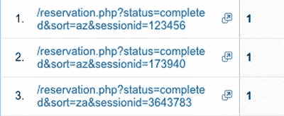
**图 8-11.** 查询参数值可能导致同一 URL 产生多种变体

幸运的是，你可以移除希望去掉的查询参数。GA 中有一个视图设置，允许你从 URL 中移除查询参数，这样你就可以看到一个一致的 URL，仅保留你希望保留的查询参数。或者，如果你想移除所有查询参数，可以使用一个简单的过滤器。

> **提示**
> 有时，为网站设置多个视图，并对查询参数应用不同的设置或过滤器可能是有意义的。例如，一个视图可以保留更详细的查询参数信息，用于更具体的报告（当你确实想知道用户是按 A 到 Z 还是 Z 到 A 排序时），而另一个视图则可以移除这些参数，以便更好地获取页面级别的高层信息。

在开始之前，你需要一份希望消除的查询参数列表。你感兴趣的查询参数部分是名称（即等号之前的部分）——例如，示例 URL 中的 `status`、`sort` 或 `sessionid`。如何编制这个列表？如果你在 GA 中已有数据，那是一个起点。（将页面导出到电子表格，并使用公式根据 `?`、`&` 和 `=` 等分隔符拆分查询参数可能会很有帮助。）查阅你的内容管理系统或其他用于管理网站的软件的文档，也可以帮助你了解查询参数及其使用方式。

一旦你确定了希望消除的查询参数列表，就可以移除它们了。

> **提示**
> 你可能会遇到的一种查询参数是与内部网站搜索相关的参数。例如，在 `http://aliceswonderlandresorts.com/searchresults.php?q=hats` 中，查询参数 `q=hats` 可能表示用户使用你的网站搜索功能搜索了“hats”一词。不要使用过滤器或视图设置移除这些参数——它们是有价值的信息，GA 有专门的一组报告来处理它们（之后你也可以将它们从 URL 中剥离）。你将在本章稍后的部分看到具体方法。

#### 使用视图设置移除特定查询参数

GA 提供了一个视图设置，允许你选择性地从 URL 中移除查询参数。

1. 在 GA 的管理区域中，选择相应的帐号、媒体资源和视图，然后点击第三列中的“视图设置”来编辑视图设置。
2. 向下滚动到“排除 URL 查询参数”设置。
3. 输入你想要排除的查询参数名称，用逗号分隔。注意，不应输入与号、等号或其他分隔符，只需输入查询参数名称。
   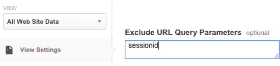
4. 保存对设置的更改。

请记住，此设置仅会影响未来的数据。之前收集的包含 URL 中查询参数的历史数据不会受到影响。

#### 使用过滤器移除所有查询参数

此过滤器会移除 URL 中问号字符（`?`）之后的所有内容。

1. 在 GA 的管理区域中，选择相应的帐号、媒体资源和视图，然后点击第三列中的“过滤器”来查看该视图的过滤器。
2. 选择“新建”按钮以添加新过滤器。
3. 选择创建一个新过滤器（而不是应用现有过滤器）。
4. 为过滤器命名：“移除所有查询参数”。
5. 选择“自定义”标签页。选择“搜索和替换”作为过滤器类型。
6. 选择“请求 URI”作为字段。
7. 在“搜索字符串”中，输入以下正则表达式：`\?.*`
8. 在“替换字符串”中，留空（以替换为空）。
9. 保存过滤器。

> **警告**
> 此过滤器会移除 URL 中问号字符之后的所有内容。请确保你至少还有一个包含完整、未过滤 URL 的其他视图，以备不时之需。

请记住，此过滤器仅会影响未来的数据。之前收集的包含 URL 中查询参数的历史数据不会受到影响。

### 捕获 URL 片段

你可能已经注意到，在之前的示例或你的 GA 数据中，GA 中的“页面”维度包含了 URL 的路径和查询字符串（在本示例中以粗体显示），但不包含片段（哈希标记之后的部分）：

`http://www.aliceswonderlandresorts.com`**`/tea-party/index.html?location=wonderland`**`#agenda`

片段（在本示例中为 `#agenda`）通常用于链接到页面的特定部分。GA 默认会丢弃片段。如果你想捕获它，可以在 GTM 中使用一个变量来获取，并将附带了片段的默认页面 URL 进行覆盖。具体方法如下。

> **注意**
> 如果 URL 片段的变化是由 AJAX 应用程序引起的，请参阅第 5 章及其关于历史监听器的信息，以触发标签来捕获该信息。此处描述的示例仅用于在页面 URL 中捕获片段，以便在现有标签被触发时记录。

#### 使用 GTM 变量捕获 URL 片段

首先，您需要设置一个变量来获取 URL 片段。

1. 在 GTM 中创建一个新变量。
2. 选择“URL”作为变量类型。
3. 选择“片段”作为组件。
4. 保存变量，并为其命名：“页面 URL 片段”。

现在，您可以修改 GA 网页浏览标签，以在 URL 中包含片段。

5. 在 GTM 中，编辑“GA – 网页浏览”标签。
6. 选择“配置标签”以更改 GA 标签设置。在“要设置的字段”部分，添加一个新字段。
7. 从下拉菜单中选择“page”作为字段名称。
8. 对于字段值，您将构建一个新的 URL，其中包含内建的`{{Page Path}}`变量和您刚刚创建的`{{Page URL Fragment}}`变量：`{{Page Path}}#{{Page URL Fragment}}`
   

> **注意**
> 如果没有片段，请注意此标签仍会在 URL 末尾附加 `#`。您可以轻松地在 GA 中使用“搜索和替换”过滤器来移除末尾的 `#`（如果不存在片段的话）。您也可以在 GTM 中巧妙地使用变量来处理这种情况。

9. 保存对标签的更改。

发布这些更改后，GTM 将在发送给 GA 的每个页面 URL 中包含片段。

## 查看子域名与跨域的主机名

第 2 章和第 3 章讨论了如何设置 GA 跟踪代码，通过共享 cookie 将子域名或跨域视为单一网站。但正如你所见，GA 的`页面`维度仅包含 URL 路径，而不包含主机名。虽然存在单独的`主机名`维度，但在基础的、开箱即用的报告中（例如“行为”>“网站内容”>“所有页面”报告），当存在多个域名时，并没有很好的方法来判断各页面归属于哪个站点（见图 8-12）。

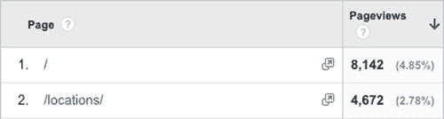

图 8-12. “所有页面”报告未指明页面所在的域名或子域名

你可以在 GA 中使用过滤器，将主机名值添加到`页面`维度的前面，这样这些报告就变得更易于解读（见图 8-13）。

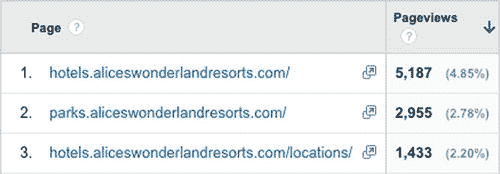

图 8-13. 添加过滤器（将主机名包含在 URL 中）后的“所有页面”报告

你将使用高级过滤器类型（图 8-14）来实现此目的，本章之前的示例中尚未介绍这种过滤器类型。高级过滤器允许你获取 GA 中的两个不同字段（字段 A 和字段 B），从中提取信息，并将这些信息输出到一个字段（输出字段）。

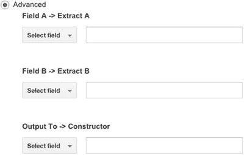

图 8-14. GA 中的高级过滤器设置

字段 A 和字段 B 各接受一个正则表达式。正则表达式中用括号括起来的任何部分都会捕获该字段的相应内容，以便在输出中使用。输出字段可以包含文本，也可以引用从字段 A 和字段 B 中捕获的信息的变量。这些变量看起来类似`$A1`，其中`$`是变量的标识符，`A`指代字段 A，`1`指代该正则表达式中第一组括号。

通过这种方式，你可以将两个字段的数据合并到一个字段中，这正是你希望对 URL 的主机名和路径所做的操作。让我们一起来操作一遍。

### 使用 GA 过滤器将主机名前置到 URL

在 GA 的管理区域中，选择相应的帐号、媒体资源和数据视图后，点击第三列中的“过滤器”，即可查看该数据视图的过滤器。点击`新建`按钮添加新过滤器。

- 选择创建一个新过滤器（而不是应用现有过滤器）。
- 为过滤器命名：“为 URL 前置主机名”。
- 选择`自定义`标签。选择`高级`作为过滤器类型。（有关高级过滤器如何工作的更多信息，请参阅本章前面关于跨域跟踪的示例。）
- 对于字段 A，在下拉菜单中选择`请求 URI`。输入正则表达式`(.*)`。这将选取`请求 URI`字段的全部内容，将其括在括号中可让你稍后在输出中使用它。
- 对于字段 B，在下拉菜单中选择`主机名`。输入正则表达式`(.*)`。这将选取`主机名`字段的全部内容，将其括在括号中可让你稍后在输出中使用它。
- 对于输出字段，选择`请求 URI`（因为你想要用你的版本覆盖现有的 URL）。输入`$B1$A1`。`$B1$A1`回调了之前的字段。`$B1`选取字段 B 中的第一组括号（主机名），`$A1`选取字段 A 中的第一组括号（URL 路径）。由于你直接将它们连写在一起，没有空格或标点，它们在 GA 报告中的显示效果将会是例如[`www.aliceswonderlandresorts.com/page.html`](http://www.aliceswonderlandresorts.com/page.html)的形式。

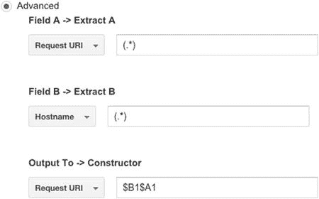

勾选“字段 A”、“必需 B”和“覆盖输出字段”复选框。

- 保存过滤器。

请记住，此过滤器只会影响之后的数据。过去的 URL 在报告中不会改变。

## 站内搜索

几乎每个网站都有让用户搜索网站内容的方式。根据网站类型的不同，此搜索可能用于查找文章、产品或任何可用的信息类型。GA 在“行为”>“站内搜索”下有一组专门衡量用户所执行的搜索及其找到答案的成功率的报告（见图 8-15）。

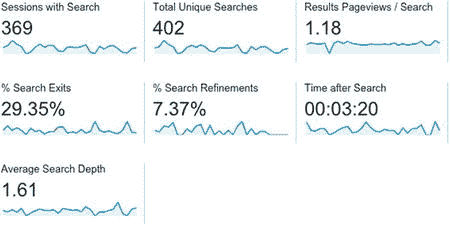

图 8-15. GA 中的站内搜索报告

要启用这些报告，你需要告诉 GA 在哪里可以找到关于用户搜索内容的信息。网站的搜索可能属于以下三种情况：

- 搜索词包含在查询参数中。例如，搜索“帽子”可能会导致类似如下的 URL：`http://www.aliceswonderlandresorts.com/searchresults.php?q=hats` 这是 GA 的默认假设，许多网站搜索引擎都是如此。这可以通过 GA 中的一个数据视图设置轻松完成。
- 搜索词包含在 URL 中，但不在查询参数中：[`http://www.aliceswonderlandresorts.com/search/hats`](http://www.aliceswonderlandresorts.com/search/hats) 使用 GA 中的过滤器，你可以将“hats”这个词从 URL 中提取出来，并将其放入适当的字段（`搜索词`维度）。
- 搜索词根本不包含在 URL 中：[`http://www.aliceswonderlandresorts.com/searchresults.php`](http://www.aliceswonderlandresorts.com/searchresults.php) 在这种情况下，由于搜索词不是 URL 的一部分，你需要在 GTM 的跟踪代码中捕获该搜索词。

除了搜索词之外，GA 还可以选择性地捕获一个类别，该类别通常代表一种将搜索限制或限定在网站内容子集的方式。与搜索词类似，这可以表示在查询参数、URL 中的其他信息中，或者不在 URL 中。在 URL 中，类别可能类似于以下 URL 中的`color`参数：

`http://www.aliceswonderlandresorts.com/searchresults.php?q=hats&color=violet`

让我们看看每种情况的设置过程。

### 使用查询参数设置站内搜索

假设你的搜索结果 URL 看起来像`/searchresults.php?q=hats&color=violet`，其中“hats”是搜索词。

在 GA 的管理区域中，选择相应的帐号、媒体资源和数据视图后，点击第三列中的`数据视图设置`，即可查看该数据视图的设置。

- 在底部标有`站内搜索设置`的部分，开启站内搜索跟踪。
- 指定在 URL 中何处查找站内搜索词：输入查询参数的名称。在此示例中，它是`q`。请注意，你不需要输入“与”符号（&）、等号或其他分隔符，只需输入查询参数的名称。
- （推荐）勾选复选框，从 URL 中去除此查询参数。一旦这些数据进入站内搜索报告，你就不需要在 URL 中看到它了。

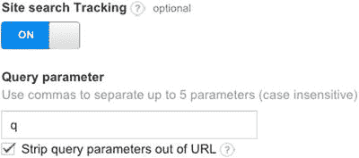

- （可选）通过开启站内搜索类别并输入查询参数，来指定在 URL 中何处查找站内搜索类别。在示例 URL 中，类别是`color`。
- 保存对设置的更改。

请记住，此设置只会影响之后的数据。之前使用站内搜索参数收集的数据不会回填到站内搜索报告中。

### 在 URL 中包含信息时设置站内搜索

假设你的搜索结果 URL 看起来像`/search/hats`，其中“hats”是搜索词。以下是使用过滤器将该值从 URL 中提取并放入适当字段的方法。

在 GA 的管理区域中，使用适当的账户、媒体资源及数据视图，选择第三列中的“过滤器”以查看该数据视图的过滤器。点击“新建”按钮以添加一个新过滤器。选择创建新过滤器（而非应用现有过滤器）。为该过滤器命名：“Site Search Term”。选择“自定义”选项卡。选择“高级”作为过滤器类型。（有关高级过滤器的工作原理，请参阅本章前面的跨域跟踪示例。）对于“字段 A”，从下拉菜单中选择“请求 URI”。输入一个正则表达式以提取 URL 中的搜索词部分（将要提取的 URL 部分括在圆括号中）。在此示例中，您可以使用以下表达式：`^/search/(.*)`。将“字段 B”留空。本过滤器不需要第二个字段。对于“输出”，选择“搜索词”。输入与搜索词对应的字段 A 变量；在此示例中为：`$A1`。

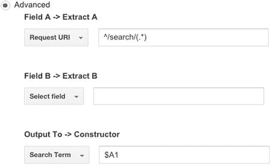

勾选“字段 A 必需”和“覆盖输出字段”复选框。保存过滤器。

请记住，此过滤器仅影响未来的数据。过去的数据将不会被回溯填充到网站搜索报告中。

与上一节中使用查询参数的设置类似，您也可以通过此方法捕获类别（如果适用于您的网站搜索）。创建另一个过滤器，选择“网站搜索类别”作为字段，并修改正则表达式以匹配 URL 的相关部分。

### 使用 GTM 捕获网站搜索信息

在最后一种场景中，搜索结果页面的 URL 类似于`/searchresults.php`，网站搜索信息完全不包含在 URL 中，因此您必须通过其他方式提供。您可以将此信息包含在数据层声明中：
```javascript
dataLayer = [{ 'searchTerm': 'hats' }];
```
首先，为此信息创建一个数据层变量。然后，您可以覆盖 GA 网页浏览标签中捕获的默认 URL，以包含此信息。

**注意**：或者，可以使用 DOM 元素变量从页面内容中提取搜索词。但是，正如第 5 章中所讨论的，基于页面内容的变量可能受布局和外观变化的影响，因此，在可能的情况下，首选数据层变量。

在 GTM 中，创建一个新变量。对于变量类型，选择“数据层变量”。对于数据层变量名称，输入`searchTerm`（或您在数据层中用于搜索词的其他标签）。保存该变量，并将其命名为“Search Term”。现在，您可以创建一个标签，使用此变量来扩充发送给 GA 的搜索结果页面 URL。在 GTM 中，复制“GA – 网页浏览”标签。您可以通过选择该标签进行编辑，然后选择右下角的“复制”按钮来复制标签。选择“配置标签”以修改 GA 标签设置。在“要设置的字段”部分，添加一个新字段。从下拉菜单中选择`page`作为字段名称。对于字段值，您将构造一个新的 URL，其中包含内置的`{{Page Path}}`变量中的网站搜索词和刚刚创建的`{{Search Term}}`变量：`{{Page Path}}?q={{Search Term}}`。

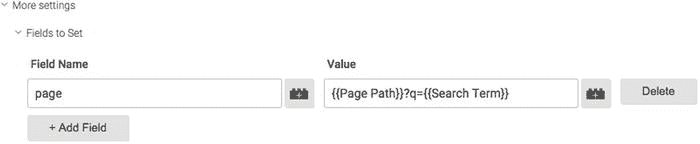

选择“触发条件”以修改标签的触发器。移除“所有页面”触发器。您只希望此标签在搜索结果页面上触发。选择“部分页面”。创建一个名为“仅限搜索结果页面”的新触发器，其中页面 URL 与您的搜索结果页面 URL 匹配。在此示例中：`{{Page URL}}` – 等于 – `/searchresults.php`。

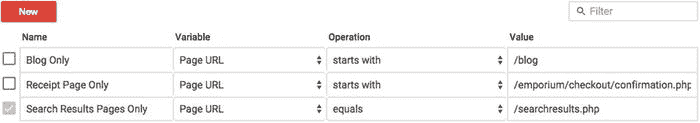

保存该标签，并命名为“GA – 网页浏览 – 搜索结果”。

**注意**：由于您创建了一个仅针对搜索结果页面触发条件的特定网页浏览标签，您还需要将此触发条件作为常规 GA 网页浏览标签的阻止触发器添加，以避免重复计数。

在将此更改发布到 GTM 容器后，您的搜索结果页面将向 GA 发送类似于`/searchresults.php?q=hats`的 URL。至此，您可以像本部分前面讨论的那样，使用`q`作为查询参数设置，继续执行相同的设置。

### 分组内容

在上一节中，您了解了多种清理 URL 的方法，使其能够精确对应页面，而无需聚合 URL 的各种变体。有时，您还需要在更高级别对页面进行分组：按类别、页面类型或其他分类。

GA 提供了多种工具来解决此问题。有时，分组可以从 URL 的结构中明显看出：

- `http://aliceswonderlandresorts.com/hearts/queen/`

- `http://aliceswonderlandresorts.com/hearts/king/`

- `http://aliceswonderlandresorts.com/spades/ace/`

- `http://aliceswonderlandresorts.com/clubs/deuce/`

在这种情况下，“内容深入分析”报告（位于“行为” ➤ “网站内容”）会根据这些子目录对 URL 进行分组（参见图 8-16）。您可以在该报告中深入查看最多四级子目录。

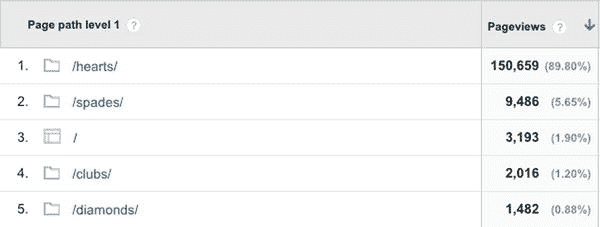

**图 8-16.** 使用“内容深入分析”报告按子目录对 URL 分组

在其他情况下，您可能希望根据 URL 中的其他信息（例如查询参数）或 URL 中完全不存在的信息进行分组。您可以使用 GA 中名为“内容分组”的功能来实现此目的。

内容分组是在数据视图中创建的。每个数据视图最多可以有五个内容分组——也就是说，最多可以有五组不同的页面分类集（每个分组内的类别数量不限）。有用的内容分组方式将取决于您的站点及其包含的内容类型，但常见的内容分组类型包括：

- 按主题或产品类别

- 按内容类型或页面模板（着陆页、文章页面、产品页面等）

- 按作者、发布日期或其他内容元数据

- 按页面内容的属性（字数、是否包含视频等）

创建内容分组后，它们可用于在“行为” ➤ “网站内容” ➤ “所有页面”报告（参见图 8-17；以及其他以“页面”为主要维度的报告）以及导航报告（如“行为流”报告）中对页面进行分组。

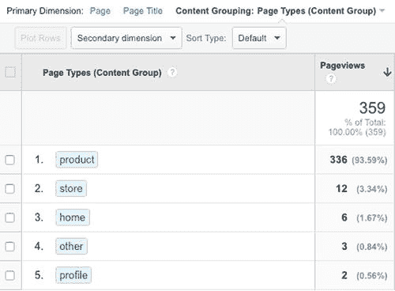

**图 8-17.** GA 报告中的内容分组（此处为“所有页面”报告）

内容分组可以通过三种方式定义：通过提取、通过规则定义以及通过跟踪代码。提取和规则定义允许您基于页面的 URL 或标题（或自定义维度；参见第 11 章）的模式进行分组，而跟踪代码选项则允许基于您提供的类别（通常在数据层中提供）进行分组。以下各节将结合实际使用场景的示例，说明每种内容分组方式。

### 通过提取进行分组

提取使用正则表达式从页面的 URL 或标题（或自定义维度）中提取分组名称。例如，在以下 URL 中，您可能希望提取产品类型（`hats`、`teacups`等）：

`http://aliceswonderlandresorts.com/products?type=hats&id=123`

`http://aliceswonderlandresorts.com/products?type=teacups&id=456`

`http://aliceswonderlandresorts.com/products?type=croquet&id=789`

关键在于编写一个正则表达式来匹配这种模式，并只捕获您想要的 URL 部分。需要捕获的部分用括号表示。在这种情况下，以下正则表达式可能满足您的需求：

`/products?type=([^&]*)`

请记住，GA 的`Page`维度不包含主机名，因此您可以从以`/products`开头的 URL 路径开始。`[^&]`匹配所有不是与号（&）的字符，而`*`表示匹配 0 个或多个这样的字符。

不过，您需要小心：如果类别参数并非总是第一个参数会怎样？考虑这样一个 URL：

`/products?id=123&type=hats`

您希望正则表达式尽可能具体，但又不过度。为了匹配前面可能出现的各种情况，更好的正则表达式选择如下：

`type=([^&]*)`

现在，无论`type`参数出现在 URL 中的哪个位置，您都可以捕获其值。

请注意，使用提取方法时，您需要在 URL 中指定内容组标签出现的位置，但无需指定标签本身。标签已经存在于 URL 中，此模式将匹配 URL 中出现的所有不同类别名称。

提示

前面展示的正则表达式模式在通过提取创建内容组时特别有用。它被称为“字符类否定”：`[^something]`，最常用于匹配 URL 中的与号、斜杠和其他常见分隔符，以匹配除所列字符之外的所有字符。

#### 通过提取设置内容分组

根据前面的示例 URL，让我们设置一个通过提取实现的内容分组。

-   在 GA 的管理区域中，选择相应的帐号、媒体资源和数据视图，然后在第三列中选择`内容分组`，以查看该视图的内容分组。

-   点击添加新内容分组的按钮。

-   为内容分组输入名称（即报告中此类别集合将显示的标签）：“产品类别”。

-   选择按**提取**分组。在本示例中，选择`Page`作为维度。

-   输入正则表达式：`category=([^&]*)` 请注意，您要提取的部分应包含在括号内。

-   选择`保存`以保存内容分组。

新的内容分组将立即可用于报告的下拉菜单中。但内容组中的类别仅从创建该内容分组的时间点起，对所收集的页面数据生效。

### 通过规则定义分组

与提取方法类似，规则定义也使用页面的 URL 或标题（或自定义维度）。与提取方法不同，规则定义并不仅仅是从 URL 或标题中截取一段内容。相反，规则定义允许您根据字段内容创建一组有限的规则。

假设您有以下 URL：

`http://aliceswonderlandresorts.com/hearts/queen/`
`http://aliceswonderlandresorts.com/hearts/king/`
`http://aliceswonderlandresorts.com/spades/ace/`
`http://aliceswonderlandresorts.com/clubs/deuce/`

如果您想按花色（`hearts`、`spades`等）对这些 URL 进行分组，通过提取可以轻松实现。但如果您想按颜色分组呢？红心和方块应为红色，黑桃和梅花应为黑色，但“红色”和“黑色”并未出现在 URL 中的任何位置。规则定义可以解决这个问题。您可以设置如下规则定义：

**红色：**
- `Page` – 包含 – `hearts` – 或
- `Page` – 包含 – `diamonds`

**黑色：**
- `Page` – 包含 – `spades` – 或
- `Page` – 包含 – `clubs`

匹配方式有多种选项——包含、开头是等——并且标准可以通过逻辑`或`和`与`进行组合。规则按照指定的顺序应用，第一个匹配的规则将用作该页面在内容组中的标签。

请注意，与提取不同，您需要在规则定义中明确指定所有可能的标签。在此示例中，`红色`和`黑色`将是唯一可能分配的类别，任何不包含“`hearts`”、“`diamonds`”、“`spades`”或“`clubs`”的 URL 将不会被分配到任何类别（在 GA 报告中会显示为“（未设置）”的值）。

### 通过规则定义设置内容分组

根据前面的示例 URL，让我们设置一个通过规则定义实现的内容分组。

1. 在 GA 的管理区域中，选择相应的帐号、媒体资源和数据视图，然后在第三列中选择`内容分组`，以查看该视图的内容分组。
2. 点击添加新内容分组的按钮。
3. 为内容分组输入名称（即报告中此类别集合将显示的标签）：“花色颜色”。
4. 选择按**规则定义**分组，并选择添加新规则集的选项。
5. 在本示例中，将规则集命名为“红色”。对于第一个条件，选择`Page`作为维度。
6. 选择`包含`作为匹配选项。
7. 输入`hearts`作为要匹配的文本。
8. 选择`或`来添加第二个条件，然后重复之前的步骤，选择“`Page` 包含 `diamonds`”。
9. 选择`完成`以完成第一个规则集。
10. 添加另一个名为“黑色”的规则集，并重复上一步骤，设置“`Page` 包含 `spades`”或“`clubs`”。
11. 选择`保存`以保存内容分组。

新的内容分组将立即可用于报告的下拉菜单中。但内容组中的类别仅从创建该内容分组的时间点起，对所收集的页面数据生效。

### 按跟踪代码分组

在前两种方法中，内容分组都是基于 URL 中包含的信息或 GA 中已有的其他数据。然而，在某些情况下，您可能希望根据其他信息进行分组。考虑以下 URL：

[`http://aliceswonderlandresorts.com/blog/2015/09/22/guide-rules-flamingo-croquet/`](http://aliceswonderlandresorts.com/blog/2015/09/22/guide-rules-flamingo-croquet/)
[`http://aliceswonderlandresorts.com/blog/2015/10/25/wheres-that-cat/`](http://aliceswonderlandresorts.com/blog/2015/10/25/wheres-that-cat/)
[`http://aliceswonderlandresorts.com/blog/2015/11/13/red-queen-proclamation/`](http://aliceswonderlandresorts.com/blog/2015/11/13/red-queen-proclamation/)

这种结构在博客或新闻文章中非常常见。如果您要查找发布日期，使用正则表达式（参见前文）即可轻松提取。但如果您想根据文章作者或文章长度进行分组呢？

基于跟踪代码的分组允许您通过在页面标签中提供具有正确标签的 GTM 变量来提供标签。此变量的来源通常有以下两种选择：

* **数据层变量**：用于来自网站内容管理系统或其他来源的信息。在前面的示例中，内容管理系统知道文章的作者，因此您可以在页面的数据层声明中包含该信息：`dataLayer = [{ 'author': 'Alice' }];` 这种方法可用于任何在页面渲染时，可从内容管理系统或其他来源获得的元数据。
* **自定义 JavaScript 变量**：用于检查条件或进行计算。在前面的示例中，如果您想根据文章长度创建内容分组，可以编写一些 JavaScript 代码来查找页面的文章部分，按空格和其他标点符号进行拆分，测量长度，并将其分类为不同区间（例如 0-100、101-200 等）。类似地，自定义 JavaScript 变量可以检查文章中的图片、视频或其他媒体文件的存在与否或数量，或者任何存在于页面内容中或可从页面内容计算出的其他信息。

**警告**

尽管内容分组是在 GA 的每个视图中设置的，但按跟踪代码进行的内容分组将应用于该媒体资源的所有视图（因为所有数据都来自该媒体资源同一组跟踪代码，您只能在该位置提供一个值）。请规划好您将如何在单个媒体资源的各个视图中使用五个内容分组中的每一个，以确保不会在任何地方发生冲突。

### 设置按跟踪代码进行内容分组

首先，您将在 GA 中设置内容分组。

1. 在 GA 的管理区域中，选择相应的帐号、媒体资源和视图，然后在第三列选择**内容分组**以查看该视图的内容分组。
2. 选择添加新内容分组的按钮。
3. 为内容分组输入一个名称（即报告菜单中显示的这组分类的标签）：“作者”。
4. 选择“按跟踪代码分组”。将**启用**设置设为**开**。
5. 从索引下拉菜单中选择您要使用的插槽（1-5）。
6. 保存内容分组。

接下来，您需要在 GTM 中创建一个包含内容分组分类名称的变量。此示例假设您使用的是数据层变量，但您也可以使用自定义 JavaScript 变量。

1. 在 GTM 中创建一个新变量。
2. 选择类型为**数据层变量**。
3. 输入`author`作为名称（此为示例；请使用您在数据层中使用的任何名称）。
4. （可选）通过勾选复选框并输入一个值来设置一个默认值。否则，如果数据层未指定分类，该值将为空，GA 报告将显示“（未设置）”。
5. 保存该变量，并为其命名：“作者”。

最后，您就可以修改 GA 的页面浏览量标签以包含内容分组了。

1. 在 GTM 中，编辑**GA – 页面浏览量**标签。
2. 选择**配置标签**以修改 GA 标签设置。在**内容组**部分，添加一个新的内容组。
3. 对于索引，输入您在 GA 中创建分组时选择的索引编号（1-5）。
4. 对于**内容组**，输入您刚刚创建的`{{Author}}`变量。
5. 保存该标签。

当您将更改发布到 GTM 容器后，每个页面的内容组数据都将传递给 GA。新的内容分组会立即作为报告下拉菜单中的一个选项出现，但从该内容分组创建之时起，仅有之后的数据才会填充分类信息。

### 过滤器的其他应用

前文介绍了使用过滤器及其他设置来清理 GA 数据的一些最常见应用，以及使用 GTM 捕获额外信息的大量变通方法。过滤器有许多潜在的用途，但前面的示例涵盖了大部分常见用例。

过滤器的另一个最常见用途是创建仅包含网站数据子集的视图。这在网站各部分之间运营或营销相对独立时尤为有用。例如，如果不同产品线或品牌有各自的营销团队，每个团队可能希望拥有一个仅包含其管辖网站部分数据的视图。这样他们就可以按照对自己最有利的方式对该视图的数据进行过滤和分组，并设置相关的转化目标（参见第 6 章）。

**注意**

请记住，每个媒体资源的基本视图数量限制为 25 个。对于 Google Analytics Premium 订阅用户，在某些情况下也可能为其他 GA 用户提高此限制。

将网站划分为此类功能区域的最常见方式是依据子目录或（子）域名：

* **子目录**：您希望将[`www.aliceswonderlandresorts.com/hotels/`](http://www.aliceswonderlandresorts.com/hotels/) 和 [`www.aliceswonderlandresorts.com/amusement-parks/`](http://www.aliceswonderlandresorts.com/amusement-parks/) 划分到不同的视图中。

## 过滤器类型

- **（子）域名**：您希望将[`hotels.aliceswonderlandresorts.com`](http://hotels.aliceswonderlandresorts.com) 和 [`parks.aliceswonderlandresorts.com`](http://parks.aliceswonderlandresorts.com) 划分到不同的视图中。
GA 为这些情况预定义了过滤器类型（参见图 8-18 和图 8-19）。

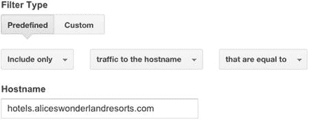
**图 8-19.** 预定义过滤器，用于包含某个域名或子域名

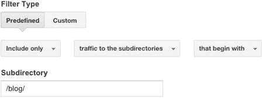
**图 8-18.** 预定义过滤器，用于包含某个子目录

如果需要更复杂的标准来指定视图中的页面或主机名，则可以将自定义的 `包含` 过滤器与正则表达式结合使用。

### 筛选视图 vs. 细分

GA 的报告界面包含一个名为 `细分` (Segments) 的功能。从表面上看，在报告中应用 `细分` 似乎与筛选视图的功能大同小异：你可以根据一长串维度和指标条件，在 `细分` 中包括或排除会话。那么，何时应该在报告中使用 `细分`，又何时应该在视图上使用 `筛选` (filter) 呢？

在可能的情况下，优先选用 `细分` 而非 `筛选`。它们在 GA 报告中内置了易于理解的界面。无需掌握正则表达式知识，维度与指标名称与报告中的一致，并且创建和应用 `细分` 无需管理员的视图访问权限。最有用的是，作为一个报表内功能，`细分` 可以应用于视图中已有的历史数据。

然而，正如你在本章中所见，在某些情况和能力上，`筛选` 具有 `细分` 无法比拟的优势（例如重写字段值）。如果存在你始终希望排除的数据（如内部流量），需要为清洗目的而更改的数据，或者出于功能原因需要在不同视图中创建独立数据集（如前所述），`筛选` 就是合适的工具。

## 总结

- Google Analytics 和 Google 跟踪代码管理器包含多种工具，可帮助你清洗数据，使其尽可能有用，包括 GA 中的 `筛选` 和视图设置，以及 GTM 中的拦截触发器和覆盖默认值。
- 与 GA 和 GTM 中的所有更改一样，在将这些工具应用到用于报告和分析的数据之前，进行测试非常重要。在 GA 中，由于更改仅影响后续数据，因此谨慎使用测试视图和未筛选视图来尝试和比较结果至关重要。
- 数据清洗最常见的需求包括：移除内部流量、标准化和整理 URL。有多种方法可以使用 GTM 和 GA 中的工具，适用于不同的情况，同时还有一些专门用于处理特定类型内容（如网址查询参数和片段、站内搜索结果网址）的工具。

脚注
[1](https://developers.google.com/analytics/devguides/collection/analyticsjs/field-reference)
[2](https://support.google.com/analytics/answer/1034380)