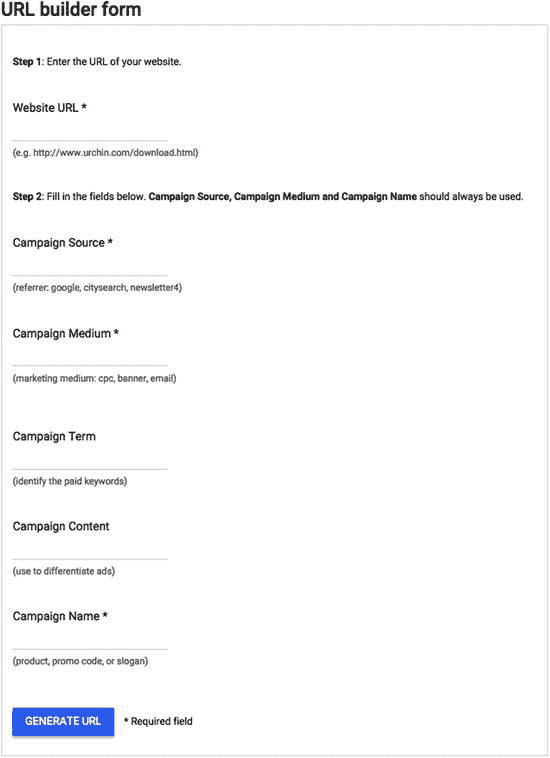
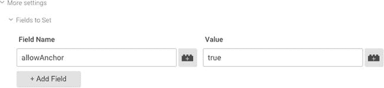
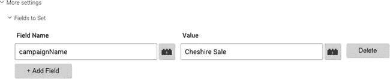
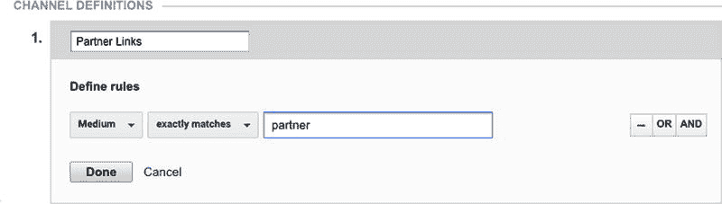
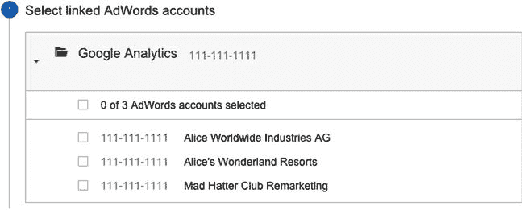
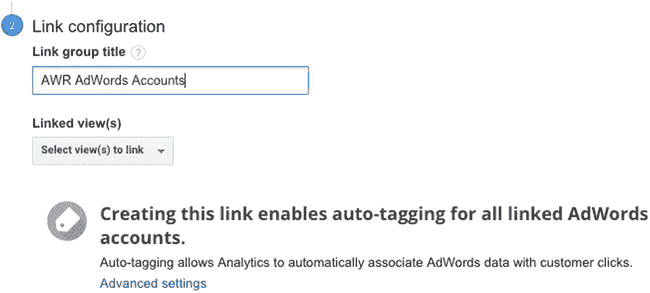
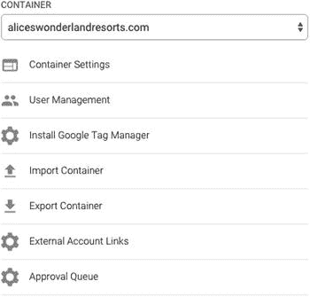
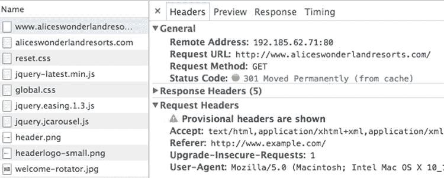
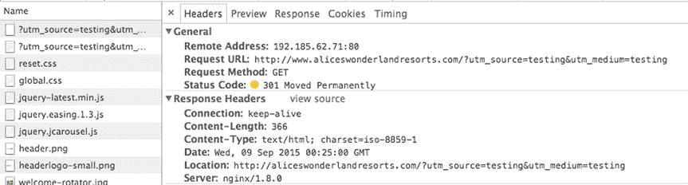
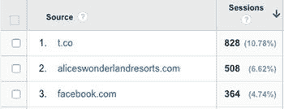

# 9. 衡量广告活动与排查流量来源问题

> 就在这时，爱丽丝跟着它掉下去了，根本没考虑过自己究竟怎样才能再爬出来。——刘易斯·卡罗尔，《爱丽丝梦游仙境》

Google Analytics 拥有一整套 `流量获取` (Acquisition) 报告，专门用于对用户访问网站的流量来源进行分类。他们来自搜索引擎、社交媒体网站的链接，还是付费广告？本章将探讨 GA 收集的关于流量来源的数据，以及如何通过 GA 中的设置和 GTM 中的工具来影响这些数据。

## GA 中的流量来源

在用户会话的首次匹配中，GA 会查看浏览器的 `引荐来源` (Referrer) 值（前一个页面的 URL），以确定用户是从哪里来到网站的。基于这个值，它会为 `流量获取` 报告中使用的两个维度 `媒介` (Medium) 和 `来源` (Source) 赋值。`媒介` 代表流量的通用类别或类型，而 `来源` 则指定该类别中的具体网站。

GA 默认将流量分为以下几种媒介和来源：

- 自然搜索流量：`媒介`为 `organic`，`来源`为搜索引擎的名称（如 Google、Bing、Yahoo 等）。这种流量来自搜索引擎网站。

- 引荐流量：`媒介`为 `referral`，`来源`为网站的域名。这种流量来自其他网站（除搜索引擎以外的任何网站）的链接。

- 直接流量：`媒介`为 `(none)`，`来源`为 `direct`。直接流量指没有其他明显来源的流量，通常因为用户输入了网址、使用了书签，或直接使用了 URL。在网页浏览器中打开来自浏览器外部应用程序的 URL 也会被归类为 `direct`。

这些值可以在 `流量获取` ➤ `所有流量` ➤ `来源/媒介` 报告以及 GA 的各个报告中找到。

### 边栏：GA 中的归因

`归因` (Attribution) 是网站分析中的一个术语，指应用一种模型，将对理想行为（例如会话或转化）的功劳归于流量来源。用户通常会通过多个来源多次访问网站，因此有多种方法或模型可用于分配功劳：例如，将全部功劳归于第一个来源，或全部归于最后一个来源，或在所有来源之间平均分配。

GA 会记录每次会话的流量来源。在其所有标准报告中，GA 使用所谓的“最后点击归因”来报告这些流量来源，这意味着用户本次到达网站的方式（最后一次点击）就是该会话将被归因的流量来源。

然而，这个“最后点击”规则有一个重要的例外：如果某个会话的流量来源是 `direct`，GA 会记住之前的流量来源，并将该会话归因于它。本质上，`direct` 永远不会覆盖之前的流量来源。

这背后的逻辑是什么？回想一下，`direct` 流量基本上就是没有关于用户来源的信息。所以这个规则的意思是：如果你上次知道用户是如何到达的，那就不要用无信息的数据覆盖它。

GA“记住”用户先前来源的超时时间是可调整的；默认是六个月。你可以在管理区域的媒体资源设置中找到该设置，路径为 `跟踪信息` ➤ `会话设置`。

如前所述，这个“除直接流量外的最后点击”规则应用于 GA 的所有标准报告。然而，GA 在 `转化` ➤ `多渠道路径` (Multi-Channel Funnels) 下也有一系列报告，可以查看转化前一段时间内每次会话的来源。`归因建模工具` (Attribution Modeling Tool) 允许在不同的归因规则下进行分析，例如首次点击、包括直流的最后点击、所有流量来源的加权分配等。

除了 GA 执行的默认分类之外，你还可以影响这些分类，并提供关于如何标记流量来源以更好地反映你的网站及其受众的额外细节。让我们来看看如何操作。

### 添加自然搜索引擎

GA 默认能识别大量的自然搜索引擎，但如果某个特定的搜索引擎不在该列表中，你可以添加域名，使其被计为搜索引擎（而非引荐来源）。这通常用于以下情况：

- GA 默认列表中没有包含与你的网站相关的特定语言或特定国家的搜索引擎。

- 与你的网站相关的特定行业或其他小众搜索引擎。

你可以通过在 GA 管理区域的媒体资源设置中，于 `跟踪信息` ➤ `自然搜索来源` 下指定搜索结果页面的域名和 URL 模式来添加搜索引擎。添加到该列表后，来自该网站的引荐将被归类为 `organic` 而非 `referrals`，就像来自其他搜索引擎的自然搜索流量一样。

### 忽略特定引荐来源

GA 还提供了忽略特定引荐网站（将其视为直接流量）的功能。这在以下情况中最为常见：

- 某些类型的第三方网站，例如 PayPal。用户离开你的网站，前往 PayPal（完成交易），然后返回你的网站查看最终的确认消息，这是一种典型场景。你并不希望将此次返回统计为来自 PayPal 的引荐。

- 跨域跟踪（将在第 1 章和第 2 章以及本章后面的故障排除部分中进一步讨论）。

你可以在 GA 管理界面中的媒体资源设置下的 `跟踪信息` ➤ `引荐排除列表` 中，指定要视为直接流量的域名。任何来自添加到该列表的网站的引荐都将被视为直接流量。

### 广告系列跟踪

对于你控制的、指向你网站的链接，你可以精确指定你希望 GA 使用的媒介和来源值（以及额外的流量来源维度）。这可能包括多种类型的营销和广告链接：

- 付费搜索和展示广告

- 社交媒体帖子和付费社交广告

- 电子邮件营销中的链接，例如简报或促销

- 合作伙伴或联盟网站的链接

- 线下广告中的链接，例如印刷品、电视或广播

**注意：** GA 只能衡量你网站上的活动以及用户如何到达此处。它并非衡量其他网站活动的工具，例如有多少人在社交网络上点赞或分享了某个链接。其他工具可用于收集这些类型的数据。

能够为这些类型的流量指定你自己的标签非常有用，因为你希望将它们从引荐流量、自然搜索流量和直接流量中区分出来，并能够分析它们的有效性。你可以为多种流量来源维度指定你自己的值：

- `媒介`（先前已讨论）：流量类型的一般类别。常见的值有 `email`、`social`、`display`、`print` 等。

- `来源`（先前也已讨论）：某个媒介内流量的具体来源。通常是另一个网站的域名，例如社交网络或显示广告投放的网站。对于电子邮件，它可能是邮件发送到的列表名称；对于印刷品，它可能是出版物的名称。

- `广告系列`：特定的促销或营销活动。例如，你可能会跨多个媒介和来源推广“春季季票销售”。你希望能够将所有此类流量汇总到单个广告系列下。

- `关键字`（可选）：搜索广告中使用的关键词。

- `广告内容`（可选）：描述广告内容或格式的标签。例如，你可以用此标签来区分具有不同创意内容的多个展示广告，或区分广告的不同尺寸和格式。

`获客` 报告允许你使用这些维度的任意组合来查看流量。

#### 广告系列跟踪网址

那么，如何向 GA 提供你希望用于这些流量来源维度的值呢？

你可以使用广告系列跟踪网址（通常称为 GA 的广告系列标记）来为你希望用于这些维度的值指定参数。（不要被“标记”这个词误导；这些与 GTM 中的标记无关。）你可以在 URL 中包含特定的查询参数，来为这些流量来源维度指定值。以下是一个广告系列跟踪 URL 的示例（为清晰起见，此处分行显示）：

```
http://aliceswonderlandresorts.com/buy-season-tickets/?utm_medium=email&utm_source=Mad%20Hatter%27s%20Club&utm_campaign=Spring%20Season%20Ticket%20Sale
```

这是一个指向落地页的 URL，你会将该链接用于发送给“疯帽子俱乐部”邮件列表（来源）用户的关于春季票务促销（广告系列）的促销电子邮件（媒介）中。请注意，查询参数以 `utm_` 开头，并且（在此示例中）对应于媒介、来源和广告系列维度。与所有查询参数一样，查询字符串的开始由问号（`?`）标示，每个参数都是一个由等号（`=`）分隔的键值对，每个参数之间由与号（`&`）分隔。GA 能识别出与先前所列维度相对应的五个参数：`utm_medium`、`utm_source`、`utm_campaign`、`utm_term` 和 `utm_content`。其中，来源、媒介和广告系列是必需的（或者至少是强烈建议使用的；技术上仅来源是必需的），而关键字和内容是可选的。请注意，提供的值是经过 URL 编码的（例如，空格字符显示为 `%20`）。

**提示：** 无需将所有广告系列值包含在 URL 中，你可以包含单个 `utm_id` 参数，并使用 GA 的数据导入功能来填充其余的值。有关数据导入的更多信息，请参见第 12 章。

GA 提供了一个工具来帮助生成正确格式的 URL（见图 9-1）。



*图 9-1. 用于创建广告系列跟踪网址的网址构建器工具*

这个工具很方便，但需要注意的是，并非必须使用它。只要你以正确的格式提供了参数，当有人点击此链接并访问网站时，GA 就会识别这些值，并将其用于流量来源维度（而不是使用默认记录的任何值）。

### 缩短广告系列网址

广告系列网址可能很长，如果将其用作广告或电子邮件中的目标网址，这没问题。但在社交媒体帖子或印刷品中，当简洁性或可读性很重要时，使用网址缩短器会很有用。

将网址缩短器（如最流行的选项 `bit.ly`）与来自 GA 的、带有广告系列标记的链接一起使用是可以的。只需先添加广告系列参数，然后将带有广告系列标记的网址作为要缩短的链接输入即可。

您也可以使用所谓的“ vanity URL”作为广告系列网址的缩短版本，只需像这样从一个短网址进行重定向：
```
http://aliceswonderlandresorts.com/tickets
```
到一个完整的、带有广告系列标记的网址：
```
http://aliceswonderlandresorts.com/?utm_medium=print&utm_source=brochure&utm_campaign=Tickets
```
（如何实现重定向的详细信息取决于您的内容管理系统和/或 Web 服务器；请查阅相关文档了解详情。请参见本章后面关于与 GA 一起安全使用重定向的一些最佳实践。）对于印刷品或其他线下广告或营销材料，当您希望包含品牌链接时，Vanity URL 尤其有用。当然，不能保证看到广告的人一定会使用该网址（而不是直接访问或使用搜索引擎），但这可以为您提供一些指示，表明用于为您的网站引流的不同线下广告的相对响应情况。

### 避免与广告系列网址冲突

如您之前所见，您可以通过在指向您网站的链接的查询字符串中包含参数来指定流量来源维度。在大多数情况下，网站会简单地忽略它无法识别的查询参数（例如 `utm_` 参数）。但是，在某些内容管理系统或 Web 服务器上，无法识别的参数可能会导致问题或被禁止。具体来说，您应确保您的网站准备好处理以下查询参数：

- `utm_source`、`utm_medium`、`utm_campaign`、`utm_term`、`utm_content`
- `utm_id`（前面提到过，并在第 12 章中针对广告系列数据导入进行了更详细的描述）
- `gclid`、`dclid`（在接下来关于与其他 Google 工具集成的部分中描述）

例如，您的网站不应导致重定向而剥离这些参数。（有关重定向以及如何安全地与 GA 一起使用它们的更多信息，请参见本章后面部分。）

如果由于某种原因需要避免使用查询参数，GA 确实提供了一种替代方案。您可以使用 URL 的片段或锚点字符串部分（`#` 之后的部分）来代替 URL 的查询字符串，以包含广告系列信息。由于 URL 的这一部分由浏览器使用，通常不由服务器解释，因此在您的 Web 服务器或内容管理系统阻止您在 URL 中使用 GA 的广告系列跟踪查询参数的情况下，它是“安全的”。

广告系列跟踪信息的格式相同，但位于 URL 片段中（注意 `#`）：
```
http://aliceswonderlandresorts.com/buy-season-tickets/#utm_medium=email&utm_source=Mad%20Hatter%27s%20Club&utm_campaign=Spring%20Season%20Ticket%20Sale
```
要在 GA 中启用此功能，跟踪代码中有一个名为 `allowAnchor` 的设置。在 GTM 的 GA 网页浏览代码中，您可以在编辑代码时，在“Fields to Set”部分设置此值（参见图 9-2）。



**图 9-2.** 在 GTM 的 GA 代码的“Fields to Set”部分中使用 `allowAnchor`

将此值设置为 `true` 允许您在 URL 片段中使用广告系列标签。

### 使用 GTM 指定广告系列值

有时，您可能不想通过在链接中使用前面描述的 URL 参数来指定广告系列值，而是希望根据您网站的一个或多个页面来指定广告系列参数。这最常用于以下情况：

- **将旧的跟踪 URL 适配到 GA：** 在某些情况下，您可能有一套在您使用 GA 之前就已经存在的标记广告系列网址的系统。您可能使用特定的 URL 模式或查询参数，并希望将其转换为 GA 中相应的广告系列维度。

- **“公开”的链接缺少或有错误的广告系列标签：** 即使尽最大努力勤勉且一致地将广告系列跟踪参数应用于 URL，有时也会出错。在这种情况下，您可以根据着陆页或引荐来源提供广告系列维度的值。

无论出于何种原因，您都可以使用 GTM 来覆盖广告系列维度值。

#### 在 GTM 的 GA 代码中指定广告系列值

让我们看看如何在 GTM 的 GA 代码中覆盖广告系列值。

在 GTM 的“Tags”部分，选择一个 GA 网页浏览代码并选择编辑它。

> **注意：** 通常您不会对所有页面的网页浏览代码进行此更改。您可能只想针对由触发器定义的特定情况（例如，在特定的着陆页 URL 上或针对特定的引荐来源）或基于变量值（例如 URL 中的查询参数）执行此操作。

1.  点击 **Configure Tag** 以修改代码配置。

2.  在 **More Settings ➤ Fields to Set** 中，输入以下内容：对于 **Field Name**，根据您要设置的字段，选择以下选项之一：`campaignMedium`、`campaignSource`、`campaignName`、`campaignKeyword`、`campaignContent` 或 `campaignId`。

3.  对于 **Value**，输入一个固定值或一个 GTM 变量，该变量包含您要使用的值。



> **提示：** 基于页面或引荐来源 URL（或其部分）的变量对于动态创建值非常有用。

4.  为您要设置的每个附加广告系列值重复步骤 3。

5.  选择 **Save Tag** 以保存对代码的更改。

发布后，GTM 现在将使用代码中指定的值覆盖默认的流量来源维度值。

### GA 中的渠道分组

你已经看到 GA 中有许多流量来源维度，包括 `source`、`medium`、`campaign` 等。此外，GA 允许你将这些维度的组合分组为**渠道分组**。渠道分组是一种将流量来源分类到与你对营销和广告活动的理解方式相对应的渠道中的方法。GA 提供了一组默认的渠道分组（你可以在 `Acquisition ➤ All Traffic ➤ Channels` 报告中找到），但你可以根据自身情况进行自定义。

默认渠道分组包括以下渠道：

- **直接流量**：直接流量，其 `Source` 值为 `direct`，`Medium` 值为 `(none)` 或 `(not set)`。
- **自然搜索流量**：来自搜索引擎的自然流量，其 `Medium` 值为 `organic`。

- **社交媒体流量**：来自社交媒体网站的引荐流量，其`Medium`值为`referral`，且`Source`与GA识别的社交媒体网站列表匹配；或`Medium`包含`social`、`social-network`、`social-media`、`sm`、`social network`或`social media`。
- **引荐流量**：来自所有其他（非社交媒体）网站的引荐流量，其`Medium`值为`referral`。
- **电子邮件流量**：来自电子邮件的流量，其`Medium`值为`email`。
- **付费搜索流量**：来自搜索引擎的付费流量，其`Medium`值为`cpc`、`ppc`或`paidsearch`，但`Ad Distribution Network`不能为`Content`。（有关`Ad Distribution Network`等AdWords特有维度的更多信息，请参阅`AdWords`集成说明。）
- **展示广告流量**：展示广告流量，其`Medium`值为`display`、`cpm`或`banner`，或`Ad Distribution Network`值为`Content`。
- **其他广告流量**：`Medium`值为`cpv`、`cpa`、`cpp`或`content-text`。
- **任何不属于这些类别的流量都会被标记为 `(Other)`。**

正如你所见，使用这些渠道分组有助于分类不同的流量类别，例如，从社交媒体网站中提取引荐流量，并将其与来自社交媒体的广告活动标记链接放在一起（从而将通常所说的“赢得”和“自有”社交流量归为一组）。

然而，默认类别可能不足以反映你实际开展的营销和广告类型。示例如下：
- 将`付费搜索`渠道划分为品牌关键词和通用关键词。
- 将`展示广告`渠道划分为基于主题的广告和再营销广告。
- 为`合作伙伴`或`联盟营销`链接创建一个渠道。

GA允许你在“管理”区域修改默认渠道分组或创建全新的分组。你可以在`查看`设置（第三列）下的`渠道设置 ➤ 渠道分组`中找到这些设置。每个渠道分组都基于一组规则（见图9-3）。



图9-3. 创建渠道分组的规则

这些规则按其在渠道分组设置中出现的顺序应用，与一次会话匹配的第一条规则即为该会话应用的标签。任何与会话分组中所有规则都不匹配的会话都会显示值`(Other)`。

对默认渠道分组的更改将应用于之后收集的所有数据，并且不会追溯性地更改历史数据。可以在报告中随意应用新的渠道分组（类似于细分）来查看历史数据（但应用时可能会触发抽样）。

## 流量数据集成

Google提供了GA与其他Google平台之间的多种集成，用于获取流量来源数据。这些集成可以将许多维度和指标导入GA，以丰富交互数据，例如展示次数、点击率和费用。

另外，别忘了GTM不仅可用于GA代码标签，还可用于其他用途——包括广告和营销工具的跟踪和转化代码标签。GTM为Google平台提供了内置的代码标签类型，例如`AdWords`转化和再营销代码标签、`DoubleClick Floodlight`代码标签和`Adometry`代码标签，以及第三方工具代码标签。此外，GTM还提供了与`DoubleClick Campaign Manager`的集成，用于管理创建`Floodlight`代码标签的工作流程。

在接下来的章节中，你将了解GA与GTM以及Google平台和工具之间的集成。

### AdWords（谷歌关键词广告）

`GA`与谷歌的广告平台`AdWords`（谷歌关键词广告）进行了整合，该平台用于在搜索结果和展示网络中投放广告。关联你的`GA`和`AdWords`帐户可启用多项功能：
- **AdWords 目标网址的自动标记**。`AdWords`可以自动应用一个可识别广告的查询参数（`gclid`），而无需像本章前面所述那样手动标记广告系列网址。随后，`GA`会从`AdWords`导入流量来源维度数据，其中媒介为`cpc`、来源为`google`，而广告系列、关键词和广告内容则分别对应`AdWords`中的广告系列、竞价关键词和广告标题。此外，还会导入一系列`AdWords`特有的维度，包括广告组（用于将广告系列中的广告和关键词分组）、匹配搜索查询（根据竞价关键词触发广告的查询）、广告位、展示位置域名（针对展示网络投放）等。
- **将 AdWords 指标导入 GA 报告**。`GA`在`流量获取`部分下包含一组`AdWords`报告，用于导入展示次数、点击次数、点击率（CTR）、费用和每次点击费用（CPC）等指标。结合`GA`中的转化和收入数据（见第6章和第7章），这些数据可用于计算广告支出回报率（ROAS）或每次获取成本（CPA）。将费用数据（来自`AdWords`）和响应数据（来自`GA`）整合到同一组报告中，就能创建一个用于评估广告成本效益的极有价值工具。
- **将 GA 指标导入 AdWords 报告**。`GA`指标（如跳出率）可用于`AdWords`内的报告，并且`GA`的目标和电子商务交易可作为转化数据导入`AdWords`。
- **在 AdWords 中基于 GA 细分创建再营销受众群体**。`GA`中的所有行为数据都可用于创建再营销受众群体（向之前访问过网站或完成过特定操作的用户展示广告）。`GA`精细的细分工具允许你定制想要定位的特定受众行为。`AdWords`受众群体可以在属性设置的管理区域中创建，也可以直接从报告中细分下拉菜单中的现有细分创建。

要获得所有这些优势，你需要将你的`AdWords`和`GA`帐户关联起来。关联是在`AdWords`中的一个帐户与`GA`中的一个属性之间进行的。由于网站及其与`GA`属性和`AdWords`帐户的对应方式有多种可能的配置，因此可以根据需要将多个`AdWords`帐户关联到单个`GA`属性，也可以将多个`GA`属性关联到单个`AdWords`帐户。

> **提示**
>
> 将`AdWords`帐户关联到一个属性，将会导入该`AdWords`帐户中所有广告系列的`AdWords`指标（点击次数、费用、展示次数等），其中可能包括指向其他网站的广告的广告系列或广告组。最好尝试以类似的方式组织你的`AdWords`和`GA`帐户，即每个网站（`GA`属性）对应一个`AdWords`帐户。尽管并非严格必要，但这使得理解广告和网站如何匹配变得更加容易。

#### 将 AdWords 帐户关联到 GA

关联`AdWords`和`GA`帐户需要一个登录帐号，该帐号需是`AdWords`帐户的管理员，并对要关联的`GA`属性拥有编辑权限。在继续操作之前，请确保你在两个工具中都具有适当的权限。（一旦关联，任何拥有`GA`中某个数据视图的报告与分析权限的用户都可以看到导入的数据，但关联过程需要编辑权限。）

在`GA`的管理区域中，选择相应的帐户和属性后，点击中间栏的`AdWords 关联`。选择`新建`按钮以添加新的`AdWords`关联。选择一个或多个你可以访问的`AdWords`帐户以关联到该属性。然后点击`继续`按钮。



给该关联组起一个标题以便识别。选择你要关联的属性内的数据视图。你可以选择一个或多个数据视图。所选的数据视图将启用前面讨论过的集成选项，而未选中的数据视图则不会包含任何详细的`AdWords`数据。（你可以在关联建立后稍后更新这些设置，以启用或禁用某个数据视图。）



> **注意**
> 默认情况下，创建关联会启用`AdWords`帐户中的自动标记功能。如果需要，你可以覆盖此设置，但建议使用自动标记以获得`AdWords`与`GA`集成的所有好处。点击`关联帐户`按钮以完成关联。
>
> 与`GA`管理设置中的其他更改一样，此数据仅从关联建立之时起开始导入。

从广告发布的另一方面来看，`GA`还提供了与`AdSense`（谷歌广告联盟）的集成——即在你的网站上发布来自`AdWords`的广告（你可以从中获得谷歌的点击收入分成）。与`AdWords`类似，你可以将`AdSense`帐户关联到`GA`（在属性设置的管理区域中）。在`行为` > `发布商`下可以找到额外的报告，并且从导入的数据中可以获取额外的维度和指标。

### DoubleClick 平台

与`AdWords`类似，`GA`还与谷歌的`DoubleClick`广告工具`DoubleClick Campaign Manager`（DoubleClick 广告管理平台）和`DoubleClick Bid Manager`（DoubleClick 竞价管理器）进行了集成。这些集成仅适用于 Google Analytics Premium 订阅用户。与`AdWords`集成类似，`DoubleClick`支持自动标记（使用`dclid`参数），将数据导入到`流量获取`部分的`DoubleClick`报告中，以及基于`GA`细分创建用于`DoubleClick`的再营销受众群体。

`DoubleClick Campaign Manager`还与`GTM`进行了集成，允许在`DCM`界面中生成`DoubleClick Floodlight`（DoubleClick 计数像素）代码，并将其推送到`GTM`进行审批。你可以在容器设置的`审批队列`中找到这些内容（见图 9-4）。当然，就像对容器进行的任何其他更改一样，容器必须在`GTM`中发布后才能生效。



**图 9-4.** `DoubleClick Floodlight`代码的审批队列可以在`GTM`管理区域的容器设置底部找到

在广告发布方面，Google Analytics Premium 用户还可以享受与`DoubleClick for Publishers`（DoubleClick 广告发布商平台）的集成，该集成提供了与`AdSense`集成类似的报告和指标。

### Google Search Console（谷歌搜索控制台）

对于自然搜索，Google Search Console（原谷歌网站管理员工具）提供了大量关于谷歌搜索引擎如何与你的网站交互的信息。这包括关于你的网站出现的搜索结果页面的指标、列出的关键词和着陆页、它们的平均排名以及大致的展示次数和点击次数。`GSC`中的一个网站可以关联到`GA`中的一个属性（在属性设置的管理区域中），以将这些信息导入到`GA`中。导入的数据可在`流量获取` > `搜索引擎优化`下的报告中找到。

请注意，与`AdWords`和`DoubleClick`的集成不同，`GSC`的集成并不会将外部数据与`GA`中的会话数据连接起来。它只是为了方便，将`GSC`的报告在`GA`的界面中提供，从而免去你登录`GSC`并单独查看它们的麻烦。

## 流量来源问题排查

有时，流量来源信息可能会丢失。让我们探讨一下流量来源数据不正确的原因，并了解如何避免这些陷阱。

### 重定向

重定向是一种有价值的工具，用于强制网站 URL 的一致性、提供替代（通常是更短的）URL，并确保历史链接仍然有效。但是，您需要谨慎地在网站上使用重定向，以确保不会丢失关于用户如何到达网站的数据。您需要重定向来实现以下两个目标：

-   重定向保留 HTTP Referrer 标头。Referrer 标头告知浏览器，当点击链接时，上一个页面是哪个 URL，这也是 GA 用来在引荐流量和自然搜索流量中分配来源的信号。服务器端重定向（也称为 `301` 或 `302` 重定向）通常能够保留 Referrer 标头。

-   重定向保留原始 URL 上的任何查询参数——特别是本章前面描述的任意广告活动跟踪参数。这些参数应在最终目标页面的 URL 中可见——如果您在 URL 中看不到它们，GA 同样也看不到它们。

您可以使用浏览器的测试工具，在重定向的 URL 上检查相应的行为。例如，假设我知道 [`www.aliceswonderlandresorts.com`](http://www.aliceswonderlandresorts.com/) 被重定向到 [`aliceswonderlandresorts.com`](http://aliceswonderlandresorts.com)（不带 `www`）。我可以测试来自引荐网站的链接，以查看重定向类型并确认 Referrer 标头得以保留，同时我还可以测试带有广告活动标签的链接，以确保广告活动参数得以保留。具体操作如下。

首先，我从另一个网站点击了一个链接（带 `www` 的链接）。查看 Chrome 开发者工具中的“网络”选项卡，您会看到图 9-5。



**图 9-5.** 在 Chrome 开发者工具中查看服务器端重定向

请注意，服务器返回的状态码是 `301 Moved Permanently`（一个永久性的服务器端重定向），查看请求标头，您会看到 Referrer 标头同时出现在原始请求和重定向后的 URL 中。

如果情况并非如此（即，如果您没有看到 `301` 或 `302` 作为状态码），那么该重定向是客户端重定向，这意味着它发生在浏览器本身，而不是在 Web 服务器上。这样做的结果是，两个页面会依次加载——首先是重定向页面，然后是实际的目标页面。根据 `GTM` 中的设置，您会遇到以下两个问题之一：

-   您将在没有用户任何交互的情况下连续获得两次网页浏览，导致使用重定向 URL 的流量跳出率降至 0%。

-   您在重定向页面上有一次未追踪的网页浏览，这意味着原始来源信息丢失，您将看到自身引荐（请参阅下一节）。

显然，这两种情况都不是理想状态——您会丢失某一种类型的数据。这就是不推荐使用客户端重定向的原因；请改用服务器端重定向。（具体如何操作将取决于您的 Web 服务器或内容管理系统；请参考相应的文档。）

**注意：** 存在一些变通方法，用于在 GA 中使用客户端重定向来捕获并提供原始引荐来源，可以通过 cookie 或查询参数值实现。然而，客户端重定向通常对搜索引擎优化也不利，因此最好的建议是完全避免它们，转而使用服务器端重定向。

现在，让我们尝试一个带有重定向 URL 的广告活动链接（见图 9-6）。



**图 9-6.** 在 Chrome 开发者工具中查看带有广告活动参数的重定向

这里您可以看到，广告活动参数既包含在原始请求中，也包含在重定向后的 URL 中。成功！

同样，如果这不是您看到的情况，您需要检查您的 Web 服务器或内容管理系统的设置，看看是否有办法修改此行为以保留这些参数。（或者，您也可以使用本章前面描述的 `setAllowAnchor` 设置，利用 URL 片段而非查询字符串来传递广告活动跟踪信息。）

### 自身引荐

GA 中最常见的流量来源问题之一是看到自身引荐：您自己的网站显示为引荐来源（见图 9-7）。显然，这并非预期结果——当用户从您网站上的一个页面点击链接跳转到另一个页面时，这不应计入引荐——这只是在浏览网站！



**图 9-7.** 获客报告中的自身引荐（`aliceswonderlandresorts.com` 是我们的网站）

为什么会出现自身引荐？两个最普遍的原因是：页面缺少 `GA` 代码标签，以及跨域或子域跟踪配置不正确。

### 缺少 GA 代码标签的页面

当用户登陆某个页面并开始一个会话时，`GA` 会分配来源、媒介以及本章前面讨论的其他流量来源维度。但是，假设出现这样一种情况：用户登陆的页面上没有触发任何 `GA` 标签。会发生什么？

由于没有 `GA` 标签触发，会话尚未开始。如果用户继续导航到第二个页面——这个页面带有 `GA` 标签——`GA` 会开始一个会话并询问：“好的，这个用户是从哪里来的？”在这种情况下，它来自您网站上的另一个页面，于是 `GA` 将媒介分配为“引荐”，来源分配为您自己的域名。

在“获客”>“流量来源”>“引荐”报告中，您可以深入查看自身引荐，了解它们源自哪些页面。请在这些页面上检查以下事项：

-   `GTM` 容器代码是否存在于该页面？使用 `Google Tag Assistant` 扩展程序或检查页面源代码来确认。有时某些页面可能使用了不同的模板或布局，您可能无意中遗漏了包含容器代码。

-   是否有一个 `GA` 标签被设置为在此页面的网页浏览（`gtm.js` 事件）时触发？使用 `GTM` 的调试模式查看标签以及哪些标签在此页面上触发。如果没有 `GA` 网页浏览标签被触发，您需要修改 `GTM` 中的触发器，以确保您正在跟踪此页面。

### 跨域或子域跟踪配置不正确

回顾第一章，`GA` 使用 `cookie` 来跟踪用户。当有多个域或子域需要作为一个整体网站进行衡量时，您需要确保 `GA` 在这些域之间拥有一致的 `cookie` 值。如果做不到这一点，它会将每个网站视为独立的，每个网站都有独立的会话，您将看到这些域之间的引荐流量。

# 跨域流量问题排查

如果您有多个域或子域，并且看到它们之间存在引荐流量，那么 GTM 中 GA 标签的设置不正确很可能是罪魁祸首。您需要确保 GTM 中的所有 GA 标签都包含适当的跨域设置（详细信息请参阅第一章和第二章）。仔细检查您的标签设置并进行必要的调整。

## 摘要

- GA 提供了多个维度来描述会话的流量来源。除了分配的默认值之外，您还可以使用 GA 中的广告系列标记和其他功能，或覆盖 GTM 的 GA 标记中的值，来自定义营销和广告来源的标签。

- Google 提供了多种将 Google 平台上的广告和营销数据来源与 GA 和 GTM 集成的方案。

- 自我引荐是流量来源数据中最常见的问题，通常由未标记的页面、行为不当的重定向或不正确的子域名或跨域跟踪导致。

脚注 1
```
https://support.google.com/analytics/answer/2795821#searchEngine
```

脚注 2
```
https://support.google.com/analytics/answer/1033867?hl=en
```