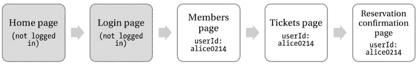
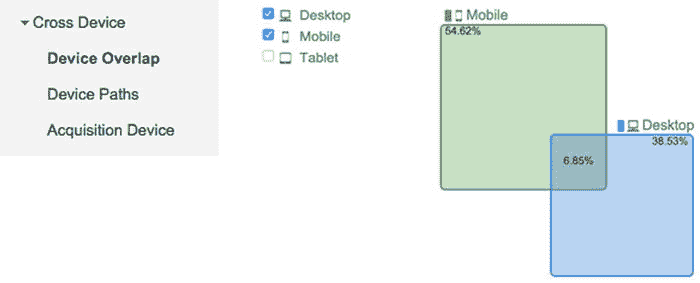
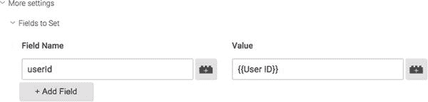

# 10. 跨设备跟踪用户

> “你是谁？”毛毛虫问道。这可不是一个鼓励人开口交谈的开场白。爱丽丝怯生生地回答说：“我——先生，我现在几乎也说不清——至少我知道今天早上起床时我是谁，但从那以后，我想我已经变了好几次了。” ——刘易斯·卡罗尔，《爱丽丝梦游仙境》

Google Analytics 报告一个名为“用户”的指标，这听起来像是在统计使用网站的人数。一个“用户”应该代表一个单独个体在网站上随时间推移的活动情况，对吗？不幸的是，实际情况要更复杂一些。Google 并没有（至少目前没有）通过我们设备的摄像头监视我们所有人并使用面部识别来识别我们的身份，因此“用户”和“人”并不完全是一回事。

正如你在第 2 章中所记得的那样，`GA` 使用一个包含 `client ID` 的 Cookie。这是一个随机生成的标识符。由于它存储在 Cookie 中，因此特定于具体的浏览器和设备。默认情况下，`GA` 使用此 `client ID` 来计算用户指标和跨会话的用户行为。所以，“用户”实际上对应的是“浏览器/设备”，而不是“人”。而且我们都知道，人们可能会删除浏览器的 Cookie（手动或使用“隐私”浏览模式），也可能使用多个设备（例如，他们在笔记本电脑和手机上访问过你的网站）。所有这些都意味着，通过 `client ID` 来计算用户数量在某种程度上是不准确的。

在某些情况下，这是你能做到的最好程度，也是网站衡量中必须接受的一个限制。然而，有时你有更好的方法知道当用户与你的网站（例如，用户登录的网站）互动时他们是谁。因为他们已登录，无论他们的 Cookie 内容是什么或使用什么设备，你都能确切地知道他们是谁。`GA` 允许我们设置一个额外的标识符，称为 `User ID`，它可以用来更准确地将“用户”和“人”对应起来，并向我们展示同一个人跨设备和浏览器的活动情况。

## 边栏：使用用户 ID 跟踪的场景

使用 `User ID` 跟踪的一个直接场景就是如上述所说，通过登录将同一用户跨设备的网站会话拼接起来。`User ID` 也可用于整合以下数据：

- 网站活动与移动应用（见第 13 章）。如果用户同时登录了你的网站和移动应用，你可以统一他们在这些界面和设备上的活动。
- 网站活动与其他线上或线下营销活动。如果用户登录了你的网站，你可能在 `CRM` 或其他系统中拥有包含电子邮件地址、社交媒体用户名或（店内购买使用的）会员卡号等信息的资料。这些数据中的一部分可以通过数据导入（见第 12 章）或使用 `Measurement Protocol`（见第 14 章）在 `GA` 中获得，或者你也可以在导出数据后，使用诸如 `BigQuery` 进行数据仓库和分析（见奖励章节）或使用 `GA API` 提取数据（见附录）等工具来整合数据。

根据你保留的客户内部数据，你可能还能想到使用这些数据的其他方式。

### 注意

在识别用户方面，技术上可行的方法超出了 `GA` 政策允许的范围。¹ 有许多技术可以更精确地跨浏览器或在 Cookie 被删除时识别个体，但这些技术是不被允许的（例如从 Flash 共享对象重新创建 Cookie、浏览器指纹识别或使用移动设备标识符）。`Google` 的政策以及你所在运营国家的法律可能会发生变化；请仔细检查这些政策和法律，并在必要时寻求法律建议，以确保你遵守规则。请记住，信誉良好的网站总会明确告知用户其数据将如何被收集、保留和使用。

在 `GA` 中设置 `User ID` 跟踪有三个基本步骤：

1. 在 `GA` 资源中启用 `User ID` 功能。
2. 在 `GA` 资源中创建一个用于报告 `User ID` 数据的视图。
3. 修改 `GTM` 中的 `GA` 标记，以发送 `User ID` 值。

在接下来的章节中，你将逐步完成这些流程。

## 在 GA 中设置用户 ID

Google Analytics 中的 `User ID` 功能是在媒体资源级别启用的。一旦为媒体资源启用了 `User ID`，您就可以在该媒体资源内创建基于 `User ID` 统一用户并显示特殊跨设备报告的视图。我们所有现有的视图将继续使用旧规则（通过 `client ID` 计算用户）。您需要创建一个新视图才能利用 `User ID`。`User ID` 只能在创建视图时启用；此设置之后无法更改。

使用 `User ID` 的视图将仅包含设置了 `User ID` 的会话数据。这意味着，`User ID` 视图将不包含例如未登录用户的会话。因此，您永远不应该只为媒体资源设置一个 `User ID` 视图；您至少需要创建一个启用了该选项的视图（用于使用 `User ID` 查看跨设备行为），另一个则关闭该选项（用于显示所有用户的会话，包括未标识的用户）。

设置 `User ID` 功能时，您可以选择控制会话整合，这涉及用户被识别之前会话中收集的数据是否与该用户关联。例如，考虑会话中的以下页面浏览序列（见图 10-1）。



图 10-1. 用户在标识前后浏览的页面序列

如果开启会话整合（默认设置），此会话中的所有页面浏览都将与该 `User ID` 关联，即使在前两次页面浏览时您还不知道 `User ID`。（请注意，会话整合仅适用于单个会话内的跟踪点击。未登录的会话永远不会与 `User ID` 关联，也不会包含在 `User ID` 视图中。）对于许多网站，开启会话整合可能是您想要的选项。

然而，有时您可能只想考虑设置了 `User ID` 的页面（在此示例中为最后三次页面浏览）。这可能是出于政策原因，或者例如针对多人登录共享的计算机。关闭会话整合将仅包含在 `User ID` 启用的视图中那些针对跟踪点击设置了 `User ID` 的数据。

### 为 GA 媒体资源启用用户 ID

首先，您需要在 `GA` 媒体资源中启用 `User ID` 跟踪。

在 Google Analytics 的管理部分，选择所需的媒体资源（中间列）。在跟踪信息部分，选择 `User ID`。查看相关政策，并通过将开关切换到“开启”来同意条款。选择“下一步”继续。`GA` 将显示在跟踪代码中设置 `User ID` 的说明；您可以暂时跳过此步骤，因为您将在本章后面部分在 `GTM` 中进行设置。选择保持会话整合开启或通过切换开关将其关闭。（请参见前面关于会话整合设置的讨论。）选择“下一步”继续。最后一步将提示您创建一个启用了 `User ID` 的视图。您可以点击“创建”按钮开始此过程，或者如果您将来需要为此媒体资源创建一个新的启用了 `User ID` 的视图，请参阅下一节。

### 创建 GA 视图以显示用户 ID 报告

在 `GA` 的管理部分，选择视图下拉菜单（第三列），然后选择列表底部的“创建新视图”。（或者，如果您是从前面的步骤继续操作，点击该过程末尾的“创建”按钮也会到达相同的位置。）选择“网站”作为视图类型。为视图输入一个名称（例如“已登录用户”），并选择一个时区。将“`User ID` 视图”设置更改为“开启”。点击“创建视图”按钮完成视图创建。

视图创建完成后，不要忘记更改您需要的任何其他设置，例如应用过滤器（请参阅第 8 章）、设置转化（请参阅第 6 章）或渠道分组（请参阅第 9 章）。

在您新建的启用了 `User ID` 的视图中，只会显示指定了 `User ID` 的会话和点击，“用户数”指标将基于唯一 `User ID` 的计数。此外，您还会在“受众群体” ➤ “跨设备”（见图 10-2）下找到一些额外报告，这些报告显示了用户的跨设备行为。



图 10-2. GA `User ID` 视图中可用的跨设备报告示例

## 使用 GTM 发送用户 ID 数据

现在您已启用 `GA` 来接收和使用 `User ID` 数据，您需要设置您的网站和 `GTM` 来发送它。

### 提供用户 ID 值

您的网站需要提供一个 `User ID` 值供 `GTM` 使用。最直接的方法是在数据层声明（`GTM` 代码之前数据层中包含的信息）中包含一个条目：

```
dataLayer = [{
                'userId': 'alice0214'
            }];
```

然后，您可以简单地使用 `GTM` 中的数据层变量来访问此值。在数据层中获取此值通常涉及一些服务器端网站编码来插入适当的值（例如，类似于第 7 章中放置在数据层中的电子商务数据）。

根据您的网站，可能还有其他查找 `User ID` 值的方法：在 cookie 中，甚至使用页面上显示“欢迎，alice0214!”的元素。使用数据层变量可确保站点的其他更改（例如，更改页面上放置“欢迎，alice0214!”元素的布局）不会影响您的跟踪设置。与本书讨论的许多其他变量一样，使用数据层为 `GTM` 组织信息始终比依赖页面内容或其他脚本（这些内容可能不受您控制）更安全、更可靠。

**提示：** `GA` 报告中没有直接可见的 `User ID` 值。在许多情况下，您需要报告 `User ID` 值以匹配来自其他来源的数据，因此，在自定义维度中也发送此变量（请参阅第 11 章）是一个好主意，您可以在报告和导出的数据中使用它。

### 配置 GTM 以将用户 ID 发送到 GA

既然网站数据层已提供 `User ID`，你需要在 `GTM` 中设置一个变量来捕获该值，然后修改 `GA` 标签，将此变量作为 `User ID` 发送。让我们逐步了解整个过程。

#### 在 GTM 的 GA 标签上设置用户 ID

首先，创建一个变量来从数据层捕获 `User ID`。

在 GTM 的“变量”部分，选择“新建”按钮创建一个新的用户自定义变量。选择“数据层变量”作为变量类型，然后点击“继续”。在“数据层变量名称”字段中，输入你在数据层条目中使用的名称（本章前面的示例中为 `userId`）。选择“创建变量”以保存该变量。为其命名：`用户 ID`。接下来，你需要修改 GTM 中的 GA 标签，以传递此变量的值。我们先从基础的网页浏览标签开始。在 GTM 的“标签”部分，选择“GA – 网页浏览”标签并点击编辑。点击“配置标签”以修改标签配置。在“更多设置” ➤ “要设置的字段”下，选择 `userId` 作为字段名称。在“值”字段中，使用你之前创建的 `{{用户 ID}}` 变量（参见以下截图）。



选择“保存标签”以保存对标签的更改。

你需要对容器内的所有 Google Analytics 标签进行此更改，以便在每次适用的跟踪点击中发送用户 ID 值。当然，在数据出现在 GA 之前，你需要测试并发布新版本的容器。一旦这些更改在网站上发布，你将开始在 GA 的用户 ID 视图中看到已登录用户的数据。

## 总结

- Google Analytics 通常使用客户端 ID（一个存储在 cookie 中的标识符，特定于某个浏览器和设备）来统计用户。对于用户可以登录或以其他方式识别的网站，GA 支持使用用户 ID 来更准确地跨设备统计用户。

- 在收集用户 ID 数据时，隐私问题、政策、法规以及对网站用户的适当披露是重要的考量因素。请仔细审查这些内容。

- 用户 ID 功能在 GA 中通过媒体资源级别启用，可以选择是否使用会话统一（统计用户登录前的点击）。在该媒体资源内，可以创建启用用户 ID 的视图，仅显示包含关联用户 ID 的数据以及额外的跨设备报告。

- 在 GTM 中，用户 ID 从网站捕获，通常是将用户 ID 值插入数据层中。修改 GTM 中的 GA 标签以包含此用户 ID 变量。

## 脚注

您所在国家的 GA 服务条款可在 [`www.google.com/analytics/terms/`](http://www.google.com/analytics/terms/) 找到。附加的用户 ID 政策（在 GA 中启用用户 ID 功能前必须同意）可在 [`https://developers.google.com/analytics/devguides/collection/protocol/policy`](https://developers.google.com/analytics/devguides/collection/protocol/policy) 找到。