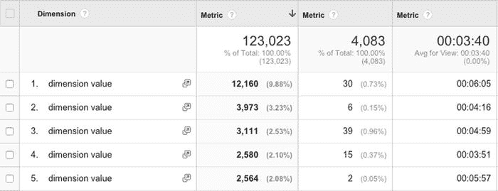
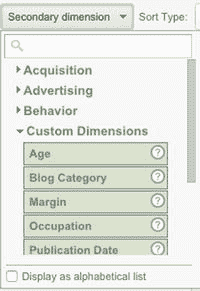
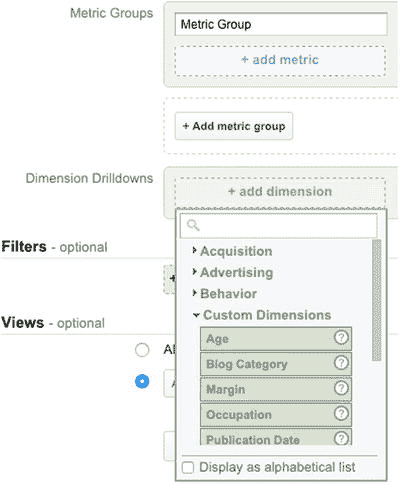
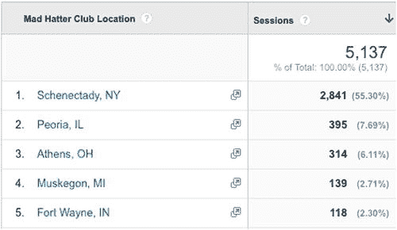
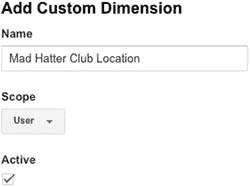
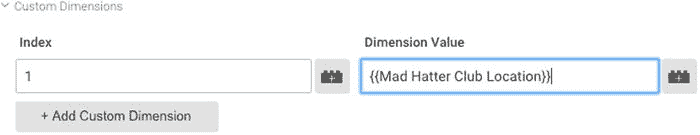
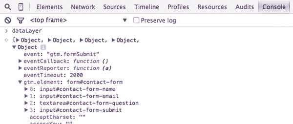

# 11. 提供关于用户的附加数据

> “再喝点茶吧，”三月野兔非常认真地对爱丽丝说。“我还没喝过一口呢，”爱丽丝用生气的语气回答，“所以我不能再喝了。”“你的意思是你不能喝更少的，”帽匠说：“从零开始喝多很容易。” ——刘易斯·卡罗尔，《爱丽丝梦游仙境》

前面几章介绍了如何使用 Google 跟踪代码管理器将网站信息传输到 Google Analytics。你已经学习了如何衡量基本信息——用户交互，例如页面加载（通过网页浏览跟踪）——以及更具体的操作——例如观看视频或下载文件（通过事件衡量）。

在本章中，你将学习如何为这些网页浏览或事件添加额外的自定义数据，以提供关于网站内容、访问用户及其操作的更多信息。在许多情况下，你的网站可能掌握关于用户及其行为的更多信息——这些信息来自你的用户注册数据库、内容管理系统或其他可通过 GTM 捕获的源——你希望将这些信息与 GA 中的交互行为数据关联起来。你将利用 GA 接受自定义维度和指标的能力来嵌入这些额外数据。这些数据将是你所在组织和网站独有的，对于在 GA 中进行更详细的分析和细分非常有价值。

**注意**：自定义维度和指标是一组更新后的功能，取代了自定义变量这一 GA 中实现类似自定义的旧功能。如果你过去使用过自定义变量，它们将继续有效，但自定义维度和指标是未来的首选方法。

## 自定义维度和指标

回顾（来自第 1 章）GA 的报表按维度和指标组织。你发送给 GA 的每次点击会填充某些内置维度和指标。然而，GA 也允许你向发送的点击中添加自定义维度和指标。让我们看看这些选项以及你可能需要使用它们的一些原因。

## 维度

维度是将数据分门别类的标签。每种点击类型，例如页面浏览量和事件，都有预定义的维度，你可以用不同的数据片段填充这些维度。

例如，对于页面浏览量，你有一个名为 `Page` 的维度，通常是指你所在页面的路径（尽管在第 6 章中，你可以自定义这个维度来表示任何你想要的 URL）。

对于事件，你可以使用更通用的维度，例如 `Event Category`、`Event Action` 和 `Event Label`。你可以在这几个字段中填入任何内容；例如，你可以分别使用 `Downloads`、`PDF` 和 `example.pdf` 来告诉 Google Analytics（分析）：有人发起了下载，文件类型是 PDF，并且他们开始下载的具体文件名为 `example.pdf`。

除了与每次点击相关联的维度之外，还有其他维度可能适用于整个会话、用户甚至特定产品（在电子商务数据中）。所有这些维度都是预先确定好的，并收集在 GTM 的 GA 代码中。自定义维度允许你提供自己的标签，以额外的数据分类方式来扩展这些维度。

通过自定义维度，你拥有完全的控制权：你可以为维度命名，然后决定在该维度中存储什么内容。如果你知道发表博客文章的作者、用户的注册状态或产品的重量，都可以存储在 GA 中。GA 允许你为每个媒体资源创建 20 个自定义维度。（GA Premium 订阅用户每个媒体资源最多可获得 200 个自定义维度。）

创建自定义维度时，你需要在 GA 中指定一个范围，该范围表示此维度与 GA 中哪些数据相关，或者 GA 应该“记住”自定义维度多长时间。共有四种可能的范围：

*   **用户**：提供的信息会添加关于特定用户的更多详情（由浏览器中的客户端 ID Cookie 确定——请参阅第 10 章），并且每次该用户回来时都会被记住。用户级自定义维度用于描述应适用于用户当前会话及所有未来会话的用户属性（除非你更改或更新该值）。可能的示例包括以下内容：
    *   人口统计信息，例如年龄、性别、收入、职业等。
    *   客户信息，例如用户 ID、状态、订阅级别或续订日期。
    *   用户与网站关系史上的累积数据，例如生命周期价值或总分享次数。
    *   用户群组信息，例如首次购买日期、注册日期等。（首次访问日期是 GA 中的内置维度，因此你无需为此创建自定义维度，但其他“首次”数据，例如首次产品购买，可能会很有用。）

> **提示**
>
> 如果你正在按照第 10 章所述的方式收集用户 ID 以统一跨设备会话，你也应该为用户 ID 创建一个自定义维度，因为 GA 不会将此值作为内置维度在报告中提供。

*   **会话**：提供的信息描述的是该特定会话。示例如下：
    *   会话期间发生的行为，例如登录状态或是否查看了特定类型的内容。
    *   与网站特定功能的互动，例如分面导航或是否有任何商品添加到购物车。
*   **点击**：提供的信息仅描述此次特定的点击，例如页面浏览量或事件。示例如下：
    *   页面级信息，例如作者姓名、发布日期或页面类别。
*   **产品**：该信息适用于特定产品，超出了在 GA 电子商务跟踪中可以使用的那些基本维度。示例如下：
    *   产品重量、采购信息、内部跟踪 ID 等。

> **警告**
>
> 对于自定义维度，你可以自由创建和填充字段。请记住，GA 的服务条款禁止收集个人身份信息——因此，包含用户姓名、电子邮件地址等的自定义维度是绝对不允许的。请确保你阅读并遵守相关政策。¹

## 指标

维度是将点击、会话或用户数据分门别类的标签，而指标则是通过统计这些点击而得到的衡量结果。指标是各种单位的数字，例如总页面浏览量或事件数（仅从零开始计数）；或者时间元素，例如会话时长；或者是电子商务和目标价值的金额。

与维度一样，你也可以创建自己的自定义指标。创建自定义指标时，你可以选择格式为整数、十进制货币或时间度量。GA 会根据报告中此类型的信息适当格式化该指标。GA 允许你为每个媒体资源创建 20 个自定义指标。（GA Premium 订阅用户每个媒体资源可获得 200 个。）

你还需要选择一个范围。自定义指标只有两种范围：

*   **点击**：自定义指标代表与它所附加的点击（例如页面浏览量或事件）相关联的度量值。
*   **产品**：自定义指标代表与电子商务交易中特定产品相关联的度量值。

> **注意**
>
> 自定义指标总是会基于某个维度（该维度也有作用域）进行汇总。因此，你可以通过使用点击级范围的维度（如 `Page`）来获取特定点击的自定义指标总计，通过使用会话级范围的维度（如 `Campaign`）来获取特定会话的总计，依此类推。

### 边栏：维度还是指标？

当你拥有来自网站的一些数据片段想要在 GA 中使用时，你必须做出决定：这是维度还是指标？

有时，选择很容易。如果值是文本，那么它肯定是维度。指标总是数字。因此，任何你使用文本的地方——页面的类别或其他点击的类别、用户或会话的标签或标识符——都必须是维度。

那么，你可能会想，反过来是否成立：如果它是数字，就一定是指标吗？这需要多思考一下。指标总是数字（整数、货币值或时间长度），但并非所有数字都必须是指标。

要寻找示例，请查看 GA 中的内置维度列表。你会发现其中一些是数字：`Page Depth`（会话期间发生的页面浏览量）、`Day of Week`（0 到 6，对应周日到周六）等等。这是怎么回事？

在某些情况下，数字只是某物的标签。例如，`Day of Week` 维度就是这种情况：数字 0 到 6 只是周日到周六的标签，而不是任何类型的度量值，将它们加起来是毫无意义的。

在其他情况下，例如 `Page Depth`，这些数字是基于度量值的。已经有度量标准来衡量“有多少次页面浏览？”——那个指标就是 `Pageviews`！既然已经有了指标，为什么还需要一个维度呢？

要理解这背后的逻辑，请记住维度用于对点击、会话、用户或产品进行分类或分组。`Page Depth` 维度则提供了一种方式来说明“向我展示恰好有 1 次页面浏览量的所有会话的指标”（或者 2 次、3 次等）。维度用作报告的行，而指标则填充列。如果你想查看某个类别列表中的指标，那么该类别就是维度。



此外，请记住，指标会在点击、会话、用户等层面上进行汇总，而维度仅仅是标签。

在考虑为你自己的网站创建所需的自定义维度和指标时，请思考你希望报告看起来是什么样的。行标签是维度；列的值是指标。

## 在 GA 中访问自定义维度和指标

将数据发送到自定义维度或指标后，有几种不同的方式可以在 GA 报告中访问这些信息。在大多数标准报告中，自定义维度可用作**次级维度**（见图 11-1）。



图 11-1. 在报告的次级维度下拉菜单中可使用自定义维度

您还可以在自定义报告和仪表板中使用自定义维度和指标（见图 11-2）。



图 11-2. 自定义报告中的自定义维度和指标

自定义报告是访问这些自定义数据最灵活且最有用的方式。（自定义维度和指标也可在 `BigQuery` 及报告 API 的 GA 数据中使用；详见补充章节和附录。）

## 设置自定义维度和指标

现在您已经了解了为何要使用自定义维度和指标，接下来我们来看看在 GA 和 GTM 中实施它们的流程。在自定义维度或指标中开始发送数据需要三个步骤：

首先，您需要在 GA 中创建并标记自定义维度或指标，以存储数据。其次，您需要从网站内容或其他元数据中实际生成要使用的数据（通常是将数据放入 GTM 的数据层中）。最后，您需要通过 GTM 中的 GA 代码将自定义指标或维度随此数据一起发送到 GA。

以下各节将介绍这一过程，从一个相对简单的示例开始。假设您网站的用户可以注册“爱丽丝仙境度假村疯帽匠俱乐部”，注册后可享受特别优惠和公园门票折扣。注册时，他们需要指定偏好的公园位置，这有助于您精准推送优惠信息。您希望在 GA 中记录此信息。

在开始之前，您需要问自己几个问题：

- **这是维度还是指标？** 这是维度，因为它是各类别（疯帽匠俱乐部会员的公园位置）的标签。您希望将这些标签用作报告中的行，例如图 11-3 所示的内容。

  

  图 11-3. 作为维度的疯帽匠俱乐部位置

- **作用范围是什么？** 由于疯帽匠俱乐部位置在用户每次回访时都适用于同一用户，因此您希望作用范围设为“用户”。GA 会将此值应用于用户使用同一 Cookie 回访的每次会话。

- **数据从何而来？** 您必须已经拥有这些数据！网站（用户注册疯帽匠俱乐部的地方）背后关联着某个数据库或应用程序，当用户注册或登录时，您可以查找该信息。稍后我们将详细探讨这一点，但此问题的答案始终取决于您网站的特定平台和工具，因为数据最终来自某些现有信息。

### 在 GA 中创建自定义维度或指标

创建自定义维度或指标时，您需要选择名称，该名称将作为维度或指标的标签显示在 GA 报告中。您希望名称具有描述性，便于使用数据的人员理解。由于 GA 中所有其他字段名称均采用首字母大写格式，建议您也采用相同格式。在本示例中，您可将维度命名为“疯帽匠俱乐部位置”。

**在 GA 中创建自定义维度或指标**

您将使用疯帽匠俱乐部位置示例，在 GA 中添加一个自定义维度。

在 GA 的管理区域中，选择相应的帐号、媒体资源和数据视图后，点击中间列的 `自定义定义` ➤ `自定义维度`（或 `自定义指标`），查看媒体资源的自定义维度。点击 `新建` 按钮添加新的自定义维度。输入自定义维度（或指标）的名称：“疯帽匠俱乐部位置”。



- 从下拉菜单中选择与维度或指标相适应的作用范围。对于疯帽匠俱乐部位置，您应选择“用户”作用范围（如前所述）。

- （仅限指标）选择自定义指标的格式类型：整数、货币或时间。

- （仅限指标）输入可选的 `最小值` 和 `最大值`。GA 将忽略超出此范围的值。这有助于防止意外出现的异常值（例如误算的 1000 亿美元货币值）压垮自定义指标的总计数据。

- 勾选复选框以激活维度或指标。（取消勾选将停用维度或指标，并停止收集数据。）

- 点击 `创建` 按钮创建自定义维度或指标。

每个自定义维度或指标都会分配一个从 1 到 20 的特定索引编号。请记下您所创建的维度或指标的索引编号，后续流程中您需要用到它来填写值。与目标一样，自定义维度和指标无法删除，只能开启或关闭。但如果您需要重复使用某个特定编号，可以对其进行重命名。

### 生成自定义数据

现在，你已经设置了自定义维度的名称以及发送数据的范围，接下来你需要处理更困难的部分：找到要发送的数据。

你需要已经开始收集想要发送到 GA 的信息，然后以某种方式使其可用。例如，如果你想发送描述用户性别和年龄的信息，逻辑上你需要首先了解他们的性别和年龄——GA 和 GTM 无法自动为你创建这些数据！

收集这类数据的方法有多种，但大致可分为两类：

*   从内部数据库提取信息，例如包含页面和内容信息的内容管理系统、用于存储登录网站用户信息的用户数据库，或者包含产品数据的电子商务系统。

*   从用户处收集信息，既可以通过表单直接获取，也可以通过用户在网站上的行为间接收集。

**注意**

在本章中，你将考虑如何直接从网站填充自定义维度和指标。也可以使用 GA 的数据导入功能，通过批量导入一组值并将其与 GA 字段关联，来填充某些维度和指标（包括自定义维度和指标）的值（详情请参见第 12 章）。

使用与网站相连系统中已有的信息是更常见的选择，因此我们先考虑这种情况。（你可以使用 GTM 的表单触发器来捕获表单字段的值；后续示例中会详细说明。）

无论数据来源如何，你都需要弄清楚如何将其传递到网站代码中，以便 GTM 能够读取。有时，这些数据可能已经存在于网站上。例如，假设一个博客或新闻网站希望随每篇文章传递内容元数据，如发布日期、作者或标签。通常，这些信息已经存在于内容管理系统中，可以插入到网站模板中。

有时，检索这些信息会稍微复杂一些。例如，当用户登录时，你可能拥有一个包含用户各种信息的用户数据库，比如用户的联系方式、他们的“疯帽子俱乐部”状态、首选城市、帽子尺码以及你所知道的关于他们的一切。这些信息仅在用户登录并且你能将其与个人信息匹配时才能访问。

**提示**

考虑用一些方式激励用户登录你的网站！这能提供更多关于网站受众的信息，并允许更频繁地传递自定义信息。此外，如果你正确配置了用户 ID 视图（见第 10 章），已登录用户还能实现跨设备跟踪。

如果你掌握了这些信息，那么有一种相对简单的方法可以将它们传递给 GTM：数据层。当然，访问该值并将其插入数据层的具体方式取决于你网站的特定工具和平台。

### 使用数据层

本书中你已经多次使用数据层声明（在页面的 GTM 容器之前）向 GTM 提供信息。对于“疯帽子俱乐部位置”信息，你也可以这样做：

```
dataLayer = [{
    'hatterClub': 'Schenectady, NY'
}];
```

该值（此示例中的 `Schenectady, NY`）是基于特定用户选择的其最喜欢的公园地点插入的。

你可以继续向数据层添加任何你想作为自定义维度或指标传递给 GA 的信息。在 GTM 中，你可以简单地使用数据层变量来检索这些值。

根据你的网站，可能还有其他方法可以找到所需的值，例如，如果数据出现在页面内容中，可以使用 DOM 元素变量。然而，使用数据层变量可以确保网站的其他更改不会影响你的跟踪设置，并且确保值在 GTM 加载时立即可用。与本书中讨论的许多其他变量一样，使用数据层为 GTM 组织信息总是比依赖页面内容更安全、更可靠。

**注意**

对于产品范围内的维度或指标，请将这些指标包含在已添加到数据层的电子商务数据中的产品对象内，使用类似 `dimensionXX` 或 `metricXX` 的名称，其中 `XX` 是维度的索引编号：例如 `'dimension2': 'blue'`。由于你已经设置了 GTM 使用数据层来填充电子商务值，它将自动捕获这些值（关于在数据层中包含电子商务数据的详细信息，请参见第 7 章）。

### 向 GA 发送自定义信息

一旦在数据层中获得了所需的值，就可以使用在 GTM 中设置的代码将这些值相对简单地传递给 GA。自定义维度和指标会随现有匹配一起发送，因此您可以将其添加到现有代码（例如网页浏览或事件代码）中。您只需找到一个已发送至 GA 的匹配，然后“搭个便车”即可。

根据维度或指标的范围，您可能希望将其包含在所有匹配（代码）中，或仅包含在部分匹配中。对于匹配级维度或指标，您只希望将其包含在适当类型的匹配中，因此可能仅限定于某些代码。例如，文章发布日期的自定义维度可能仅适用于网页浏览（文章），而不适用于事件。

对于会话级或用户级维度，您只需在会话期间发送一次该值，或为用户发送一次即可。例如，对于“疯帽匠俱乐部”地点变量，您只需在用户首次注册“疯帽匠俱乐部”时设置此值。但在许多情况下，您希望再次发送该值（例如，用户每次登录时，甚至在每个页面上）。这有助于在用户切换设备或浏览器、清除 Cookie 或值发生更改时，强化该值的记录。

如果您为会话级或用户级维度多次指定值，则该会话以最后一个值为准。（先前会话的值保持不变。）

### 从数据层发送自定义信息

让我们从数据层获取“疯帽匠俱乐部”状态信息，并将其插入到 GTM 中的 GA 代码中。

首先，您需要创建一个变量来从数据层捕获值。

在 GTM 的“变量”部分，选择“新建”按钮以创建新的用户定义变量。选择“数据层变量”作为变量类型，然后选择“继续”。在“数据层变量名称”中，输入您用于数据层条目的名称（在示例中，它是 `hatterClub`）。选择“创建变量”以保存该变量。为其命名：“疯帽匠俱乐部地点”。

现在，您需要修改 GTM 中的 GA 代码，以传递此变量的值。在本例中，您只需将该值包含在基本的网页浏览代码中。只要数据层值出现在页面上，您就会将此自定义维度随同该网页浏览一起发送。

在 GTM 的“代码”部分，选择“GA – 网页浏览”代码并对其进行编辑。点击“配置代码”以更改代码配置。在“更多设置” ➤ “自定义维度”下，点击“添加自定义维度”按钮以添加新的自定义维度。填入与您之前在 GA 中创建的自定义维度相对应的索引号。对于“维度值”字段，使用您在步骤 1-4 中创建的 `{{疯帽匠俱乐部地点}}` 变量（见下方截图）。



选择“保存代码”以保存对代码的更改。

您需要测试然后发布新版本的容器，这些数据才会显示在 GA 中。与往常一样，您可以使用 GTM 调试面板或控制台中的 GA 调试模式来验证其是否正常工作。

一旦这些更改发布到网站上，您将能够在自定义报告中，或通过在标准报告中使用次级维度，开始看到自定义维度或指标的数据。（请记住，没有内置的标准报告会自动包含自定义维度或指标，因此您必须创建一个才能看到这些值。）

### 其他示例

上一节探讨了一个自定义维度的基本示例。现在，让我们再看几个示例来探索其可能性：一个基于表单输入的自定义维度，以及一个基于交互的自定义指标。

#### 来自表单输入的自定义维度

除了使用数据层中来自其他系统的数据外，收集自定义维度数据的另一种方法是从用户填写的表单中抓取一些信息。这些信息可能只提供一次，在表单提交后您就无法再获取了。

假设您的网站上有一个联系表单。您可能会询问用户的性别，或者要求他们将自己归入某个特定类别，例如“教师”、“学生”或“家长”。如果您能在表单提交时截取这些数据，就有可能获取他们填写的这些字段，并将其存储为用户级自定义维度。

第 6 章 讨论了使用 GTM 的表单触发器来监听特定表单的提交。从表单中捕获自定义维度是表单触发器的另一个绝佳应用，但这需要您更深入地挖掘。

与点击触发器（在第 5 章中讨论过）类似，表单触发器会向数据层添加关于已提交表单的信息。它看起来像下面这样：

```json
{
    event: "gtm.formSubmit",
    gtm.element: form#contact-form,
    gtm.elementClasses: "",
    gtm.elementId: "contact-form",
    gtm.elementTarget: "",
    gtm.elementUrl: "http://aliceswonderlandresorts.com/contact-thankyou"
}
```

您已经学习了如何获取表单的 ID 和类，它们的工作方式与点击完全相同。真正令人兴奋的是，GTM 会将整个 DOM 对象作为 `gtm.element` 添加到数据层。这意味着，该表单的所有内容现在都可以在 GTM 内部访问，包括所有表单字段及其在提交时的当前值。

访问各个部分只需导航表单的 DOM 对象以找到您想要的字段即可。对于表单字段，DOM 结构其实非常简单：每个表单字段都按照其在表单中出现的顺序嵌套在 `gtm.element` 下，从 0 开始按数字编号。在每个表单字段下，都有一个名为 `value` 的属性，它将是表单字段在提交时的值。（您可以使用 Web 浏览器的工具探索数据层中的 DOM 元素；图 11-4 是 Chrome 浏览器中的示例。）



**图 11-4.** 使用 Chrome 的 JavaScript 控制台在数据层中查看表单字段（在本例中，编号为 0-3）

要获取此信息并将其放入 GTM，您需要找到您关心的特定表单字段，然后使用数据层变量从数据层中获取其值。数据层使用句点来表示嵌套值，因此上述路径在数据层变量中将如下所示：

`gtm.element.0.value`

这个数据层变量，当与表单触发器结合使用时，将返回刚提交表单中第一个字段的值。（对于非第一个字段，请使用不同的数字。）

现在，您可以像之前使用在数据层中显式提供的值的场景一样，使用该变量来填充自定义维度。

**注意：** 此示例假设已存在一个使用该表单触发器的代码。请记住，自定义维度或指标始终需要随某个匹配（如网页浏览或事件）一起发送。如果当前没有代码由此表单触发，您可以简单地添加一个 GA 事件代码，使其在表单提交时触发，以包含该自定义维度。（更多关于表单触发器的信息，请参见第 6 章。）

### 来自互动的自定义指标

你也可以根据你通过 `pageview` 或事件衡量的其他互动数量来创建自定义指标。

为什么要用自定义指标重复统计事件或 `pageview` 的数量？同样，只是为了简化报告。尽管 GA 中有诸如 `pageview` 总数或事件总数之类的指标，但你需要采用创造性的过滤或细分才能获得特定类型的 `pageview` 或事件的数量。如果你只是想要一列显示特定类型 `pageview` 或事件数量的数据，该怎么办？自定义指标就是完美的解决方案。

例如，假设你正在使用事件来跟踪网站上的下载。你可以为“下载”创建一个自定义指标，并轻松地在报告中将其显示为一列数据。

#### 从互动创建自定义指标

你首先需要按照本章前面的说明在 GA 中创建一个自定义指标。将其命名为“下载”，并选择“整数”作为格式化类型。记下自定义指标的索引；你将在后续步骤中用到它。

你还需要在 GTM 中已经有一个带有用于跟踪下载的事件的代码（参见第 5 章）。

在 GTM 的“代码”部分，选择用于下载的 GA 事件跟踪代码，然后选择“编辑”。点击“配置代码”以修改代码配置。在“更多设置” ➤ “自定义指标”下，点击“添加自定义指标”按钮来添加一个新的自定义指标。填入与“下载”相对应的自定义指标的索引号。对于“指标值”字段，直接使用值 `1`。选择“保存代码”以保存对代码的更改。

当然，你需要在 GTM 中进行测试和发布，这些更改才会生效。

发布后，每当文件被下载且事件被发送到 GA 时，“下载”指标的计数就会增加 `1`。

## 总结

-   自定义维度和指标允许你向 GA 发送自定义信息，用于报告和分析。维度是类别标签，通常表示为报告中的行。指标是度量值（计数、货币金额或时间长度），通常表示为报告中的列。

-   你可以在 GA 中为自定义维度或指标指定名称和作用范围。作用范围会影响该维度或指标在 GA 中关联的数据。自定义维度和指标是在媒体资源级别配置的，每个媒体资源各有 20 个配额。

-   在 GTM 的代码中插入的自定义维度和指标的值，可以来自网站服务器（通过数据层），也可以来自页面及用户与页面的互动。GTM 的变量功能可以轻松获取这些值。

## 脚注

1. 服务条款可能因您所在的国家/地区而异；请在此处查找您所在国家/地区和语言版本的条款：[`http://www.google.com/analytics/terms/`](http://www.google.com/analytics/terms/)