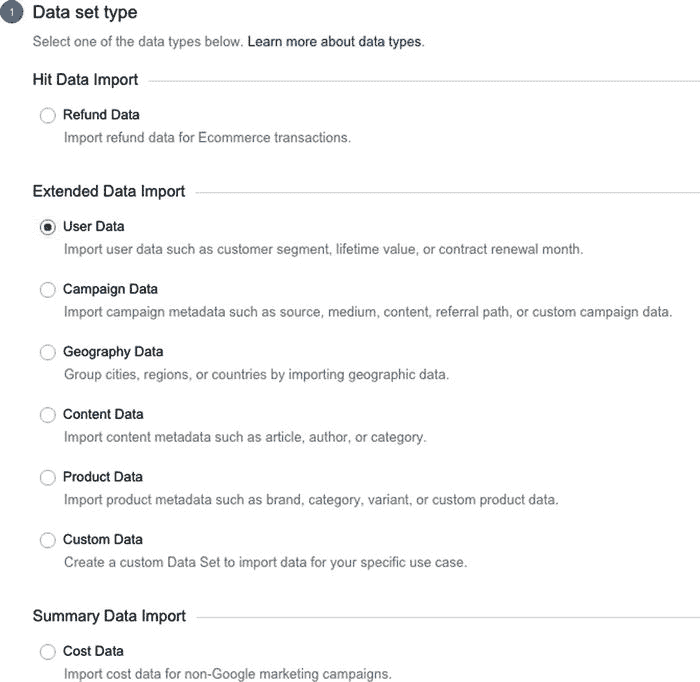
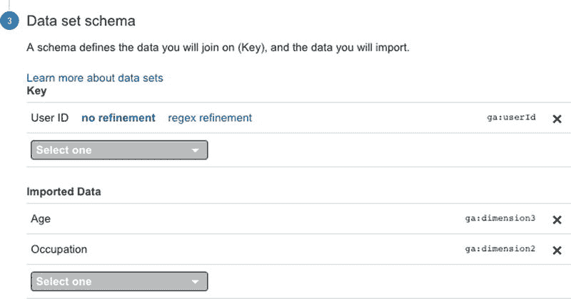
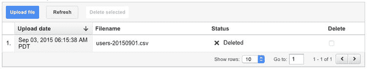

# 12. 向 Google Analytics 导入数据

> 爱丽丝觉得这根本不能证明什么；不过，她还是继续说：“那你怎么知道自己疯了？”猫说：“首先，狗没有疯。你同意这个观点吗？”“我想是的，”爱丽丝说。“那好，”猫接着说，“你看，狗生气时会咆哮，高兴时会摇尾巴。而我呢，高兴时咆哮，生气时摇尾巴。所以我疯了。”“我认为那是咕噜声，不是咆哮，”爱丽丝说。 ——刘易斯·卡罗尔，《爱丽丝梦游仙境》

在第 11 章中，你学习了如何使用 GA 中的自定义维度和指标来填充关于用户及其行为的附加数据。你将这些自定义维度和指标作为附加数据，随同 GTM 中的一次匹配一起发送。GA 提供了另一种填充这些值的方法，即通过其数据导入功能。数据导入允许你使用直接上传到 GA 的文件来填充数据。这在以下情况下非常有用：

-   数据在匹配发生时无法从网站获取——例如，因为它存储在一个单独的系统中。你可以从此类系统将数据上传到 GA。
-   数据量庞大，直接包含在站点上会带来开发负担，或会超出匹配中包含数据的字符限制。你可以减少从站点发送的数据量，只发送某些关键维度，然后再填充其他值。
-   数据比较敏感，你不希望将其包含在站点上，例如某些类型的用户或产品数据。

你将在下一节详细查看数据导入的过程，然后研究几种可用的数据导入类型及其应用。

## 数据导入流程

数据导入的基本流程如下：

1.  创建一个与 GA 中某个媒体资源关联的数据集，以配置将要导入的维度和指标。
2.  上传一个包含待导入数据的文本文件。GA 接收该文件并将其处理为报告中的数据。
3.  根据需要更新数据集，以便后续更新数据。

在本章后面，你将了解 GA 中可能的具体数据导入类型，但每种类型的基本流程都是相同的。让我们逐步了解。

### 创建数据集

在 GA 媒体资源中创建数据集可以配置将要导入的维度和指标，并为用于上传数据的文本文件创建一种架构。数据集充当上传文件的容器，并控制导入的数据如何应用于 GA。

GA 中可用的不同类型数据集，每种都支持一个或多个键（GA 中已有一个值，导入数据将与之关联的维度）以及一个或多个导入的维度或指标（将通过导入添加的数据）。

#### 设置用于导入的数据集

数据集是在 GA 的某个媒体资源中创建的。

1.  在 GA 的管理区域中，选择合适的帐号、媒体资源和数据视图后，选择中间列的**数据导入**，以查看该媒体资源的数据集。选择**新建**按钮以添加新的数据集。
2.  为数据集选择一种类型（参见下面的截图；更多关于类型的信息将在本章后面介绍）。选择**下一步**按钮。



3.  为数据集输入一个名称，以描述要导入的数据。
4.  （仅针对某些数据导入类型）选择该媒体资源内将显示导入数据的数据视图。
5.  为导入选择维度和指标（参见下面的截图）。根据所选的数据导入类型，键维度和导入数据的选项会有所不同。



6.  （仅针对某些数据导入类型）选择覆盖数据的选项（我们稍后会在介绍具体数据类型时讨论这一点）。
7.  选择**保存**按钮。

保存数据集后，GA 会显示两个按钮，分别链接到上传数据的架构，以及获取用于 API 的 ID。我们稍后会介绍如何使用它们。

GA 允许每个媒体资源最多创建 50 个数据集。上传的数量和大小还有其他限制。GA Premium 订阅用户拥有更高的限额。

一旦数据集创建完成，你就可以上传数据用于导入了。


### 数据导入架构

用于向 GA 导入数据的文本文件采用 CSV（逗号分隔值）格式，这是一种用于表示电子表格行和列的文本文件格式。CSV 文件可以轻松使用 Google Sheets 或 Microsoft Excel 等电子表格应用程序生成，并且作为许多应用程序的导出格式也得到广泛支持。

如您之前所见，在创建数据集时，GA 会提供一个可供下载的示例架构文件。架构文件包含描述数据集中维度和指标的标头，并显示相应的文件格式。（请注意，数据集架构中使用的标头与 GA 的 API 中维度和指标的标签方式相匹配；更多详细信息请参见附录。）以下是一个示例上传文件，其中包含几行待导入的数据：

```
ga:userId,ga:dimension3,ga:dimension2
alice0214,Student,7.5
madhatter13,Milliner,35
queenofhearts<3,Royalty,65
```

只要您以此格式提供数据，GA 并不关心数据来源或创建工具。数据可以手动汇编、从其他系统或工具的导出数据重新格式化，或由自动化数据导入的脚本生成。

### 上传数据

数据导入文件可以手动通过管理区域上传到 GA，也可以通过 API 实现自动化。本节将介绍手动流程。有关 GA API 的更多详细信息，请参见附录。

#### 将数据上传到数据集

让我们来看看如何手动上传数据以供 GA 导入。假设您已经拥有数据文件，并且已按照前面所述的架构正确格式化。

在 GA 的管理区域中，选择相应的帐户、媒体资源和数据视图后，点击中间列的“数据导入”即可查看该媒体资源的数据集。在数据集列表中，为您要上传的数据集选择右侧的“管理上传”链接。GA 会显示之前上传的文件列表（参见以下截图）。



选择列表顶部的“上传文件”按钮。从计算机中选择要上传的文件，然后点击“上传”按钮。

文件将被上传，状态显示为“待处理”，直到 GA 完全处理完该文件。如果没有格式错误，状态将更新为“已完成”。此时，GA 将开始应用数据导入。

### 更新数据集

上传后，数据将应用于后续的数据。某些类型的数据导入在首次上传后可能很少需要更新，对于这些情况，前面描述的手动上传流程是一个简单的解决方案。

然而，其他类型的数据导入可能需要定期更新——对于某些可能频繁变化的数据，甚至可能需要每天更新。对于此类应用，手动上传流程可能较为繁琐，因此建议使用 API（参见附录）。

> **提示**  
> 目前已存在许多现成的工具，可使用 GA API 从其他系统导入数据，例如来自广告平台的费用数据。您应寻找能够帮助您自动化这些重复性任务的工具。

更新或删除数据集通常仅影响后续数据，这与 GA 管理区域中的所有更改一致。历史数据不受影响。不同类型的数据导入受更新的影响方式略有不同；详细信息请参见下一节按类型划分的内容。

## 数据导入类型

Google Analytics 提供三种基本的数据导入类别：点击数据（将点击直接导入 GA）、扩展数据（导入多种维度和指标值，以应用于 GA 中的现有点击）以及汇总数据（导入已按特定维度聚合的数据的指标）。您将在以下各节中了解每种类型的潜在用途。

### 点击数据导入

点击数据导入允许您直接将点击导入 GA。导入后，这些点击将与其他任何点击一样被处理，并根据应用于媒体资源数据视图的过滤器进行处理。仅支持一种类型的点击数据导入：电子商务交易的退款数据。

#### 退款数据

退款数据用于导入电子商务交易的全部或部分退款。您可以使用电子商务或订单处理平台提供的数据，向 GA 添加关于网站上下文之外发生的退款的数据。一旦退款添加到 GA，相应的交易将被更新，以显示退款后的相应收入和产品。

退款数据必须包含`交易 ID`维度。对于全额退款，仅需`交易 ID`。GA 中整个交易（包括所有产品）都将被退款。对于部分退款，有两种选择：

- 指定要退款的交易中的`产品 SKU`和`数量`。所有列出的产品将被退款，并从交易收入中扣除。
- 指定要退款的`交易收入`金额。该部分交易收入将被退还，但交易中仍保留所有产品。

> **警告**  
> 退款一旦导入 GA，将无法删除或修改。请谨慎操作，并先在测试媒体资源中测试退款数据，以确保在应用于生产数据之前了解该流程的工作原理。

### 扩展数据导入

扩展数据导入允许您使用附加信息扩展 GA 中的现有点击。它们包含来自现有数据的一个或多个“键”维度值，以匹配导入的维度或指标值。这通常用于填充自定义维度或指标的值，但也可用于覆盖现有维度的值。

扩展数据导入发生在 GA 处理过程中，这意味着数据导入将在收集新点击时应用。您可以选择数据将出现在媒体资源的哪些数据视图中。由于数据在处理过程中被整合，如果您对数据集进行更改，这些更改将仅对后续数据生效，而不会影响历史数据。

> **注意**  
> GA Premium 订阅用户能够指定数据导入是在处理时还是查询时进行，这意味着导入的数据可以应用于报告中的历史数据，并可随时更新。

扩展数据导入有六种不同的类型。让我们来看看每种类型的应用。

#### 用户数据导入

用户数据可以导入 GA，以增强关于单个用户的信息。您可以使用它从 CRM 或其他包含用户细分信息的系统中导入用户数据，例如人口统计信息、生命周期价值或购买信息等。¹

第 11 章讨论了许多此类针对用户范围自定义维度的想法。用户数据导入的唯一区别在于，您只需在网站上传递单个维度来标识用户，然后在 GA 中稍后导入其余维度。

用户数据可以根据`用户 ID`（参见第 10 章）或用户范围的自定义维度进行导入。导入的数据可以是用户范围的自定义维度。


#### 广告活动数据导入

广告活动数据导入可用于填充来源、媒介和广告活动等与广告活动相关的维度。它使用一个名为 `Campaign ID` 的关键维度，该维度可通过广告活动网址标记提供（请参见第 9 章）。

广告活动数据导入可用于完成以下任一任务：

*   简化广告活动网址标记，使您能够在广告活动网址中仅提供一个参数（`utm_id`），而不是为来源、媒介等分别提供各个参数（`utm_source`、`utm_medium` 等）。随后，可以根据 `Campaign ID` 值导入完整的描述性维度集合。
*   填充没有对应广告活动网址参数的广告活动相关字段，例如 `Ad Group` 或 `Referral Path` 维度，或自定义维度。

可导入的维度包括：`Medium`、`Source`、`Campaign`、`Ad Group`、`Ad Content`、`Keyword`、`Referral Path`，或会话级自定义维度。

#### 地理数据导入

地理数据导入可用于利用 GA 的地理数据创建自定义地理区域或分组。例如，在美国，您可能希望按县对城市进行分组，或将州划分为诸如“新英格兰”和“中西部”之类的区域。

地理数据的关键维度可以是以下任意一项，按范围从大到小排列：

*   根据联合国 M.49 标准² 的次大陆代码。这些是与次大陆区域对应的数字代码，例如“西欧”或“加勒比海”。
*   根据 ISO 3166-1 alpha-2 标准³ 的国家代码。这些是与国家对应的两个字母代码，例如美国的“US”或英国的“UK”。
*   来自 Google 地理标准 ID 列表⁴ 的区域 ID。这些是 Google 广告定位中使用的地理划分，但它们必须对应于 GA 中 `Region` 维度的某个区域。GA 中的区域是国家以下的地理划分，例如美国的州、加拿大的省等。
*   来自 Google 地理标准 ID 列表的城市 ID。这些 ID 必须对应于 GA 中 `City` 维度的某个位置。

导入的值可以是任何会话级自定义维度。

**提示**

您可以在 GA 自定义报表的可用维度列表中找到 `Subcontinent Code`、`Country Code`、`Region ID` 和 `City ID`。如果不确定使用的值是否正确，可以创建一个自定义报表进行检查。

#### 内容数据导入

内容数据导入可用于基于 `Page`（网址）导入匹配范围级自定义维度。第 11 章讨论了许多潜在的匹配范围级自定义维度，例如页面的作者、发布日期等。内容数据导入提供了将这些数据带入 GA 的另一种方法。

#### 产品数据导入

产品数据导入可用于基于 `Product SKU` 导入产品相关数据。导入的数据可包括产品维度，如 `Product Category` 或 `Product Brand`，或产品范围级自定义维度或指标。产品数据导入对于以下情况很有用：

*   简化网站的电子商务跟踪。您无需在数据层中包含电子商务数据中关于产品的所有数据（如第 7 章所述），只需包含 SKU（以及数量和价格），然后在之后使用导入功能填充额外的描述性字段。
*   导入过于敏感而不适合直接包含在网站数据中的维度或指标，例如产品的利润率。

#### 自定义数据导入

自定义数据导入可用于导入维度与指标之间的其他关联（通常是自定义维度和指标，但也支持某些内置维度）。作为关键维度，您可以从各种内置维度以及任何范围的自定义维度中选择最多两个维度。导入的值也可以是各种内置维度以及任何范围的自定义维度或指标。

### 汇总数据导入

汇总数据导入与扩展数据导入不同，因为它导入的是汇总度量的数据，而不是对应于单个匹配的数据。汇总数据导入在处理后应用于 GA 的报表，因此可以在稍后时间点进行更新，以追溯性地应用数据。

唯一支持的用于导入的汇总数据类型是：广告和营销活动的费用数据。

#### 费用数据导入

第 9 章讨论了 GA 与 AdWords 和 DoubleClick 平台的集成，以导入在这些平台上投放广告的展示次数、点击次数和费用数据。

类似地，您可能希望导入其他网络上投放广告的数据。尽管其他广告网络和平台没有与 GA 自动集成，但您可以使用费用数据导入来引入这些数据。

费用数据导入至少必须包含以下内容：

*   `Medium` 和 `Source` 维度。
*   至少一个指标：`Impressions`、`Clicks` 或 `Cost`。
*   数据适用的日期。

此外，您可以通过包含更多维度（如 `Campaign`、`Ad Group`、`Keyword` 等）来提高精确度。其他指标也根据这些数据计算得出，例如 `Cost per Click` 和 `Return on Ad Spend`。

创建费用数据导入集时，您可以选择新的数据上传是添加到该日期的任何现有数据中（将展示次数、点击次数和费用相加），还是覆盖现有数据。

## 总结

*   GA 支持基于一个或多个已在 GA 中具有值的关键维度，批量导入维度和指标值。这可用于将 GA 数据与其他系统关联，减少需要从网站发送的数据量，或保护敏感信息不在网站上暴露。
*   数据导入的工作原理是创建与 GA 中某个媒体资源关联的数据集，然后将文件上传到该数据集。如果数据频繁更新，上传可以自动化。
*   GA 支持多种不同类型的数据导入，用于电子商务交易退款和产品数据、用户数据、广告活动标记和费用数据、地理数据、内容数据以及自定义数据。

**脚注**

¹ 请记住，GA 中不允许出现个人身份信息。更多信息请参见第 10 章和第 11 章。

² [`https://en.wikipedia.org/wiki/UN_M.49`](https://en.wikipedia.org/wiki/UN_M.49)

³ [`https://en.wikipedia.org/wiki/ISO_3166-1_alpha-2`](https://en.wikipedia.org/wiki/ISO_3166-1_alpha-2)

⁴ [`https://developers.google.com/analytics/devguides/collection/protocol/v1/geoid`](https://developers.google.com/analytics/devguides/collection/protocol/v1/geoid)


