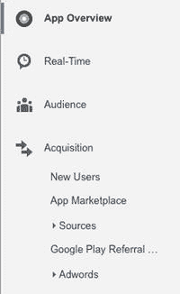
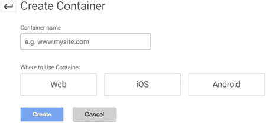
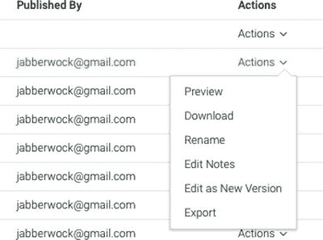
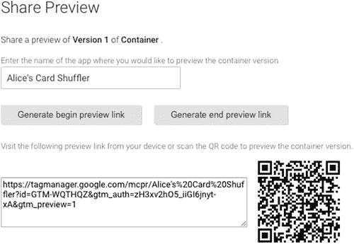

# 13. 从移动应用收集数据

> 当兔子真的从马甲口袋里掏出一块怀表，看了一眼，然后匆匆赶路时，爱丽丝猛地站了起来，因为她脑子里闪过一个念头：她从未见过一只兔子穿着马甲口袋，或者从里面掏出怀表。——刘易斯·卡罗尔，《爱丽丝梦游仙境》

到目前为止，本书的重点是使用 `GTM` 来实施 `GA`（以及可能的其他标签）以衡量网站。但网站并非客户与我们互动的唯一方式。另一个重要渠道是使用适用于移动设备的原生应用——那种可以下载并安装在手机或平板电脑上的应用，而不是在浏览器中访问网站。

`GTM` 和 `GA` 也可用于收集移动应用的数据——具体来说，就是来自 Android 和 iOS 应用的数据（在任何使用这些操作系统的设备上）。使用这些工具进行衡量有许多优势：

- 一个统一的报告工具（`GA`），用于网站和应用，使用您已熟悉的所有数据清理和报告功能。
- 一个统一的部署工具（`GTM`），用于网站和应用，使用您已熟悉的结构和发布机制。
- 一种在已发布的应用版本之间进行更新的方法。（通常，应用必须通过应用商店的发布流程进行更新，这可能很繁琐。）

当然，`GA` 中收集的数据以及您在 `GTM` 中收集这些数据的方式存在一些差异，因为我们在讨论与网站不同的环境。本章将探讨这些差异、可以使用 `GA` 和 `GTM` 的平台，以及通过其软件开发工具包（`SDK`）在移动应用中部署这些工具的过程。

**注意**  
请记住，本章并非旨在教您如何开发 Android 或 iOS 应用。虽然 `GTM` 中针对应用的实施与网站类似，但应用代码中的实施最好交给有能力的 Android 或 iOS 开发者来完成。本章旨在为您提供必要的知识，以便与开发者沟通，从而实现成功的实施。

## 适用于移动应用的 GA

在您了解如何收集移动应用的数据之前，我们先来分析一下将在 `GA` 中收集的数据本身。这些数据与网站数据相似，但存在一些差异：

- 移动应用数据不包含 `pageview` 匹配类型，而是包含 `screenviews`，它代表应用内屏幕的加载。`screenviews` 通过一个名为 `Screen Name`（屏幕名称）的维度来标识（而非包含 `pageviews` URL 的 `Page` 维度）。
- 移动应用还支持一种用于异常的额外匹配类型；即您希望捕获的应用内发生的错误和崩溃。
- 移动应用中提供了额外的维度，例如 `Application Name`（应用名称）、`Application ID`（应用 ID）和 `Application Version`（应用版本），而其他特定于网站的维度（如 `Hostname`（主机名））可能不适用于应用数据。
- 与网站数据一样，移动应用中也提供了 `event`（事件）和 `social`（社交）互动的匹配类型（参见第 5 章），用于跟踪视频播放、按钮点击或社交媒体互动等交互行为。
- 与网站数据一样，移动应用中也提供了电子商务和增强型电子商务功能（参见第 7 章），用于跟踪应用内购买。
- 广告系列在应用中的工作方式有所不同。广告系列可以通过两种不同的方式使用：
    - 跟踪应用的最初安装来源——即用户如何到达 Google Play 商店（用于 Android）或 iTunes 商店（用于 iOS）以下载并安装该应用。
    - 跟踪通过 URL 启动应用——即当网络浏览器中的链接启动用户的应用时。

由于这些差异，您可以在 `GA` 中创建特定于应用的媒体资源和视图，从而重新排列默认报告以更好地反映应用数据。

### 应用媒体资源和视图

当在 `GA` 中创建新的媒体资源或视图时（参见第 8 章），您可以选择该媒体资源或视图是用于应用还是网站（见图 13-1）。


**图 13-1.** 在 `GA` 中创建媒体资源或视图时决定跟踪类型

此选择会影响视图中可用报告的结构。（在创建媒体资源时做出此选择会影响随媒体资源一起创建的默认视图，但随后创建的视图可以用于网站或应用数据。）为移动应用选择视图会重新排列视图中的报告，以聚焦于应用数据（见图 13-2）。



**图 13-2.** `GA` 中的应用视图包含特定于应用的报告，例如“应用概览”报告

例如，您会发现不再是 `行为` > `网站内容` > `所有页面`报告（侧重于 `pageviews`），而是拥有 `行为` > `屏幕`报告用于 `screenview` 数据。在 `获客` 报告中，您会发现专门针对 iTunes 和 Google Play 商店的报告。尽管应用的报告列表有所不同，但您会发现所有熟悉的 `GA` 报告功能仍然可用，例如细分、信息中心以及许多其他工具。

与网站数据一样，您可以使用视图和媒体资源设置来定制移动应用数据，包括创建目标（参见第 6 章）、使用过滤器和内容分组（参见第 8 章）等。

#### 侧边栏：合并或分离网络和应用数据

请注意，可以将网站和移动应用数据包含在同一个媒体资源中。（需要时，可以通过过滤器将它们分开。）您应该合并移动应用数据还是将其分开？

对于需要用户登录的网站和应用，您可以使用 `GA` 的 `User ID`（用户 ID）功能来关联用户跨这些平台的活动（参见第 10 章）。然而，合并移动应用和网站数据的一个缺点是，`GA` 不包含可以轻松合并内容数据（`pageviews` 和 `screenviews`）的报告，这削弱了这种方法的优势。最终，选择权在您手中。您应该评估您的分析需求以及将这些类型的数据合并到 `GA` 中的实用性。

Google Analytics Premium 订阅者可以使用 `汇总媒体资源` 来合并来自不同媒体资源的数据，从而提供额外的灵活性。移动应用和网站数据可以保留在单独的媒体资源中，但可以在汇总媒体资源中合并以便一起分析。

其他合并数据的解决方案包括使用 `GA` API（参见附录）从媒体资源中提取数据，并在 `GA` 之外将它们合并到报告中。

## 移动应用 SDK

`GTM` 拥有适用于 Android 和 iOS 平台的官方 `SDK`。此外，`GA` 还拥有适用于 Unity 游戏引擎的 `SDK`。

**注意**  
对于除拥有官方 `SDK` 之外的任何您想要跟踪的平台，都可以通过 `Measurement Protocol`（衡量协议）（参见第 14 章）将数据发送到 `Google Analytics`。

### Android 与 iOS

`GTM SDK for Android` 和 `iOS` 有许多相似之处。虽然它们的实现细节会有所不同（Android 应用使用 Java，iOS 应用使用 Objective-C 或 Swift），但概念上它们都遵循相同的基本框架：

- 应用中包含 `GTM SDK`。
    - `Android 版 GTM SDK` 与 `Google Play Services SDK` 捆绑在一起，后者是一组用于 Google 服务（如 Google Drive、Google Maps 等）的 `SDK` 集合。`GTM SDK` 允许 Android 应用开发者在应用的 Java 代码中嵌入 `GTM` 容器，以便将事件和值推送到数据层。¹
    - `iOS 版 GTM SDK` 可以加载到 iOS 应用中。可以使用 Objective-C 或 Swift 代码将事件和值推送到数据层。²
- 与网站每次加载时都会获取容器的新副本不同，移动应用会内置一个默认容器。应用可能在没有网络连接的设备上运行，因此如果应用启动时无法通过网络连接更新容器，内置一个默认容器对于跟踪功能至关重要。
- 应用中嵌入的代码会将事件和值推送到数据层。请注意，与网站每次页面加载都会重新创建数据层不同，应用中的数据层会持续整个会话期间。
- 与网站一样，`GTM` 可以根据数据层事件触发标签。根据您在容器中设置的标签和触发器，数据会被发送到 `GA`（或其他工具的其他标签）。
- 如前所述，应用可能在没有当前网络连接的设备上运行。`GTM` 会尝试向 `GA` 或其他工具发送匹配（`hit`），但如果网络不可用，它会将匹配加入队列以便稍后发送（对于长时间延迟，超过四小时的匹配可能不会被 `GA` 处理）。即使有网络连接，`GTM` 也会批量发送匹配，并按固定间隔调度以节省电量。

本章稍后将详细介绍应用的 `GTM` 容器和数据层。

### Unity

除了 iOS 和 Android，`Google Analytics` 还为 `Unity` 平台提供了 `SDK`。`Unity` 是一个游戏引擎，其中一组代码可以编译到多个平台的应用中。

# 移动应用的 GTM

虽然存在 GA SDK for Unity，但没有 GTM SDK。这意味着您无法通过 GTM 管理标签。相反，Unity 应用中的代码直接指定将屏幕视图（`screenview`）、事件（`event`）或异常（`exception`）数据发送到 GA（例如，类似于在网站的 JavaScript 中直接实现 GA）。³

## 移动应用的 GTM 容器

您可以通过账户概览屏幕创建新容器来为移动应用创建容器。创建容器时，`GTM` 允许您选择容器是用于网站、Android 应用还是 iOS 应用（见图 13-3）。



Figure 13-3. 创建容器时选择容器类型

### 与网站容器的差异

移动应用的 GTM 容器与网站容器的基本工作方式相同，包含标签、触发器和变量。然而，移动应用的可用选项和测试过程存在一些差异。我们来看一下。

#### 标签

与 GTM 中的网站标签类似，移动应用也有许多内置标签以及自定义标签。这些标签包括：

- 用于 GA、AdWords 和 DoubleClick 的内置标签。这些标签的选项与网站相同。
- 用于自定义跟踪像素的 `Custom Image` 标签。同样，此标签的选项与网站相同。
- 一个 `Function Call` 标签，可用于调用应用内的函数（必要时可包含参数）。

请注意，与网站上的自定义 JavaScript 标签不同，自定义代码（Android 的 Java，iOS 的 Objective-C 或 Swift）不能直接包含在标签中。但是，可以使用 `Function Call` 标签来调用已存在于应用中的函数。

#### 触发器

GTM 移动应用容器中只有一种触发器，即 `Custom Event` 触发器。与网站一样，当 `event` 值被推送到数据层时，它会触发标签（示例请参见第 5 章）。

技巧：与网站流量一样，您应该使用触发器（和阻止触发器）来分隔移动应用上的测试数据。具体来说，使用 `{{App Version Code}}` 或 `{{Advertiser ID}}` 变量对于移动应用的测试触发器可能特别有用。

### 变量

移动应用容器包含了一些内置变量，可提供常用值。具体包括以下几类：

- 应用相关变量，包括应用 ID、名称、版本以及所使用的 GTM SDK 版本。
- 与网站容器相同的实用变量，包括 GTM 容器 ID 和版本、来自数据层的自定义事件值以及随机数变量。此外，移动应用还提供了一个变量，用于指示用户是否已启用广告跟踪或已选择退出。（Android 和 iOS 都提供了系统级的选项，允许用户选择退出兴趣定向广告。）
- 设备相关变量，包括平台（Android 或 iOS）、操作系统版本、设备类型、语言、屏幕分辨率以及广告标识符。广告标识符是一种持久但可由用户重置的设备标识符（与永久的设备硬件标识符不同），Android 和 iOS 都提供了该标识符用于跟踪设备。这个值——通常被称为“IDFA”或根据其在 iOS 中的名称称为“广告标识符”——取代了 Cookie（如同用于客户端 ID 的 GA Cookie）在移动应用设备识别中的作用。

此外，你还可以创建以下类型的自定义变量：

- 常量变量和数据层变量类型的工作方式与网站容器完全相同。
- 函数调用变量类型允许你调用应用内的函数并使用其返回值。
- 值收集变量类型允许你指定一组可在应用中使用的键值对。
- `Google Analytics` 内容实验变量允许使用 GA 的内容实验功能⁴，在值收集变量的多组值之间进行切换。

### 侧边栏：通过 GTM 提供应用内容

与网站类似，移动应用中的 GTM 不仅可以提供跟踪功能（通过 GA 或 AdWords 转化等代码），还可以为应用提供实际内容或功能（通过变量值和自定义代码）。通常建议不要通过 GTM 为网站提供内容或功能，原因如下：

- 当存在其他选项（如内容管理系统、Web 服务器）可以动态地向网站提供此类数据时，使用 GTM 会混淆其原本的目的（即提供一个管理跟踪代码的系统）。
- 这会导致 GTM 容器（最大为 200 KB）变得臃肿，而这些内容在其他地方管理会更好。
- 如果关键功能依赖于 GTM 中的内容，且容器因故无法访问，网站将无法正常运行。

然而，在应用中，各因素的平衡点有所不同。应用更新流程（通过应用商店）往往既漫长又繁琐，因此你会希望尽可能少地更新应用。所以，能够在应用商店更新间隔期内通过 GTM 进行小幅调整是非常有价值的。遗憾的是，目前并没有所谓的“应用内容管理系统”，而 GTM 恰好可以填补这一角色。此外，与网站不同，应用始终会包含一份容器的副本作为备用，即使在无法从 GTM 获取更新后的容器时也是如此，从而降低了容器不可用的风险。

基于这些原因，在移动应用中更常见的是使用 GTM 来提供配置数据或启动功能。值收集变量常用于向应用提供配置设置或其他内容。例如，假设你有一个包含以下值的值收集变量：

```json
{
  "suit": "hearts",
  "card": "queen"
}
```

我们的应用可以检索这些值（通过 Android 中的 `container.getString()` 函数或 iOS 中的 `container stringForKey:@{}` 函数）并在应用中使用它们：


值收集变量可用于包含配置值，或作为应用内函数输入的 URL、应用界面中使用的文本字符串，或任何其他可用于改变应用内容或行为的信息片段。这一功能是在移动应用中利用 GTM 的关键优势之一。

### 移动应用中的数据层

移动应用中的数据层与网站上的工作方式非常相似：它是一个运行中的事件和值队列，用于触发代码并提供变量值。

在网站上，每次加载新页面都会导致浏览器清除前一页面的所有 JavaScript。因此，数据层在每个页面加载时都会更新。然而，在移动应用中，数据层会持续存在，直到应用退出。这带来了几个后果：

- 拥有一个持久的数据层非常有用，因为你无需在用户的整个会话期间持续刷新持久值（就像在网站上必须做的那样）。例如，用户范围或会话范围的自定义维度、用户 ID 或其他在整个会话期间保持不变的值会保留在数据层中，无需重新添加。
- 另一方面，你需要手动清除那些不应应用于后续操作的临时值。例如，增强型电子商务值仅适用于特定的一次点击，而不适用于后续的点击。你需要清除这些值（或用新值覆盖它们），以便为每次点击发送正确的数据。

另请注意，与网站不同，这里没有默认的数据层事件（`gtm.js`、`gtm.dom`、`gtm.load`）。你需要通过应用代码显式推送所有你想放入数据层的内容。Android 和 iOS SDK 提供了用于将信息推送到数据层的函数。对于 Android，使用 `DataLayer.pushEvent()` 函数；对于 iOS，使用 `[dataLayer push:@{}]` 函数。

### 部署与测试

移动应用的部署与测试流程与网站有所不同，因为我们的更新流程不同，可用的工具也不同。

首先，你在网站中使用的调试面板在移动应用中不可用。GTM SDK 内置了可启用的日志记录功能，用于在开发阶段查看详细的日志信息。在 Android 中通过 `TagManager.setVerboseLoggingEnabled(true)` 启用，或在 iOS 中通过 `[self.tagManager.logger setLogLevel:kTAGLoggerLogLevelVerbose]` 启用。

在 GTM 中进行更改时，有两种方式可在应用中预览对容器的更改：

- 如果应用仍处于开发阶段，你可以下载容器的二进制文件并将其包含在应用中。在移动应用版本列表的操作列表中可以找到“下载”选项（见图 13-4）。
  
  图 13-4. 下载容器的二进制版本以编译到应用中
  > **注意：** 在提交到应用商店或分发给用户之前，应在编译的应用二进制文件中包含一份测试用的、功能完整的容器副本。

- 与网站类似，你可以使用预览链接（或二维码）来预览应用（包括已发布上线的应用）中容器的更改。使用此链接前，你必须在应用代码中注册 URL scheme。然后，在版本列表的操作列表中选择“预览”选项以获取链接（见图 13-5）。（请注意，你还可以生成一个结束设备预览模式的链接。）
  
  图 13-5. 通过链接或二维码在移动应用中启用容器版本的预览

对于在设备上对已上线的应用进行移动应用容器测试，数据包嗅探器（监控设备发出的网络流量）可能很有用（类似于对网站使用浏览器开发者工具）。当然，你还可以监控传入 GA 的数据，以确保数据符合预期。

> **注意：** 使用 GA 的实时报告监控测试活动时，请记住移动应用 `SDK` 会批量收集命中数据并按时间间隔发送。因此，你不会立即看到实时数据——而是会在短暂延迟后，一批命中数据同时到达。这是应用数据的正常行为。

## 总结

- GA 除了可以使用之前讨论过的 `event`、`social` 和其他命中类型外，还可以通过 `screenview` 命中类型从移动应用收集数据，并包含一些专门适用于移动应用的额外维度。GTM 提供了适用于 Android 和 iOS 的 `SDK`，支持在移动应用中使用容器，包括 GA 代码。

- 移动应用容器包含代码、触发器和变量。代码和变量的选择与网站不同，并且唯一可用的触发器类型是针对推送到数据层的事件。

- 当使用 `值收集` 变量类型来提供内容更新或为移动应用在两个应用商店版本之间提供配置值时，GTM 对移动应用尤为重要。

- 与网站不同，移动应用使用在整个会话期间持久存在的数据层。

- 移动应用测试工具包括预览模式，以及下载容器并将其编译到应用中的功能。

**脚注**

1. [`https://developers.google.com/tag-manager/android/v4/#push`](https://developers.google.com/tag-manager/android/v4/#push)

2. [`https://developers.google.com/tag-manager/ios/v3/#push-datalayer`](https://developers.google.com/tag-manager/ios/v3/#push-datalayer)

3. [`https://developers.google.com/analytics/devguides/collection/unity/v3/`](https://developers.google.com/analytics/devguides/collection/unity/v3/)

4. [`https://support.google.com/tagmanager/answer/6003007`](https://support.google.com/tagmanager/answer/6003007)