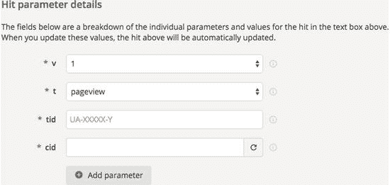

# 14. 使用 GA 的测量协议从其他来源发送数据

> 越来越好奇了！——刘易斯·卡罗尔，《爱丽丝梦游仙境》

本书大部分内容聚焦于通过 Google 跟踪代码管理器向 Google Analytics 发送数据。这些在 GA 中收集数据的官方方法涵盖了网站（JavaScript）和移动应用（iOS 和 Android SDK）。然而，除了网站和移动应用之外，还有许多你可能希望整合到 GA 中的潜在数据来源。

为了支持这些额外的数据来源，GA 提供了测量协议。测量协议是一份关于数据如何发送到 GA 的规范，数据的来源无关紧要。只要你以正确的格式发送，GA 就能使用这些数据，并与从网站或移动应用收集的常规数据一起处理。

测量协议可应用于多种场景，用于向 GA 发送数据：

- 从具有用户线下或非网页交互数据的系统（如呼叫中心或零售店销售点系统）发送数据。
- 在无法使用 JavaScript 的语境下（如 HTML 电子邮件）发送数据。
- 从没有官方 SDK 的环境或设备（如 Windows Phone、机顶盒和其他联网设备）发送数据。

由于测量协议的格式规范不依赖于数据的来源，因此你使用何种方法、编程语言或技术来捕获这些数据（这些都取决于平台和上下文）都无关紧要。只要你以相同的方式发送数据，GA 就会像处理来自网站、iOS 和 Android 官方收集源的数据一样，接收并处理它们。

> **注意：** GA 唯一的官方代码库是 `analytics.js`（用于网站）以及 iOS 和 Android SDK（用于移动应用）。你可以使用测量协议的格式从任何来源发送数据，但你需要使用你正在使用的任何编程或脚本语言自己创建用于发送数据的代码。

## 发送数据

使用测量协议发送数据只需发起一个 HTTP 请求（就像在网页浏览器中请求一个网页一样），该请求包含一个有效负载，即一组构成所发送数据的参数。


### HTTP 请求

Measurement Protocol 会向以下 URL 发起 HTTP 请求：

[`http://www.google-analytics.com/collect`](http://www.google-analytics.com/collect)

你已经知道，这也是 `analytics.js`（针对网站）和移动应用 SDK（针对 iOS 和 Android）发送数据的目标地址！Measurement Protocol 允许任何其他来源以完全相同的方式发送数据。你也可以通过 SSL 使用此 URL 进行安全请求：

[`https://ssl.google-analytics.com/collect`](https://ssl.google-analytics.com/collect)

两者的工作方式相同。

Measurement Protocol 请求可以使用 GET 或 POST 请求。（即使你之前没有特别留意，对这两种方法也一定不陌生：在网页浏览器中，页面和图片等项目使用 GET，而表单通常使用 POST。）

使用 GET 请求的能力意味着，即使在 HTML 邮件这类静态环境中，你也可以通过嵌入包含 Measurement Protocol URL 的图片来发送数据：

``

然而，出于浏览器兼容性原因，GET 请求的大小限制为 2000 字节（即 URL 中 2000 个字符，除非有双字节字符，例如亚洲语言）。与 GET 不同，POST 支持有效负载高达 8192 字节。POST 请求通常需要某种脚本来生成请求（例如，作为后端应用程序的扩展）。

### 有效负载参数

“有效负载”指通过 HTTP 请求发送给 GA 的数据。它由一系列标准化参数组成。对于 GET 请求，这些参数作为查询参数附加到 URL 中：

`http://www.google-analytics.com/collect?v=1&tid=UA-XXXX-Y&cid=12345&t=pageview&dp=%2Fhome`

在 POST 请求中，有效负载参数作为请求的主体发送，其格式与查询参数相同（由与号分隔的键值对）。

**注意：** 有效负载数据应使用 URL 编码，这意味着空格、斜杠以及 URL 格式中的其他保留字符应被替换为编码后的字符。例如，在前面的 URL 中，参数 `dp` 中的页面 `/home` 使用 `%2F` 来编码斜杠。通常情况下，你的编程或脚本语言会提供编码和解码 URL 的函数。

Measurement Protocol 文档涵盖了有效负载中可能使用的所有参数及其可接受值。（你可能会发现，它们与 GTM 中 GA 标签的“要设置的字段”中的所有字段完全相同。）每个 Measurement Protocol 匹配必须至少包含以下四个参数：

*   协议版本：`v=1`。该值始终为 1（直到有一天 GA 更新了 Measurement Protocol）。
*   跟踪 ID：`tid=UA-12345-1`。GA 网站媒体资源 ID。
*   客户端 ID：`cid=12345`。客户端 ID，对应于 `analytics.js` 存储在其 Cookie 中的客户端 ID（下文会进一步说明）。
*   匹配类型：`t=pageview`。互动的类型；可以是 `pageview`、`event`、`social`、`transaction`、`item`、`screenview`、`exception`、`timing` 之一。（与你在 GTM 的 GA 标签中可选择的互动类型相同。）

对于不同的匹配类型，可能需要附加字段。例如，如果匹配类型是 `pageview`，则应设置页面路径参数 (`dp`)；如果匹配类型是 `event`，则应设置事件类别和事件操作 (`ec` 和 `ea`)。可用的参数包括本书中讨论的针对 Web 和移动应用的 GA 中的所有数据类型，涵盖了从网页浏览和事件到高度自定义信息（如自定义维度和增强型电子商务数据）的所有基础知识。

#### 客户端 ID 和用户 ID

有两个用于按用户聚合数据的字段需要特别提及，即客户端 ID (`cid`) 和用户 ID (`uid`)。

客户端 ID 通常代表一个设备标识符——在网站的 `analytics.js` 中，它是存储在 Cookie 中的值。对于 Measurement Protocol 匹配，根据其来源，你可以将此设置为一个新的随机 ID，或者从 Cookie 中提取现有的客户端 ID。例如，考虑以下场景：

一位潜在客户通过营销活动链接访问了你的网站。他们在网站上浏览，但并未转化。相反，他们决定致电你的呼叫中心来完成转化。他们通过一个从电话号码池中随机分配的电话号码进行联系。你的呼叫中心收到了来自该电话号码的来电。呼叫中心软件与网站集成，以维护客户端 ID 和电话号码的对应关系，并向 GA 发送一个 Measurement Protocol 匹配，其中包含一个表明电话呼叫已开始的事件。客户在通话期间完成了购买。当客服代表在呼叫中心软件中录入此信息时，另一个 Measurement Protocol 匹配被发送到 GA，其中包含一个表明购买的事件。

由于整个过程使用了相同的客户端 ID，在 GA 中你将看到此用户的会话跨越了网页和电话。非常神奇！

用户 ID 帮助你更进一步，为跨设备的个体提供标识符，即使互动发生在不同时间（即，跨越多个会话）。如果你知道用户的姓名、电子邮件地址或其他信息，你可以将其链接到一个持久的标识符（例如，在你的 CRM 系统中），并且只要该用户被识别（通过登录网站或移动应用、致电呼叫中心等），你就会知道是同一个人。（有关用户 ID 的更多信息，请参阅第 10 章。）

#### 有效负载之外的请求数据

除了有效负载参数，Measurement Protocol 还会使用来自 HTTP 请求的几条额外信息：

*   接收请求的 IP 地址，用于分配地理维度，如国家/地区和城市。
*   用户代理标头，用于指示发起请求的浏览器和设备类型。
*   接收请求的时间，用于为匹配分配日期和时间。

然而，在某些情况下，你可能希望覆盖这些值。例如，假设你使用 Measurement Protocol 从呼叫中心记录应用程序收集数据，客户通过该应用程序致电下单。如果所有请求都来自你自己服务器上的内部系统，它们将具有相同的 IP 地址，但这并不能准确体现来电客户的实际地理位置。

有一些有效负载参数可以覆盖 IP 地址和/或地理位置、用户代理，并指定时间延迟（用于在连接可用时稍后发送的离线匹配，或批量发送的匹配）：

*   IP 覆盖：`uip` 参数可用于指定一个 IP 地址。然后会应用标准的 GA 处理来解释其位置。
*   地理位置覆盖：`geoid` 参数可用于指定一个位置。其值可以是两个字母的国家/地区代码，或 AdWords 地理位置标准 ID，这是一套全球范围内的国家、城市和地区标识符，用于 AdWords 中的广告定位，并作为多个 Google 工具中的地理标识符。
*   用户代理覆盖：`ua` 参数可用于指定一个用户代理。然后会应用标准的 GA 处理来确定设备类型、操作系统和浏览器。
*   队列时间：`qt` 参数可用于指定数据收集与发送之间经过的时间（以毫秒为单位）。队列时间超过四小时的匹配可能不会被 GA 处理。


### 缓存破坏

浏览器通常会缓存请求——也就是说，如果浏览器发起的请求与之前的某个请求完全相同，浏览器会首先检查该资源是否在缓存中，如果是，则直接从缓存加载，无需向服务器发起新的 HTTP 请求。

然而，这显然不是你在使用 Measurement Protocol 命中时想要的效果。如果你针对一个具有相同负载的命中发起第二次请求，那是因为用户确实第二次查看了该页面，并且你希望该请求能被发送到服务器。

为了确保发送到 Measurement Protocol 的请求不被缓存，你可以在负载中使用一个名为缓存破坏器的参数。（`analytics.js` 库会自动处理缓存破坏，但使用 Measurement Protocol 时，你需要自行处理。）该参数（`z`）仅包含一个随机数，这样原本相同的请求就能被区分开来，并从服务器重新请求。例如，以下是同一个客户端 ID 针对同一页面发起的两个网页浏览请求，但通过为缓存破坏器参数设置不同的随机值来区分它们。

```
v=1&tid=UA-12345-1&cid=12345&t=pageview&dp=%2Fhome&z=384585985785
v=1&tid=UA-12345-1&cid=12345&t=pageview&dp=%2Fhome&z=214492387598
```

### 验证

为了测试 Measurement Protocol 的命中并确保其格式正确，GA 提供了一些原型设计和测试工具。

Hit Builder 工具提供了一个表单，允许你填写负载字段的值，从而构建一个 Measurement Protocol 请求（图 14-1）。



图 14-1. 用于构建 Measurement Protocol 请求原型的 Hit Builder 工具

GA 的验证服务器允许你发送一个命中来测试负载是否包含格式正确的必需参数。你可以将任何 Measurement Protocol 命中发送到此端点进行测试：

`http://www.google-analytics.com/debug/collect`

此端点的功能与普通端点相同，但有两点区别：

*   发送到验证服务器端点的数据不会出现在报告中。它仅用于测试目的，并且会被丢弃。
*   验证服务器会以 JSON 格式发送详细的响应，显示请求是否有效以及生成的任何错误消息：

```json
{
  "hitParsingResult": [{
    "valid": false,
    "parserMessage": [{
      "messageType": "ERROR",
      "description": "A value is required for parameter 'dp'. Please see http://goo.gl/a8d4RP#dp for details.",
      "messageCode": "VALUE_REQUIRED",
      "parameter": "dp"
    }],
    "hit": "GET /debug/collect?v=1\u0026t=pageview\u0026tid=UA-12345-1\u0026cid=12345 HTTP/1.1"
  }]
}
```

你可以首先生成任何 Measurement Protocol 命中并先使用验证服务器进行测试，以确保其格式正确。

## GA 中的数据处理

一旦 GA 接收到数据（假设它通过了验证），这些数据将被视为该媒体资源的任何其他数据。过滤器和其他设置会被应用，数据会被放入视图的报告中。

请注意，目前没有针对 Measurement Protocol 数据的专门报告；它会与网站和应用程序数据一起出现（并且可以像这些数据一样被过滤）。为了使使用 Measurement Protocol 发送的数据与 GA 中的现有用户相关联，你应该包含一个与你的网站数据中现有值相匹配的客户端 ID 或用户 ID（参见 第 10 章）。

你需要自行决定如何在 Measurement Protocol 数据的上下文中解释“网页浏览量”和其他以网站为中心的指标，并且在设计发送数据的解决方案之前，你应该考虑如何在 GA 中使用这些数据。自定义维度和指标在记录本质上不同类型且不一定符合以网站为中心范式（参见 第 11 章）的数据时可能非常有用，而自定义报告和细分可能有助于以有用的方式呈现这些数据。

## 总结

*   Measurement Protocol 是一个规范，用于从任何来源向 Google Analytics 发送数据。它是一个 HTTP 请求规范，其中包含一个待 Google Analytics 接受的数据负载。
*   Measurement Protocol 可用于从网站和移动应用以外的来源收集数据，例如后端应用程序或没有官方 SDK 的环境。
*   负载数据可以包含与网站或移动应用命中相同的所有字段。GA 提供了用于构建原型和验证数据的工具。一旦 GA 接收到数据，它就会像来自网站和移动应用的数据一样出现在报告中。

## 脚注

1 ISO 3166-1，它们也用于 GA 中“受众群体”➤“地理位置”➤“语言”报告的语言代码。

2 [`http://developers.google.com/analytics/devguides/collection/protocol/v1/geoid`](http://developers.google.com/analytics/devguides/collection/protocol/v1/geoid)

