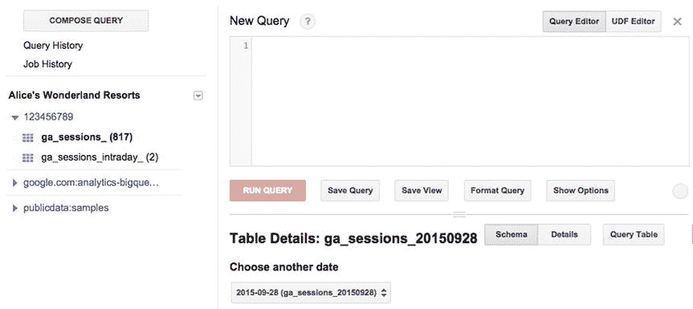
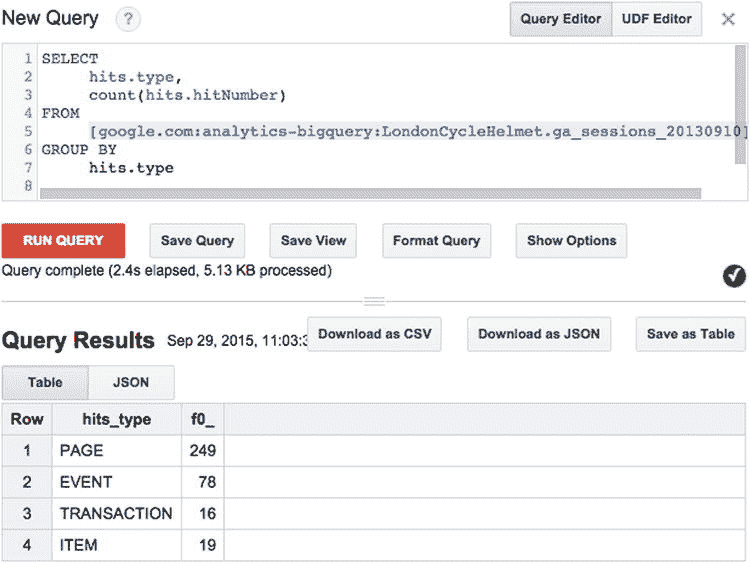
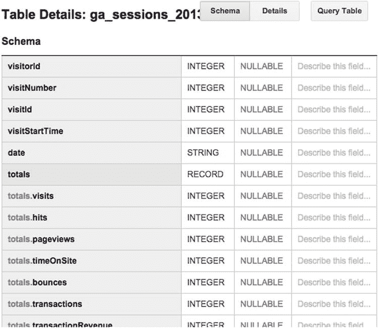
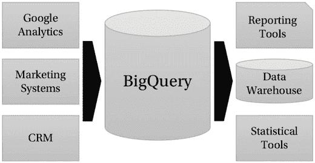

# 15. 将 Google Analytics 与 BigQuery 结合用于大数据分析

Google Analytics 在其网页界面中提供了一套广泛的报告和工具。标准报告旨在为关于网站的最常见问题提供答案，而自定义报告、细分和其他工具则有助于进行更深入的探索。然而，有些类型的问题很难通过 GA 报告中聚合的会话数据来解决——尤其是像数据挖掘和应用统计模型这样的应用，这些应用通常需要按命中的非聚合数据。这些工具可以处理的某些问题和场景包括：

*   发现行为之间的关联，例如“购买了产品 X 的用户也购买了产品 Y”或“阅读了文章 X 的用户也阅读了文章 Y”。
*   复杂的归因建模，尤其是那些整合了来自 GA 外部的额外转化、营销数据或客户数据的模型。
*   基于算法的用户分群，以及客户价值或转化可能性的预测模型。

这些技术以及用于实现它们的技术工具通常都归入“大数据”这一总称之下。GA 通过支持将数据逐条导出到另一个名为 BigQuery 的 Google 工具，为访问此类数据提供了渠道。BigQuery 是一种旨在轻松快速地分析和查询大型数据集的工具，无需担心底层技术和计算资源的支持。本章将探讨 GA 与 BigQuery 之间的集成、可用的数据以及如何利用这些数据。

GA 与 BigQuery 的集成仅适用于 Google Analytics Premium 订阅用户。

注意：本章将探讨 BigQuery 及其用于访问和查询 GA 数据的工具。统计模型和数据挖掘工具本身不在本讨论范围之内。

本章首先介绍 BigQuery 和用于访问它的工具。后续章节将更详细地介绍查询语言以及如何将其应用于 BigQuery 中的 GA 数据。最后一部分将退后一步，从宏观角度讨论在诸如前述应用中使用 BigQuery 可用数据的策略。


## 关于 BigQuery

BigQuery 是一种可让你存储、查询和提取数据的工具。它独立于 GA 和 GTM，是 Google 云平台的一部分，但你可以像使用其他 Google 工具一样，通过 Google 账号登录来访问它。虽然 BigQuery 提供了网页界面（你将在本章后面看到），但该界面主要用于探索和测试查询。通常，BigQuery 会像其他任何数据库一样，作为一种服务来充当其他应用程序的信息源。与其他数据库一样，它支持一种查询语言，可以根据感兴趣的条件选择数据子集，并返回这些值，以便在报告、可视化、统计模型或其他应用程序中进一步处理。

**注意：** 在 BigQuery 中存储和查询数据会产生相关费用。¹ 本章中的示例查询执行一次大约只需花费几美分。你的 Google Analytics Premium 订阅中包含月度 BigQuery 费用抵免额，可用于抵消使用费，但如果超出月度抵免额，你将需要为任何额外的使用量付费。

### BigQuery 不是什么

BigQuery 并非一套精美的报告。（毕竟，你在 GA 中已经有这些了！）它可以与各种报告和商业智能工具配合使用来创建报告，但 BigQuery 本身并未内置报告功能。

BigQuery 也不是传统的关系型数据库。如果你已经熟悉传统的关系型数据库和 SQL 查询语言，你会发现学习 BigQuery 很容易，但两者也存在一些差异。BigQuery 针对处理大型分布式数据集进行了优化，其结构可以包含嵌套和重复值。因此，BigQuery 的查询语言是“类 SQL”的，但并非在所有方面都符合 SQL 标准。BigQuery 表中的数据无法更改或更新；表仅能追加数据。

## GA 与 BigQuery 集成

Google Analytics Premium 订阅用户可联系其客户经理启用 GA-BigQuery 集成。你可以选择 GA 中的一个或多个视图进行数据导出。

BigQuery 的结构层次分为项目（Project）、数据集（Dataset）和表（Table）。通常，你有一个项目包含你所有的 GA 数据。你导出的每个 GA 视图在 BigQuery 中都是一个独立的数据集。

一旦启用，GA 的数据会定期导出到 BigQuery。数据包括 GA 中每次匹配（如页面浏览、事件等）的详细信息，并按会话（Session）组织排列。（本章后面的部分会更详细地探讨 GA 数据所使用的架构。）每天的数据在当天结束后导出，并成为 BigQuery 数据集中的一个独立表。如果你需要在当天结束前处理当天的数据，那么在当天数据表最终确定之前，还会有几次日内导出（大约每 8 小时一次）。

## 访问 BigQuery

可以通过多种方式访问 BigQuery 数据：

- 通过网页界面，可以在其中输入查询并查看或下载结果数据。这对于数据的探索和测试特别有用。
- 通过命令行界面输入查询并获取结果。这对于一次性数据导出或通过简单的自动化脚本从 BigQuery 检索数据可能很有用。
- 通过 API，你可以与现有工具（如 Google Sheets 或 Tableau）结合使用，以报告和可视化来自 BigQuery 的数据，或者编写与你自己的应用程序的自定义集成，或将数据导出到位于其他位置的数据仓库。

本章将展示网页界面，但所有讨论的查询，无论通过哪种方法访问 BigQuery 数据，其工作方式都是相同的。

### 网页界面

如果你使用有权访问 BigQuery 项目的 Google 账号登录，则可以访问 BigQuery 网页界面（见图 15-1）。²



*图 15-1. BigQuery 网页界面，显示从 GA 导出的一个数据集*

左侧导航显示了项目、数据集和表的层次结构。此示例中的项目名为“Alice’s Wonderland Resorts”。其中包含一个数据集（`123456789`），其名称是被导出视图在 GA 中的视图 ID 号。该数据集包含一些表，这些表的名称以 `ga_sessions_` 开头，后跟日期（以及当天以 `ga_sessions_intraday_` 开头的日内表）。

该项目中还包含一些示例数据集。数据集 `[publicdata:samples]` 是所有 BigQuery 项目中都包含的一组通用示例数据。数据集 `[google.com:analytics-bigquery:LondonCycleHelmet]` 是一个 GA 数据的示例数据集。它包含一个表，其中包含来自一个示例自行车电商网站的一天数据。在你将查询应用于自己网站上的更大数据集之前，使用这个较小的数据集来探索查询会很有帮助。

在右侧，你可以使用 BigQuery 类 SQL 查询语法输入查询并检索结果。以下是一个可供尝试的简单示例查询：

```
SELECT
  hits.type,
  count(hits.hitNumber)
FROM
  [google.com:analytics-bigquery:LondonCycleHelmet.ga_sessions_20130910]
GROUP BY
  hits.type
```

此查询从示例数据集中按类型获取匹配计数。（暂时不要太担心此查询的语法——稍后你将看到查询语言如何工作的更多细节。）图 15-2 显示了此查询在 BigQuery 网页界面中的结果。



*图 15-2. 在网页界面中输入的查询的查询结果*

在顶部，你可以看到输入的查询。选择“运行查询”按钮后，BigQuery 会执行查询并在下方显示结果（一个表格，行按匹配类型排列，列显示计数）。请注意，结果上方的按钮允许你下载为 CSV 或 JSON 文件，或将结果保存为 BigQuery 中的一个新表。


## BigQuery 中的 GA 数据架构

GA 导出至 BigQuery 的数据，代表所选数据视图在应用任何过滤器后的、非聚合的匹配级别数据（有关过滤器的更多信息，请参阅第 8 章）。数据表中的每条记录代表一个会话，会话中的嵌套记录代表各个匹配（页面浏览量、事件等）。您可以在网页界面中选择一个表，查看 GA 数据中各字段的详细信息（见图 15-3）。



图 15-3. 网页界面中显示的 BigQuery 内 GA 表的架构详情

`Schema` 选项卡显示字段名称、结构及类型。您还可以选择 `Details` 选项卡查看表中前几条记录的数据，以了解数据填充方式。

GA 数据的架构非常庞大，包含超过 150 个字段，这些字段代表了 GA 所捕获的众多信息，包括每次页面浏览、事件或其他匹配的相关信息；会话级别信息，如流量来源和地理位置；匹配中包含的增强型电子商务数据（请参阅第 7 章）；以及自定义维度和指标（请参阅第 11 章）。这些字段的命名方式与 GA 中的维度名称非常相似，因此您应该能轻松解读它们，但架构文档提供了更详细的说明。³

该架构是一种嵌套结构，嵌套字段的名称用点号 (`.`) 分隔。例如，`totals` 记录包含 `totals.hits`、`totals.pageviews`，以及整个会话总数相关的其他几个计数字段。`trafficSource` 记录包含 `trafficSource.source`、`trafficSource.medium` 以及其他流量来源维度。最重要的嵌套记录是 `hits`，它是一个可重复的记录，包含每次匹配的数据，例如 `hits.type`（针对不同的匹配类型：页面浏览量、事件等）、`hits.page.pagePath`（页面的 URL 路径）等。字段的值可以是字符串、整数、布尔值（`true` 或 `false`）或其他类型。如果某个字段为空，其值可以为 `null`。

与 GA 中的数据相比，您会注意到此数据的一个主要区别：它主要由维度值组成，仅有少数基本指标，并且缺少您在 GA 中可能常用的许多指标，例如跳出率、页面停留时间等。由于您在 BigQuery 中拥有非聚合的匹配数据，因此您可以通过选择的任何公式来计算您选择的任何指标。您可以重新计算 GA 中的指标（如跳出率和页面停留时间），但您也不再受 GA 中指标的限制——例如，您可以创建新的指标计算，比如每用户收入。

由于 BigQuery 中的数据代表 GA 视图中的完整数据，因此查询永远不受抽样、表行数限制或 GA 界面中其他报告限制的影响。（有关抽样的更多信息，请参阅第 1 章。）

BigQuery 中非聚合数据的另一个主要优势是按用户提供的详细的匹配级别数据。您可以查看用户在一段时间内（跨多个会话）的完整行为，从而对其进行详细分类。在 GA 内部，通过使用细分功能可以实现有限的操作，但基于用户的细分只能应用于有限的时间范围内，并且会受到抽样影响。

## BigQuery 的查询语言

BigQuery 使用一种修改过的 SQL 语法来查询数据集。如果您不熟悉 SQL 和数据库查询语言，本节将提供一些基本示例来帮助您入门。如果您熟悉在 MySQL、PostgreSQL、MS-SQL 或 Oracle 等数据库中使用 SQL，那么您已经掌握了构建查询的基础知识，下面的示例将为您指出与传统 SQL 方言存在差异的地方。

在这些示例中，您将使用“伦敦自行车头盔”示例数据集。该数据集包含一个表：`[google.com:analytics-bigquery:LondonCycleHelmet.ga_sessions_20130910]`，您将在所有查询中使用这个表。您应该可以在 BigQuery 的 GA 项目中访问此示例数据集。

**注意：** “伦敦自行车头盔”数据集使用的架构版本比 GA 当前使用的版本稍旧。当前架构是向后兼容的。您可以针对当前的 Google Analytics 导出数据运行以下任何查询。

查询是一个从数据集中获取所需结果的语句，可以包含以下子句：

- `SELECT`
- `FROM`
- `WHERE`
- `GROUP BY`
- `HAVING`
- `ORDER BY`
- `LIMIT`

您可以将此理解为针对您想要检索的数据编写一个句子：

- `SELECT` `某些字段`
- `FROM` `某些表`
- `WHERE` `记录满足条件`
- `GROUP BY` `某个希望其唯一的字段`
- `HAVING` `某个有趣的聚合条件`
- `ORDER BY` `某些字段`
- `LIMIT` `只取前若干条`

让我们从一些基本示例开始，说明这个句子的各个子句及其工作方式。

**注意：** 本章包含一系列与 BigQuery 中 GA 数据相关的示例，但它并非查询语言的完整参考。GA-BigQuery 集成文档⁴ 和 BigQuery 文档⁵ 提供了更多信息和示例。


### 从表中选择数据

`SELECT`关键词允许查询从表中挑选特定字段`FROM`表、重命名字段，并对数据执行计算。`SELECT`和`FROM`是任何查询的两个核心子句。

通常，查看表中的每一个字段并不实用或有效。仅选择你需要的字段可以简化待审查的结果，并减少完成查询所需的数据量和处理能力。使用`SELECT`，你可以使用字段名称（来自模式）或使用`*`作为通配符来选择所有字段。（通常不推荐使用`SELECT *`，因为当模式中存在多个可重复字段时，它是不允许的。请参阅本节后面的“展平包含重复字段的表”）。

一个非常简单的查询示例如下：

```
SELECT fullVisitorId, totals.hits
FROM   [google.com:analytics-bigquery:LondonCycleHelmet.ga_sessions_20130910]
```

这将从伦敦自行车头盔示例表中选择两个字段（`fullVisitorId`，对应 GA 中的客户端 ID；以及`totals.hits`，表示会话中的点击次数）。结果如下所示：

```
     fullVisitorId       totals_hits
1    380066991751227408  8
2    712553853382222331  12
3    881288060286722202  3
4    881288060286722202  1
5    881288060286722202  7
```

这里仅展示了前几个结果。如果你使用的是网络界面，它会分页显示结果，每次显示少量数据。（`LIMIT`子句也可以设置返回的最大行数；例如，只需在查询末尾加上`LIMIT 5`即可。）

**注意：** 在 SQL 语法中，大小写和空格并不重要。你可以根据需要随意插入换行符，使查询更具可读性。习惯上也会将`SELECT`和`FROM`等子句关键词大写。

你可以使用`AS`关键词重命名结果中的字段，如下所示：

```
SELECT fullVisitorId AS Client_ID, totals.hits AS Hits
FROM   [google.com:analytics-bigquery:LondonCycleHelmet.ga_sessions_20130910]
```

这将返回与之前相同的结果，但列标题现在对应你所选的名称：

```
     Client_ID           Hits
1    380066991751227408  8
2    712553853382222331  12
3    881288060286722202  3
4    881288060286722202  1
5    881288060286722202  7
```

为结果列赋予有意义的名称非常有帮助，尤其是在创建新列来表示新指标时。

### 计算函数

除了选择字段的值，你还可以对字段执行计算。

计算可以作用于单条记录中的字段，将它们组合起来，并返回一个结果。例如，你可以对数字进行加、减、乘、除（使用运算符`+`、`-`、`*`、`/`），或者连接字符串（使用`CONCAT()`）。

例如，假设你需要为每个会话设置一个唯一标识符。模式中没有这个字段，但你可以通过连接客户端 ID（`fullVisitorId`）和访问开始的时间戳（`visitId`）来创建一个：

```
SELECT CONCAT(fullVisitorId, ".", STRING(visitId)) AS Session_ID
FROM   [google.com:analytics-bigquery:LondonCycleHelmet.ga_sessions_20130910]
```

此示例使用`CONCAT`函数组合了两个字段。注意它们在中间插入了一个点字符，以便直观地标识各部分。另外注意使用了`STRING()`来强制将`visitId`字段的类型转换为字符串，因为它实际上是一个整数字段（如模式中所述）。结果如下所示：

```
     Session_ID
1    380066991751227408.1378805776
2    712553853382222331.1378804218
3    881288060286722202.1378803865
4    881288060286722202.1378804975
5    881288060286722202.1378805870
```

还有第二种类型的计算，称为聚合函数，因为它们通过计数、求平均值或求和等方式（使用`COUNT()`、`AVG()`或`SUM()`等），将多条记录中的值聚合到结果中的单一行中。例如，如果你想要当天的总点击次数，可以使用以下查询：

```
SELECT SUM(totals.hits) AS Hits
FROM   [google.com:analytics-bigquery:LondonCycleHelmet.ga_sessions_20130910]
```

这将产生以下结果：

```
     Hits
1    362
```

请注意，使用聚合函数将表中的所有记录合并为单个结果。你可以对其他指标采用类似的方法。例如，假设你需要跳出率。你可以编写如下查询：

```
SELECT AVG(totals.bounces) AS Bounce_Rate
FROM   [google.com:analytics-bigquery:LondonCycleHelmet.ga_sessions_20130910]
```

但这是你将得到的结果：

```
     Bounce_Rate
1    1
```

100%的跳出率——这可不妙！但这也是不正确的。不幸的是（或者幸运的是，取决于你的需求），聚合函数不包含空值，而`totals.bounces`的值对于跳出会话是`1`，对于非跳出会话则是`null`（如模式中所述）。因此，你可以将`null`值转换为`0`，或者计算`1`的数量并除以总会话数，如下例所示：

```
SELECT COUNT(totals.bounces)/COUNT(totals.visits) AS Bounce_Rate
FROM   [google.com:analytics-bigquery:LondonCycleHelmet.ga_sessions_20130910]
```

得到以下结果：

```
     Bounce_Rate
1    0.1746031746031746
```

啊，17.5%的跳出率——好多了！

### 表的日期范围

到目前为止的示例仅使用了包含单个表的`FROM`子句。然而，正如你所见，GA 数据每天包含一个单独的表，因此如果你想聚合多天的数据，就需要查询多个表的并集，将它们当作一个大表来处理。你可以在查询中通过在`FROM`子句中使用逗号包含多个表来合并它们。

**注意：** 如果你熟悉 SQL，请注意 BigQuery 中的逗号表示并集，而不是连接。这是 BigQuery 与标准 SQL 语法的主要区别之一。

示例如下：

```
SELECT
     fullVisitorId, totals.hits
FROM
     [google.com:analytics-bigquery:LondonCycleHelmet.ga_sessions_20130910],
     [google.com:analytics-bigquery:LondonCycleHelmet.ga_sessions_20130911]
```

**注意：** 伦敦自行车头盔数据集仅包含一个单日表（2013 年 9 月 10 日），因此此示例会执行失败。请在你自己的数据集上尝试一些日期。

如果你只想列出两三天，这种语法没问题，但超过这个范围，就会变得笨拙。为方便起见，BigQuery 还包含了`TABLE_DATE_RANGE()`函数（及其姊妹函数`TABLE_DATE_RANGE_STRICT()`）。这允许你匹配一个日期范围。`TABLE_DATE_RANGE()`通过接受一个前缀，并为其给定范围内的每一天附加日期，然后将所有表合并在一起。（`TABLE_DATE_RANGE_STRICT()`工作方式类似，但如果日期范围内缺少任何表，则会返回错误。）

你会注意到，在 GA 导出中，所有表名都以`ga_sessions_`开头，后跟`YYYYMMDD`格式的日期。你可以像这样使用`TABLE_DATE_RANGE()`来合并这些表：

```
SELECT
     fullVisitorId, totals.hits
FROM
     TABLE_DATE_RANGE(
          [google.com:analytics-bigquery:LondonCycleHelmet.ga_sessions_],
          TIMESTAMP('2013-09-01'),
          TIMESTAMP('2013-09-30'))
```


### 展平包含重复字段的表

与传统的关联式数据库不同，在 BigQuery 中，你可以拥有可重复的字段。例如，`hits` 记录在一次会话中会重复多次，每次的值都不同。

`FLATTEN` 表达式会处理一个重复字段，并为该重复字段的每个值生成一行结果（其他所有字段会被复制）。如果你的 `SELECT` 子句中只有一个重复字段，BigQuery 会自动对结果进行 `FLATTEN` 处理：

```
SELECT
     CONCAT(fullVisitorId, ".", STRING(visitId)) AS Session_ID,
     hits.page.pagePath AS Page
FROM
     [google.com:analytics-bigquery:LondonCycleHelmet.ga_sessions_20130910]
```

```
     Session_ID                     Page
1    380066991751227408.1378805776  /vests/
2    380066991751227408.1378805776  /vests/orange.html
3    380066991751227408.1378805776  /vests/orange.html
4    380066991751227408.1378805776  /login.html
5    380066991751227408.1378805776  /login.html
```

这与使用以下显式包含 `FLATTEN` 语句的查询是等效的：

```
SELECT
     CONCAT(fullVisitorId, ".", STRING(visitId)) AS Session_ID,
     hits.page.pagePath AS Page
FROM
     FLATTEN([google.com:analytics-bigquery:LondonCycleHelmet.ga_sessions_20130910], hits)
```

当 `SELECT` 查询中只有一个重复字段时（如此示例中的 `hits`），`FLATTEN` 语句是隐式的。但是，如果你想组合多个重复字段，比如同时使用 `hits` 和 `customDimensions`，你必须先对其中一个字段应用 `FLATTEN`：

```
SELECT
     CONCAT(fullVisitorId, ".", STRING(visitId)) AS Session_ID,
     hits.page.pagePath AS Page,
     customDimensions.index AS CD_Index,
     customDimensions.value AS CD_Value
FROM
     FLATTEN([google.com:analytics-bigquery:LondonCycleHelmet.ga_sessions_20130910], hits)
```

以下是结果（为了展示 `CD_Index` 和 `CD_Value` 列中的一些有趣数据，增加了几行）：

```
     Session_ID                     Page                    CD_Index  CD_Value
1    380066991751227408.1378805776  /helmets/foldable.html  null      null
2    380066991751227408.1378805776  /helmets/foldable.html  null      null
3    380066991751227408.1378805776  /helmets/foldable.html  null      null
4    380066991751227408.1378805776  /                       null      null
5    380066991751227408.1378805776  /vests/                 null      null
6    380066991751227408.1378805776  /vests/yellow.html      null      null
7    380066991751227408.1378805776  /vests/yellow.html      null      null
8    380066991751227408.1378805776  /                       null      null
9    712553853382222331.1378804218  /vests/                 2         Bronze
10   712553853382222331.1378804218  /vests/                 3         Yes
11   712553853382222331.1378804218  /vests/orange.html      2         Bronze
12   712553853382222331.1378804218  /vests/orange.html      3         Yes
13   712553853382222331.1378804218  /vests/orange.html      2         Bronze
14   712553853382222331.1378804218  /vests/orange.html      3         Yes
15   712553853382222331.1378804218  /login.html             2         Bronze
```

如果你编写了一个包含多个重复字段的查询，但没有正确地应用 `FLATTEN`，将会收到一个错误：

```
Cannot output multiple independently repeated fields at the same time.
```

### 按字段排序

你常常会希望按照特定的顺序获取信息：例如，按用户浏览的页面数量排序。你可以使用 `ORDER BY` 子句对结果进行排序，排序方式可以是 `ASC`（从小到大）或 `DESC`（从大到小）。`ORDER BY` 与 `LIMIT` 结合使用非常有用，比如获取前 5 个（或后 5 个）最大值。

```
SELECT
     CONCAT(fullVisitorId, ".", STRING(visitId)) AS Session_ID,
     totals.pageviews AS Pageviews
FROM
     [google.com:analytics-bigquery:LondonCycleHelmet.ga_sessions_20130910]
ORDER BY
     Pageviews DESC
LIMIT 5
```

```
     Session_ID                      Pageviews
1    6865576331513008945.1378805428  15
2    7715166900416604175.1378805776  12
3    8266000033835867941.1378803597  10
4    7236424239009423246.1378806189  10
5    5682534891274575276.1378819500  9
```

请注意，使用 `AS` 重命名字段后，你可以使用你创建的名称，如 `ORDER BY` 子句中的 `Pageviews` 所示。

### 分组字段

到目前为止，你已经了解了如何从表中检索字段以及如何在整个数据集上进行聚合。现在，让我们来看看如何使用 `GROUP BY` 对字段进行分组，以聚合值。

例如，到目前为止，你已经了解了如何查询网站的聚合总页面浏览量，以及按会话（针对表中的每条记录）查询页面浏览量。如果你想要每个用户（基于 `fullVisitorId`）的页面浏览量呢？这就是 `GROUP BY` 子句的用途：为字段中具有特定值的每一行应用一个聚合函数。你可以应用 `SUM()` 聚合函数，并按用户进行 `GROUP BY`：

```
SELECT
     fullVisitorId AS Client_ID,
     SUM(totals.pageviews) AS Pageviews,
     COUNT(visitId) AS Sessions
FROM
     [google.com:analytics-bigquery:LondonCycleHelmet.ga_sessions_20130910]
GROUP BY
     Client_ID
ORDER BY
     Pageviews DESC
LIMIT 5
```

```
     Client_ID            Pageviews  Sessions
1    6865576331513008945  15         1
2    9007483028904009722  12         3
3    8266000033835867941  12         2
4    7715166900416604175  12         1
5    3878411695083249177  11         2
```

现在，你已经汇总了每个用户（`Client_ID`）的总页面浏览量，即使某些用户拥有多个会话！例如，结果中的第 2 行显示了一个用户，该用户在所查询的天数内，跨三个不同会话共有 12 次页面浏览量。

请注意，如果你 `SELECT` 了一个字段值（例如 `fullVisitorId`）和聚合函数（例如 `SUM(totals.pageviews)`），则必须对字段值进行 `GROUP BY`。否则，查询将没有意义，并且你会收到一条错误消息。

### 查找满足条件的数据

通常，你感兴趣的可能是数据的子集，而非全量数据：比如某个特定用户、页面、流量来源等。类似于在 GA 中构建细分，你可以在 BigQuery 中使用 `WHERE` 子句将查询限制为符合一个或多个条件的数据。

例如，考虑以下查询：

```
SELECT
     CONCAT(fullVisitorId, ".", STRING(visitId)) AS Session_ID,
     totals.pageviews AS Pageviews
FROM
     [google.com:analytics-bigquery:LondonCycleHelmet.ga_sessions_20130910]
WHERE
     trafficSource.medium="organic"
```

这个查询与你之前用来查看按会话统计的页面浏览量的查询相同，只是增加了一个 `WHERE` 子句，只选择流量媒介标签为“organic”的会话。你可以在 `WHERE` 子句中使用 `OR` 和 `AND` 来组合多个条件。

## 更多 Google Analytics 示例

现在你已经了解了 BigQuery 中查询的基本语法，这里提供几个更复杂的、针对 GA 数据实际应用的示例。


### 关于代码块的注意事项

本文中的 SQL 查询和结果集示例应使用 Markdown 代码块格式，以保持其原始结构。所有变量名、函数名、路径名等均已添加反引号。

### 按着陆页统计的跳出率

之前的查询计算了整体跳出率。现在，我们尝试按着陆页分组进行计算：

```sql
SELECT
     hits.page.pagePath AS Landing Page,
     COUNT(totals.bounces)/COUNT(totals.hits) AS Bounce_Rate,
     COUNT(totals.bounces) AS Bounces,
     COUNT(totals.hits) AS Entrances
FROM
     [google.com:analytics-bigquery:LondonCycleHelmet.ga_sessions_20130910]
WHERE
     hits.type="PAGE" AND hits.hitNumber=1
GROUP BY
     Landing Page
ORDER BY
     Entrances DESC
     Landing Page            Bounce_Rate          Bounces  Entrances
1    /                       0.13043478260869565  3        23
2    /helmets/foldable.html  0.25                 3        12
3    /helmets/               0.2222222222222222   2        9
4    /vests/                 0.16666666666666666  1        6
5    /vests/orange.html      0.3333333333333333   1        3
```

该查询中的 `WHERE` 子句是通过 `AND` 组合两个条件的示例。它使用了 `hits.type="Page"` 和 `hits.hitNumber=1` 来仅获取着陆页（会话中第一次页面浏览的 URL）。

请注意，此查询会自动进行 `FLATTEN` 处理，因为您是从重复字段 `hits` 中进行选择。

### 按自定义维度细分

自定义维度以重复字段的形式包含在 BigQuery 的 GA 数据中，该字段包含索引和值。（有关自定义维度的更多信息，请参见第 11 章）。自定义维度的一个常见用途是细分：使用自定义维度值来定义您感兴趣的特定受众。

在 `WHERE` 子句中使用字段（例如之前的 `trafficSource.medium` 示例）进行细分很容易，但对于自定义维度（一个由两部分组成的重复字段）来说，则稍微复杂一些。

在伦敦自行车头盔数据中，有几个自定义维度。索引为 2 的自定义维度是一个用户作用域的自定义维度，用于客户类型，其值可以是 `Bronze` 或 `Platinum`，反映了优选客户状态。（此维度为 null 或没有值则表示普通客户。）

以下查询用于查找具有 `Platinum` 状态的用户：

```sql
SELECT
     fullVisitorId AS Client_ID,
     LAST(IF(
          hits.customDimensions.index=2,
          hits.customDimensions.value,
          "Regular")) WITHIN RECORD AS Customer_Type
FROM [google.com:analytics-bigquery:LondonCycleHelmet.ga_sessions_20130910]
HAVING Customer_Type = "Platinum"
```

此查询展示了几个新概念的示例：

- `IF()` 是一个函数，它接受一个条件、一个条件为真时返回的值以及一个条件为假时返回的值。在此示例中，它仅为索引为 2 的自定义维度返回值。
- `LAST()` 是一个聚合函数（类似于 `SUM()`、`COUNT()` 等），它获取最后一个顺序值。在此示例中，它返回自定义维度的最后一个值（例如，以防有人在会话期间从 `Bronze` 升级到 `Platinum` 状态）。
- `WITHIN RECORD` 允许我们在单个记录内使用聚合函数（在此示例中，使用 `LAST()` 获取会话中的最后一个值）。
- `HAVING` 类似于 `WHERE`，但可用于过滤聚合函数的结果。（`WHERE` 为要包含在 `SELECT` 语句中的记录定义条件，因此不能在 `WHERE` 子句中使用聚合函数值。）

### 自定义维度值的指标

除了上一个示例中的细分之外，您可能还想比较维度各值之间的指标，并使用更复杂的选择标准跨字段进行聚合。以下是一个示例：

```sql
SELECT
     Customer_Type,
     COUNT(fullVisitorId) AS Users,
     SUM(totals.transactionRevenue)/1000000 AS Revenue,
     SUM(totals.transactionRevenue)/1000000/COUNT(fullVisitorId) AS Revenue_per_User
FROM
     (SELECT
          fullVisitorId,
          totals.transactionRevenue,
          LAST(IF(
              hits.customDimensions.index=2,
              hits.customDimensions.value,
              "Regular")) WITHIN RECORD as Customer_Type
     FROM [google.com:analytics-bigquery:LondonCycleHelmet.ga_sessions_20130910])
GROUP BY Customer_Type
     Customer_Type  Users  Revenue  Revenue_per_User
1    Regular        43     104.12   2.4213953488372093
2    Bronze         12     44.98    3.748333333333333
3    Platinum       8      57.13    7.14125
```

结果表明，Platinum 客户的平均价值大约是 Bronze 客户的两倍，是普通客户的三倍。太酷了！

此查询展示了一个新概念——子查询的示例。`FROM` 子句可以包含一个嵌套的 `SELECT` 语句，而不是直接从表中进行选择。在此示例中，它用于选择一些值（包括上一个示例中用于客户类型的自定义维度）。然后，外部的 `SELECT` 子句聚合这些值并按客户类型进行分组。

### 数据透视维度

最后，让我们来看一下构建数据透视表，以查看两个不同维度之间某个指标的交集。例如，假设您想按客户类型查看产品购买情况。以下是一个示例查询：

```sql
SELECT
     Sku,
     SUM(IF(Customer_Type="Bronze", Quantity, 0)) AS Bronze,
     SUM(IF(Customer_Type="Platinum", Quantity, 0)) AS Platinum,
     SUM(IF(Customer_Type IS NULL, Quantity, 0)) AS none
FROM
  (SELECT
       hits.item.productSku AS Sku,
       hits.item.itemQuantity AS Quantity,
       LAST(IF(
            hits.customDimensions.index=2,
            hits.customDimensions.value,
            NULL)) WITHIN RECORD AS Customer_Type
   FROM [google.com:analytics-bigquery:LondonCycleHelmet.ga_sessions_20130910])
WHERE Sku IS NOT NULL
GROUP BY Sku
     Sku            Bronze  Platinum  none
1    VEST-ORANGE-4  2       0         2
2    HELM-HEAVY-2   3       0         1
3    HELM-FOLD-1    0       2         4
4    VEST-YELLOW-5  0       1         2
5    HELM-LIGHT-3   0       2         0
```

结果将产品 SKU 放在行中，客户类型放在列中，值为购买数量。

此示例使用了上一个示例中的子查询概念，并在聚合函数中使用 `IF()` 按客户类型对数据进行透视。此外，表达式 `IS NULL` 和 `IS NOT NULL` 可帮助排除空白字段或对它们进行不同处理，如所示。


### 连接数据

前述示例均使用了单一表或一组表，且这些表都拥有相同的架构。有时，在 BigQuery 中分析 GA 数据最有趣的应用场景在于将其与其他来源的数据相结合。（关于此类应用的更多讨论，请参见下一节。）与其他数据库系统一样，BigQuery 也支持 `JOIN` 语句来组合多个表或查询。

例如，假设你拥有退款数据（来自订单处理系统），希望将其与 GA 中的电子商务交易数据结合，以便更深入地了解净收入（即退款后的收入）。伦敦自行车头盔数据集实际上包含一个示例表 `refunds_201309`，其中就含有此类信息。让我们来看一个使用 `JOIN` 将该表与 GA 数据结合的查询：

```
SELECT
     hits.transaction.transactionId AS Transaction_ID,
     hits.transaction.transactionRevenue/1000000 AS Revenue,
     Refund_data.RefundAmount AS Refunded,
     hits.transaction.transactionRevenue/1000000- Refund_data.RefundAmount AS Net_Revenue
FROM FLATTEN([google.com:analytics-bigquery:LondonCycleHelmet.ga_sessions_20130910],hits) AS GA_data
JOIN
    (SELECT TransactionId, RefundAmount
     FROM [google.com:analytics-bigquery:LondonCycleHelmet.refunds_201309]) AS Refund_data
    ON GA_data.hits.transaction.transactionId = Refund_data.TransactionId
WHERE hits.type = "TRANSACTION"
     Transaction_ID  Revenue  Refunded  Net_Revenue
1    LCH75081220828  11.15    11.15     0.0
2    LCH99499967532  7.56     7.56      0.0
3    LCH69093459403  12.99    12.99     0.0
4    LCH59885020485  12.99    12.99     0.0
5    LCH62189793867  21.15    10.0      11.15
```

`JOIN` 语句包含一个 `FROM` 第二个表的 `SELECT` 子句，其中 `ON` 子句指定了两个表用于连接所共享的值。

结果中包含了交易 ID，这是已连接表之间共享的值，同时展示了来自 GA 的收入、退款表中的退款金额，以及两者之差计算得出的净收入。

**注意**

示例数据使用的是基础电子商务（而非增强型电子商务；有关差异的详细信息，请参见第 7 章）。如果你的网站使用增强型电子商务，则需要修改查询，以便使用增强型电子商务数据中的交易 ID。

这是一个所谓的 `INNER JOIN`（内连接）示例，这意味着只有两个数据集中具有对应值的记录才会被包含在结果中。与其他 SQL 方言一样，BigQuery 也支持 `OUTER JOIN`（外连接）（`LEFT`（左连接）、`RIGHT`（右连接）或 `FULL`（全连接））和 `CROSS JOIN`（交叉连接）功能。

**注意**

如果你熟悉关系数据库中的 `JOIN`，应了解它们在 BigQuery 中的工作方式有所不同。BigQuery 在处理嵌套、非规范化的记录集时效率最高，并且未针对规范化结构进行优化。在将数据集加载到 BigQuery 之前，不应对其进行规范化，并且应谨慎使用 `JOIN`。

## 在数据分析中运用 GA 与 BigQuery 的策略

既然你已经了解了 BigQuery 的一些功能及其查询 GA 数据的方式，让我们退一步，从全局角度进行审视。在充分利用网站、营销和客户关系相关数据的整体战略中，BigQuery 扮演着怎样的角色？

BigQuery 既可以作为数据的目的地，也可以作为数据的来源（参见图 15-4）。左侧是数据流入 BigQuery。正如 GA 数据可以导出到 BigQuery 一样，其他系统也可能成为数据源，从而将 BigQuery 转变为存储多种你想要组合并查询的数据类型的仓库。



图 15-4. 使用网页分析数据及其他数据在 BigQuery 中进行数据处理的架构

右侧则是从 BigQuery 中提取数据。通过 BigQuery 查询组合而成的数据集可以路由到其他数据仓库系统，供报表或商业智能工具使用，或者作为统计建模或数据挖掘算法的输入。

### 将数据导入 BigQuery

来自其他来源的数据可以导入到 BigQuery 中，以便与 GA 数据进行连接。这有许多潜在的应用场景：

- 任何可用于“数据导入”的数据类型（参见第 12 章）也可以导入到 BigQuery 中并与 GA 数据进行 `JOIN`。这种方法的好处包括能够丰富历史数据（而“数据导入”仅适用于新收集的数据），以及能够利用个人身份信息（这在 GA 内是被禁止的）。
- 来自其他来源的活动流数据，类似于 GA 中的数据。例如，你的电子邮件营销系统可能包含用户收到、打开和点击的电子邮件记录。你的 CRM 系统可能包含了与用户通过电话或当面互动的**时间线**。你可能还拥有针对用户的直邮或其他营销记录。BigQuery 是一个可以针对已识别用户整合所有这些信息的地方。

BigQuery 与 Google Cloud Platform（GCP）的其他产品（如 App Engine、Cloud Storage 和 Dataflow）一样，提供了多种 API 来实现从这些来源自动导入数据。

与更传统的数据仓库系统相比，以这种方式将 BigQuery 用作数据仓库具有若干优势。BigQuery 是一个快速且可靠的查询大型数据集的引擎，其基础源于谷歌对此类工具的经验和需求，代表了从 Hadoop 等工具演进而来的下一代解决方案。GCP 产品在云端运行，减少了本地解决方案的硬件管理挑战。此外，BigQuery 和其他一些关键的 GCP 产品都是完全托管的服务，在很大程度上消除了在配置和维护解决方案时的猜测工作。

### 提取数据以用于其他应用程序

来自 BigQuery 的数据也可以作为其他工具的来源：

- BigQuery 中的数据可以完整或部分地复制到其他数据仓库系统中。
- 报表、可视化和商业智能工具可以访问数据，以构建报告或仪表板。简单的解决方案包括在 Google Sheets 中访问 BigQuery 数据。流行的数据探索和可视化工具 Tableau 将 BigQuery 作为数据源。许多商业智能平台都可以将 BigQuery 作为源数据库进行访问。
- 统计建模和数据挖掘工具可以将 BigQuery 的查询结果数据作为算法输入，用于预测分析、数据简化、细分、关联和聚类分析等。这是将未聚合的 GA 数据用于 BigQuery 最有前景的机会之一，因为此类分析在很大程度上无法使用聚合数据完成。统计编程语言 R 以及 Python 中的 Pandas 库（这些应用中最常用的工具集）都支持将 BigQuery 作为数据源。


## 摘要

*   `BigQuery` 是谷歌云平台的一项工具，作为一个针对大规模数据集查询优化的数据库。它使用类 SQL 的查询语言，但在某些方面与传统关系型数据库有所不同。用户可以通过网页界面、命令行工具和 API 访问它。
*   对于谷歌分析（Google Analytics）付费用户，其数据可以以未聚合的、点击级别的形式导出到 `BigQuery`。
*   `BigQuery` 可作为谷歌分析数据以及营销活动和客户关系等其他数据的数据仓库。`BigQuery` 的输出可用于向报表工具、其他数据仓库系统和统计模型提供数据。

脚注 1
[`https://cloud.google.com/bigquery/pricing`](https://cloud.google.com/bigquery/pricing)

2
[`https://bigquery.cloud.google.com`](https://bigquery.cloud.google.com/)

3
[`https://support.google.com/analytics/answer/3437719`](https://support.google.com/analytics/answer/3437719)

4
[`https://support.google.com/analytics/topic/3416089`](https://support.google.com/analytics/topic/3416089)

5
[`https://cloud.google.com/bigquery/docs`](https://cloud.google.com/bigquery/docs)

6
如架构文档所述。

