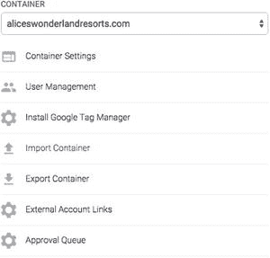
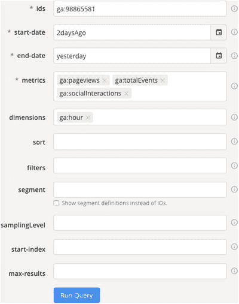
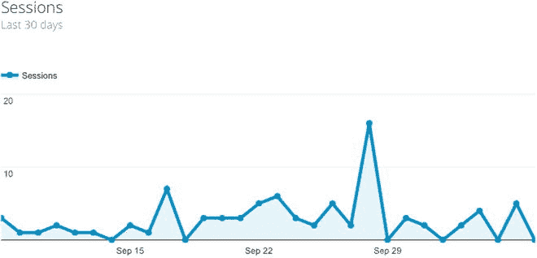

# 谷歌跟踪代码管理器与谷歌分析 API

> 然而，爱丽丝已经非常习惯于只期待不寻常的事情发生，以至于生活按照平常的方式进行，反而显得相当枯燥乏味。 ——刘易斯·卡罗尔，《爱丽丝梦游仙境》

本书主要侧重于使用 `GTM` 和 `GA` 网页界面进行配置，以便将数据导入报表。然而，有必要提及的是，这两个工具都提供了用于配置和导出数据的 API。

应用程序编程接口（`API`）只是第三方应用程序或脚本读取或写入数据到另一个工具的标准化方式。与 API 交互通常需要具备某种编程或脚本语言（如 Java 或 Python）的熟练使用能力，尽管对于不太熟练的开发人员来说，也有一些轻量级的可能性（例如，使用嵌入 API 的 HTML 和 JavaScript 解决方案）。本附录概述了可用的 API，并讨论了如何使用它们，但并未包含使用这些 API 进行编程的深入示例。有大量的文档和示例代码，以及一些有用的工具，供你进一步探索。¹

此外，还存在一个现有生态系统，包含许多免费和付费的第三方产品，它们都在利用这些 API。你可以在 `GA` 合作伙伴应用商店中找到与 `GA` 和 `GTM` 集成的产品目录。²

## 谷歌 API 基础

谷歌为其众多产品提供了 API。这些 API 中的大多数共享相同的基础架构和设计模式。一些常见功能包括：

*   **授权**：谷歌使用 OAuth 授权来提供对您账户的访问权限（相当于在网站上使用电子邮件和密码登录）。OAuth 既支持客户端身份验证（适用于用户拥有适当访问权限并登录产品的场景），也支持服务器端身份验证（适用于自动仪表板更新、定时数据管道等场景）。

*   **客户端库**：这些 API 是 `REST API`，可以通过任何方法经由 HTTP 访问。然而，官方提供了多种语言的客户端库。覆盖范围因 API 和语言而异。通常，Java 和 Python 拥有最完整的库和文档。

*   **配额**：这些 API 对在给定时间段内可以发出的请求数量设有配额。您可以通过 Google API 控制台管理您的配额使用情况。³ 如果特定应用程序有需要，可以申请调整配额。

借助共享基础架构的谷歌 API，`GA`/`GTM` 与其他谷歌工具（如 `Google Sheets` 和 `Google Cloud Platform`）之间的集成得以简化。尽管这些 API 可以从任何工具或环境工作，但通常的做法是，在适当的情况下使用多种谷歌提供的工具和系统，以最少的组件拼接来实现您的目标。

## 谷歌跟踪代码管理器 API

`GTM API` 用于访问和更新代码、触发器和变量。因此，它是构建便捷工具的基础，这些工具可以在不使用网页界面的情况下设置容器：复制容器、对多个容器执行自动化更改等。请记住，`GTM` 本身不包含任何数据；它仅能确保数据被发送到其他工具（如 `GA`），因此 `GTM` 的 API 完全专注于配置。

`GTM` 的 API 能够完成我们在网页界面中可以做的所有事情：创建账户和容器；分配权限；设置代码、触发器和变量；以及发布和管理版本。

### GTM 容器 JSON 格式

`GTM API` 使用标准化的 JSON 对象格式来表示容器版本的设置、代码、触发器和变量。该 JSON 对象格式在 `GTM` 文档中有详细说明⁴，并在 `GTM API` 中用于表示容器的内容，或使用新的设置、代码、触发器或变量来更新容器。

我们还可以在 `GTM` 界面内使用相同的 JSON 格式导出和导入容器。这些选项可以在 `GTM` 管理区域的容器设置中找到（见图 A-1）。

**图 A-1.** 在容器设置菜单中导入和导出 `GTM` 容器。

## 谷歌分析 API

谷歌分析有两种类型的 API：配置和报表。

*   **报表**：报表 API 可访问 `GA` 标准和自定义报表中提供的相同数据。您可以像在网页报表界面中一样，选择维度和指标、日期范围、过滤和排序选项，并应用细分来从 `GA` 获取数据。

*   **配置**：与 `GTM API` 类似，`GA` 的配置 API 专注于设置——即可以在 `GA` 管理区域中完成的操作，例如设置用户权限、关联 AdWords 账户、设置视图和过滤器，以及创建目标转化。

### 报表 API

主要的报表 API 是核心报表 API，它可以访问 `GA` 中的大部分数据。它由多渠道漏斗报表 API 和实时报表 API 补充，这些 API 可访问替代类型的数据。嵌入 API 和元数据 API 围绕核心报表 API 提供了额外的便捷功能。

#### 核心报表 API

核心报表 API 允许访问与 `GA` 网页报表界面中的标准和自定义报表相同的数据。以编程方式访问这些数据的能力为自定义报表和仪表板、将 `GA` 数据集成到应用程序或网页内容中、与营销渠道或内部应用程序数据结合等开辟了无限可能。

通过向请求中指定一个查询来访问核心报表 API。API 会针对该查询返回一个结果表。核心报表 API 中的查询具有许多选项；概述如下。

##### 指定视图

每个查询必须指定一个 `GA` 中您希望从中提取数据的视图 ID。（当然，授权用户必须拥有对该视图的访问权限。）您可以在 `GA` 管理区域的视图设置中找到视图 ID，或者通过使用管理 API 来获取。

##### 维度与指标

与 `GA` 网页界面中的报告由维度和指标构成一样，核心报告 API 中的查询也是如此。每个查询必须至少包含一个指标，最多可包含十个指标和七个维度。

并非所有维度和指标在同一个查询中都兼容。在 `GA` 文档中，有一个名为“维度与指标浏览器”的工具。⁵ 它可以让你查看所有可用维度和指标的名称与描述，以及它们在 `GA` 网页报告界面中的名称及其在 API 查询中的兼容性。在核心报告 API 中，维度和指标的名称以 `ga:` 为前缀（例如：`ga:pagePath` 或 `ga:sessions`）。

##### 排序、过滤和细分

核心报告 API 的查询可以按包含的任何维度或指标进行升序或降序排序。（维度按字母顺序排序，日期除外，日期按时间顺序排序；指标按数字顺序排序。）如果未指定排序顺序，`GA` 会按第一个维度排序，这几乎从来都不是我们想要的！通常，我们感兴趣的是按基本指标（如 `ga:sessions` 或 `ga:pageviews`）降序排序。

与网页界面中的报告一样，你可以过滤查询结果的行。过滤器可以根据维度或指标值包含或排除行，包括对文本进行正则表达式匹配。过滤器可以通过逻辑“与”和“或”进行组合。

此外，与网页界面中的报告一样，你可以应用细分。你可以从内置的细分中选择，也可以选择你之前在网页界面中为登录用户创建的细分，或者即时指定细分的条件。

##### 日期范围、结果和分页

每个查询都包含一个时间段。该 API 支持一些常见的简写，例如 `today`、`yesterday` 和 `30daysAgo`。或者你也可以指定一个日期范围。

默认情况下，查询返回 1,000 行结果（使用指定的排序顺序）。你可以指定返回的行数，范围从 1 到 10,000。如果结果超过 10,000 行，你可以为请求指定起始行。例如，你可以请求前 10,000 行，然后发起第二个请求，请求从 10,001 行开始（到 20,000 行）的结果，依此类推。

##### 查询浏览器工具

基本上，你在 `GA` 网页界面的自定义报告中能想到的任何操作，都可以通过核心报告 API 来完成。探索核心报告 API 功能的一个好工具是“查询浏览器工具”。⁶ 该工具（图 A-2）使用下拉菜单系统来填写核心报告 API 请求，然后你可以提交并查看结果（或将其下载为文本文件）。

图 A-2. 查询浏览器工具是开始探索核心报告 API 可能性的好方法。

#### 多渠道漏斗报告 API

多渠道漏斗报告 API 允许访问 `GA` 中通过“转化” ➤ “多渠道漏斗”报告可获得的数据。这些数据处理的是促成转化的多个会话中的流量来源。

由于此 API 处理的是多渠道会话数据，访问和处理这些数据与核心报告 API（基于单个会话）略有不同，但其应用类似：自定义报告和仪表板、与营销渠道数据集成等。多渠道漏斗报告 API 中的维度和指标使用 `mcf:` 前缀。

#### 实时报告 API

实时 API 允许访问 `GA` 实时报告中的数据，包括页面、事件、目标转化、地理位置和流量来源。与核心报告 API 相比，这是一个更有限的数据集，但不同于核心报告 API 的数据，这些数据是实时可用的。以编程方式访问这些数据使得实时仪表板或警报成为可能。实时报告 API 中的维度和指标使用 `rt:` 前缀。

#### Embed API

`Embed API` 是一组 JavaScript 函数，为核心报告 API 提供了附加功能的封装。它包含一组组件，可以轻松完成以下任务：

*   对用户进行授权，并从可用的帐户、媒体资源和数据视图中进行选择。

*   针对核心报告 API 运行查询。

*   使用 Google 图表将结果可视化。

如果你刚开始探索 GA 报告 API，`Embed API`是一个很好的起点，因为它使用 JavaScript，可以在 Web 浏览器中轻松测试和迭代，它处理了 OAuth 的繁重工作，并为数据提供了内置的可视化功能（图 A-3）。

图 A-3.

使用`Embed API`在不到 50 行的 HTML 和 JavaScript 代码中创建的图表。

### Metadata API

`Metadata API`是 GA 的一个便捷 API，用于列出核心报告 API 中可用的维度和指标。这与前面提到的“维度与指标浏览器”工具类似，但它允许以编程方式访问这些信息。

### 配置 API

GA 有两个配置 API。

#### Management API

`Management API`用于访问和更新 GA 中的配置设置，包括以下内容：

*   创建、访问和更新媒体资源的设置。

*   创建、访问和更新数据视图的设置。

*   添加和更新用户权限。

*   创建、访问和更新过滤器，并将其应用于数据视图。

*   创建、访问和更新目标转化。

*   添加和更新 AdWords 链接。

*   创建、访问和更新自定义维度、指标和数据源。

*   创建、访问和更新内容实验。

*   创建和检索未抽样报告（仅限 GA Premium 版）。

#### Provisioning API

`Provisioning API`可用于在 GA 中创建帐户（然后可以通过`Management API`进行管理）。它旨在自动化 GA 的大规模部署，且仅限受邀合作伙伴使用。

**脚注**

1. GTM: [`https://developers.google.com/tag-manager/api/v1/`](https://developers.google.com/tag-manager/api/v1/) GA: [`https://developers.google.com/analytics/devguides/reporting/`](https://developers.google.com/analytics/devguides/reporting/) 和 [`https://developers.google.com/analytics/devguides/config/`](https://developers.google.com/analytics/devguides/config/)。

2. [`https://www.google.com/analytics/partners/search/apps`](https://www.google.com/analytics/partners/search/apps)。

3. [`https://console.developers.google.com/project`](https://console.developers.google.com/project)

4. [`https://developers.google.com/tag-manager/api/v1/reference/accounts/containers/versions`](https://developers.google.com/tag-manager/api/v1/reference/accounts/containers/versions)

5. [`https://developers.google.com/analytics/devguides/reporting/core/dimsmets`](https://developers.google.com/analytics/devguides/reporting/core/dimsmets)

6. [`https://ga-dev-tools.appspot.com/query-explorer/`](https://ga-dev-tools.appspot.com/query-explorer/)