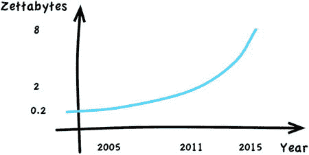
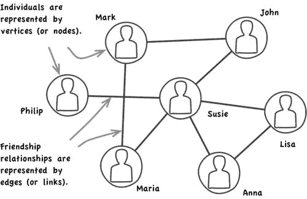
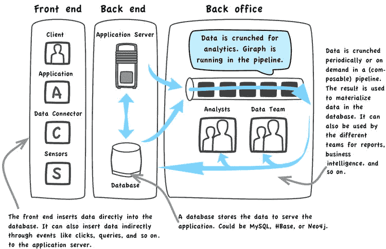
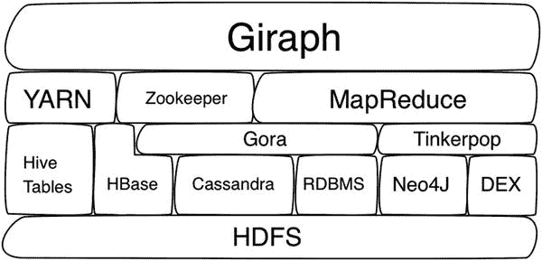
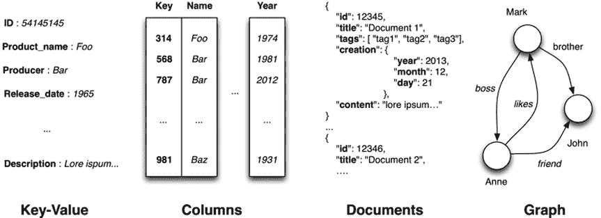
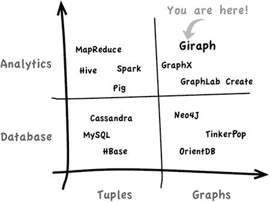

# 1. Giraph 简介

本章涵盖

- 利用海量图数据获取更深层次的洞察
- 理解 Giraph 的具体目标与设计宗旨
- 在 Hadoop 生态系统中定位 Giraph
- 识别 Giraph 与其他图处理工具之间的差异

本章将讨论数据驱动决策的重要性，以及如何利用大数据实现这一目标。你将看到如何通过使用海量数据来提升附加价值的示例。你还会了解到 `Giraph` 如何在众多可用于分析大型数据集的工具中找准自身定位。本章将 `Giraph` 置于 Hadoop 生态系统中，并介绍它如何与生态中的其他组件协同工作。此外，本章还会将 `Giraph` 与图数据库等其他基于图的技术进行对比，解释何时以及为何应该使用每种技术。这是一个入门章节，因此会介绍一些概念和理念，这些内容将在后续章节中更深入地探讨。

## 数据，数据，还是数据

几年前，《纽约时报》发表了一篇关于数据分析的引人入胜的文章。¹ 故事是这样的：一位明尼阿波利斯附近的父亲向塔吉特（Target）的一名员工投诉，抱怨他的未成年女儿收到了与孕期相关的优惠券。“我女儿收到了这个！”他指着打印出来的优惠券说，“她还在上高中，你们就给她寄婴儿服和婴儿床的优惠券？你们是想鼓励她怀孕吗？”塔吉特的代表道歉了，几天后又给这位父亲打电话进一步道歉——但对话却出现了意想不到的转折。“我和女儿谈过了，”这位父亲说，“原来我家里发生了一些我完全没察觉到的事情。她八月份预产期。我应该向你道歉。”

与其它零售商一样，塔吉特为每位顾客分配一个唯一 ID（例如信用卡号），并利用这些 ID 记录顾客在实体店和网上的购买记录。通过分析这些历史数据，企业能够对顾客及其购物行为进行画像。他们能识别出的事情之一就是怀孕。不仅如此，他们还能在很小的误差范围内估算出预产期。显然，润肤露是个不错的指标；很多人都会买润肤露，但孕妇往往会在孕中期购买大量无香型润肤露。此外，在孕早期，她们会购买钙、镁、锌等补充剂。这些产品本身并非孕期专用，但消费量的突然激增，再加上其他产品（如洗手液和毛巾）的购买行为，就成了怀孕和临近预产期的信号。塔吉特的统计学家通过分析顾客的购买记录，发现了这些模式。

很可能在不久的将来，当你穿梭于商店和购物中心时，你的手机就会收到符合你当前需求和喜好的优惠通知，比如你一直想要的那双鞋，或者快用完的意大利面。但购买数据只是可用于深入了解顾客行为的数据示例之一。我们周围的新设备和传感器，让我们能够以越来越高的精度测量和记录周围的世界。正如马克·维瑟所说：“最深远的技术是那些消失的技术。它们将自己编织进日常生活的布匹中，直到与之难以区分。”² 现在，或许该让我们那些无处不在的计算设备——带着它们的互联网连接和全套传感器——融入日常生活的布匹中了。当这一切发生时，我们将面临前所未有的海量数据需要管理。为了让这些技术能够有效地融入并“消失”，管理它们所产生数据的基础设施也必须随之演进。

这些技术所提供的能力深刻地、广泛地影响着我们，包括我们沟通和社交的方式。我们联系和分享得越多，就越会去做。如图 1-1 所示，2011 年全球创建和共享的数据总量（从文档到图片再到推文）达到了 2 泽字节³，大约是 2005 年的九倍；而 2015 年的预测数据量是 8 泽字节。这些数据包括社交行为、金融、天气、生物学等方面的信息。它不仅在科学领域有价值，而且企业也可以有效地利用它来了解客户并提供更好的服务。

图 1-1. 过去及预测的数据创建与共享量

现在思考一下这个问题。我们的行为会因情绪而异。当我们感觉良好、心情愉快时，往往会向世界敞开怀抱，尝试新事物并承担风险。另一方面，消极情绪则会让我们变得悲观，不太愿意进行新奇的冒险。最近，科学家们将这一观点推向极致，试图探究人们的情绪与他们在股票市场的行为之间是否存在联系。人们是否会根据自身感受，以不同的方式投资，买入或卖出某些股票？关于股市趋势的数据是存在的，但实时收集数百万人的情绪数据则要困难得多。于是，科学家们将目光投向了推特。人们在推特上发布各种内容：他们正在做的事情、喜欢的电影、让他们开心或愤怒的事情、笑话和语录等等。推文内容简单，并且比博客文章或文章蕴含更多情感成分。因此，推文中的文字可以很好地代表发布者的情绪状态——而每秒钟都有成千上万条推文被发出。

`情感分析`是自然语言处理（`NLP`）技术的一种应用，用于判断作者对特定主题的态度。简单来说，通过分析所使用的词语和字符，如形容词、动词、表情符号和标点符号，就可以将文本归类为积极或消极。有时，甚至可以评估作者的情感状态，例如“快乐”、“悲伤”或“愤怒”。这些技术被应用于社交媒体，以衡量客户对某些品牌的态度，或政治竞选中选民对候选人的看法。

回到情绪与股市关联的话题上，科学家们得以证明，根据推特上的衡量标准，在经历了一段整体平静的日子后，`道琼斯`指数会上升；而在一段焦虑期之后，情况则相反。尽管研究人员声称准确率约为 87%，但仅凭推特数据是否真的能做出如此精确的预测，仍存有争议；不过，普遍认为它可以作为一个可靠的指标。无论是用于预测金融市场的行为还是社交媒体的趋势，这都是一个很好的例子，说明当汇集在一起审视时，像 140 个字符的推文这样的小信息片段可以变得非常有价值。

商业智能从业者正通过数据分析来发现数据中的模式，以支持他们的决策。观察客户如何使用产品，能让设计师和工程师理解如何改进这些产品。关于用户行为的数据提供了洞察，帮助理解如何通过新增或改进的功能来使产品更适应于用户。传统上，产品使用情况的研究是通过调查和可用性研究来进行的。用户被要求描述他们如何执行某些操作和任务——比如你如何在电子邮件客户端软件中搜索一封丢失的邮件，如何在电商网站上挑选一个徒步背包，如何管理日历中的约会——并列举出缺失的功能。他们也可能被要求在受控环境（如实验室）中使用产品，这让产品设计师有机会衡量其设计决策的有效性。但这种方法有一个重大缺陷：无法大规模开展。你能测试多少用户？这些评估有多真实？或者，能收集多少数据？这些数据又有多可靠？

数据分析不仅对分析师和科学家有用。机器学习算法可以发现模式，并对数据进行分类和整理，作为应用的一部分。例如，考虑用户和书籍。如果你发现马克和莎伦在读书品味上很相似，你可以建议马克去读莎伦读过但马克（尚未）读过的书，反之亦然。或者，反过来，如果你知道两本书是相似的，你可以建议第一本书的读者去读第二本，以此类推。这些算法从数据中自动学到的东西可以被直接集成到应用中，使其更加个性化和主动。这些概念是推荐系统的核心，例如亚马逊和脸书使用的推荐书籍和好友的系统。或者想想像谷歌这样的搜索引擎。谷歌搜索接收用户查询特定内容的请求。它还会收集用户在结果页面上点击了哪些条目，更不用说用户对其他谷歌产品（如 `Gmail`、谷歌地图等）提供的内容的点击了。将这些信息整合在一起，谷歌搜索可以根据执行搜索的用户，为同一个查询提供不同的搜索结果。如果我搜索一家音乐店，谷歌可能会更倾向于推荐阿姆斯特丹出售爵士乐的店铺。这被称为个性化搜索。

关于数据的一个有趣事实是，数据越多，你就越能理解和建模你所观察的现象。事实上，研究还显示出更惊人的结果。最近，科学家们将“朴素”的机器学习算法与更复杂的算法进行了比较。他们发现，如果向朴素算法提供足够大量的数据，它通常能胜过更复杂的算法。以网飞挑战赛为例。网飞提供了一个大型数据集，包含近 50 万用户对 18,000 部电影的评分。挑战在于预测用户对尚未看过的电影的评分。这些研究表明，一个更简单的算法，如果考虑了关于电影的额外数据（例如来自互联网电影数据库的信息），其表现可以胜过仅使用网飞数据的更复杂算法。这个例子有点复杂，因为 IMDb 是一个不同的（独立的）数据集；但总的来说，机器学习算法受益于更多数据，因为它能减少噪声并帮助构建更好的模型。

另一个反直觉的观点是，给定足够大的数据集，一个复杂的算法可能表现得比朴素算法更差。基本上，当算法获得更宏观的视角时，更复杂的启发式方法并无帮助；反而可能得到更差的结果。这就像是，新算法的额外复杂性补偿了证据的缺失，因此它们在小数据集上表现更好，但这种复杂性会使结果产生偏差，无法充分利用更多证据所能达到的效果。一种说法是，复杂的算法可能更加固执己见，而不是基于事实得出结论。这是个好消息。这意味着你可以使用相当简单且易于理解的工具集（过去 30 年里被广泛研究的基本算法）来挖掘数据，前提是你能够大规模地执行它们。

## 重要

基于数据创建模型的能力是创造更好产品和服务的基础。正在产生的数据量已经非常庞大，并且还在不断增长。不幸的是，没有捷径能让你避开应对这些海量数据。你必须设计能够管理如此规模数据的算法并构建相应的平台。`Giraph` 就是这样的平台之一。

## 从大数据到大图

上一节讨论了审视海量数据以提取有用情报的重要性。所举的例子利用了许多小数据片段进行聚合，以提取趋势等信息。购买某产品的人的平均年龄是多少？该产品在一年中的哪个月份销量最好？哪种其他产品具有相似的趋势？你拥有的数据越多，对这类问题的回答就越准确。然而，对于某些类型的数据，你还可以利用数据中实体之间的关联。在这些情况下，比信息片段（及其聚合）更重要的是这些片段之间的连接方式——更准确地说，是由这些连接所构成的网络结构。不幸的是，分析关联数据所带来的强大能力是有代价的，因为分析图通常计算成本高昂，并且会引入新的挑战和特定工具。`Giraph` 是一个框架，你可以用它来在多台普通机器上对超大规模图进行图分析。它是专门为解决那些需要考虑数据关联性的问题而设计的。换句话说，它是为处理图而设计的。

图是一种表示抽象实体（或称顶点）及其关系（或称边）的结构。在计算机科学中，图被广泛应用于多个领域，用于表示数据和表达问题。许多常见的数据结构，如树和链表，都是图：它们的节点根据定义每种特定数据结构的准则通过链接进行连接。图也应用于其他学科；例如，在社会科学中，图通常被称为网络。网络用于表示个体之间的关系，例如社交网络，如图 1-2 所示。与计算机科学中的图类似，社交网络早在 `Facebook` 等社交网站流行之前就已在社会科学中使用了。而在生物学中，图被用于绘制蛋白质之间的相互作用。拥有这样一个关联的结构化模型，让研究人员能够以比仅仅作为单个项目集合更连贯的方式来看待数据。第 2 章将更深入地探讨图，并解释如何通过它们来建模数据和问题。

*图 1-2.* 用图表示的个体社交网络

为了让你更好地理解将数据关联视为图能带来的附加价值，以及`Giraph`可能有助于解决哪些类型的问题，我们来考虑一些例子。最近的研究表明，通过查看 `Facebook` 上 130 万个体的社交网络，可以预测哪些人是伴侣，以及他们是否会在未来两个月内分手（当然，是在不查看他们关系状态的情况下）。研究人员仅使用了网络结构——个体之间的朋友关系。这项研究背后的概念是社会分散性。基本上，仅看两个人共同的朋友数量（称为嵌入性）并不能提供足够的信息，且是一个预测性较低的指标。另一方面，分散性衡量的是这些共同朋友彼此之间不连接的程度。换句话说，两个人之间的高分散性意味着他们有共同的朋友，但这些朋友中只有少数彼此互为朋友。根据数据，关系持久的伴侣往往表现出高分散性。直观上，结果表明牢固的恋爱关系是那些人们参与不同社交群体的关系，他们与伴侣共享这些群体，但这些群体彼此保持独立。查看一个人，并从她的社交网络中选择与她具有高分散性的个体，可以生成该个体的潜在伴侣列表；大约 60%的情况下，列表顶部的人确实是其正确的伴侣。此外，没有这种特定社交结构的伴侣在不久的将来更有可能分手。

另一个将数据视为图能带来附加价值的例子是万维网。正如你在后续章节中看到的，`Google` 最初成功的原因之一就是它把万维网看作一个图。网页通过超链接指向其他页面。早期，`Google` 的竞争对手通过从一个页面跳转到另一个页面并跟随每个页面上的链接来爬取网络，但并未利用图结构来提供搜索结果。结果仅基于查询词在网页上的出现情况来提供，这导致了无关页面上充斥热门关键词的垃圾信息。另一方面，`Google` 决定查看图的结构——哪些页面链接到哪些其他页面——以便根据某种流行度概念对页面进行排名。根据 `Google` 的 PageRank 算法，一个页面的流行度取决于指向它的链接数量以及这些页面的流行度。这意味着整个图的结构都被用于定义顶点的排名。这种方法更为复杂，但结果令人印象深刻，而后续的故事你也都知道了。

最后一个例子与网络的时间维度有关。几年前，研究人员利用一个代表性买家和性工作者的网络来研究疾病的传播。这个数据集是一个图，其中个体之间的连接代表性行为；它还包含时间维度，因为连接带有时间戳。通过研究图的结构及其随时间的发展，研究人员能够模拟流行病并研究其发展过程。如果他们模拟某些个体受到性传播感染，并查看这些连接，最终可能有多少人被感染？图的结构又是如何影响这一结果的？有趣的是，类似的模型已被应用于在线社交网络，以研究信息如何通过 `Twitter` 和 `Facebook` 等网络传播——这个过程常被恰如其分地称为“病毒式传播”。

**重要提示**

万维网、在线社交网络、电影数据库中为电影评分的用户之间的关系，以及生物网络，都只是图的几个例子。无论是在商业还是科学背景下，将数据视为相互关联的都能为其增加价值。分析这些关联可以帮助你以其他方式无法实现的方法提取情报。

不幸的是，将数据视为图通常需要计算成本高昂的算法，因为需要考虑数据之间更大、更交织的特性。此外，图的规模正变得越来越大。例如，`Facebook` 的社交图包含超过 10 亿用户，每个用户平均有大约 200 个朋友关系。根据 `Google` 的索引，万维网包含超过 50 万亿个页面。这些图是巨大的。如果你想通过一种简单而强大的编程范式，从数据中实体之间的交织关联中提取信息，请继续阅读：`Giraph` 可能正是适合你使用场景的工具。

## 为什么选择 Giraph？

前面几节提到的一些内容并非全新概念。大数据运动在过去十年中，已从少数公司（如 `Google`、`Yahoo!`、`Facebook` 等）面临的问题，演变为一场彻底的范式转变。最初，大数据的特征在于设计新的解决方案，以克服传统方案在处理海量数据时的局限性。大规模数据管理面临以下三个技术挑战：

*   数据是动态的，解决方案必须支持高频率的更新和检索。想象一下一个拥有数百万用户的 Web 应用，每秒钟都有用户点击链接和请求页面。

*   数据是海量的，其管理必须分布在多台机器上。想象一下 PB 级别的数据，单台机器无法完成存储和处理。

*   计算环境也可能是动态的，解决方案必须能够在随时可能发生故障的多台机器上可靠地管理数据。想象一下一个由数千台商用机器组成的集群，这些机器可能分布在不同数据中心。

大数据解决方案必须面对这些挑战，以支持大规模应用。

管理大规模图数据则需要解决这些挑战以及更多问题。图数据引入了更多特定于问题的挑战，而 `Giraph` 正是为此而设计：

*   图算法通常表示为迭代计算，支持此类算法的图处理系统需要高效地执行迭代。

*   图算法往往具有探索性，这会导致难以预测的随机数据访问。

*   通常，每个图实体上会多次执行小型计算，这些操作应该易于表达和并行化。

本书将探讨 `Giraph` 如何在技术上应对这些特定挑战。现在，请记住 `Giraph` 是为图数据和图算法而设计的，因此它执行图算法的速度可以比 `MapReduce` 等其他大数据框架快 100 倍。

**定义**

`Giraph` 是一个专为执行迭代式图算法而设计的框架，这些算法可以轻松地在数百台商用机器上并行化。`Giraph` 具有容错性，易于编程，并且能够处理超大规模的图数据。

虽然高效可靠地执行图算法很重要，但编程范式简单易用、避免耗时且易出错的操作也同样重要。`Giraph` 提供了一种所谓的以顶点为中心的编程模型。这种模型要求你设身处地地从一个顶点的角度思考，该顶点可以在一系列迭代中与其他顶点交换消息。大规模并行分布式系统的所有编程复杂性都对用户透明。程序员专注于算法中特定于问题的方面，而 `Giraph` 则在可用机器上透明地并行执行算法。在实践中，这意味着继承一个类并实现一个函数。通常，`Giraph` 算法代码少于 50 行，并且不需要任何并发原语，如锁、信号量或原子操作。

**重要**

`Giraph` 提供了以顶点为中心的编程模型，要求开发者像顶点一样思考，顶点可以与其他顶点交换消息。该编程模型隐藏了并行和分布式系统编程的复杂性。`Giraph` 在可用机器上透明地并行执行你的代码。

`Giraph` 专为计算图分析和社交网络分析而设计。正如你在下一章中看到的，这些通常作为离线计算执行。这意味着 `Giraph` 应用通常运行在后台，定期对大型数据集执行，耗时几分钟或几小时。`Giraph` 专为繁重的计算任务而设计，而不是快速的交互式查询。

让我们快速了解一下一个应用程序架构（在最广泛的意义上），以及 `Giraph` 在其中的位置。第 2 章 将对此进行更深入的探讨。图 1-3 展示了这种架构。如图所示，架构分为三个典型的宏观组件：前端、后端和后端办公系统。前端是应用客户端相关组件运行的地方，包括移动应用、在桌面浏览器中运行的代码等。后端是应用服务器、数据库以及所有（分布式）基础设施运行的地方，它们与前端的协作，为用户在与应用交互时提供统一的体验。以 `Facebook` 这样的应用为例，这两个组件负责在你点击社交网络功能按钮（如浏览新闻流、查看好友活动等）时提供数据和逻辑。后端存储着你的图片、评论、点赞以及社交图谱。后端办公系统则驻留着定期执行的逻辑，用于离线计算和物化应用在线上使用的内容。`Giraph` 就位于后端办公系统中，用于计算朋友推荐、活动项目排名等应用逻辑。数据科学团队也可按需使用它，对后端收集的用户活动数据进行分析。例如，`Giraph` 用于执行像前面提到的分析，即通过社交分散度指标，判断是否能从社交图谱中推断出伙伴关系。

图 1-3. 应用程序的架构以及 `Giraph` 在其中的位置

总而言之，`Giraph` 用于运行昂贵的计算，这些计算相对于用户与应用之间的交互是异步执行的，因此它被认为位于后端办公系统。接下来的章节将探讨 `Giraph` 如何与位于此架构组件中的技术集成，以及它与其他位于后端办公系统和后端的工具有何不同。

**重要：** `Giraph` 位于后端办公系统。它用于离线计算图分析，这些分析定期对从前端和后端交互中收集的数据，以及后端办公系统中可能存在的所有附加数据执行。

### Google Pregel 和 Apache Giraph

`Hadoop` 项目下的许多 Apache 项目都深受 Google 技术的启发。`Hadoop` 最初包含 Hadoop 分布式文件系统和 `MapReduce` 框架。这两个系统都受到 2003-2004 年发表的两篇文章中描述的 Google 技术——Google 文件系统 (`GFS`) 和 Google `MapReduce`——的启发。⁴ 2010 年，Google 发表了一篇关于大规模图处理系统 `Pregel` 的文章。⁵ Apache `Giraph` 深受 `Pregel` 的启发。

`Giraph` 最初由 `Yahoo!` 开发，并于 2011 年夏季在 Apache 基金会孵化。2012 年，`Giraph` 被提升为 Apache 顶级项目。`Giraph` 是 Google `Pregel` 的一个（开源）松散实现，并在 Apache 许可证下发布。2013 年，1.0 版本发布，证明了其稳定性和自初始版本以来新增的大量功能。

`Giraph` 吸引了来自 Facebook、Twitter 和 LinkedIn 的贡献者，目前其中一些公司及其他企业已在生产环境中使用它。`Giraph` 与 `Pregel` 共享其计算模型和编程范式，但通过引入主计算函数、核外处理能力等特性，并消除由主节点带来的单点故障（SPoF），对 `Pregel` 的 API 和架构进行了扩展。你将在本书中详细了解到所有这些功能。

### Giraph 与 Hadoop 生态系统

`Hadoop` 是一个广受欢迎的大数据管理平台。它拥有活跃的社区和较高的采用率，年增长率约为 60%，⁶ 许多公司以为这些企业提供支持为己任。全球 `Hadoop` 市场预计在未来五年内将增长至数十亿美元，而掌握 `Hadoop` 技能被视为 ICT 就业市场上最具竞争力的因素之一。⁷

`Hadoop` 最初源于 Apache Nutch 项目中对 Google 分布式文件系统和 `MapReduce` 框架的实现。多年来，它已演变为一个独立的 Apache 项目。如今，它远不止于此，已发展成为一个成熟的生态系统。其旗下涵盖了除 Hadoop 分布式文件系统和 `MapReduce` 框架之外的其他项目。所有这些系统都是为了解决与管理海量数据相关的不同挑战而开发的，涉及从存储到处理等各个方面。`Giraph` 是 `Hadoop` 生态系统中相对较新的成员。

**重要提示：** 尽管 `Giraph` 是 `Hadoop` 生态系统的一部分，并运行在 `Hadoop` 上，但它并不要求你是 `Hadoop` 专家。你只需能够启动一个 `Hadoop` 机器（或集群）即可。

以下是 `Giraph` 相关的一些项目。如果你不了解（或不使用）其中某些工具，无需担心。列出这些项目的目的是为了向你展示 `Giraph` 能够与 `Hadoop` 生态系统中许多流行的项目协同工作：

- **`MapReduce`**：一种用于处理大型数据集的编程模型和系统。它基于在多台机器上并行扫描文件，将数据建模为键值对。`Giraph` 可以作为 `MapReduce` 作业在 `Hadoop` 上运行。
- **Hadoop 分布式文件系统（`HDFS`）**：一种用于跨多台机器存储数据的分布式文件系统。它提供高吞吐量和容错能力。`Giraph` 可以从 `HDFS` 读取数据并写入数据。
- **`ZooKeeper`**：一种集中式服务，用于维护配置信息、命名、提供分布式同步以及提供组服务。`Giraph` 使用 `ZooKeeper` 来协调其计算，并提供可靠性和容错能力。
- **`HBase`**：`Hadoop` 数据库。它是一个可扩展且可靠的数据存储，支持低延迟的随机读取和高写入吞吐量，拥有灵活的基于列的数据模型。`Giraph` 可以从 `HBase` 读取数据。
- **`Cassandra`**：一种专注于可靠性和可扩展性的分布式数据库。`Cassandra` 是完全去中心化的，没有单点故障（SPoF）。`Giraph` 可以从 `Cassandra` 读取数据。
- **`Hive`**：`Hadoop` 的数据仓库。它允许你使用类似于 SQL 的高级编程语言，对大型数据集进行即席查询和分析。`Giraph` 可以从 `Hive` 表读取数据。
- **`HCatalog`**：一种针对使用 Apache `Hadoop` 创建的数据的表和存储管理服务。它与 `Hive`、`Pig` 和 `MapReduce` 配合使用。`Giraph` 可以读取通过 `HCatalog` 存储的数据。
- **`Gora`**：一种为大数据提供内存数据模型和持久化的中间件。`Gora` 支持持久化到列式存储、键值存储、文档存储和关系型数据库管理系统（RDBMS）。通过 `Gora`，`Giraph` 可以从 `Gora` 支持的任何数据存储中读取和写入图数据。
- **`Hama`**：`HDFS` 之上的一个纯批量同步并行（BSP）计算框架，用于处理大规模科学计算，如矩阵、图和网络算法。与 `Hama` 类似，`Giraph` 旨在解决迭代算法。与 `Hama` 不同的是，`Giraph` 不需要在 `Hadoop` 集群上安装额外的软件。
- **`Mahout`**：`Hadoop` 之上的一个可扩展机器学习算法库。它包含用于聚类、分类、推荐和频繁项挖掘的算法。`Giraph` 可以运行专门为图设计的机器学习算法。
- **`Nutch`**：用于 Web 搜索应用程序的软件。它包括一个网络爬虫以及用于网页排名和索引的功能。`Nutch` 可以使用 `Giraph` 来计算网页的排名。

正如你所见，这些项目差异很大，从数据库到处理工具不一而足。但它们有一个共同特点：都是为大规模应用而设计的。`Giraph` 通过提供一种用于处理大型图的编程模型和系统，跻身于该列表之中。你可以将 `Giraph` 视为一种专用于图算法的 `MapReduce`。`Giraph` 通过作为 `MapReduce` 作业或 Apache `Hadoop` YARN（另一种资源协调者）应用程序运行（前提是已安装基于 YARN 的 `Hadoop`）来利用现有的 `Hadoop` 环境。`Giraph` 可以从 `HDFS`、`HBase`、`HCatalog` 和 `Hive` 读取数据，并使用 `ZooKeeper` 来协调计算。协作也发生在相反方向上：如前所述，`Nutch` 可以使用 `Giraph` 来计算网页的排名。你将在本书中了解更多关于如何将 `Giraph` 与生态系统其他部分集成的内容。图 1-4 展示了 `Giraph` 的高层架构以及它如何利用不同的 `Hadoop` 项目来工作。

**图 1-4.** `Giraph` 的架构及其与其他 `Hadoop` 项目的集成方式

**重要提示：** 如果你已经部署了 `Hadoop` 基础设施，或者计划将来扩展更多，`Giraph` 能够与其中的大部分组件良好配合。

## Giraph 与其他图处理工具

了解 `Giraph` 在图处理领域与其他工具的区别，对于在合适场景下做出正确选择至关重要。这里提供一个简单的判断方法。如果你的计算只需要触及图的一小部分（例如几百个顶点）就能在毫秒级返回结果，比如你需要支持一个交互式应用，那么你应该考虑图数据库，如 `Neo4j`、`OrientDB` 或 `TinkerPop` 工具。另一方面，如果你的计算需要几分钟甚至几小时才能完成，因为它们需要探索整个图，那么 `Giraph` 就是合适的工具。如果你的计算任务是从扫描文本文件中提取值进行聚合，或是在大型表之间计算类似 SQL 的连接操作，那么你应该考虑 `MapReduce`、`Pig` 和 `Hive` 等工具。

我们特别想强调 `Giraph` 与图数据库之间的区别。你可以用一个比例关系来理解 `Giraph` 与 `Neo4j` 这类图数据库的关系：`Giraph` 之于图数据库，正如 `MapReduce` 之于 `HBase` 或 `MongoDB` 这类 NoSQL 数据库（或 `MySQL` 这类关系数据库）。同样，`MapReduce` 通常用于对以元组形式表示的数据进行昂贵的分析，而 `Giraph` 则可以对以图形式表示的数据运行图挖掘算法。在这两种情况下，`MapReduce` 和 `Giraph` 都对存储在数据库中的数据运行分析。在这两种情况下，数据库都用于服务低延迟查询：例如，支持交互式应用。不同之处在于用于表示数据的数据模型。这种类比在演示时效果不错，但不要被它误导。`Giraph` 也可以处理存储在 NoSQL 数据库中的数据，而 `MapReduce` 也可以处理图数据库中的数据。

**提示**

> 你可以将 `Giraph` 与图数据库之间的关系理解为以下比例：`Giraph` : 图数据库 = `MapReduce` : NoSQL 数据库。

这是一个非常简单而有效的判断方法。但让我们试着把事情弄得更清楚些。大数据的出现催生了一系列新工具。Hadoop 是一个生态圈，容纳了其中一些工具，但还有更多可用的工具。这些工具的格局通常分为两类：用于存储数据并提供低延迟查询服务的数据库，以及用于长时间计算的工具（例如分析）。这两类工具有不同的用例和要求，这导致了不同的设计决策。数据库专注于每秒服务数千个查询，这些查询只需要毫秒级（或几秒）就能返回结果。想象一下，一个数据库支撑着点击后网页的内容。分析工具则专注于每分钟服务少量计算请求，每个请求需要几分钟或几小时才能返回结果。想象一下在大型社交网络中计算社区。`Giraph` 将自己定位于第二类，因为它设计用于运行需要多次遍历分析整个图的长时间计算。如果你想了解更多关于图数据库的信息，可以看看像 `Neo4j`、`OrientDB` 和 `TinkerPop` 社区这样的系统。

**提示**

> 如果你有兴趣进一步了解像 `Neo4J` 和 `OrientDB` 这样的图数据库，可以查阅 Greg Jordan 所著的 *Practical Neo4j*（Apress 2014）。

所有这些工具都专注于不同的数据模型：键值对、列、文档或图。图 1-5 以可视化方式展示了其中一些模型。其中，图可能是最独特的。与简单的键值对和列相比，图具有更非结构化和相互交织的性质。此外，图算法往往是探索性的，需要访问图的某些部分来回答特定查询（相比之下，检索的是特定的一组键值对、列或文档）。出于这些原因，图处理系统需要做出设计决策，充分考虑图及其算法的特定特征。使用通用系统运行图算法是可行的——例如，在基于元组的系统上，如关系数据库或 `MapReduce`——但这些解决方案的性能往往较差。

**图 1-5.** 将其他数据模型与图进行比较

`Giraph` 从一开始就是为图而设计的。它并不是唯一的此类工具。其他与 `Giraph` 类似的系统有 `GraphLab` 和 `GraphX`。其中，`Giraph` 是唯一一个能够在 Hadoop 集群上透明运行并拥有庞大开源社区的工具。`GraphX` 也许与 `Giraph` 最为相似；尽管它提供了简化的图处理 API，但它要求使用与 `Giraph` 提供的 API（可以说并不那么简单）不同的 API 在 Scala 中实现你的算法，它需要 `Spark`，并且通常比 `Giraph` 慢。`GraphLab`（现在称为 Dato Core 或 GraphLab Create）曾经是一个开源解决方案，但现在已成为专有软件。图 1-6 展示了 `Giraph` 与其他数据管理系统的比较。

**图 1-6.** `Giraph` 相对于其他数据管理工具的定位

总而言之，`Giraph` 适用于以下任务：

- 在商品化机器集群（运行 Hadoop）上分析一组大规模互连数据

- 运行计算密集型算法，并以迭代方式（可能多次遍历）处理你的图

- 在后台定期离线运行算法

而以下任务则不适用 `Giraph`：

- 对一组不互连或无关的数据片段运行聚合操作

- 处理容易在单台机器上容纳的小型图

- 运行预期只触及图的一小部分的计算——例如，用于支持像 Web 应用这样的交互式工作负载

## 摘要

大数据与数据分析正开辟出收集轨迹和理解用户行为的新途径。掌握分析这些数据的技术，能够催生更优质的产品与服务。通过聚合大量数据碎片进行观察，可以获得对数据的洞察，但进一步审视这些碎片之间的连接方式，则能助你更深入地理解数据。

在本章中，你将了解以下内容：

- 图是一种简洁且灵活的实体及关系表示形式。图可用于表示社交网络、互联网、万维网，以及产品与客户等实体之间的关系。

- 处理大型图会带来特定的挑战，传统数据分析工具无法成功应对这些挑战。图分析需要专门为此设计的工具。

- `Giraph` 是一个用于分析通过图表示的大型数据集的框架。它被设计为能够在多台商用机器上可靠地执行图计算。

- 与图数据库不同，`Giraph` 是一个批处理系统。它旨在运行计算开销大的任务，以分析整个图用于分析目的，而非执行期望在毫秒级内完成的查询。

- `Giraph` 是 Hadoop 生态系统的一部分。`Giraph` 作业可以在现有 Hadoop 集群上运行，无需安装额外软件。`Giraph` 与生态系统中的其他组件协作良好，并能从 Hadoop 生态系统中的多种数据存储中读写数据。

现在，你已经了解了处理大规模连接数据的通用问题以及大数据和图处理生态系统，接下来可以准备学习如何将数据建模为图、图如何应用于实际场景，以及 `Giraph` 如何帮助你解决相关的图分析问题。

**脚注**

[1] Charles Duhigg, "企业如何获悉你的秘密," 纽约时报, 2012 年 2 月 16 日, [`www.nytimes.com/2012/02/19/magazine/shopping-habits.html`](http://www.nytimes.com/2012/02/19/magazine/shopping-habits.html).

[2] Mark Weiser, "二十一世纪的计算机," 科学美国人, 1991 年.

[3] 1 泽字节等于 1 万亿吉字节。来源：John Gantz 和 David Reinsel, IDC, "从混沌中提取价值," 2011 年 6 月, [`www.emc.com/collateral/analyst-reports/idc-extracting-value-from-chaos-ar.pdf`](http://www.emc.com/collateral/analyst-reports/idc-extracting-value-from-chaos-ar.pdf).

[4] Sanjay Ghemawat, Howard Gobioff, 和 Shun-Tak Leung, "Google 文件系统," ACM SIGOPS 操作系统评论. 第 37 卷. 第 5 期. ACM, 2003 年. Jeffrey Dean 和 Sanjay Ghemawat, "MapReduce: 大型集群上的简化数据处理." ACM 通讯 51.1 (2008): 107–113.

[5] Grzegorz Malewicz, Matthew H. Austern, 等人, "Pregel: 一个大规模图处理系统." 2010 年 ACM SIGMOD 国际数据管理会议论文集. ACM, 2010 年.

[6] 华尔街日报, CIO 报告, "Hadoop 来了：大数据技术正获得牵引力." 2014 年 4 月 12 日. 面向华尔街日报订阅者, [`http://blogs.wsj.com/cio/2014/04/12/hadoop-there-it-is-big-data-tech-gaining-traction/`](http://blogs.wsj.com/cio/2014/04/12/hadoop-there-it-is-big-data-tech-gaining-traction/).

[7] "工作趋势," Indeed 求职网站, [`www.indeed.com/jobtrends`](http://www.indeed.com/jobtrends).

