# 2. 建模图处理用例

本章涵盖以下内容：
- 将数据建模为图
- 离线计算与在线计算的区别
- 在应用架构中集成 `Giraph`
- `Giraph` 在网络搜索公司的用例
- `Giraph` 在电子商务网站的用例
- `Giraph` 在在线社交网络网站的用例

`Giraph` 不仅仅是一个用于促进图处理的基础库。它提供了一个编程模型和框架，通过大规模离线计算来解决图问题。要使用 `Giraph`，你需要理解如何使用图对数据进行建模，以及如何将 `Giraph` 集成到系统架构中，使其作为应用的一部分来处理图数据。因此，本章将围绕三个主题展开。首先介绍图，并展示如何在不同领域中使用图对数据进行建模。然后，你将了解离线计算与在线计算之间的区别，以帮助你识别 `Giraph` 适合处理的问题类型。本章的剩余部分将重点介绍如何将 `Giraph` 集成到系统架构中。为此，本章将基于真实场景介绍三个用例。

## 图无处不在

图是一种简洁、灵活的结构，用于表示实体及其关系。你可以通过图来表示各种事物：计算机网络、社交网络、互联网、蛋白质之间的相互作用、交通网络——总而言之，就是数据。这些例子有什么共同点？它们都由通过某种关系连接的实体组成。计算机网络由连接的设备组成，社交网络是由社交关系（朋友、家人、同事等）连接的人组成的网络，城市通过道路连接，神经元通过突触连接。万维网可能是最清晰的例子之一：页面、图像和其他资源通过链接的 `href` 属性相互连接。

**定义**：图是一种表示通过关系连接的实体的结构。

图可用于表示这些连接的结构。它由顶点（或节点）以及连接它们的边（或弧、链接）组成。一条边连接的两个顶点通常被称为边的端点。通过相应边连接到特定顶点的顶点被称为该顶点的邻居。将顶点连接到自身的边称为环。在示意图中，顶点通常用圆圈表示，边用线条表示。图 2-1 展示了这些基本概念；在其最基本的形式中，图仅此而已。

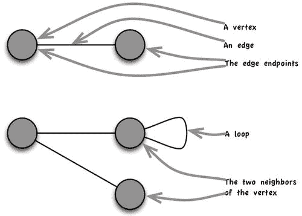
**图 2-1.** 图的基本概念

本节将引导你通过几个示例，了解如何使用图对不同的数据进行建模。每个示例都会引入一些图的概念。让我们从计算机网络开始。

### 使用简单无向图对计算机网络建模

计算机网络由一系列计算设备（如台式机、服务器、工作站、路由器、手机等）集合构成，这些设备通过通信介质相互连接。图 2-2 展示了一个计算机网络的示例。暂且忽略使设备能够通信的技术或协议（如以太网、WiFi 或蜂窝网络），重点关注它们已连接并能交换数据这一事实。这正是使计算机网络成为网络和图的核心要素。

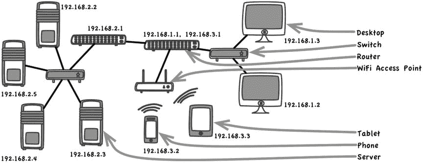
图 2-2. 一个计算机网络

很自然地可以用图来对计算机网络建模：将计算机表示为顶点，如果两台计算机已连接，则用一条边连接代表它们的两个顶点。显然，通过图来对计算机网络建模并没有唯一正确的方式；由建模者决定，例如，是否应在图中表示集线器和交换机，或者应考虑 `TCP/IP` 协议栈的哪一层。为了识别图中的每个设备，需要为每个顶点分配一个唯一的标识符（`ID`）；在计算机网络的情况下，可以使用设备的主机名或 `IP` 地址。每个数据域都有一个自然的数据元素可用作顶点的 `ID`，例如社交网络中的护照号码、网页的 `URL` 等等。

图 2-3 展示了一个表示图 2-2 中计算机网络的图。在此示例中，每台计算机的 `IP` 地址被用作顶点的 `ID`，如果两台计算机能够在网络层直接通信（因此忽略交换机、集线器、接入点等），则它们之间通过一条边连接。

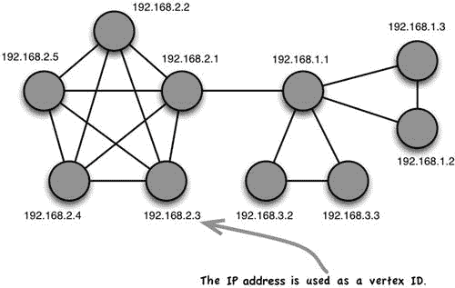
图 2-3. 表示计算机网络的图

### 对社交网络和关系建模

接下来看另一个示例：社交网络。社交网络由一定数量的个体组成，这些个体通过某种关系（朋友、同事等）相互连接。你可以轻松地利用目前介绍的图概念来表示社交网络：以顶点代表个体，如果两个个体有社交联系，则用一条边连接代表他们的两个顶点。但是如何指定两个个体之间具体的关系类型呢？可以使用标签。标签标识关系的类型，可以附加在边上。图 2-4 展示了一个表示由五个个体构成的社交网络的图。个体的名字作为 `ID`，每条边上附加了一个标签以说明关系类型。

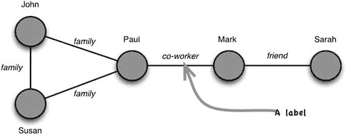
图 2-4. 表示社交网络的图

到目前为止，只考虑了对称关系，比如友谊。然而，边可以扩展出方向。方向定义了边的源顶点和目标顶点。带有方向的边称为有向边。以某个特定顶点为源的所有边称为其出边，而以该顶点为目标的所有边称为其入边。Twitter 和 Facebook 社交图谱之间的差异之一正是由此产生。对于 Facebook 而言，好友关系是对称的（需要双方确认），更适合用无向边来表示。另一方面，Twitter 允许你指定关注关系，这种关系不一定是相互的；因此有向边更为合适。再次强调，关系是否应该通过方向来建模取决于关系本身，决定权掌握在建模者手中。在绘图中，有向边通常用箭头表示。含有有向边的图称为有向图，含有无向边的图称为无向图。图 2-5 展示了同一个五人的社交网络，这次使用有向图建模。

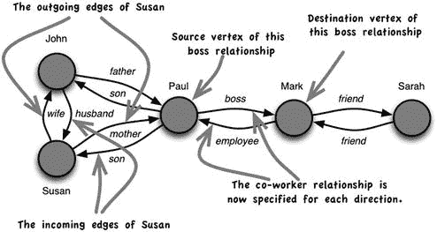
图 2-5. 表示社交网络的有向图

### 使用多重图对语义图建模

到目前为止的所有图中，在无向情况下，特定顶点对之间只允许有一条边（Mark 和 Sarah 之间只有一条朋友边），在有向情况下允许有两条边（John 的父亲 Paul 有一条边，Paul 的儿子 John 有一条边）。而多重图则允许在相同顶点对之间存在多条边，无论是有向还是无向情况，并且也支持为每条边附加标签。

一个标签化的有向多重图的好例子是资源描述框架（`RDF`）图。根据 `RDF` 数据模型，信息可以通过一系列三元组来描述，每个三元组由主体、谓词和客体组成。忽略语法符号、序列化等具体细节，`RDF` 可用于表示不同领域的知识。假设你想表示“罗马是意大利的首都”这个事实。`("Rome", "is capital of", "Italy")` 就是一个有效的 `RDF` 三元组来表示该信息，其中 `"Rome"` 是主体，`"is capital of"` 是谓词，`"Italy"` 是三元组的客体。`("Resource Description Framework", "has abbreviation", "RDF")` 是另一个三元组示例。仔细想想，这些三元组实际上就是一个标签化的有向边，其中主体是源顶点，谓词是标签，客体是目标顶点。这种描述概念的通用且灵活的方式，几乎可以表示任何能够通过三元组表达的事物。`RDF` 图通常被称为语义网络或语义图（这也使得 `RDF` 成为语义网的核心组件之一），因为它们常被用来通过事物之间的关系描述事物的语义。

`DBpedia` 就是这样一个语义图的例子。`DBpedia` 致力于将维基百科中的结构化信息（例如信息框中的内容）以图的形式呈现。图 2-6 列出了来自 `DBpedia` 的一些（简化后的）三元组。从这个表格构建图非常简单：每个三元组可以用一条出边表示，从代表主体的顶点出发，终止于代表客体的顶点。主体和客体的标签可用作顶点 `ID`，谓词标签可用作边的标签。图 2-7 展示了这样一个图。

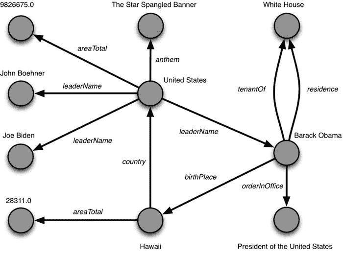
图 2-7. 从 `DBpedia` 的一组三元组构建的多重图

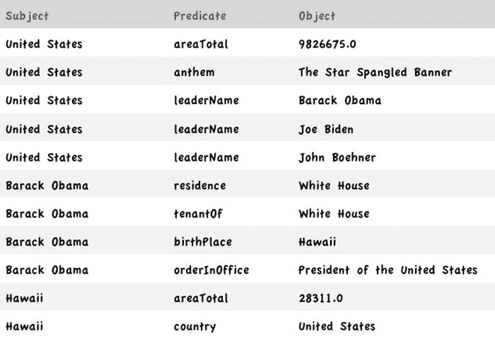
图 2-6. 来自 `DBpedia` 的一组三元组

请注意，所有以 Barack Obama 为主体的三元组都导致代表 Barack Obama 的顶点有一条出边。同时请注意，Barack Obama 有两条指向 White House 的出边（`tenantOf` 和 `residence`）。后者正是之前提到的多重图属性的一个示例。

### 使用图和权重对街道地图进行建模

# 街道地图与图模型

街道地图也是图的很好例子。也许第一个绘制地图的人也是第一个绘制图的人。用图来建模街道地图很直观：城市、城镇和村庄用顶点建模，连接它们的道路和街道用边建模。通常，任何可以选择不同道路的点都用顶点建模。注意，尽管街道相交，但边并不相交（在二维空间中绘制时它们会相交，但在概念上并不相交）。因此，交叉口必须通过顶点显式建模。（当你在第 4 章中查看路径时，这一点会更清楚。）在表示街道地图的图中，边可以具有类型（高速公路或普通道路）或编号（两者的组合）作为标签，并且方向可用于建模街道的通行方式（单行道）。如何对道路的长度进行建模？显然，两个城市之间的距离不仅仅取决于需要经过的道路（以及边）的数量，还取决于这些道路的长度。

为此，你可以使用权重。权重是边的数值属性，可用于表示关系的定量属性。例如，它们可以表示两个城镇之间的距离、用户对电影的评分、基于某些个人资料数据的两个用户之间的相似度，或者社交关系的强度。算法利用权重来计算最短路径、推荐以及图的各种度量标准。当你在第 4 章中查看路径时，你将了解更多关于权重的信息。图 2-8 展示了意大利的高速公路图以及其中一部分用图建模的结果。

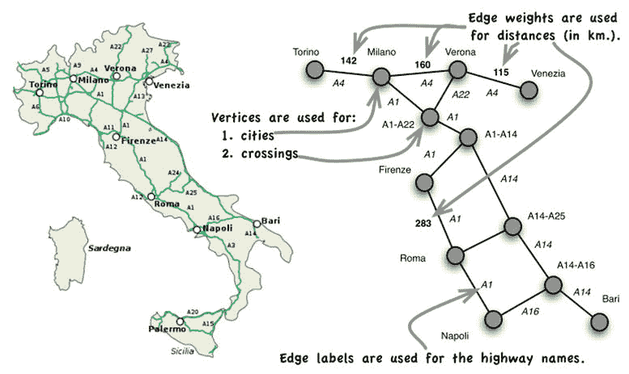

**图 2-8.** 通过带权重的图建模的交通网络

图是灵活的结构，容易进行思考，其建模很大程度上取决于其目的。软件工程师每天都在以某种形式使用这些结构。想想 ER 图、UML 图或依赖树；这些都是图。我们大多数人在头脑风暴讨论设计或架构时，都会自然地画出图。这就是为什么图也被称为白板友好的原因。大多数数据结构，从树到链表，都是某种类型的图。但是数据、数据表示和数据结构只有与计算它们的算法结合时才具有意义。接下来的章节和第 4 章将探讨你可以用图做什么。表 2-1 总结了本节介绍的概念。

**表 2-1.** 图的核心概念

| 名称         | 描述                         |
| :----------- | :--------------------------- |
| 顶点         | 图中的一个实体               |
| 标识符 (ID)  | 顶点的唯一标识符             |
| 边           | 两个实体之间的关系           |
| 边标签       | 边的定性属性（例如，类型）   |
| 边方向       | 指定边的源顶点和目标顶点     |
| 边权重       | 关系的定量（数值）属性       |
| 边端点       | 一条边连接的两个顶点         |
| 环           | 连接顶点到自身的边           |
| 邻居 / 邻域  | 连接到特定顶点的顶点         |
| 有向图       | 包含有向边的图               |
| 无向图       | 包含无向边的图               |
| 多重图       | 允许两个顶点之间存在多条边的图 |

## 比较在线计算和离线计算

第 1 章讨论了 `Giraph` 与图数据库以及其他图处理工具的关系。你已了解到 `Giraph` 被定位为图分析工具，并了解了离线图分析与在线交互式查询之间的区别。本节将深入探讨这些概念。为了更好地理解这两种工作负载之间的区别，我们通过 Unix 命令`find`和`locate`在文件系统中进行搜索来做一个类比。在解释了文件系统场景之后，本节将把这些概念映射到 `Giraph` 和图分析。

在使用计算机时，你经常执行的操作之一可能就是搜索文件。例如，你可能要查找所有名称以特定前缀开头的文件，或者查找在某个日期之后创建的文件。这并不涉及基于文件内容的搜索，后者是通过不同方式执行的。如果你是使用命令行进行搜索的 Unix 用户，你一定知道`find`命令。`find`从特定目录开始遍历文件系统树，并返回所有匹配给定模式的文件名。为了执行模式匹配，`find`必须访问起始根目录下的每个文件和目录，并应用匹配函数。这可能是一项开销很大的操作，特别是因为它可能会产生大量的输入输出。此外，如果你连续执行两次或更多次搜索，`find`每次都必须从头开始执行所有操作。

为了避免每次搜索都重复所有工作，`locate`命令依赖于其自身的数据库。它可以像`find`一样用于搜索匹配特定模式的文件。该数据库以能够高效搜索的格式存储了文件系统中所有文件和目录的元数据信息。随着文件的创建、删除和更新，`locate.updatedb`会定期在后台运行，扫描文件系统并更新`locate`数据库。显然，在后台执行开销较大的索引过程的频率、文件更改的速率以及搜索执行的频率之间，需要找到一个平衡点。你不希望索引数据库的频率高于文件更新或搜索的频率，也不希望数据库包含过时的元数据。因此，如果你只在主目录下处理少量文件并且经常修改它们，那么依赖`find`命令并仅在主目录中搜索会更合理。图 2-9 展示了这两个命令之间的区别。

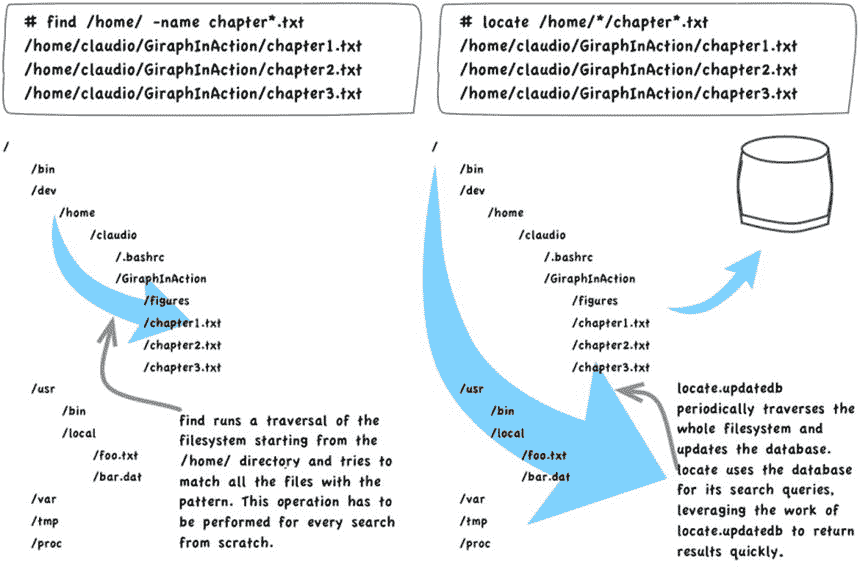

**图 2-9.** 使用`find`和`locate`在文件系统中进行搜索

关键在于，对于某些操作，你不想花很长时间等待结果。这类应用通常需要与用户或其他需要在短时间内做出决策的应用进行交互。就像前面的例子一样，遍历整个文件系统是一项开销很大的操作，因为它需要处理大量数据，因此需要定期进行后台计算，以使交互式操作更快。这些计算处理索引和其他数据结构，从而允许交互式操作快速执行。在前面的例子中，`locate`命令在数据库中执行交互式查找，以返回匹配的文件列表。它还有另一个命令`locate.updatedb`，该命令定期运行并在后台更新数据库。这种方法的副作用是，应用程序可能无法始终访问到最新版本的数据，因为在数据库更新之后数据可能已经发生了变化。对于这些情况，仍然需要为每个查询计算结果。然而，为了快速返回结果，查询必须是一个快速操作，只触及一小部分数据。

在图论术语中，需要快速执行的查询可能是在社交网络中询问某个特定用户的朋友姓名。也可能涉及更复杂的内容，需要探索图中超出顶点邻域范围的一小部分。想想像 IMDb 这样的数据集。你可以询问与布拉德·皮特合作、在法国拍摄的电影中女演员的平均年龄。因为与整个电影数据库相比，与布拉德·皮特相关的电影和女演员数量相当少，所以（图）数据库应该能快速执行此查询。这类似于在文件系统的某个特定小目录中使用 `find` 命令。然而，如果你想询问布拉德·皮特与电影界任何其他演员之间的分隔度——假设两位演员如果出现在同一部电影中就算有联系——那么对于 IMDb 这样规模的数据库，这无法快速计算。它需要探索整个图，并触及图中的每一个其他演员，就像从 `/` 目录开始探索整个文件系统一样。如果你想频繁查询任意两位演员之间的分隔度，并且希望快速得到结果，就必须预先计算所有结果并将其存储在数据库中。一旦计算完成，就可以在查询时进行查找。这个过程类似于 `locate` 命令及其后台命令 `locate.updatedb` 的功能。

按照这个类比，数据处理生态系统分为在线系统和离线系统：在线系统旨在计算预期在几秒或几毫秒内完成的查询，而离线系统旨在计算由于数据规模而预期在几分钟、几小时甚至几天内完成的分析（见图 2-10）。这些系统的作用类似于使用 `find` 和 `locate` 的例子。在线系统通常用于构建交互式应用程序。这类系统的典型例子包括 `MySQL`、`Neo4J` 等数据库。它们支撑着为 Web 应用程序、企业资源规划（ERP）系统或任何能够每秒接收大量短请求的软件或服务提供支持的应用程序。离线系统通常用于计算分析结果和批量计算。批量计算是处理数据批次而无需人工干预的作业。如前所述，`Giraph` 就属于这一类。

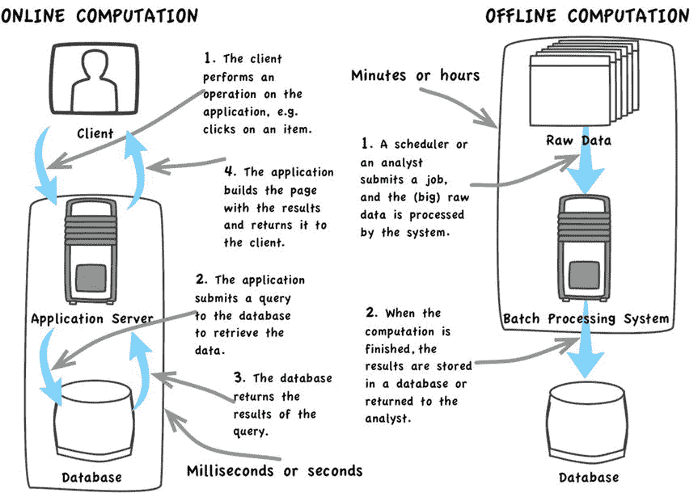

**图 2-10.** 在线与离线工作负载的区别

现在你已经了解了在线系统和离线系统之间的区别，可以来看看一个包含这两类系统的应用程序架构，以及每种系统如何融入该架构。通过观察这个架构，你可以学习如何将 `Giraph` 定位在后端。

## 在应用程序中集成 Giraph

正如你在上一节中看到的，在线系统和离线系统可以协同工作，并且通常都是应用程序的一部分。本节将介绍一个典型的架构，后续章节会通过更实际的例子进行细化。学完本节后，你将了解如何在自己的架构中定位 `Giraph`。图 2-11 展示了一个由多个不同系统组成的通用应用程序架构；让我们放大观察构成该架构的各个组件。

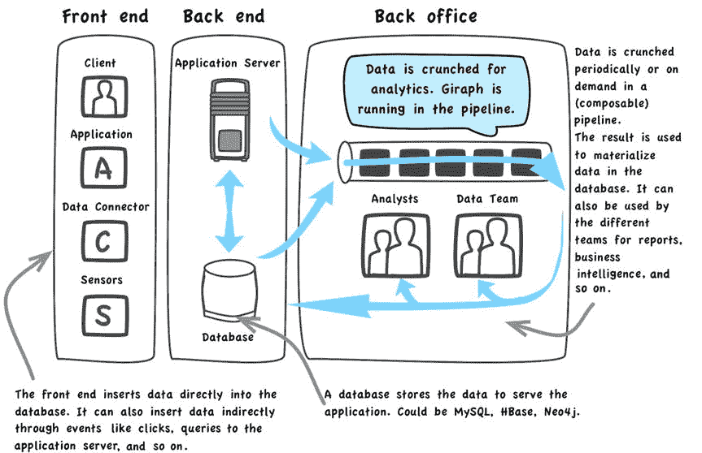

**图 2-11.** 典型应用程序的系统架构

该架构分为三个主要组件：

*   **前端**：客户端与系统交互的部分。根据客户端的不同，前端可以直接将数据插入数据库，也可以通过与应用服务器交互间接实现，应用服务器随后将数据插入数据库。应用服务器从数据库读取数据并向数据库写入数据，以便为前端提供内容。这就是数据库和应用服务器之间用双箭头连接的原因。在前端，人类客户端以及传感器、其他应用程序等都被考虑在内。

*   **后端**：应用服务器和数据库所在的部分。应用程序的数据、逻辑以及在线系统都驻留在此处。应用服务器根据请求类型、应用程序逻辑以及数据库中存储的相关数据，计算对客户端请求的响应。根据运行的应用数量、不同的架构等，后端可以包含多种类型的应用服务器和数据库。后端通常包含大量的不同系统和技术。

## 后台办公室

后台办公室是交互性较弱的部分，也是人工干预较多的组件。例如，在后台办公室，负责数据录入的团队将数据插入数据库，而数据团队则负责计算分析结果，研究收集的数据并获取关于客户行为的见解。离线系统也驻留于此。以原始日志形式从应用日志中收集的数据，或以结构化格式存储在数据库中的数据，会被处理以计算分析结果，或物化新信息以更新数据库中的集合。物化后的信息正是那种在线计算成本过高的数据，因此这些结果会定期计算并缓存在后端的数据库中。

## 架构组成部分交互示例

让我们花点时间看一个例子，更好地理解架构的这三个组成部分——以及组成它们的系统——是如何交互的。为了便于说明，该示例使用了一个简单的应用程序；它绝非该应用程序的“最佳”架构，所以请多多包涵。这类架构中的定义和边界也有点模糊，所以请关注大局。

想象一个用户通过手机与新闻网站交互的场景。当浏览器首次加载主页时，会从 Web 服务器接收一个 HTML 页面，其中包含一个 JavaScript 脚本。浏览器、HTML 页面和脚本共同构成了**前端**。当用户滚动页面并点击新闻条目时，前端中的脚本会向**应用服务器**发出请求。根据用户操作产生的请求，应用服务器从数据库和不同的内容存储（文章内容和相关多媒体）中检索数据。随后，它将数据发送回浏览器，浏览器更新用户界面以展示新闻条目。应用服务器、数据库和数据存储，以及可能的缓存和消息代理，构成了**后端**，运行在新闻网站的服务器上。图 2-12 展示了前端与后端之间的交互。

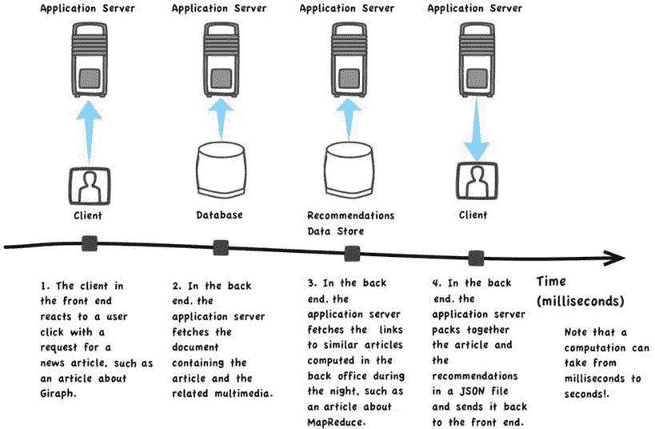

*图 2-12. 前端与后端之间的低延迟交互*

当浏览器请求用户点击的新闻条目时，应用服务器会获取并发送这些新闻条目，同时附上相似新闻文章推荐。此功能帮助用户找到相似内容并继续浏览新闻网站。找到相似新闻文章的计算开销极大，无法在每次客户端请求时在线完成，因此推荐结果会定期（例如在夜间）离线计算，并存储在专用的数据存储中。计算“相似文章”特征的推荐系统位于**后台办公系统**，与新闻内容提供商（如记者和编辑）相关的操作一起运行。为了找到相似文章，系统会查看应用服务器日志，采用“阅读本文的用户也阅读了这些文章”的范式（处理日志中的点击数据）。因此，后台办公系统连接到后端，以检索用户行为数据来计算推荐，并存储推荐结果以供用户使用。图 2-13 展示了后端与后台办公系统之间的交互。请注意，前端与后端之间的交互，以及后端与后台办公系统之间的交互，是独立发生的，并且时间尺度不同。

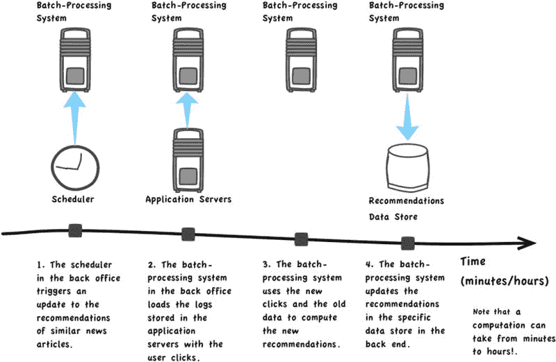

*图 2-13. 后台办公系统与后端之间的周期性交互*

`Giraph` 位于后台办公系统中。它可以成为许多管道的一部分，前提是应用涉及图数据。管道不过是一系列作业，前一个作业的输出作为下一个作业的输入。不同的管道可以并行或串行计算，具体取决于不同团队的工作流程和请求。事实上，后台办公系统中执行着多个批处理作业管道，有些用于支持特定的应用功能，另一些则用于支持数据科学家的分析查询。这在很大程度上取决于特定时刻所需的结果类型，当然也取决于应用本身。不过，可以识别出一个通用模式——一组通用的步骤。接下来的章节将在真实场景的背景下审视这些步骤。

图 2-14 展示了涉及图数据的管道。该管道包含以下步骤。

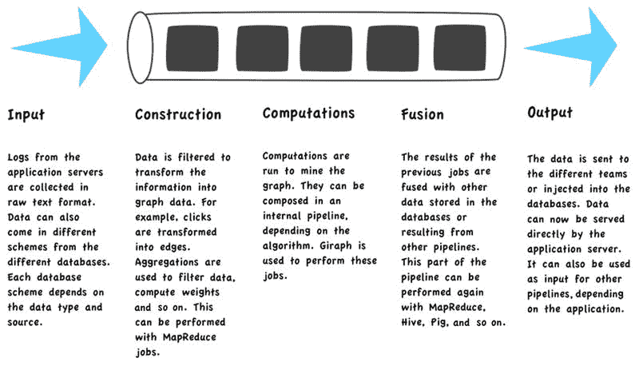

*图 2-14. 后台办公系统中的数据处理管道*

-   **输入（Input）**：数据从不同来源收集。这些数据以不同格式存储，有时遵循结构化方案，有时采用简单格式，如纯文本。管道的这一步可以通过将数据存储到数据库或文件系统的日志文件中来实现。在大型架构中，可能需要部署一个分布式系统，以实时从应用服务器收集流式日志。在“相似新闻文章”应用中，输入可以是文章本身（例如，如果推荐文章是因为它们具有相似内容）、来自应用服务器的点击日志（如果使用点击来查找相似文章），或者由内容提供者提供的额外元数据（文章类别、标签等）。

-   **构建（Construction）**：数据以各种格式和方案收集，尚未经过处理来表征图。这些数据需要经过过滤、转换和聚合，直到提取出一个图。这一步既取决于待处理数据的类型，也取决于后续步骤中要计算的算法。不同的图算法通常需要不同的图表示方法和不同的数据类型。在新闻网站的例子中，文章可以由顶点表示，每当用户从一篇文章点击到另一篇文章时，它们之间就会有一条边相连。边的权重可以表示事件发生的（归一化）次数。可以对边权重应用一个阈值，以防止图变得过于密集。

-   **计算（Computations）**：一旦图构建完成，就可以使用 `Giraph` 对其进行处理。在这个阶段，会执行一个或多个作业。图计算的类型和数量在很大程度上取决于挖掘应用。通常，图算法是分层构建、相互依赖的。例如，某些排序算法使用中心性度量，而这些度量又依赖于最短路径的计算。通常，一个作业计算出的图是下一个作业的输入。对于新闻文章，可以在构建好的图上执行两种计算。要计算最受欢迎的文章，可以在点击图上运行 `PageRank`，并使用排名对推荐进行排序（例如，最受欢迎的排在最前面）。要计算哪些文章与其他文章相关，可以在点击图上运行社区发现算法。落入同一社区的文章可以被视为相关，并因此被推荐。你将在第 4 章中看到这两种算法。

-   **融合（Fusion）**：上一步计算的结果会被转换、连接或与可能来自数据库或其他管道的数据进行融合。请记住，图计算通常是更大型应用的一部分，因此可能只解决一个子问题。此外，这一步取决于正在执行的分析类型以及数据库中必要的物化类型。融合实际上可能需要多个步骤，因为计算结果可能会被重用于不同的报告和数据库。例如，通过社区发现算法计算出的文章排名及其类别，可以与文章元数据连接，以准备注入到推荐数据存储中。

-   **输出（Output）**：一旦数据被融合并打包成报告或物化视图，它就会被发送给相关团队或注入到各自的数据库中。对于报告，输出可以是结果的摘要视图；或者，对于物化视图，输出可以是准备注入数据库的数据表。在后一种情况下，输出阶段可能会对注入数据的数据库产生持续的负载。因此，注入的数据格式应避免数据库系统进行进一步的昂贵操作。在新闻文章的例子中，数据可以按照推荐数据存储的模式注入到其中。

现在你已经了解了 `Giraph` 如何在系统架构中发挥作用，接下来的章节将介绍针对各种真实场景的专门化架构和管道。

### 网络搜索公司中的 Giraph

一家从事网络搜索业务公司的核心产品是什么？那就是它的搜索引擎。最笼统地说，就是为网络搜索提供结果——根据用户通过查询指定的内容，在网络上搜索特定内容。然而，当用户通过查询搜索页面时，搜索引擎并不会漫游网络来寻找匹配该查询的页面。网络是巨大的，这样的搜索需要数天或数周才能返回有意义的结果。相反，搜索引擎包含一个（部分）网络内容的索引，用于在合理的时间（毫秒级）内回答查询。这个问题与 `find` 和 `locate` 命令的问题非常相似。事实上，它的工作方式与 `locate` 类似。搜索引擎由一个定期更新网络内容“数据库”（即索引）的程序，以及一个在数据库中搜索与查询匹配内容的程序组成，后者被搜索页面所使用（比如著名的谷歌“白页”，位于 [`www.google.com`](http://www.google.com/)）。搜索引擎的核心由两个主要组件构成：爬虫（也称为蜘蛛）和索引。爬虫是一个持续漫游网络的程序，从一个页面跳到另一个页面，并跟随其所访问的每个页面 HTML 中的链接。当爬虫到达一个新页面或之前访问过页面的更新版本时，它将该页面发送给索引器，索引器负责根据页面内容保持索引为最新状态。在不深入索引工作细节的情况下，你可以将其视为一个映射，将单词链接到包含这些单词的页面的 URL 列表。对于特定的单词，该映射存储了 URL 以及该单词在这些页面中出现的次数。图 2-15 展示了这些组件。

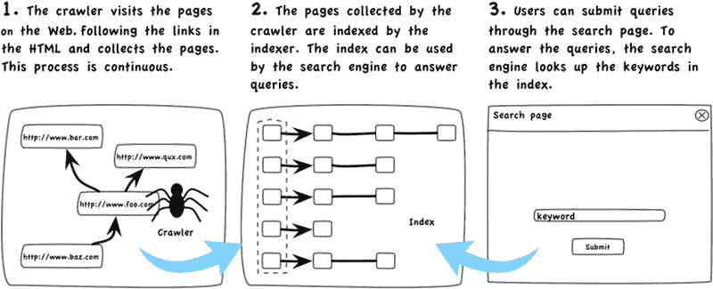

*图 2-15. 网络搜索引擎的组件：爬虫、索引和搜索页面*

### 搜索引擎中的应用

为了创建索引，索引器会遍历爬虫传递给它的每个页面，将页面正文中的文本分割成单词，进行计数，并相应地更新索引。在索引中搜索查询是如何工作的——例如，一个由一组关键字表达的查询？假设你提交了查询`Hello Giraph`。索引会搜索每个特定的单一关键字，并返回URL`http://www.foo.com`、`http://www.bar.com`和`http://www.baz.com`，因为它们包含这两个关键字或其中之一（见图2-16）。关键字出现频率更高的页面被认为相关性更高。搜索结果呈现的顺序也称为排名。搜索页面按此顺序返回搜索结果，因为它们是按相关性排序的（`http://www.foo.com`为三个，`http://www.bar.com`为两个，`http://www.baz.com`为一个）。请记住，页面上关键字的纯粹出现次数是一种简单的相关性度量。更复杂的度量指标会考虑文档长度和其他参数（例如，搜索关于TF-IDF以了解更多信息）。索引器还使用其他技术，如词干提取、停用词过滤、锚文本等，但这个示例为了清晰起见，把事情简化了。

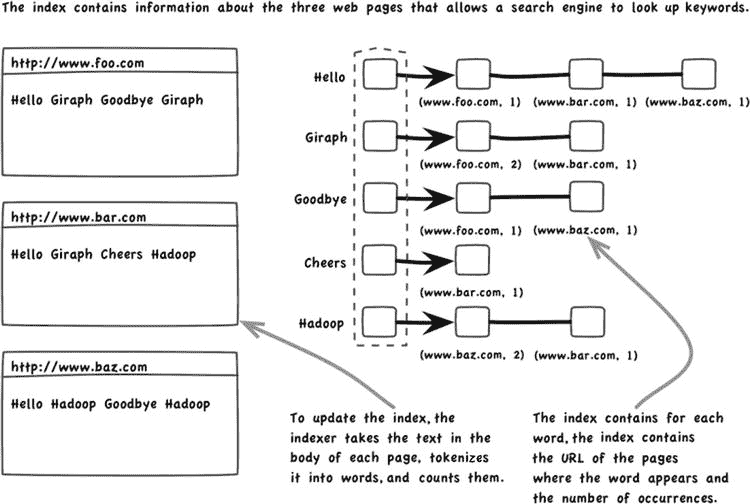

图2-16. 从三个网页生成的索引

这大致就是谷歌及其PageRank算法出现之前，一个非常基本的搜索引擎的工作方式。你可能已经注意到，网络的结构仅被爬虫用于发现要访问的页面；它不用于任何其他用途，例如计算排名。在这个搜索引擎中，排名是根据每个网页的相关性来计算的。这就是为什么在谷歌之前，搜索引擎优化（SEO）技术是基于用人类用户看不见的长串关键字污染网页。SEO会“提升”一个页面在许多不同搜索查询中的排名。谷歌最初如此成功的原因之一就是它排名网页的方法。PageRank算法利用网络结构来对页面进行排名。PageRank背后的直觉非常简单：链接到某个页面的页面越多，该页面的排名就应该越高。此外，链接到某个页面的页面排名越高，该页面的排名也就越高。这是一种根据页面受欢迎程度对其进行排名的精英式方法：如果许多受欢迎的页面都链接到某个特定页面，那么这个页面一定很受欢迎，并且提供了优质内容。所有必要的信息都存在于网页的链接结构中。虽然可能，但创建具有高人气的页面，并从这些页面添加链接到你想提高排名的页面要困难得多。

第4章将详细介绍PageRank的工作原理以及如何使用Giraph实现它。现在，只需考虑这正是那种非常适合用Giraph进行迭代计算的图算法。索引可以通过像MapReduce这样的系统为极大量的页面构建，而页面排名则可以用Giraph计算。这两个系统都适用于后台运行的管道流程中，与爬虫一起工作。与迄今为止所描述的搜索引擎架构的唯一区别是增加一个Giraph作业来计算排名。一旦计算出排名，它们就可以与页面的相关性一起，用于决定页面作为搜索结果呈现给用户的顺序。如今，像谷歌这样的搜索引擎在计算页面排名时，会添加并考虑更多的指标；例如，社交媒体、点击统计和用户画像。然而，PageRank算法展示了如何将数据视为图，并将解决方案视为图算法。

现在，让我们看看图2-14中为搜索引擎使用Giraph计算PageRank的管道流程：

- `输入`：输入直接来自爬虫，因此取决于爬虫存储其已获取页面的方式。如果你想更新当前的PageRank而不是从头开始计算，则图的当前值也可以用作输入。

- `构建`：爬虫可以在解析链接图时将其与页面分开存储，或者可能需要遍历页面并提取HTML中的链接以构建图。必须过滤掉（非法的）URL、进行规范化并去重。通常，URL会被转换，域名会转换为反向域名表示法。

- `计算`：一旦图被转换，就可以加载到Giraph中，计算即可开始。在此阶段，会为加载的图计算PageRank。还可以在图之上执行其他计算，例如通过其他特定的图算法计算相关页面。

- `融合`：索引先前是通过MapReduce作业构建的。你可能希望将PageRank直接添加到索引中每个URL的条目中。这允许你在查询时获取URL，以及相关性和PageRank值，以计算结果呈现的顺序。

- `输出`：包含PageRank值的更新后索引数据被注入到索引存储中，以便搜索页面可以直接使用。

这是一个处理管道的示例，具体取决于搜索引擎支持的功能。页面索引（通常通过`MapReduce`执行）可以视为该管道的一部分，在`PageRank`计算之前执行，或者作为其自身管道的一部分。现在你已经了解了`Giraph`如何帮助网络搜索公司，让我们转向另一个场景。

### Giraph 在电子商务公司中的应用

用户在电商网站上通常做两类事情：搜索他们明确想要的特定商品（这可能是他们最初访问网站的原因）；或者四处浏览并偶然发现吸引他们注意力、可能决定购买的商品。回想一下你在亚马逊的一次浏览会话。从某种程度上说，支持第一类使用的基础设施与网络搜索公司类似。为了支持搜索，产品数据会被索引，以便通过查询找到。但由于数据已经存储在公司的数据库中，因此无需通过爬虫发现。数据一旦被插入网站，就会立即被处理并添加到索引中。第二类使用更类似于浏览网页。用户通过链接在网站上探索可用产品，寻找他们喜欢的东西。这意味着产品页面上的链接必须精心挑选，以刺激用户点击，并增加用户找到感兴趣物品的可能性。但是，什么能成为产品页面上的好链接？对于《月之暗面》这张专辑的页面，什么链接会有效？可能是平克·弗洛伊德的其他唱片，或者符合该唱片粉丝口味的东西。那么，这种粉丝的口味又是什么呢？这很难界定，并且取决于多种因素。

推荐系统旨在向用户推荐项目（有时也向用户推荐用户），例如用户可能感兴趣的产品。在当前场景下，一个有效的推荐系统会为给定产品生成链接，使用户无需明确搜索就能轻松找到感兴趣的内容。虽然这项任务可以由人类（例如，将相似唱片在商店货架上相邻摆放的专家店员）完成，但让计算机程序执行它也行之有效：面对数百万种产品，由人工组织推荐无法规模化；而数据驱动的方法能产生更无偏的结果。

这一切与`Giraph`有什么关系？事实证明，电商网站的数据可以通过图来建模。电商网站有两种类型的实体：产品和客户（或用户）。你可以用顶点来对两者建模。从技术上讲，它们可以用两种类型的顶点来表示，一种对应一种实体（例如，用圆形表示用户，用方形表示商品）。当客户购买产品时，边连接顶点。由于边总是连接不同类型的两个顶点，这种类型的图也被称为二分图。图2-17展示了一个例子。网站还可以支持产品评级——例如，使用星级。评级可以很容易地用边权重来建模，其中权重设置为客户对产品的评分。这种图数据可以按照流行的“购买了此商品的顾客也购买了这些其他商品”的模式进行分析。通过执行此分析，你可以利用客户的购买历史，自动发现特定产品买家的画像。你也可以回答关于哪些商品可能对《月之暗面》的顾客感兴趣的问题。这种画像数据通常被称为潜在画像，因为它不是直接观察到的，而是从用户行为中推断出来的。这种方法也被称为协同过滤，因为用户隐式地协作构建过滤器，以组织商品推荐数据库。

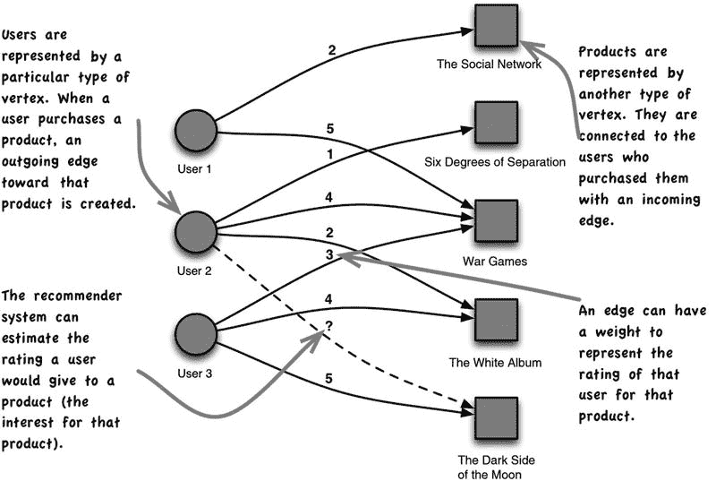

图2-17. 用包含用户、商品和评级的图表示的电商网站数据

协同过滤是构建推荐系统的一种有效技术。然而，它并不是唯一的技术。基于内容的推荐系统遵循不同的方法。不（仅仅）关注购买历史，你可以基于定性证据推荐产品。例如，假设有关于音乐专辑的元数据，如类型、发行年份、录制地点、情绪、风格、标签等。基于这些元数据，你可以定义一个相似度度量来衡量两张专辑的相似程度——例如，它们是否属于同一类型，是否在同一时期和国家录制。一旦确定了商品之间的相似性，你就可以构建一个图，其中相似的产品通过边连接，边的权重编码了这些商品的相似程度。图2-18展示了这种图的一个例子。有了这些信息，如果客户购买了《月之暗面》，系统可以推荐其他具有相似元数据的专辑（例如其他20世纪70年代的迷幻摇滚专辑），或许还会考虑该客户过去购买的其他产品。这种方法类似于有前面提到的专家店员为你组织商店货架，但更具个性化和可扩展性。根据产品类型，即使没有元数据，也可以计算基于内容的相似度。多年来，科学家们一直在研究通过分析文本来识别书籍之间相似性、通过分析音频信号来识别歌曲之间相似性、以及通过分析形状和颜色来识别图像之间相似性的方法。然而，这超出了大规模图处理的范围。

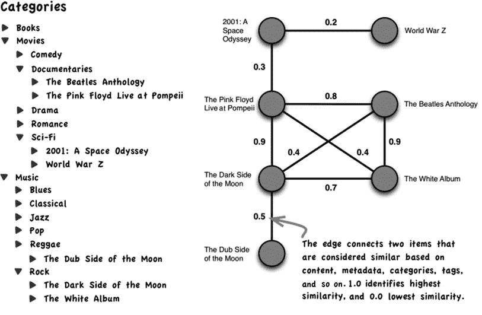

图2-18. 基于元数据的电商网站数据图表示

两种方法各有优缺点。协同过滤的优势在于，除了购买历史之外，不需要任何其他类型的数据。此外，它可以跨不同类型的产品计算推荐。例如，它可以基于电影和音乐专辑的购买数据推荐书籍（也许购买金属摇滚乐专辑的人也购买黑色 T 恤）。另一方面，基于内容的推荐不会受到所谓的“冷启动问题”的影响，因为从第一天起就可以推荐商品，无需历史数据。通常，这两种方法会结合使用，在早期使用基于内容的推荐，然后系统逐步迁移到协同过滤。本书并非专门介绍构建推荐系统；其他书籍涵盖了这一主题。关键在于，用图来建模电商数据，并将推荐算法视为探索这些图的算法，是可能的（且通常是可取的）。这些图可能会变得非常大，因此你可以使用`Giraph`来计算图算法，为电商网站构建推荐系统。第 4 章介绍了一种用于此目的的算法；你可以将其用作特定数据模型和用例场景的构建块。

推荐系统只是`Giraph`如何用于分析电商网站数据的一个例子。分析客户行为可以让你了解营销活动或网站组织的有效性等信息。

## 电商网站的处理管道

总的来说，电商网站的处理管道可能如下所示：

*   **输入**：输入数据来源于历史购买记录、原始网络服务器日志（例如用于点击图），在基于内容的推荐场景中，也可能来自结构化数据库。

*   **构建**：图可以通过将产品和客户作为顶点，并用购买数据或点击信息连接它们来构建。通常，数据会被归一化以生成权重——例如，将每个页面的点击次数除以总点击数进行归一化。物品之间的相似度也可以根据不同标准进行计算——例如，通过`MapReduce`作业或`Apache Mahout`等非图形化模型来实现。

*   **计算**：图转换完成后，可将其加载到`Giraph`中并进行算法计算。在推荐算法场景中，会计算每个用户的潜在特征向量。这些潜在特征向量可用于在流水线的另一个步骤中预测评分和推荐结果，可能通过`MapReduce`实现。

*   **融合**：潜在特征向量和推荐结果可以与结构化数据融合，生成包含更新后的相似产品链接的新产品页面。它们也可以被加载到数据库中，或在每个用户的首页上生成个性化推荐。如果推荐是基于离线计算的潜在特征向量在线实时计算的，则需将特征数据准备好，供在线系统加载。

*   **输出**：推荐结果被发送到推荐数据存储中，网页也会更新新的链接。

你现在已经了解了`Giraph`如何融入一个架构，以支撑电子商务网站的工作负载，特别是着眼于构建推荐系统。下一节将聚焦于一个最终场景：一家在线社交网络公司。

## Giraph 在在线社交网络公司的应用

社交网络网站成功的原因之一，在于它们让我们能够与他人建立联系，并分享我们正在做什么以及喜欢什么的信息。我们在这些网站上与他人建立联系的原因因网站而异。例如，在 Facebook 上，用户倾向于与现实生活中的熟人建立联系；而在 Twitter 上，他们则与感兴趣的人建立联系；在 Flickr 上，则与欣赏其作品的摄影师建立联系。无论原因如何，与他人建立的连接都编织出了一幅有趣的社交网络图。将这些网络表示为图，并通过图算法进行处理，可以让你研究图中反映出的底层社交动态。

Facebook 在 2010 年 12 月发布了一张图片。¹虽然这张图片看起来像是世界夜景的卫星照片（这正是其震撼之处！），但实际上并非如此。这张图片展示的是 Facebook 社交网络图的一部分。为了绘制这张图，保罗·巴特勒分析了 Facebook 用户的友谊关系，并根据以下标准对数据进行可视化：

*   对于每对城市，保罗统计了这两个城市之间的朋友数量，并用一条边连接这两个城市。

*   对于每条边，他根据两个城市之间的距离以及它们之间的朋友数量计算了一个权重。

*   他根据边所连接城市的地理空间信息来放置这些边。换句话说，他根据每个顶点（一个城市）在地图上的位置进行放置，但没有显示顶点本身，因此只可视化了边。

*   为了选择边的颜色，他选取了从白色到蓝色的渐变色，其中权重最高的边映射为白色。

*   对于连接不同大陆城市的长边，则用环绕地球的弧线绘制，以最大限度地减少重叠，提高可读性。

这个例子清楚地表明，Facebook 上的个体通过地理关系联系在一起，因为人们在 Facebook 上大多数时候是与现实生活中（或曾经）相处的人建立联系。描述用于分析数据和计算可视化边权重的标准，实际上就是一个图算法。

社交网络最有趣的特性之一是其社群划分。在社交网络分析（SNA）中，社群是指一组个体，他们彼此之间的联系比与社群外个体的联系更为紧密。直观上，你可以将社群视为一个聚类。由于这种社群划分，表示社交网络的图具有特定的性质，图算法可以利用这些性质来检测社群。图 2-19 展示了作者（之一）的社群的一部分，该图从其 LinkedIn 账户中提取，并通过 LinkedIn Maps 工具进行可视化。²在这张图中，每个顶点代表一个 LinkedIn 用户，如果两个用户代表的人存在连接，则两个顶点之间有一条边。在该图上运行了一个社群检测算法，顶点根据算法分配的社群进行着色。请注意，该算法并未使用每个用户个人资料中的信息（例如过往工作）来检测社群。相反，它仅使用了图中关于用户如何连接的信息。该算法成功检测到了社群：每种颜色确实映射到了作者所属的一个当前或过往社群，例如他的前任和现任同事、`Apache Giraph` 社区等等。第 4 章将介绍一个使用`Giraph`检测社群的算法。有趣的是，用于绘制该图的图布局算法本身也是一个图算法。图布局算法计算顶点在二维空间中的位置，使得相连的顶点彼此靠近，并且边交叉最小化（以提高可读性）。该算法只使用图中的连接信息，而相同颜色（相同社群）的顶点会聚集在一起，这再次证明了图中存在强烈的社群结构。

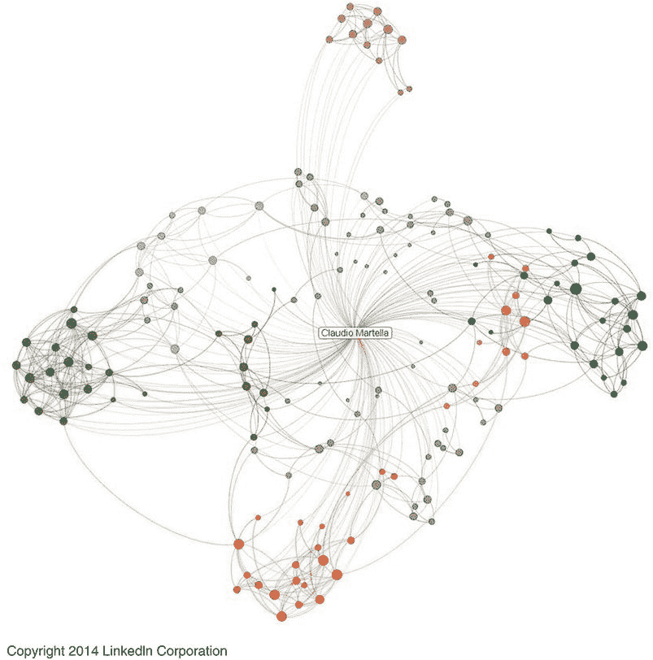

**图 2-19.** 一位 LinkedIn 用户社交网络中的社群

社群的定义并非严格唯一。现实世界中的许多社群是重叠的，因为我们每个人同时属于多个社群。例如，在 Facebook 上，你可能与你的学校朋友、同事、足球队友等都有联系。此外，社群通常按层级组织。你可能属于你的学校社群，同时也属于你所在班级的内部小社群、学校乐队、你曾经参加的篮球队等等。这意味着社群检测算法必须根据特定的应用场景进行调整。

## 社交网站为何要检测社区？

首先，是为了研究其用户。通过研究社交网络中的社区，可以了解用户之间是如何组织和连接的。这有助于你针对特定群体行为，并分析特定功能的有效性。网站还可以支持“你可能认识的人”等功能。例如，图 2-20 展示了一个朋友社区。利用朋友关系，网站可以帮助用户与老朋友重新建立联系。但社区的作用并不仅限于社交网站。

想一想上一节中提到的电商网站推荐系统。本书介绍的用于计算推荐的算法会生成关于客户和商品的画像，从而让你能够预测评分。它本质上创建了一个函数，该函数根据给定客户和任意商品，基于历史评分预测该客户对商品的评分。目前仍需解决的问题是“配对”——找出预测评分较高的商品。对此，一个简单的解决方案是将客户的画像与所有未评分的商品进行匹配，并保留评分最高的那些。然而，这种方案意味着要将每位客户与所有商品进行匹配，这需要巨大的计算量，并且是不可行的。

另一种解决方案是查看客户的社区，并且仅将他们的画像与这些社区内的商品进行匹配。客户-商品图（例如上一节中所示）往往会被组织成社区，通常按流派或口味划分。喜欢摇滚乐的人很有可能购买相似的专辑。如果允许客户通过创建明确的社交网络在网站上建立联系，这种社区结构往往会更加强大。在客户-商品图上使用社区检测算法，实际上就是一种聚类计算。

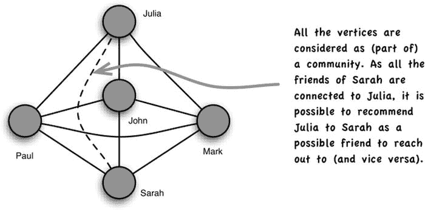

**图 2-20.** 基于社区结构的好友推荐

排名也可以应用于社交网络。以推特为例。在社交媒体网站上，用户通常根据其影响力进行排名。直观地说，影响力高的用户是指那些行为和动作能深入触及图结构、从而有效增加影响其他用户可能性的用户。影响力高的用户被称为影响者。在推特上，可以通过观察他们的推文如何在其关注者网络中传播，以及通过查看转发和提及等行为来计算影响者。你可能希望在推荐关注的用户列表中优先推荐影响者，并提高他们的推文在用户信息流中显示的概率。通常，计算影响者的算法使用与 `PageRank` 相同的范式（其中一种算法被称为 `TweetRank`），但它们也会考虑时间因素，例如推文传播的速度。

`Giraph` 适合部署在社交网站的后台，作为分析社交网络的流水线中的一环。其不同的步骤可能如下：

*   **输入：** 输入来自存储社交关系和画像（性别、年龄、国家等）的不同数据存储，以及来自原始 Web 服务器日志（例如用于点击图）。使用哪些数据取决于应用程序的类型。

*   **构建：** 根据特定的关系类型和画像特征筛选出图的一部分，这通常被称为图的投影。例如，居住在美国的男性职场人士的社交图是 `LinkedIn` 图的一个投影。图的投影是通过过滤掉不需要的数据并归一化边的权重来构建的。通常，不同的算法需要计算不同的投影。在其他情况下，不同的投影需要在流水线的后续步骤中进行合并。

*   **计算：** 利用图来计算社区、排名、影响者等。不同的计算根据分析的语义依次执行并形成流水线；例如，排名可用于计算影响者。在这一点上，为了汇总和生成报告，可以根据社区成员身份或画像数据等标准对数据进行聚合——例如，美国男性职场人士的平均连接数。聚合可以直接在`Giraph`中计算，也可以通过像`Hive`这样的工具，或是直接通过`MapReduce`来计算。
*   **融合：** 计算的结果用于构建要注入到存储中的物化数据。社区和排名用于构建好友推荐，而影响者排名则用于推荐数据项，具体取决于数据源。
*   **输出：** 物化后的数据项被插入到数据库中，或发送给分析团队。

再次强调，这些仅仅是线上社交网络应用程序功能的一些例子。通过到目前为止提供的示例，你已经学会了如何将`Giraph`定位到你的架构中，以及如何将其与现有的数据处理流水线集成。

## 总结

图无处不在，你可以用它们来描述许多不同领域的众多事物。通过以图的视角审视数据和问题，你可以更好地了解你的应用程序和产品。`Giraph`帮助你大规模地处理这些数据，作为你应用程序架构的一部分。

在本章中，你学习了以下内容：
*   图是非常简单的结构，可用于描述许多不同的事物。
*   根据数据类型，你可以使用标签、有向边、权重等来表示数据的特定特征。
*   对于计算成本高昂但需要在毫秒内返回结果的计算，可以通过结合在线和离线计算来执行。
*   `Giraph`是一个离线图处理引擎，位于应用程序架构的后台。
*   你可以将`Giraph`与你架构中的其他系统协同使用，来计算排名、推荐、社区等。

既然你已经了解了如何用图对数据进行建模，以及如何将`Giraph`集成到你的应用程序中，那么你已经准备好学习如何对`Giraph`进行编程了。下一章将讨论编程模型和API。

**脚注**

[1] Paul Butler，“Visualizing Friendships”，Facebook，[`www.facebook.com/note.php?note_id=469716398919`](http://www.facebook.com/note.php?note_id=469716398919).

[2] [`http://inmaps.linkedinlabs.com`](http://inmaps.linkedinlabs.com/).

