# 4. Giraph 算法构建块

本章涵盖

*   可扩展图算法背后的原理和模式

*   图连通性、路径和连通分量

*   使用 `PageRank` 对顶点进行排名

*   预测用户-物品推荐的评分

*   使用标签传播识别社区

*   图的类型及其特征化方法

本章重点介绍图算法的算法构建块，特别强调其可扩展性。在 `Giraph` 中，图问题通常使用多种模式来解决。由于 `Giraph` 基于消息传递的以顶点为中心的范式，这些模式使用了一种值传播的方式。本章将介绍通用模式，并探讨一些可以使用该模式解决的典型问题，例如寻找路径、对顶点进行排名、识别分量和社区以及预测评分。你还会了解不同类型的图，以及如何通过本章描述的一些算法来表征它们。

## 设计可扩展的图算法

在上一章中，您了解到 Giraph 提供了一种编程模型，通过简单的范式让您表达图算法。顶点拥有值，并可以在多次迭代中通过消息交换数据。在底层，系统负责在分布式环境中并行执行算法。尽管限制较多，但该范式专门设计用于让您能够产出可扩展的算法。遵循此模型表达的算法本质上是去中心化的。每个顶点基于局部信息（例如其当前的顶点值和收到的消息）做出独立决策（例如是否以及如何更新其值、发送消息或投票停止）。由于每个顶点在每次迭代中都基于自身的一组数据做出决策，因此算法的执行可以实现大规模并行化。实际上，用户定义的函数可以在所有可用的处理单元上对所有顶点独立并行执行。基于消息传递的模型避免了昂贵的并发原语——尤其是在分布式环境中——例如基于共享内存的模型所需的锁、信号量和原子操作。

使用限制性模型可以让您专注于算法的语义，而忽略框架自带的执行模型。这样一来，每次只需进行少量重新发明，只需开发特定于问题的代码。尽管过程简单，但在设计新算法时，您仍需考虑几个重要的决策。熟悉 Giraph 模型需要一些时间，但一旦您掌握了以顶点为中心的视角，您将开始以完全不同的方式看待图问题。

第三章 使用了社交网络的例子，其中“一个人的价值等同于她的朋友的价值”。该例子指出，一个顶点的值取决于其邻居的值；而邻居的值又取决于它们邻居的值，依此类推。这意味着要计算这些值，信息需要通过图的结构进行传播，迭代一次接一次。信息传播是 Giraph 模型背后基本且根本的模式。Giraph 中的算法定义了信息如何通过图传播，以及每个顶点如何使用这些信息来做出独立决策，例如是否以及如何更新其值。您将看到这种模式如何贯穿本章介绍的所有算法。

> **注意**
>
> 在 Giraph 中，计算的全局状态分布在顶点值中，并通过顶点之间相互发送的消息进行共享。

根据这一定义，如果一个顶点需要另一个顶点拥有的某条信息来计算其值，那么这条信息必须通过消息传递给该顶点。要在 Giraph 中设计图算法并基于信息传播模式进行构建，您必须决定一系列事项，这些事项定义了与每个顶点关联的数据如何初始化、访问、交换和更新——基本上，就是它如何使用。

具体来说，您必须定义以下算法元素，这些元素特定于去中心化的、以顶点为中心的方法：

- **独立的顶点决策**：每个顶点做出的决策，例如是否应发送消息或投票停止，应基于顶点自身拥有的信息（局部信息），并且仅基于该信息（独立/去中心化）。

- **顶点值的初始化**：尽管显然需要正确初始化顶点值，但值的初始化对于去中心化的以顶点为中心的算法更为重要。由于顶点基于当前的顶点值和传入消息做出决策，因此计算所走的路径既取决于分配给顶点的初始值，也取决于图的结构。

- **停止条件**：顶点独立做出决策，因此设计一个一致、易于理解且最重要的是能够由顶点协作决定停止条件非常重要。

- **聚合器和组合器**：有时全局计算可以简化算法，甚至可能是不必要的。在这些情况下，聚合器非常有用，且不会破坏算法的可扩展性。在可能的情况下，算法应使用组合器来最小化用于消息的资源量（如网络和内存）。

总而言之，您应该使用以顶点为中心的方法，专注于基于局部信息的去中心化决策，这些决策通常更易于并行化。

本章的其余部分将具体探讨现有算法如何定义这些要点。接下来的章节具有双重作用：它们帮助您更好地理解 Giraph 编程模型以及本节介绍的概念；同时它们提供了解决方案，这些方案通常作为更复杂解决方案的构建模块。您可能会希望在自己的应用程序中重用这些解决方案背后的某些原则。

## 探索连通性

正如您所学到的，图不过是一堆相互连接的顶点。在此，如果两个顶点是直接邻居，即它们是单条边的两个端点，则认为它们是连通的。然而，这是对图结构的简化视图。连通性可以看作是顶点之间更广泛的关系。事实上，连通性是一种传递关系。换句话说，如果顶点 A 与顶点 B 连通，且顶点 B 与顶点 C 连通，那么顶点 A 与顶点 C 连通。连接 A 到 B 的边和连接 B 到 C 的边构成了一条路径。路径是连接顶点的边序列。如果遍历这些边，它们会从一个顶点“到达”另一个顶点。通过路径，连通性可以扩展到非邻居的顶点；它们是研究图结构的基本工具之一。本节将探讨如何计算最短路径，并使用它们来识别图中作为子图的组件。

### 计算最短路径

假设您有一个社交图谱，想要找到应该请谁帮您引荐网球 superstar **罗杰·费德勒**。如果您认识的人中没有人认识罗杰，他们很可能认识认识他的人。或者，他们可能认识认识认识罗杰的人，以此类推。基本上，您就是在寻找一条“朋友的朋友”关系路径，让您能联系到罗杰。您可能熟悉“六度分隔”理论。根据该理论，在我们的社交关系中，人与人之间平均相隔六步。例如，我们每个人平均距离罗杰·费德勒（或地球上的任何其他人）六步之遥，构成一条长长的“朋友的朋友”关系链。

20 世纪 60 年代末，**斯坦利·米尔格拉姆** 进行了一个简单的实验。他向美国随机挑选的一些人寄出了一封信；这些人被称为“源”，每封信都包含一个目标个体（在米尔格拉姆的实验中，目标住在波士顿）的全名和一个名册。收信人被问及是否与目标直呼其名。如果是，收信人就被要求将信直接转发给目标。如果收信人不认识目标，则被要求将信转发给他们认为更有可能认识目标的朋友。每位收到信的人都在名册上签下自己的名字，以追踪这条链。当目标收到信时，名册上就记录了连接最初随机选择的“源”和目标个体的整个“朋友的朋友”链。这个程序对 600 多人执行，结果是，对于那些最终到达目标的信件，名册上平均包含五到六个名字。每个名册上的名字列表就是一条路径。图 4-1 展示了其中一封信的可能路径；在此例中，目标是玛利亚，随机选择的源是山姆。

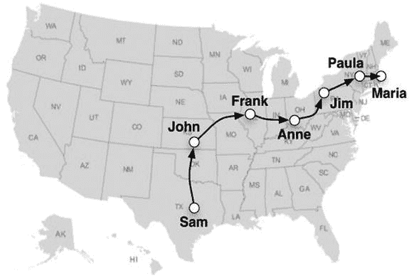

**图 4-1.** 米尔格拉姆实验中一封信的虚构路径

实际上，米尔格拉姆在他的实验中所做的是计算美国社交图谱平均路径长度的近似值——而这个数字大约是六。通常，两个顶点之间存在多条路径，您通常关心的是最短的那条。在无权图中，两个顶点之间的最短路径不过是两个顶点之间边数最少的路径。计算图中两个顶点之间的距离以及具有该长度的路径有多种方法。其中大多数可以看作是米尔格拉姆在实验中所用技术的变体。

一种用于搜索两个顶点之间的最短路径，或一个顶点与任何其他（可达）顶点之间最短路径的算法，称为单源最短路径算法。一种非常直观且简单的可用于此目的的算法是所谓的广度优先搜索。¹ 从源顶点开始，算法访问其所有邻居。这些邻居被视为距离为 1，因为它们与源顶点之间隔着一条边。接下来要访问的顶点是这些邻居的邻居，但已访问过的除外。这些顶点被视为与源点距离为 2，或者比它们被访问的顶点远一跳。算法持续进行，直到所有顶点都被访问且所有距离都被计算出来。直观地说，`BFS` 从源顶点开始访问图中顶点的方式遵循一种波浪状模式，就像石头投入水中在平坦表面上产生的涟漪一样。路径被广度优先探索，所有路径一次向前推进一跳。

在有权图中，边权重表示邻居之间的距离。因此，路径的长度计算为构成该路径的所有边的权重之和。为了支持权重，算法必须稍作修改。图 4-2 展示了从最左侧顶点马克开始在有权图上执行 `SSSP` 的过程。每当访问顶点时，不是向被访问顶点的距离加一跳，而是加上所遍历边的权重。例如，看看约翰的距离是如何被定义为连接他和马克的边的权重，以及彼得的距离是如何等于这个值加上约翰的距离的。如果一个顶点被多次访问（无论是在同一迭代还是未来的迭代中），只有当距离有所改善时，其距离才会被更新。例如，注意玛利亚是如何根据经过朱莉娅的路径来决定她的距离（6）的，因为这条路径比经过彼得的路径（8）更短。还要注意索菲亚是如何在确定更短距离后分两步更新她的距离的。

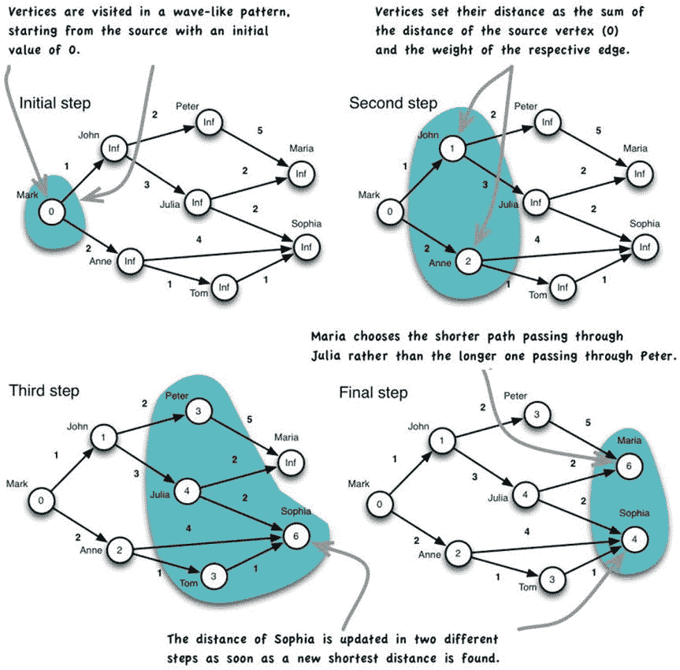

**图 4-2.** 在有权图上执行 `SSSP` 的示例

您可以将无权图上的 `SSSP` 视为有权图上的 `SSSP`，其中所有边的权重都设为 1。在图 4-2 中，当前距源点的距离写在每个顶点内部，当前正在访问的顶点包含在袋状形状中。距离初始化为无穷大，源顶点除外，其初始化为 0。将距离初始化为无穷大可确保顶点在发现新距离（任何距离都小于无穷大）时立即使用它。

在 Giraph 提供的以顶点为中心的编程模型中实现 SSSP 变得非常自然。首先，所有顶点将其距源顶点的距离存储在其 `vertex` 值中。边值可以存储边的权重。消息可用于将距离从邻居传播给邻居。因此，距离是通过图传播的信息。清单 4-1 给出了该算法的伪代码，图 4-3 显示了 Giraph 中的计算流程。

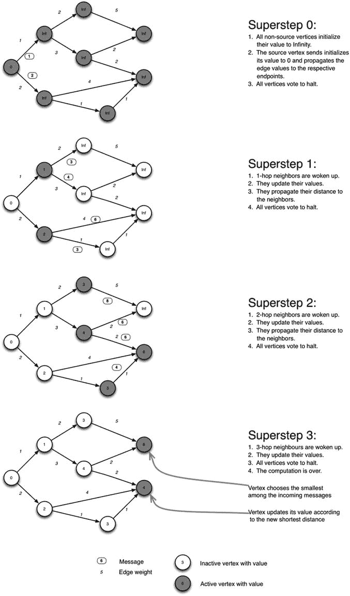

**图 4-3.** 在 Giraph 中执行 SSSP 的示例

**清单 4-1.** 加权单源最短路径

```python
function compute(vertex, messages):
    if getSuperstep() == 0:                #1
        if isSource(vertex.getId()) is True: #1
            vertex.setValue(0)                 #1
            propagateDistance(vertex)          #1
    else:                                #1
        vertex.setValue(Inf)              #1
    else:
        minDistance = min(messages)         #2
        if minDistance < vertex.getValue(): #2
            vertex.setValue(minValue)         #2
            propagateDistance(vertex)         #2
        vertex.voteToHalt()

function propagateDistance(vertex):
    minDistance = vertex.getValue()
    for edge in vertex.getEdges():
        endpoint = edge.getTargetVertexId()
        weight = edge.getValue()
        sendMessage(endpoint, minDistance + weight) #3
```

1.  顶点距离被初始化。
2.  顶点计算最短距离。
3.  顶点考虑边权重并传播距离。

根据前面概述的要点，针对 SSSP 算法你需要做出以下决策：

- **独立的顶点决策**：每个顶点根据其当前值和接收到的消息来计算自己的距离。它选出消息中包含的最小距离，并将该距离与迄今为止发现的最短距离进行比较。该顶点还会根据此次比较的结果来决定是否发送新消息，因此决策是完全独立的。
- **顶点值的初始化**：每个顶点基于接收到的距离与当前存储的最短距离之间的比较来做出决策，因此你将每个目标顶点（即排除源顶点）的值初始化为无穷大。这保证了只要发现第一个最短距离，该顶点就会将此距离存储为其顶点值。另一方面，源顶点将其顶点值初始化为 0。从这种意义上说，以顶点为中心的算法行为类似于前面概述的通用 BFS 算法。
- **停止条件**：当所有最短距离都被发现时，算法停止。仅在顶点发现新的最短距离时才发送消息，因此当距离没有改进时不产生消息。基于此，每个顶点在评估完一组消息后每次投票停止就足够了。如果需要评估新的候选距离，则该顶点会被唤醒。否则，该顶点保持不活跃状态，同时存储迄今为止发现的最短距离。最终，所有顶点都发现其最短距离并停止发送消息。这种启发式方法允许实现完全去中心化的停止条件。
- **聚合器与合并器**：除非需要计算通用统计信息（例如距源顶点的最大或最小最短距离），否则聚合器对于计算最短距离并非必需。相反，合并器在 BFS 中可以发挥重要作用，能最大限度地减少需要传输的消息数量。

清单 4-2 展示了该合并器的伪代码。

**清单 4-2.** 用于单源最短路径的 `MinValue` 合并器

```python
function ssspCombiner(messages):
    return min(messages)
```

该合并器的语义很简单。它生成一条消息，其中包含其所合并消息中的最小值。基本上，它对应于清单 4-1 中的 `minDistance = min(messages)` 这一行。这种对应关系允许你透明地使用（或不使用）合并器，而不会破坏算法的语义。使用合并器的效果是，每个顶点可能只需要评估发送给它的原始消息的一个子集（范围从所有原始消息一直缩减到仅剩一条消息）。换句话说，第 9 行的功能不会因为使用了合并器而改变。唯一的结果是，不必要的消息会被合并器提前丢弃，从而避免传输它们。

路径在图连通性的研究中非常重要。它们衡量顶点之间的可达性。在像 Facebook 这样的社交网络场景中，可达性有助于阐明信息在网络中可以传播到什么程度，或者换句话说，内容可以通过分享功能“病毒式”传播到什么程度。如果图中所有顶点都是连通的，即对于每一对顶点，至少存在一条路径连接它们，则称该图是连通的。直观地说，如果对于每个人，你都能找到一条“朋友的朋友”关系链连接到所有其他人，那么该社交图就是连通的。原则上，在一个连通图中，一个用户分享的内容有可能到达任何其他用户。

这与应用于计算机网络的一个更传统的问题并无不同：计算机在多大程度上可以将数据传输给网络中的其他计算机？计算机通过路由器和其他网络基础设施连接，即使它们没有直接相互连接，也能进行通信。但是，网络的拓扑结构是否允许任何计算机与网络中的任何其他计算机交换数据？你可以很容易地看出，这与社交网络中的信息传播完全相同。如果你将计算机网络视为一个图，那么 `traceroute` 程序所做的无非就是计算两台计算机之间的路径。

### 计算连通分量

到目前为止，你主要关注了连通图。另一个相关概念是连通分量。在无向图中，连通分量是指图的一个连通子图。一个图可以由多个子图构成。想象一个由两组朋友组成的社交网络，其中第一组中的任何成员都不认识第二组中的任何人（当然反之亦然）。这两组朋友各自是一个不同的分量，因为每组中的成员与另一组中的成员互不相连。你可以将连通分量视为构成其他图的图（因此称为子图）。

对于无向图，连通分量的定义相当直接。但对于有向图，定义则更为复杂。有向图的特性决定了，例如，在一个类似 Twitter 的网络中，存在一条从用户 Mark 到用户 Julia 的路径，并不代表反向路径也存在（路径取决于关注边的方向）。Lady Gaga 在 Twitter 上有数百万粉丝，如果她分享内容，这些内容可能会传播到网络中非常遥远的用户。然而，尽管她有数百万粉丝，“普通人 John”分享的内容却不太可能传到 Lady Gaga 那里，因为她很可能不会回关他。

因此，有向图可以是**弱连通**的，也可以是**强连通**的。在前一种情况，如果你将每条有向边替换为无向边，你会得到一个连通图：即存在一条路径连接每一对顶点。注意，某些顶点可能仅仅因为转换为无向图后才连通；这就是为什么该图被认为是弱连通的。在后一种情况，图本身已经是连通的，无需转换图结构。图 4-4 展示了一个弱连通有向图和一个强连通图的例子。为了得到第二个图，我们在第一个图中添加了一组边，以帮助连接原本不可达的顶点对。弱连通分量和强连通分量分别是一个图的弱连通和强连通子图。

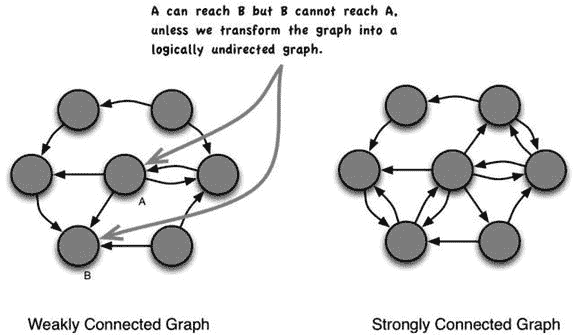

**图 4-4.** 弱连通图与强连通图示例

连通分量之所以有趣，是因为它们能让你研究社交网络中信息传播这一初始问题。你可以识别出信息可以传播的孤立岛屿；但传播最终会遭遇一道屏障，阻止信息到达图的其余部分，因为这样的路径不存在。许多现实世界的图都具有多个连通分量，其中一个分量包含了大部分顶点。这个分量也被称为**最大连通分量**。这个分量通常是进一步分析的焦点，而其余分量则被忽略。这种过滤主要有两个原因。第一，较小的连通分量可能被视为噪声，例如那些尝试使用 Facebook 但从未与任何人联系的用户。第二，某些算法假设图是连通的，因此通常选择最大连通分量作为图中最具代表性的部分。

在 Giraph 中计算弱连通分量和强连通分量是直接的。让我们来看一种计算无向图连通分量和有向图弱连通分量的方法。该算法基于这样一个思想：在连通分量中，信息可以传播到所有顶点。用 Giraph 的术语来说，这意味着如果一个顶点向其邻居发送消息，并且每个邻居将此消息转发给它们的邻居，那么消息最终会到达所有顶点。特别是，如果顶点具有可比较的 ID，使得你可以找出最大或最小的 ID（例如整数或字符串），那么每个连通分量就可以用属于该分量的顶点中的最大（或最小）ID 来表征。如果每个顶点最初使用自己的 ID 作为其值并将其发送给邻居，然后顶点仅在新 ID 大于当前分配的 ID 时才分配并传播新 ID，那么最终所有顶点都会接收到该分量中的最大 ID。由于各分量互不相连，此信息会保留在每个分量内部，并且计算结束时，属于不同分量的顶点会被分配不同的值（即该分量中顶点的最大 ID）。

代码清单 4-3 给出了实现此算法的伪代码。对于有向图，必须首先将图转换为逻辑上的无向图——例如，使用第 3 章中介绍的算法。图 4-5 展示了该算法在 Giraph 中的执行流程。
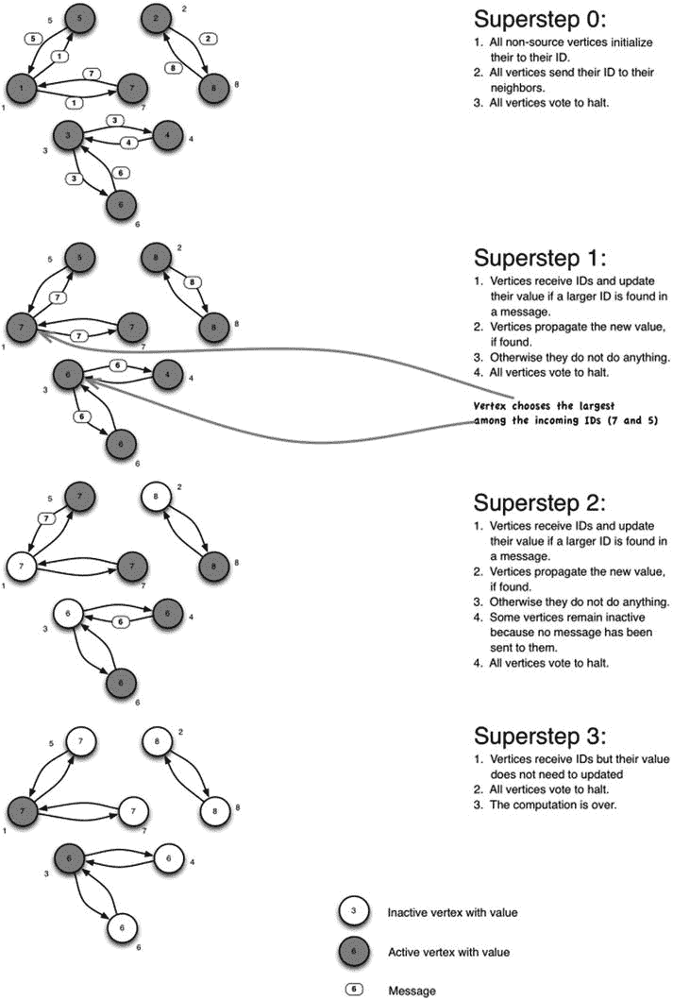
**图 4-5.** 在 Giraph 中执行弱连通分量算法
**代码清单 4-3.** 弱连通分量
```
function compute(vertex, messages):
    if getSuperstep() == 0:                             #1
        vertex.setValue(vertex.getId())                 #1
        sendMessageToAllEdges(vertex, vertex.getId())   #1
    else:
        maxID = max(messages)                           #2
        if maxID > vertex.getValue():                   #2
            vertex.setValue(maxID)                      #2
            sendMessageToAllEdges(vertex, maxID)        #2
    vertex.voteToHalt()
```
#1 顶点将其值初始化为自己的 ID 并进行传播。
#2 顶点在必要时更新其值并进行传播。
结合前面提出的几点来剖析该算法，你可以归纳出以下决策：
*   **独立的顶点决策**：每个顶点根据其当前值和接收到的消息计算其组件 ID。它会选择消息中包含的最大 ID，并将其与当前 ID 进行比较。它还仅根据此比较的结果来决定是否发送新消息，因此决策是独立的。
*   **顶点值的初始化**：每个顶点基于接收到的 ID 与其当前存储的 ID 之间的比较来做出决策，因此您可以将顶点的值初始化为该顶点的 ID。这保证了一旦发现更大的 ID，该顶点就会将其存储为自己的顶点值。
*   **停止条件**：当最大 ID 已传播到所有顶点时，算法停止。仅当顶点发现新的最大 ID 时才发送消息，因此当未发现新的最大 ID 时，不会产生任何消息。出于这个原因，每个顶点在评估完一组消息后，每轮投票停止就足够了。如果需要评估新的候选 ID，顶点会被唤醒。否则，顶点保持非活跃状态，同时存储迄今为止发现的最大 ID。最终，所有顶点都发现最大 ID 并停止发送消息。这种启发式方法实现了完全去中心化的停止条件。
*   **聚合器与组合器**：计算连通分量不需要聚合器。相反，组合器在此算法中可以发挥重要作用，它能最小化需要传输的消息数量。
表 4-4 展示了该组合器的伪代码。
**表 4-4.** 弱连通分量算法的 `MaxValue` 组合器
```
function weaklyConnectedComponentsCombiner(messages):
  return max(messages)
```
该组合器的语义很简单。它生成的输出消息包含了它所合并的消息中的最大值。基本上，它对应于表 4-2 中的 `maxID = max(messages)` 这一行。同样，这种对应关系允许您透明地使用（或不使用）组合器，而不会破坏算法的语义。与 BFS 一样，使用组合器的效果是，每个顶点可能只需要评估发送给它的原始消息的一个子集（从所有原始消息的范围缩减到只有一条消息）。

## 基于距离的常用图度量
SSSP 和 WCC 只是可用于探索图连通性的两个算法示例。许多用于研究图的度量都基于路径和距离。以下是一些常见的度量：
*   **离心率**：该顶点与最远顶点之间的距离。换句话说，就是该顶点与任何其他顶点之间的最大距离。离心率是以下度量所使用的一个指标。
*   **直径**：图中任何顶点的最大离心率。直径是图中最长的最短路径。它也可以定义算法完成所需的最大迭代次数。例如，计算 SSSP 所需的迭代次数不会超过图直径的长度（因为它是所有待发现的最短路径中最长的一条）。
*   **半径**：图中任何顶点的最小离心率。它代表了所有顶点各自的最长最短路径中的最短的那条。半径给出了 SSSP 完成所需的最少迭代次数。当您从图的中心开始计算 SSSP 时，就会出现这种情况。
*   **中心**：任何离心率等于图半径的顶点。图的中心是那些能够以很少步数到达任何其他顶点的顶点。这些顶点是图的核心顶点，因为它们可以连接其他顶点并缩短它们的路径。从这些顶点出发的信息可以迅速到达任何其他顶点。
*   **外围顶点**：任何离心率等于图直径的顶点。与图的中心相反，外围顶点需要更多步数来传播其信息。为了到达可到达的最远顶点，一个外围顶点需要的步数等于直径。
**中心性度量**也是研究图的有趣方法。就像上面列出的度量一样，它们基于顶点之间的路径和距离。不幸的是，对所有度量的详尽介绍超出了本书的范围；您可以在相关的维基百科页面了解更多信息，例如[`http://en.wikipedia.org/wiki/Centrality`](http://en.wikipedia.org/wiki/Centrality)和[`http://en.wikipedia.org/wiki/Distance_(graph_theory)`](http://en.wikipedia.org/wiki/Distance_(graph_theory))。
现在您已经了解了如何计算路径以及如何使用它们来衡量图的不同特性。接下来，让我们看看如何根据顶点在图中的重要性来对其进行排序。

## 使用 PageRank 对重要顶点进行排序
一个图可能包含许多顶点，但它们的重要性都相同吗？所有的网页都同等重要吗？所有的 Twitter 用户都同等重要吗？您能否在图论中定义“重要性”这个概念？在此上下文中，“重要”绝不是一个精确的术语，但定义度量来对顶点进行排序通常是有用的。其中一些度量是领域相关的，它们捕捉了特定问题相关的定义——例如，通过统计奥运奖牌数量来对运动员进行排名。另一些度量则仅关注图的结构，试图捕捉更一般的图景。`PageRank` 就是这样一个用于对图中顶点进行排序的算法示例。正如您在第 2 章中所了解的，`PageRank` 由 Google 的布林和佩奇设计，用于识别重要的网页并在搜索结果中对其进行排名。您还了解到 `PageRank` 是一个图算法，它将万维网视为一个图，其中页面是顶点，超链接是边。
本节将探讨 `PageRank` 的工作原理以及如何在 Giraph 中实现它。其中涉及一些数学知识，但我们会对其进行分解，并向您展示它是如何转化为实际代码的，因此您在理解其核心思想后无需死记硬背。首先，您将了解在图上游走的一般模型。然后，您将使用此模型通过 `PageRank` 来定义顶点的排序。在基础概念确立之后，您将学习如何在 Giraph 中实现 `PageRank`。

### 网页排名
尽管最初应用于网络，但 `PageRank` 可以应用于许多其他场景。为了理解其工作原理，让我们以网络为例。想象一下，你打开浏览器，输入一个随机的 URL（假设你能随机选到一个有效的 URL）。然后，你会点击页面上的一个随机链接，跳转到那个页面。你将永远重复这个过程：从一个页面到另一个页面，无限长的随机点击序列。问题是，你最终停留在某些页面的频率是否会高于其他页面？毕竟，如果一个页面在网上很重要，应该会有很多链接指向它。更多的链接意味着点击这类链接的概率更高，也意味着最终停留在某些页面的概率更大。此外，可以合理地假设，重要的页面通常包含指向其他重要页面的链接。这增加了点击重要页面链接的可能性。图 4-6 展示了一个网页图的示例，其中顶点已通过 `PageRank` 进行了排名；顶点大小反映了其 `PageRank` 值。
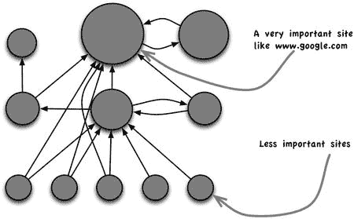
图 4-6. 一个网页图，其中页面由顶点表示，顶点大小取决于其 `PageRank` 值
这就是所谓的随机冲浪者模型。该模型可以通过“瞬移”进行扩展：随机冲浪者有时会跳转到一个新的随机页面，而不遵循链接。仔细想想，这是一个现实的场景——你有时会打开一个新标签页，从另一个页面开始上网，要么是因为你对新内容感兴趣，要么是因为上一个页面没有链接。直观上，长时间在网络中进行随机冲浪，并统计最终停留在每个页面的次数，应该能让你很好地了解页面的重要程度，并据此对它们进行排名。

### PageRank
无限浏览网页的想法正是 `PageRank` 背后的核心理念。这个概念的形式化表达如下：
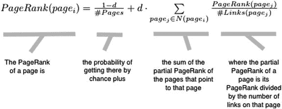

# PageRank算法与评分预测

别被这些数学公式吓到，请耐心听我们解释。这个公式的含义其实非常简单。一个页面的`PageRank`由两部分组成：纯粹因为偶然跳转到该页面的概率，以及从其他页面到达该页面的概率。阻尼系数`d`作为一个权重，让你可以控制对第一部分和第二部分的侧重程度。第一部分是通过 1 除以图中页面的总数得到的，因此是一个均匀分布。第二部分是通过对从指向你所计算的`PageRank`的页面的那些部分`PageRank`值求和得到的。一个页面的部分`PageRank`是其`PageRank`值除以该页面上出现的链接数量。就是这么简单！

在`PageRank`的定义中需要注意的一点是，它是递归的。每个页面的`PageRank`依赖于其入链邻居的`PageRank`。那么，你如何计算`PageRank`值呢？每个顶点的`PageRank`都依赖于其邻居的`PageRank`。你需要一个起点。你可以为每个页面分配一个初始值，然后使用公式迭代计算每个页面的新`PageRank`值。尽管每个顶点都以相同的初始值开始——通常是 1 除以图中的顶点数量——以模拟开始时随机选择起始页面的行为，但随着迭代的进行，由于图的底层结构，某些页面会收集到更高的`PageRank`。经过若干次迭代后，`PageRank`值会收敛到稳定状态，这意味着前后两次迭代的值变化极小。`PageRank`的伪代码如代码清单 4-5 所示。图 4-7 展示了在 Giraph 中使用阻尼系数 0.85 时算法的流程。

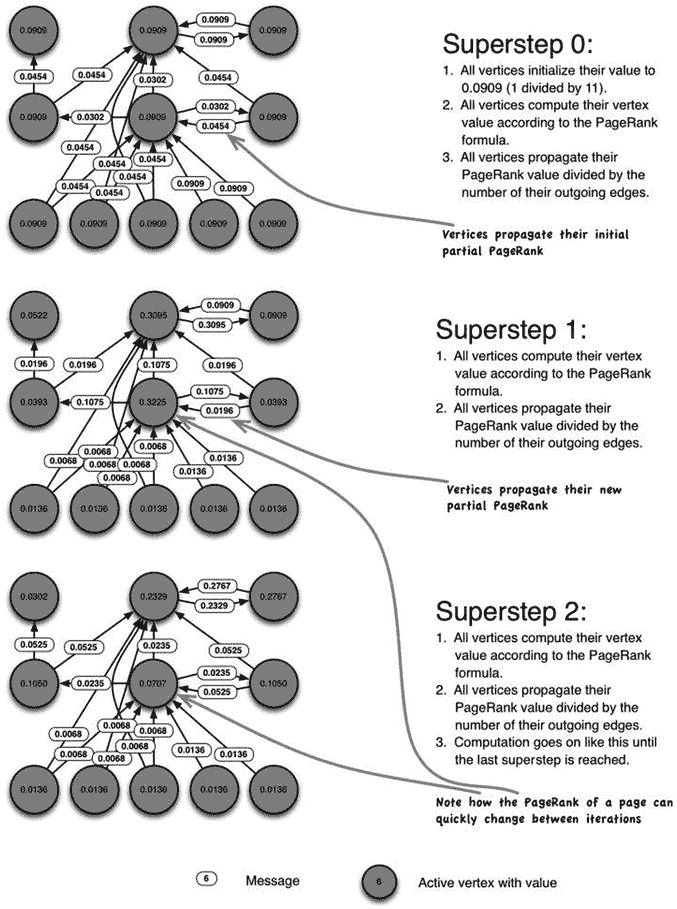

图 4-7. 在 Giraph 中`PageRank`的三次迭代

`PageRank`伪代码如下：

```
function compute(vertex, messages):
    if getSuperstep() == 0:
        vertex.setValue(1 / getTotalNumVertices())        #1
    else:
        prSum = sum(messages)                             #2
        pr = (1 - D) / getTotalNumVertices() + D * prSum  #3
        vertex.setValue(pr)
    msg = vertex.getValue() / vertex.getNumEdges()        #4
    sendMessageToAllEdges(vertex, msg)
    if getSuperstep() == NUMBER_OF_ITERATIONS:
        vertex.voteToHalt()
```

- `#1` 初始化顶点值

- `#2` 部分`PageRank`值的总和

- `#3` 根据公式计算`PageRank`

- `#4` 当前要发送的部分`PageRank`值

根据本章开头提出的要点分析该算法，可以概括出以下决策：

-   `独立的顶点决策`：每个顶点根据收到的消息和顶点数量（以及常数`d`）计算其`PageRank`。因此，每个顶点的计算是完全独立的。

-   `顶点值的初始化`：根据图中的顶点数量初始化每个顶点。该值用于第一次迭代的计算。

-   `停止条件`：理想情况下，算法会在收敛时完成。但由于收敛是渐近达到的，`PageRank`通常按固定的迭代次数进行计算（通常少于 10 到 15 次）。停止条件就基于这个次数。另一种方法要求你计算两次迭代之间顶点`PageRank`值的变化量，并使用阈值来决定是否停止计算。

-   `聚合器和组合器`：聚合器可用于实现刚刚提到的第二种停止条件。这需要一个聚合器收集两次迭代之间的`PageRank`值，以进行阈值判断。组合器在该算法中也可以发挥重要作用，它可以最大限度地减少需要传输的消息数量。

`SumValues` `PageRank`组合器伪代码如下：

```
function pageRankCombiner(messages):
    return sum(messages)
```

组合器对发送给特定顶点的值进行求和；其语义对应于`prSum = sum(messages)`这一行。由于求和是关联操作和交换操作，组合器可以在不影响算法正常执行的情况下工作。

`PageRank`借助其随机冲浪者（或随机漫步者）模型，除了用于网页排名外，还被应用于许多其他场景。因此，理解该算法以及如何在 Giraph 中实现它，可能会对你有所帮助；你也许能找到适用于某个问题的应用或改编版本。这个例子不仅仅是`PageRank`算法的实现；它还展示了在 Giraph 中设计算法的一种模式。具体来说，该算法实现了一种（稳态）迭代方法，可用于通过不断改进解直到收敛，来计算系统的近似解。在这种情况下，顶点值表示由图和`PageRank`公式所代表的系统的变量。下一节讨论的算法在这方面与之相似。

## 预测评分以计算推荐

第 2 章介绍了一个用例场景，该场景使用图来建模用户与用户所评项目之间的关系。你已了解在此类图之上构建推荐系统的高层级方法。本节将介绍一种遵循协同过滤（CF）方法的算法，该算法可根据用户过去的评分，预测其对未评分项目的评分。你首先学习如何将用户、项目和评分建模为图，然后了解在 Giraph 中设计预测评分的算法。本节包含一些数学内容，但已为你拆解分析，并展示了如何在代码中实现。你无需记住精确的数学公式，只需理解其背后的思想。

### 用图和潜在向量对评分进行建模

设想所有允许用户对电影、书籍等项目进行评分的网站，例如使用 1 到 5 星的评分制度。一个有趣的问题是，你是否能仅根据过去的评分，预测用户会对未评分项目给出怎样的评分？如果可以，那么你就可以向每位用户推荐预测评分最高的项目。许多技术都试图实现这一目标，讨论它们之间的差异超出了本书的范围。本节将探讨随机梯度下降（SGD）算法及其在 Giraph 中的实现。你将了解到，只需对该算法进行极小的修改，即可实现该类中另一种流行算法：交替最小二乘法（ALS）。

图 4-8 展示了评分数据库的概念版本。每一列代表一个用户，每一行代表一个项目。因此，每个单元格包含一个用户对某个项目的评分。在没有评分的单元格中会出现问号；这些正是你想要预测的评分。基本假设是，用户是根据描述其品味的画像来分配评分的。另一个假设是，同样的画像类型也可用于描述项目。从概念上讲，你可以将这些画像数据视为变量向量，其中向量的每个元素代表画像空间的一个维度。你可以将每个维度视为描述用户/项目空间的某种类型或特征，但在实践中，这个空间是抽象的，无法映射为特定类型或特征的人性化表示。向量中的元素代表了系统无法直接观测到的用户品味或项目特征变量。因此，它们通常被称为潜在变量，而向量则被称为用户和项目的潜在向量。图 4-9 展示了这样一个二维投影空间，其中距离较近的项目和用户具有相似的潜在向量。

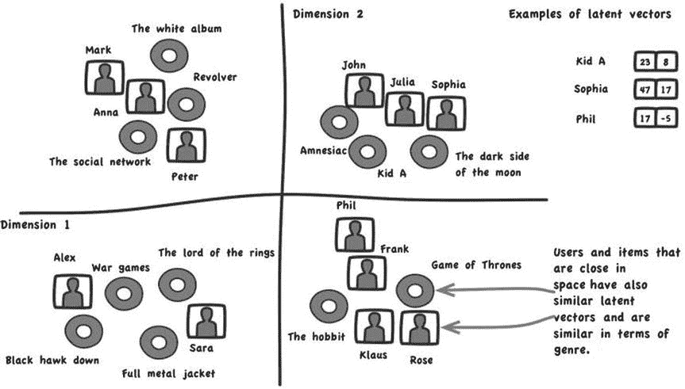

图 4-9. 潜在向量特征的二维空间示例。距离较近的用户和项目应分别具有较高的预测评分

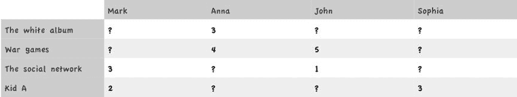

图 4-8. 评分数据库示例。问号 (?) 表示你想要预测的评分

**定义**：向量 `[1, 2, 3]` 与向量 `[4, 5, 6]` 的点积，是各对应元素乘积之和：`(1 * 4) + (2 * 5) + (3 * 6) = 32`。

这些潜在向量的有趣之处在于，如果你计算用户潜在向量与项目潜在向量的点积，就可以将结果解释为用户对该特定项目可能给出的评分预测。该预测的准确程度取决于构成向量的值。通过你的算法，你想要为每个用户和每个项目找到能产生最准确评分预测的潜在向量。但该如何实现呢？你可以利用已知的评分。首先，随机初始化每个用户和项目的潜在变量，然后为每一个你知道正确评分的用户-项目对计算预测评分。接着，你可以将预测与已知评分进行比较，并尝试更新潜在变量以最小化误差。原则上，如果你能让这组变量正确预测过去的评分，它们也应该能正确预测未来的评分。换言之，你需要训练你的系统，并将已知评分用作训练集。

### 最小化预测误差

现在的问题是，如何修改潜在变量以最小化预测误差？这个问题的答案揭示了 `SGD` 与 `ALS`（以及其他同类优化方法）之间的区别。首先，从用户和物品的角度来看，其流程是相同的。其原理是：对于给定的用户及其潜在向量，你需要获取该用户评过分的所有物品的潜在向量，然后通过点积计算这些物品的预测评分。反之，对于给定的物品及其潜在向量，你需要获取所有为该物品评过分的用户的潜在向量，然后通过点积计算这些用户对该物品的预测评分。接着，相应地修改潜在变量以最小化这个误差。在深入研究如何在 Giraph 中并行执行此操作之前，我们先看看用于修改潜在变量以最小化预测误差的 `update` 函数。

# 第4章 Giraph中的协同过滤

根据`SGD`方法，给定一个物品的潜在向量和预测误差，用户的潜在向量的`update`函数可以这样使用：

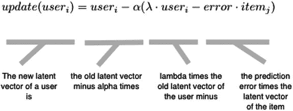

这个公式为你提供了一个能产生更准确预测的新潜在向量。请记住，同样的公式也可以用来计算物品的新潜在向量，只需给定用户的潜在向量和预测误差即可。`Alpha`代表学习率，可以用来加速收敛，但代价是可能无法达到最优收敛；`lambda`是正则化常数，用于避免对训练数据过拟合，从而提高预测准确性。如前所述，误差可以通过两个向量之间的点积来计算。

至此，对用户潜在向量或物品潜在向量的更新是一次性操作。第2章介绍了二分图的概念：一种包含两种类型顶点的图，第一类顶点只与第二类顶点相连，反之亦然。在本例中，一种类型是用户，另一种类型是物品。如果存在评分，则用一条边连接两个不同类型的顶点。边的权重用于存储评分。通过使用两条镜向边（每条方向一条），我们在逻辑上保持边是无向的。

接下来是棘手的部分：你需要组织计算过程，使得在给定的迭代中，只有一种类型的顶点被更新。在一次迭代中，你只让一种类型的顶点执行其`update`函数；在下一次迭代中，你只让第二种类型的顶点执行它。如此反复，在每次迭代中交替更新顶点类型。例如，在一次迭代中，你只让用户根据物品的潜在向量更新他们自己的潜在向量；在下一次迭代中，你只让物品根据用户的潜在向量（在上一次迭代中计算得出）更新它们自己的潜在向量。你根据迭代次数来划分，让一种类型的顶点在奇数次迭代中执行，另一种类型在偶数次迭代中执行。

这种机制允许你根据刚计算出的物品潜在向量来更新用户的潜在向量，反之亦然。这创建了一种“乒乓”计算模式，其中一组顶点基于另一组顶点的值来更新它们的值。这种计算会持续一定数量的迭代，或者一直持续到潜在向量收敛到稳定状态：也就是说，在两次迭代之间，它们的变化不会超过某个阈值。如果让两种类型的顶点在同一迭代中更新它们的潜在向量，将会导致不准确的结果。

理解计算过程中图中发生的事情非常重要。从公式中可以看出，潜在向量是递归交织的。用户的潜在向量会根据该用户评过分的物品的潜在向量进行更新，而这些物品的潜在向量也会根据其他评过分的用户进行更新。而这些用户可能评过其他不同的物品，那些物品的潜在向量又受到了另一组用户的影响。潜在向量不仅受到直接邻居的影响，而且随着迭代的进行，会受到整个图中所有顶点的影响。在实践中，用户顶点充当了物品顶点之间的桥梁（因为用户之间没有直接连接），反之亦然。图中每个顶点的潜在向量的计算最终都会受到所有其他顶点的潜在向量的影响。

在Giraph模型中，`SGD`是按照这种模式实现的。在每个超级步中，只有两种类型顶点中的一种是活跃的，并且能够更新潜在向量；另一种类型是不活跃的。用于更新单个潜在向量的邻居潜在向量，通过消息从每个顶点传送到其邻居。边的值用于存储评分。

`清单4-7`展示了`SGD`的代码，`图4-10`展示了该算法在Giraph中的计算过程。特别要注意图中如何在每次迭代中只有一种类型的顶点是活跃的。

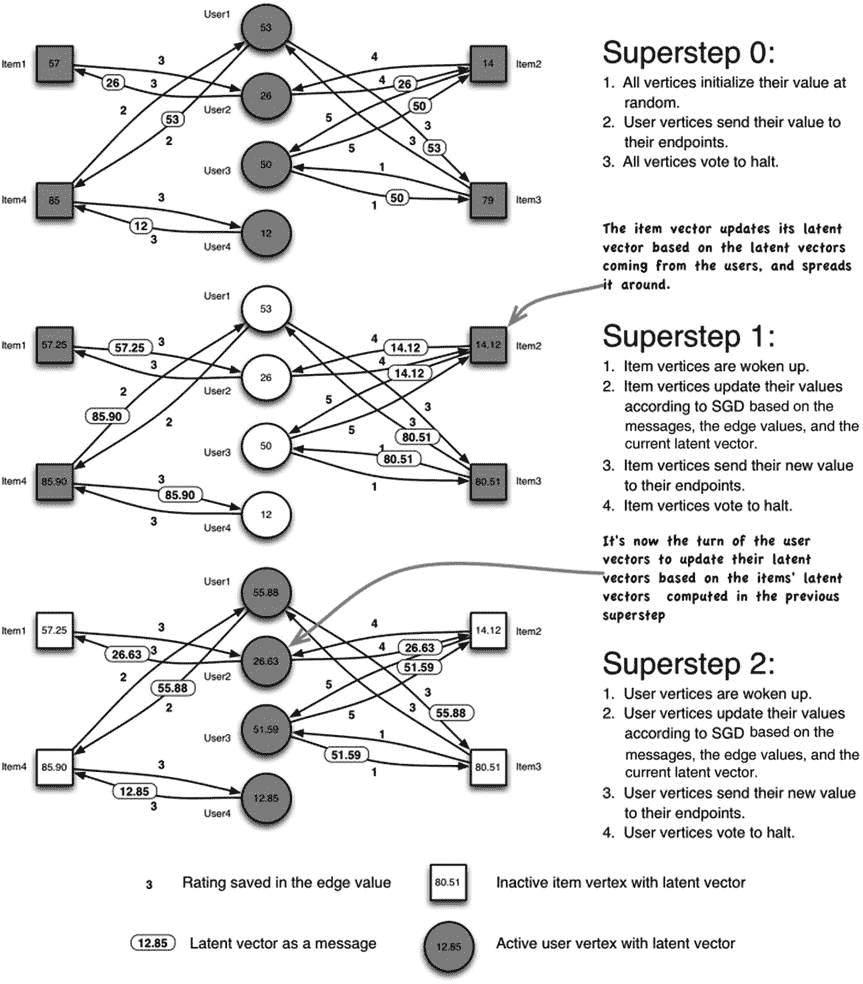

`图4-10`. Giraph中SGD的计算流程

`清单4-7`. 随机梯度下降 (SGD)

```
function compute(vertex, messages):
    if getSuperstep() == 0:
        value = generateRandomLatentVector()                 #1
        vertex.setValue(value)                               #1
    if vertexType(vertex.getId()) == getSuperstep() % 2:    #2
        propagateValue(vertex, value)
    elif getSuperstep() < NUMBER_OF_ITERATIONS:
        errorRMSE = 0
        for message in messages:
            rating = vertex.getEdgeValue(message.getSourceId())
            msgValue = message.getValue()
            oldValue = vertex.getValue()
            newValue = computeValue(oldValue, msgValue, rating)  #3
            error = computeError(newValue, msgValue, rating)     #4
            vertex.setValue(newValue)
            errorRMSE += pow(error, 2)
        aggregate(errorRMSE)                                   #5
        propagateValue(vertex, vertex.getValue())
        vertex.voteToHalt()

function computeError(value, msgValue, rating):
    prediction = value · msgValue                            #6
    return max(min(prediction, 5), 1) – rating

function computeValue(value, msgValue, rating):
    error = computeError(value, msgValue, rating)
    return value - ALPHA * (LAMBDA * value - error * msgValue) #7

function propagateValue(vertex, value):
    message = Message(vertex.getId(), value)
    sendMessageToAllEdges(vertex, message)
```

`#1`潜在向量被随机初始化。
`#2`你根据顶点类型划分顶点。
`#3`计算新的潜在向量。
`#4`用新的潜在向量计算误差。
`#5`聚合误差。
`#6`使用点积计算预测误差。
`#7`这是代码中实际的SGD公式。

请注意，对向量的操作实际上是向量运算，因此你需要自行实现点积和标量积。此外，这段代码假设给定顶点ID，你能够识别该顶点的类型（用户或物品）——例如，通过ID中的前缀来识别。这正是`vertexType()`的作用：它根据顶点类型返回0或1的值。代码假设存在一个名为`Message`的类，它是普通消息的包装器，并且还存储了发送方顶点的ID，因为你需要识别要将相应的潜在向量存储在哪条边上。

结合本章开头提出的要点来分析该算法，可以概括出以下决策：

-   `独立顶点决策`：每个顶点根据传入的潜在向量及其当前的潜在向量来更新自身的潜在向量。这样，每个顶点都可以独立地并行计算其潜在向量。

-   `顶点值初始化`：每个潜在向量在第一个超步（superstep）期间被随机初始化，以便在后续的超步中，`compute()`方法可以根据SGD公式对它们进行更新。

-   `停止条件`：理想情况下，算法会在收敛时完成。由于收敛只是渐近达到的，通常SGD会计算一定数量的迭代次数。停止条件就基于这个迭代次数。另一种方法则需要计算两次迭代之间整体平均预测误差的改进程度。当这种误差在整体上未超过某个特定阈值时，计算可以停止。

-   `聚合器与组合器`：聚合器可用于实现上述第二种停止条件。这需要一个聚合器收集两次迭代之间的RMSE值来执行阈值判断。组合器在此应用中无用，因为你需要保持潜在向量的独立性以计算SGD公式。

`清单4-8`展示了用于SGD的聚合器中`aggregate()`方法的伪代码。

`清单4-8`. `SGDAggregator`

```
function aggregate(value):
    setAggregatedValue(getAggregatedValue() + value)
```

该聚合器在每个超步开始时初始化为0，并累加每个顶点发送的值。计算结束时，聚合器将包含最后一次超步中所有误差的总和。将此值除以评分数量，即可计算出平均误差。这个聚合器只是对值进行求和，因此并没有SGD特有的内容；它通常被称为`SumAggregator`，可以直接用于不同的算法。

请记住，该算法仅计算潜在向量。这些潜在向量随后会被另一个应用程序用来计算推荐。一种朴素的方法是计算每个用户与其尚未评分的所有物品之间的点积，然后选择前 K 个结果。面对数百万用户和物品，这种方法很可能不可行。相反，你可以利用图的拓扑结构，仅计算用户与那些已被与该用户有共同评分的其他用户评过分的物品之间的预测值。

该算法的另一个有趣之处在于，只需稍作修改，你就可以实现另一个推荐算法，例如 ALS。唯一需要修改的部分是 `computeValue()` 背后的逻辑，该逻辑负责处理特定于方法的数学运算。

现在你已经学会了如何对图中的顶点进行排序，可以准备进入下一个问题：如何在社交网络中识别社区。下一节将介绍一种非常流行的算法，称为标签传播算法。

## 使用标签传播识别社区

社交网络在其图结构中通常共享一些属性。例如，请看图 4-11，它展示了一个个体组成的社交网络。这是一个简化的例子，结构被刻意强调，但它应该能说明问题。你在这张图中看到了什么？该图被划分为多个社区或聚类。社区是一组顶点，它们彼此之间的连接往往比与社区外部顶点的连接更紧密。两个好朋友往往有许多共同的朋友——不是全部，但有很多。而这些他们共同的朋友也往往彼此是朋友——同样，不是全部，但这正是朋友群体（以及其他群体，如同事）的特征。用图的术语来说，嵌入在社区中的顶点往往具有较高的聚类系数，该系数衡量了一个顶点的邻居彼此之间相互连接的程度。

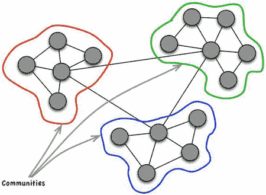

`图 4-11.` 图中社区结构的示例

识别社区是一个有趣的问题，可能会产生有用的信息。例如，你可以推荐其他用户进行连接。另一种选择是利用识别出的社区结构来研究其他维度，也许用于分析。信息是否会突破社区的边界（例如共享的照片或帖子）？属于同一社区的人是否共享诸如年龄、爱好或工作类型等特征？

识别社区的基本思路是为顶点分配标签，每个标签代表一个社区。通常，社区检测算法不需要像聚类算法（例如 k-means）那样预先指定社区的数量。其理念是你应该找到图中存在的那些社区（你并不知道有多少个）。请记住，在现实世界中，个体同时属于多个社区：他们有不同的朋友群体、同事、家人等。将多个标签（多个社区）分配给顶点的算法也被称为识别重叠社区。然而，本节重点介绍一种简单的算法，称为标签传播算法（LPA），该算法不能检测重叠社区，但可以被（并且已经被）改编以实现该目标。

如何为顶点分配标签？嗯，思路很简单，其背后的直觉如下。首先，在计算结束时，同一社区中的每个顶点应具有相同的标签。如果两个顶点属于同一社区，那么这应该体现在它们具有相同标签这一事实上。其次，一个顶点应与其邻居（或至少大多数邻居）拥有相同的标签（请记住，一个用户可能拥有属于不同社区的朋友，而这些朋友中的成员与该用户关系更密切）。

该算法的运行原理如下。每个顶点都有一个标签，初始时为其自身的 ID，并通过消息将其发送给直接邻居。每个顶点应用的简单启发式方法是获取在其邻居中出现频率最高的标签，若出现平局则随机选择（即，如果两个标签在邻居中出现的频率相同且最高，则随机选择）。当一个顶点获得新标签时，它会将该标签发送给其邻居。这就是该算法被称为标签传播算法的原因。例如，“Lady Gaga”最初传播字符串“Lady Gaga”，即她的 ID。在每次迭代中，如果某个顶点发现一个标签在其邻居中出现的频率高于其当前标签，它就会获取该新标签。就“Lady Gaga”而言，经过若干次迭代后，在她的粉丝的邻居中，出现频率更高的标签应该是“Lady Gaga”。在这种情况下，该顶点会通过消息将该标签传播给其邻居。当没有顶点更改标签时，算法停止。计算结束时，每个顶点都持有代表其社区的标签。该标签对应于其社区中某个顶点的 ID——该顶点是其所代表的社区中更“核心”的顶点（在此示例中为“Lady Gaga”）。

该算法就这么简单。在第一次迭代时，标签数量与顶点数量相同。当每个顶点从其邻居处接收到 ID 时（每个标签恰好出现一次），它必须从中随机选择。拥有多条出边的顶点的 ID 更有可能被随机平局打破启发式方法选中。在下一次迭代中，这些顶点邻居中有更多顶点拥有相同的标签，从而增加了该标签被分配给更多顶点的可能性。随着迭代的进行，标签在邻居中传播并相互竞争，直到达到平衡点，不再发生标签更改。达到该平衡点的方式及时间取决于图的拓扑结构及其社区结构。

**警告**

在像 `Giraph` 这样的同步系统中运行 `LPA` 需要进行一些特殊安排，因为这可能导致不稳定状态，算法会在两个或多个解之间振荡，且永不停止。

要在 `Giraph` 中运行 `LPA`，你必须对算法稍作修改。原因在于 `LPA` 与 `Giraph` 这类同步系统的兼容性不佳。在同步系统中运行 `LPA` 可能导致不稳定状态，其中某些顶点会在两个或多个标签之间持续振荡，从而避免收敛。考虑这个简单示例。想象一个只有两个顶点 `A` 和 `B` 的图，它们仅彼此相连。在第一个超步中，顶点 `A` 接收到标签 `B`，顶点 `B` 接收到标签 `A`。此时，每个顶点都决定获取接收到的标签，因为这是其邻居中出现频率最高的标签，并且每个顶点再次通过消息发送其标签。在下一个超步中，相同的情况再次发生，但标签互换。问题在于算法会持续进行，这两个顶点试图永远“抓住”对方。这不仅发生在两个顶点由一条边连接的简单情况下，也发生在更复杂的拓扑结构中。好消息是这个问题可以解决。首先，你需要确保顶点有一种确定性的方式来打破平局——例如，在出现频率（相同）最高的标签中获取最小的标签。其次，顶点需要避免重新获取当前标签之前的标签。这保证了顶点将达成非振荡状态。

`清单 4-9` 展示了 `LPA` 的伪代码。`LPA` 在无向图上效果最佳，因此假设图已被转换为逻辑上的无向图。图 4-12 展示了 `LPA` 在 `Giraph` 中的流程。请注意，为了便于演示，图中展示的算法流程未包含为在 `Giraph` 中运行而进行的特殊修改。代码使用一个 `LPAValue` 对象作为顶点值，该对象同时包含当前值和之前的值，以便实现前述保证收敛的技术。此外，请注意你将标签存储在边值中。这是因为顶点仅在标签发生变化时才发送新标签。当顶点计算标签频率时，它需要所有邻居的标签，包括几个超步之前发送的标签。这就是你将标签存储在相应边中的原因。这样做很方便，因为 `Giraph` 可以轻松地将标签序列化以用于检查点，并且你不需要额外的数据结构来存储标签。

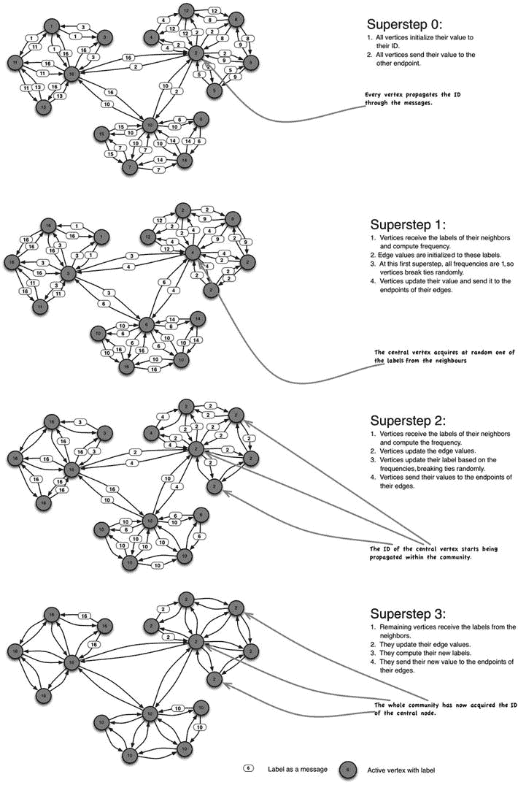

`图 4-12.` `LPA` 在 `Giraph` 中的计算流程

`清单 4-9.` 标签传播算法（LPA）

```
function compute(vertex, messages):
    if getSuperstep() == 0:                                    #1
        vertex.setValue(LPAValue(vertex.getId(), vertex.getId()))  #1
        propagateValue(vertex, vertex.getId())                 #1
    else:
        for message in messages:                               #2
            label = message.getValue()                         #2
            source = message.getSourceId()                     #2
            vertex.setEdgeValue(source, label)                 #2
        labels = DefaultDictionary(0)
        for edge in vertex.getEdges():                         #3
            labels[edge.getValue()]++                          #3
        mfLabel = computeMostFrequentLabel(labels)
        cLabel = vertex.getValue().getCurrent()
        lLabel = vertex.getValue().getLast()
        if labels[cLabel] < labels[mfLabel] and mfLabel != lLabel:  #4
            vertex.setValue(LPAValue(cLabel, mfLabel))         #4
            propagateValue(vertex, mfLabel)                    #4
        vertex.voteToHalt()

function computeMostFrequentValue(labels):
    maxFreq, mfLabel = -INFINITY, None
    for label, freq in labels:
        if freq > maxFreq or (freq == maxFreq and label < mfLabel): #5
            maxFreq, mfLabel = freq, label
    return mfLabel

function propagateValue(vertex, value):
    message = Message(vertex.getId(), value)
    sendMessageToAllEdges(vertex, message)

class LPAValue:
    function LPAValue(lastLabel, currentLabel):
        this.lastLabel = lastLabel
        this.currentLabel = currentLabel
    function getCurrent():
        return this.currentLabel
    function getLast():
        return this.lastLabel
```

顶点使用自身 ID 作为初始标签。

顶点将新标签存储为边值。

计算标签的出现次数。

如有必要，更新当前标签。

找出出现频率最高且 ID 最小的标签。

根据本章开头提出的几点来分析该算法，可以概括出以下决策：

### 独立顶点决策
每个顶点根据邻居的标签及其当前标签选择自己的标签。由于邻居的值也取决于它们各自的邻域，一个顶点只能考虑其直接邻居来决定自己的标签。因此，它拥有这些元素中的全部必要信息。打破平局策略也很重要，因为其确定性本质（基于标签的排序）使得该策略在不同顶点之间保持一致。

### 顶点值初始化
每个顶点使用自身的 ID 作为初始值。此值默认为唯一，这使得在计算结束时能够唯一地识别社区。

### 终止条件
每个顶点仅在其值发生变化时才传播该值。顶点在每次超级步结束时投票终止。因此，当没有顶点更改其标签时，不会产生消息，所有顶点都处于非活动状态。由于`Giraph`实现的同步模型，你必须引入前面描述的打破平局启发式算法，以保证任务会终止。

### 聚合器与组合器
鉴于算法的实现方式，组合器不可用。你需要保留未组合的消息，因为需要跟踪消息发送者。聚合器可用于跟踪已发现的社区数量及其大小。

你已经了解了如何通过遵循`Giraph`信息传播模式的算法来检测社区。该算法具有很高的可扩展性且易于实现。到目前为止介绍的算法应该能让你了解如何为`Giraph`设计算法以及需要注意的事项。希望你能受到启发，着手使用`Giraph` API。

现在你应该明白在设计可扩展算法时什么是重要的、什么需要避免。为方便起见，以下清单总结了为`Giraph`设计算法时应考虑的要点。

## Giraph 算法设计清单
为`Giraph`设计算法时请牢记以下几点。不要将此视为能保证可扩展性的最终且完整的条目列表；但这份清单应能引导你的分析走向正确的方向。

- 顶点决策基于局部信息，例如其当前的顶点值和边值、接收到的消息以及当前的超级步。
- 顶点主要向已知顶点（如其邻居）发送消息，并且无需查找顶点 ID。
- 图和算法不应暗示存在顶点接收来自所有其他顶点的消息的模式。
- 终止条件清晰且一致。
- 顶点值具有明确定义的初始值，该值与顶点应用的启发式算法一致。
- 如果可能，对消息进行组合。
- 顶点值的大小不与图的大小成比例。
- 算法需考虑边界情况，例如顶点无边、仅有出边或仅有入边等。
- 消息的大小不会随时间推移增长过多（例如指数级增长），例如在迭代过程中将接收到的消息连接起来并传播给所有邻居。
- 尽管 API 支持添加和删除顶点与边，但算法不应假设整个图是迭代地从头构建的。
- 聚合器是满足结合律和交换律的函数，并且其占用的空间不与图的大小成比例（例如，一个将接收到的所有值存储在内存中的“虚假”聚合器）。
- 当需要重复使用接收到的消息时，如果可能，应将其存储在本地，而不是要求重新发送，以节省网络 I/O。

## 图与网络的类型特征
图算法可用于在你的图上构建应用程序并进行分析。根据你的业务场景，如果正在将数据建模为图，你会发现大量有用的图算法。其中一些可能属于本章迄今介绍的某类算法。然而，在你的图上运行图算法也可以帮助你更好地理解数据背后的过程或现象。例如，你可以研究社交网络中导致特定关系的社会互动类型，或网页的超链接结构。

尽管所有图都由若干通过边连接的顶点组成，并对世界的各个方面进行建模，但建模不同数据的图的拓扑结构通常具有共同特征。图有多种类型，每种都有特定的属性，其中许多常见于现实世界的图中——特别是迄今描述的那些图，如社交网络、互联网和万维网。本节介绍了一些最常见的图类型，并解释了如何识别一个图是否属于某种类型。了解你的图非常重要，而其中一些算法正是实现这一目的的工具。

以下三个特征是该分析的核心：

- **平均路径长度**：随机选择的两个节点之间的平均跳数。该数值通常与图中的顶点数进行比较。
- **度分布**：顶点度数在顶点之间的分布方式。顶点是否拥有大致相同数量的边，还是少数顶点拥有大量边，而大多数其他顶点只有少量边？
- **聚类系数**：顶点嵌入紧密连接集群的程度。

这些只是你可能需要查看的部分图特征，用于识别图类型，但它们通常足以让你对图有一个清晰的了解。注意，这些特征仅与图的拓扑结构相关，并不依赖于图实际代表什么（网页、个体、用户与物品等）。

例如，考虑一个代表美国编号高速公路系统的图。如第 2 章所述，道路网络可以用图来建模：每个可以选择多条道路的点（如十字路口、城镇或城市）作为一个顶点，边代表道路。如果观察图 4-13 并将道路网络视为一个图，可以看到该图具有以下属性：

- 所有顶点的度数普遍较低。大多数顶点有五或六条边，有些更多，有些更少。这是自然的，因为十字路口和城市只直接连接到最近的邻居。
- 聚类系数非常低，并且相邻顶点之间很少（如果有的话）共享共同的邻居。
- 该图的平均路径长度非常大。如果两个城市相距很远，例如纽约和洛杉矶，那么在图中连接它们的路径就很长。

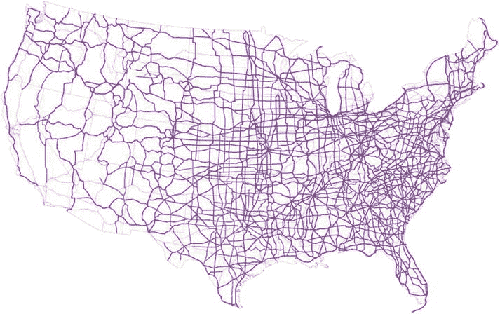

图 4-13. 美国编号高速公路系统

这些属性是预料之内的，因为道路网络类似于网格（或晶格、网状结构）。

## 网格图示例

顾名思义，网格是一种在绘制时具有规则瓦片（例如正方形）的图。图 4-14 展示了一个包含 15 个顶点的此类图。这是一个非常规则的图，具有较大的平均路径长度，且该长度会随着图中顶点和边数量的增加而迅速增长。其度分布也非常规则：除了位于图边界的顶点之外，绝大多数顶点恰好有四个邻居。平均聚类系数为零，因为顶点与其邻居不共享任何其他邻居。这是一个枯燥的图，很少有现实世界的图具有如此严格的拓扑结构（尽管图 4-13 中的道路网络以一种更松散的方式类似于这种拓扑）。然而，作为一个示例图，它起到了说明讨论的作用。更精彩的内容还在后面。

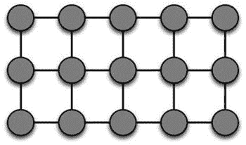
图 4-14. 网格图示例

## 美国国内航线图

现在来看美国的国内航线路线，如图 4-15 所示。这是一个非常不同的图，尽管它连接的仍然是美国的城市。首先，请注意某些（少数）城市具有非常高的度，而大多数城市具有较低的度。那些高度高的城市被称为枢纽机场，因为它们可以通过转机航班连接多个城市。在图论术语中，在图中扮演这种角色的顶点也被称为枢纽。这种度分布类似于幂律分布。这种连接模式能够显著降低平均路径长度。具有这类连接性的图也被称为无标度网络，因为当你在图中添加顶点时，平均最短路径长度往往保持在较低水平。每个城市都可以通过枢纽到达任何其他城市，而无需将所有城市两两连接。该图的聚类系数仍然很低，因为航空公司会尝试移除那些可以被通过枢纽的两段航线所替代的冗余航线。当然，航线并不能到达所有城市——只有那些拥有（足够大的）机场的城市才能到达。

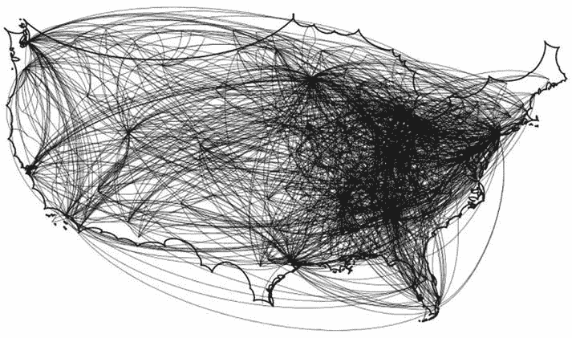
图 4-15. 美国国内航线图

## 图的合并与重连

假设你将这两个图合并起来，通过道路和航线连接城市。它们之间会产生什么影响？

由于你会通过航线连接相距遥远的城市，因此最终得到的图的平均路径长度仍然小于纯粹的道路图。但是，其平均路径长度会大于纯航线图的平均路径长度，因为某些路径需要通过道路图来遍历。此外，由于枢纽的存在，合并后图的度分布将呈现幂律分布。聚类系数将保持较低水平，因为两个图的聚类系数都很低，而且你只方便地给道路图添加了长距离连接。用图论的术语来说，合并这两个图类似于**重连**。

让我们回到图 4-14 中的网格图。从该图中取出一些边，并对它们进行随机重连。这意味着你取一些边（比如 18%），并将每条边的一个端点重新连接到图中随机选择的另一个顶点。这种重连如何影响图的三个特征？最重要的是，它降低了平均路径长度。在网格拓扑中，平均路径长度往往很大，因为可能存在相距很远的顶点，例如图 4-14 中最左边和最右边的顶点。图 4-16 展示了这样一个经过重连的图。在网格图中重连顶点增加了图中相距较远的区域通过重连边连接起来的可能性。本质上，这些重连边起到了桥梁的作用。最短路径现在可以穿过这些桥梁，从而影响路径的长度。就度分布而言，由于你是随机选择端点，某些顶点最终增加的边可能多于从它们那里移除的边。因此，这些顶点的度可能会改变，但平均而言，边仍应均匀分布。这意味着你得到的是一个与网格图确定性分布略有不同的度分布。换句话说，平均顶点度应该非常相似，但这次其偏差应大于网格拓扑中的偏差。出于同样的原因，平均聚类系数应该不同于 0（尽管仍然非常小），因为存在一定的可能性，一条重连的边会引入一个三角形。

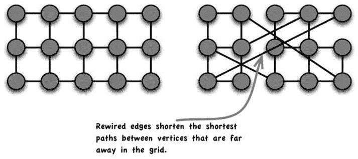
图 4-16. 网格图与将 18%的边随机重连后的网格图

## 随机图与度分布

为了将这个例子推向极致，你可以生成一个完全随机的图：取同样的 15 个顶点，用与之前相同数量的边完全随机地连接它们（继续随机重连，直到得到一个连通图）。出于同样的讨论原因，这个随机图，虽然拥有相同数量的顶点和边，但其平均路径长度更短，度分布的平均值相似但偏差更高，并且聚类系数略高（尽管仍然很小）。图 4-17 展示了这样一个图。网格图和随机图并不是现实世界网络非常真实的表示，但它们有助于引入通常用于描述图类型的三个特征。

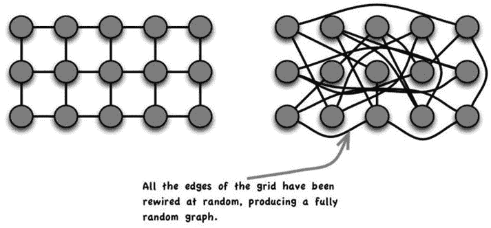
图 4-17. 通过随机重连所有边可以得到一个随机图

## 优先连接策略

在进入真实图之前，让我们回到网格图的重连。如果你在对一定比例的边进行重连时采用另一种重连策略，你可能会得到一个类似于合并了航线图和道路图的图：它将具有幂律度分布。要获得这样的图，当你选择重连边的新端点时，不是随机选择，而是根据顶点的度以正比于其度的概率进行选择。度高的顶点概率更高，因此被选中的次数更多。一个顶点被选为重连边新端点的次数越多，下一次重连的边就越有可能选择该顶点作为端点（由于其度不断增长）。这个过程倾向于让大顶点变得更大。在该过程结束时，你会得到一个幂律分布，其中包含少数枢纽和大量低度顶点的长尾——这与合并后的图完全相同（这种策略也称为**优先连接**）。图 4-18 展示了这样一个图。

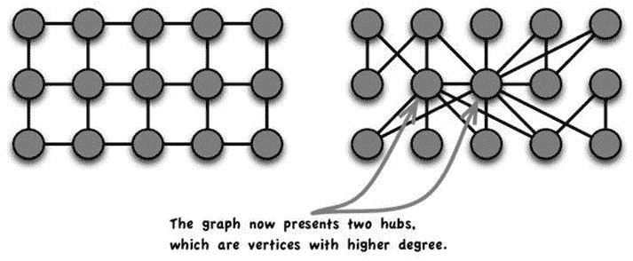
图 4-18.

# 排版后的内容

一个网格中60%的边按照优先连接机制进行了重连。

这些示例展示了图拓扑结构与度分布、聚类系数和平均路径长度之间的关系。你还了解了枢纽节点及其影响这些指标的方式。现在，让我们来看最后一种重要的图类型。在过去十年中，对现实世界网络的研究表明，许多网络都具有小世界属性（这反过来也使它们成为小世界网络或小世界图）。社交图往往具有此类属性。想想你的朋友网络：你的朋友通常住在你所在的地区（也可能是你成长的地方），而且这些朋友中的许多人彼此之间也是朋友。毕竟，人们往往会是许多社群的成员。这意味着社交网络往往具有较高的聚类系数。这种具有局部特性的网络往往具有较大的平均路径长度。然而，你可能也有一些住在远方、属于完全不同社群的朋友。例如，你或许有个朋友在日本，这让你与许多日本人之间只隔了少数几步。这些特定的友谊就像重连网格中的桥梁，显著降低了平均路径长度。最后，有些人的朋友网络比一般人要大得多，这也许是因为他们经常旅行，或者由于他们的工作原因。这意味着社交网络也存在枢纽节点。总结一下，小世界网络往往具有较高的聚类系数、较小的平均路径长度以及幂律度分布。米尔格拉姆之所以能在像美国人口这样的大型社交网络中发现如此小的平均路径长度，正是得益于小世界属性。最近在 Facebook 社交图上进行的同类实验显示，其平均路径长度仅为四到七步！图 4-19 展示了一个具有小世界属性的图。

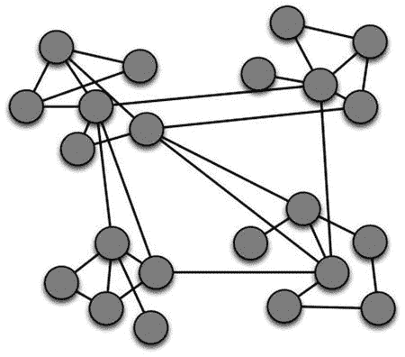
图 4-19. 一个具有小世界属性的图

为了设计、构建和掌握图应用，你需要更好地理解你的图。如果你要构建像 Twitter 这样的社交网络，你会对信息（推文）在关注者网络中的传播方式感兴趣。在一个平均路径长度较低的社交网络中，你只需要少数几次转发就能触及图的远端区域。此外，具有高聚类系数的图会增加信息传播到起始社群大部分成员的可能性。

图拓扑结构还有许多其他方面，例如图在遭受攻击或故障时的鲁棒性等；但网络科学所涵盖的领域远比本书所能呈现的要广泛。不过，借助本章提供的工具，你应该已经准备好踏上更好地理解和掌控图数据的旅程了。

## 总结

将数据建模为图是使用 `Giraph` 的第一步。下一步是设计一个能够处理该数据的算法：

*   在 `Giraph` 中，算法建立在信息传播原则之上，计算状态分布在顶点值中，顶点之间通过消息共享状态。
*   路径是连接顶点的边的序列。`SSSP` 是一种计算源顶点与所有其他可达顶点之间距离的算法，它自然地符合 `Giraph` 模型。
*   路径可用于定义连通分量，即图中每个顶点都能到达其他任何顶点的子图。连通分量可用于研究信息在图中的传播方式。
*   某些顶点比其他顶点更重要，识别它们是有用的。`PageRank` 是一种允许你根据顶点在图中的重要程度对其进行排名的算法。
*   如果你将用户、物品及其评分建模为一个图，就可以通过随机梯度下降（`SGD`）算法为用户计算关于新物品的推荐。
*   图，尤其是社交网络，可以通过社区（或簇）来刻画其特征，在这些社区中，顶点之间紧密相连。标签传播允许你识别这些社区，并为每个顶点标记其所属的社区。
*   不同类型的图，无论它们代表什么数据，都具有特定的拓扑属性特征。通过使用一些度量指标和部分图算法来计算它们，你可以找出图的类型。

`Giraph` 提供了一个编程 API，帮助开发者设计可扩展的图算法。现在，你已经准备好深入研究 `Giraph` Java API，在 Hadoop 集群上实现并运行图算法了。

脚注 1

`BFS` 是一种遍历图的策略，可用于计算最短路径，也可用于其他操作。还有其他一些算法可用于计算最短路径。

