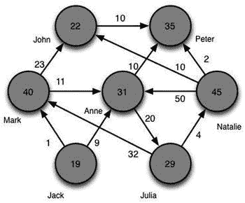
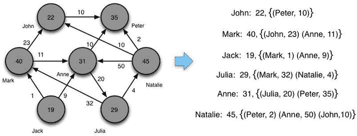
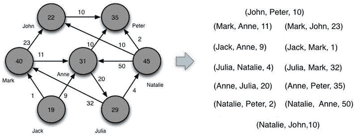
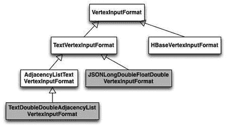
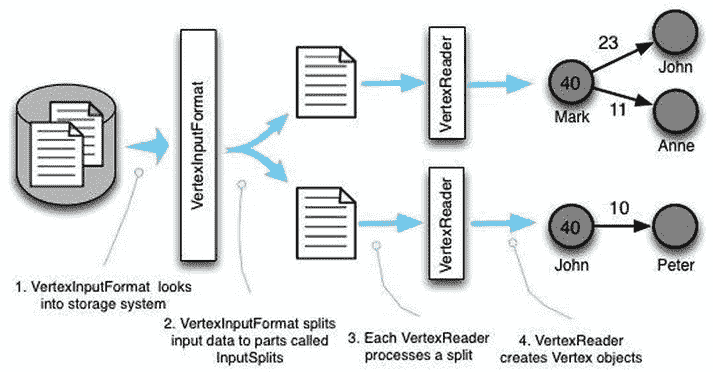
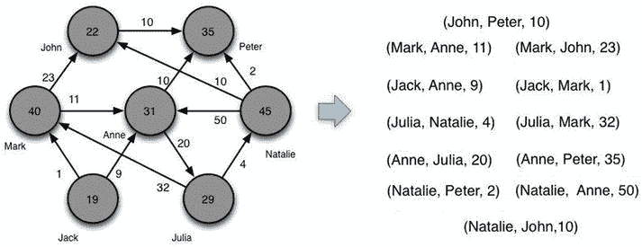
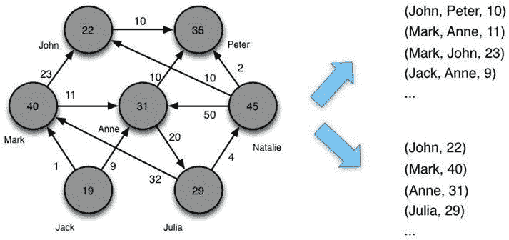
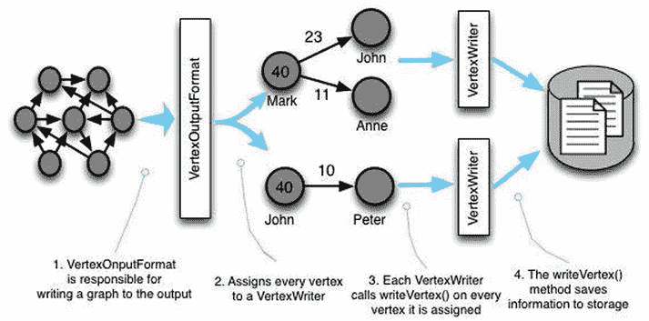

# 7. 图输入/输出格式

## 本章涵盖
- 图的表示方法
- 以不同格式读取输入图
- 保存分析结果

到目前为止，你已经通过多种用例熟悉了图及其组成元素——顶点和边的概念。在第 5 章中，你学习了 Giraph 如何使用相应的`Vertex`和`Edge`对象来表示图，并通过编程方式操作`Vertex`和`Edge`对象，计算有用的图指标。但在 Giraph 创建可供使用的`Vertex`和`Edge`对象之前，图是以不同格式存储在存储系统中的：例如，纯文本文件或二进制格式。同样，你可能需要将 Giraph 计算的结果以不同输出格式进行存储。

在本章中，你将学习 Giraph 提供的用于读取输入图和写入输出的工具，分别称为输入格式和输出格式。Giraph 使用输入格式将输入图转换为你可以通过编程方式操作的`Vertex`和`Edge`对象；它使用输出格式来保存分析结果。当你在第 5 章启动第一个 Giraph 作业时，你已经使用了输入和输出格式的具体实现。现在，你将详细了解输入和输出格式的工作原理。

更重要的是，你将学习如何编写自己的输入和输出格式实现。由于图可能以不同方式存储，因此很难提供一种适合所有可能存储系统或图格式的输入格式。Giraph 提供了一个编程接口，你可以实现该接口以构建针对特定场景的自定义支持。本章首先讨论图可以表示的不同方式，然后教你如何实现输入和输出格式接口，以读取图并以各种格式输出结果。在本章结束时，你将完成对 Giraph API 基本特性的学习，并准备好进入更高级的特性：读取图、进行计算并输出计算结果。

## 图的表示
在深入探讨 Giraph API 的细节之前，你首先需要了解表示图以将其存储在磁盘等存储介质中的方法。到目前为止，本书已经在抽象层面并借助二维图形讨论了图。让我们借用第 3 章中的 Twitter 社交图示例，如图 7-1 所示，并为其添加额外信息，使其更有趣一些。本章将全程使用这个示例图。



图 7-1. 一个 Twitter 社交图示例。顶点代表用户，从顶点 A 到顶点 B 的边表示用户 A 关注了用户 B。顶点值代表用户年龄，边值代表用户 A 向用户 B 发送的提及次数

在示例图中，每个顶点对应一个 Twitter 用户，并用名称作为标签：顶点 ID。在此例中，从用户 A 到用户 B 的边表示 A 在 Twitter 上关注了 B。尽管顶点和边是图的基本组成元素，但在大多数情况下，你希望将有趣的信息（即元数据）与顶点和边关联起来。在社交网络的场景中，顶点可能与用户档案信息相关联。此处，顶点有关联的用户年龄。你可能已经注意到，这对应于你在第 5 章中了解到的`Vertex`值。每条边也关联了一个数字，表示一个用户提及另一个用户的次数；这对应于`Edge`值。

从这张图片中概念化一个图很容易；但是要将这个图存储到磁盘上，你必须将其分解成信息片段，以便日后能够重建原始图。存储图的典型方式是存储顶点信息——基于顶点的表示，或者存储顶点之间关系的信息——基于边的表示。

在基于顶点的表示中，图由每个顶点的信息集合定义。邻接表是最常见的基于顶点的图表示之一。在最简单的形式中，邻接表是一个列表的集合，其中每个列表对应一个顶点，并包含该顶点的邻居。例如，图 7-2 展示了表示图 7-1 中 Twitter 图的邻接表。每个列表对应一个用户，列表中的顶点对应该用户关注的 Twitter 账户。



图 7-2. Twitter 图的基于顶点的表示

请注意，邻接表提供了与图 7-1 完全相同的信息，只是形式不同。通过这种形式，你可以将图分解为每个顶点的信息，从而便于存储。

通常，图不是像上一个例子那样通过单个顶点来描述，而是通过顶点之间存在的关系来描述。在这种基于边的表示中，图由一组边定义，可能还伴随着边的元数据。图 7-3 展示了如何通过将相同 Twitter 图分解为每条边的信息来表示它。请注意，基于边的表示不包含关于顶点本身的信息。如果你尝试从边信息重建 Twitter 图，最终将丢失顶点信息。通常，当你想通过顶点之间的关系来描述图的结构时，基于边的表示更合适。



图 7-3. Twitter 图的基于边的表示

在处理图数据时，你很可能会遇到各种不同的表示形式。在某些情况下，你可以选择用于存储图数据的表示形式；而在其他情况下，你不得不访问已经为你组织好的图数据。例如，基于顶点的表示可能比基于边的表示更受青睐，因为它在磁盘上占用更少的空间。其他时候，你可能希望存储顶点特定的信息，例如社交网络中的用户档案信息，此时基于顶点的格式比基于边的格式更自然。

当需要从这些不同表示形式创建`Vertex`和`Edge`对象时，必须以不同方式处理。例如，在基于顶点的描述中，仅通过查看单个信息片段（例如数据库中描述社交网络用户的一行表数据），你就可以重建一个`Vertex`对象。相比之下，在基于边的表示中，你需要查找并整合各种信息片段来重建一个`Vertex`对象。这在图片中看起来很简单，但当你必须处理 TB 级别的分布式图数据时——想象一下手动完成这项任务——它将变得极具挑战性。接下来的部分将探讨 Giraph 如何在不让你过多担心这些细节的情况下，简化图表示的处理。

## 输入格式
无论采用何种表示形式，图都可以存储在不同的存储系统中，并且可能以不同格式分布。Giraph 提供了一种称为"输入格式"的工具，用于简化读取输入图的任务。输入格式的实现本质上是一种指定如何从存储系统读取数据，然后将数据转换为熟悉的`Vertex`和`Edge`对象的方式。Giraph 提供了一个简单的 API，你可以通过实现该 API 来支持新型存储系统和格式。而 Giraph 则负责为你完成繁重的工作。

基于顶点的图表示的 Giraph API 是`VertexInputFormat`，基于边的图表示的 API 是`EdgeInputFormat`。这些是你扩展以实现新输入格式的最基本的抽象类。Giraph 还提供了更专门的 API，用于支持常见的存储系统和格式；例如，一种常见格式是存储在 Hadoop 分布式文件系统（HDFS）或 HBase 表上的邻接列表文本文件。

通常，你可以扩展基本 API 来编写适合自己应用场景的自定义输入格式实现，也可以扩展现有的专用 API。在许多情况下，你无需从头实现输入格式；Giraph 提供的现有实现很可能已经满足你的需求。

> **提示：** 在创建自己的输入输出格式实现之前，建议先查看可用的实现。Giraph 的代码库在不断丰富，你可能会在那里找到所需内容，从而节省时间。

在其他情况下，你可能需要扩展某个专门的基于文本的输入格式，这种格式已经为你实现了大部分功能。例如，`TextVertexInputFormat`处理诸如在 HDFS 上定位文件并逐行读取等细节。实现这个专用 API 只需要你指定如何将文本行解析为`Vertex`对象。

图 7-4 展示了 Giraph 代码库中基于顶点的输入格式类的一个小样本。它还展示了如何从基本 API 开始构建功能。白色框代表你可以扩展的抽象类，阴影框代表 Giraph 源代码中已有的具体实现。



图 7-4. 输入格式类层次结构。从基本的`VertexInputFormat`开始，每个子类都增加功能并添加特定格式类型

例如，`TextVertexInputFormat`是`VertexInputFormat`的扩展，专门用于处理存储在 HDFS 上文本文件中的输入图。而`AdjacencyListTextVertexInputFormat`抽象类则可以处理以邻接列表形式表示的图文本格式。你可以在 Giraph 代码的`org.apache.giraph.io.formats`包下找到所有这些类。

在本节的剩余部分，你将学习如何通过实现基本 API 从头创建输入格式。这将为你提供在必要时创建自己输入格式的必要知识。本章以基于文本的格式为例；在第 9 章中，你将学习如何使用相同的 API 来实现对更高级系统和格式（如 HBase 和 Hive）的支持。

### 基于顶点的输入格式
首先，你将了解如何为基于顶点的图表示实现输入格式。`VertexInputFormat`是你可以实现的最基本 API。让我们看看如何逐步扩展此 API，以实现一种输入格式，该格式可用于读取以邻接列表形式存储在 HDFS 上纯文本文件中的图——这是最常见的输入格式之一。清单 7-1 展示了表示 Twitter 图的邻接列表在文本文件中的样子。

**清单 7-1.** 描述 Twitter 图的示例文本文件

```
John 22 Peter 10
Mark 40 John 23 Anne 11
Jack 19 Mark 1 Anne 9
Julia 29 Mark 32 Natalie 4
Anne 31 Julia 20 Peter 35
Natalie 45 Peter 2 Anne 50 John 10
```

在此文本输入中，每行包含一个用户、该用户的年龄、他们关注的人以及他们提及这些关注者的次数。此实现称为`SimpleTextVertexInputFormat`。

Giraph 使用`VertexInputFormat`将输入数据拆分为多个部分，然后处理每个部分以生成`Vertex`对象。清单 7-2 展示了`VertexInputFormat` API。

**清单 7-2.** `VertexInputFormat`抽象类

```java
public abstract class VertexInputFormat<
    I extends WritableComparable,
    V extends Writable,
    E extends Writable> extends GiraphInputFormat<I, V, E> {

  public abstract void checkInputSpecs(Configuration conf);

  public abstract List<InputSplit> getSplits(JobContext context,
      int minSplitCountHint) throws IOException, InterruptedException;

  public abstract VertexReader<I, V, E> createVertexReader(
      InputSplit split,
      TaskAttemptContext context) throws IOException;
}
```

首先注意到`VertexInputFormat`使用 Java 泛型来声明参数：顶点 ID 的类型`I`、顶点值的类型`V`和边值的类型`E`。除非是抽象类，否则此 API 的任何实现都必须指定这三种类型。回顾第 5 章，`Vertex`对象和`Computation`实现也需要相同的参数。在加载图之前，Giraph 使用类型信息来确保你的`VertexInputFormat`实现创建的顶点类型与`Computation`的类型匹配。

在清单 7-3 的示例中，顶点 ID 是名称，因此你使用`Text`类型来表示它们。顶点值和边值分别是年龄和提及次数，因此你使用`IntWritable`来表示它们。接下来，让我们通过示例逐一了解 API 方法的细节。

**清单 7-3.** 一个基于文本的`VertexInputFormat`实现示例

```java
public class SimpleTextVertexInputFormat
    extends VertexInputFormat<Text, IntWritable, IntWritable> {

  public void checkInputSpecs(Configuration conf) { ... }      #1

  @Override
  public List<InputSplit> getSplits(JobContext context,
      int minSplitCountHint)
      throws IOException, InterruptedException {
    List<FileStatus> files = getFileList(context);           #2
    List<InputSplit> splits = new ArrayList<InputSplit>();
    for (FileStatus file : files) {                          #3
      Path path = file.getPath();                            #3
      long length = file.getLen();                           #3
      splits.add(new FileSplit(path, 0, length,              #3
          new JobConf(context.getConfiguration())));         #3
    }
    return splits;                                           #4
  }

  public VertexReader<I, V, E> createVertexReader(
      InputSplit split, TaskAttemptContext context) throws IOException {
    return new SimpleTextVertexReader();                      #5
  }
}
```

> #1 检查输入的有效性。

> #2 获取输入路径中的文件列表。

> #3 对于每个输入文件，创建一个`FileSplit`对象并添加到列表中。

> #4 返回创建的`FileSplit`对象列表。

> #5 返回`VertexReader`类的实现。

第一个你必须实现的方法是`checkInputSpecs()`。在开始使用输入格式之前，Giraph 会调用这个方法。通常，该方法的作用是检查任务配置是否包含读取输入图所需的所有必要信息。例如，在此方法中，你可以检查输入目录是否已在配置中设置，或者输入目录是否存在。

接下来你必须实现的方法是`getSplits()`。它接收一个`JobContext`对象作为输入，其中包含有关任务的配置信息（例如输入目录），并返回一个`InputSplit`对象列表。`InputSplit`是输入数据一部分的逻辑表示。例如，`FileSplit`实现了`InputSplit`接口，用于表示 HDFS 上的一个文件；`InputSplit`包含文件路径、大小和位置等信息。在此示例中，`getSplits()`方法列出任务配置中作为参数传递的输入目录中的所有文件，并为每个文件创建一个`FileSplit`。

### 从 Hadoop API 继承的类型

正如第 5 章所述，请注意某些类型（如`InputSplit`、`JobContext`和`TaskAttemptContext`）是从 Hadoop API 继承的。但在大多数情况下，你不需要了解 Hadoop 的细节。

该类最重要的方法是`createVertexReader()`，它返回一个继承自`VertexReader`抽象类的对象。`VertexReader`负责实际处理由`InputSplit`描述的数据。对于前一个方法返回的每个`InputSplit`，Giraph 会创建一个`VertexReader`对象，该对象处理相应的数据并创建最终构成图的`Vertex`对象。图 7-5 展示了整个过程。



图 7-5.

将所有部分整合在一起。`VertexInputFormat`将输入分割成多个部分。`VertexReader`处理一个部分并创建`Vertex`对象

现在让我们来看看`VertexReader`的细节以及如何实现它。代码清单 7-4 显示了在`VertexReader`抽象类中定义的方法。

**代码清单 7-4.** `VertexReader`抽象类

## public abstract class VertexReader
```java
public abstract class VertexReader<I extends WritableComparable,
    V extends Writable, E extends Writable> extends
    DefaultImmutableClassesGiraphConfigurable<I, V, E>
    implements WorkerAggregatorUsage {
    public abstract void initialize(InputSplit inputSplit,
        TaskAttemptContext context)
        throws IOException, InterruptedException;
    public abstract boolean nextVertex() throws IOException,
        InterruptedException;
    public abstract Vertex<I, V, E> getCurrentVertex()
        throws IOException, InterruptedException;
    public abstract void close() throws IOException;
}
```

在代码清单 7-5 中，你实现了`SimpleTextVertexReader`，它负责逐一读取文本文件中的行，并为每一行创建一个`Vertex`对象。此示例展示了如何实现`VertexReader`的每个方法。

### 代码清单 7-5. 一个基于文本的VertexReader示例

```java
public class SimpleTextVertexReader
    extends VertexReader<Text, IntWritable, IntWritable> {
    private RecordReader<LongWritable, Text> lineRecordReader;
    private TaskAttemptContext context;

    @Override
    public void initialize(InputSplit inputSplit, TaskAttemptContext context)
        throws IOException, InterruptedException {
        this.context = context;
        lineRecordReader = new LineRecordReader();                            // #1
        lineRecordReader.initialize(inputSplit, context);                     // #1
    }

    @Override
    public final boolean nextVertex()
        throws IOException, InterruptedException {
        return lineRecordReader.nextKeyValue();                               // #2
    }

    @Override
    public final Vertex<Text, IntWritable, IntWritable> getCurrentVertex()
        throws IOException, InterruptedException {
        Text line = lineRecordReader.getCurrentValue();                       // #3
        Vertex<Text, IntWritable, IntWritable> vertex =
            getConf().createVertex();                                         // #4
        String[] words = line.toString().split(’ ’);                          // #5
        Text id = new Text(words[0]);                                         // #6
        IntWritable age = new IntWritable(Integer.parseInt(words[1]));         // #7
        List<Edge<TextWritable, IntWritable>> edges = new ArrrayList();
        for (int n = 2; n < tokens.length; n=n+2) {
            Text destId = new Text(tokens[n]);                                // #8
            IntWritable numMentions =                                        // #8
                new IntWritable(Integer.parseInt(tokens[n+1]));               // #8
            edges.add(new DefaultEdge(dstId, numMentions));                  // #9
        }
        vertex.initialize(id, age, edges);                                   // #10
        return vertex;
    }

    @Override
    public void close() throws IOException {
        lineRecordReader.close();                                            // #11
    }
}
```

#1 创建行记录读取器以读取文本文件。
#2 检查是否还有更多行需要读取。
#3 获取当前行。
#4 创建一个空的顶点对象。
#5 将行分割为标记。
#6 第一个标记是顶点 ID。
#7 第二个标记是顶点值。
#8 解析目标 ID 和提及次数。
#9 创建边对象。
#10 初始化顶点对象。
#11 关闭输入文件。

您实现的第一个方法是 `initialize()`，Giraph 在创建 `VertexReader` 之后、开始使用它之前会立即调用该方法。Giraph 将 `VertexReader` 要处理的 `InputSplit` 以及一个包含配置信息（如 HDFS 输入目录）的 `TaskAttemptContext` 对象作为输入传递给此方法。通常，您可以在执行前使用此方法来设置 `VertexReader`。在示例中，您使用此方法初始化局部变量并创建一个 `LineRecordReader`。`LineRecordReader` 是一个辅助类，您可以从 Hadoop API 中借用它来逐行读取 HDFS 上的文本文件。为简化示例，此处省略了 `LineRecordReader` 的细节；您只需将 `InputSplit` 和上下文信息传递给它，即可直接使用。

### nextVertex() 和 getCurrentVertex() 方法
接下来的两个方法 `nextVertex()` 和 `getCurrentVertex()` 类似迭代器接口。`nextVertex()` 方法必须返回 true（如果还有更多顶点需要读取），并将迭代器推进到下一个顶点。`getCurrentVertex()` 方法返回迭代器当前指向的顶点。Giraph 会重复调用这两个方法作为一对，直到输入中没有更多数据可读。

现在来看看如何实现这些方法。在示例中，`nextVertex()` 只需要检查文件中是否还有更多行，如果有，则读取并缓存下一行。这是 `LineRecordReader` 自动为您执行的操作，因此您无需担心细节。

而 `getCurrentVertex()` 方法则必须根据文本行创建一个 `Vertex` 对象。首先，它获取当前已读取的文本行。然后，创建一个空的 `Vertex` 对象，您需要为其填充信息：ID、类值及其边。回想一下，输入图采用邻接表形式，如下所示：
```
John 22 Peter 10
Mark 40 John 23 Anne 11
Jack 19 Mark 1 Anne 9
Julia 29 Mark 32 Natalie 4
...
```
将文本行分割为单词后，行中的第一个单词描述用户的顶点 ID。下一个单词描述顶点值，即用户的年龄，您将其解析为 `IntWritable` 对象。接下来的单词描述该用户在 Twitter 上关注的 ID 以及该用户提及这些 ID 的次数。您可以使用这些信息创建顶点边：解析行中的每一对这样的数据，并创建 `Edge` 对象。解析完整个行后，您使用 `Vertex` 类的 `initialize()` 方法将必要的信息填充到空的 `Vertex` 对象中。

### close() 方法
最后，读取完一个 `InputSplit` 后，Giraph 会调用 `VertexReader` 的 `close()` 方法。在示例中，您使用此方法关闭初始化时打开的文件。同样，`LineRecordReader` 会为您处理此操作。

至此，`VertexInputFormat` 的操作就结束了。通过这个简单但非常实用的示例，您现在可以开始编写自己的基于顶点的输入格式了。

## 基于边的输入格式

如上一节所述，基于边的图表示也十分常见。回顾一下，对于示例中的 Twitter 图，其基于边的表示形式如图 7-6 所示。



图 7-6. Twitter 图的基于边表示法。边的值代表提及次数

清单 7-6 展示了如何将这种表示法存储在文本文件中。文件中的每一行都代表图中的一条边。回顾一下，从 A 到 B 的一条边表示用户 A 关注了 B，并且附带 A 提及 B 的次数。文件中的每一行也就在每条边旁边包含了这些信息。

清单 7-6. Twitter 图的示例基于边输入文件

```
John Peter 10
Mark John 23
Mark Anne 11
Jack Mark 1
Jack Anne 9
Julia Mark 32
Julia Natalie 4
Anne Julia 20
Anne Peter 10
Natalie Peter 2
Natalie Anne 50
Natalie John 10
```

`Giraph` 提供了一种读取此类表示法的简单方式，称为 `EdgeInputFormat`。与 `VertexInputFormat` 类似，`Giraph` 使用 `EdgeInputFormat` 将输入数据分割成多个部分，然后处理每个分片中的数据。基本的区别在于 `EdgeInputFormat` 不创建 `Vertex` 对象，而是创建 `Edge` 对象。此时你可能会好奇 `Vertex` 对象是如何创建的；毕竟，当你实现一个 `Computation` 时，`Giraph` 会传递一个 `Vertex` 对象供你操作。答案是 `Giraph` 为你处理了 `Vertex` 对象的创建。这是 `EdgeInputFormat` 提供的便利之一。

让我们深入了解 API 的细节，如清单 7-7 所示。请注意它与 `VertexInputFormat` 的相似之处。前两个方法的目的完全相同：检查配置的有效性并返回描述输入部分的 `InputSplit` 对象列表。需要注意的一个区别是，`EdgeInputFormat` 不要求你指定顶点值类型 `V`，只要求指定顶点 ID 类型 `I` 和边值类型 `E`。请记住，顶点 ID 类型和边值类型仍必须与你的 `Computation` 中的类型匹配。

清单 7-7. `EdgeInputFormat` 抽象类

```
public abstract class EdgeInputFormat<I extends WritableComparable,
    E extends Writable> extends GiraphInputFormat<I, Writable, E> {

    public abstract void checkInputSpecs(Configuration conf);
    public abstract List<InputSplit> getSplits(JobContext context,
        int minSplitCountHint) throws IOException, InterruptedException;
    public abstract EdgeReader<I, E> createEdgeReader(
        InputSplit split,
        TaskAttemptContext context) throws IOException;
}
```

API 中最重要的区别是 `createEdgeReader()` 方法，它返回一个扩展了 `EdgeReader` 抽象类的对象，如清单 7-8 所示。`EdgeReader` 负责读取 `InputSplit` 描述的数据并创建 `Edge` 对象。

清单 7-8. `EdgeReader` 抽象类

```
public abstract class EdgeReader<I extends WritableComparable,
    E extends Writable> {

    public abstract void initialize(InputSplit inputSplit,
        TaskAttemptContext context)
        throws IOException, InterruptedException;
    public abstract boolean nextEdge()
        throws IOException, InterruptedException;
    public abstract I getCurrentSourceId()
        throws IOException, InterruptedException;
    public abstract Edge<I, E> getCurrentEdge()
        throws IOException, InterruptedException;
    public abstract void close() throws IOException;
}
```

让我们逐一查看这些方法以及如何实现它们来读取清单 7-9 中的示例文件。这个实现被称为 `SimpleTextEdgeReader`。

清单 7-9. 用于基于文本格式的示例 `EdgeReader`

```markdown
## 组合输入格式

你已经了解到，图可以基于顶点或基于边这两种表示形式进行存储。但在某些场景下，一张图可能同时以多种表示形式存储。一种常见的情况是通过分离图结构来存储图：即，将连接边与每个顶点的信息分开存储。这样做有多种实际原因。例如，不同的分析应用可能需要不同的数据；你可以出于性能原因分离数据，这样任何应用都无需每次都读取所有数据。在 Twitter 图场景中，你可能希望将以基于边格式存储在 HDFS 文本文件中的“谁关注谁”关系，与以基于顶点格式存储在键值存储中的每个用户的个人资料信息分开管理。图 7-7 展示了这种分离的示例。



图 7-7. 图信息被拆分为两种独立的表示形式

这种分离可能是一种常见做法，但应用为了以有意义的方式分析图而组合数据源也同样常见。一个应用必须能够将图 7-7 右侧的两个数据源组合起来，以重建原始图。

你可能会想，处理这种情况是否需要基于顶点或基于边的输入格式。但你会很快意识到，单独任何一种输入格式都不足以应对此场景。例如，在前一小节中，`EdgeInputFormat` 不提供指定顶点值的方法，因此你无法使用它来读取个人资料信息。同样，你也不能使用 `VertexInputFormat`，因为单个顶点的信息分散在输入的不同位置。作为一种变通方法，你可以在读取之前对数据进行预处理，将两个数据源合并为一个基于顶点格式的输入数据集。但这种方法可能既繁琐又低效，因为每次进行分析时你都必须读取相同的数据两次。

幸运的是，Giraph 提供了一种更便捷高效的方式来处理此场景，它允许你组合两种不同的图表示形式。具体来说，你可以同时使用一个负责读取边表示来创建边的 `EdgeInputFormat`，以及一个负责读取个人资料信息来设置顶点值的 `VertexInputFormat`。

回顾一下第 5 章中的示例，当你启动作业时，你使用 `–vif` 命令行参数指定了顶点输入格式的类名，并使用 `–vip` 参数指定了顶点输入路径。类似地，你可以通过将这些参数替换为 `–eif` 参数（指定边输入格式类名）和 `–eip` 参数（指定边输入路径）来使用边输入格式。组合两种类型的输入格式只需在你的命令行中包含所有这四个参数即可。其余工作由 Giraph 处理。

### 使用内置的边实现

Giraph 提供了 `Edge` 接口的不同实现，以满足不同用途。你可以在 `org.apache.giraph.edge` 包中找到这些实现。例如，当边没有关联值时，`EdgeNoValue` 边类型非常适用，因为这种实现比默认实现更节省内存。为方便起见，Giraph 提供了 `EdgeFactory` 工具类，其中包含简化 `Edge` 对象创建过程的方法。

---

```java
public class SimpleTextEdgeReader extends EdgeReader<Text, IntWritable> {
    private RecordReader<LongWritable, Text> lineRecordReader;

    @Override
    public void initialize(InputSplit inputSplit,
                           TaskAttemptContext context)
            throws IOException, InterruptedException {
        lineRecordReader = new LineRecordReader();
        lineRecordReader.initialize(inputSplit, context);
    }

    @Override
    public final boolean nextEdge()
            throws IOException, InterruptedException {
        return lineRecordReader.nextKeyValue();
    }

    @Override
    public final Text getCurrentSourceId() throws IOException,
            InterruptedException {
        Text line = getRecordReader().getCurrentValue();
        String[] words = line.toString().split(" ");
        return new Text(words[0]);
    }

    @Override
    public final Edge<Text, IntWritable> getCurrentEdge()
            throws IOException, InterruptedException {
        Text line = getRecordReader().getCurrentValue();
        String[] words = line.toString().split(" ");
        Text targetVertexId = new Text(words[1]);
        IntWritable edgeValue = Integer.parseInt(words[2]);
        return new DefaultEdge(targetVertexId, edgeValue);
    }

    @Override
    public void close() throws IOException {
        lineRecordReader.close();
    }
}
```

- #1 此方法在最开始时被调用，用于设置 `EdgeReader`。

- #2 检查是否存在文本行。

- #3 获取当前文本行，并解析源顶点 ID。

- #4 解析目标顶点。

- #5 解析边值。

- #6 使用解析后的值创建一个 `Edge` 对象。

- #7 此方法在最后被调用，用于关闭已打开的文件。

首先，请注意你需要像使用 `VertexReader` 那样实现 `initialize()` 和 `close()` 方法。这些方法在 `Giraph` 开始使用读取器之前以及执行结束时被调用。这里你使用它们来打开和关闭 `InputSplit` 所描述的文件，方式与之前相同。在这个例子中，它们的实现完全相同，因此我们不再赘述。让我们转而探讨 `EdgeReader` 最有趣的部分。

`EdgeReader` 实现了一个类似于 `VertexReader` 的迭代器风格的接口。如果输入文件中还有更多边需要读取，`nextEdge()` 方法返回 true，并将迭代器推进到下一条边。虽然细节未显示，但如果有一行可用，`LineRecordReader` 会读取并缓冲它。在 `Giraph` 调用此方法后，它可以接着使用以下两个方法。首先它会调用 `getCurrentSourceId()` 方法。此方法必须返回迭代器当前指向的边的源 ID。回顾一下，`Giraph` 会自动为你创建 `Vertex` 对象；`Giraph` 正是通过这种方式知道应该将边附加到哪个 `Vertex` 上。在这个实现中，你所要做的就是读取一行中的第一个单词，并将其作为 `Text` 对象返回。最后，`Giraph` 调用 `getCurrentEdge()` 方法来创建一个 `Edge` 对象并将其添加到顶点。一条边由目标顶点 ID 和边值定义。为了获取这些信息，该实现解析每一行的第二个和第三个单词，然后创建并返回一个 `Edge` 对象。

注意 `Edge` 对象的创建。在第 5 章中，你只关心通过 `Vertex` 访问 `Edge` 对象；你从未需要创建过 `Edge` 对象。实际上，`Edge` 是一个接口；在底层，`Giraph` 使用实现了 `Edge` 接口的特定类型。`DefaultEdge` 是 `Giraph` 提供的这些 `Edge` 实现之一。大多数时候，默认类型能满足你的需求，但你可以自由编写自己的 `Edge` 实现。
```

## 输入过滤器

过滤图是图分析中的常见操作。过滤意味着从原始图中移除部分顶点或边，然后在剩余的图上进行分析。这样做有多种原因。某些图挖掘算法即使执行在图的随机样本上，也能给出良好的近似结果。这通常作为一种加速计算的方式而备受青睐。

在其他情况下，过滤是应用的隐含需求。一种常见场景是，图中边的权重表示顶点之间连接的强度，而你只想对具有强连接的用户进行分析。考虑 Twitter 场景，假设你想通过查看 Mark 关注的人——Anne 和 John——关注了谁，来向 Mark 推荐新朋友。例如，John 关注了 Peter，那么 Peter 可能也是 Mark 的一个不错的推荐。但为了使推荐更相关，你可能只想将 Mark 与之有强连接的邻居包含在此分析中。在这种情况下，你需要过滤掉权重低的边。例如，你可以过滤掉用户提及次数少于 20 次的邻居，在此例中排除了 Anne，这表明 Julia 可能不是对 Mark 的相关推荐。

你甚至可以根据每个顶点的信息来执行此类过滤。例如，你可能希望对特定年龄段内的 Twitter 用户执行此分析。这样，你可以确保不会根据年长用户关注的人来向年轻人推荐朋友。为此，你可以从图中过滤掉所有年龄超过某个阈值的顶点。这些只是可能需要过滤的少数几个例子。

Giraph 提供了一种优雅的方式，让你在必要时将此过滤过程集成到分析中。它允许你指定顶点过滤器和边过滤器，与 `VertexInputFormat` 和 `EdgeInputFormat` 一起使用。顶点和边过滤器提供了一种方法，让你可以在加载输入数据期间指定是否应将某个顶点或边添加到最终图中。你可以通过实现 `VertexInputFilter` 和 `EdgeInputFilter` 接口来指定过滤器，这些接口分别如清单 7-10 和清单 7-11 所示。

清单 7-10. `VertexInputFilter`

```java
public interface VertexInputFilter<I extends WritableComparable,

V extends Writable, E extends Writable> {

boolean dropVertex(Vertex<I, V, E> vertex);                 #1

}

#1 决定是否丢弃顶点。
```

清单 7-11. `EdgeInputFilter`

```java
public interface EdgeInputFilter<I extends WritableComparable,

E extends Writable> {

boolean dropEdge(I sourceId, Edge<I, E> edge);

}
```

对于基于顶点的输入格式，在加载图的过程中，Giraph 使用 `VertexInputFilter` 对象来决定是否应过滤某个顶点。`VertexInputFilter` 接口有一个名为 `dropVertex()` 的单一方法，返回布尔值。回顾前几节，Giraph 使用 `VertexReader` 来创建 `Vertex` 对象。对于 `VertexReader` 创建的每个 Vertex 对象，Giraph 会调用 `dropVertex()` 并将该 `Vertex` 对象作为输入参数传入，以决定是否保留相应的顶点。如果该方法返回 true，那么 Giraph 将丢弃该顶点。

类似地，对于基于边的输入格式，Giraph 使用 `EdgeInputFilter` 来决定读取到的边是否应被包含在图中。对于创建的每个 `Edge` 对象，Giraph 会调用 `dropEdge()` 方法，并将该边源顶点的 ID 以及边对象本身作为参数传入。如果该方法返回 true，Giraph 就会丢弃该边。清单 7-12 展示了一个 `EdgeInputFilter` 的示例实现，该实现根据边的权重来决定是否包含某条边。以 Twitter 图为例，你可以使用这种边过滤器来过滤掉那些提及次数较少、被认定为弱连接的边。

清单 7-12. 一个边输入过滤器示例

```java
public class WeightInputFilter extends EdgeInputFilter<Text,IntWritable> {

   public static int THRESHOLD = 10;

   boolean dropEdge(Text sourceId, Edge<Text,IntWritable> edge) {
      if (edge.getValue().get() < THRESHOLD) {
         return true;
      }
      return false;
   }
}
```

正如你可能预料到的，顶点 ID 和边值类型必须与你所使用的输入格式实现的类型相匹配。

一旦实现了你的过滤器，你就可以通过命令行指定使用它。你可以通过在执行命令中添加 `giraph.vertexInputFilterClass` 自定义参数，并将你的过滤器实现类名设为其值来实现这一点。

请注意，如果你愿意，也可以在你的应用程序中使用你在第 5 章中学到的变异 API 来实现过滤逻辑。这样，你就可以将计算的第一个超步专门用于过滤。然而，使用过滤器有几个好处。首先，它允许你将过滤逻辑与主应用程序逻辑解耦，从而实现清晰、可复用的代码。其次，使用输入过滤器，Giraph 可以在读取图的早期阶段进行过滤，从而使图的加载更高效。这样做速度更快，且所需内存更少。

或者，你也可以通过单独的脚本来预处理你的图。但这可能是一项繁琐的任务，因为你需要编写代码从不同的存储系统和格式中读取数据。而 Giraph 及其输入格式已经提供了这一功能。此外，这样做可能效率也不高，因为每次想要分析图时，你都需要读取两次图：一次用于预处理，另一次用于实际分析。输入过滤器简化了这些任务。

## 输出格式

你已经学习了如何读取输入图以及如何在其上执行有用的分析。为了完善整个流程，你所缺少的是一种输出分析结果的方法。毕竟，如果无法以某种方式保存结果以供后续使用，那么这个结果也就毫无价值了。输出格式正是 Giraph 为此提供的工具。在计算结束时，图中的 `Vertex` 和 `Edge` 对象包含了所有你想要存储的有用信息。例如，你在第 5 章编写的短路径应用中，计算结束时顶点包含了最短距离的值。Giraph 使用一种输出格式将 `Vertex` 和 `Edge` 对象的内容保存到存储系统中。

与输入格式类似，存在基于顶点和基于边的两种输出格式。正如你可能猜到的，基于顶点的输出格式用于保存各个顶点的信息，而基于边的输出格式则用于保存在 `Edge` 对象中的信息。在第 5 章的示例中，你主要使用的是基于顶点的输出格式。你需要哪种输出格式取决于你的具体场景。例如，当你计算每个顶点的度量值（如距离或排名）时，你自然需要一种基于顶点的输出格式。但假设你以基于边的输入格式读取了一个输入图，并且只想对其进行转换。（你在第 4 章中看到过这样一个转换的例子，其中你将无向图转换成了有向图。）在这种情况下，你可能也希望将转换后的图以基于边的格式保存。

与读取输入图类似，你可能希望将结果信息存储到不同的存储系统并以不同的格式保存。为了适应这一点，Giraph 导出了两个基本的抽象类 `VertexOutputFormat` 和 `EdgeOutputFormat`，你可以对其进行扩展。例如，你在第 5 章中使用的 `GraphvizOutputFormat` 就是为你提供的一个 `VertexOutputFormat` 实现。在本节中，你将学习如何编写自己的输出格式。本章重点介绍基于文本的格式，但在第 9 章中，你将了解如何将数据输出到任何存储系统以及以任何格式输出。

### 基于顶点的输出格式

首先，你将学习如何实现一个基于顶点的输出格式。假设你运行了最短距离应用，并希望将计算出的每个顶点的距离保存到文本文件中，然后存储到 HDFS——这是典型的场景。为此，你需要继承 `VertexOutputFormat` 抽象类，如代码清单 7-13 所示。

# VertexOutputFormat 与 VertexWriter

```java
public abstract class VertexOutputFormat<
  I extends WritableComparable, V extends Writable,
  E extends Writable> {
  public abstract void checkOutputSpecs(JobContext context)
    throws IOException, InterruptedException;
  public abstract VertexWriter<I, V, E> createVertexWriter(
    TaskAttemptContext context) throws IOException, InterruptedException;
  public abstract OutputCommitter getOutputCommitter(
    TaskAttemptContext context) throws IOException, InterruptedException;
}
```

在 `VertexOutputFormat` 中，首先需要注意的一点是，顶点 ID、顶点值和边值类型是该类的参数。这意味着你的实现（除非是抽象的）必须指定这些类型，并且它们必须与你的 `Computation` 中的相应类型匹配。

接下来，代码清单 7-14 描述了 `VertexOutputFormat` 类的方法并实现了它们。这个实现被称为 `SimpleTextVertexOutputFormat`。

```java
public class SimpleTextVertexOutputFormat
  extends VertexOutputFormat<Text, IntWritable, IntWritable> {
  @Override
  public void checkOutputSpecs(JobContext context)
    throws IOException, InterruptedException {
    textOutputFormat.checkOutputSpecs(context);
  }
  @Override
  public VertexWriter<Text, IntWritable, E> createVertexWriter(
    TaskAttemptContext context)
    throws IOException, InterruptedException {
    return new SimpleTextVertexWriter();                         #1
  }
  @Override
  public OutputCommitter getOutputCommitter(TaskAttemptContext context)
    throws IOException, InterruptedException {
    return textOutputFormat.getOutputCommitter(context);
  }
}
```

\#1 这返回一个继承自 `VertexWriter` 类的对象。

Giraph 在作业开始时调用 `checkOutputSpecs()`，并向其传递一个包含配置信息的 `JobContext` 对象。其作用是执行类似于你在输入格式中学到的检查。例如，你可以检查输出目录是否已在作业配置中设置，如果已设置，则检查该目录是否已存在且包含无法覆盖的数据。在这种情况下，此方法可能会抛出异常。

与 `VertexReader` 对象类似，Giraph 使用 `VertexWriter` 对象来完成将对象中的顶点信息写入输出的主要工作。具体来说，在你的计算完成后，Giraph 会在集群中的每个工作机器上创建一个 `VertexWriter` 对象，并使用这些对象将每个顶点的信息写入输出。它通过调用 `VertexOutputFormat` 类的 `createVertexWriter()` 方法来实现这一点，该方法返回一个继承自 `VertexWriter` 抽象类的对象。每个这样的对象负责处理图中的一组顶点。图 7-8 展示了这一过程。



**图 7-8.** 使用 `VertexOutputFormat` 和 `VertexWriter` 对象保存图

请注意，Giraph 遵循的流程与其读取图时执行的流程相反。Giraph 从文本文件重建图开始，现在它必须将图保存回相同类型的格式。但让我们更详细地看一下 `VertexWriter` 中发生了什么。代码清单 7-15 显示了你需要实现的 `VertexWriter` 抽象类方法。

```java
public abstract class VertexWriter<I extends WritableComparable,
  V extends Writable, E extends Writable> {
  public abstract void initialize(TaskAttemptContext context)
    throws IOException, InterruptedException;
  public abstract void writeVertex(Vertex<I, V, E> vertex)
    throws IOException, InterruptedException;
  public abstract void close(TaskAttemptContext context)
    throws IOException, InterruptedException;
}
```

示例输出格式返回一个名为 `SimpleTextVertexWriter` 的 `VertexWriter`，它被设计用于将顶点信息写入文本文件。代码清单 7-16 展示了 `SimpleTextVertexWriter` 及其方法的实现。

```java
public class SimpleTextVertexWriter
  extends VertexWriter<Text, IntWritable, IntWritable> {
  private RecordWriter<Text, Text> lineRecordWriter;
  @Override
  public void initialize(TaskAttemptContext context)
    throws IOException, InterruptedException {
    lineRecordWriter = createLineRecordWriter(...);            #1
  }
  @Override
  public final void writeVertex(Vertex vertex) throws
    IOException, InterruptedException {
    String line = vertex.getId() + " " + vertex.getValue();   #2
    lineRecordWriter.write(new Text(line), null);             #3
  }
  @Override
  public void close(TaskAttemptContext context)
    throws IOException, InterruptedException {
    lineRecordWriter.close(context);                          #4
  }
}
```

\#1 创建一个行记录写入器对象。

\#2 生成一个包含待写入顶点信息的字符串。

\#3 使用记录写入器写入该字符串。

\#4 关闭记录写入器。

在开始使用 `VertexWriter` 之前，Giraph 会调用 `initialize()`，并传入一个 `TaskAttemptContext` 作为输入。`initialize()` 方法通常使用 `TaskAttemptContext` 对象中的配置信息来设置输出文件。例如，这涉及创建输出文本文件并获取该文件的句柄。要将输出写入 HDFS，你使用 `LineRecordWriter` 类，它可以为你处理这些任务。在 `VertexWriter` 初始化之后，Giraph 会为图中的每个顶点调用 `writeVertex()` 方法。在此方法中，你必须指定要输出哪些信息以及如何写入这些信息。在这里，你将顶点值写入输出文本文件。该实现首先生成一个包含顶点 ID 和顶点值的字符串；然后使用 `LineRecordWriter` 将该字符串追加到输出文件中。

使用`LineRecordWriter`

注意，你使用`LineRecordWriter`的`write()`方法将文本追加到文件中。`write()`方法接受两个输入参数：一个键和一个值。然后，`LineRecordWriter`将键和值参数都写入输出文件。这里你只需要写入一个字符串，所以只需将其作为键参数传递，并将第二个参数保留为`null`。`LineRecordWriter`知道忽略`null`参数。

在写入每个顶点后，Giraph会调用`close()`方法，该方法在此示例中会关闭你在初始化时打开的文件。同样，`LineRecordWriter`会为你处理此任务。

这里的一个新特性是`OutputCommitter`。输出提交器是一个从Hadoop借用的组件；其主要工作是设置作业的输出目录。这包括设置一个目录，用于在作业完成前写入临时输出文件，并在作业成功完成后将文件从临时目录移动到最终目录。这里我们不深入探讨`OutputCommitter`方法的细节。对于HDFS输出，你可以简单地重用Hadoop API提供的标准`OutputCommitter`，它会为你处理设置输出目录所涉及的所有任务。第9章在讨论存储系统时会再次提到`OutputCommitter`。

## 基于边的输出格式

基于边的输出格式与基于顶点的输出格式非常相似。你可以在代码清单7-17中立即看到相似之处，该清单展示了`EdgeOutputFormat`抽象类。

**代码清单 7-17.** `EdgeOutputFormat` 抽象类

```
public abstract class EdgeOutputFormat<
    I extends WritableComparable, V extends Writable,
    E extends Writable> {
  public abstract void checkOutputSpecs(JobContext context)
      throws IOException, InterruptedException;
  public abstract OutputCommitter getOutputCommitter(
      TaskAttemptContext context) throws IOException, InterruptedException;
  public abstract EdgeWriter<I, V, E> createEdgeWriter(
      TaskAttemptContext context) throws IOException, InterruptedException;
}
```

基本的区别在于，现在需要实现的是`EdgeWriter`而不是`VertexWriter`。代码清单7-18展示了`EdgeWriter`抽象类。这个类中最重要的方法是`writeEdge()`；Giraph会为图中的每条边调用此方法。

**代码清单 7-18.** `EdgeWriter` 抽象类

```
public abstract class EdgeWriter<
    I extends WritableComparable, V extends Writable,
    E extends Writable>
  public abstract void initialize(TaskAttemptContext context)
      throws IOException, InterruptedException;
  public abstract void writeEdge(I sourceId, V sourceValue, Edge<I,E> edge)
      throws IOException, InterruptedException;
  public abstract void close(TaskAttemptContext context)
      throws IOException, InterruptedException;
}
```

让我们看一个如何实现`EdgeWriter`的示例，该`EdgeWriter`将边及其数值保存到存储在HDFS上的文本文件中。这个实现名为`SimpleTextEdgeWriter`，如代码清单7-19所示。

**代码清单 7-19.** 一个基于文本的`EdgeWriter`示例

```
public class SimlpeTextEdgeWriter<
    extends EdgeWriter<Text, NullWritable, IntWritable> {
  private RecordWriter<Text, Text> lineRecordWriter;

  @Override
  public void initialize(TaskAttemptContext context)             #1
      throws IOException, InterruptedException {                #1
    lineRecordWriter = createLineRecordWriter(...);              #1
  }

  @Override
  public final void writeEdge(Text sourceId,
      IntWritable sourceValue, Edge<Text, IntWritable> edge)
      throws IOException, InterruptedException {
    String line = sourceId+" "+                                 #2
        edge.getTargetVerexId()+" "+                            #2
        edge.getValue();                                        #2
    lineRecordWriter.write(new Text(line), null);               #3
  }

  @Override
  public void close(TaskAttemptContext context)
      throws IOException, InterruptedException {
    lineRecordWriter.close(context);                            #4
  }
}
```

#1 通过创建行记录写入器来初始化`EdgeWriter`。  
#2 构建要写入输出的字符串。  
#3 使用行记录写入器写入该字符串。  
#4 最后关闭输出文件。

到目前为止，你需要为`EdgeWriter`实现的大多数方法应该不会让你感到意外。你使用`initialize()`方法，通过创建熟悉的`LineRecordWriter`来设置`EdgeWriter`。与`VertexWriter`类似，Giraph会为图中的每条边调用`writeEdge()`。Giraph会向此方法传递边的源顶点ID、它的顶点值以及边对象本身。在这个实现中，你构建了一个包含源顶点 ID、目标顶点 ID 和边值的字符串。然后，你使用`LineRecordWriter`将该字符串写入到输出文件中。

输出格式为你提供了输出图中存储信息（顶点值和边值）所需的所有工具。但请记住，Giraph程序还允许你将信息保存在不同的对象中。其中最有用的就是聚合器。

## 聚合器写入器

聚合器用于保存关于整个图的信息，例如计数器和聚合统计数据。例如，在第5章中，你看到了一个如何使用聚合器来追踪拥有最多关注者的Twitter用户的示例。通常，在程序结束时，聚合器会持有有用的信息——在这个例子中，是最受欢迎的Twitter用户——你希望像输出图中顶点和边所持有的信息一样，将这些信息输出到文件中。

为了实现这一点，Giraph提供了一种称为聚合器写入器的工具。Giraph使用聚合器写入器将聚合器的值保存到你选择的存储介质和格式中：例如，保存到HDFS上的文本文件中。在第5章中，你使用了Giraph代码库中提供的一种聚合器写入器实现，该实现将聚合器值保存到一个文件中。在这里，你将学习如何实现你自己的聚合器写入器。

为了指定如何保存聚合器的值，你必须实现代码清单7-20中所示的`AggregatorWriter`接口。Giraph在每个超步结束时使用`AggregatorWriter`来保存存储在聚合器中的值。

**代码清单 7-20.** `AggregatorWriter` 接口


```java
public interface AggregatorWriter
    extends ImmutableClassesGiraphConfigurable {
  void initialize(Context context, long applicationAttempt)
      throws IOException;
  void writeAggregator(Iterable<Entry<String, Writable>> aggregatorMap,
      long superstep) throws IOException;
  void close() throws IOException;
}
```

让我们看一个如何实现这些方法以自定义保存聚合器信息的示例。代码清单 7-21 展示了一个简单的聚合器写入器，名为`SimpleAggregatorWriter`，它将聚合器值导出到 HDFS 上的一个文本文件中。

### 代码清单 7-21. 示例聚合器写入器

```java
public class SimpleAggregatorWriter implements AggregatorWriter {
  private FSDataOutputStream output;

  @Override
  public void initialize(Context context, long applicationAttempt)
      throws IOException {
    Path p = new Path("aggregatedValues_" + applicationAttempt);  #1
    FileSystem fs = FileSystem.get(context.getConfiguration());
    output = fs.create(p, true);                                  #2
  }

  @Override
  public void writeAggregator(
      Iterable<Entry<String, Writable>> aggregatorMap,
      long superstep) throws IOException {
    for (Entry<String, Writable> entry : aggregatorMap) {        #3
      String text = entry.getKey()+" "+entry.getValue();
      output.writeChars(text);                                   #4
    }
    output.flush();
  }

  @Override
  public void close() throws IOException {
    output.close();                                               #5
  }
}
```

#1 根据应用尝试次数命名输出文件。  

#2 在 HDFS 上创建一个文件。  

#3 遍历所有聚合器。  

#4 将聚合器名称和值附加到文件中。  

#5 关闭输出文件。

你实现的第一个方法是`initialize()`。Giraph 在开始使用聚合器之前立即调用此方法，并且通常用它来设置聚合器写入器。它传递的第一个参数是一个`Context`对象，其中包含关于作业的配置信息。第二个参数指示应用尝试的次数。每当 Giraph 选出一个新的主节点时，就会发生一次应用尝试；在大多数情况下，这只会发生一次，但有时，例如主节点发生故障后，必须选出新的主节点。该示例使用此方法创建了用于输出聚合器值的 HDFS 文件。请注意，你根据应用尝试次数命名输出文件，这样你就可以区分不同的尝试。

### 接下来，你需要实现 `writeAggregator()` 方法

Giraph 会在每个超步结束时调用此方法，并传入两个参数。第一个参数是一个 `Map`，其中包含每个已注册聚合器的键值对，键是代表聚合器名称的 `String`，值是聚合器对应的值。第二个参数是刚刚结束的超步编号。请注意，Giraph 使用特殊超步编号 `-1` 来表示这是最后一个超步。你可以利用这一信息来决定是在每个超步都执行某些操作，还是只在最后执行。本示例会遍历所有聚合器；对于每个聚合器，我们会在输出文件中写入一行，包含该聚合器的名称和值。

在此方法中，你可以实现任意逻辑。例如，你可能只想选择特定的聚合器导出到文件，或者决定只在最后一个超步时才导出聚合器的值。你可能还希望将不同的聚合器输出到不同的文件名，甚至将值输出到不同的存储系统或格式。你可以根据自己的特定应用场景进行灵活调整。

### 最后，你需要实现 `close()` 方法

Giraph 会在成功执行结束时调用此方法。在这里，我们使用此方法来关闭初始化时打开的文件。

## 总结

读取输入图是使用 Giraph 时需要执行的第一步，而保存分析结果同样必不可少。这些听起来是简单的任务，但一旦开始考虑图谱可能存储的各种格式和存储系统，它们就会变得具有挑战性。Giraph 提供了必要的工具来简化这一过程。

在本章中，你学习了以下内容：

-   了解输入图的表示方式、存储系统的细节及其格式，是管理输入和输出数据的第一步。

-   你可以使用 `VertexInputFormat` 和 `EdgeInputFormat` 的实现来分别读取基于顶点和基于边的输入数据。它们的作用是将原始输入数据转换为可供使用的 `Vertex` 和 `Edge` 对象。

-   `VertexOutputFormat` 和 `EdgeOutputFormat` 的实现则允许你以基于顶点或基于边的格式保存输出信息。

-   Giraph 提供了一个支持常见情况的输入输出格式库，可能满足你的需求。请务必检查现有的代码库，因为它可能会为你节省时间。

-   当你开始以更高级的方式使用 Giraph，并将其集成到你特定的数据分析架构中时，你可能需要更多基础功能之外的东西。扩展输入输出格式 API 可以让你添加更多功能——例如，支持新的存储系统。

-   你可能经常需要组合不同的图表示形式。在这种情况下，组合 `VertexInputFormat` 与 `EdgeInputFormat` 的能力会变得非常有用。

在最后几章中，你已经学习了如何使用基本的 Giraph API。尽管这让你能够对图进行复杂的分析，但 Giraph API 的功能更加强大。接下来的章节将探讨 Giraph 提供的高级特性；你将学习如何为应用添加功能、提高效率，以及编写更清晰、更可复用的代码。

