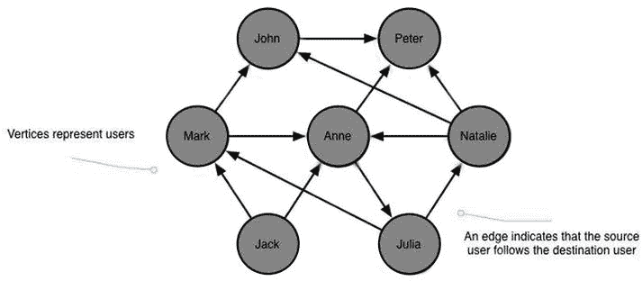
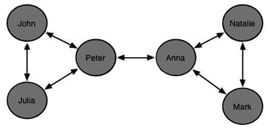
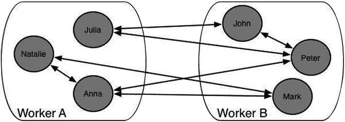
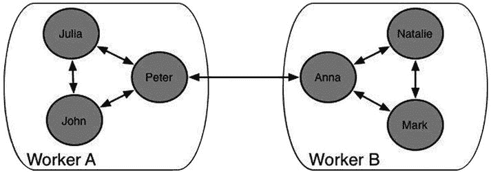
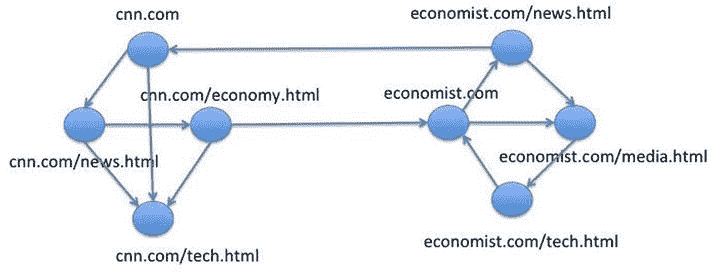
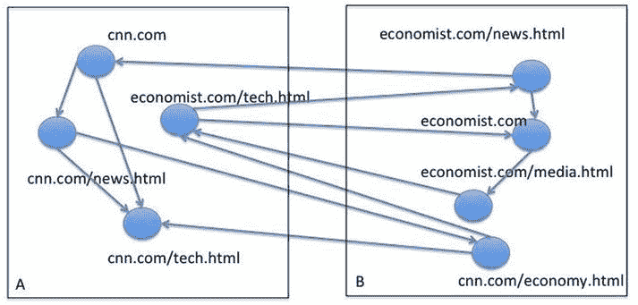
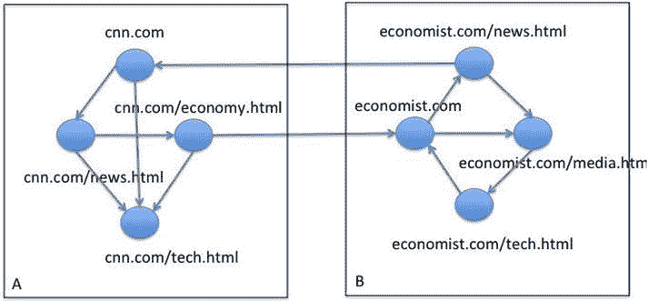
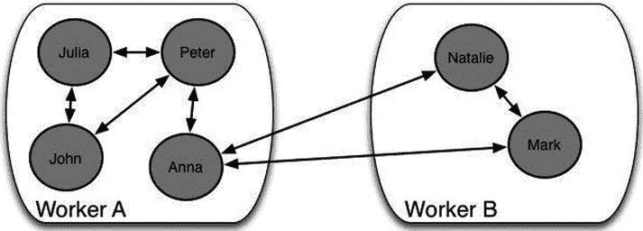

# 9. 揭示 Giraph 中的并行性

本章涵盖

- 每工作节点计算
- Giraph 中的线程安全性
- 图划分的重要性
- 实现自定义分区器

在前面的章节中，你了解了 Giraph 的不同编程原语，并学会了如何使用它们来实现图算法。在实现图算法的过程中，你以抽象的方式考虑图，仅将它们视为可以通过消息相互通信的顶点和边。幸运的是，你无需担心底层发生了什么；也就是说，当 Giraph 在集群上执行你的算法时，这些顶点和边位于何处，或者消息是如何实际实现的。你也不必担心 Giraph 如何将算法的执行并行化。事实上，这正是 Giraph 的一大优势；它为你隐藏了在大型计算集群上执行图算法所带来的复杂性。

随后在第 6 章中，你更深入地了解了 Giraph 的内部架构，并发现它是如何管理超大规模图的并行处理的。你了解到 Giraph 将顶点分组到分区中，并将它们分发给负责处理每个分区的实际机器或工作节点，从而实现并行处理。你还了解到 Giraph 甚至可以在同一工作节点内的不同线程上执行处理，从而实现进一步的并行化。

在本章中，你将重新审视 Giraph 如何并行化大型图的处理，但目标有所不同。你将看到，只需了解一些并行处理机制的知识，就可以在 Giraph 之上构建更高效的应用程序。例如，本章将讨论如何通过工作节点计算的概念来利用顶点到工作节点的分布。具体来说，你将学习如何使用每工作节点计算来增强以顶点为中心的算法，这些计算允许你在物理上位于同一工作节点上的顶点之间共享数据和计算。你将在几个场景中看到，共享数据和计算可以帮助你增加新功能或显著提高应用程序的性能。

本章还将讨论图划分，即顶点在不同工作节点之间的放置。简单的示例描述了不同的图划分策略可能对应用程序性能产生的影响。然后你将学习不同的图挖掘场景如何从不同的划分策略中受益。最后，你将学习如何通过实现自定义分区器来控制图划分以使其对你有益。

## 工作节点计算

正如你在第 6 章中所了解的，Giraph 将图分割成多个分区，并将分区分配给集群机器或工作节点。这使得 Giraph 能够通过将分区分配给不同的工作节点，甚至可能将不同的分区分配给同一工作节点内的不同 CPU 核心来实现图的并行处理。更具体地说，每个工作节点或核心负责为该工作节点或核心上的所有顶点调用 `compute` 函数。到目前为止，很好的一点是，作为程序员，你无需担心图在底层是如何划分的，以及 Giraph 如何处理每个分区；你只需要抽象地思考图和算法，将其视为带有边的顶点以及顶点计算即可。

然而，在本节中，你将发现有时了解分区和工作节点分布这一概念可以帮助你构建更好的应用程序。具体来说，你将学习到一些算法可能不仅受益于以顶点为单位的计算，还可能受益于以工作节点为单位的计算。你将首次执行不属于 Giraph 典型以顶点为中心思维的运算。在这里，你将回顾一些常见的用例，并学习如何利用划分的概念，以便为你的应用程序添加功能或使其更高效。

### 用例：在工作线程间共享数据

每个工作线程的独立计算中最常见的应用场景之一，就是需要在同一个工作线程的所有顶点间共享某种数据结构。通常情况下，顶点计算内部的编程逻辑需要访问数据，这些数据可能来自某个外部服务（例如分布式存储系统），并且对所有顶点都是通用的。

为了更具体地说明，假设你要处理图 9-1 中熟悉的 Twitter 关系图，统计每个用户拥有的男性或女性粉丝数量。



**图 9-1.** 一个 Twitter 关系图示例

事实上，在第 3 章中你已经见过该算法简化版本的伪代码，它仅统计 Twitter 粉丝数。在介绍更复杂的算法之前，我们通过代码清单 9-1 来看看这个简化版应用在实际代码中是什么样子。

**代码清单 9-1.** 统计 Twitter 粉丝数的算法

```java
public static class CountFollowers
extends AbstractComputation<Text, IntWritable, NullWritable, Text, Text> {
    @Override
    public void compute(Vertex<Text, Text, NullWritable> vertex,
                        Iterable<Text> messages) throws IOException {
        if (getSuperstep()==0) {
            sendMessageToAllEdges(vertex, vertex.getId());              #1
            voteToHalt();                                               #1
            return;                                                     #1
        }
        int numFollowers = 0;
        for (Text msg : messages) {                                     #2
            numFollowers++;                                             #2
        }                                                               #2
        vertex.setValue(new IntWritable(numFollowers));                 #3
        voteToHalt();
    }
}
```

#1 在第一个超步中，将 ID 发送给所有邻居并返回

#2 在第二个超步中，顶点统计消息数量，每条消息来自一个粉丝

#3 最后，顶点将其值设为粉丝数，投票中止并隐式返回

在该算法中，第一个超步期间，每个顶点将其 ID 发送给所有它指向的顶点，即它关注的所有用户。第二个超步期间，每个顶点会收到消息：每个粉丝发送一条。此时，它只需统计收到的消息数量，并将结果计数设为其值即可。

接下来，你要修改这个应用，以便根据性别统计粉丝数量。首先要注意，由于性别信息可能不属于用户资料的组成部分，你需要一种方法来自动判断用户是男性还是女性，并为其打上“female”或“male”标签。假设存在一个维护此信息的外部服务，即该服务可以将用户映射到性别。这样的服务本质上会提供一个分类器，当你传入名字时，它能自动检测性别。

你无需关心该服务和分类器的细节。只需假设在应用内调用 `getClassifierFromService()` 可以联系外部服务，并返回一个 `GenderClassifier` 类型的对象。一旦获得了 `GenderClassifier` 对象的实例，你就可以将名字传递给该实例的 `get(String)` 方法，该方法会返回一个字符串，指示“female”或“male”性别。

现在你已知道如何访问外部服务并将名字映射到性别，接下来看看如何在 Giraph 中实现这个应用，如代码清单 9-2 所示。

**代码清单 9-2.** 按性别统计 Twitter 粉丝数的算法

```java
public static class CountFollowersByGender
extends AbstractComputation<Text, Text, NullWritable, Text, Text> {
    @Override
    public void compute(Vertex<Text, Text, NullWritable> vertex,
                        Iterable<Text> messages) throws IOException {
        if (getSuperstep()==0) {
            GenderClassifier classifier = getClassifierFromService();    #1
            String gender = classifier.get(vertex.getId());              #2
            sendMessageToAllEdges(vertex, new Text(gender));             #3
            voteToHalt();                                                #4
            return;                                                      #4
        }
        int femaleFollowers = 0;
        int maleFollowers = 0;
    }
}
```

# 算法实现：基于性别的关注者统计

```java
for (Text msg : messages) {                                    #5
    if (msg.toString().equals("female")) {                       #5
        femaleFollowers++;                                     #5
    } else {                                                     #5
        maleFollowers++;                                       #5
    }                                                            #5
}                                                              #5

String vertexValue =
    "female:"+femaleFollowers+", male:"+maleFollowers;            #6
vertex.setValue(new Text(vertexValue));                        #6
voteToHalt();
}
}
```

## 连接外部服务并获取性别分类器
## 根据姓名从分类器中获取性别
## 向该顶点关注的所有用户发送性别标签
## 如果这是第一个超步，则投票停止并返回
在第二个超步中，消息包含关注者的性别标签。
将性别计数器设置为顶点值。

这个新算法同样相当直接。与简化版相比，区别在于在超步 0 期间，顶点会联系外部服务来获取性别分类器，以判断其代表的用户是男性还是女性。之后，它会向所有该用户关注的用户发送"female"或"male"标签。在第二个超步中，每个已知顶点维护两个独立的计数器：一个用于女性计数器，另一个用于男性计数器。注意，你还需要将值的类型改为`Text`，并将其设置为表示两个计数的字符串。这就是按性别统计关注者所需的全部内容。

现在，这是一种为算法添加此功能的完全有效的方式，但它带来了一个问题。它迫使你每次进行顶点计算时都要访问外部服务。这个看似无害的特性可能会给处理过程增加延迟，从而显著降低应用程序的性能。

然而，你可能已经注意到，在这种场景下，每次顶点计算时你都在重复读取完全相同的信息，即性别分类器对象。理想情况下，你希望避免这种情况，而是将这些信息保存在内存中的某个位置，并在所有顶点之间共享。这样就能避免所有不必要的访问，最终加速计算。

为了实现这一目标，Giraph 提供了一个名为 `WorkerContext` 的工具。`WorkerContext` 是一个对象，它在一个分区内的所有顶点之间共享，并且贯穿算法执行的整个生命周期；每个工作器都有自己的 `WorkerContext`。你可以通过两种方式使用它。首先，你可以在算法执行的预定义时间点执行每个工作器的计算；例如，在超步之前和之后。其次，你也可以用它来维护共享数据结构，从而在每个顶点计算内部进行访问。Giraph 提供了一个抽象类，你可以扩展它以定制适合你的用例。在观察你如何在特定场景中使用它之前，我们先来看看 `WorkerContext` 抽象类的方法，如清单 9-3 所示。

## 清单 9-3. `WorkerContext` 抽象类

```java
public abstract class WorkerContext {
    public void preApplication();        #1
    throws InstantiationException, IllegalAccessException;

    public void postApplication();       #2

    public void preSuperstep();          #3

    public void postSuperstep();         #4
}
```

在每个工作器上，在计算开始前调用。
在每个工作器上，在计算结束后调用。

# 3 在每个超步开始前，于每个工作节点上调用

# 在每个超步结束后，于每个工作节点上调用

要理解如何扩展`WorkerContext`抽象类，首先必须了解`WorkerContext`对象的生命周期。对于 Giraph 作业运行的每个机器工作节点，Giraph 都会创建一个`WorkerContext`实例。在你的算法开始执行之前，Giraph 会为每个工作节点调用`preApplication()`方法。你可以使用此方法来设置`WorkerContext`。执行开始后，Giraph 会在每个超步开始前调用每个`WorkerContext`的`preSuperstep()`方法。超步结束后，Giraph 会调用`postSuperstep()`方法。最后，在你的算法执行完毕时，Giraph 会为每个工作节点调用`postApplication()`方法。在算法的整个执行过程中，顶点计算可以通过调用`getWorkerContext()`方法来访问`WorkerContext`对象。

接下来，你将看到如何在我们特定的场景中实现这些方法。你将创建一个`WorkerContext`，用于联系外部服务以获取性别分类器对象，并将其共享给同一工作节点上的所有顶点。清单 9-4 展示了实现。

## 清单 9-4. `WorkerContext`的示例实现

```
public class MyWorkerContext extends WorkerContext {

    private GenderClassifier classifier;              #1

    @Override
    public void preApplication() throws InstantiationException,
        IllegalAccessException {
        classifier = getClassifierFromService();        #2
    }

    public GenderClassifier getClassifier() {
        return classifier;                              #3
    }

}
```
#1 保存性别分类器的变量
#2 在应用程序启动前从外部服务加载数据
#3 提供对分类器变量的访问权限

首先，`WorkerContext`实现包含一个`GenderClassifier`类型的变量，这与原始算法中的类型相同，用于保存所有顶点将要共享的信息。回想一下，在这种情况下，你需要访问一个外部服务并读取一些数据以在所有顶点之间共享。这是一个你只需要执行一次的步骤，因为这些数据在算法执行过程中不会改变。`preApplication()`方法是执行此操作的理想选择。你使用此方法从外部服务获取分类器，使用与之前相同的 API 调用来连接服务。这确保了数据在任何顶点的计算发生之前被加载，并且只加载一次。在此示例中，你将保持`WorkerContext`类的其他方法为空。

现在，让我们看看如何修改算法，以便从顶点计算方法内部访问分区上下文中维护的共享数据。这如清单 9-5 所示。

## 清单 9-5. 修改后的算法以访问`WorkerContext`中的共享数据

```
public static class CountFollowersByGender
    extends AbstractComputation< Text, Text, NullWritable, Text, Text> {

    @Override
    public void compute(Vertex<Text, Text, NullWritable> vertex,
        Iterable<Text> messages) throws IOException {

        if (getSuperstep()==0) {
            MyWorkerContext context = (MyWorkerContext)getWorkerContext();   #1
            GenderClassifier classifier = context.getClassifier();           #2
            String gender = classifier.get(vertex.getId());
            sendMessageToAllEdges(vertex, new Text(gender));
            voteToHalt();
            return;
        }

        int femaleFollowers = 0;
        int maleFollowers = 0;

        for (Text msg : messages) {
            if (msg.toString().equals("female")) {
                femaleFollowers++;
            } else {
                maleFollowers++;
            }
        }

        String vertexValue =
            "female:"+femaleFollowers+", male:"+maleFollowers;
        vertex.setValue(new Text(vertexValue));
        voteToHalt();
    }

}
```
#1 获取工作上下文的引用并将其转换为你的实现类型
#2 获取`WorkerContext`中包含的`GenderClassifier`对象

在这个实现中，唯一的区别在于你如何获取`GenderClassifier`对象。你不会每次都从外部服务读取它，而是从一个已经为你加载好它的`WorkerContext`对象中获取它。Computation API 提供了`getWorkerContext()`方法，该方法返回`WorkerContext`对象。请记住，此方法返回的是`WorkerContext`父类的对象，因此在你开始使用它之前，必须将其强制转换为刚刚实现的类型。此时，你可以随心所欲地访问它。在这种情况下，你只需获取`GenderClassifier`对象的引用，并像之前一样使用它即可。

通过使用这种基于分区计算的简单概念，你不仅成功简化了应用程序，还使其更加高效。这种方式避免了为每个顶点加载和维护一个共享数据结构。这节省了计算开销、通信开销和内存，因为你不再需要多次复制相同的数据结构。本质上，你在此案例中所做的只是创建了一个简单的对象缓存，该缓存一次填充，然后在所有顶点之间重用。一旦你开始构建更复杂的应用程序，这项技术可能会非常有用。

最后你必须注意的一个细节是，如何告诉 Giraph 在启动作业时使用特定的`WorkerContext`实现。与 Giraph 的许多可定制方面一样，你可以在启动作业时将其作为命令行参数传递。具体来说，你可以将`giraph.workerContextClass`参数设置为你`WorkerContext`实现的完整类名。你可以通过在命令行中添加以下内容来实现：

```
–ca giraph.workerContextClass=MyWorkerContext.
```

## 使用案例：每工作节点性能统计

每工作节点计算的另一个有用场景，是监控并计算算法运行时的细粒度统计信息。请注意，Giraph 已经为您维护了一些总体统计信息，例如总处理时间、图的总体规模等。除此之外，您还可以在 Giraph 任务的日志中找到有用的性能统计信息。然而，您可能希望维护更精细的算法性能视图，例如检测特定于应用程序的性能问题。例如，您可能希望计算每个工作节点持有的顶点数，或每个工作节点发生的计算次数，以监控计算在各工作节点间的分布均匀程度。

为此，您将使用 `WorkerContext` 提供的相同功能：能够跨一个工作节点上的所有顶点共享一个对象。在此案例中，该对象持有性能统计信息，并可被每个顶点计算访问和修改。

在了解如何实现之前，我们先确定要维护的信息类型。在这个场景中，您希望统计每个工作节点上顶点计算的发生次数。这能让您了解每个工作节点的处理负载，并可能有助于检测节点间分布不均的情况。在应用程序结束时，您还需要以某种方式输出这些信息，以便呈现给运行算法的人。

现在，假设您已经构建了一个名为 `Performance` 的类，用于保存运行时性能信息，例如顶点计算次数。我们将保持此类简单，并假设它只包含一个递增计算次数的方法。显然，您可以扩展此类并维护更多的性能指标，如代码清单 9-6 所示。

## 代码清单 9-6. 用于维护简单性能统计的类

## Performance类与WorkerContext

```java
public class Performance {
    private int numComputations;         #1
    public void getNumComputations() {   #2
        return numComputations;
    }
    public void incNumComputations() {   #3
        numComputations++;
    }
}
```

#1 保存工作节点上的顶点计算次数
#2 返回当前工作节点的计算次数
#3 将工作节点的计算次数增加 1

接下来，您将实现一个 `WorkerContext`，通过它来操作这些性能统计信息。在此应用程序中，您需要在每次 `compute` 方法执行时更新性能统计信息；同时还需要输出这些统计信息。让我们看看代码清单 9-7 中 `WorkerContext` 的实现。

### 代码清单 9-7. 用于维护性能统计的 `WorkerContext` 实现

```java
public class PerfStatsWorkerContext extends WorkerContext {
    private Performance perf;

    @Override
    public void preApplication()
        throws InstantiationException, IllegalAccessException {
        perf = new Performance();                               #1
    }

    synchronized public void incComputations() {
        perf.incComputations();                                 #2
    }

    @Override
    public void postApplication() {                            #3
        String id =
            getContext().getConfiguration().get("mapred.task.id");  #4
        Counter counter =                                       #5
            getContext().getCounter(                             #5
                "Worker Computations",                          #5
                "Worker_"+id);                                  #5
        counter.increment(perf.getNumComputations());           #5
    }

    @Override
    public void postSuperstep() {                              #6
        String id =
            getContext().getConfiguration().get("mapred.task.id");
        Counter counter =
            getContext().getCounter(                             #7
                "Worker Computations",                          #7
                "Worker_"+id+"_"+getSuperstep());               #7
        counter.increment(perf.getNumComputations());
    }
}
```

### 性能统计

`#1` 初始化性能统计类
`#2` 在每个顶点计算时调用
`#3` 在最后输出统计数据
`#4` 获取工作节点 ID
`#5` 获取 Hadoop 计数器并设置值
`#6` 在每个超步后输出统计信息，用于细粒度分析
`#7` 根据工作节点 ID 和超步号构造计数器

### 使用 `Mapper.Context`

通常你可能需要从 `Mapper.Context` 对象中获取一些配置信息，该对象继承自 Hadoop。每个 Giraph 工作节点都被实现为一个 Hadoop 映射器，`Mapper.Context` 提供了映射器配置的相关信息。在这个场景中，你使用它来：（i）获取映射器的唯一索引，即 `mapred.task.id` 属性的值，也就是 Giraph 工作节点的唯一索引；（ii）访问 Hadoop 计数器接口。

在此场景中，`WorkerContext` 实现包含一个名为 `Performance` 的字段来保存统计信息。你使用 `preApplication()` 方法初始化该字段。该 `WorkerContext` 实现还提供了一个名为 `incComputations()` 的公共方法，通过调用 `Performance` 对象中的相应方法来增加计算次数。接下来你将看到如何以及何时调用此方法。

此外，你实现了 `postApplication()` 方法，用于输出算法执行期间收集的信息，即每个工作节点的总计算次数。除此之外，你还希望计算并输出所有工作节点的总计算次数。换句话说，你希望聚合不同工作节点维护的部分统计信息。Giraph 提供了多种向用户输出信息的方式。例如，第 7 章讨论了输出格式。这里，你使用了另一种机制，一种从 Hadoop 借鉴的机制，称为计数器。Hadoop 计数器通过简单的 API 使统计信息的聚合和输出变得容易。

除了最终的计算次数，你可能还想以更细的粒度衡量此指标，并观察每个超步期间的性能。你可以在 `WorkerContext` 的 `postSuperstep()` 方法中轻松执行相同的操作。Giraph 在每个超步结束后调用此方法，在算法执行期间提供详细信息。

### 使用 Hadoop 计数器

计数器是 Hadoop 提供的一种机制，用于以友好的方式向用户输出有用的统计信息。如果你运行过 Hadoop 或 Giraph 作业，你应该已经在输出中看到过计数器。Hadoop Web 界面或终端中显示的输出包含此类计数器。

计数器通常属于一个具有特定名称的计数器组，例如“Giraph Stats”。每个组可能包含多个计数器，每个计数器都有一个名称和关联值。例如，Giraph 计数器组包含显示每个超步所用时间的计数器。

你可以使用 Hadoop API 在代码中创建新计数器并为其赋值。实际上，计数器类似于聚合器；你可以从代码中的任何位置根据计数器名称递增其值，Hadoop 会负责计算计数器值的最终总和。

现在让我们来看最后缺失的部分：如何在应用程序内部更新性能统计信息。清单 9-8 展示了一个计算函数的实现。你省略了计算的细节，专注于如何访问 `WorkerContext`。可以想象，这可以是任何你实现的计算。

### 清单 9-8. 从应用程序内部修改性能统计信息

```java
public class MyComputation extends BasicComputation {

    @Override
    public void compute(Vertex<I, V, E> vertex,
        Iterable<M1> messages) {

        PerfStatsWorkerContext context =        #1
            (PerfStatsWorkerContext)getWorkerContext();

        context.incComputations()               #2
        ...                                       #3
        ...                                       #3
    }
}
```

`#1` 获取工作上下文句柄
`#2` 增加计算次数
`#3` 执行剩余的计算逻辑

在 `compute()` 方法内部，你只需获取工作上下文对象的引用。回想一下，你需要先将其强制转换为自定义实现的类型。之后，你可以使用任何已实现的自定义功能。在此示例中，你只是递增了计算次数。至此，实现已完成。请记住，要启用此 `WorkerContext` 实现，你必须在命令行中添加以下选项：

`–ca giraph.workerContextClass=PerfStatsWorkerContext`

如果忘记这样做，`Giraph`将使用默认实现，并且在运行时显然无法将`WorkerContext`对象强制转换为你的自定义实现。

### Giraph 中的线程安全

前两节介绍的两个用例都利用了同一功能——在顶点之间共享`WorkerContext`，但有一个重要区别：在第一个用例中，顶点只读取共享数据结构，而在第二个用例中，它们还会修改该数据结构。作为 Giraph 用户，你需要关注这一区别，因为它会影响程序的线程安全性。

你一定已经注意到，尽管本书整本都在讲述并行算法的设计与实现，但这是第一次讨论线程安全。在编写并行程序时，这通常是一个重要问题，也往往是各种问题的根源。不过，截至目前你所使用的 Giraph 核心编程模型，刻意隐藏了所有复杂的同步和线程安全问题。当你编写以顶点为中心的程序时，无需担心顶点是否同时执行，也无需关心它们的计算顺序。在 BSP 模型中，你假设每个顶点的计算都是独立的，并通过消息进行显式同步。

然而，随着`WorkerContext`的引入，你开始接触到 Giraph 内部机制的更多细节。这带来了你已看到的益处，但同时也要求你更加谨慎。具体来说，你现在必须意识到，同一`WorkerContext`实例可能被多个线程同时访问。回想一下，`Giraph`将图分割成多个分区，而单个工作机可能持有多个分区。每个分区的处理可能由不同的线程完成，从而利用同一工作机内部的并行化机会。

因此，你必须确保应用程序的线程安全性。在某些情况下，你可能只读取`WorkerContext`维护的数据结构，因此保证线程安全相对容易。前面的例子——从外部服务读取数据并让所有顶点读取——就属于这一类。在其他情况下，比如性能监控示例，你可能还会修改`WorkerContext`对象。在该示例中，你通过`incComputations()`方法实现了这一点。你可能已经注意到，你将此方法声明为`synchronized`，因为你预计该方法会被不同线程调用。这确保了性能统计数据的一致访问与修改。随着你在`WorkerContext`内部维护越来越复杂的数据结构，线程安全是需要关注的问题。

**注意**
你无需对实现的`preApplication()`、`postApplication()`、`preSuperstep()`和`postSuperstep()`方法进行同步。`Giraph`在每个超步中只调用这些方法一次。

在本节中，你重新审视了图的分区与分布概念，并学习了如何通过每次工作计算来利用其优势。你只了解了可以用`WorkerContext`实现的一小部分功能。你可以发挥更多创意，找到更高级的使用方式。通常，这需要你对算法有更多的信息和理解。无论如何，你应记住：将某些共享进程或共享数据从主应用逻辑中提取出来，放入`WorkerContext`中，可能会提升算法的性能。接下来，你将更进一步，学习如何实际控制 `Giraph` 在工作机之间对图进行分区的方式。

### 控制图分区

到目前为止，你并未关心`Giraph`如何将图分割成多个分区，因为这并不影响你编写算法。仔细想想，你只是在逻辑层面指定了每个顶点的计算和消息交换。顶点位于何处、消息如何交换其实并不重要。即使你在上一节进行了每工作机计算，你也无需关心工作机持有哪些顶点；`Giraph`抽象了这些细节。

在本节中，你将进一步探讨`Giraph`如何并行化处理的具体细节，特别是`Giraph`如何对图进行分区。你将看到，尽管`Giraph`在工作机之间分配图的方式不会影响算法的正确执行，但它可能会对图算法的执行性能产生影响。你将简要了解智能分区如何提升性能，然后重点关注`Giraph`为用户提供的可自由控制图分区的机制。

### 分区的重要性

在深入探讨`Giraph` API 的细节之前，我们先来看看为什么需要关注图分区。图分区决定了图的不同顶点如何分配到各个分区，并以不同方式影响算法执行的性能。首先，它直接影响图算法执行期间集群上的网络流量。我们通过图 9-2 中的示例图来理解这一点，看看不同分区策略对网络流量的影响。



**图 9-2.** 一个包含六名用户的社交网络示例图

假设你的集群只有两台工作机器`A`和`B`，并且`Giraph`以随机方式将图分区到这些机器上。具体来说，`Giraph`会计算顶点 ID（本例中为用户名称）的哈希值。如果哈希值为偶数，则将顶点分配到机器`A`；如果为奇数，则分配到机器`B`。这几乎等同于随机决定顶点的放置位置，就像`Giraph`掷硬币一样，将顶点分配到两台机器中的一台。实际上，这就是`Giraph`的默认分区策略。假设最终放置结果如图 9-3 所示。



**图 9-3.** 六节点社交图在两台工作机器上的示例分区

### Giraph 中的哈希分区

`Giraph`中的默认分区策略是哈希分区。假设`Giraph`需要将图划分到`P`个分区中。对于每个顶点，`Giraph`计算顶点 ID 的哈希码`H`，然后计算`H mod P`（即`H`除以`P`的余数）。该运算的结果就是该顶点所属的分区。

哈希分区是一种非常常见的数据分区技术。它计算简单，并且能实现数据项（本例中为顶点）在分区间的均匀分布。

现在，假设在算法某个超步的执行过程中，每个顶点都向其所有邻居发送一条消息。这是一种非常常见的模式；例如，你在第 3 章中看到的`PageRank`算法就是这样运行的。从该图中可以明显看出，有 10 条消息会跨机器传输，从而在集群上产生网络流量。其余消息，例如从 Natalie 发送给 Anna 的消息，则会在各工作机器的内存内部进行交换。

接下来，我们看看如果不采用掷硬币式的随机放置方式，而是以更智能、更知情的方式来决定顶点放置，会发生什么。具体来说，我们尝试确保每个顶点的大部分邻居都位于同一台工作机器上。图 9-4 展示了另一种分区方案。目前，我们假设你有办法指示`Giraph`按照你的意愿放置顶点。



**图 9-4.** 另一种跨两台工作机器的分区方案，产生的网络流量更少

显然，就产生的网络流量而言，这种分区方案更为有利。图中只有一条图边跨越了两台工作机器，因此只有两条消息通过网络传输：一条从 Peter 到 Anna，另一条从 Anna 到 Peter。

尽管对于如此小的图，不同的分区方案在性能上可能看不出明显差异，但当你开始使用真实的大型图时，分区就变得至关重要了。跨工作机器的大量消息会给你的网络带来巨大负担，可能影响可扩展性并增加`Giraph`作业的处理时间。

请注意，寻找好的分区方案是图管理研究的一个完整领域，可能取决于多种因素，例如图的类型和所使用的算法。研究不同的分区技术超出了本章的范围。相反，我们这里重点介绍`Giraph` API，它允许你插入不同的分区方案。也就是说，一旦你找到了将顶点映射到分区的合适技术，就可以通过 API 提供的一种简便方式将其插入`Giraph`，并在执行过程中强制执行该映射。后续小节将对此进行介绍。

### 实现自定义分区器

如您所见，`Giraph`使用的默认哈希分区技术并未考虑产生的网络流量，因此您可能希望用更智能的分区方式替换它。通常，您可以通过实现一个名为`WorkerGraphPartitioner`的接口来完成此操作，该接口负责将顶点分配给各个分区。

为了说明该接口的用法，我们将以网页图为例，描述一种在处理如图 9-5 所示的网页图时常用的替代分区技术。



**图 9-5.** 一个网页图示例

回顾一下，网页图描述了网页之间如何通过链接相互连接。在第 3 章中，您看到了可能希望在网页图上运行的算法示例，例如`PageRank`。在此图中，顶点代表网页，边代表从一个页面到另一个页面的链接。在`Giraph`中，您将网页 URL 用作顶点的 ID。

为简单起见，假设我们的计算集群再次由两台工作机器`A`和`B`组成。和之前一样，如果使用默认的哈希分区，`Giraph`会随机放置顶点，分区结果将如图 9-6 所示，其中有多条边跨越这两台机器。



**图 9-6.** 在两个工作节点上对网页图进行基于哈希的分区

在这个网页图中，我们可以采用一种更好的方法。请记住，在 Twitter 图的例子中，智能分区基于这样一个理念：您应尽最大努力将某个顶点及其邻居顶点放在同一个工作节点上。在小型 Twitter 图中，这很简单，您只需直观地查看图就能轻松完成分配。在这里，我们将使用一种更有原则性的策略来决定放置代表网页的顶点的位置。具体来说，该策略基于这样一个事实：网页上的大多数链接都指向通常位于同一域名下的其他网页。例如，`cnn.com/index.html` 上的大多数链接都指向诸如 `cnn.com/technology.html` 和 `cnn.com/economy.html` 之类的页面，这些页面都属于 `cnn.com` 域名。这应该已经让您对如何划分图有了提示。我们将使用一种类似哈希分区的技术，但不是对顶点 ID 进行哈希，而是仅对域名前缀进行哈希；例如，前缀 `cnn.com`。这确保了具有相同域名下 URL 的顶点被放置在同一工作节点上。图 9-7 展示了这种分区方式。



图 9-7. 基于每个网页域名前缀对同一网页图的分区

接下来，我们将研究如何实现 `WorkerGraphPartitioner` 来应用此逻辑。但在深入分区器的核心之前，我们先介绍一些您必须首先实现的辅助性但必要的其他接口。

首先，您必须实现 `GraphPartitionerFactory` 接口。`GraphPartitionerFactory` 对象负责创建实际分区器实现的实例。具体来说，Giraph 使用 `GraphPartitionerFactory` 来实例化 `MasterGraphPartitioner` 和 `WorkerGraphPartitioner` 对象，以执行所有主要操作。在代码清单 9-9 中，您可以看到该接口中您必须实现的仅有的两个方法。

**代码清单 9-9.** `GraphPartitionerFactory` 接口

```
public interface GraphPartitionerFactory<I extends WritableComparable,
    V extends Writable, E extends Writable> extends
    ImmutableClassesGiraphConfigurable {
```

# 排版后的内容：

`MasterGraphPartitioner<I, V, E> createMasterGraphPartitioner();`  #1

`WorkerGraphPartitioner<I, V, E> createWorkerGraphPartitioner();`  #2

`}`

#1 实例化并返回一个 `MasterGraphPartitioner` 对象  
#2 实例化并返回一个 `WorkerGraphPartitioner` 对象

在深入探讨这些接口的具体实现之前，我们首先描述它们的作用，并展示需要实现的各个方法。随后，你将逐一实现它们，以实现实际的哈希分区技术。

第一个接口 `MasterGraphPartitioner` 主要负责建立和维护用于存储所有分区信息的必要数据结构。其方法如列表 9-10 所示。稍后将通过一个示例对其进行详细说明。

**列表 9-10.** `MasterGraphPartitioner` 接口

```
public interface MasterGraphPartitioner<I extends WritableComparable,
    V extends Writable, E extends Writable> {

  Collection<PartitionOwner> createInitialPartitionOwners(
      Collection<WorkerInfo> availableWorkerInfos, int maxWorkers); #1

  Collection<PartitionOwner> generateChangedPartitionOwners(
      Collection<PartitionStats> allPartitionStatsList,
      Collection<WorkerInfo> availableWorkers,
      int maxWorkers,
      long superstep);                                              #2

  Collection<PartitionOwner> getCurrentPartitionOwners();           #3

  PartitionStats createPartitionStats();                            #4
}
```

#1 基于可用工作节点创建 `PartitionOwner` 对象  
#2 在每个超步开始时调用，用于潜在创建新的 `PartitionOwner` 对象  
#3 返回当前 `PartitionOwner` 对象的列表  
#4 返回一个用于保存分区统计信息的对象

这里最重要的数据结构是 `PartitionOwner`。`PartitionOwner` 封装了关于分区本身的信息，也包含了拥有该分区的工作机器（即该分区所在的工作机器）的信息。如你所见，`MasterGraphPartitioner` 负责创建一组 `PartitionOwner` 对象，这些对象通常描述当前场景的配置；也就是说，运行任务的工作节点集合以及将图分割成的分区数量。

`PartitionOwner` 实际上是一个接口，根据你想要维护的分区所有者元数据类型，它可以有不同的实现。在这里，我们不深入探讨 `PartitionOwner` 接口的细节，而是使用 Giraph 已经提供的实现 `BasicPartitionOwner`。`BasicPartitionOwner` 主要包含它所对应的分区 ID，以及该分区所在工作节点的信息。这种 `PartitionOwner` 的实现应该足以满足大多数场景。

但现在让我们看看如何利用这些来实现一个基于哈希的分区器。首先，你实现 `GraphPartitionerFactory` 接口。实现相当简单，如列表 9-11 所示。

**列表 9-11.** 一个 `GraphPartitionerFactory` 实现示例

```
public class HashPartitionerFactory<I extends WritableComparable,
    V extends Writable, E extends Writable>
    implements GraphPartitionerFactory<I, V, E> {

  private ImmutableClassesGiraphConfiguration conf;                  #1

  @Override
  public MasterGraphPartitioner<I, V, E> createMasterGraphPartitioner() {
    return new HashMasterPartitioner<I, V, E>(getConf());            #2
  }

  @Override
  public WorkerGraphPartitioner<I, V, E> createWorkerGraphPartitioner() {
    return new HashWorkerPartitioner<I, V, E>();                     #3
  }

  @Override
  public ImmutableClassesGiraphConfiguration getConf() {
    return conf;                                                     #4
  }

  @Override
  public void setConf(ImmutableClassesGiraphConfiguration conf) {
    this.conf = conf;                                                 #5
  }
}
```

#1 持有作业配置的对象  
#2 返回基于哈希的 `MasterGraphPartitioner` 实现实例  
#3 返回基于哈希的 `WorkerGraphPartitioner` 实现实例  
#4 返回配置对象  
#5 在工厂初始化时调用，用于设置配置对象  

在此实现中，你可以看到工厂仅实例化了两个对象：类型分别为 `MasterGraphPartitioner` 和 `WorkerGraphPartitioner`。接下来，让我们更详细地查看 `HashMasterPartitioner` 的实现，以了解设置 `PartitionOwner` 数据结构的典型方式（参见清单 9-12）。

**清单 9-12.** `HashMasterPartitioner` 的实现

```markdown
```
public class HashMasterPartitioner<I extends WritableComparable,
    V extends Writable, E extends Writable> implements
    MasterGraphPartitioner<I, V, E> {

    private ImmutableClassesGiraphConfiguration conf;                    #1
    private List<PartitionOwner> partitionOwnerList;                     #2

    public HashMasterPartitioner(ImmutableClassesGiraphConfiguration conf) {
        this.conf = conf;                                                #3
    }

    @Override
    public Collection<PartitionOwner> createInitialPartitionOwners(      #4
        Collection<WorkerInfo> availableWorkerInfos, int maxWorkers) {

        int partitionCount = PartitionUtils.computePartitionCount(       #5
            availableWorkerInfos, maxWorkers, conf);

        List<PartitionOwner> ownerList = new ArrayList<PartitionOwner>();
        Iterator<WorkerInfo> workerIt = availableWorkerInfos.iterator();

        for (int i = 0; i < partitionCount; ++i) {
            PartitionOwner owner =                                       #6
                new BasicPartitionOwner(i, workerIt.next());

            if (!workerIt.hasNext()) {                                   #7
                workerIt = availableWorkerInfos.iterator();
            }

            ownerList.add(owner);                                        #8
        }

        this.partitionOwnerList = ownerList;
        return ownerList;
    }

    @Override
    public Collection<PartitionOwner> getCurrentPartitionOwners() {
        return partitionOwnerList;
    }

    @Override
    public Collection<PartitionOwner> generateChangedPartitionOwners(
        Collection<PartitionStats> allPartitionStatsList,
        Collection<WorkerInfo> availableWorkerInfos,
        int maxWorkers,
        long superstep) {

        return PartitionBalancer.balancePartitionsAcrossWorkers(
            conf,
            partitionOwnerList,
            allPartitionStatsList,
            availableWorkerInfos);
    }

    @Override
    public PartitionStats createPartitionStats() {
        return new PartitionStats();
    }

}
```

`#1` 保存配置
`#2` 维护 `PartitionOwner` 对象的列表
`#3` 构造 `HashMasterPartitioner` 时，需传入作业配置
`#4` 在执行前调用，用于创建初始的 `PartitionOwner` 对象集
`#5` 获取分区数量，通常是一个配置选项
`#6` 为每个分区创建一个分区所有者，并指定下一个可用的工作节点
`#7` 如果已为所有工作节点分配了分区，则重新开始
`#8` 创建后，将 `PartitionOwner` 添加到维护的列表中

`HashMasterPartitioner` 实现中最重要的方法是 `createInitialPartitionOwners()`。该方法首先计算你想要的分区数量。这个数字通常是一个配置参数，可能取决于集群中的总核心数等因素。之后，它为每个分区创建一个 `PartitionOwner` 对象，并以轮询方式将其分配给一个可用的工作节点。在此处，你可以应用自己的逻辑。例如，如果通过某些外部服务能够获取每个工作节点的负载信息，你可以将其纳入分区分配策略中。最后，该方法仅返回所创建的 `PartitionOwner` 对象列表。

接下来，你需要实现 `generateChangedPartitionOwners()` 方法。Giraph 会在每个超步执行后调用此方法，让你有机会根据需要更改工作节点的初始分区分配。例如，可能是因为你发现某个工作节点崩溃了，此时需要将其分区分配给另一个工作节点。另一种可能的情况是，你注意到某个工作节点最终拥有的分区超出了其处理能力，此时你可能希望将部分处理任务卸载到另一台工作节点上。在所有这些情况下，每个超步结束后，你都可以通过为分区选择新位置来调整分区。但请注意，不允许更改顶点到分区的分配。

在此特定实现中，修改分区所有者的决策被委托给一个名为 `PartitionBalancer` 的特殊辅助类。简而言之，`PartitionBalancer` 确保每个工作节点被分配大致相同的工作量，从而提供良好的集群利用率。关于平衡器及其重要性的讨论将推迟到下一节。在那里，你还会看到如何在运行时通过 `generateChangedPartitionOwners()` 修改分区。

`createPartitionStats()` 方法返回一个 `PartitionStats` 类型的对象，该对象保存有关分区的有用统计信息。这些统计信息包括分区中的顶点和边数量，以及此分区中顶点发送的消息数。这些统计信息对于应用依赖运行时行为的复杂分区技术可能很有用。更具体地说，你可以使用该类维护的信息来决定当 Giraph 调用 `generateChangedPartitionOwners()` 方法时如何更新分区所有者。Giraph 已经提供了一个基础的 `PartitionStats` 类，其中包含最常见的统计信息，你可以继续使用它。如果你需要，也可以自由扩展此类以维护更多信息，以适应你的特定场景。

现在你已经实现了所有辅助类，接下来就可以实现由 `WorkerGraphPartitioner` 接口定义的分区器主要逻辑了。一旦 Giraph 使用分区器工厂和 `HashMasterPartitioner` 创建了 `PartitionOwner` 对象集合，它就可以将顶点分配给已构建的分区所有者。这就是 `WorkerGraphPartitioner` 的工作。其方法在清单 9-13 中说明。

`清单 9-13.` `WorkerGraphPartitioner` 接口
```

# Giraph 图分区机制详解

## WorkerGraphPartitioner 接口

`WorkerGraphPartitioner` 接口定义了工作节点分区器的核心方法。

```java
public interface WorkerGraphPartitioner<I extends WritableComparable,
    V extends Writable, E extends Writable> {

    PartitionOwner createPartitionOwner();                         #1
    PartitionOwner getPartitionOwner(I vertexId);                  #2
    Collection<PartitionStats> finalizePartitionStats(             #3
        Collection<PartitionStats> workerPartitionStats,
        PartitionStore<I, V, E> partitionStore);
    PartitionExchange updatePartitionOwners(                       #4
        WorkerInfo myWorkerInfo,
        Collection<? extends PartitionOwner> masterSetPartitionOwners,
        PartitionStore<I, V, E> partitionStore);
    Collection<? extends PartitionOwner> getPartitionOwners();     #5

}
```

#1 创建一个空的 `PartitionOwner` 对象
#2 将顶点 ID 映射到 `PartitionOwner`
#3 在超步结束时调用
#4 确定哪些分区必须从特定工作节点发送
#5 返回当前的 `PartitionOwner` 对象列表

`getPartitionOwner()` 方法是其中最重要的，它接收一个顶点 ID 作为输入，并返回该顶点对应的 `PartitionOwner` 对象。Giraph 使用此方法来决定顶点的放置位置。接下来，将通过一个基于哈希的分区器示例，解释 `WorkerGraphPartition` 接口的所有方法。

### HashWorkerPartitioner 实现

清单 9-14 展示了这些方法的实现。

清单 9-14. `HashWorkerPartitioner` 实现

```java
public class HashWorkerPartitioner<I extends WritableComparable,
V extends Writable, E extends Writable>
implements WorkerGraphPartitioner<I, V, E> {

    protected List<PartitionOwner> partitionOwnerList =               #1
        Lists.newArrayList();

    @Override
    public PartitionOwner createPartitionOwner() {
        return new BasicPartitionOwner();                             #2
    }

    @Override
    public PartitionOwner getPartitionOwner(I vertexId) {
        URL url = new URL(vertexId.toString());                      #3
        String domain = url.getHost();                                #3
        return partitionOwnerList.get(                                #4
            Math.abs(domain.hashCode() % partitionOwnerList.size()));
    }

    @Override
    public Collection<PartitionStats> finalizePartitionStats(
        Collection<PartitionStats> workerPartitionStats,
        PartitionStore<I, V, E> partitionStore) {
        return workerPartitionStats;
    }

    @Override
    public PartitionExchange updatePartitionOwners(
        WorkerInfo myWorkerInfo,
        Collection<? extends PartitionOwner> masterSetPartitionOwners,
        PartitionStore<I, V, E> partitionStore) {
        return PartitionBalancer.updatePartitionOwners(partitionOwnerList,
            myWorkerInfo, masterSetPartitionOwners, partitionStore);
    }

    @Override
    public Collection<? extends PartitionOwner> getPartitionOwners() {
        return partitionOwnerList;
    }
}
```

#1 保存当前 `PartitionOwner` 对象的列表
#2 创建一个空的 `BasicPartitionOwner` 对象
#3 从 URL 中提取域名
#4 在域名上应用哈希分区逻辑

基于哈希的分区逻辑核心位于 `getPartitionOwner()` 方法内部。给定一个顶点 ID（即网页 URL），该方法从 URL 中提取域名，然后计算域名的哈希码，并求其除以分区数的余数。结果指示指定顶点应被分配到哪个分区。

请注意，本例中的分区逻辑非常简单，但你可以在该方法内放置任意逻辑，甚至可以连接到负责维护图分区的外部服务。

此外，你还需要实现 `updatePartitionOwners()` 方法。Giraph 会在每个超步结束时调用此方法，用于确定是否以及哪些分区需要从其他工作节点发送过来。此决策同样委托给了 `PartitionBalancer`，稍后将对此类进行介绍。

最后，既然你已经实现了自定义分区器的所有必要部分，你可能会想知道如何实际告知 Giraph 使用它们。要启用自定义分区器，只需将参数 `giraph.graphPartitionerFactoryClass` 设置为你分区器工厂的完整类名即可。像往常一样，你可以通过命令行完成此操作。

在此特定场景中，启动作业时需要在命令行中添加 `–ca giraph.graphPartitionerFactoryClass=HashPartitionerFactory` 选项。其余的工作 Giraph 会自动处理。

## 分区平衡

在前面关于分区的讨论中，你只了解了分区如何影响网络流量，并进而影响应用程序性能。分区还有另一个可能影响性能的方面，称为分区平衡。通常，当所有工作节点包含大致相同数量的顶点或边时，分区是平衡的。但首先，让我们看看平衡为何重要。

考虑之前看到的图，并设想在工作节点间有第三种分区方式，如图 9-8 所示。



图 9-8. 非平衡分区示例

这是一种完全有效的图分区方式，但它存在一个问题。注意，工作节点 A 包含的顶点数远多于工作节点 B，此处是后者的两倍。因为机器上顶点数量越多，其 CPU 负载也越大；这种图在工作节点间的不均匀分布同样会导致 CPU 负载的不平衡。结果，部分工作节点（此处为工作节点 B）未被充分利用，从而无法获得集群的最大性能。

相反，均匀分布工作负载可以有效利用集群资源，并减少总处理时间。`PartitionBalancer` 是一个辅助类，其方法可以找到分区的正确放置位置，从而实现平衡分区。本质上，它利用分区 API 提供的能力，通过 `GraphMasterPartitioner` 的 `generateChangedPartitionOwners()` 方法和 `WorkerGraphPartitioner` 的 `updatePartitionOwners()` 方法在运行时修改分区位置——正如你之前所见。

重要的是，`PartitionBalancer` 支持不同类型的平衡。第一种平衡类型称为顶点平衡，确保每个工作节点持有大致相同数量的顶点。除此之外，它还支持边平衡，尝试确保所有工作节点包含大致相同数量的边。哪种更合适取决于你要运行的算法类型，以及每个工作节点的 `CPU` 负载取决于其持有的顶点数还是边数。

以你在第 4 章中见到的 `PageRank` 算法为例，它用于网页排名。在 `PageRank` 中，每个顶点从其邻居接收消息，每条消息携带一个数值。对于接收到的每条消息，顶点执行一次运算，将消息值累加至其本地排名值。因此，顶点完成的总工作量主要取决于其具有的邻居（即边）数量。所以，为了在工作节点间均匀分布工作负载，你希望每个工作节点拥有大致相同数量的边。

通常，在顶点平衡和边平衡之间进行选择需要对你算法的计算和通信模式有深入了解。通常，只需将算法的计算和通信模式与某些其他算法（如 `PageRank`）进行比较，你可能就能理解哪种平衡类型更合适。无论如何，正确平衡分区可以积极影响算法性能和集群资源利用率。

## 概要

`Giraph` 的编程核心 `API` 隐藏了其并行化图处理过程的细节。与此同时，通过向用户开放这一过程，你能够编写出更高效的应用程序。

- 在某些应用场景下，可能需要跨顶点共享数据，这乍看起来会打破以顶点为中心的计算模型。

- 在这种情况下，`WorkerContext` 变得非常有用。它允许你在每个 `Worker` 的基础上进行计算，并在同一 `Worker` 上的所有顶点之间共享数据结构。这既能简化你的应用，也能提升性能。

- 不要忘记，使用 `WorkerContext` 可能会引发线程安全问题。某些应用可能会修改 `WorkerContext` 持有的数据，并且这种修改可能由不同线程并发进行。请务必将方法声明为 `synchronized`，以避免竞态条件。

- 图的分区方式会对应用的可扩展性和性能产生重大影响。

- 默认情况下，`Giraph` 使用哈希分区，这是一种常见的做法，能使图在机器之间均匀分布，但可能导致较高的网络流量。

- 以智能方式对图进行分区通常取决于具体的图和应用程序。

- 一旦你为你的场景确定了合适的分区方案，请使用 `WorkerGraphPartitioner` 及其所有相关接口来实现自定义分区器。

最后几章重点介绍了 `Giraph` 的内部机制和更高级的特性。在下一章中，我们将延续这一思路。你会再次回顾如何从各种存储系统读取图以及将图写入其中，但这次我们将探讨更高级的存储系统（例如 `HBase`）的场景，它能使你将 `Giraph` 连接到任何数据源。
