# 3. Giraph 编程模型

## 本章内容涵盖

*   `Giraph` 在图处理方面的设计目标
*   以顶点为中心的 API
*   使用 combiner 来最小化通信
*   通过 aggregator 进行聚合
*   整体同步并行模型

本章深入探讨了图和图算法的本质，以及如何使用 `Giraph` 来实现和计算图算法。你将学习图问题本质上为何是递归的，以及为何图算法通常通过迭代来解决。你将看到 `Giraph` 是如何为迭代图计算而设计的，并探索以顶点为中心的编程 API 和 `Giraph` 的范式。然后，你将查看一些简单算法的示例，以熟悉该模型。本章最后将揭开 `Giraph` 的引擎盖，审视其底层分布式引擎，正是它使得迭代计算如此快速且简单。

## 简化大规模图处理

传统上，图算法的设计遵循我们早已习惯的顺序编程模式。图在主存中通过原生数据结构（如矩阵或列表）表示。算法假设采用图的全局视图和单线程执行方式。数据结构和执行逻辑均为特定解决方案量身定制。这种方法存在诸多缺陷。首先，新的图问题会催生新的图算法，并可能随之带来全新的、从零开始重新设计的方法和模型。定制化的、特设的解决方案虽能实现细粒度优化，但要求实践者在每次在系统中实现新算法时部分地重新发明轮子。其次，算法需要专门设计或修改才能在并行分布式系统中运行。同样，这虽然允许利用特定平台进行细粒度优化，但每次为并行分布式系统实现新算法时都需重新发明轮子。此外，图算法的并行化并非易事，因为图计算具有非结构化和交错性的特点。

`Giraph` 通过提供一种针对图算法设计的编程模型，同时隐藏了并行分布式系统编程的复杂性，从而解决了这两个问题。这两个特性最大限度地减少了实现大规模图算法所需的工作量。接下来的两节将详细阐述这些特性。

### 隐藏并行分布式计算的复杂性

`Giraph` 为您提供的远不止是一个执行图计算的库；它提供了一种编程模型和 API，让您可以专注于所设计算法的具体语义，而无需担心图在内存中如何存储、算法如何执行，或计算如何在具备容错能力的机器间分布。从根本上说，图在内存中的表示方式以及执行引擎，对于任何能用 `Giraph` 表达的图算法都是通用的。实践中，您需要编写一个用户定义函数（`UDF`），该函数由 `Giraph` 运行时在处理单元上对每个顶点迭代执行。此 `UDF` 既不了解数据在这些单元间的共享方式，也不了解代码的并发执行方式。换言之，您无需进行任何锁定或并发协调。从您的角度来看，`UDF` 是在单个单元上顺序执行的。图 3-1 展示了这种概念性的堆叠结构。

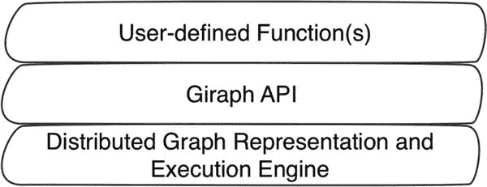

图 3-1. Giraph 中应用程序的概念性组织

**重要提示**

根据 `Giraph` 编程模型，您需要开发一个在图的顶点上迭代执行的 `UDF`。您无需了解图在内存中的表示方式、函数如何在分布式系统中并行执行，以及如何保证容错。

`UDF` 定义了每个顶点如何管理接收到的消息以更新其值，以及它向哪些其他顶点发送哪些消息。由于顶点通过消息共享数据，因此无需锁定。同时，由于每个顶点在每次迭代中最多执行一次，用户也无需进行显式的同步。这意味着您只需专注于如何从顶点的角度来表达一个算法，即该顶点能在多次迭代中与其他顶点交换消息。正因如此，这种编程模型通常被称为顶点中心范式。尽管这种模型更具限制性，但它能引导您开发出能够实现大规模并行化的算法。第 4 章将进一步阐述这一思想。

### 通过基于迭代的图特定模型进行编程

前一章介绍了图以及如何利用它们对不同领域的数据进行建模。现在，让我们快速回顾一下图，重点关注它们如何塑造用于表达图算法的编程模型。图以其为数不多的几个概念而著称，使其非常易于理解。您只需要“一组顶点以及连接它们的边集合”，这些边可能具有方向、标签和权重。仅此而已。通过这些概念的组合，几乎可以为您能想到的任何事物建模。但简单是有代价的。问题在于，每个顶点的信息不仅包含在其相邻顶点以及连接它们的边的标签和权重中，还包含在更远的顶点中。每个顶点的信息通常分散在整个图中，这使得图的管理变得复杂且代价高昂。

让我们看一个例子，说明如何通过观察超出直接邻居范围的信息来获取更多关于某个顶点的信息。在图 3-2 中，最左边的圆圈代表了所有图中（或许除了空图）最简单的一种——它仅由一个顶点组成。这个图告诉您什么？目前看来，信息寥寥。但如果您为该顶点添加一个标签，并用带标签的边将其连接到其他一组顶点，您就能得到更清晰的画面。您会发现该图包含关于马克的信息。他在香蕉公司工作，与安娜处于恋爱关系，并居住在柏林。现在看看右边的图。它添加了一个代表德国的顶点，并用一条标签为“首都”的边将其连接到代表柏林的顶点。

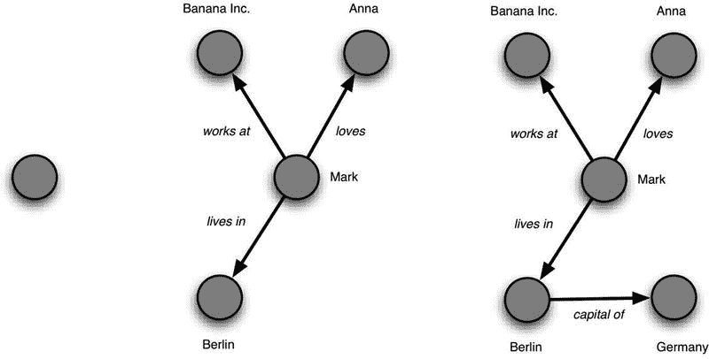

图 3-2. 通过邻居定义顶点

有趣的是，通过向图中添加一个顶点并将其连接到非马克的顶点，您可以发现更多关于马克的信息：马克住在德国。此外，假设在本例中马克不远程办公，您可以推断出香蕉公司在柏林设有办公室。邻居（无论是直接邻居还是相隔多跳的邻居）包含的信息越多，您就能推断出关于该顶点的越多信息。

换句话说，关于一个顶点的信息取决于其邻域内顶点的信息。自然地，这些顶点又依赖于它们的邻域。这在每个顶点的信息中引入了一种递归性，使得每个顶点都依赖于其他顶点。这就是图处理棘手的原因。每个顶点都依赖于其邻居。马克由顶点香蕉公司、安娜和柏林定义，但柏林由顶点德国定义，这使得马克也被顶点德国间接定义。

再看另一个例子。人们常说，要评判一个人，必须看其朋友。但同样可以说，要评判其朋友，又得看他们各自的朋友。如之前一样，最终您不得不审视整个图。图问题通常以一种或另一种形式，通过顶点与其邻居之间的依赖关系来定义。揭示这些依赖关系往往是导致图计算复杂且代价高昂的原因。

**重要提示**

关于一个顶点的信息取决于其邻居的信息。这使得图问题具有递归性。

幸运的是，你知道这类问题可以通过迭代的方式求解。经过一次次迭代，迭代算法会逐层展开这些依赖关系。正因如此，图算法通常被表达为迭代算法，在每一次迭代中，部分顶点被访问（一次或多次）。随着计算的进行和中间状态被计算出来，每个顶点的信息会随着更新的中间状态不断更新，直到最终结果计算完成。这就是 `Giraph` 编程模型被设计用来表达迭代算法，而 `Giraph` 执行引擎被优化用于迭代计算的原因。你必须从迭代算法的角度来思考。

**重要**

图问题可以通过迭代算法很好地解决。这正是 `Giraph` 被设计和优化用于迭代计算的原因。

让我们看一个例子来阐明这些概念。图 3-3 展示了一个社交图，其中许多人通过朋友关系相连。想象他们想要找出图中年龄最大的人，但他们只能通过朋友进行交流。你可以为每个顶点分配一个值，初始化为该人的年龄，并通过递归的方式定义问题：将每个顶点的值定义为自身值与邻居值中的最大值。这个定义是递归的，因为每个顶点的值都依赖于邻居的值。这个递归定义之所以有效，是因为年龄最大的人会影响其朋友的值，而朋友的值又会进一步影响他们的朋友的值，最终每个人的值都取决于图中年龄最大的人的年龄。

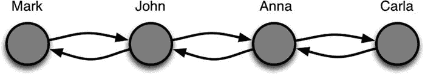

图 3-3. 由朋友关系连接的四个人组成的社交网络

但是如何解决这个问题呢？你将计算组织成一系列迭代，在每次迭代中，每个顶点将自身的值设置为当前值与邻居值中的较大者。经过一次次迭代，年龄最大的人的年龄在图中流动，直到到达所有顶点。如果在某次迭代中没有顶点更新其值，则计算达到最终迭代，每个顶点的值中都包含了图中年龄最大的人的年龄。图 3-4 显示了此示例的执行过程。注意 `Carla` 的年龄如何逐步到达 `Anna`，然后是 `John`，最后是 `Mark`。此外，最初 `Mark` 顶点基于 `John` 的值更新其值，而在 `John` 顶点更新其值后又再次更新。下一节将探讨这与通常所说的 `Giraph` 的“以顶点为中心”的方法之间的关系。

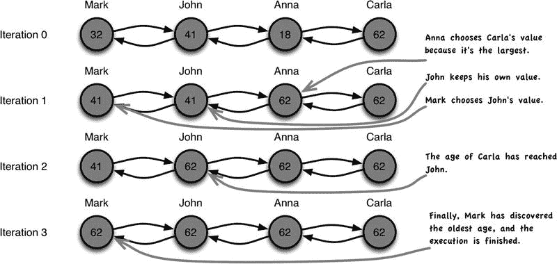

图 3-4. 寻找图中最年长者年龄（最大值）算法的执行过程

### 以顶点为中心的视角

根据 `Giraph` 编程模型和 API，你必须将自己置于一个顶点的角色中，该顶点拥有一个值，并且可以在多次迭代中与其他顶点交换消息。本节将介绍其工作原理。为了简化演示并尽可能多地包含示例，我们使用伪代码而不是 `Java`（`Giraph` 是用 `Java` 编写并可编程的）。从第 5 章开始，当所有概念都清晰并且你熟悉了该范式后，书中的示例将使用实际 `Giraph` API 的 `Java` 代码。这两种 API（伪代码和 `Java`）是完全匹配的。

**本书中伪代码的使用**

本章和下一章将使用一种伪代码语言来介绍`Giraph` API和算法的实现。这让你能够专注于编程模型，而无需考虑（`Java`）语言的特性。此外，由于伪代码比`Java`简洁得多，这些章节可以涵盖更多的内容。

该语言深受`Python`启发，因此如果你了解该语言，理解代码不会有什么问题。大多数API使用了与官方`Java` API相同的命名，因此你可以轻松地将这里学到的内容迁移到第二部分和第三部分（它们展示`Java`代码）的内容中。

## Giraph 数据模型

本节将介绍 Giraph 的数据模型：图的表示方式。回顾图 3-4 中的示例，每个人用一个顶点表示，若两人相识，则对应的两个顶点相连接。这就是构建社交网络图的方法。你可以使用人名作为标识符，例如使用字符串类型。每个人都知道自己所连接的朋友，因此每个顶点都拥有出边。需要注意的是，在某些图中（如街道地图），边也可以被赋予值。顶点及其标识符，以及附有值的边，共同构成了图。针对“查找最高年龄”这一具体问题，我们需要为每个人存储一个整数值。每当某个顶点发现更高的年龄时，这个值就会被更新。顶点 ID、带值的出边以及顶点值，就是 Giraph 数据模型的构成要素。图 3-5 总结了这些要素。

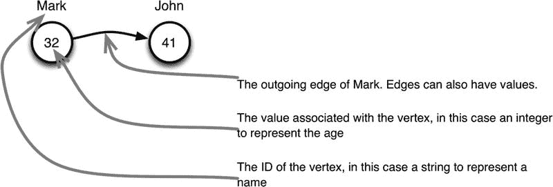

图 3-5. Giraph 数据模型：包含顶点、ID、值和边

更严谨地说，根据 Giraph 的定义，一个图由一组顶点和一组边构成，每个顶点定义如下：

- 拥有唯一的 ID，由某种类型定义（例如整数、字符串等）。

- 拥有一个值，也由某种类型定义（例如双精度浮点数、整数等）。

- 拥有指向其他顶点的一组出边。

- 每条边可以有一个值，同样由某种类型定义（例如整数、双精度浮点数等）。

从上述列表首先要注意的是，数据模型是一个有向图，并且边归属于其源顶点。原则上，顶点只知道自己的出边；如果算法需要获知入边，则必须作为算法的一部分来发现它们。在“将有向图转换为无向图”一节中，将介绍实现此目的的算法。其次要注意的是，对于每个元素（顶点 ID 和值、边值），你都必须定义其类型。该类型可以是基本类型，如`int`或`double`，也可以是复合类型，如一个类。

虽然顶点 ID 依赖于图本身（例如，网页图的顶点 ID 由 URL 表示，因此是字符串类型），但顶点值通常依赖于算法。例如，最短路径算法将顶点值定义为整数（用于无权图）或双精度浮点数（用于有权图）；PageRank 将顶点值定义为双精度浮点数；推荐算法则常将顶点值定义为浮点数向量。第 4 章将介绍所有这些算法及其在 Giraph 中的实现。对于你编写的每个算法，必须决定哪种数据类型适合作为顶点值。

另一方面，边值则介于两者之间。对于某些算法，你不需要使用边值；对于另一些算法，你使用边值来模拟输入图中边所附带的标签（如果有的话）；还有一些算法中，你使用边值来模拟权重。而对于其他一些算法，你可能会使用一种与原始图完全无关的全新边值类型，算法可能用它来存储中间结果。顶点值在计算过程中往往会发生变化，因为它们是中间结果的一部分，但边值则倾向于保持不变。但这并非绝对规则。回顾图 3-4 中的示例，该图将使用字符串 ID 表示人名，整数值表示年龄，并且没有边值。

在 Giraph 中，每个顶点对象都是`Vertex`类的一个实例。`Vertex`类的接口如代码清单 3-1 所示，它允许你访问顶点值、边及其值，并允许添加和删除边。现在先忽略`voteToHalt()`方法，该方法将在下一节介绍。Giraph 提供了顶点和边的默认实现，因此你无需在应用程序中自行实现它们（除非你需要某种特定行为）。你只需要定义顶点 ID、顶点值和边值的类型。

代码清单 3-1. `Vertex` 类

```
class Vertex:

function getId() #1
function getValue() #2
function setValue(value) #3
function getEdges() #4
function getNumEdges() #5
function getEdgeValue(targetId) #6
function setEdgeValue(targetId, value) #7
function getAllEdgeValues(targetId) #8
function voteToHalt() #9
function addEdge(edge) #10
function removeEdges(targetId) #11
```

#1 返回顶点的 ID。返回类型取决于 ID 的类型。

#2 返回顶点的值。返回类型取决于顶点值的类型。

#3 设置顶点的值。参数类型取决于值的类型。

#4 以`Edge`对象可迭代的形式返回该顶点的所有出边。

#5 返回该顶点的出边数量。

#6 返回连接到目标顶点的第一条边的值（如果存在）。返回类型取决于边值的类型。

#7 设置连接到目标顶点的第一条边的值（如果存在）。参数类型取决于值的类型。

#8 返回连接到特定顶点的所有边的关联值。此方法在处理多重图时很有用。

#9 让此顶点投票停止。

#10 向此顶点添加一条边。

#11 移除所有指向目标顶点的边。

`Edge`类则更简单，它只有三个方法：一个用于获取另一端点 ID，一个用于获取值，一个用于设置值。该接口如代码清单 3-2 所示。

代码清单 3-2. `Edge` 类

```
class Edge:

function getTargetVertexId() #1
function getValue() #2
function setValue(value) #3
```

#1 返回目标顶点的 ID。返回类型取决于 ID 的类型。

#2 返回附加到边上的值。返回类型取决于边值的类型。

#3 设置边的值。参数类型取决于边值的类型。

现在，你已经了解了图在 Giraph 中的表示方式以及如何通过编程方式访问它，接下来可以学习如何表达一个算法了。

### 基于消息与超步的计算

一旦你通过顶点 ID、顶点值以及边值类型定义了图的形状，Giraph 就需要你编写一个名为`compute`的用户自定义函数（UDF）。如前所述，Giraph 要求你“像顶点一样思考”。所有这些逻辑都放在了`compute()`方法中。但在深入了解 API 之前，让我们先看看计算是如何组织的。

Giraph 计算是以一系列超步的形式组织的。之所以这样称呼，是因为一个超步由多个步骤组成，正如你将在本章后面看到的那样。直观上，你可以把超步看作算法的一次迭代；情况并非总是如此，但通常是这样的。在每个超步中，一个顶点可以向其他顶点发送消息、访问其顶点值和边，并投票终止。发送的消息会在下一个超步开始时送达目标顶点。每个顶点可以处于活动状态或非活动状态。在每个超步期间，只有活动顶点会被计算（一次）。在计算开始时，每个顶点都处于活动状态，并且可以通过投票终止来切换到非活动状态。顶点投票终止是因为它从自身局部角度判断工作已完成，计算可以结束。处于非活动状态的顶点在后续超步中不会被执行，除非它收到了消息。消息的送达会将顶点从非活动状态切换回活动状态。当所有顶点都已投票终止且没有需要送达的消息时，Giraph 计算即告结束。图 3-6 中的图表说明了顶点在活动与非活动状态间的转换方式。

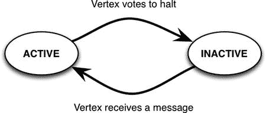

图 3-6. 顶点状态转换示意图

Giraph 计算被认为是同步的。当所有活动顶点都计算完毕且所有消息都已送达时，一个超步就结束了。Giraph 不会在下一个超步开始之前计算，直到所有顶点都计算完成。由于活动顶点必须等待当前超步中其他顶点计算完毕，才能进入下一个超步的计算，因此这种计算被称为同步的，而等待阶段被称为同步屏障。

Giraph 计算是分布式的，并通过将顶点及其边分布到多个处理单元（例如机器或 CPU 核心）上来实现并行化。在每次迭代中，每个单元负责对其分配的顶点执行`compute()`方法。每个单元还负责将已发送的消息传递给负责接收消息的顶点的单元。这意味着参与计算的单元越多，可以并行执行的顶点就越多。但单元越多，产生的通信量也越大。第 6 章 专门讨论 Giraph 的架构，并深入探讨了细节。图 3-7 展示了一个顶点的计算过程：它接收三条消息（5, 7, 和 20），选出最大值（20），更新其值（从 2 到 20），并将该值发送给它的邻居。请注意，本章展示了同步屏障，并用它们自己的虚线箭头表示正在发送的消息。为了保持图表简洁，本书后面的图表不再包含同步屏障，消息直接绘制在它们被发送的边上。

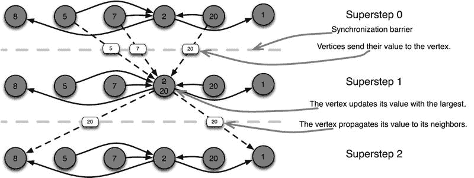

图 3-7. 一个顶点的计算过程：接收通过消息传递的值，并传播最大值

在实践中，为了编写一个算法，你必须实现一个名为 `BasicComputation` 的类中的 `compute()` 方法。在每个超步中，Giraph 会在所有活动顶点上调用 `compute()` 方法，并传递上一个超步期间发送给该顶点的消息（如果有的话）。`compute()` 方法的签名是 `compute(vertex, messages)`，其中第一个参数是正在被计算的顶点，第二个参数是一个容器，包含发送给该顶点的消息（现阶段你可以将其视为一个消息列表）。`BasicComputation` 类必须使用与其操作的顶点相同的三种类型来定义。然而，除了这三种类型之外，你还需要定义第四种类型：`message` 类型。Giraph 需要这些信息来知道如何存储和传递消息。清单 3-3 展示了 `BasicComputation` 类中最相关的方法。

**清单 3-3.** `BasicComputation` 类

```
class BasicComputation:

    function compute(vertex, messages) #1
    function getSuperstep() #2
    function getTotalNumVertices() #3
    function getTotalNumEdges() #4
    function sendMessage(targetId, message) #5
    function sendMessagetoAllEdges(vertex, message) #6
    function addVertexRequest(vertexId) #7
    function removeVertexRequest(vertexId) #8

#1 需要实现的方法，由 Giraph 运行时调用
#2 返回当前超步编号
#3 返回图中顶点总数
#4 返回图中边总数
#5 向目标顶点发送一条消息
#6 向一个顶点的所有出边端点发送一条消息
#7 请求向图中添加一个顶点
#8 请求从图中移除一个顶点
```

这就是你在 Giraph 中编写基本图算法所需了解的全部内容。本章的其余部分将介绍基本 API 的其他部分，但现在让我们重点关注如何使用到目前为止所学的内容来实现图 3-4 中的示例。清单 3-4 展示了实现该算法的 `compute()` 方法。

### Giraph 核心编程模型

**清单 3-4.** `MaxValue` 算法

```
function compute(vertex, messages):
    maxValue = max(messages)    #1
    if maxValue > vertex.getValue(): #2
        vertex.setValue(maxValue) #2
        sendMessageToAllEdges(vertex, maxValue) #2
    vertex.voteToHalt() #3

#1 找出通过消息传递过来的值中的最大值。
#2 该值大于此顶点目前发现的值，因此更新并传播。
#3 投票终止。
```

图 3-8 说明了该算法在图 3-3 的图上执行的过程。如你所见，最大值在图中迅速传播。当顶点发现新的、更大的值时，它们会被更新并传播，直到所有顶点都发现了最大值。

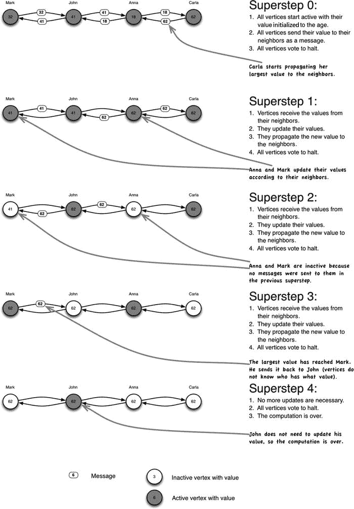

**图 3-8.** 在 Giraph 中计算 `MaxValue` 算法

现在你已经了解了简单的 Giraph API，下一节将探讨如何通过组合器让你的算法更高效。

### 整体同步并行（BSP）模型

Giraph 中的一些术语借鉴自整体同步并行（BSP）模型，Pregel 和 Giraph 都受其启发。如果你有兴趣进一步了解 BSP 模型，本章末尾有一个专门的小节介绍它。但请记住，使用 Giraph 并不需要了解 BSP 模型是如何工作的。

### 使用组合器减少消息量

消息在 Giraph 中扮演着非常重要的角色，因为它们允许顶点之间共享信息。此外，由于 Giraph 使用消息而非共享内存，图计算可以在不使用（昂贵的）并发原语的情况下实现并行化。然而，交换消息本身是有代价的，并且会影响计算的总运行时间。你能减少消息的数量吗？

组合器是一种将发送给某个顶点的消息合并起来的函数。合并消息可以让 Giraph 在处理单元之间发送更少的数据。组合器非常简单，它可以将两条消息合并成一条。它所合并的消息都是在当前超步中被发送到同一个顶点的。重要的是，不保证组合器会被调用多少次，甚至不保证它是否会被调用。基本上，你能做出的唯一假设是，传递给组合器的所有消息都是发送给同一个顶点的。

由于组合器接收到的消息集合是不完整的，并且可能被多次调用，因此它必须应用一个满足交换律和结合律的函数。代码清单 3-5 展示了 `MessageCombiner` 类的接口。显然，因为组合器是针对特定消息类型定义的，所以算法必须使用与其顶点发送的消息类型相匹配的组合器。

**交换律与结合律函数**

交换律函数无论以何种顺序应用于元素，都会产生相同的结果。例如，`sum`（求和）满足交换律：

`1 + 2 = 2 + 1`，更广泛地讲，`1 + 2 + 3 + 4 = 3 + 2 + 4 + 1`，以此类推。

结合律函数可以应用于输入元素的子组，并产生相同的结果。例如，`sum`（求和）也满足结合律：

`1 + 2 + 3 + 4 = (1 + 2) + (3 + 4) = 1 + (2 + 3) + 4`，以此类推。

**代码清单 3-5.** `MessageCombiner` 类

```
class MessageCombiner:
    function combine(id, message1, message2) #1
#1 返回两条消息的组合结果
```

对于 `MaxValue` 算法，一个可行的组合器是返回两条消息中较大值的组合器。代码清单 3-6 展示了该组合器的伪代码。

**代码清单 3-6.** `MaxValue` 组合器

```
function combine(id, message1, message2):
    return max(message1, message2) #1
#1 返回较大的值
```

现在，让我们看看在计算最大值（使用不同的图）的示例计算中使用组合器的效果。图 3-9 展示了一个超步。左侧是消息按原样传递。然而，在右侧，Giraph 应用了两次组合器，将发送给该顶点的消息数量减少到了原来的三分之一。还需要注意，第二次组合可能不会发生，因为 Giraph 不做任何保证。在这种情况下，消息数量只会减少到原来的三分之二。

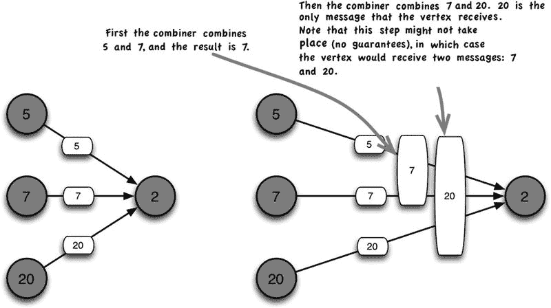

**图 3-9.** 在消息上使用 `MaxValue` 组合器的效果

关于组合器有趣的一点是，`compute()` 方法不能对组合器是否会执行做出任何假设。因此，组合器的合并逻辑通常由 `compute()` 方法执行。注意代码清单 3-6 是如何在 `maxValue = max(messages)` 这一行中对输入消息计算 `max()` 函数的。这与组合器的函数是相同的。在进入 `compute()` 方法之前，组合器会对部分消息执行，但结果是相同的。

组合器对于最小化 Giraph 的资源使用非常有用。通常你可以应用一个简单的组合器，但并非所有算法都能使用。在设计你自己的算法时请记住这一点。

### 使用聚合器计算全局函数

计算与顶点关联的值的最大值或其他聚合值，可以表示为一个图算法。但是，如果你无需在多个超步中跨顶点传播消息就能计算这些聚合值，那将会更容易。这正是引入聚合器的原因。聚合器让你可以将聚合视为全局函数，顶点可以向这些函数发送值。在每个超步期间，这些全局函数会聚合这些值，并且结果可以在下一个超步期间供顶点使用。

聚合器计算全局函数，但它们是在多个处理单元上并行执行的，并且是可扩展的。与组合器一样，聚合器要求函数具有交换律和结合律。聚合器的接口展示在代码清单 3-7 中。

**代码清单 3-7.** `Aggregator` 类

```
class Aggregator:
    function aggregate(value) #1
    function getAggregatedValue() #2
    function setAggregatedValue(value) #3
    function reset() #4
#1 聚合该值
#2 返回聚合后的值
#3 将聚合值设置为参数
#4 将聚合值重置为中性值
```

让我们回到示例。与其让顶点传播它们的值，不如让顶点在第一个超步中将它们的值发送给聚合器，然后投票停止。该算法将只执行一个超步并完成计算。代码清单 3-8 展示了 `MaxValueAggregator` 类的代码。请注意，对于这种算法，Giraph 可能不是合适的工具，因为它没有利用图的结构。尽管如此，算法通常可以在其图计算中使用聚合器；第 4 章展示了两个这样的案例。

### 代码清单 3-8. `MaxValueAggregator` 类

```
maxValue = -Inf #1
function aggregate(value):
    maxValue = max(maxValue, value) #2
function getAggregatedValue():
    return maxValue #3
function setAggregatedValue(value):
    maxValue = value #4
function reset()
    maxValue = -Inf #5
#1 存储聚合值的局部变量
#2 如果新值更大，则更新局部值
#3 返回聚合后的值
#4 将该值设置为新值，用于（例如）初始化
#5 将该值重置为中性值 -Inf（对于 max() 函数是中性的）
```

代码清单 3-9 展示了一个使用聚合器的简单 `MaxValue` 算法的伪代码。为简单起见，代码假设你有一个名为 `maxValueAggregator` 的聚合器对象的引用。然而，在 Giraph 中，你可以同时使用多个聚合器——每个聚合器用一个字符串名称来区分——并且它们需要在使用前声明和初始化。展示这个完整的 API 需要引入 API 中与理解聚合器工作原理及如何使用无关的部分。第 5 章在介绍 Java API 时包含了完整的 API。

### 代码清单 3-9. 带聚合器的 `MaxValue` 算法

```
function compute(vertex, messages):
    maxValueAggregator.aggregate(vertex.getValue()) #1
    vertex.voteToHalt()
#1 通过 MaxValue 聚合器聚合顶点值
```

图 3-10 展示了新计算的组织方式。请注意，聚合器是如何为每个值自动计算的，因为该函数满足结合律和交换律。

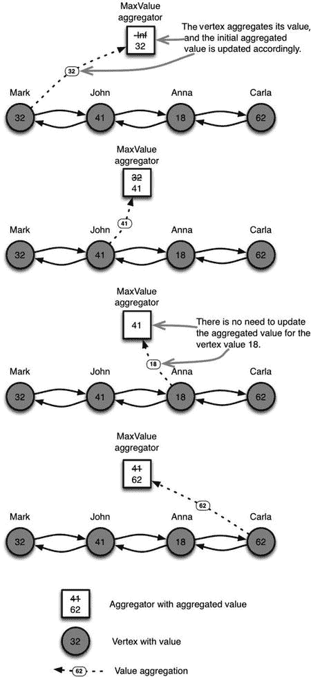

**图 3-10.** 通过聚合器计算 `MaxValue`

在继续学习之前，你需要了解关于聚合器的最后一点内容。你可能已经注意到了`Aggregator`类中的`reset()`方法。这个方法的存在是因为有两种类型的聚合器：常规聚合器和持久聚合器。常规聚合器的值在每个超步中都会重置为初始值，而持久聚合器的值则会贯穿整个应用程序的生命周期。请注意，调用`getAggregatedValue()`返回的是前一个超步计算出的值，而不是当前超步的值。Giraph 运行时使用`reset()`方法来重置常规聚合器的值。因此，它应该将聚合器重新初始化为一个中性值，例如求和聚合器为 0，或`MaxValue`聚合器为`-Infinity`。

设想一个简单的应用：在每个超步中，顶点向一个求和聚合器发送值 1，该聚合器将所有值相加。如果该聚合器是常规的，那么在每个超步（第一个超步除外）中，聚合器包含的数字等于顶点总数。相反，如果聚合器是持久的，那么聚合后的值将是顶点数乘以超步编号。因此，如果在包含三个超步的计算中有四个顶点，那么计算结束时，常规求和聚合器的值为 4，而持久求和聚合器的值为 12。

本章介绍了基本 API，并假设图已经加载并初始化到内存中，且最后一个超步将是计算的最后一部分。下一节将介绍第一个超步之前和最后一个超步之后发生的事情，以此结束你对 Giraph 计算的探索。

## Giraph 计算剖析

本章对 API 的介绍假设图已经加载到内存中，值已经初始化，并且最后一个超步将是计算的最后阶段。让我们来看一个更完整的概述。图 3-11 展示了 Giraph 计算的剖析。

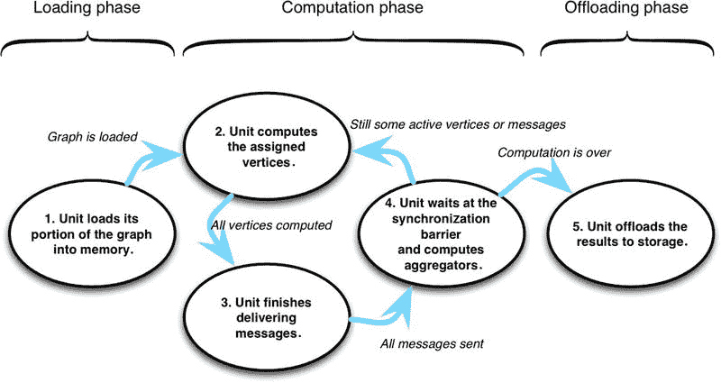

**图 3-11.** 每个处理单元执行的 Giraph 计算的不同阶段和步骤

计算从 Giraph 将图加载到各处理单元的内存中开始。在 Giraph 中，加载阶段被视为超步-1。图通常从持久化存储（如文件系统或数据库，且两者很可能是分布式的）中读取。这个加载阶段尽可能并行进行，并且需要将从存储中读取的数据转换为图的内部表示。正如第 7 章所解释的，Giraph 提供了一个 API，允许你定义持久化数据的格式以及如何解析以加载图。加载阶段会加载所有顶点及其边，并初始化顶点值和边值。图加载完毕后，计算就可以开始了。

计算阶段由一个或多个超步组成。每个超步分为三个阶段：

1. 处理单元遍历活动顶点，并调用 `compute()` 方法，同时传入相应的消息（如果有的话）。当顶点产生消息时，根据目标顶点，消息会被发送到相应的处理单元。在不同的时间点，如果定义了组合器，则可以在消息离开源或到达目的地时对消息应用组合器。处理单元完成顶点计算并发送完剩余的消息。每个处理单元在同步屏障处等待其他单元完成。
2. 处理单元完成聚合器的计算（如果有的话），并汇总本地聚合结果。涉及聚合器的本地计算可以在计算顶点时进行，因为聚合函数是可交换和结合的。这意味着本地聚合不一定在所有顶点计算完之后才进行。当处理单元完成聚合后，如果计算尚未结束，它们可以进入下一个超步。
3. 在卸载阶段（计算的最后一个阶段），处理单元的内存中保存着顶点及其值、边及其值。这些数据代表了结果（通常，如果算法不改变图结构，只有顶点值包含最终结果）。处理单元遍历这些数据并将其写回持久化存储。整个计算至此结束，结果可供使用。

## BSP 模型与 Giraph 的区别

传统上，在 BSP 模型中，一个超步分为三个步骤：本地计算、通信和同步屏障。这些步骤依次进行。当一个单元完成本地状态计算后，它就开始发送数据。

Giraph 以不同的方式计算超步，它重叠了本地计算和通信。处理单元一旦产生消息就开始交换消息，而不是等待顶点计算完成。这有助于将网络使用分散到更长的时间段内。这一点在运行多个作业（其中一个是 Giraph）的 Hadoop 集群中尤其有用，这样 Giraph 就不会使网络饱和。

你已经了解了基本的 Giraph API 以及计算是如何组织的。本书的第二部分和第三部分将介绍 Giraph Java API。在进入第 4 章（介绍用于现实世界图分析的 Giraph 算法实现）之前，让我们先花两节的篇幅来看一些简单的算法，以帮助你更好地熟悉目前所学的内容。

## 计算入出度

为了让你熟悉 Giraph 编程模型，本节将介绍一个简单的图算法，它可被视为图计算的“Hello World”（如果你熟悉 Hadoop MapReduce，这个例子就像是 Giraph 的“词频统计”）。

据报道，截至 2012 年 12 月 31 日，Facebook 拥有 10.6 亿月活跃用户和 1500 亿好友连接。用图术语来说，这意味着 10.6 亿个顶点和 1500 亿条无向边。用户在 Facebook 或 Twitter 上有多少连接？图 3-12 展示了两个社交网络：一个具有对称的好友关系（Facebook），另一个具有非对称的关注关系（Twitter）。在这两种网络中，图都包含三个顶点和三条边。第一种情况下，每位用户的平均好友数为 2；第二种情况下，每位用户的平均粉丝数为 1。这很有趣，因为顶点数与边数的比例是相同的。但由于 Twitter 图是有向的，且你只考虑入边（粉丝），所以计数方式不同。如果你仅关注“接触”顶点的边数，两种情况下平均值都是 2。

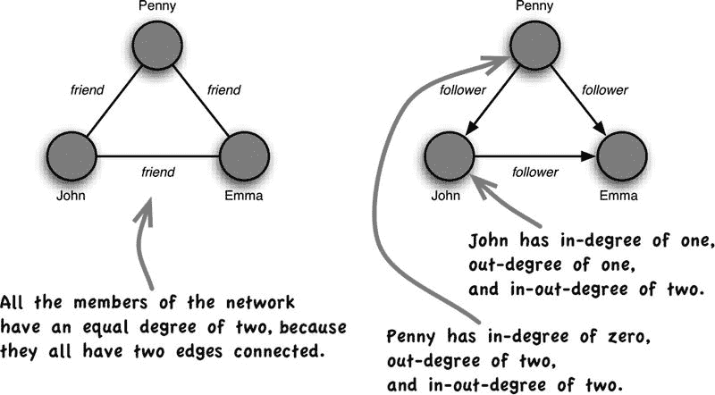

**图 3-12.** 有向图与无向图中的顶点度数

接触一个顶点的边数称为该顶点的度数。对于有向图，一个顶点有入度（入边数量）、出度（出边数量）和入出度（两者之和）。如果考虑入出度，那么有向图中顶点度数的计算方式与无向图相同。如果将无向的 Facebook 图转换为有向图，即用两个方向相反的有向关系替代每条无向好友关系，那么该图将包含六条边。

那么问题来了：如何用 Giraph 以顶点为中心的编程模型计算入出度？由于每个顶点只知道自己的出边，顶点与其邻居之间需要交换一些信息。为了发现入边，顶点可以利用其消息传递能力，通过出边告知邻居自己的存在。图 3-13 展示了一个包含七个顶点的有向图，你需要计算其入出度（你可以将其视为一个 Twitter 关注关系图）。

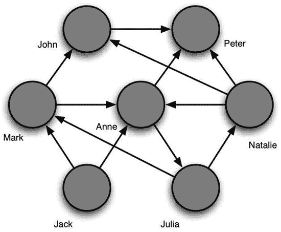

**图 3-13.** 一个类似 Twitter 的用户与关注关系网络

算法的工作原理如下：

- 开始时，所有顶点都处于活跃状态，其值初始化为 `0`。

## 计算入出度

在超步0中，每个顶点计算其出边的数量，并将该值赋给自己的值。如果只想计算出度，这一步就足够了，顶点值中将包含出度。但由于每个顶点仍不知道入边，因此每个顶点通过其出边发送一条消息，并投票终止。当所有顶点完成度数计算并发送消息后，下一个超步开始。

拥有入边的顶点会被上一超步发送给它们的消息唤醒。每个顶点收到的消息数量等于通过入边指向它的顶点数量。每个顶点现在统计消息的数量，从而计算出其入度，将其与出度相加，然后投票终止。此时，所有顶点的值中都包含了它们的入出度，计算结束。

图 3-14 展示了针对图 3-13 中所示图的计算流程。

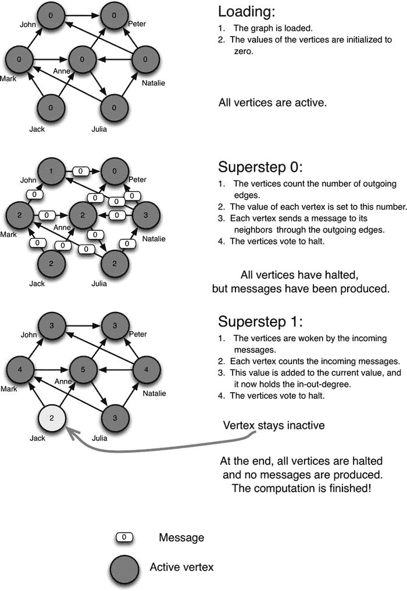

图 3-14. 在 Giraph 中计算入出度

在 Facebook 图中计算顶点度数很简单：归结为统计边的数量。当无向图通过有向图建模时（如在 Giraph 中），每条入边对应一条出边。因此，顶点可以只统计其拥有的边数，而不必依赖入站消息。列表 3-10 展示了该算法的伪代码。

列表 3-10. `InOutDegree`算法

```
function compute(vertex, messages):
    if getSuperstep() == 0:
        vertex.setValue(vertex.getNumEdges()) #1
        sendMessageToAllEdges(vertex, 0) #1
    elif getSuperstep() == 1:
        inDegree = 0
        for msg in messages: #2
            inDegree += 1 #2
        outDegree = vertex.getValue()
        inOutDegree = outDegree + inDegree #3
        vertex.setValue(inOutDegree) #3
        vertex.voteToHalt()
```

#1 将顶点值初始化为出度，并传播该值  
#2 统计入站消息的数量作为入边数量  
#3 将入度和出度相加得到入出度，并将顶点值设为此值

仅用几行代码，你就开发了一个应用程序，可以在数百或数千台机器上计算每个顶点的入出度，而无需担心并发或并行分布式计算问题。经过这番关于有向图和无向图的讨论，接下来让我们看看一个将有向图转换为（逻辑上）无向图的算法。

## 将有向图转换为无向图

某些算法要求图必须是无向的。Giraph 仅支持有向图，因此这意味着需要逻辑上的无向图。这里的“逻辑上”是指图中的每条边都有一条对应的反向边。由于每条边都有一条对应的反向边，方向性便消失了。

以图 3-15 为例。原始有向图通过添加一条尚未存在的反向边，被转换为逻辑上的无向图。这种简单的转换策略可能会让你丢失一些边信息，但目前不必担心；稍后我们将对此进行探讨。在顶点中心 API 中，作为源顶点的顶点可以添加该边。

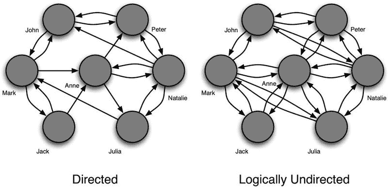

图 3-15. 通过逻辑无向图表示有向图

该算法按以下两个超步执行。请注意，它不使用顶点值，因为其仅作用于图的拓扑结构：

-   在超步 0 期间，每个顶点将其`顶点ID`发送给邻居。

-   在超步 1 期间，每个顶点接收作为入边端点的顶点的 ID。也就是说，顶点发现了它的入边。对于这些 ID 中的每一个，每个顶点检查是否已存在一条反向边。如果不存在，则该顶点创建一条指向该顶点的边。此外，活跃顶点在两个超步期间都投票停止。

代码清单 3-11 展示了该算法的伪代码。

代码清单 3-11. 图转换算法

```
function compute(vertex, messages):
    if getSuperstep() == 0:
        sendMessageToAllEdges(vertex, vertex.getId()) #1
    elif getSuperstep() == 1:
        for msg in messages:
            if vertex.getEdgeValue(msg) is None:
                vertex.addEdge(Edge(msg)) #2
        vertex.voteToHalt()
```

#1 初始时将 ID 传播给所有邻居  
#2 如果指向目标的边尚不存在，则添加一条边

在某些情况下，你可能希望利用边值来存储原始图是否仅包含单方向的一条边的信息。例如，当原始图有两条对应的边时，你可能想将边值赋为 2；而当仅有一条边存在时，则赋值为 1。例如，图 3-16 根据这一新启发式方法转换了图 3-15 中的原始图。假设输入图的每条边初始时都被赋予一个值 1。该启发式方法的伪代码见代码清单 3-12。

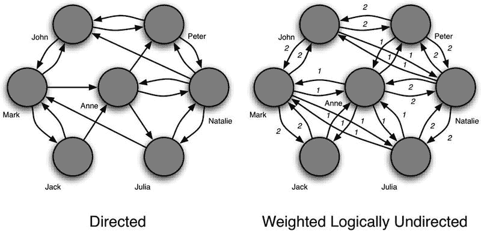

图 3-16. 通过带权逻辑无向图表示有向图

代码清单 3-12. 带权重的图转换算法

```
function compute(vertex, messages):
    if getSuperstep() == 0:
        sendMessageToAllEdges(vertex, vertex.getId()) #1
    elif getSuperstep() == 1:
        for msg in messages:
            value = vertex.getEdgeValue(msg):
            if value is None:
                vertex.addEdge(Edge(msg, 1)) #2
            else:
                vertex.setEdgeValue(msg, 2) #3
        vertex.voteToHalt()
```

#1 初始时将 ID 传播给所有邻居  
#2 如果指向目标的边尚不存在，则添加一条边，权重为 1  
#3 如果指向目标的边已存在，则将权重更新为 2

再次，仅用几行代码，你就可以表达一个能够跨多台机器转换大型图的算法。图 3-17 展示了该算法的流程。

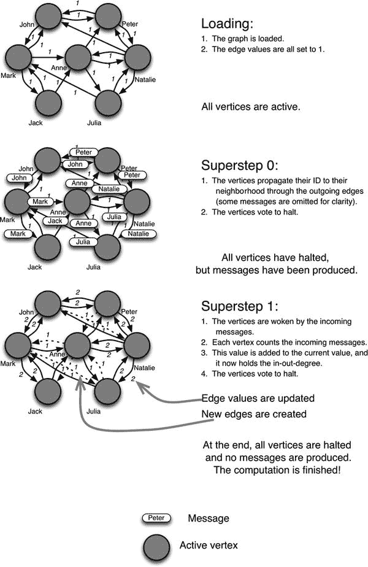

图 3-17. 在 Giraph 中将图转换为带权逻辑无向图的计算过程

你已经看到了如何使用 Giraph API 编写迭代图算法，以及分布式引擎如何跨多个处理单元执行该算法。在本章结束之前，让我们打开 Giraph 的引擎盖，看一看启发 Giraph 的计算模型。

## 理解批量同步并行模型

本节将探讨启发 Giraph 的模型。作为 Giraph 用户，你会在 API 中看到许多借用于 BSP 模型的术语，例如超步和同步屏障。作为 Giraph 开发者，如果你需要扩展 Giraph，其内部包含许多对 BSP 模型的引用，你需要更好地理解底层计算模型是如何工作的。本节将教你 Giraph 在引擎盖下的工作原理，但请记住，在编写 Giraph 程序时，你无需以 BSP 术语来思考。这些概念已被 Giraph 模型借用或隐藏，因此你可以仅使用目前学到的概念来编写 Giraph 程序。

想象一下，你有一个包含 20 个正整数的列表，想要找出最大值。在单机环境下，这需要遍历整个列表，将当前最大值保存在一个变量中，并与列表中的每个元素逐一比较。计算结束时，该变量将包含列表中的最大值。

使用十台机器，你能并行化这个计算吗？答案是肯定的。你将每个数字分配给一台机器，让每台机器找出分配给它的最大值。此时需要解决的问题是，如何比较分配给这 10 台机器的 20 个值，以找出所有机器中的最大值（当然也必须并行进行）。此外，你希望避免每台机器都将其值发送给所有其他机器。为此，你可以将计算组织成一棵树：

-   机器 1 将其值发送给机器 0，机器 0 比较两个值并保存最大值。机器 3 将其值发送给机器 2，机器 2 比较两个值并保存最大值，依此类推。请注意，此步骤是并行发生的。现在，你有五台机器持有需要进一步比较的五个值。

-   同样，你层次化地组织这个过程。因此，机器 2 将其值发送给机器 0，机器 0 比较两个值并选出最大值；机器 6 将其值发送给机器 4，机器 4 比较结果并选出最大值；而机器 8（是单独的）也将其值发送给机器 4（本轮显然必须比较三个值）。

-   最后一步：机器 4 将其值发送给机器 0，机器 0 比较剩下的两个值并选出全局最大值。

图 3-18 展示了这一计算过程。

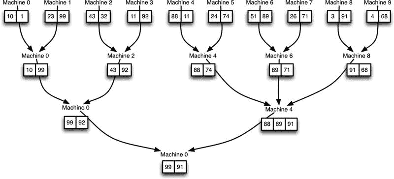

**图 3-18.** 跨十台机器的并行`MaxValue`计算的组织方式

这是一种层次化组织计算以并行解决问题的方法。并非所有问题都需要层次化组织，因此在第一步之后所有机器都会处于忙碌状态，但这个例子已经足够清晰地说明了目的。其他算法会让每台计算机计算子问题的一部分，并将结果传递给其他机器。BSP模型将这些方法概括到一个抽象机器中，用于计算并行算法。

根据BSP模型，你有`n`个处理单元，它们可以通过网络或总线等媒介进行通信。你将输入划分到各个处理单元，并让每个处理单元本地计算其子问题的中间解。当处理单元计算完成后，它们根据算法的语义交换中间结果。当某个处理单元完成其子问题的计算并发送中间结果后，它会等待其他处理单元也完成。当所有处理单元都完成后，它们将基于之前计算的状态和接收到的消息，开始下一轮迭代，计算各自的子问题。每一轮迭代被称为一个超步（`superstep`），而等待阶段被称为同步屏障（`synchronization barrier`）。在`Giraph`中，许多概念都借鉴自`BSP`模型。图3-19展示了`BSP`模型的概念组织。

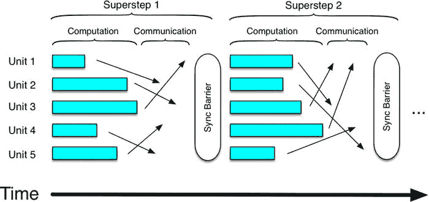

**图 3-19.** 一个`BSP`计算在五个处理单元上的组织方式

到目前为止，你应该已经注意到本章介绍的`BSP`模型与`Giraph`模型之间的匹配关系。图被分割到各个处理单元上，而在通信阶段交换的中间结果是由分配的顶点产生的消息。每个处理单元在内存中维护其本地状态，该状态由分配的顶点（包含其值）以及待处理的消息表示。图3-20展示了`BSP`模型与`Giraph`模型之间的映射关系。

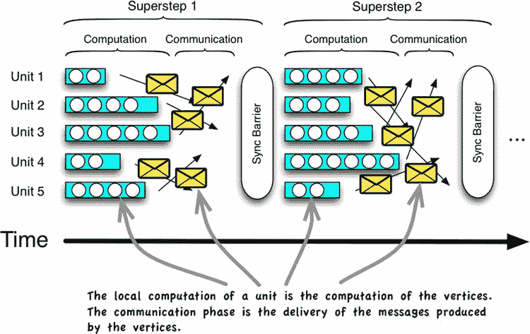

**图 3-20.** `BSP`模型到`Giraph`的映射

如前所述，在设计图算法时，不必考虑`BSP`机器。`Giraph`建立在它之上，因此你可以忽略底层的抽象。尽管如此，理解这一点仍然有助于你理解`Giraph`是如何为在并行、分布式系统中执行的迭代计算而设计的。

## 总结

设计和执行图算法以及一个能够大规模处理它们的系统是困难的。`Giraph`提供了一种直观的编程范式，简化了编写可扩展图算法的过程，并隐藏了并行、分布式系统的复杂性。在本章中，你学习了以下内容：

*   在图算法中，每个顶点的计算通常依赖于附近顶点的计算。因此，图算法通常是迭代的。
*   一个用于处理图算法的平台必须支持快速的迭代计算，并可能隐藏分布式、并发编程的复杂性。
*   `Giraph`提供了一个简单的以顶点为中心的API，要求你“像顶点一样思考”，该顶点可以与其他顶点交换消息。
*   你可以组合消息，以最小化超步之间传输的消息数量。
*   你可以使用聚合器来计算图顶点值的聚合函数。在`Giraph`中，聚合器的扩展性非常好。
*   计算顶点度以及将有向图转换为无向图，在`Giraph`中仅需几行代码。
*   整体同步并行模型定义了在多个处理单元上执行的并行计算。`Giraph`建立在此抽象之上。

你已经了解了如何将`Giraph`集成到系统架构中以及如何对`Giraph`进行编程。现在，你已经准备好查看更多的算法示例以及如何在`Giraph`中实现它们。下一章将专门介绍如何使用`Giraph`编程模型编写可扩展的图算法；为此，它将展示第2章中部分算法的实现。