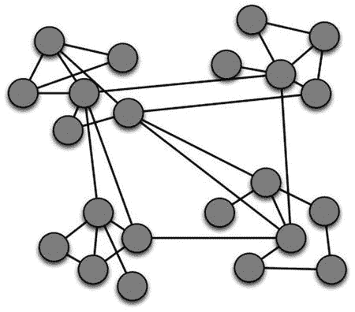

# 排版后的内容

一个网格中 60% 的边按照优先连接机制进行了重连

这些示例展示了图拓扑结构与度分布、聚类系数和平均路径长度之间的关系。你还了解了枢纽节点及其影响这些指标的方式。现在，让我们来看最后一种重要的图类型。在过去十年中，对现实世界网络的研究表明，许多网络都具有小世界属性（这反过来也使它们成为小世界网络或小世界图）。社交图往往具有此类属性。想想你的朋友网络：你的朋友通常住在你所在的地区（也可能是你成长的地方），而且这些朋友中的许多人彼此之间也是朋友。毕竟，人们往往会是许多社群的成员。这意味着社交网络往往具有较高的聚类系数。这种具有局部特性的网络往往具有较大的平均路径长度。然而，你可能也有一些住在远方、属于完全不同社群的朋友。例如，你或许有个朋友在日本，这让你与许多日本人之间只隔了少数几步。这些特定的友谊就像重连网格中的桥梁，显著降低了平均路径长度。最后，有些人的朋友网络比一般人要大得多，这也许是因为他们经常旅行，或者由于他们的工作原因。这意味着社交网络也存在枢纽节点。总结一下，小世界网络往往具有较高的聚类系数、较小的平均路径长度以及幂律度分布。米尔格拉姆之所以能在像美国人口这样的大型社交网络中发现如此小的平均路径长度，正是得益于小世界属性。最近在 Facebook 社交图上进行的同类实验显示，其平均路径长度仅为四到七步！图 4-19 展示了一个具有小世界属性的图。

图 4-19. 一个具有小世界属性的图

为了设计、构建和掌握图应用，你需要更好地理解你的图。如果你要构建像 Twitter 这样的社交网络，你会对信息（推文）在关注者网络中的传播方式感兴趣。在一个平均路径长度较低的社交网络中，你只需要少数几次转发就能触及图的远端区域。此外，具有高聚类系数的图会增加信息传播到起始社群大部分成员的可能性。

图拓扑结构还有许多其他方面，例如图在遭受攻击或故障时的鲁棒性等；但网络科学所涵盖的领域远比本书所能呈现的要广泛。不过，借助本章提供的工具，你应该已经准备好踏上更好地理解和掌控图数据的旅程了。

## 总结

将数据建模为图是使用 `Giraph` 的第一步。下一步是设计一个能够处理该数据的算法：

*   在 `Giraph` 中，算法建立在信息传播原则之上，计算状态分布在顶点值中，顶点之间通过消息共享状态。
*   路径是连接顶点的边的序列。`SSSP` 是一种计算源顶点与所有其他可达顶点之间距离的算法，它自然地符合 `Giraph` 模型。
*   路径可用于定义连通分量，即图中每个顶点都能到达其他任何顶点的子图。连通分量可用于研究信息在图中的传播方式。
*   某些顶点比其他顶点更重要，识别它们是有用的。`PageRank` 是一种允许你根据顶点在图中的重要程度对其进行排名的算法。
*   如果你将用户、物品及其评分建模为一个图，就可以通过随机梯度下降（`SGD`）算法为用户计算关于新物品的推荐。
*   图，尤其是社交网络，可以通过社区（或簇）来刻画其特征，在这些社区中，顶点之间紧密相连。标签传播允许你识别这些社区，并为每个顶点标记其所属的社区。
*   不同类型的图，无论它们代表什么数据，都具有特定的拓扑属性特征。通过使用一些度量指标和部分图算法来计算它们，你可以找出图的类型。

`Giraph` 提供了一个编程 API，帮助开发者设计可扩展的图算法。现在，你已经准备好深入研究 `Giraph` Java API，在 Hadoop 集群上实现并运行图算法了。

脚注 1

`BFS` 是一种遍历图的策略，可用于计算最短路径，也可用于其他操作。还有其他一些算法可用于计算最短路径。

