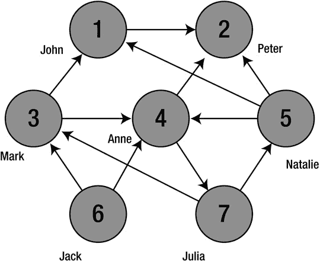
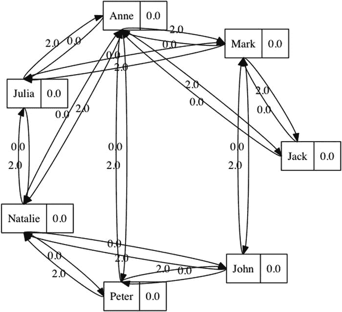

# 5. 使用 Giraph

前几章介绍了通用的 Giraph 编程模型，并讨论了一些易于建模为图处理应用的常见用例。本章涵盖开发 Giraph 应用的实践方面，重点介绍如何在 Hadoop 上运行 Giraph。

编写 Giraph 应用本质上就是将自定义图处理逻辑插入 Giraph 框架。这通过为接口和抽象类提供自定义实现来完成，这些实现后续由 Giraph BSP 机制编排。在本章中，你将学习如何通过扩展基本抽象类 `BasicComputation` 并提供 `compute` 函数的自定义实现来快速构建图处理应用。这是构建图处理应用所需的最少代码量，许多实用的 Giraph 应用也正是如此实现的；然而，更复杂的应用会选择使用 Giraph 框架的各种组件，本章将详细探讨这些组件。

接着，你将了解通过将 Giraph 应用作为 MapReduce 作业提交到 Hadoop 来执行它所需的条件。由于 Giraph 框架是在 Hadoop 之上实现的，图处理算法无需关心它们是在单个节点上运行，还是在数万个节点的集群上运行。执行 Giraph 应用的过程保持不变。

本章其余部分将聚焦于通过 Hadoop 的本地作业运行器在单节点上执行。由于本地作业运行器在单个 Java 虚拟机（JVM）中执行作业，其优势在于极易与常见的 IDE 和调试工具配合使用（唯一的缺点是你无法使用完整数据集——必须在图数据的一小部分样本上运行）。一旦你对本地运行的实现感到满意，你可以选择直接部署到完全分布式的 Hadoop 集群，或者采取中间步骤，在伪分布式 Hadoop 集群上运行。伪分布式集群让用户有机会体验 Hadoop 机制的所有细节，同时仍在单台主机上运行（它们在不同的 JVM 中运行，通过回环网络接口通信）。无论哪种方式，好消息是你无需更改实现中的任何内容——只需使用不同的配置文件集。如果你想了解更多关于 Hadoop 的各种选项，请直接前往附录 A，然后返回本章。

与传统图数据库不同，Giraph 在将非结构化数据转化为图关系方面表现出色。本章将探讨如何通过输入输出格式实现这种灵活性，以及如何直接使用内置实现或扩展它们，让 Giraph 从任何数据源读取数据并将其存入任意类型的数据接收端。

最后，你将了解 Giraph API 的一些更高级的用例，例如消息组合器、主计算和聚合器。在一章中涵盖如此多的基础设施内容——系好安全带，准备出发吧！

## Giraph 中的 “Hello World”

遵循布莱恩·克尼汉（Brian Kernighan）及其贝尔实验室 C 语言黑客同行们所开创的古老传统，你的第一个 Giraph 应用是 “Hello World”：尽可能简单的实现，输出几条文本消息。经典的 “Hello World” 与图处理的 “Hello World” Giraph 应用之间一个显著区别是需要输入数据。没有给定的图定义，你的 Giraph 应用就无法运行；毕竟，Giraph 是一个图处理框架。

在本章剩余部分，你将使用第 3 章中看到的 Twitter 关注关系图（以及计算入度/出度的伪代码示例）。不过在本节中，你将从更简单的、作用于该图的代码开始。它所做的只是为每个顶点（在此例中为人）打印一条 “Hello World” 消息，并输出该顶点所连接的邻居（该人关注的对象）。为了使代码尽可能简单，它使用数字而不是人名。输出最终将如下所示：

`Hello world from the 5 who is following: 1 2 4`

你看到的所有输出都基于图 5-1。这是一个展示 Twitter 上谁关注谁的关注关系图。观察节点 #5。指向节点 1、2 和 4 的箭头表示用户 #5 关注了另外三个用户。


图 5-1. Twitter 关注关系有向图

### 定义 Twitter 关注关系图

你的 Giraph 应用能够识别的、图 5-1 最简单的文本表示形式是清单 5-1 中所示的 ASCII 文件。它编码了每个顶点的邻接列表，输入文件中的每一行格式如下：`顶点 邻居 1 邻居 2...`。

清单 5-1. `src/main/resources/1/graph.txt` 的内容

```
1 2
2
3 1 4
4 2 7
5 1 2 4
6 3 4
7 3 5
```

如果你熟悉如何向 Hadoop MapReduce 作业提供输入数据，你会发现 Giraph 采用相同的方法：Giraph 应用处理给定子目录（本例中为 `src/main/resources/1`）中的所有文件，并将它们视为同一图定义的一部分。你可以将定义给定顶点拓扑的每一行放入单独的文件，或将它们分组到多个文件中，都能达到相同效果。例如，清单 5-2 和 5-3 中由两个文件组成的输入，被认为与清单 5-1 中的输入完全相同。

清单 5-2. `src/main/resources/1.1/1.txt` 的内容

```
1 2
7 3 5
```

清单 5-3. `src/main/resources/1.1/2.txt` 的内容

```
2
3 1 4
4 2 7
5 1 2 4
6 3 4
```

## 创建你的第一个图应用

有了输入数据后，我们现在来编写你的第一个“Hello World”Giraph 应用的 Java 实现（`GiraphHelloWorld.java`，如清单 5-4 所示）。请记住，你的目标是打印出与图中顶点数量相等的行数，每行内容为“Hello world from the X who is following: Y Z...”。

清单 5-4. `GiraphHelloWorld.java`

```java
import org.apache.giraph.edge.Edge;
import org.apache.giraph.GiraphRunner;
import org.apache.giraph.graph.BasicComputation;
import org.apache.giraph.graph.Vertex;
import org.apache.hadoop.io.IntWritable;
import org.apache.hadoop.io.NullWritable;
import org.apache.hadoop.util.ToolRunner;

// Giraph 应用是自定义类，通常使用 BasicComputation 类作为默认基类……
// 但 compute 方法必须由用户自行定义

public class GiraphHelloWorld extends
    BasicComputation<IntWritable, IntWritable,
                     NullWritable, NullWritable> {

    @Override
    public void compute(Vertex<IntWritable,
                               IntWritable, NullWritable> vertex,
                        Iterable<NullWritable> messages) {
        System.out.print("Hello world from the: " +
                         vertex.getId().toString() + " who is following:");

        // 遍历顶点的邻居
        for (Edge<IntWritable, NullWritable> e : vertex.getEdges()) {
            System.out.print(" " + e.getTargetVertexId());
        }
        System.out.println("");

        // 标记当前顶点的 BSP 计算结束
        vertex.voteToHalt();
    }

    public static void main(String[] args) throws Exception {
        System.exit(ToolRunner.run(new GiraphRunner(), args));
    }
}
```

# Giraph 示例详解

即使在这个简单的示例中，也包含了不少内容。首先，你扩展了一个用于在 Giraph 的 BSP 模型实现中进行计算的基本抽象类：`BasicComputation`。你立即需要指定四个类型参数，告诉 Giraph 如何建模图。回想一下，Giraph 框架通过一个分布式数据结构来建模每个图，该数据结构由以下参数化：每个顶点的类型（`VertexID`）、每个顶点关联的标签类型（`VertexData`）、每条边关联的标签类型（`EdgeData`），以及 BSP 框架将在网络上通信的消息类型（`MessageData`）。即使在这个简单的示例中，你也需要根据输入图的表示方式（顶点使用整数 ID，无边标签）对这四种类型做出选择。因此，你需要选择的类型参数是：`VertexID` 和 `VertexData` 使用 `IntWritable`，`EdgeData` 和 `MessageData` 使用 `NullWritable`。再次强调，这些选择是由你所采用的简单输入数据格式预先确定的；它们还必须与在向 Hadoop 提交计算作业时（如后面的清单 5-8 所示）给予 Giraph 命令行执行器的顶点输入格式的实际实现兼容。最后，这些选择意味着 `GiraphHelloWorld` 实现的其余部分期望能够访问图的拓扑结构，即每个顶点都有一个 `Integer` ID 和一个连接到其他 `Integer` ID 的边列表；但它不期望边关联任何标签，最重要的是，它不会在图中的顶点之间发送消息（`NullWritable` 表示没有数据）。

## Giraph 编程的“四大金刚”

在整个 Giraph 中，你会看到以下四元组类型变量被用于各种泛型：

- `VertexID` 是一种可用于引用每个顶点的类型。
- `VertexData` 是附加到每个顶点的标签类型。
- `EdgeData` 是附加到每条边的标签类型。
- `MessageData` 是可以在两个顶点之间发送的消息类型。

所有这四种类型都需要扩展 Hadoop 序列化框架的一个基本构建块，即 `Writable` 接口。除此之外，由于表示顶点的对象必须在集群的不同节点之间进行分区，`VertexID` 有更严格的保证，需要扩展 `WritableComparable` 接口。重用 Hadoop 的对象序列化方法意味着 Giraph 可以使用大量通用代码。另外，考虑到位于集群不同节点上的顶点之间传递消息是 BSP 框架的关键特性之一，你使用的类型在序列化和反序列化时必须非常高效。换句话说，它们需要针对网络流量进行优化。幸运的是，Hadoop 通过创建自己基于 `Writable` 接口的序列化和反序列化方法，解决了其 MapReduce 框架中的同样问题。在任何 Giraph 应用中，你都可以使用 Hadoop 提供的、实现了 `Writable` 接口的大量类，这些类映射了 Java 应用可能需要的所有常见数据类型（`boolean`、`int`、`Array`、`Map` 等）。

Giraph 要求你在一个名为 `compute()` 的方法中实现所有计算，该方法会为每个顶点调用（至少最初调用一次，之后只要有该顶点的消息就会继续调用）。由于你扩展的是一个抽象类，你必须为 `compute()` 提供定义。本示例打印一条消息，其中包含一个顶点 ID，后跟该顶点所有邻居 ID 的列表。邻居是通过遍历所有边并查找每条边目标顶点的 ID 来确定的。最后，你调用 `voteToHalt()`，从而标记给定顶点的计算结束。当所有顶点都调用此方法时，就标志着当前 BSP 计算迭代的结束（并且，除非还有消息未处理，这也标志着整个 Giraph 应用运行的结束）。

最后，如果你想知道为什么定义了 `main()` 方法，那并非必需，但在你想手动执行示例而不必调用 `giraph` 命令行执行器时，这会很方便。第 12 章中给出了一个这样的示例，当时你在亚马逊云上运行 Giraph 应用。

## 项目构建

`GiraphHelloWorld` 的 Java 实现就绪后，剩下的唯一一项管理工作就是创建一个项目（Maven 或 Ant），以帮助引入正确的依赖项并编译该示例。如果你决定使用 Maven，清单 5-5 显示了你的项目的 Maven `pom.xml` 文件应该是什么样子。请注意，唯一需要的依赖项是 `giraph-core` 和 `hadoop-core`。

清单 5-5. Maven 项目对象模型定义：`pom.xml`

```xml
<?xml version="1.0" encoding="UTF-8"?>
<project>
    <modelVersion>4.0.0</modelVersion>
    <groupId>giraph</groupId>
    <artifactId>book-examples</artifactId>
    <version>1.0.0</version>
    <dependencies>
        <dependency>
            <groupId>org.apache.giraph</groupId>
            <artifactId>giraph-core</artifactId>
            <version>1.1.0</version>
        </dependency>
        <dependency>
            <groupId>org.apache.hadoop</groupId>
            <artifactId>hadoop-core</artifactId>
            <version>1.2.1</version>
        </dependency>
    </dependencies>
    <build>
    </build>
</project>
```

此时，请确保 `pom.xml` 位于源代码树的顶层，而 Java 实现位于 `src/main/java` 目录下。这样，你就可以通过执行清单 5-6 所示的命令轻松构建项目。

清单 5-6. 构建 `HelloWorld` 项目

```bash
$ mvn package
```

一旦 Maven 完成构建，你应该会在 `target` 子目录下看到生成的 jar 文件。下一节将解释如何使用这个 jar 来执行 `GiraphHelloWorld` 应用。

## 启动你的应用

要运行该示例，你只需要额外安装 Hadoop 和 Giraph 的独立版本（附录 A 提供了两者的详细安装说明）。安装完毕后，更新你的 Shell 环境。如果你使用的是 bash Shell，代码清单 5-7 即可完成设置（如果使用其他 Shell，请务必查阅其关于如何导出环境变量的文档）。

代码清单 5-7：为 Giraph 执行定义 Shell 环境

```
$ export HADOOP_HOME=<Hadoop 安装目录的根路径>
$ export GIRAPH_HOME=<Giraph 安装目录的根路径>
$ export HADOOP_CONF_DIR=$GIRAPH_HOME/conf
$ PATH=$HADOOP_HOME/bin:$GIRAPH_HOME/bin:$PATH
```

只要你在当前 Shell 会话中保留了上述环境变量，就可以使用 Hadoop 的本地执行模式来运行示例 Giraph 应用，如代码清单 5-8 所示。请注意，执行 Giraph 应用时，命令行会相当长。为了在书页中完整显示，我们将这条命令用反斜杠（`\`）字符拆成了多行。在终端窗口中输入此命令时，你可以采用同样的方式（确保反斜杠是每行的最后一个字符），或者将其作为单行输入。

代码清单 5-8：运行 Giraph 应用

```
$ giraph target/*.jar GiraphHelloWorld -vip src/main/resources/1         \
-vif org.apache.giraph.io.formats.IntIntNullTextInputFormat            \
-w 1 -ca giraph.SplitMasterWorker=false,giraph.logLevel=error
...
Hello world from 2 who is following:
Hello world from 1 who is following: 2
Hello world from 3 who is following: 1 4
Hello world from 4 who is following: 2 7
Hello world from 5 who is following: 1 2 4
Hello world from 6 who is following: 3 4
Hello world from 7 who is following: 3 5
```

# 恭喜！你已经开发并执行了第一个 Giraph 应用。

诚然，它相当简单，而且输出可以通过打印人名而非数字 ID 来优化（下一节将处理这个问题），但这毕竟是一个只需几十行代码就能独立运行的 Giraph 应用。顺便提一下，如果你看到的输出行顺序与代码清单 5-8 略有不同，不必惊讶：Giraph 中顶点的处理顺序是非确定性的，当然，所有顶点最终都会被处理。

## 让我们再审视一遍代码清单 5-8

逐一了解命令行的各个组成部分。第一个参数（`target/*.jar`）指定了包含图处理“Hello World”应用实现的 JAR 文件位置。第二个参数（`GiraphHelloWorld`）指定了包含 `compute` 方法的类名，该方法将应用于图中的所有顶点。第三个参数（`-vip`）指定了图数据的输入路径。第四个参数（`-vif org.apache.giraph.io.formats.IntIntNullTextInputFormat`）告诉 Giraph 实现使用哪种输入格式来解析图数据。第五个参数（`-w 1`）让 Giraph 仅使用一个工作节点来处理示例图中的所有顶点（因为你并非在集群上运行，所以只能使用一个工作节点）。最后，命令行最后一个参数（`-ca giraph.SplitMasterWorker=false,giraph.logLevel=error`）调整了 Giraph 实现的一些内部参数，以允许使用单个工作节点执行，并将日志输出级别降低为仅显示错误。

虽然使用 `-ca` 命令行选项在运行时配置 Giraph 应用执行很有用，但更实际的做法是将任何可复用的配置放入 XML 配置文件中。任何熟悉 Hadoop 配置 API 的人都会发现 Giraph 的配置与之非常相似（在内部，Giraph 只是复用了 Hadoop 的配置 API 实现）。例如，要为本地 Hadoop 执行环境创建永久的 Giraph 配置，你可以将代码清单 5-9 所示的配置放入 `$GIRAPH_HOME/conf` 文件夹下的 `giraph-site.xml` 配置文件中（有关如何安装和配置 Giraph 的更多信息，请参见附录 A）。

### 代码清单 5-9：Giraph 配置

```
<configuration>
<property>
<name>giraph.SplitMasterWorker</name>
<value>false</value>
</property>
<property>
<name>giraph.logLevel</name>
<value>error</value>
</property>
</configuration>
```

有了这个配置，你在执行 Giraph 应用时就不再需要提供命令行选项中的最后一行了。

> **注意**：请记住，你在静态配置文件中设置的所有内容都将应用于所有 `giraph` 运行，因此跟踪其中定义的属性非常重要。

## 使用更自然的 Twitter 关注关系图定义

如前所述，示例应用的一个小问题是其输出的消息描述性不够强。如果图 5-2 中每个顶点旁显示的不是数字标识符，而是人物的原始姓名，效果是否会更好呢？


### 图 5-2. Twitter 关注关系有向图

即使图本身的定义，如清单 5-10 所示，看起来也更加自然（该定义使用虚拟的 0 作为顶点和边标签的值，因为目前你并不关心这些值）。

### 清单 5-10. 存储在`src/main/resources/2/g.txt`中的更自然的 Twitter 关注关系图定义

```
John 0 Peter 0
Peter 0
Mark 0 John 0 Anne 0
Anne 0 Peter 0 Julia 0
Natalie 0 John 0 Peter 0 Anne 0
Jack 0 Mark 0 Anne 0
Julia 0 Mark 0 Natalie 0
```

图的定义现在看起来更完整了，但格式仍有几个令人头疼的限制。所有内容必须由单个制表符（`\t`）分隔（空格无效），并且即使从未使用过，也必须为顶点和边标签值指定虚拟的 0。如果能有一种更灵活的格式就好了；但信不信由你，Giraph 默认并不支持这种格式。你必须等到第 8 章才能了解如何扩展 I/O 格式的内置实现，使其符合自己的偏好。目前，这些烦人的 0 仍将保留，因为`TextDoubleDoubleAdjacencyListVertexInputFormat`期待这种格式。

虽然很自然地会认为此时你可以直接将这个新的图定义提供给现有的 Giraph 应用，但你将顶点表示从整数改为字符串这一事实，要求你必须修改`compute()`方法及其所在类中使用的类型变量。对`GiraphHelloWorld`的修改很简单；新的实现如清单 5-11 所示。请注意，你使用了 Hadoop 的`Text`类型来表示字符串。这与之前关于使用 Hadoop 类型以方便 I/O 管理的建议是一致的。

### 清单 5-11. `GiraphHelloWorld2.java`

```
import org.apache.giraph.edge.Edge;
import org.apache.giraph.GiraphRunner;
import org.apache.giraph.graph.BasicComputation;
import org.apache.giraph.graph.Vertex;
import org.apache.hadoop.io.DoubleWritable;
import org.apache.hadoop.io.Text;
import org.apache.hadoop.io.NullWritable;
import org.apache.hadoop.util.ToolRunner;

public class GiraphHelloWorld2 extends
    // 注意：类型变量已更改，以匹配新的输入
    BasicComputation<Text, DoubleWritable, DoubleWritable, NullWritable> {

  @Override
  public void compute(Vertex<Text, DoubleWritable, DoubleWritable> vertex,
      Iterable<NullWritable> messages) {
    System.out.print("Hello world from the: " +
        vertex.getId().toString() + " who is following:");
    for (Edge<Text, DoubleWritable> e : vertex.getEdges()) {
      System.out.print(" " + e.getTargetVertexId());
    }
    System.out.println("");
    vertex.voteToHalt();
  }
}
```

使用前述源代码重新构建 jar 文件后，不要忘记在命令行中指定新的`InputFormat`，如清单 5-12 所示。

### 清单 5-12. 使用不同的`InputFormat`运行 Giraph 应用

```
$ giraph target/*.jar GiraphHelloWorld2  -vip src/main/resources/2 -vif           \
    org.apache.giraph.io.formats.TextDoubleDoubleAdjacencyListVertexInputFormat    \
    -w 1 -ca giraph.SplitMasterWorker=false,giraph.logLevel=error

Hello world from Julia who is following: Mark Natalie
Hello world from Natalie who is following: John Peter Anne
Hello world from Jack who is following: Mark Anne
Hello world from Anne who is following: Peter Julia
Hello world from Peter who is following:
Hello world from Mark who is following: John Anne
Hello world from John who is following: Peter
```

如你所见，在输入格式之间切换非常容易。你只需更新 Java 实现中的类型变量，并在命令行的第四个参数中指定不同的输入格式（`org.apache.giraph.io.formats.TextDoubleDoubleAdjacencyListVertexInputFormat`）。命令行的其余部分与清单 5-8 完全相同。

既然你已经了解了 Giraph 应用的基础，接下来我们将探讨更复杂的图处理算法如何预期使用 Giraph API。

### 统计 Twitter 连接数

现在，你应该已经熟悉了 Giraph 框架的基础知识。是时候更进一步，实现更多应用程序了。在本节中，你将把第 3 章中的伪代码示例转化为实际的 Java 代码，这些代码可以像执行“Hello World”Giraph 应用程序一样在 Giraph 上运行。第一个示例是统计 Twitter 上的关注关系，如代码清单 5-13 所示。

**代码清单 5-13.** `TwitterConnections.java`

```
import org.apache.giraph.GiraphRunner;
import org.apache.giraph.graph.BasicComputation;
import org.apache.giraph.graph.Vertex;
import org.apache.hadoop.io.DoubleWritable;
import org.apache.hadoop.util.ToolRunner;
import org.apache.hadoop.io.Text;

public class TwitterConnections extends

// 注意最后一个类型变量不再是 NullWritable。
// 这是因为我们将向顶点的邻居发送 Text 消息，
// 作为通知目标顶点我们与它们相连的一种方式。

BasicComputation<Text, DoubleWritable, DoubleWritable, Text> {

    @Override
    public void compute(Vertex<Text, DoubleWritable, DoubleWritable> vertex,
                        Iterable<Text> messages) {

        if (getSuperstep() == 0) {
            // 这表示我们正处于 BSP 的第一个超级步，
            // 是时候发送将在下一个超级步（else 分支）中处理的消息了
            vertex.setValue(new DoubleWritable(vertex.getNumEdges()));
            sendMessageToAllEdges(vertex, new Text());
        } else {
            int inDegree = 0;
            for (Text m : messages) {
                inDegree++;
            }
            vertex.setValue(new DoubleWritable(vertex.getValue().get() +
                    inDegree));
        }
        vertex.voteToHalt();
    }
}
```

上述算法的总体思路是使用空消息作为一种方式，通知接收消息的顶点存在一个连接（回想一下，Giraph 并不存储连接到某个给定顶点的所有顶点的集合）。你在 BSP 计算的第一个超级步（`getSuperstep()` 返回 0）中发送消息。由于有待处理的消息，`compute()` 方法会在下一个超级步再次被调用。你通过统计这些消息（在上一个超级步中发送的）的数量，并将总和赋给每个顶点的标签，从而处理它们。这就是你如何为每个顶点得出 `inDegree` 值的方法。

阅读代码后自然会问，如果代码没有产生任何输出，你到底该如何找出每个顶点的最终 `inDegree`？答案在于 Giraph 中与输入格式互补的设施：输出格式。输出格式正是这样一种方式：Giraph 在运行完成后，可以转储图的拓扑结构和所有标签。使用输出格式很简单，只需指定两个命令行选项：`-vof` 用于请求特定的实现，`-op` 用于指定输出子目录。代码清单 5-14 展示了指定输出格式所需的命令行，该输出格式与代码清单 5-12 中使用的输入格式完全相同。请注意，你首先做的是删除输出子目录；这是因为 Giraph 期望请求的子目录不存在。还要注意，最后一条命令会输出所有文件的内容，Giraph 的输出格式可能将结果图分割到这些文件中。对于大型图，这可能会有不少名为 `part-XXX` 的单独文件。最后，尽管在本地模式下运行 Hadoop 会在本地文件系统中产生输出，但通常最后一条命令会基于调用 Hadoop 的文件系统工具，正如你在下一节中看到的。

**代码清单 5-14.** 使用 `OutputFormat` 运行 `TwitterConnections` 示例

```
$ rm -rf output
$ giraph target/*.jar  TwitterConnections  -op output   \
    -vof org.apache.giraph.io.formats.AdjacencyListTextVertexOutputFormat \
    -vip src/main/resources/2    \
    -vif \
    org.apache.giraph.io.formats.TextDoubleDoubleAdjacencyListVertexInputFormat \
    -w 1 -ca giraph.SplitMasterWorker=false,giraph.logLevel=error
$ cat output/part*
Julia    3.0    Mark    0.0    Natalie  0.0
Natalie  4.0    John    0.0    Peter    0.0    Anne    0.0
Jack     2.0    Mark    0.0    Anne     0.0
Anne     5.0    Peter   0.0    Julia    0.0
Peter    3.0
Mark     4.0    John    0.0    Anne     0.0
John     3.0    Peter   0.0
```

让我们回顾一下你目前所学到的内容。每个 Giraph 应用程序都从一组输入文件中读取图定义开始。这些数据描述了初始的图拓扑结构，并由通过 `Edge` 对象连接的 `Vertex` 对象组成。Giraph 应用程序以分布式方式运行，迭代处理一组 `Vertex` 对象，并调用用户定义的计算类中提供的 `compute()` 方法。实现 `Computation` 接口是自定义计算类的唯一要求。不过在实践中，大多数应用程序会继承两个抽象类之一：`AbstractComputation` 或 `BasicComputation`。后者是前者的一个稍有限制性的形式。所有必需顶点的 `compute()` 方法在一系列超级步中执行。当所有顶点都调用 `voteToHalt()` 时，一个超级步结束。超级步从 0 开始编号，并且始终可以通过调用 `getSuperstep()` 来请求当前超级步的编号。“Hello World”示例正好包含一个超级步：超级步 0。当前示例在两个超级步中运行；大多数实际的 Giraph 应用程序会遍历可变数量的超级步，作为算法收敛过程的一部分。最后，`compute()` 可以选择在其 `Vertex` 对象上调用 `voteToHalt()`，表明除非在下一个超级步中有新消息传递给该顶点，否则它希望不再被调用。整个 Giraph 应用程序在其所有顶点都已停止且没有任何待处理消息时结束。此时，如果用户请求将图的整个状态刷新到存储中，输出格式就会接管，并确保数据序列化到所需位置下的文件中。

保持输入和输出格式兼容，使得可以将 Giraph 应用程序以任意管道方式串联起来，每个应用程序处理前一个或多个应用程序的输出。Giraph 算法接近 Unix 工具哲学，即一个工具旨在“做好一件事”。表现力并非来自每个工具或算法的复杂性，而是来自于从多个阶段构建任意管道的灵活性，这些阶段都操作在公共数据集上。

有了这个理论背景，让我们转向第 3 章中的第二个示例：将有向图转换为无向图。

## 将 Twitter 变成 Facebook

# 图转换与可视化

从图论角度来看，Facebook 与 Twitter 的最大区别在于方向性。Twitter 的社交图是**有向**的（用户关注他人不代表对方也会关注自己），而 Facebook 的图是**无向**的（你的好友也视你为好友）。在前面的示例中，我们一直使用的是 Twitter 关注关系图。这还有一个额外的好处：能够与 Giraph 的有向图模型保持一一对应。如果你想用 Giraph 建模 Facebook 的关系图，就必须确保顶点之间是双向连接的。

现在，让我们通过运行清单 5-15 中的代码，用 Giraph 将现有的 Twitter 连接图转换为 Facebook 关系图。

**清单 5-15.** `Twitter2Facebook.java`

```java
import org.apache.giraph.GiraphRunner;
import org.apache.giraph.graph.BasicComputation;
import org.apache.giraph.graph.Vertex;
import org.apache.giraph.edge.EdgeFactory;
import org.apache.hadoop.io.DoubleWritable;
import org.apache.hadoop.util.ToolRunner;
import org.apache.hadoop.io.Text;

public class Twitter2Facebook extends
    BasicComputation<Text, DoubleWritable, DoubleWritable, Text> {

    // 以下两个常量分别表示原始边和用于模拟 Facebook 连接关系的新建边
    static final DoubleWritable ORIGINAL_EDGE = new DoubleWritable(1);
    static final DoubleWritable SYNTHETIC_EDGE = new DoubleWritable(2);

    @Override
    public void compute(Vertex<Text, DoubleWritable, DoubleWritable> vertex,
        Iterable<Text> messages) {
        if (getSuperstep() == 0) {
            sendMessageToAllEdges(vertex, vertex.getId());
        } else {
            for (Text m : messages) {
                DoubleWritable edgeValue = vertex.getEdgeValue(m);
                if (edgeValue == null) {
                    vertex.addEdge(EdgeFactory.create(m, SYNTHETIC_EDGE));
                } else {
                    // 对于已有的边，仅标记其类型
                    vertex.setEdgeValue(m, ORIGINAL_EDGE);
                }
            }
        }
        vertex.voteToHalt();
    }
}
```

至此，你可以像运行之前示例那样直接运行这段代码。不过，这样生成的图输出虽然对 Giraph 友好，但对人类读者而言并不直观。因此，我们可以换用一种能直接输入到多种图可视化工具的输出格式。毕竟，一图胜千言。清单 5-16 的运行方式与之前几乎相同，区别仅在于使用了另一种输出格式（`org.apache.giraph.io.formats.GraphvizOutputFormat`）。

**清单 5-16.** 使用可视化友好的输出格式运行 `Twitter2Facebook`

```bash
$ rm -rf output
$ giraph target/*.jar Twitter2Facebook   -op output        \
    -vof org.apache.giraph.io.formats.GraphvizOutputFormat     \
    -vip src/main/resources/2                                  \
    -vif \
org.apache.giraph.io.formats.TextDoubleDoubleAdjacencyListVertexInputFormat \
    -w 1 -ca giraph.SplitMasterWorker=false,giraph.logLevel=error
```

要可视化此命令生成的输出结果，首先需要让 Hadoop 将输出文件的各个部分合并成一个文件。接着，添加 Graphviz 格式所需的文件头和文件尾，最后运行 Graphviz 可视化命令行工具，生成一个可直接查看的图片文件。这四个步骤如清单 5-17 所示，图 5-3 展示了最终生成的图片。



**图 5-3.** 与 Twitter 关注关系图对应的 Facebook 关系图

**清单 5-17.** 可视化 Giraph 的 Graphviz 格式输出

```bash
$ hadoop fs -getmerge output data.txt
$ echo "digraph Giraph {" > giraph.dot
$ cat data.txt            >> giraph.dot
$ echo "}"                >> giraph.dot
$ circo giraph.dot –Tpng -ogiraph.png
```

## Graphviz (DOT)：图可视化的通用语言

Graphviz 是一款开源图可视化软件。Graphviz 及其输入语言 DOT 最初由 AT&T 实验室研发，用于快速可视化任意图数据，现已独立发展壮大。大多数 Unix 平台都提供参考实现，同时也有许多基于 DOT 格式的纯软件可视化工具。如果你的平台没有 DOT 可视化工具（`circo`），也可以将 `giraph.dot` 文件的内容粘贴到在线 Graphviz 工具（例如 [`www.webgraphviz.com`](http://www.webgraphviz.com/)）中，来可视化 Facebook 关系图。

通过图可视化，你可以看到每个顶点对应的顶点值，以及每条边对应的边值。由于本示例未使用顶点值，在图 5-3 中，所有顶点值都显示为 0.0，位于姓名旁边的方框中。而边的标签则根据其类型标注：转换过程中新增的边标记为(2)，图中原本就存在的边标记为(1)。

这是通过添加新边来改变图拓扑结构的第一个示例。下一节将介绍更多动态更改图结构的方法。

## 改变图结构

为图添加新边相当简单，但添加新顶点呢？如何不通过外部数据源读取数据，直接在内存中构建完整的图片段？一个极端的例子是根据特定条件从头生成图。如果你将 Giraph 作业视为一个流水线，生成图可能就是该流水线的第一步。这是复杂图算法仿真和系统测试中的典型方法。下一个示例（见清单 5-18）演示了如何从空图开始生成你的老朋友——Twitter 关注关系图。

**清单 5-18.** `GenerateTwitter.java`

```java
import org.apache.giraph.GiraphRunner;
import org.apache.giraph.graph.BasicComputation;
import org.apache.giraph.graph.Vertex;
import org.apache.giraph.edge.EdgeFactory;
import org.apache.hadoop.io.DoubleWritable;
import org.apache.hadoop.util.ToolRunner;
import org.apache.hadoop.io.Text;
import java.io.IOException;

public class GenerateTwitter extends
    BasicComputation<Text, DoubleWritable, DoubleWritable, Text> {

  // 两个静态数组，定义与清单 5-10 输入数据相同的图结构
  private static final String[] twitterMembers = { "seed",
      "John", "Peter", "Mark", "Anne", "Natalie", "Jack", "Julia" };
  private static final byte[][] twitterFollowership = {{0},
      {2},   {},      {1, 4},  {2, 7}, {1, 2, 4}, {3, 4}, {3, 5}};

  @Override
  public void compute(Vertex<Text, DoubleWritable, DoubleWritable> vertex,
      Iterable<Text> messages) throws IOException {
    if (getSuperstep() == 0) {
      for (int i = 1; i < twitterFollowership.length; i++) {
        Text destVertexID = new Text(twitterMembers[i]);
        addVertexRequest(destVertexID, new DoubleWritable(0));
        for (byte neighbour : twitterFollowership[i]) {
          addEdgeRequest(destVertexID, EdgeFactory.create(
              new Text(twitterMembers[neighbour]),
              new DoubleWritable(0)));
        }
      }
      removeVertexRequest(new Text("seed"));
    } else {
      vertex.voteToHalt();
    }
  }
}
```

运行此示例时，一个非常合乎逻辑的假设是：既然该 Giraph 应用的全部目的就是从头生成图，那么你不应该给 Giraph 提供任何输入文件。更高级的 Giraph 用法支持这样做，但对于这个简单示例，你面临一个小挑战。生成图的代码位于`compute()`方法中，而由于`compute()`方法是为输入图的顶点调用的，实现需求的最简单方式是给 Giraph 提供一个尽可能小的图：一个仅含单个顶点、没有边的图，如清单 5-19 所示。

### 清单 5-19. 仅含单个顶点、没有边的最小图定义（`src/main/resources/3/g.txt`）

```
seed 0
```

有了这个输入文件，你就可以像之前所有示例一样运行 Giraph。让我们用 Graphviz 输出格式运行它（如清单 5-20 所示），这样你可以快速检查可视化后的图，确保代码生成了图 5-2 中的原始图。

### 清单 5-20. 使用 Graphviz 输出格式运行 `GenerateTwitter`

```
$ rm -rf output
$ giraph target/*.jar GenerateTwitter   -op output              \
  -vof org.apache.giraph.io.formats.GraphvizOutputFormat          \
  -vip src/main/resources/3                                       \
  -vif \
  org.apache.giraph.io.formats.TextDoubleDoubleAdjacencyListVertexInputFormat \
  -w 1 -ca giraph.SplitMasterWorker=false,giraph.logLevel=error
```

本例中用于修改图拓扑的两个 Giraph API 调用（`addVertexRequest`和`addEdgeRequest`）属于更广泛的 API 集合，称为图变异 API。这些 API 调用大多以某种方式修改图的整体结构。这些变更可以立即或在下一个超步中对所有计算进程成员可见（这就是为什么示例中你不能立即退出，而必须等待下一个超步）。以下是对实际应用中常用变异 API 方法的总结：

* `setValue()`：修改自身的值。此操作的结果立即（在同一超步内）对整个计算可见。
* `setEdgeValue()`：修改出边的边值。尽管结果也立即对整个计算可见，但此方法的应用有限，因为通常只有源顶点才能访问出边。
* `addEdge()`、`removeEdges()`：通过添加或删除边来修改图的局部拓扑结构，且源顶点保持不变。
* `addVertexRequest()`、`removeVertexRequest()`、`addEdgeRequest()`、`removeEdgesRequest()`：请求从下一个超步开始修改图的全局拓扑结构。

通过使用这些方法，你可以创建与 Giraph 执行开始时可用图结构及拓扑截然不同的图。有趣的是，除了这里介绍的直截了当的图变异方法外，还有一种不那么明显的方法与 Giraph 中的多面手——消息——有关。这正是下一节的主题。

## 发送与合并多条消息

如前所述，Giraph 的消息传递拓扑与图拓扑完全独立。换句话说，每个顶点可以向其他任意顶点发送消息。向不存在的顶点发送消息会创建该顶点。（看到了吗？消息也可以被视为图变异 API 的一部分！）

这正是下一个示例利用的技巧，用于并行构建图拓扑。不同于在单个主机上运行单循环遍历所有顶点及其边，这里采用了两阶段方法。首先通过发送消息创建所有顶点，每条消息包含该新顶点的一个邻居。当顶点被创建并分配到集群的工作节点后，每个顶点开始并行遍历接收到的消息，并创建连接其与邻居的边。清单 5-21 对上一个示例进行了修改，实现了这一功能。

### 清单 5-21. `GenerateTwitterParallel.java`

```
import`org.apache.giraph.GiraphRunner`;
import`org.apache.giraph.graph.BasicComputation`;
import`org.apache.giraph.graph.Vertex`;
import`org.apache.giraph.edge.EdgeFactory`;
import`org.apache.hadoop.io.DoubleWritable`;
import`org.apache.hadoop.util.ToolRunner`;
import`org.apache.hadoop.io.Text`;
import`java.io.IOException`;

public class`GenerateTwitterParallel`extends
    `BasicComputation`<`Text`, `DoubleWritable`, `DoubleWritable`, `IntWritable`> {

  private static final`String`[] twitterMembers = { "",
      "John", "Peter", "Mark", "Anne", "Natalie", "Jack", "Julia" };
  private static final`byte`[][] twitterFollowership = {{0},
      {2},   {},      {1, 4},  {2, 7}, {1, 2, 4}, {3, 4}, {3, 5}};

  @Override
  public void`compute`(`Vertex`<`Text`, `DoubleWritable`, `DoubleWritable`> vertex,
      `Iterable`<`IntWritable`> messages) throws`IOException` {
    if (`getSuperstep`() == 0) {
      for (int i = 1; i < twitterFollowership.length; i++) {
        `Text` destVertexID = new`Text`(twitterMembers[i]);
        for (byte neighbour : twitterFollowership[i]) {
          `sendMessage`(destVertexID, new`IntWritable`(neighbour));
        }
      }
      `removeVertexRequest`(new`Text`("seed"));
    } else {
      for (`IntWritable` m : messages) {
        `Text` neighbour = new`Text`(twitterMembers[m.get()]);
        vertex.addEdge(`EdgeFactory.create`(neighbour,
            new`DoubleWritable`(0)));
      }
      vertex.voteToHalt();
    }
  }
}
```

当然，对于这样一个小图，相同代码的串行版本与并行版本之间的差异微乎其微。但这确实凸显了每个 Giraph 应用需要考虑的一个重要设计点：并行图处理始终受限于无法并行化的串行代码量。这同样被称为`阿姆达尔并行定律`。

最新示例使得图中的边可以并行创建，而非在超步 0 的单循环中创建。这是一项改进，但仍有进一步优化的空间。

考虑到每条边都需要创建一条专属消息，而消息中仅需传递一个整数 ID，开销可能相当高。如果能够将邻居 ID 聚合或合并为单条消息，效率将大幅提升。实现方法之一是改变消息的数据类型为字节数组，另一种方式是使用 Giraph 的组合器（combiner）。

当存在自然的方式将多条消息聚合为一条时，就可以为顶点间发送的消息实现组合器。Giraph 提供了一些有用的默认组合器。例如`SimpleSumMessageCombiner`将单条消息求和为一个；`MinimumIntMessageCombiner`从包含单独整数的消息中找出最小值并创建一条包含该值的消息。然而，下一个示例创建了一个自定义组合器，将所有消息合并为一个位图数组。消息中发送的每个整数值都表示为位图中的一位。例如，如果消息包含整数 3，则从右边数起第三位被设为 1。清单 5-22 展示了`BitArrayCombiner`的代码。

**清单 5-22.** `BitArrayCombiner.java`

```
import org.apache.giraph.combiner.MessageCombiner;
import org.apache.hadoop.io.IntWritable;

public class BitArrayCombiner
    extends MessageCombiner<IntWritable, IntWritable> {

  // 每个组合器的核心是一个方法，定义了如何将新消息合并到总体消息累加器中
  @Override
  public void combine(IntWritable vertexIndex,
                      IntWritable originalMessage,
                      IntWritable messageToCombine) {
    originalMessage.set((1<<messageToCombine.get()) |
        originalMessage.get());
  }

  // 这是一个定义如何创建初始消息累加器的方法
  // 本例中简单创建了一个所有位均为 0（即未看到任何消息）的位图数组
  @Override
  public IntWritable createInitialMessage() {
    return new IntWritable(0);
  }
}
```

通常，组合器非常简洁：只需定义返回初始消息的函数即可。此消息用作`compute()`执行过程中发出的消息的累加器。累加数据的任务由`combine()`方法中定义的代码执行。如你所见，该方法将`originalMessage`视为可变累加器；本例中，它在整数位数组中设置了与邻居整数 ID 对应的位。

组合器虽然有用，但并非透明。首先，必须告诉 Giraph 需要使用组合器。这通常通过将类名传递给`-c`命令行选项实现，就像传递输入格式一样。其次，必须修改上一个示例的代码，以便解包现在作为每条消息负载的位数组。这个问题，加上只能处理少于 32 个顶点（因为 Java 中整数为 32 位）的限制，使得`BitArrayCombiner`有些不太实用，仅作为展示编写组合器多么简单的示例。

说到限制，如果你尝试运行上一个示例，可能注意到实现中存在一个细微的 bug：无法生成零邻居的顶点。减少此类 bug 可能性的常用方法是，结合验证正确性的单元测试来开发代码。本章到目前为止的代码开发没有任何测试或验证，现在是时候做出改变了。

### 对 Giraph 应用进行单元测试

针对任何框架开发复杂应用通常都需要一套单元测试，以确保在代码修改和重构过程中语义不会意外改变。幸运的是，Giraph 应用的**事件驱动**特性使得独立测试各种方法（如`compute()`）的语义变得极其容易。你还可以创建一个微型执行环境来进行完整的应用测试。

如前所述，前面的例子中存在一个细微的问题。考虑到这一点，我们来创建一个单元测试，验证最终生成的图拓扑结构是否确实符合预期；请参阅列表 [5-23]。

**列表 5-23.** `TestGiraphApp.java`
```

```
import org.junit.Test;
import org.junit.Assert;
import org.junit.Ignore;
import org.apache.giraph.conf.GiraphConfiguration;
import org.apache.giraph.io.formats.TextDoubleDoubleAdjacencyListVertexInputFormat;
import org.apache.giraph.io.formats.AdjacencyListTextVertexOutputFormat;
import org.apache.giraph.utils.InternalVertexRunner;

public class TestGiraphApp  {
    final static String[] graphSeed = new String[] { "seed\t0" };
    final static int EXPECTED_VERTICES = 7; // 我们期望最终图中创建的顶点数量

    @Test
    public void testNumberOfVertices() throws Exception {
        `GiraphConfiguration` conf = new `GiraphConfiguration`(); // `GiraphConfiguration` 对象：它将配置我们的测试 `Giraph` 运行，就像我们在所有之前的例子中使用的静态配置文件和命令行选项的组合一样

        conf.setComputationClass(`GenerateTwitterParallel`.class);
        conf.setVertexInputFormatClass(
            `TextDoubleDoubleAdjacencyListVertexInputFormat`.class);
        conf.setVertexOutputFormatClass(
            `AdjacencyListTextVertexOutputFormat`.class);

        // 以下就是我们的测试模拟完整 `Giraph` 应用运行所需的全部内容：`conf` 用于配置模拟，`graphSeed` 是一个用于模拟输入图数据的字符串数组。它返回的结果允许我们遍历模拟输出，以检查关于 `GenerateTwitterParallel` 代码执行完毕后我们期望结果的各种假设。
        `Iterable`<String> results =
            `InternalVertexRunner`.run(conf, graphSeed);

        // 遍历模拟输出是检查结果图结构的方法。在我们的例子中，我们简单地统计模拟输出的行数。
        int totalVertices = 0;
        for (String s: results ) {
            totalVertices++;
        }

        // 我们期望模拟输出中呈现特定数量的行（顶点描述）。
        `Assert`.assertEquals(EXPECTED_VERTICES, totalVertices);
    }
}
```

尽管这个实现只有几行代码，但得益于 `InternalVertexRunner` 的实现，后台发生了许多引人注目的事情。此示例中使用的 `run()` 方法要求你提供 `Giraph` 的配置和一个模拟输入内容的 `String` 数组。调用 `run()` 得到的是一个模拟输出的 `String` 数组，该输出模拟了在应用正常运行时写入文件系统的内容。虽然输入和输出文件是模拟的，但其他所有内容都并非如此。`conf` 对象的构建方式与实际运行应用时完全相同：结合默认设置、`giraph-site.xml` 中的设置以及 `giraph` 命令行指定的设置。如果你不想受命令行语法的约束，可以编写一个 `main()` 方法来显式设置配置值。

运行单元测试很简单，要么将其连接到你的构建系统（`Ant`、`Maven` 或 `Gradle`），要么将其传递给 `JUnit` 执行器。如果你使用 `Maven` 来构建示例，只需将测试用例保存到项目文件树的 `src/test/java/TestGiraphApp.java` 下，并将 `JUnit` 依赖项添加到 `pom.xml` 文件中，如列表 `5-24` 所示。之后，执行 `mvn test` 将为你运行单元测试（`mvn package` 命令也会执行）。

**列表 5-24.** Maven 项目对象模型定义：添加 `JUnit` 依赖项后的 `pom.xml`

```xml
<?xml version="1.0" encoding="UTF-8"?>
<project>
  <modelVersion>4.0.0</modelVersion>
  <groupId>giraph</groupId>
  <artifactId>book-examples</artifactId>
  <version>1.0.0</version>
  <dependencies>
    <dependency>
      <groupId>org.apache.giraph</groupId>
      <artifactId>giraph-core</artifactId>
      <version>1.1.0</version>
    </dependency>
    <dependency>
      <groupId>org.apache.hadoop</groupId>
      <artifactId>hadoop-core</artifactId>
      <version>1.2.1</version>
    </dependency>
    <dependency> <!-- 这是我们添加到原始 pom 文件中的唯一部分 -->
      <groupId>junit</groupId>
      <artifactId>junit</artifactId>
      <version>4.12</version>
    </dependency>
  </dependencies>
  <build>
  </build>
</project>
```

无论哪种方式，断言都会失败，因为生成的图比你预期少了一个顶点。如何让单元测试通过将作为练习留给你；下一节将讨论 `Giraph` 提供的 `BSP` 计算模型扩展这一较为独立的主题。

### 超越单一顶点视角：启用全局计算

到目前为止，你所看到的 `Giraph` 应用都假设不同顶点之间没有共享状态。在给定的两个顶点之间（甚至在给定顶点与一组消息接收者之间）传递数据时，发送消息效果很好；但如果整个计算需要维护一个可由处理图中所有顶点的所有 `compute()` 方法更新和访问的连续累加计数，那么它就不太适用了。

例如，想象一种需要对图进行并行搜索的情况。假设你的图代表一张地图，顶点是城市，边是道路，边上的标签是城市间的距离。理想情况下，你可以找到两个顶点之间的绝对最短路径；但通常情况下，一个接近最短路径的近似值就足够了。那么问题就变成了：你如何跟踪当前最短路径距离，以及当路径足够短（但可能不是绝对最短路径）时，如何中止计算？

`Giraph` 提供了一种高效的解决方法：命名聚合器。接下来的两节将讨论聚合器以及它们如何与主计算协同工作。

### 使用聚合器

如前所述，当你需要追踪那些并不天然从属于任何顶点（甚至不隶属于顶点子集）的图统计量时，聚合器便真正大显身手了。其中一个统计量就是图中连接（边）的总数。清单 `5-25` 提供了一种非常简单的、利用聚合器计算图中边数的方法。该聚合器恰好是一个求和聚合器，但除非你查看清单 `5-26` 并发现该聚合器实现是以名称 `TotalNumberOfEdgesMC.ID` 注册的，否则你无法知晓这一点。

**清单 5-25.** `TotalNumberOfEdges.java`

# Apache Giraph 聚合器使用示例

## 聚合器基础与顶点计算

```java
import org.apache.giraph.graph.BasicComputation;
import org.apache.giraph.graph.Vertex;
import org.apache.hadoop.io.Text;
import org.apache.hadoop.io.DoubleWritable;
import org.apache.hadoop.io.NullWritable;
import org.apache.hadoop.io.LongWritable;

public class TotalNumberOfEdges extends
    BasicComputation<Text, DoubleWritable, DoubleWritable, NullWritable> {

    @Override
    public void compute(Vertex<Text, DoubleWritable, DoubleWritable> vertex,
                        Iterable<NullWritable> messages) {
        aggregate(TotalNumberOfEdgesMC.ID, new LongWritable(vertex.getNumEdges()));
        vertex.voteToHalt();
    }
}
```

这里的思路很简单：每个`compute()`方法都将与给定顶点关联的出边数量推送至一个名为`TotalNumberOfEdgesMC.ID`的聚合器。如你所见，`compute()`方法既不在意发送给聚合器的值会如何处理，也不关心它们发送值给哪种聚合器。设置聚合器本身就是在第一个超步之前必须执行一次的全局操作示例，因此你不能在以顶点为中心的`compute()`方法中执行该操作。你得使用在每个超步之前运行一次的少量代码，而清单 5-26 中展示的主计算实现恰好允许你做到这一点。

## 主计算实现

**清单 5-26.** `TotalNumberOfEdgesMC.java`

```java
import org.apache.giraph.aggregators.LongSumAggregator;
import org.apache.giraph.master.DefaultMasterCompute;

public class TotalNumberOfEdgesMC extends DefaultMasterCompute { // 主计算
    // 实现通常继承 DefaultMasterCompute 抽象类
    // 就像我们的基本 BSP 计算实现继承 BasicComputation 一样。
    // 与 BasicComputation 不同的是，你必须为两个方法提供实现：
    // compute() 和 initialize()

    public static final String ID = "TotalNumberOfEdgesAggregator"; // 所有注册的
    // 聚合器都通过唯一的（在给定应用内）但任意的字符串进行引用

    @Override
    public void compute() {
        // 这是一个全局主计算方法，将在每个超步之前执行一次。
        // 在我们的例子中，我们只是输出图中总边数的运行总计
        System.out.println("在超步 " +
            getSuperstep() + " 时的总边数为 " +
            getAggregatedValue(ID));
    }

    @Override
    // 该方法在 Giraph BSP 机制的总体初始化期间被调用。
    // 它是注册所有必需聚合器的理想位置。
    public void initialize() throws InstantiationException,
        IllegalAccessException {
        registerAggregator(ID, LongSumAggregator.class); // 这就是我们如何将
        // 聚合器 ID 与特定的聚合器实现关联起来：
        // 在我们的例子中，我们使用内置的 LongSumAggregator，
        // 它简单地对其接收到的所有值进行求和
    }
}
```

主计算允许你利用整个图拓扑以及你可用的所有聚合器值来执行全局操作。由于主计算的`initialize()`方法在Giraph初始化的很早阶段运行一次，因此这是注册给定应用中使用的所有聚合器的理想位置。聚合器注册后，以顶点为中心的`compute()`方法可以向它们发送值，而主`compute()`方法可以在每个超步之前检查聚合器的状态。在这个例子中，你使用主计算实现的`compute()`方法来打印求和聚合器的当前值。在实际应用中，你可以基于其结果进行任何类型的全局计算，甚至可以根据这些结果提前终止你的应用（前提是你选择的某个全局计算启发式条件已得到满足）。

## 运行示例与聚合器写入器

在 Hadoop 本地模式下执行该示例会提供预期的输出，但对于集群执行，更明智的做法是在应用执行期间的特定时间间隔内，将聚合器的状态记录到外部存储中。可以把它想象成在运行结束时记录图的最终状态。当然，你可以替换主计算中的`System.out.println()`调用，但有更好的方法。Giraph 提供了聚合器写入器的概念。聚合器写入器类需要实现`AggregatorWriter`接口，并为`writeAggregator()`方法提供实现，该方法在每个超步结束时接收一个包含所有已注册聚合器名称、其值以及该超步数值 ID 的映射（计算结束时通过传递 ID `LAST_SUPERSTEP` 来标识）。和往常一样，你可以自由实现自己的聚合器写入器，或者使用默认的`TextAggregatorWriter`。现在，我们先使用默认的。

综合起来，清单 5-27 展示了如何从命令行运行你的边计数 Giraph 应用。

**清单 5-27.** 运行边计数应用

```bash
$ rm -rf aggregatorValues*
$ giraph target/*.jar TotalNumberOfEdges -mc TotalNumberOfEdgesMC  \
    -aw org.apache.giraph.aggregators.TextAggregatorWriter         \
    -ca giraph.textAggregatorWriter.frequency=1                    \
    -vip src/main/resources/2                                      \
    -vif \
org.apache.giraph.io.formats.TextDoubleDoubleAdjacencyListVertexInputFormat \
    -w 1 -ca giraph.SplitMasterWorker=false,giraph.logLevel=error
Total number of edges at superstep 0 is 0
Total number of edges at superstep 1 is 12
$ cat aggregatorValues*
superstep=0    TotalNumberOfEdgesAggregator=0
superstep=-1    TotalNumberOfEdgesAggregator=12
```

关于清单 5-27 中展示的`giraph`命令行，有几点值得注意。首先，由于你使用了主计算，你告知 Giraph 包含该实现的类作为第三个参数（`-mc TotalNumberOfEdgesMC`）。其次，你告知 Giraph 使用一个将聚合器值输出到默认 Hadoop 文件系统的聚合器写入器（`-aw org.apache.giraph.aggregators.TextAggregatorWriter`）。最后，你指定要在每个超步都记录聚合器值（`-ca giraph.textAggregatorWriter.frequency=1`）。请注意，你是通过提供一个`TextAggregatorWriter`实现能够识别的属性来指定频率的。你也可以在自己实现的配置属性中使用相同的方法。

清单 5-27 中的最后一个命令演示了`TextAggregatorWriter`确实记录了每个超步时你的聚合器状态。这些值与你的`System.out.println`语句产生的值相同。

## 总结与下一步

下一节将提供关于聚合器与主计算机制如何运作的更多细节。不过，首先，让我们花点时间看看清单 5-28 中展示的`LongSumAggregator`的实现。尽管这个聚合器是开箱即用的，但了解创建自定义专用聚合器是多么简单，仍然很有价值。

**清单 5-28.** `LongSumAggregator` 的实现

```java
import org.apache.hadoop.io.LongWritable;

// 大多数自定义聚合器都继承自 BasicAggregator 类，并专注于实现两个关键方法：
// createInitialValue() 和 aggregate()。BasicAggregator 使用的类型变量定义了
// 聚合器将从 compute()方法接收的值类型，以及向其消费者提供的值类型。

public class LongSumAggregator extends BasicAggregator<LongWritable> {

  @Override
  public LongWritable createInitialValue() {
    // 此方法用于为聚合器创建初始状态，在我们的例子中，初始值为 0
    return new LongWritable(0);
  }

  @Override
  public void aggregate(LongWritable value) {
    // 此方法用于将传入的值合并到前一个方法创建的聚合器中
    getAggregatedValue().set(getAggregatedValue().get() + value.get());
  }
}
```

这里的实现已经简单到了极致，但这并非一个玩具示例。这段代码直接从 Giraph 代码库中原封不动地提取出来。希望这能充分激发你的灵感，以便在 Giraph 未提供你所需的聚合器时，能自行创建。

### 聚合器与 Master Compute

如你所见，聚合器通过简单的扁平`String`名称空间进行引用。每个名称都与一个实现了`Aggregator`接口的类相关联。一旦建立这种关联，每个顶点的`compute()`方法就可以通过调用`aggregate(name, value)`方法提供一个待聚合的值，或者通过调用`getAggregatedValue(name)`查询聚合器的当前状态，并期望返回值类型与相应`aggregate()`方法调用中提供的类型一致。聚合器的实现定义了如何将来自不同顶点的多次`aggregate()`调用提供的多个值聚合为同一类型的单个值。这与你在组合器（combiners）中看到的模式类似。

例如，聚合器可以对数值求和，或寻找最小值/最大值。Giraph 提供了大约十几个聚合器，用户可以通过直接实现`Aggregator`接口，或者更好的方式是继承`BasicAggregator`抽象类来扩充这个集合。对于大多数实用的聚合器来说，后者提供了一个合理的起点，而前者则不受实现方式的约束。你可以根据需求创建任意数量的聚合器：它们在数据类型以及对来自不同顶点的多个值执行的聚合操作上都是相互独立的。

最后，聚合器可以是常规的（regular）或持久的（persistent）。区别在于，常规聚合器的值在每个超步（superstep）中会重置为初始值，而持久聚合器的值在整个应用程序运行期间都存在。你可以根据是通过调用`registerAggregator()`还是`registerPersistentAggregator()`进行注册，来决定将同一个聚合器实现用作常规聚合器还是持久聚合器。

聚合器作为顶点间汇合点的功能很有用，但它们在影响图计算方面的真正强大之处，在于与 master compute 的结合使用。master compute 背后的思想是对纯 BSP 模型的一个轻微扩展。你所做的只是在每个超步开始时（在调用各个顶点的`compute()`方法之前），引入一个钩子（hook）来运行 master compute 对象的特殊`compute()`方法。这为你提供了一个集中位置来影响图计算后续流程的各个方面。Master compute 为注册和初始化聚合器，以及在连续超步之间检查其状态，提供了绝佳的机会。反过来，聚合器为工作节点（worker）和 master compute 方法之间提供了一种通信手段。在给定的超步中，所有工作节点上所有聚合器的值始终是一致的，因为这些值会在每个超步开始时进行广播。另一方面，在每个超步结束时，这些值会被收集起来，并可供下一次 master compute 调用使用。这意味着，工作节点使用的聚合器值与同一超步中 master 使用的聚合器值是一致的；而 master 使用的聚合器值与上一个超步中工作节点使用的聚合器值是一致的。

## 真实世界示例：最短路径查找器

到目前为止，我们一直专注于一些人为的小型示例，以突出 Giraph API 的某些方面。你可能会认为真实的 Giraph 应用程序要复杂和繁琐得多。然而，事实往往是，即使在处理超大规模图数据的任务中，所使用的应用程序也往往相当简洁。

总的来说，Giraph 应用程序遵循 Unix 哲学，即编写只做一件事并且做好的小工具。在 Unix 中，通常使用管道，让下一个工具处理上一个工具的输出，Giraph 也是如此。Giraph 管道由连续的 Giraph 应用程序串联而成，每个后续应用程序处理前一个应用程序序列化的图表示。

Giraph 开箱即用地提供了一些著名的、有用的算法。你可以通过给 Giraph 传递命令行参数`-la`来获取内置算法的列表。

清单 5-29 中展示的示例是图论中一个典型算法的完整实现：它查找图中的最短路径（也称为 Dijkstra 算法）。它的作用如下：给定一个图表示和一个顶点，它找出该顶点与图中所有其他顶点之间的最短路径。例如，如果你将图想象成一张地图，顶点代表城市，边代表道路，整数边标签代表驾驶距离，那么结果就是所选城市与地图上其他城市之间的最短驾驶距离。

这个算法的思路相当直接。你首先为所选城市分配驾驶距离 0（毕竟，你不需要开车去那里），并为所有其他城市分配无穷大的距离（最坏的情况是其他所有城市与起始城市之间没有路径）。然后，你并行地计算每个顶点的值（当前到该顶点的最短距离）加上到该顶点所有邻居的距离之和。你可以将其视为每个顶点向它所有的邻居广播其已知的最佳最短路径，而邻居则有机会根据这些信息更新它们自己的值。如果这样的更新提供了一个更短的距离，那么邻居没有理由不把它视为新的最短路径。当图中不再有更新发生时，算法收敛。

清单 5-29 是直接从 Giraph 代码库中提取的未删节源码。这是一个很好的例子，说明即使是最小、最简单的图处理算法在实践中也是不可或缺的。它也给了你一个机会来回顾你在本章中学到的相当多的 API 调用。

### 清单 5-29. `SimpleShortestPathsComputation.java`

### 代码描述

本代码操作一个图，其中每个顶点的顶点数据包含一个`LongWritable`类型的 ID 和一个`DoubleWritable`类型的到源顶点的距离。所有边都关联了`FloatWritable`标签，表示两个连接顶点之间的距离。通过`SimpleShortestPathsVertex.sourceId`命令行选项将源顶点传递给实现；该选项应为一个`LongWritable`类型的 ID。你需要测量图中从该源顶点到所有其他顶点的距离。初始时，你将所有顶点（除了起始顶点）的距离度量设为`Double.MAX_VALUE`。每个顶点期望收到其邻居发来的消息，宣布从源顶点到每个邻居的距离，再加上邻居顶点与接收顶点之间的距离。然后，你选择最小的值（因为你对最短路径感兴趣），如果它恰好小于当前距离，你就假设发现了一条通过某个邻居的更短路径；接着，你向邻居发送消息宣布这一事实。最后，无条件调用`voteToHalt()`确保只要有未处理的消息，计算就会继续。这是合理的，因为当没有消息剩余时，意味着每个顶点都已获得最短距离，剩下的只是记录图的状态。

```java
import org.apache.giraph.graph.BasicComputation;
import org.apache.giraph.conf.LongConfOption;
import org.apache.giraph.edge.Edge;
import org.apache.giraph.graph.Vertex;
import org.apache.hadoop.io.DoubleWritable;
import org.apache.hadoop.io.FloatWritable;
import org.apache.hadoop.io.LongWritable;
import org.apache.log4j.Logger;
import java.io.IOException;

public class SimpleShortestPathsComputation extends
    BasicComputation<LongWritable, DoubleWritable,
    FloatWritable, DoubleWritable> {

  // 这就是我们如何传递起始顶点的 ID：
  // 通过 giraph 执行工具的命令行参数传递。
  public static final LongConfOption SOURCE_ID =
      new LongConfOption("SimpleShortestPathsVertex.sourceId", 1,
          "最短路径的 ID");

  private static final Logger LOG =
      Logger.getLogger(SimpleShortestPathsComputation.class);

  private boolean isSource(Vertex<LongWritable, ?, ?> vertex) {
    return vertex.getId().get() == SOURCE_ID.get(getConf());
  }

  @Override
  public void compute(
      Vertex<LongWritable, DoubleWritable, FloatWritable> vertex,
      Iterable<DoubleWritable> messages) throws IOException {
    if (getSuperstep() == 0) {
      vertex.setValue(new DoubleWritable(Double.MAX_VALUE));
    }

    double minDist = isSource(vertex) ? 0d : Double.MAX_VALUE;
    for (DoubleWritable message : messages) {
      minDist = Math.min(minDist, message.get());
    }

    if (LOG.isDebugEnabled()) { // 处理调试输出的好方法
      LOG.debug("顶点 " + vertex.getId() + " 获取到的最小距离 = " +
          minDist + " 顶点值 = " + vertex.getValue());
    }

    // 以下是最短路径算法的核心
    if (minDist < vertex.getValue().get()) {
      vertex.setValue(new DoubleWritable(minDist));
      for (Edge<LongWritable, FloatWritable> edge : vertex.getEdges()) {
        double distance = minDist + edge.getValue().get();
        if (LOG.isDebugEnabled()) {
          LOG.debug("顶点 " + vertex.getId() + " 发送到 " +
              edge.getTargetVertexId() + " = " + distance);
        }
        sendMessage(edge.getTargetVertexId(),
            new DoubleWritable(distance));
      }
    }
    vertex.voteToHalt();
  }
}
```

## 总结

本章涵盖以下主题：

* 构建你的第一个“Hello World”Giraph 应用并为其编写单元测试

* 发现指定图定义数据的多种方式

* 探索 Giraph 图计算模型的细节

* 操作图结构的拓扑结构

* 深入研究消息传递的高级用法

* 利用 Giraph 对简单 BSP 计算模型的扩展，例如聚合器和主计算

Giraph 框架提供了一套强大的 API，可满足各种图处理算法的需求。所有 Giraph 实现的一个共同点是，它们必须提供 `compute()` 方法的实现，该方法至少为每个顶点调用一次。每个 `compute()` 的实现都可以完全访问各种实用方法：

* 每个 Giraph 应用在需要指示顶点完成计算时，都会使用 `voteToHalt()`。当所有顶点都调用 `voteToHalt()` 且没有待处理的消息时，整个计算就会停止。

* 你可以使用 `sendMessage()` 和 `sendMessageToAllEdges()` 等方法，从任意顶点向任何其他顶点发送消息（无论它们是否连接）。如果目标顶点不存在，则会创建它。

* 在输入/输出方面，你可以访问大量的内置输入和输出格式，用于解析各种图表示形式，并且如果需要，还可以选择自行编写。你在本章中看到了 `IntIntNullTextInputFormat` 和 `TextDoubleDoubleAdjacencyListVertexInputFormat`，但 Giraph 还提供了更多格式，使你可以不仅从文件，还可以从 HBase、Hive 和其他数据存储中读取数据。

* 另一组常用的 API 提供了查询图拓扑结构的方法（`getEdgeValue()`、`getVertexId()` 等），并且可以在应用运行期间修改图（`addVertexRequest()`、`addEdge()` 等）。

* 一部分 API（支持聚合器和主计算）超出了基本的 BSP 图计算模型。

* 如果发送消息的成本成为问题，Giraph 提供了有效的工具来处理它：通过将组合器应用于多条消息，并有效压缩流量。

本章为本书后续部分奠定了实际使用 Giraph API 的基础，但你尚未了解 Giraph 框架的实现细节，以及它如何使用 Hadoop MapReduce 和 Apache ZooKeeper 等底层机制。这将是下一章的重点。