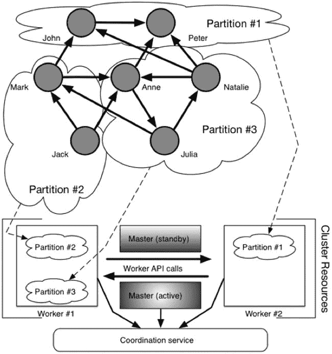
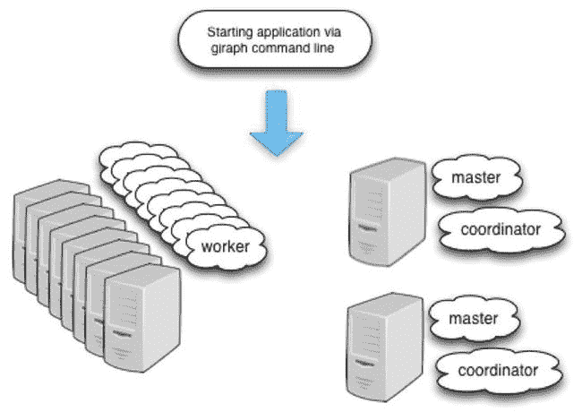
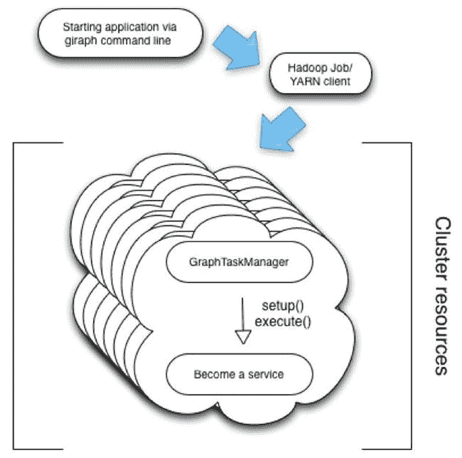
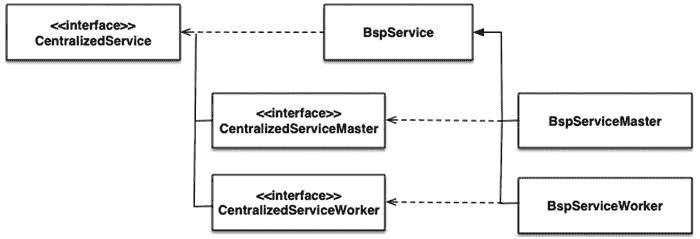
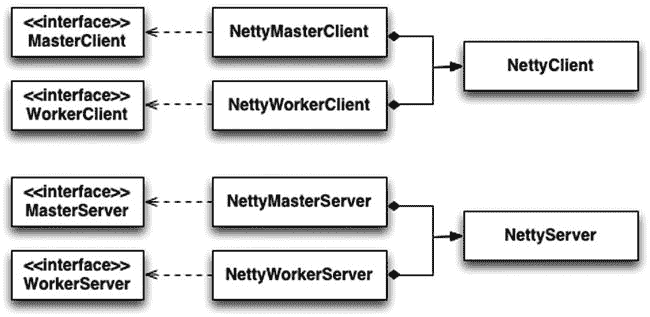
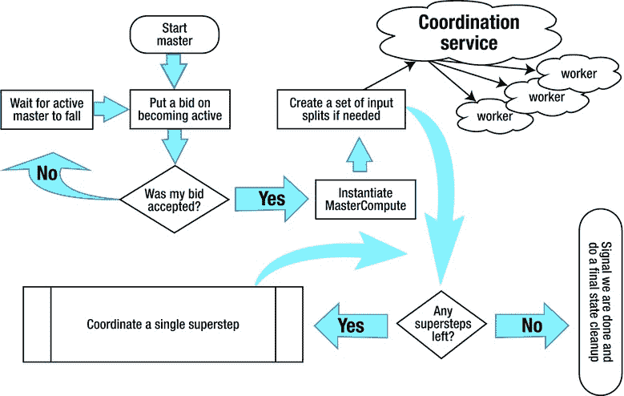
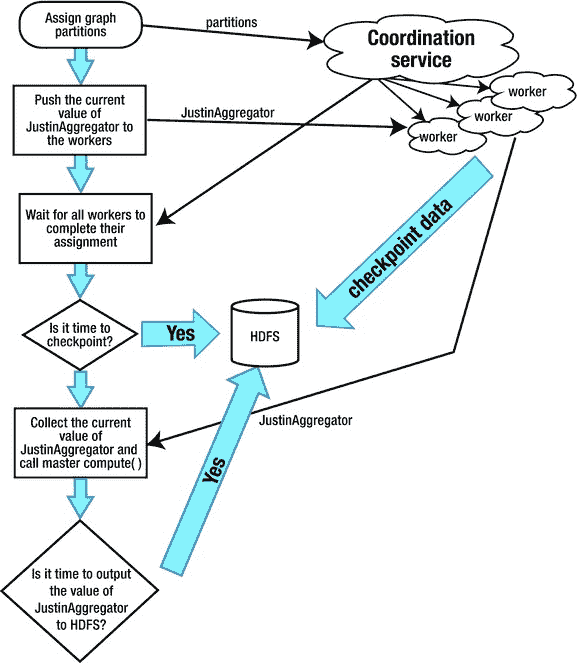
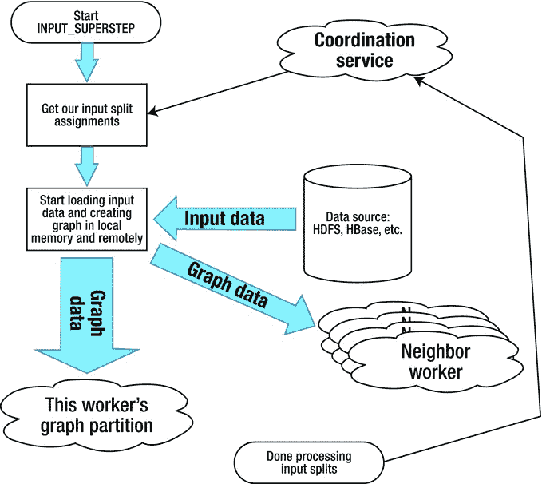
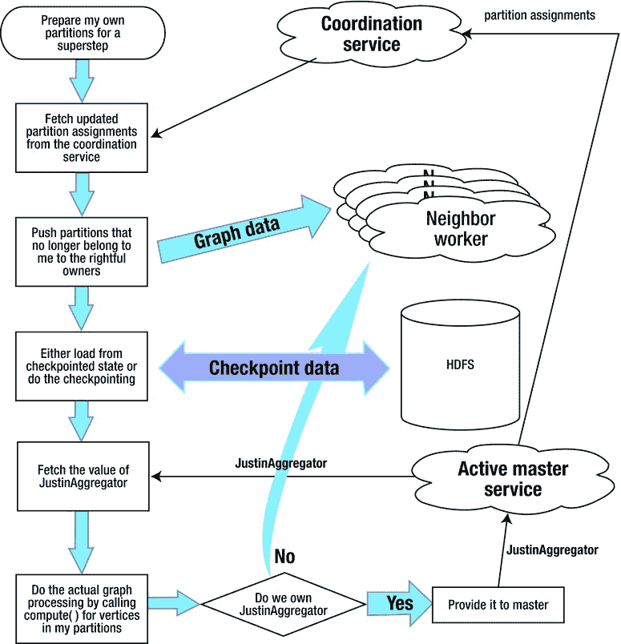
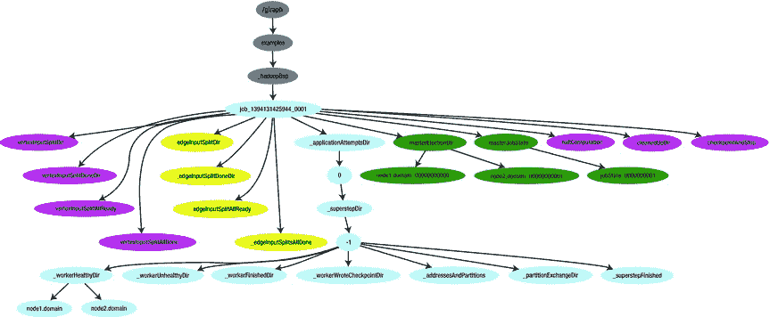

# 6. Giraph 架构

前一章介绍了大量 Giraph API，并展示了如何将它们用于各种图处理应用。本章将深入 Giraph 实现的内部，向你展示在图处理应用执行和调用 API 时，幕后发生了哪些事情。

在本章的其余部分，你将使用第 5 章中介绍的 Giraph 示例应用。假设应用操作的图的大小以数十亿行输入来衡量。基于此假设，本章将追踪应用在 Hadoop 集群上运行的每一步。你将首先了解组成一个运行中的 Giraph 应用的不同服务的功能角色，这些服务如何分配到集群中的计算节点，以及它们如何协调活动以执行整个图处理任务。你还将研究对输入进行分区和加载初始图拓扑所需的步骤，以便每个顶点都能分配给一个执行计算操作的工作者。然后，你将深入探讨每个服务的实现细节，并在本章结束时，审查 Giraph 实现需要应对的故障场景。

## Giraph 的诞生

到目前为止，你仅使用过那些能轻松放入单台主机磁盘和内存空间的小型数据集上的 Giraph。虽然 Giraph 当然适用于中小型图，但其真正的威力在于它的可扩展性。为了让您体验 Giraph 实现所需达到的可扩展性水平，不妨看看它在 Facebook 的使用场景：分析社交网络成员的关系图。2013 年，顶点总数估计约为 11 亿，边的数量则高达数万亿。即使存储每个与顶点或边相关的数据块仅需几百字节，仅图表示本身就已接近 PB 级别。在单节点上存储如此规模的数据集是不可能的；而使用单节点的 CPU 资源进行分析将耗时巨大，令人望而却步。满足存储和计算需求的唯一扩展途径是利用商用硬件集群。

因此，一个运行中的 Giraph 应用是集群中不同节点上并行运行的一组分布式网络服务，这并不令人意外。这些服务中的每一个都为 Giraph 应用的其余部分提供特定功能，拥有自己的生命周期，并通过远程 API 调用与运行在不同节点上的其他服务交互。由于这些交互大多基于网络，因此需要处理网络编程的所有复杂性（统称为*分布式计算的谬误*）。例如，Giraph 实现花费大量时间调整其内部服务的生命周期，以便在单个服务发生故障时能够实现最高效的恢复。

### 分布式计算的谬误

早在 1994 年，Sun Microsystems 的几位聪明工程师就开始意识到局域网设计进步所释放的分布式计算的力量。大约在同一时间，其中一位工程师 John Gage 提出了“网络即计算机”这一说法，以概括公司的新方向。这是好消息。坏消息则由另一位 Sun 工程师 (Peter Deutsch) 汇编，作为在设计这种下一代计算机架构时需注意的一系列错误假设，传递给后世工程师。这个列表被称为分布式计算的谬误，并且时至今日，其相关性仍与 20 年前一样高：

*   网络是可靠的。
*   延迟为零。
*   带宽是无限的。
*   网络是安全的。
*   拓扑结构不会改变。
*   存在一个管理员。
*   传输成本为零。
*   网络是同质的。

在阅读本章时请牢记此列表——它将帮助您理解 Giraph 实现所做的相当多的架构决策。

## Giraph 构建块与概念

无论您是在单台主机上（如您在第 5 章中所做的那样）还是在一个 1000 节点的集群上运行示例应用程序，Giraph 所做的一切归根结底就是确保一段作为特定类型网络服务的 Java 代码能够在指定数量的主机上执行。在继续之前，让我们快速定义作为 Giraph 架构基本构建块的三种网络服务类型：*主节点* (master)、*工作节点* (worker) 和*协调器* (coordinator)。

每一次 Giraph 计算都是这些服务协调执行的结果，它们作用于被分割成分区并并行处理的顶点子集。分区是一个关键的优化手段，它允许并行执行图处理任务；它是动态的，意味着分区到工作节点的分配可以根据运行中应用程序的特性而变化。然而，在每个超步中，Giraph 应用程序的整体功能结构如图 6-1 所示。此图中表示的所有服务都是 Giraph 实现内部的，对最终用户不可见，但了解其架构仍然很重要——即使只是为了能够在 Giraph 应用程序运行出错时进行调试。



**图 6-1.** 运行中的 Giraph 应用程序的功能结构

### 主节点 (Masters)

始终有一个活跃的主节点服务和若干个备用主节点，当当前主节点发生故障时，备用主节点会竞争成为活跃主节点。备用主节点处于休眠状态，在运行中的 Giraph 应用程序生命周期中不扮演活跃角色。一旦主节点变为活跃状态，其职责就是协调计算。此任务包括执行以下操作：

*   以协调的方式将工作节点从一个超步过渡到下一个超步
*   在每个超步之前，将分区分配给活跃的工作节点
*   运行主节点计算代码
*   监控所有工作节点的健康状况和统计数据

### 工作节点 (Workers)

工作节点构成了 Giraph 服务的大部分。它们的主要功能是管理分配给它们的图分区状态。每个工作节点都暴露一组网络 API，以允许远程工作节点操作分配给它的分区中的数据。再次注意，这些网络 API 是 Giraph 实现内部的，不期望对最终用户可用。工作节点按照活跃主节点的指示从一个超步过渡到下一个超步。在每个超步期间，工作节点遍历其拥有的图分区，并为属于这些分区的所有顶点执行 `compute()` 方法。工作节点还负责不时地对其状态进行检查点设置，作为从工作节点故障中恢复的一种手段。

请注意，图分区到工作节点的分配不是永久性的，并且在每个超步之前会由主节点驱动的重新平衡进行调整。实现 `MasterGraphPartitioner` 接口的类提供了分区逻辑的实现。属于活跃主节点的该类的实例管理当前的分区到工作节点映射，并提供 `generateChangedPartitionOwners()` 方法，以便根据来自工作节点的各种统计数据重新评估映射。主节点通过协调服务更新映射。另一方面，工作节点会查找哪些分区不再属于它们，并通过发出网络 API 调用在目标工作节点上重建这些分区的状态。

### 协调节点

运行协调服务的节点为 Giraph 的其他服务提供“神经组织”。它们不参与执行任何图处理工作；相反，它们为 Giraph 的其余部分提供分布式配置、同步和命名注册服务。

有几种可用的协调服务实现，但在 Hadoop 生态系统中，默认选择始终是 Apache ZooKeeper。`ZooKeeper` 服务如此普遍，以至于难以想象一个生产环境的 Hadoop 集群部署可以没有它。它已成为 Hadoop 生态系统中任何应用协调的代名词。

运行协调服务的节点集合统称为 `ZooKeeper` 集合（ensemble）。集合中的所有节点都被视为对等节点，每个节点都拥有 `ZooKeeper` 状态的一个副本，以此实现高可用性和容错性。只要大多数节点处于运行状态，服务就能正常运行。

Giraph 提供了两种管理协调服务的选项。默认选项是在 Giraph 应用运行时按需启动 `ZooKeeper` 集合节点。这样，协调服务与主节点或工作节点并无区别：它们完全由 Giraph 管理，并在应用退出后消失。第二个选项是使用作为集群一部分进行集中维护的独立 `ZooKeeper` 集合。在这种情况下，Giraph 应用充当纯粹的客户端，无需在 Giraph 应用使用的节点上运行协调服务。

建议在生产环境中使用 Giraph 时采用第二种方法。它便于进行事后分析和实时调试（因为协调服务在 Giraph 应用退出后仍保持运行）。此外，由于它使用集群范围、集中化、经过高度调优和维护良好的 `ZooKeeper` 集合，你的应用性能可能会更佳。

## 引导 Giraph 服务

考虑第 5 章中的任意示例，但这次假设你必须处理一个更大的输入数据集。数据集的大小使得在单台主机上执行应用成本过高，并需要使用集群。好消息是，你无需更改应用即可使其在计算资源集群上运行：Giraph 架构足够灵活，可以弹性扩展。要开始使用集群，你只需告诉 Giraph 它可以为哪些目的使用多少计算资源。

设置配置属性 `giraph.maxWorkers`（或通过命令行选项 `-w` 传递相同值）可以告诉 Giraph 应该使用多少计算资源来执行工作节点服务。另一个配置属性 `giraph.zkServerCount`（默认值为 1）告诉 Giraph 需要分配多少计算资源来运行主节点和协调服务。最后，应用使用的集群资源总数由配置属性 `giraph.SplitMasterWorker` 决定。如果该属性设置为 `false`，则所有服务可以在所有集群资源上运行，使用的资源总数等于 `giraph.maxWorkers` 的值。另一方面，如果设置为 `true`（其默认值），则使用的资源总数是 `giraph.maxWorkers` 与 `giraph.zkServerCount` 之和。

# 本章剩余部分，假设集群至少包含十个节点

在本章剩余部分，假设集群至少包含十个节点，以便你可以使用设置为 8 的 `giraph.maxWorkers` 和设置为 2 的 `giraph.zkServerCount` 来执行示例应用。同时假设 `giraph.SplitMasterWorker` 使用默认值 (`true`)，这样使用的集群资源总数正好是十个（八加二）。这些资源将用于运行恰好八个工作节点服务、两个主节点服务和两个协调服务（主节点和协调服务部署在同一位置）。

牢记这些设置，让我们来看一下底层机制，该机制将每个服务所需的 Java 代码片段推送到所需的集群资源，并使其表现为一组八个工作节点服务、两个主节点服务和两个协调服务。参见图 6-2。



图 6-2. 在 10 个主机的集群上运行示例

虽然知道在命令行选项正确组合的情况下，`Giraph` 可以开始利用 Hadoop 集群的强大功能是件好事，但你在本章中要回答的问题是这是如何发生的。一种在计算资源集群上分发服务的方法，需要构建一个定制的、特定于 Giraph 的集群管理层，并特意为图处理应用而设计。这样做本身并无不妥；Apache Hama（一个与 Giraph 非常相似的图处理框架）正是做出了这种类型的设计决策。它允许更高级别的控制，但代价是维护与图处理无关的底层集群管理代码。

与 Hama 不同，`Giraph` 决定使用现有的集群管理解决方案来完成所有繁重的工作。Apache Hadoop 是最流行的解决方案，也是 Giraph 发行版默认自带的方案。不过，它不是唯一的选择。即使在 Hadoop 项目内部，`Giraph` 也有两种选择：更经典的 `MapReduce` 框架（在早期版本的 Hadoop 中也可用）和一套全新的资源管理 API，称为 YARN。YARN 后端仍处于实验阶段，本章假设示例应用是使用 Hadoop `MapReduce` 框架执行的。

## 当 `MapReduce` 并非真正意义上的 `MapReduce`

`MapReduce` 框架用于分布式数据分析，最早由两位谷歌工程师（Jeffrey Dean 和 Sanjay Ghemawat）在 2004 年的开创性论文《MapReduce: Simplified Data Processing on Large Clusters》中提出。该框架的核心思想虽然简单，但要求应用程序设计进行根本性转变。论文提出，每个数据处理应用程序应围绕两个核心代码构建：一个称为 `mapper`，另一个称为 `reducer`。这两段代码会透明地在大型计算资源集群上实例化，从而使应用程序能够利用所有可用的计算资源处理尽可能多的数据。换句话说，成千上万个 `mapper` 副本并行运行，全部向同样并行运行的数百个 `reducer` 提供数据。程序员无需处理底层集群管理的繁琐工作，可以专注于实现 `mapper` 和 `reducer`。

Apache `Hadoop` 是首个广受欢迎的开源 `MapReduce` 框架实现。它的出现使得那些可以简洁地分解为 `mapper` 和 `reducer` 的数据处理应用数量激增。图处理不属于此类应用；它通常更具迭代性，并需要不同的数据分区方式。

因此，当使用 `MapReduce` 作为后端运行时，`Giraph` 无法充分利用该框架的核心理念。它只需要从 `Hadoop` 获得一种方法，将其自身代码推送到指定数量的计算资源上。`Giraph` 采用的方式是构建一个虚假的 `MapReduce` 应用程序，该应用使用固定数量的 `mapper` 且没有 `reducer`，这被称为仅 `map` 应用。由于它与 `Hadoop` 的所有数据管道断开连接（从 `Hadoop` 的角度来看），它会“永久运行”（与普通的 `MapReduce` 应用程序相反，后者会一直运行直到未处理的数据耗尽）。正因如此，`Giraph` 实现必须处理初始数据的摄入并限制应用程序的运行时间。

即使一个正在运行的 `Giraph` 应用程序在 `Hadoop` 集群看来像一个 `MapReduce` 应用程序，它的行为与典型的 `MapReduce` 任务也几乎没有关系。

`Giraph` 是如何使用 `MapReduce` 来启动所有必需的内部服务的呢？这需要将 `Giraph` 的业务逻辑封装在 `GraphTaskManager` 类实现中，并期望它在 `Giraph` 应用程序可用的每个节点上被实例化。`MapReduce` `Hadoop` 框架期望 `GraphTaskManager` 提供一种执行 `mapper` 的方式。`Giraph` 无需关心 `GraphTaskManager` 实例是如何创建的细节；相反，它专注于在 `Giraph` 服务的整体网格中需要执行的任务。当 `Giraph` 使用 `MapReduce` 作为后端时，实例化 `GraphTaskManager` 对象的任务属于 `mapper`。这个不寻常的 `mapper` 唯一做的事情就是如此。

在最高层面上，在机器集群上执行 `Giraph` 应用的整个流程包括以下步骤（如图 6-3 所示）：



图 6-3.

在节点集群上引导一个 `Giraph` 应用程序 底层集群管理框架（很可能是 `Hadoop` 的 `MapReduce` 或 YARN，尽管 `Giraph` 也可以接入其他框架）在多个节点上实例化一个 `GraphTaskManager` 类实现。具体数量由 `Giraph` 的配置决定。 同一框架随后调用 `GraphTaskManager.setup()` 方法，该方法负责初始化，并确定该节点应向 `Giraph` 应用的其他部分提供哪种内部 `Giraph` 服务（主节点、工作节点或协调服务）。 `GraphTaskManager.execute()` 方法获得控制权。`Giraph` 应用程序开始运行，每个节点承担三种内部服务之一的角色：主节点、工作节点或协调器。

尽管架构简单，但这意味着 `Giraph` 无需关心寻找合适集群资源、调度容器在资源上运行、在容器失败时在不同主机上重启它们，以及分配底层资源的细节。这是一种非常灵活的方法，使得 `Giraph` 应用可以根据需要拥有任意数量的工作节点；集群管理框架负责维护工作节点池。这一切都是好消息，除了一个细节：容器可以在集群中的任何主机上实例化，如果它们不知道其他服务的主机名（或 IP 地址），它们如何相互通信？

这个问题的答案在于 `Giraph` 使用了一个所有容器都能与之通信的协调服务。不同的 `Giraph` 服务将协调服务作为一个公告板或目录，所有容器可以在其中发布关于自身的信息（例如网络坐标、运行状态等），并查看其他容器发布的信息。因此，每个容器无需跟踪所有其他容器的网络地址和状态，引导 `Giraph` 框架所需的唯一信息就是协调服务的位置。

协调服务扮演中央信息分发器角色的一个有趣后果是，它承担了与每个容器通信的主要负担。为了避免使其过载，`Giraph` 实现试图最小化每个容器与协调服务之间的流量。其方法是通过协调服务管理少量元数据，并在尽可能的情况下选择容器之间的直接通信。

只要 `Giraph` 服务正常运行，像 `Hadoop` 这样的集群管理框架就不会干预。如果服务失败（由于软件错误或硬件故障），则由集群管理框架负责启动新实例。协调服务在帮助 `Giraph` 实现检测服务何时失败以及何时（可能在不同主机上）恢复上线方面发挥着至关重要的作用。这样，活跃的主节点总能找到在活跃工作节点之间重新平衡当前图计算的方法。

当然，检测服务失败并启动新实例只解决了一半问题。当一个服务宕机时，它也会将其内存中的状态一起带走。如果仅仅因为成千上万个服务中的一个宕机，`Giraph` 就不得不重启整个计算，那将是件不幸的事。解决这个问题的一个优雅方案是使用定期检查点。在指定的时间间隔（通过 `giraph.checkpointFrequency` 配置属性设置），`Giraph` 将所有服务的状态记录到 `HDFS` 中的一个永久位置（位于当前用户的主目录下）。假设 `giraph.checkpointFrequency` 设置为 5。这意味着每五个超步之后，所有服务的状态都会被检查点保存。如果某个服务失败，计算最多只需重做最近的五个超步，因为它会从检查点保存的状态重新启动。检查点频率的具体设置值高度依赖于具体应用。一方面，更频繁的检查点会增加应用程序的总运行时间；另一方面，它会加速工作节点失败后的恢复。尝试不同的值，然后选择最适合你的那个。请记住，此属性的默认值是 0：默认情况下，检查点是禁用的。

既然你已经了解了 `Giraph` 如何使用集群计算资源的机制，接下来让我们详细了解每个 `Giraph` 服务的作用以及它们如何交互。

# Giraph 服务架构剖析

一旦完全启动并运行，每个 Giraph 应用程序都由一个服务网络构成，这些服务通过网络 API 调用相互通信，共同完成图处理。`Giraph` 实现的两种服务（主节点和工作节点）共享基于 `CentralizedService` 接口及其实现类 `BspService` 抽象类的通用设计。协调服务由独立的 Apache ZooKeeper 项目单独实现，本书不对此进行讨论。

## 什么是 Apache ZooKeeper？

Apache ZooKeeper 致力于开发并维护一个开源服务器，以实现高度可靠的分布式协调。它的诞生是为了应对高度分布式应用程序的激增，这些应用程序都试图以临时方式实现类似的功能。你可以在 [`http://zookeeper.apache.org`](http://zookeeper.apache.org/) 或由其两位作者 Flavio Junqueira 和 Benjamin Reed 编写的书籍《`ZooKeeper：分布式进程协调`》（O'Reilly, 2013）中找到关于 ZooKeeper 设计与实现的信息。

主节点提供的所有功能都在 `BspServiceMaster` 类中实现。在工作节点端，对应的实现是 `BspServiceWorker`。这两个类都通过继承 `BspService` 并实现更具体的接口，来扩展其通用功能，如图 6-4 中的类层次结构所示。



**图 6-4.** Giraph 服务类层次结构

这两种服务通过使用实现以下接口的类，同时充当网络服务器和客户端：

*   对于主节点：`MasterClient` 和 `MasterServer`。

*   对于工作节点：`WorkerClient` 和 `WorkerServer`。

目前，这四个接口的唯一可用实现都是基于 Netty 框架。Netty 是一个新的 I/O (NIO) 客户端/服务器框架，能够快速、轻松地开发网络应用程序，例如协议服务器和客户端。如果你不熟悉 Netty，也不必担心；只要你了解它实现了 NIO，就应该能毫无困难地理解 Giraph 如何使用它。Giraph 通过将提供通用、支持 Netty 的客户端/服务器交互的代码封装到两个独立的类（`NettyClient` 和 `NettyServer`）中，来抽象化这一层。这部分与 Giraph 图处理模型关系不大。而与模型相关的部分则被封装到图 6-5 所示的四个类中。



**图 6-5.** 支持 Netty 的客户端/服务器架构

如你所见，每个类都通过将所有非 Giraph 特定的客户端/服务器交互委托给它所拥有的 `NettyClient` 或 `NettyServer` 对象，来实现相应的接口。

确定哪个节点应提供哪个 Giraph 服务由 `GraphTaskManager.setup()` 处理。此决定在 Giraph 应用程序运行期间是永久的，并由提供给 Giraph 框架的配置参数驱动。例如，如果通过 `giraph.zkList` 配置选项指定了外部 ZooKeeper 集合，那么 Giraph 就无需将此服务分配给它管理的节点。该实现可以灵活地将任何服务组合分配给给定节点，但有一个例外：协调服务不能是分配给节点的唯一服务。换句话说，运行协调服务的节点始终同时运行一个额外的主节点服务，或者同时运行所有三种服务。仅有的两种不可能存在的节点服务分配组合是：

*   专门用于运行协调服务的节点

*   运行协调服务和工作节点服务的节点

现在你已经对 Giraph 如何实现其主节点、工作节点和协调服务的通用方面有了足够的了解，是时候更深入地研究它们的详细架构了。

## 主节点服务

主节点服务始终作为由 `MasterThread` 类实现的额外 Java 线程运行。该类的实例拥有对 `BspServiceMaster` 对象的引用，并通过编排对 `BspServiceMaster` 暴露的 API 的调用来实现其功能。主节点算法非常简单，但其设计需要具有弹性，以便在当前主节点发生故障时，另一个主节点（通常在不同的主机上运行）能够接替其职责。图 6-6 展示了每个主节点服务都会经历的高级步骤。



**图 6-6.** 单个主节点服务生命周期

主节点做的第一件事是通过 `BspServiceMaster.becomeMaster()` 调用，竞标成为活动主节点。请注意，尽管所有主节点都会发出此调用，但除一个之外的所有主节点都将被阻塞。成功的那一个将确定活动主节点；其他主节点将保持阻塞状态，直到活动主节点失败。届时，其中一个阻塞的调用将返回，从而确定下一个活动主节点。正如你稍后将看到的，此同步屏障是通过使用协调服务的功能来实现的。

成为活动主节点后，主节点线程会实例化一个 `MasterCompute` 对象（前提是 Giraph 应用程序配置中请求了该对象）。这反过来又有机会在活动主节点上注册应用程序聚合器。

在进入超步循环之前，活动主节点尝试执行另一个重要功能：为图数据（包括顶点数据和边数据）创建一组输入分片，以由适当的输入格式加载。由于 Giraph 应用程序通常操作存储在分布式文件系统中的一组巨大文件，因此有效地将加载该数据的工作分配给所有可用的工作节点是一个关键的可扩展性要求。此功能在 `BspServiceMaster.createInputSplits()` 方法中实现，其工作方式如下。首先，它查询协调服务，以查看哪个工作节点应加载哪个文件的映射是否已建立。如果尚未建立，则生成映射并将其持久化到协调服务中。这同时完成了两件事。其一，由于每个工作节点都在监视协调服务的更新，一旦映射可用，工作节点就可以加载其那部分输入数据（此步骤的详细信息见下文“协调服务”一节）。其二，将映射作为事务持久化到协调服务，使得备份主节点能够在活动主节点宕机时有效地接替其工作。

一旦输入分片的映射对所有工作节点可用，活动主节点就会转换到超步循环，只要还有超步就持续运行。驱动超步循环的大部分功能实现在 `BspServiceMaster` 的方法 `coordinateSuperstep()` 中，并由以下步骤组成：

通过观察协调服务中的自报告信息来确定健康工作者的集合。主节点在超步持续期间通过监听协调服务事件来观察健康工作者，并在它们发生故障时采取纠正措施。

将图分区分配给健康工作者。这是针对特定超步的动态分配，并且可能会在下一个超步中基于工作者负载和其他考虑因素而改变。如果有任何分区被分配给了本地内存中没有该分区图数据的工作者，那么拥有该分区的工作者负责通过发出 API 调用来发送图数据，从而在目标工作者上重建该分区。如果此超步是从检查点重新启动的，分区数据也可能来自检查点文件。

将聚合器从前一个超步的状态最终确定，并将它们发送给新的工作者所有者。这是两阶段分布式聚合器管理的最后一步。此时，主节点已完成最终聚合，并准备将值发回，以便在当前超步期间进行进一步聚合。请参阅下面的“工作者服务”部分，了解两阶段分布式聚合器实现中工作者侧的内容。

如果当前超步是一个输入超步（这是一个伪超步，用于让工作者从输入分片加载初始图数据），则协调顶点和边数据的加载。这是通过将数据文件划分成输入分片，并将输入分片到工作者的映射写入协调服务来实现的。在协调服务中监视更新的工作者会注意到属于它们的映射已可用，并将其解释为开始加载数据的信号。

等待所有工作者完成当前超步的处理。如果在处理当前超步期间有任何工作者发生故障，则尝试从检查点状态重新启动。如果成功，超步循环的下一次迭代将假定前一个超步是从检查点状态恢复的那个超步。

如果满足检查点频率，则等待所有工作者检查其状态，然后全局完成检查点过程（包括检查聚合器）。

此时，假设所有工作者已成功完成当前超步，并且可以安全地收集分配给它们的聚合器的值。

一旦所有聚合器值都被收集，并且聚合器的全局状态（存储在活动主节点的内存中）被更新，调用主计算的 `compute()` 方法。

确定是否该停止整个计算。为此，首先检查是否在协调服务中设置了外部标志，该标志指示因任意原因停止计算。如果没有，则检查是否所有顶点都投票停止，并且没有更多待发送到顶点的消息。最后，检查发生的超步数是否超过了此应用程序允许的最大超步数（你可以使用 `giraph.maxNumberOfSupersteps` 属性为此设置一个值）。如果这些条件中的任何一个为真，则在此作业的全局统计信息中记录计算已停止的事实，并退出超步循环。

将聚合后的应用程序状态发布到协调服务中。

根据 `giraph.textAggregatorWriter.frequency` 的值，检查是否到了输出所有已注册聚合器状态的时间。如果是，则调用提供的 `AggregatorWriter` 实现。

一旦超步循环结束，主节点唯一剩下要做的就是调用清理例程 `BspServiceMaster.cleanup()`。所有主进程应通过向协调服务发布一种特殊类型的通知来表明它们已完成。当通知的数量等于工作者和主节点的分区数量时，主节点清理与作业关联的全局状态。这就是在协调服务的帮助下实现全局屏障的方式。

回到示例应用程序，始终正好运行两个主节点服务：一个活动，一个备用。如果活动主节点发生故障，备用主节点会恢复协调活动。只要主节点处于活动状态，其超步循环就会执行图 6-7 中概述的步骤。



**图 6-7.** 示例应用程序的活动主节点超步循环

## 工作服务

在 Giraph 应用中，工作服务的核心功能是管理由主节点分配给它的若干图分区的状态。与主节点一样，工作节点的生命周期由 `GraphTaskManager.execute()` 方法管理，该方法编排对 `BspServiceWorker` 类对象所暴露 API 方法的调用，而该类提供了大部分实现。

每个工作服务都在与主节点相同的容错约束下运行。工作节点故障在 Giraph 应用中是一种常态，工作节点算法在设计时应考虑到这种可能性。

该算法包含两个阶段：**设置阶段**和**超级步循环阶段**。设置阶段主要涉及将初始图数据加载到所有工作节点的内存中。其关键步骤在图 6-8 中进行了概述。



**图 6-8.** 工作服务生命周期的设置阶段

毫不意外，`BspServiveWorker.setup()` 提供了设置阶段的实现。在加载数据之前，它会检查 `setup()` 的调用是否作为重启失败超级步的一部分。如果是这种情况，它会从检查点加载状态并退出，因为 `setup()` 机制的其余部分仅在首次初始化整个 Giraph 应用时适用：

-   启动一个伪超级步，该超级步不进行计算，而是等待主节点计算输入分片，然后加载分配给此工作节点的输入数据切片。在内部，此超级步被称为 `INPUT_SUPERSTEP`，其数字 ID 为 -1。关于加载输入分片的一个重要说明：通常，你不应期望分配给工作节点的分片中的输入数据所生成的顶点，恰好属于分配给同一工作节点的图分区。因此，加载顶点和边数据的工作节点几乎必然会产生网络流量，向其他工作节点发送消息，并请求它们在其分区中创建顶点。

-   只要还有未处理的输入分片，就持续加载数据并创建新的顶点或边。`VertexInputSplitsCallable` 和 `EdgeInputSplitsCallable` 这两个类提供了此功能的实现。

-   当没有剩余分片需要处理时，通过向协调服务发布消息来表明此工作节点已完成，并等待其他工作节点完成。这是必要的，因为它允许已完成的工作节点仍然能够接收网络 API 调用，并使用仍在处理其输入分片的工作节点所加载的顶点来更新其分区。所有工作节点均已完成这一事实由主节点识别，并反映在协调服务中。

-   当主节点已发出信号表明所有工作节点均已完成数据加载时，执行一些内务处理任务：创建此工作节点拥有的其余分区（那些尚未有输入数据到达的分区），并最终确定源自向属于此工作节点管理的分区中的顶点添加边请求的变更。

-   等待主节点发出信号，表明伪 `INPUT_SUPERSTEP` 已完成，并且所有顶点已准备好进入超级步循环。

一旦所有工作节点准备好过渡到超级步循环，它们会同时进行，并进入 Giraph 应用的主要计算循环。只要还有超级步存在，此工作服务超级步循环就会循环执行以下步骤：

1.  通过调用 `BspServiceWorker.startSuperstep()` 为当前超级步做准备。此调用会合并在前一个超级步期间收到的所有 API 请求，并相应地修改图分区（添加、删除和更新顶点等）。它还会等待主节点完成工作节点之间的分区重新平衡，并返回此工作节点的分区分配。

2.  基于当前的分区分配，工作节点可能必须将其部分分区推送到它们被分配到的其他工作节点。它通过调用 `BspServiceWorker.exchangeVertexPartitions()` 来实现。该方法确保在其所有依赖项完成向其发送数据之前不会返回。像往常一样，工作节点通过向协调服务发送消息来表明其推送自身数据的完成；它依赖主节点来聚合这些消息，并在整个工作节点集群完成图分区交换时发出信号。

3.  检查此超级步是应该从检查点状态加载，还是应该将当前状态保存到检查点（由 `checkpointFrequencyMet()` 方法指示）。这两种操作的实现由 `BspServiceWorker` 中定义的两个互补方法提供：`loadCheckpoint()` 和 `storeCheckpoint()`。

4.  调用 `BspServiceWorker.prepareSuperstep()` 方法，该方法目前主要关注同步此工作节点拥有的聚合器状态与其他工作节点的聚合器状态。在此步骤中，工作节点从主节点获取其管理的聚合器的状态，并阻塞直到这些聚合器被推送到所有其他工作节点。

5.  为属于此工作节点管理的所有顶点调用 `compute()`。遍历所有顶点，但仅对未暂停或有可用消息的顶点调用 `compute()`。这是以多线程方式完成的，线程使用 `ComputeCallable` 类作为需要添加到任务队列并稍后执行的任务的实现。

6.  调用 `BspServiceWorker.finishSuperstep()` 方法，该方法完成结束当前超级步所需的所有工作，然后阻塞，等待主节点发出信号表明所有工作节点已准备好开始下一个超级步。作为此步骤的一部分，所有在此工作节点上最终被赋予了值的聚合器都会被发送给其合法所有者（所有者由主节点动态选择）。然后，等待从所有其他工作节点接收由此工作节点管理的聚合器的值。一旦完成，进行最后一次聚合，并将结果推送回主节点。由 `finishSuperstep()` 方法执行的最后一项内务处理是将当前超级步的统计信息反映到协调服务中。这是为了出于可观测性和负载均衡的原因，跟踪每个工作节点上发生的事情。

7.  由于上一步使全局 Giraph 统计信息对每个工作节点可用，只要图中还有活跃顶点剩余，超级步循环就会继续到下一个超级步。

再次回到示例应用，每个工作节点（一旦进入超级步循环阶段）都会经历图 6-9 中概述的一系列转换。



**图 6-9.** 工作服务生命周期的设置阶段

工作节点超级步循环是驱动每个 Giraph 应用执行的核心过程。大多数步骤都非常易于理解，唯一值得重申的部分是分片聚合器的实现。步骤 4 和 6 是理解分片聚合器如何工作的关键。

首先，在每个超步（superstep）期间，提供给聚合器的值会在工作节点本地进行部分聚合。这一过程不涉及任何网络 API 调用。一旦超步完成，这些来自不同工作节点的部分聚合值需要再次进行聚合，最终值必须可供 `MasterCompute.compute()` 使用。一种选择是让主节点管理所有聚合器，因为无论如何这些值最终都要汇总到主节点。可惜，如果应用程序使用了大量聚合器，这种简单的方法将无法实现扩展；它会使主节点在计算和网络通信两方面都成为瓶颈。

Giraph 采取的方法是在集群的工作节点之间动态分片聚合器。其工作方式如下：当超步结束时，每个聚合器会被分配给一个工作节点，该工作节点负责从邻居节点接收部分聚合值。同时，它还需要将最终的聚合值推送给主节点。这样一来，主节点无需执行任何聚合操作，并且每个聚合器它始终只会收到一个最终值。当主节点接收到这些值并完成 `MasterCompute.compute()` 的执行后，主节点将每个值仅发送给对应聚合器的所有者（即那个工作节点）。最后一步，所有者需要将这些值分发给它们的邻居节点。

## 协调服务

如前所述，Giraph 并未实现协调服务。该实现来自独立的 Apache ZooKeeper 项目。尽管如此，了解其提供的 API 以及主节点和工作节点如何使用它们仍然非常重要。Giraph 放入 ZooKeeper 的大部分数据都是永久性的，因此了解 Giraph 如何外部化其状态的细节，对于调试失败的应用程序来说是一个极具价值的工具。如果你想更轻松地观察和诊断正在运行的 Giraph 应用程序，请使用外部 ZooKeeper 集合（通过设置 `giraph.zkList` 属性）运行它们，而不是依赖 Giraph 按需启动协调服务。通过使用外部 ZooKeeper 集合运行，你可以随时检查协调服务的内部状态（进而了解 Giraph 应用程序的内部状态），而不仅仅是在应用程序运行期间。

ZooKeeper 的一个关键特性是其提供的高可用性服务。其实现方式要求 ZooKeeper 集合中的所有节点都知道集合内其他每个节点的网络地址（主机名和端口）。这样，它们就能尽最大努力在尽可能多的节点之间同步公共状态。ZooKeeper 客户端（请记住，Giraph 只是一个 ZooKeeper 客户端）一次只与一个 ZooKeeper 节点通信。但即使是客户端也必须知道 ZooKeeper 集合中尽可能多节点的网络地址。毕竟，如果客户端当前正在通信的节点宕机，客户端需要知道到哪里重新连接。

只要 Giraph 使用外部 ZooKeeper 服务，集合中所有节点的网络地址就会通过 `giraph.zkList` 属性以静态的逗号分隔列表形式传递给工作节点和主节点服务。另一方面，如果 Giraph 需要按需启动一个协调服务，它就无法预先知道这些服务将在集群中的哪些节点上实例化。这是一个有趣的“先有鸡还是先有蛋”的问题：Giraph 需要 ZooKeeper 来存储所有必须在不同节点上运行的服务之间共享的信息，但 ZooKeeper 节点的网络地址恰恰是需要存储在 ZooKeeper 中的那种信息。看起来 Giraph 需要 ZooKeeper 才能引导启动 ZooKeeper。如何避免这种无限递归呢？

Giraph 使用了所有 Giraph 服务都知道如何访问的另一种存储基础：HDFS。尽管大多数时候，HDFS 对于保存需要频繁更新的小文件来说是一个非常差的选择，但按情况断点使用还是可以的。Giraph 正是这样使用它的。它将 ZooKeeper 集合节点的网络地址记录为 HDFS 文件的名称。存储这些文件的确切位置由 `giraph.zkManagerDirectory` 属性设置；默认值为 `_bsp/_defaultZkManagerDir`（请注意，由于默认值使用的是相对路径而非绝对路径，因此它位于运行该作业的用户主目录下）。

现在您已经了解了 ZooKeeper 集合的引导方式以及主服务和 Worker 服务如何作为客户端连接到它，接下来让我们看看它们使用了哪些 ZooKeeper 客户端 API。从客户端的角度来看，ZooKeeper 提供了一个类似文件系统的分层 API，其命名空间结构化为一个节点树（树中的每个节点，包括内部节点，都称为 `znode`），每个节点都响应一小部分 API 调用。层次结构中的每个 `znode` 可以保存一些数据，可以成为其他节点的父节点，或者与任何文件系统不同，它可以同时做到这两点。`ZooKeeper` 专为协调而设计，通常需要在 `znode` 中存储小块数据（数据量上限为 1MB）。所有 API 都是原子性的，这意味着客户端要么接收全部数据，要么什么都收不到。当客户端创建一个 `znode` 时，它可以选择将该 `znode` 声明为临时节点，从而保证只有当创建它的客户端连接到 ZooKeeper 时，该节点才可见。如果节点不是临时的，则被视为持久节点，需要显式调用 `delete` 才能将其从树中移除。这两种类型的 `znode` 都可以有一个额外的属性：有序性（因此 ZooKeeper 的 `znode` 分为四类：临时、临时有序、非临时、非临时有序）。有序 `znode` 的名称源自 `create` API 调用中提供的初始名称以及 ZooKeeper 为其分配的序列号。因此，如果多个客户端尝试使用相同的路径名创建一个有序 `znode`，每个客户端最终都会创建一个唯一的 `znode`，并且其顺序由 ZooKeeper 服务保证。最后，客户端可以注册监视器，当其他客户端对 `znode` 树执行某些类型的操作时，这些监视器会被触发。创建、删除和修改等事件都可以通过这种方式进行跟踪。

## 检查 ZooKeeper Znode 树

默认情况下，Giraph 不提供任何工具来检查它在 ZooKeeper 服务中维护的 `znode` 树。强烈建议您单独下载并安装 Apache ZooKeeper，并使用命令行工具 `zkCli.sh` 或 `zkCli.cmd` 来浏览文件树。您需要提供的唯一命令行参数是 `-server`。这是客户端连接的 ZooKeeper 集合节点列表，以逗号分隔。客户端启动后，其行为类似于 `ftp` 客户端。输入 `help` 可以快速查看支持的命令概览。

Giraph 将其所有的协调元数据和内部状态数据都保存在以 `_hadoopBsp` 为根的 `znode` 下。默认情况下，它直接创建在 ZooKeeper 层次结构的根目录下，但您也可以通过设置 `giraph.zkBaseZNode` 属性来指示 Giraph 将其根植于某个子树。例如，将 `giraph.zkBaseZNode` 设置为 `/giraph/examples` 将导致正在运行的 Giraph 应用程序创建如 `[6-1]` 所示的 `znode` 集合。

**清单 6-1.** 使用 `zkCli.sh` 命令行工具检查正在运行的 Giraph 应用程序的 Znode 树

```
$ zkCli.sh –server zknode.cluster

[zk: localhost:2181(CONNECTED) 0]  ls –R /giraph/examples

/giraph/examples/_hadoopBsp/job_local1896501187_0001
/giraph/examples/_hadoopBsp/job_local1896501187_0001/_applicationAttemptsDir
/giraph/examples/_hadoopBsp/job_local1896501187_0001/_applicationAttemptsDir/0
....
/giraph/examples/_hadoopBsp/job_local1896501187_0001/_masterElectionDir
/giraph/examples/_hadoopBsp/job_local1896501187_0001/_masterElectionDir/localhost_00000000000
/giraph/examples/_hadoopBsp/job_local1896501187_0001/_masterJobState
/giraph/examples/_hadoopBsp/job_local1896501187_0001/_vertexInputSplitDir
/giraph/examples/_hadoopBsp/job_local1896501187_0001/_vertexInputSplitDir/0
....
/giraph/examples/_hadoopBsp/job_local1896501187_0001/_vertexInputSplitDoneDir
/giraph/examples/_hadoopBsp/job_local1896501187_0001/_vertexInputSplitDoneDir/localhost_0
/giraph/examples/_hadoopBsp/job_local1896501187_0001/_vertexInputSplitsAllDone
/giraph/examples/_hadoopBsp/job_local1896501187_0001/_vertexInputSplitsAllReady
```

如您所见，Giraph 在其维护的 ZooKeeper 状态中暴露了丰富的信息。这显然有助于调试；另一个不那么明显的好处是与外部应用程序的集成，这些应用程序可能需要跟踪正在运行的 Giraph 应用程序的进度。请记住，Giraph znode 的位置和内容被视为 Giraph 的内部 API，并且可能在不同版本之间不经通知而更改。图 [6-10] 为您提供了各种 Giraph 服务用于协调和元数据管理的 `znode` 层次结构的完整视图。



**图 6-10.** 各种 Giraph 服务用于协调的 znode 树

示例中的所有 `znode` 都根植于 `/giraph/examples/_hadoopBsp/job_1394131425944_0001`。这个公共前缀由 `giraph.zkBaseZNode` 设置和 Giraph 当前运行的图处理作业的 ID 共同决定。在该公共根目录下，大致有五类不同的 `znode`，按照其功能用颜色区分。品红色的 znode（名称以 `_vertexInputSplit` 开头）用于协调处理分片的 Worker。黄色的 znode（名称以 `_edgeInputSplit` 开头）用于在请求了边分片处理时达到相同目的。对于这两类 znode，其名称的后缀决定了它们的用途：
- `_vertexInputSplitDir` 和 `_edgeInputSplitDir` 包含由 Master 写入的输入分片路径。
- `_vertexInputSplitDoneDir` 和 `_edgeInputSplitDoneDir` 包含已完全处理的顶点输入分片路径。
- `_vertexInputSplitsAllReady` 和 `_edgeInputSplitsAllReady` 包含准备好由 Worker 处理的顶点输入分片路径。
- `_vertexInputSplitsAllDone` 和 `_edgeInputSplitsAllDone` 包含已完成的顶点输入分片路径，用于通知 Worker 继续执行。

利用这四个`znode`，您可以创建一个容错的工作共享方案，由活动的Master协调边和/或顶点输入分片的处理与分配，作为创建初始图拓扑的一部分。绿色的znode用于选举活动的Master（`_masterElectionDir`），并在活动Master宕机时，将全局的、特定于Master的作业状态保存在安全位置（`_masterJobState`）。紫色的znode用于从客户端发出信号，以停止当前的图处理作业，并跟踪Worker的清理活动：

-   `_haltComputation`：设置此全局标志的客户端可以指示Giraph停止计算，无论计算是否应该自然停止。这是在不尝试保存任何内容的情况下中止作业的最快方式。
-   `_checkpointAndStop`：设置此全局标志的客户端可以指示Giraph对当前状态进行检查点操作，然后停止计算。这是一种优雅的停止作业的方式。
-   `_cleanedUpDir`：此znode表示哪些Worker已被清理。

最后，蓝色的znode是图处理的核心。每个图处理应用程序在运行给定图处理作业时，都会经历一定数量的尝试，这与Hadoop MapReduce执行在声明失败前会尝试运行映射阶段一定次数的方式相同。所有尝试都在`_applicationAttemptsDir/<attempt ID>`这个znode路径下进行跟踪。在每个尝试的`znode`内，`_superstepDir`按ID（从-1开始）跟踪超级步。在每个超级步期间，Master协调Worker之间的工作进度并重新平衡图分区。以下znode用于实现此目的：

`_workerHealthyDir`和`_workerUnhealthyDir`用于将集群中的工作节点（节点）划分为可分配任务的集合和需要跳过任务分配的集合。每个工作节点可以被分配到其中一个集合。

`_workerFinishedDir`和`_workerWroteCheckpointDir`包含已完成当前超步或已完成当前超步状态检查点（如果启用了检查点）的工作节点的`znode`。

`_addressesAndPartitions`用于跟踪主节点和工作节点的地址以及分区分配。

`_partitionExchangeDir`有助于协调工作节点之间的分区交换。

`_superstepFinished`将此超步标记为已完成。

大多数情况下，Giraph实现不会显式地与ZooKeeper客户端API交互，而是将所有API调用封装到由`ZooKeeperExt`类提供的方法中。该类不仅充当ZooKeeper客户端API的外观，还提供扩展功能，例如递归路径创建和非原子操作。

Giraph创建的大多数`znode`都属于常规（非临时、非顺序）`znode`类别；使用它们与在常规文件系统中使用文件非常相似。然而，在Giraph需要使用临时和顺序类型`znode`的API时，存在少数例外情况：

-   根据工作节点是否认为自身健康，它们会在`_workerHealthyDir`或`_workerUnhealthyDir` `znode`下创建临时、非顺序的`znode`（根据运行工作节点的主机名命名）。Giraph提供了一个钩子用于定义节点不健康的判断标准，但默认实现始终返回任何节点的健康状态为“健康”。因为这些`znode`是临时的，ZooKeeper保证当一个工作节点死亡时，与之关联的`znode`也会消失，并且活动主节点将收到通知，因为它维护着对这两个位置的监视。
-   处理由主节点分配的分片的工作节点通过创建一个临时、非顺序的`znode`（名称对应于分配给它的输入分片）来声明需要完成的工作。当工作节点失败时，其工作预留`znode`会消失，允许其他工作节点声明其先前读取的分片。
-   不同的主节点服务通过在`_masterElectionDir`下创建一个临时、顺序的`znode`来竞标成为活动主节点。一旦竞标完成，ZooKeeper会对文件名施加全局排序。在该顺序中竞标ID最小的主节点会假定自己可以充当活动主节点并继续执行。其余主节点阻塞，并监视`_masterElectionDir` `znode`的子节点。每当活动主节点死亡时，其临时`znode`会被ZooKeeper自动移除。这随后会唤醒所有候选主节点。其竞标关联的顺序ID最小的候选主节点将承担活动主节点的职责。
-   活动主节点服务通过将全局状态写入一个持久（非临时）但同时是顺序的`_masterJobState/jobState_XXX` `znode`，来维护整个Giraph作业全局状态的定期快照。这保证了主节点不会覆盖先前状态，而是不断创建具有递增ID的额外快照。此内部状态快照用于在主节点故障期间的恢复。

至此，对三种服务（主节点、工作节点和协调器）的设计与实现的回顾告一段落。到目前为止，本章重点介绍了正常执行路径，并未花太多篇幅介绍容错性问题。这将是本章剩余部分的主题。

## 容错

如前所述，Giraph的许多架构都是由有效解决分布式计算谬误所反映的问题的需求所驱动的。最大问题往往是，在Giraph典型的运行规模下，没有任何东西可以假设是可靠的。

### 它多久会损坏一次？

众所周知，谷歌是管理世界信息的权威。但鲜为人知的是，基于其构建和运营大型数据中心的记录，谷歌已成为数据中心建设和维护领域的领先权威之一。公司对其数据中心内所有内容的设计都极为谨慎，但根据谷歌研究员Jeff Dean（在他的“构建大规模分布式系统的软件工程建议”演讲中）的说法，即便如此，许多事情仍然会出错。

在每个集群的第一年，通常会发生1,000次单独的机器故障；以及数千次硬盘故障。Dean表示，会发生一次电源分配单元故障，导致500到1,000台机器停机约6小时；会发生20次机架故障，每次导致40到80台机器从网络消失；会有5个机架“出现问题”，其一半的网络数据包丢失；并且集群将需要重新布线一次，在2天的时间内，随时影响5%的机器。而且，集群有大约50%的可能性过热，在不到5分钟内导致大多数服务器宕机，并需要一到两天进行恢复。

到目前为止，在本章中，您已经看到了Giraph为抵御各种故障场景而采用的许多技术。本节将审视这些场景，并回顾Giraph从磁盘故障、节点故障和网络故障中恢复所必须采取的步骤。

### 磁盘故障

如前所述，Giraph不关心存储管理。然而，它确实与各种存储层交互以实现以下目标：

-   读取初始图数据，并可能在应用程序运行结束时输出最终图数据。大多数情况下，数据来自HDFS；但随着可用于其他存储框架的Giraph输入/输出格式数量的增加，HDFS可能不再被使用。
-   在计算过程中存储每个顶点状态的检查点。与为将Giraph连接到各种数据源提供无限灵活性的输入/输出格式不同，在检查点方面，灵活性非常有限。目前，Giraph实现只能使用Hadoop兼容的文件系统，但大多数情况下使用的是标准的HDFS。

对于这两种用例，当磁盘发生故障时会发生什么在很大程度上取决于所使用的存储底层。对于正确部署和配置的HDFS，Giraph不会注意到每天几个磁盘的故障率。HDFS专门设计用于在后台处理这类故障，并向客户端屏蔽它们。这是通过将所有数据的副本保存在至少三个节点上（一个在同一服务器机架上，一个在不同服务器机架上）来实现的。至于元数据（文件名和块之间的映射），它通常也存储在几个备选位置。这使得基于HDFS之上的存储框架（HBase、Hive等）运行的Giraph检查点和输入/输出格式非常可靠，并且不关心典型数据中心的磁盘故障率。在正确配置的HDFS部署上，Giraph应用程序因磁盘故障而失败需要一组非常不可能的事件（托管同一块的所有三个磁盘同时发生故障）。

当然，无论多么不可能，它仍然可能发生。此外，还存在用于非HDFS后端存储框架的输入/输出格式。这些框架可能不像HDFS那样容忍单个磁盘故障。无论哪种方式，如果磁盘发生故障并且存储框架无法静默恢复，则错误会传递到Giraph层面。此时，如果错误是在输入/输出格式读取或写入数据时遇到的，则应用程序将以错误消息失败。

### 节点故障

由于集群中的节点通常托管着多种不同的服务，分析节点故障时发生的情况，一种有用的方法是观察某个特定服务发生故障时会发生什么。这样，单个节点的故障可以视为一个复杂事件，即其托管的所有服务同时发生故障。

#### Giraph主节点故障

主节点服务可能处于两种状态之一：它可能在竞选活跃主节点的竞标中被阻塞，或者它本身正作为一个活跃主节点运行。处于竞标阻塞状态的主节点服务没有任何内部状态。因此，当它发生故障时，唯一重要的事件是，它在协调服务中用于宣告竞选活跃主节点资格的znode会消失。不存在需要恢复的内部状态（因为被阻塞的主节点没有任何状态），并且可以非常容易地启动额外的主节点服务（并等待其变为活跃状态）。

活跃主节点的故障则更为复杂。如果活跃主节点发生故障，其临时顺序 znode 也会消失，该事件会唤醒所有因竞标而阻塞的主节点服务。这些主节点服务中的一个会发现它的 znode 现在是`_masterElectionDir`的第一个子节点，并会继续成为活跃主节点（其余节点则继续保持竞标阻塞状态）。由于活跃主节点将其大部分状态保存在协调服务中，新任命的主节点无需恢复故障主节点的状态。即使是聚合器的值也无需恢复，因为它们是在每个超步结束时从它们被分配到的 worker 那里获取的。

总而言之，无论活跃主节点在何处发生故障，新的活跃主节点都可以从协调当前超步的起始点开始，从其他服务获取状态，并重演前一个主节点故障之前的所有步骤。

### Giraph Worker 节点故障

Worker 服务的目的是管理分配给它的图分区和聚合器。这意味着，与主节点服务不同，故障的 worker 会丢失大量与其关联的独特状态。这些状态对每个 worker 都是唯一的，且没有冗余，Giraph 若因一个 worker 故障就不得不重启整个计算过程，这是不可取的。幸运的是，正如本章前面提到的，您可以通过使用检查点来保护长时间运行的计算免受这种风险的影响。

在进一步讨论检查点之前，请回忆一下，一个 worker 服务会经历两个阶段：拆分加载阶段和超步循环。在拆分加载阶段（被指定为 ID 为 -1 的伪超步），每个 worker 负责加载初始图数据，将其转换为顶点和/或边，并通过网络 API 调用将这些对象发送给归属的 worker。每个 worker 会尝试加载尽可能多的输入分片。主节点监控整体进度，并等待所有输入分片被加载并（可能）在接收的 worker 上设置检查点。如果在拆分加载阶段有任何 worker 发生故障，主节点将中止整个应用的运行。这种方法意味着在拆分加载阶段不需要特殊的恢复机制。

拆分加载阶段之后，每个 worker 进入超步循环。如果启用了检查点，则可以确保初始图数据已安全存储在 HDFS 中。从那时起，每当一个健康的 worker 发生故障时，其临时 znode 会从`_workerHealthyDir`中消失，协调服务会通知活跃主节点。收到此通知后，活跃主节点会声明当前超步失败，立即从最后一个设置检查点的超步重新启动其自身的超步循环，并指示所有健康的 worker 加载对应于该最后检查点超步的状态。一旦完成，计算继续进行，当前超步就是最后一个检查点超步加一。当然，如果未启用检查点，即使是单个 worker 的丢失也意味着整个应用运行会立即终止，并被标记为故障。

### ZooKeeper 服务故障

ZooKeeper 的架构设计使其能够通过将其状态可靠地复制到大多数节点，从而能够抵抗其集合中单个节点发生的故障。它还保证了节点在宕机或与服务的其他部分断开连接后，能够重新加入集合的可靠流程。只要集合中的大多数节点可用，服务就将是可用且一致的。

从客户端角度来看，单个 ZooKeeper 节点故障会触发连接丢失事件。但由于客户端会获得集合中所有节点的列表，它们可以尝试重新连接到仍在正常运行的节点。

如果 Giraph 使用外部 ZooKeeper 服务，集合中的节点数量是预先确定的，无法更改。如果 Giraph 管理其自身的协调服务节点，您可以通过设置`giraph.zkServerCount`配置属性来控制集合的大小。默认值为 1，这不允许任何形式的恢复。如果您必须使用 Giraph 管理的协调服务运行，请务必将此值设置为至少 3。通常，明智的做法是将其设置为奇数，因为与较小的奇数相比，偶数并不会显著提高整个服务的可靠性。例如，如果您将其设置为 4，ZooKeeper 最多只能容忍一个节点故障（因为如果超过一个节点发生故障，剩余的一两个节点将无法构成多数）。这与将其设置为 3 没有区别，后者也最多只能容忍一个节点故障。

### 网络故障

当一个节点无法再与集群中的某个节点子集通信时，就会发生网络故障。一种特别棘手的网络故障类型被称为网络分区，这种情况发生在集群节点的两个子集之间无法相互通信，但每个子集内部的节点之间仍然保持完美的通信能力。

网络故障主要通过两种方式影响 Giraph。首先，网络错误可能会阻止组成正在运行的 Giraph 应用程序的各个服务（主节点、工作节点和协调节点）之间的通信。正如你在本章中所见，整个图计算是通过主节点和工作节点服务使用一组支持网络的 API 调用进行通信来完成的。主节点和工作节点通过基于 Netty 实现的`NettyClient`和`NettyServer`相互通信。通常，`NettyClient`实现会尽可能采用异步方式。在一个超步中发起的远程 API 调用是非阻塞的，它们会进入一个待处理请求队列，等待异步处理。当待处理请求队列被清空时，该超步被认为已完成。这是通过依赖于同步方法`waitAllRequests()`来实现的，该方法会阻塞，直到所有未完成的 API 调用都完成。但它并非仅仅是被动阻塞；它会持续轮询待处理请求的状态，轮询频率由`giraph.waitingRequestMsecs`属性（默认值为 15 秒）决定。每个 API 请求在待处理请求队列中停留的时间不会超过`giraph.maxRequestMilliseconds`属性（默认值 10 分钟）所设定的时间。任何耗时超过此限制的请求都将被视为失败并被重新发送。待处理请求队列的大小由`giraph.maxNumberOfOpenRequests`属性（默认值为 10,000）决定。

由于与协调服务的通信并非基于 Netty，而是依赖于原生的 ZooKeeper Java API，因此其工作方式略有不同，并且依赖于一组不同的超时和轮询间隔。如你所见，`ZooKeeperExt`类的对象管理着主节点和工作节点与协调服务的连接。在其初始化过程中，它期望接收到以下与网络相关的 ZooKeeper 客户端设置的值：

- 连接处于故障状态多久后，与整个 ZooKeeper 集合的整个会话被声明为超时（由配置属性`giraph.zkSessionMsecTimeout`设置，默认值为 1 分钟）。

- 在放弃之前，重试连接到 ZooKeeper 集合的次数（由`giraph.zkOpsMaxAttempts`属性设置，默认值为 3）。

- 因连接丢失而重试之前等待的时间。此超时间隔由两个属性控制。客户端侧的`giraph.zkOpsRetryWaitMsecs`属性（默认值 5 秒）决定主节点和工作节点连接到 ZooKeeper 集合的超时时间。`giraph.zkServerlistPollMsecs`属性控制某些内部操作的相同超时时间，也用于按需启动协调服务节点（而不是使用永久性的 ZooKeeper 集合）。其默认值为 3 秒。

最后，Giraph 可能不知道的是，与网络相关的故障可能会影响其所交互服务的内部状态。例如，如果你正在使用一个外部的 ZooKeeper 集合，并且网络分区将该集合一分为二，那么不同的主节点和工作节点最终可能会与单个 ZooKeeper 集合的不同子集进行交互。ZooKeeper 服务有责任确保它采取一切必要措施，向所有 Giraph 主节点和工作节点呈现一个一致的世界视图。你最不希望看到的就是一个活跃的主节点对工作节点的认知与工作节点自身报告的情况不一致。这种情况可能发生在以下场景：少数工作节点将其状态报告给 ZooKeeper 集合的一部分，而这部分集合当前与主节点所连接的集合子集处于分区状态。这种情况之所以不会发生，与 ZooKeeper 如何对抗网络分区有关；描述 ZooKeeper 的实现超出了本书的范围。

请记住，每当 Giraph 服务与外部分布式服务通信时，它们都依赖这些服务要么报告错误，要么维持其世界模型的完全一致性。通常，Giraph 的架构设计并不适用于与最终一致性服务进行交互。

## 总结

本章涵盖了以下主题：

- Giraph 框架的高层架构概览

- 共同构成 Giraph 实现的内部服务的详细解读

- Giraph 如何利用 Apache Hadoop 处理所有底层集群管理任务，同时通过将 Giraph 业务逻辑放入独立的`GraphTaskManager`类中，保持了足够的灵活性，允许接入其他集群管理框架

- Giraph 如何使用 Apache ZooKeeper 实现来处理其所有协调任务，以及各个 Giraph 服务用于相互通信的 znode 树的整体结构

- 故障场景和可扩展性挑战的回顾，以及 Giraph 如何处理它们

本章的关键要点是，Giraph 架构从根本上围绕着三种类型的内部网络服务（主节点、工作节点和协调节点）构建，这些服务以分布式方式运行，并共同协调每个超步需要完成的工作：

- 工作节点由两个阶段定义：设置阶段和超步循环阶段。每个阶段都涉及处理由活跃主节点分配给每个工作节点的特定分区数据（输入数据或图数据）。

- 主节点在协调工作节点的分区分配（针对输入数据和图数据）以及协调工作节点在阶段之间和超步之间的转换方面发挥着核心作用。

- 协调节点构成一个 ZooKeeper 集合，让主节点和工作节点能够相互协调，同时跟踪 Giraph 服务分配中角色的整体构成。

在本章中，你了解了每个服务特有的各种“旋钮”，以及这些旋钮的不同设置如何影响 Giraph 应用程序的整体执行（例如，通过 `giraph.zkServerCount` 设置主节点数量，或通过为 `giraph.checkpointFrequency` 设置非零值来指定检查点间隔）。总的来说，Giraph 的实现具有极高的可调性；为了理解改变其行为的方法，你需要深入研究 Giraph 的源代码（从 `GiraphConstants` 开始）或查阅位于 [`http://giraph.apache.org/options.html`](http://giraph.apache.org/options.html) 的手册。

尽管本章技术细节较多，但它提供了 Giraph 实现内部机制的一个重要概述——这在任何时候需要调试或调优 Giraph 应用程序时都非常有用。有一件事你还没有花太多时间研究，那就是 Giraph 如何通过其灵活的输入/输出格式扩展与外部存储框架进行交互。这将是下一章的重点。