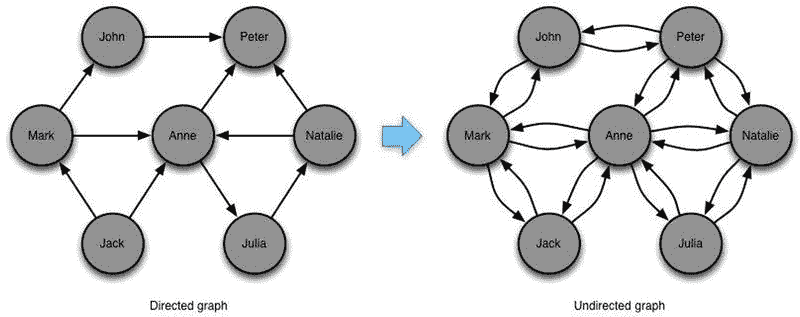
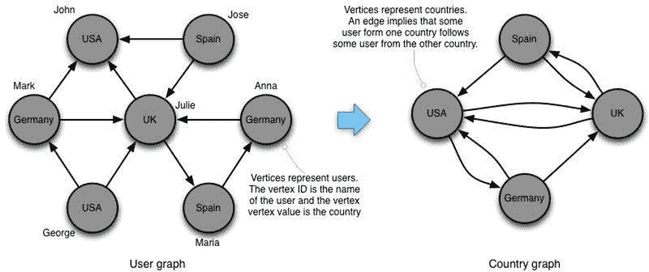
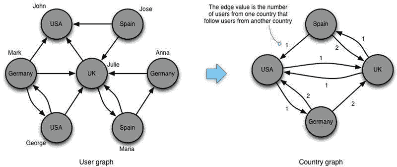

# 8. 超越基础 API

本章涵盖：
- 图突变
- 聚合器 API
- 顶点协调
- 编写模块化应用

在前面的章节中，你学习了如何使用 Giraph 编程 API 的基础部分来实现各种图算法。虽然基础 API 已经为你提供了足够的灵活性来构建大量有用的图挖掘算法，但本章将介绍 Giraph API 中超越基础的功能特性，这些特性使你能够编写更复杂的应用。Giraph API 功能丰富，允许你为应用添加更多功能、更高效地编写算法，甚至从编程角度让你的工作更轻松。

虽然我们通常将输入图视为不可变的数据结构，但本章将讨论你想要通过添加或删除顶点和边来改变输入图的场景。Giraph 提供了一个允许你对输入图执行此类突变的 API。我们将使用示例来描述使用此 API 的不同方式。

接下来，我们将重新审视聚合器，这是一种允许你计算整个图的全局统计信息的工具。在前面的章节中，你已经看到了典型聚合器的示例，并学习了如何在应用中使用它们。在此，我们将介绍 Giraph 提供的用于编写自定义聚合器的 Java API；并通过实现聚合器来进行说明。

此外，分布式算法中最重要的特性之一就是协调。到目前为止，你已经学会了以顶点为中心的方式进行思考，编写程序使得顶点之间通过消息以分布式方式进行通信。Giraph 负责协调算法的执行。在此，你将学习如何在希望进一步自定义算法执行时干预这一协调过程。

本章还将涵盖 Giraph API 中那些从编程角度让你更容易编写复杂应用的特性。你将学习如何将一个可能很复杂的算法分解为执行不同逻辑操作的模块，从而产生更清晰、更易于理解的代码。反过来，你也将学习如何将这些模块组合到不同的应用中，从而提高代码复用率并节省编程工作量。

## 图表突变

在本小节中，您将探索在算法执行期间改变图结构的能力。通常，改变图意味着添加或移除顶点和边。虽然大部分情况下，您考虑的是分析输入的图，但在这里您会看到，改变图通常是此分析过程的一部分。

出于不同的原因，图突变可能是必要的。在某些场景中，您可能只是想转换输入图；例如，作为预处理步骤。您已经在第 3 章和第 5 章中看到了图转换的示例，那里您学习了如何将有向图转换为无向图。在这种情况下，图突变是一个自然的需求。

在其他场景中，您分析的结果可能是一个与输入图完全不同的图。一个常见的例子是，您想将一个输入图划分为社区或集群，然后分析这些社区之间的连接关系。社区检测是社交网络分析中的一个常见应用。在在线社交网络中，您可能希望找到具有相似特征的用户社区，并输出这些社区本身是如何相互连接的。在这种情况下，社区检测算法的输出是一个代表社区的图，这是一个与您的输入图完全不同的图结构。这意味着，在算法执行期间，您必须以某种方式创建一个图；也就是说，创建新的顶点并用新的边将它们连接起来。

图生成器是另一个需要图突变的应用场景。图生成器是有用的工具，允许用户构建符合某些模型（如流行的“小世界”模型）的合成图。事实上，Giraph 代码已经包含了几个图生成器的实现。在这种情况下，图突变是自然而然的；这些工具可以从一个空图或一个初始种子图开始，逐步添加顶点和边，直到构建出最终的图。

在深入了解允许您更改图的 API 之前，理解改变输入图意味着什么非常重要。在这一点上，您必须记住，Giraph 将输入图加载到内存中，并在内部表示中维护一个副本。Giraph 操作并可以（如果需要）改变的就是这个图的副本。图的原始副本保持不变。例如，如果您将图存储在 Hadoop 集群的 HDFS 目录中，然后执行一个使用突变 API 的算法，那么 HDFS 上的图数据在执行后将完全相同。

当然，用户可以改变这个图的内存副本，并将一个新的副本输出到某个外部存储系统。在将有向图转换为无向图的情况下，您将创建该图的一个无向形式的新副本。这将是 Giraph 作业的输出。

注：用户始终可以在顶点计算函数内部修改原始图。假设该图存储在一个表存储系统中，例如 HBase。没有任何东西可以阻止用户编写一个连接到 HBase 并修改图的顶点计算。然而，这样的操作将超出 Giraph 的范围。Giraph 不保证这些更改的一致性。例如，如果某个 Giraph 工作节点发生故障，Giraph 保证能产生正确的结果，但不保证这种外部更改的正确性。这是 Giraph 编程 API 灵活性带来的一种能力和风险。如果您选择利用这种灵活性，您应该意识到所有风险，并格外小心地设计您的程序，以确保它不会引起任何问题，尤其是在生产环境中使用时。

既然我们已经讨论了图突变的实用性，那么让我们来探索赋予您这种能力的实际 API。第 5 章简要介绍了突变 API，而这里将通过多种示例对其进行详细解释。

## 突变 API

Giraph 提供了三种在执行期间改变图结构的方法：（i）对顶点的直接突变，（ii）突变请求，以及（iii）通过消息进行突变。这些方法可能允许不同类型的图突变，并且在突变何时实现方面具有不同的语义。接下来，您将回顾每种突变类型的 API 并说明它们的用法。

### 直接突变

为了说明直接突变 API 的用法，让我们使用一个您已经在第 5 章中看过的示例。在这个示例中，您想要将一个输入图从有向图转换为无向图。图 8-1 展示了这种转换。



**图 8-1.** 将有向图转换为无向图

在图 8-1 中，您看到这种转换需要您更改图结构。特别是，您需要在现有顶点之间添加一些额外的边。

`Vertex` 接口包含了许多方法，允许顶点计算函数直接更改顶点的结构——即更改其边。

*   它们只能更改调用它们的顶点。
*   这种调用的效果是立即生效的。

让我们看看允许改变其结构的 `Vertex` 方法：
*   `addEdge(Edge<I, E> edge)`：向顶点添加一条边。边的 ID 和值通过传递的 `Edge` 对象指定。
*   `removeEdges(I targetVertexId)`：从顶点中移除所有具有指定目标 ID 的边。
*   `setEdges(Iterable<Edge<I, E>> edges)`：通过遍历传递的 `Iterable` 并逐条添加边来设置顶点的出边。

在清单 8-1 中，让我们重新审视第 5 章中的示例代码；接下来将详细解释它使用突变 API 的方式。

**清单 8-1.** 将图从有向图转换为无向图

```java
public class ConvertToUndirected extends
  BasicComputation<Text, DoubleWritable, NulleWritable, Text> {

  static final NullWritable DEFAULT_EDGE_VALUE = NullWritable.get();

  @Override
  public void compute(Vertex<Text, DoubleWritable, DoubleWritable> vertex,
                      Iterable<Text> messages) {
    if (getSuperstep() == 0) {                                           #1
      sendMessageToAllEdges(vertex, vertex.getId());                     #1
    } else {
       for (Text m : messages) {                                         #2
          if (vertex.getEdgeValue(m)==null) {                            #3
           vertex.addEdge(EdgeFactory.create(m, DEFAULT_EDGE_VALUE));    #4
         }
      }
    }
    vertex.voteToHalt();
  }
}
```

在第一个超步中，每个顶点都将其自身的 ID 发送给它的所有邻居。
在第二个超步中，顶点接收到来自每个拥有指向它的边的顶点的消息。
对于收到的每一条此类消息，顶点检查对应的边是否已经存在。
如果边不存在，顶点则添加该边。

请注意，`addEdge` 方法将一个实现了 `Edge` 接口的对象作为输入。虽然您可以实现自己的 `Edge` 类型，但 Giraph 已经提供了在大多数情况下应该足够使用的默认实现。特别是，您可以使用 `EdgeFactory` 实用类的 `create()` 方法来创建 `Edge` 对象。

### 变异请求

接下来，你将看到一个示例，说明直接变异可能并不总是适合修改图结构，并了解变异请求如何提供更高的灵活性。假设你想分析一个类似 Twitter 的社交网络，并探索不同国家的用户是如何关联的——而不是像你之前做的那样分析单个用户连接。从原始的社交图谱开始，你想创建一个新图谱，其中每个顶点对应一个国家，边表示这些国家的用户之间存在连接关系。这让你能够构建 Twitter 图谱的高层视图，并在国家层面观察社交影响力，如图 8-2 所示。



**图 8-2.** 分析不同国家用户之间的连接关系

很明显，在分析原始图谱的同时，你也在创建一个新图谱。事实上，新图谱才是该算法的实际输出。然而，由于这个新图谱的顶点并非预先存在，你无法像之前那样直接使用直接变异。让我们看看变异请求是如何解决这个问题的。

变异请求是 `Computation` 接口中的方法。就像直接变异一样，你可以在顶点计算函数中调用这些方法。但是，与直接变异不同，变异请求具有以下属性：

-   它可以修改图的任何部分，无论发起请求的是哪个顶点。例如，顶点 A 可以请求在顶点 B 和 C 之间添加一条边。

-   变异请求的效果只有在当前超步完成后、下一个超步开始前才可见。

### 注意

第二个属性起初可能看起来有点不自然，但它实际上是为了简化你的程序。这个属性允许你将处理顶点和边创建或删除的逻辑与其余编程逻辑分离开来。即使顶点请求修改了同一个顶点，该请求对发起请求的顶点剩余的当前超步计算也没有影响。它也不会影响其他顶点在请求发出后、但仍在同一超步内进行的计算。

接下来，让我们看看这个 API 的实际应用。

清单 8-2 显示了这个算法的实现。虽然逻辑可能不是一目了然，但所有部分稍后都会解释清楚。

**清单 8-2.** 在 Twitter 图谱中查找国家连接关系

```java
public class CreateCountryGraph extends
BasicComputation<Text, Text, NullWritable, Text> {

  static final NullWritable DEFAULT_EDGE_VALUE = NullWritable.get();

  @Override
  public void compute(Vertex<Text, Text, NullWritable> vertex,
                      Iterable<Text> messages) {
    Text myCountry = vertex.getValue();
    if (getSuperstep()==0) {                                             #1
      sendMessageToAllEdges(vertex, myCountry);                          #1
    } else {
      for (Text m : messages) {                                          #2
        addEdgeRequest(m,                                                #3
          EdgeFactory.create(myCountry, DEFAULT_EDGE_VALUE));            #3
      }
      removeVertexRequest(vertex.getId());                               #4
      vertex.voteToHalt();
    }
  }
}
```

#1 向我关注的每个用户发送我自己国家的名称。

#2 在超步 1，每条消息都包含一个关注我的用户所在的国家。

#3 对于每条消息，创建一条从对方国家指向我所在国家的新边。

#4 每个用户顶点将自己从图中移除，这样最后剩下的只有国家顶点。

在这个场景中，顶点的 ID 类型为 `Text`，代表用户的名称，而顶点的值类型也是 `Text`，代表用户所在的国家。算法运行的大致思路应该很熟悉。你需要了解关注关系图中隐藏着哪些国家之间的配对关系。自然的做法是让每个顶点将其所属国家告知其邻居。算法的第一个超步正是实现了这一逻辑。每个顶点向它关注的顶点发送自己的顶点值，即其对应的国家（#1）。

在第二个超步中，每个顶点现在都知道它的粉丝来自哪些国家。换句话说，它知道了在新的国家图谱中应该存在怎样的边。此时，它可以使用 `addEdgeRequest()` 方法（#3）简单地请求创建一条从粉丝所在国家指向自己国家的边。`addEdgeRequest()` 方法会请求在指定源 ID 的顶点处添加一条边。边的值和目标 ID 通过传递的边对象来指定。

### 注意

你不需要显式创建代表国家的顶点。通过请求在两个国家之间创建一条边，Giraph 会自动创建相应的顶点（如果它们尚不存在）。

不过，你还没有完成。通过创建这些新边，算法执行结束时存在两种类型的顶点：构成原始图谱的用户顶点和构成国家图谱的国家顶点。如果你使用输出格式，你会看到输出包含这两种类型的顶点。但在这个案例中，你只关心国家图谱，所以理想情况下你希望最终的图只包含代表国家的顶点。

变异请求 API 为此提供了解决方案。除了修改顶点的边之外，变异请求 API 还允许你创建或删除顶点。为此，你可以使用 `removeVertexRequest()` API。在超步 0，除了创建新边和新顶点，你还可以移除不需要的顶点。每个顶点还会通过调用 `removeVertexRequest()` 方法并传入自己的 ID 作为参数，来请求移除自身。

### 算法细节

细心的读者可能已经注意到，在超步 0 中没有任何顶点停止。想象一下，如果那些没有粉丝的顶点在超步 0 就停止了会发生什么。它们永远不会在超步 1 中收到消息，因此它们不会被激活并运行 `compute()` 函数。通过在超步 0 不让顶点停止，你可以让每个顶点都在超步 1 运行 `compute()` 函数，从而允许它们通过 `removeVertexRequest()` 方法从图中移除自身。

最后，请记住，通过调用 `addEdgeRequest()` 和 `removeVertexRequest()` 方法，顶点只是向 Giraph 注册了这些请求。边并不会立即创建，顶点也不会立即被移除。你必须等到下一个超步，这些更改才会真正生效。

除了你在示例中看到的这两个方法之外，`Computation` 接口还提供了以下方法：

-   `addVertexRequest(I id, V value, OutEdges<I, E> edges)`: 发起请求，创建一个具有指定 ID、值和边的顶点。

-   `addVertexRequest(I id, V value)`: 发起请求，创建一个具有指定 ID 和值的顶点。创建的顶点没有边。

-   `removeVertexRequest(I vertexId)`: 发起请求，移除具有指定 ID 的顶点。如果具有指定 ID 的顶点不存在，则不执行任何操作。

-   `addEdgeRequest(I sourceId, Edge<I, E> edge)`: 发起请求，在具有指定源 ID 的顶点处添加一条边。边的值和目标 ID 通过传入的边对象指定。请注意，此请求仅影响具有源 ID 的顶点。

-   `removeEdgesRequest(I sourceId, I targetId)`: 发起请求，从具有传入源 ID 的顶点中移除一条边。具体来说，它移除具有传入目标 ID 的那条边。如果该边不存在，则不执行任何操作。此调用仅影响源顶点，不影响目标顶点。

尽管这个示例没有使用这些方法，但它们具有相似的语义。它们允许的修改并非立即生效，而是在下一个超步开始时才实现。

## 通过消息进行变更

接下来，让我们看看在 Giraph 中修改图的第三种替代方式。除了通过之前的 API 进行显式图变更外，Giraph 还允许通过向不存在的顶点发送消息来隐式地创建一个顶点。让我们来看看这究竟意味着什么，以及它如何发挥作用。

让我们看看如何通过前面的例子来使用这种创建顶点的方式。事实上，你将通过计算更多信息来丰富它。假设现在你不仅想知道哪些国家相互连接，还想知道来自一个国家的用户有多少关注了来自另一个国家的用户。这为我们提供了对国与国之间关系更全面的视角；你还可以了解国家间关系的强度，以及从总粉丝数来看，哪个国家是被关注最多的。图 8-3 展示了通过分析原始输入图你希望得到的结果。



**图 8-3.** 计数来自一个国家的用户关注了来自另一个国家的用户的数量

现在让我们来看一下计算这些更详细统计数据的算法。与之前的示例不同，这里我们假设边的值类型为`IntWritable`，用于在程序执行结束时保存粉丝数。清单 8-3 展示了其实现。

清单 8-3。计算国家间粉丝关注的数量

```
public class CreateCountryGraphWithCounts extends
    BasicComputation<Text, Text, IntWritable, Text> {

  @Override
  public void compute(Vertex<Text, Text, IntWritable> vertex,
      Iterable<Text> messages) {
    Text myCountry = vertex.getValue();
    if (getSuperstep()==0) {                                             // #1
      sendMessageToAllEdges(vertex, myCountry);                          // #1
    } else if (getSuperstep()==1) {                                      // #2
      for (Text m : messages) {                                          // #2
        sendMessage(m, myCountry)                                        // #3
      }
      removeVertexRequest(vertex.getId());                               // #4
      vertex.voteToHalt();
    } else {                                                             // #5
      for (Text m : messages) {                                          // #6
        IntWritable edgeValue = vertex.getEdgeValue(m);                  // #7
        if (edgeValue == null) {                                         // #7
          vertex.addEdge(EdgeFactory.create(m, new IntWritable(1)));     // #7
        } else {                                                         // #8
          vertex.setEdgeValue(m, new IntWritable(edgeValue.get()+1));    // #8
        }
      }
      vertex.voteToHalt();
    }
  }
}
```

- `#1` 告诉我正在关注的用户，我来自哪个国家。
- `#2` 在超步 1，每条消息都包含一个关注我的用户所在的国家。
- `#3` 对于每一个关注我的国家，向一个 ID 设置为该特定国家的目标发送一条消息。消息中包含此顶点自己的国家名称。
- `#4` 和之前一样，每个用户顶点将自己从图中移除。
- `#5` 在超步 2，代表国家的顶点被创建并接收消息。
- `#6` 消息包含一个国家名称，代表该国家中一个用户的关注关系。
- `#7` 对于每一个这样的国家，检查此顶点是否已经有一条到它的边。如果没有，添加一条新边并将其初始值设为 1。
- `#8` 如果该国家已经存在，则对于每一条包含相应国家名称的消息，将其边的值加一。

## 算法细节

在初始的用户图中，边的值无关紧要，你只需假设当图通过使用`InputFormat`构建时，其值被设置为`0`。

回顾一下，Giraph 模型允许一个顶点通过简单地指定目标的 ID 来发送消息。在大多数情况下，一个顶点会向其邻居之一发送消息。它通常通过查看其边（在加载输入图期间构建）来选择一个 ID。然而，Giraph 的 API 实际上更加灵活，允许你在`sendMessage()`方法中使用任何 ID。既然你可以指定任何 ID，你可能想知道如果你指定了一个输入图中实际不存在的 ID 会发生什么。

答案是 Giraph 会为你创建该顶点。这样，你的程序可以通过向一个顶点发送消息来动态地创建它。在这种情况下，创建的顶点被初始化为没有边，并且顶点值被设置为`null`。

> **注意**：作为程序员，你有责任编写代码来处理这种初始化。

该算法的第一部分与之前相同。在超步 0，每个顶点通过消息将自己的国家发送给它关注的顶点（`#1`）。因此，在超步 1，每个用户顶点都会收到包含国家名称的消息。

在开始超步 2 之前，Giraph 发现有消息是发送给代表国家的顶点的。这些顶点尚不存在。因此，Giraph 会创建它们，然后超步 2 像往常一样开始执行。它将消息传递给所有顶点，并调用`compute()`函数。

在这种情况下，只有新创建的国家顶点有消息。消息同样包含国家名称。国家 A 收到的一条包含国家名称 B 的消息意味着存在一条从国家 A 到国家 B 的单个关注关系。首先，这意味着代表国家 A 的顶点和代表国家 B 的顶点之间应该有一条边（`#7`）。其次，通过统计包含国家 B 的消息数量，你就能够确切地知道来自国家 A 的用户中有多少人关注了来自国家 B 的用户。这个数量就是所创建边的值。

现在，你已经了解了在算法执行过程中修改图结构的三种不同方式。通常，使用哪一种取决于你的算法以及你的创意。有时你会发现可以用这些方式中的任何一种来实现一个算法，而在其他场景中，你会发现更倾向于某一种变更类型。例如，当你只需要向顶点添加边，并且每个顶点只负责添加自己的边时，就像第一个例子那样，直接变更可能是更好的选择，因为它们更快。另一方面，如果你需要创建顶点，或者某个顶点负责向其他顶点添加边，那么变更请求就是解决方案。总的来说，你需要稍微思考一下算法的设计，然后选择最合适的选项。

## 处理变更冲突

尽管之前的示例中并未体现，但变更请求中可能发生冲突。例如，两个顶点可能发出以下冲突请求：一个顶点请求添加一条具有特定值的边，而另一个顶点可能请求创建同一条边但带有不同的值。此时这条边的值应如何确定？有时甚至会出现更令人困惑的请求，比如某个程序可能同时发出向一个顶点添加边的请求，以及删除该顶点的请求。

乍看之下，这类请求似乎不合逻辑；你可能会疑惑为什么会有人编写这样的程序。但你会发现，在编写分布式程序时，不同计算过程之间出现此类分歧是不可避免的。事实上，只要存在解决冲突的方式，这种设计就是分布式算法的一部分。不妨想想一个简单的多线程程序：两个线程试图递增同一个共享计数器。如果程序设计不当，结果将是未定义的，而编程语言通常提供同步原语来帮助正确设计程序。接下来你将看到`Giraph`如何解决这类冲突。

首先，回顾一下创建推特国家关系图的示例。代码如 8-4 所示。请注意，"Mark"顶点和"Anna"顶点都发出请求，为"Germany"顶点创建一条目标 ID 为"UK"的边。

每当一个顶点发生一组变更（如添加或删除边）时，`Giraph`会使用`VertexChange`对象表示这些变更，并使用`VertexResolver`对象（它以`VertexChange`作为输入）来定义实际处理变更的方式。我们先从描述 8-4 中的`VertexResolver`接口开始。

**代码清单 8-4.`VertexResolver`接口**

```
public interface VertexResolver<I extends WritableComparable,
                                V extends Writable, E extends Writable> {
    Vertex<I, V, E> resolve(I vertexId,                        #1
                            Vertex<I, V, E> vertex,            #2
                            VertexChanges<I, V, E> vertexChanges, #3
                            boolean hasMessages);              #4
}
```

`#1` 待解析的顶点 ID。

`#2` 应用变更前的原始顶点。

`#3` 该顶点的变更集合。

`#4` 定义该顶点在上一个超步中是否有发往它的消息。

`VertexResolver` 接口只有一个方法。`Giraph` 会为每个顶点调用该方法，并将已发生的变更集合传递给它。当你实现此方法时，你本质上就定义了变更后 `Vertex` 应呈现的状态。如 8-5 所示的 `VertexChange` 接口有助于确定请求对该顶点执行的变更。

**代码清单 8-5. `VertexChanges` 接口**

```java
public interface VertexChanges<I extends WritableComparable,
                               V extends Writable, E extends Writable> {
    List<Vertex<I, V, E>> getAddedVertexList();   #1
    int getRemovedVertexCount();                   #2
    List<Edge<I, E>> getAddedEdgeList();           #3
    List<I> getRemovedEdgeList();                  #4
}
```

#1 返回请求针对此顶点 ID 添加的顶点列表。

#2 返回针对此顶点 ID 的删除请求数量。

#3 返回请求添加到此顶点的边列表。

#4 返回请求从此顶点移除的边列表。

在实现你自己的 `VertexResolver` 之前，先看看如果让 `Giraph` 使用默认的 `VertexResolver` 会发生什么。默认的顶点解析器会执行以下操作：如果存在任何边移除请求，首先执行这些移除操作。如果存在顶点移除请求，则将其移除。这通过将返回的 `Vertex` 对象设置为 `null` 来实现。如果存在顶点添加请求，且该顶点不存在，则创建该顶点。如果顶点有消息发送给它，且该顶点不存在，则创建该顶点。如果存在向顶点添加边的请求，若该顶点不存在，则先创建顶点再添加边；否则，直接添加边。

此列表的顺序很重要，因为它精确地定义了 Giraph 默认解决冲突的方式。这意味着，例如，如果同时存在移除顶点和添加顶点的请求，那么由于默认解析器在删除顶点之后才检查顶点创建，因此最终会创建该顶点。

## 默认顶点解析器实现

尽管此处未展示 `DefaultVertexResolver` 的实现，但建议你查看其源代码作为额外示例。这能让你更深入地了解 `VertexResolver` 的用法。

现在假设你想更改此默认行为。具体来说，让我们稍微不同地处理同一边的多个添加请求。与仅仅将边添加到顶点不同，你实际上希望统计存在的请求数量，并将此数量设置为边的值。这本质上为你提供了一种替代方法来统计一个国家关注另一个国家用户的数量。在清单 8-6 中，让我们看看如何通过创建一个自定义 `VertexResolver` 来简单地实现这一点。

**清单 8-6. 一个计算边添加次数的自定义 VertexResolver**

```java
public class MyVertexResolver implements VertexResolver<Text, Text, IntWritable, Text> {

    @Override
    public Vertex<Text, Text, IntWritable> resolve(
        Text vertexId,
        Vertex< Text, Text, IntWritable> vertex,
        VertexChanges<Text, Text, IntWritable > changes,
        boolean hasMessages) {

        if (changes!=null) {
            if (!changes.getAddedEdgeList().isEmpty()) {         #1
                if (vertex==null) {                             #2
                    vertex = getConf().createVertex();          #2
                    vertex.initialize(vertexId,                 #2
                        getConf().createVertexValue());
                }
                for (Edge<I, E> edge : changes.getAddedEdgeList()) {
                    IntWritable edgeValue =                     #3
                        vertex.getEdgeValue(edge.getTargetVertexId()); #3
                    if (edgeValue==null) {
                        edge.setValue(new IntWritable(1));      #4
                        vertex.addEdge(edge);                   #4
                    } else {
                        vertex.setEdgeValue(edge.getTargetVertexId(),  #5
                            new IntWritable(edgeValue.get()+1));       #5
                    }
                }
            }
        }
    }
}
```

#1 首先，检查是否存在边添加请求。

#2 如果存在边添加请求，且该顶点尚不存在，则创建它。

#3 对于每条边的添加，检查该边是否已存在。

#4 如果不存在，则添加它并将其值设置为 1。

#5 如果已存在，则仅将其值加 1。

在此示例中，你假设只需要处理边添加请求。自定义解析器首先检查是否存在任何此类添加请求 (#1)。如果有，则需要检查源顶点是否已存在。回想一下，在这种情况下，你创建了表示国家的顶点，而这些顶点尚不存在。因此，如果顶点尚不存在，则需要创建它 (#2)。之后，每当你看到同一边的请求时，只需将该边的值加 1 (#5)。

现在你已经实现了自定义解析器，唯一缺少的是告诉 Giraph 使用此特定的顶点解析器实现来替代默认实现。和往常一样，通过熟悉的命令行自定义参数来实现。只需将以下内容添加到命令行：`-ca giraph.vertexResolverClass=MyVertexResolver`。

总体而言，突变是一种高级特性，一旦你开始考虑更复杂的应用程序，就会发现它非常有用。接下来，将讨论另一个高级特性：如何编写你自己的聚合器。

## 聚合器 API

聚合器是一种非常有用且易于使用的工具，它允许你计算整个图的全局统计数据。你已经在第 3 章和第 5 章中看到了几个使用聚合器的示例。Giraph 已经提供了一组通用的聚合器函数（例如 sum 或 max），你可以在应用程序中使用它们。同时，Giraph 允许你实现自己的聚合器函数。本节将更详细地解释聚合器接口，并展示如何编写新的聚合器。

Giraph 提供了两种实现自定义聚合器的方式。第一种方式是实现 `Aggregator` 接口，这为你实现聚合器提供了最大的灵活性。清单 8-7 展示了该接口的方法。

**清单 8-7. Aggregator 接口**

```java
public interface Aggregator<A extends Writable> {
    void aggregate(A value);            #1
    A createInitialValue();             #2
    A getAggregatedValue();             #3
    void setAggregatedValue(A value);   #4
    void reset();                       #5
}
```

#1 将输入值聚合到聚合器的当前值。

#2 在任何聚合发生之前创建聚合器的初始值。

#3 返回聚合器的当前值。

#4 设置聚合器的当前值。

#5 重置聚合器的值。

为了理解聚合器的实现，让我们先讨论一下 Giraph 如何使用此接口。`createInitialValue()` 在 Giraph 开始聚合任何值之前被调用。每当顶点想要向聚合器添加一个值时，Giraph 都会调用 `aggregate` 方法。聚合器的实现负责维护适当的数据结构以实现此聚合。例如，如果你正在实现一个求和聚合器，你的实现应维护一个部分和，并向其中添加值。

除了 `Aggregator` 接口之外，Giraph 还提供了一个抽象类，它实现了 `Aggregator` 接口的一部分，涵盖了最常见的聚合器功能。大多数情况下，扩展此抽象类就能满足你的需求。让我们看看 `BasicAggregator` 的详细信息，然后看一个扩展它以实现新聚合器的示例。（参见清单 8-8。）

## 清单 8-8. `BasicAggregator` 抽象类

```
public abstract class BasicAggregator<A extends Writable> implements
    Aggregator<A> {

    private A value;                                #1

    public BasicAggregator() {                      #2
        value = createInitialValue();
    }

    @Override
    public A getAggregatedValue() {                 #3
        return value;
    }

    @Override
    public void setAggregatedValue(A value) {       #4
        this.value = value;
    }

    @Override
    public void reset() {                           #5
        value = createInitialValue();
    }
}
```

#1 聚合器的内部值。它保存当前的部分聚合结果。
#2 默认构造函数将内部值设置为其初始值。
#3 返回聚合器的当前值。
#4 直接设置聚合器的内部值。
#5 将聚合器的值重置为其初始值。