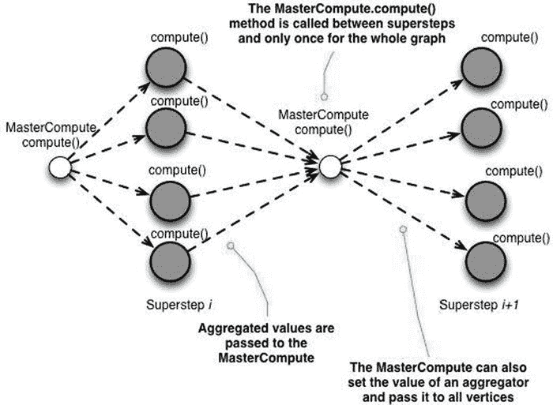
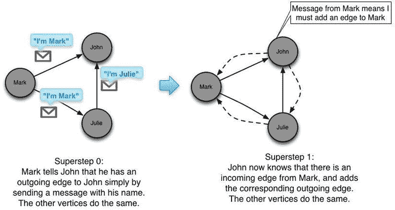

# `BasicAggregator`与自定义聚合器

`BasicAggregator`维护的唯一数据结构是聚合器内部的值，其类型与您的聚合体类型相同。这本质上是聚合器当前的局部值。当您扩展`BasicAggregator`时，您唯一的职责是通过`createInitialValue()`方法定义初始值，并通过`aggregate()`方法定义如何将新值聚合到聚合器的当前内部值中。让我们通过一个示例来说明。

您已经见过编写最大值或求和聚合器的逻辑；这里将展示如何编写一个实现布尔 OR 函数的聚合器。您可以使用这样的聚合器来检测图中是否有任何顶点满足某个条件。例如，假设一个社交图中每个顶点都标有用户的年龄。您还假设有时年龄信息可能缺失，在这种情况下您会停止分析并打印一条消息。因此，您真正想知道的是是否存在至少一个顶点缺少年龄信息。布尔 OR 聚合器将以"至少一个"的逻辑实现这一点。换句话说，如果有至少一个顶点向聚合器添加了值`true`，聚合器的值应为布尔值`true`，否则为`false`。清单 8-9 展示了实现。

**清单 8-9.** 实现布尔 OR 的自定义聚合器

```
public class BooleanOr extends BasicAggregator<BooleanWritable> {

    @Override
    public BooleanWritable createInitialValue() {       #1
        return new BooleanWritable(false);
    }

    @Override
    public void aggregate(BooleanWritable value) {
        boolean currValue = getAggregatedValue().get();   #2
        boolean newValue = currValue || value.get();      #3
        getAggregatedValue().set(newValue);               #4
    }

}
```

#1 将聚合器的值初始化为`false`。

#2 获取聚合器的当前值。

#3 在当前聚合器值与聚合值之间执行逻辑 OR 操作。

#4 将操作结果设置为聚合器的新值。

## OR 运算的交换律和结合律

在第 3 章中，您了解到为了让 Giraph 能够高效地执行聚合，运算必须满足交换律和结合律。显而易见，逻辑 OR 运算符(`||`)确实同时满足交换律，因为：

`a || b = b || a`

并且满足结合律，因为：

`(a || b) || c = a || (b || c)`

实现相当直接。显然，如果没有顶点向聚合器添加值，结果应为`false`。因此，`createInitialValue()`通过使用布尔类型的`Writable`实现，将聚合器的值初始化为布尔值`false`。接着，通过`aggregate()`方法，您实际上是在当前聚合器值(#2)与新聚合值(#3)之间执行逻辑 OR 操作。结果替换了聚合器的值(#4)。

Giraph 已经为最常见的操作提供了丰富的聚合器实现集合。与往常一样，随着您的应用程序变得越来越定制化和复杂，您越希望超越基本功能并实现自己的功能。该 API 提供了一种简单的方法来实现有用的聚合器，Giraph 能够以可扩展且高效的方式为您计算这些聚合器，而您无需担心底层实现。在下一节中，您将再次遇到聚合器，这次将探讨它们如何帮助协调分布式程序。

## 集中式算法协调

到目前为止，您了解到在 Giraph API 中编程的基本原则是"以顶点为中心"的编程，这要求您从图中顶点的角度思考。相应地，您必须编写一个每个顶点都会执行的`compute()`函数。这导致了自然分布式的算法，其中每个顶点不需要知道图中其他顶点的状态，只为自己进行计算。

但在某些情况下，您发现要实现算法，顶点之间需要相互协调。这种协调可能涉及共享某种对整个图通用的信息，或通过执行一些影响整个算法的集中式计算。事实上，您已经在第 5 章中看到了这样的例子，其中您必须通过使用聚合器来计算 Twitter 中最受欢迎的用户。聚合器提供了一种集中式协调和计算的形式，因为所有顶点共同贡献于单个聚合器的值，然后这个值再被提供给所有顶点。这里，我们将讨论`MasterCompute`，这是另一种协调顶点的方式。

总的来说，除了通过熟悉的`compute()`函数在每个顶点上执行的分布式计算之外，您可能还需要执行一些依赖于或影响整个图和计算的操作。例如，考虑一下，应用程序的停止取决于聚合器的值，而不是每个顶点个体。幸运的是，Giraph 提供了`MasterCompute`，一种为此而设计的机制。您已经见过一些如何使用`MasterCompute`的例子，但这里将更详细地解释它，并提供更多关于用它实现什么功能的示例。

`MasterCompute`本质上提供了一个集中位置，您可以在其中执行操作，例如读取和设置聚合器值、获取关于整个图的统计信息，甚至停止整个作业执行。实际上，您可以将`MasterCompute`视为一段应用程序逻辑，它在每个超步结束后只执行一次。（见图 8-4。）



**图 8-4.** `MasterCompute`集中式计算点。`compute()`方法在每个超步之前执行一次。聚合器值从`MasterCompute`传递给顶点。

清单 8-10 展示了`MasterCompute`抽象类的方法，随后将结合示例进行说明。

**清单 8-10.** `MasterCompute`抽象类

```
public abstract class MasterCompute
    extends DefaultImmutableClassesGiraphConfigurable
    implements MasterAggregatorUsage, Writable {

  public abstract void initialize()        #1
   throws InstantiationException, IllegalAccessException;

  public abstract void compute();          #2

}
```

#1 在算法执行开始前调用。

#2 在每个超步结束后为整个图恰好调用一次。

`MasterCompute`的`initialize()`方法在算法开始执行之前被调用一次；它通常用于设置您的`MasterCompute`实现。您稍后将看到，这对于设置聚合器的操作非常有用。`compute()`方法是`MasterCompute`的核心工作方法。Giraph 在每个超步执行之前恰好调用一次此方法；也就是说，在它调用顶点的`compute()`方法之前。更具体地说，Giraph 第一次调用`MasterCompute`的`compute()`方法是在超步 0 执行之前。接下来，让我们看看一些可以在`MasterCompute`的`compute()`函数中执行的示例。


### 终止计算

决定何时停止执行是分布式图算法的核心方面之一。想一想你在第 4 章中看到的 PageRank 算法。PageRank 算法在每次迭代中都会改变网页的排名。停止决策可能取决于你目前已执行的迭代次数，或者自上次迭代以来网页排名的变化幅度。无论如何，你都需要一种方法来指示 Giraph 停止计算。

到目前为止，你已经了解到要停止 Giraph 计算，必须满足两个条件：每个顶点都调用了 `voteToHalt()` 方法，并且当前超步中没有发送任何消息。这些条件完全取决于你的顶点计算逻辑。实际上，在第 4 章中，你看到了许多算法示例以及它们如何实现这种停止条件。但你可能需要基于关于图及算法执行的一些聚合信息（而非单个顶点）来做出停止计算的决策。例如，你可能希望这样的决策依赖于某个聚合器的值。以 PageRank 为例，如果自上次迭代以来排名的总差异变化不大（即 PageRank 已收敛），你可能希望停止计算。这种类型的决策无法由每个顶点单独做出，而必须由某个中心化实体来完成。正如你可能已经猜到的，`MasterCompute` 正是执行此操作的地方。

Giraph 通过 `MasterCompute` API 为你提供了一种额外的方法，可以在中心化控制点终止计算。回想一下，`MasterCompute` 类的 `compute()` 方法是在超步结束之后、下一个超步开始之前调用的。在 `MasterCompute` 的 `compute()` 方法内部，你可以调用 `haltComputation()` 方法来终止执行。请注意，一旦调用了此方法，无论是否仍有顶点发送消息，或者是否并非所有顶点都已调用 `voteToHalt()` 方法（正如你之前所知的那样），执行都会终止。换句话说，从 `MasterCompute` 调用 `haltComputation()` 会优先于通常的终止条件。

让我们看一个如何使用它的示例。决定算法终止的一种典型方式是依据目前已执行的超步数。你在第 4 章中看到的 PageRank 算法就是这样一个例子。在那里，你将停止逻辑放在顶点计算本身内部；而这里你将看到如何从 `MasterCompute` 内部实现这一点。这样做的一个好处是，你可以保持主要计算逻辑更清晰。代码清单 8-11 展示了如何在 `MasterCompute` 实现中执行此操作。

**代码清单 8-11.** 基于超步数的终止

```
public class MyMasterCompute extends DefaultMasterCompute {

    @Override
    public void compute() {
        if (getSuperstep() == 10) {                         #1
            haltComputation();                              #1
        }
    }

}
```

#1 基于超步编号终止计算。

通常，你可以在 `MasterCompute` 的 `compute()` 方法内实现任意逻辑。此逻辑在超步之间执行。在这个例子中，你简单地检查是否处于超步 10，并通过终止计算来采取相应行动。否则，`compute()` 方法不需要做其他事情。

回想一下，当你在 `MasterCompute` 内部调用 `getSuperstep()` 时，它返回即将执行的超步的编号。在上一个示例中，`compute()` 方法在超步 9 执行完毕之后、超步 10 执行之前调用了 `haltComputation()`。因此，超步 10 将永远不会被执行。这是一个你需要留意的小细节，以避免错误地编写终止条件逻辑。


### 使用聚合器进行协调

你已经了解到聚合器在计算全局统计数据方面的强大作用。除了全局统计，聚合器还有其他实用功能，协调便是其中之一。我们先讨论一个需要协调的具体例子。回想一下你在第 4 章中看到的推荐算法，它用于预测用户与物品之间的推荐关系。这些算法会迭代优化一个机器学习模型，旨在最小化预测误差。预测误差通过所有顶点的聚合误差计算得出，并借助聚合器来完成。这类算法通常在聚合预测误差低于特定阈值时停止执行。将聚合器与 `MasterCompute` 结合使用，便是协调执行停止的一种方式。

更具体地说，你可以将聚合器视为一个所有顶点都能读写数据的全局变量。通过聚合器，你可以将信息从各个顶点收集到一个中心位置（即 `MasterCompute`），然后在算法执行期间从该位置将信息传回所有顶点，让它们根据这些信息做出决策。在这个例子中，你传递的是聚合误差的值给顶点，顶点则根据这个值采取行动。换言之，聚合器是主控节点与顶点通信的途径。具体而言，在顶点 `compute()` 被调用之前，聚合器的值会广播给所有工作节点；而在主控节点 `compute()` 被调用之前，聚合器的值会被收集。清单 8-12 展示了这一示例。

**清单 8-12.** 基于聚合器值终止执行

```
public class MyMasterCompute extends DefaultMasterCompute {

    @Override
    public void compute() {
        if (((DoubleWritable)getAggregatedValue("error")).get() < 0.001) { #1
            haltComputation();                                             #2
        }
    }
}
```

#1 终止条件基于聚合器预测误差低于阈值。

#2 当此条件成立时，终止执行。

在此示例中，假设顶点使用“error”聚合器来累加总预测误差。每轮超步结束后，聚合误差会提供给 `MasterCompute`，你可以在其 `compute()` 方法中读取该值，以决定是否终止执行。

如前所述，除了读取聚合器的值，在 `MasterCompute` 的 `compute()` 方法内部，你还可以设置聚合器的值，并将其“广播”给图中的每个顶点。该聚合器的值将在下一轮超步执行期间对所有顶点可用。例如，假设在上一个例子中，你希望在每轮超步后计算所有顶点误差的平均值，然后将该平均值反馈给所有顶点。平均误差随后被每个顶点用作反馈，以改进预测。

实现方式之一是先计算所有顶点的预测误差总和。你已了解如何使用“error”聚合器完成这一步。之后，在 `MasterCompute` 中，将聚合器误差除以图中的顶点数，即可轻松计算出平均值，然后将其广播给所有顶点。清单 8-13 展示了这一过程。

**清单 8-13.** 在 MasterCompute 中设置聚合器的值

```
public class MyMasterCompute extends DefaultMasterCompute {

    @Override
    public void compute() {
        double totalError =
            ((DoubleWritable)getAggregatedValue("error")).get();          #1
        double avgError = totalError / (double)getTotalNumVertices();    #2
        setAggregatedValue("avg.error", new DoubleWritable(avgError));   #3
    }
}
```

#1 获取所有顶点的聚合器误差。

#2 通过除以顶点数来计算平均误差。

#3 通过一个新的聚合器将平均误差广播给所有顶点。

在这个 `MasterCompute` 实现中，你首先读取了持有所有顶点预测误差总和的“error”聚合器的值（#1）。之后，利用 `getTotalNumVertices()` 方法，轻松计算出平均误差（#2）。最后，使用 `MasterCompute` 的 `setAggregatedValue()` 方法，将“avg.error”聚合器的值设置为你刚计算出的平均值（#3）。该聚合器的值将在下一轮超步中对所有顶点可用。

总的来说，`MasterCompute` 是协调顶点之间关系的一个非常实用的工具。在这个例子中，它实现了仅使用分布式顶点中心编程接口所无法实现的功能。具体来说，它允许你通过聚合信息来收集顶点间的通信，并使整个图都能获取这些信息。在下一节中，你将了解使用 `MasterCompute` 的另一种独特方式——如何由更简单的模块组合成复杂算法。

## 编写模块化应用

到目前为止，你已经探索了 Giraph API 提供的那些能让你在应用中增加更多功能或编写更高效算法的特性。在本节中，你将了解 Giraph API 的一个特性，该特性有助于你从编程角度编写更好的应用。具体来说，你将看到 Giraph 如何让你将可能很复杂的算法从更简单的逻辑块中组合出来，从而提高代码的可读性和复用性。通过示例，你将学习如何识别那些可能被分解为更简单算法的算法，以及如何使用 Giraph API 来简化其开发过程。


### 将算法结构化为阶段

我们首先讨论属于此类别且能从可组合性中获益的算法类型。这些编程模式出现在许多算法中，且易于识别。不过请注意，这绝非一个详尽的列表。这些仅作为常见案例，帮助您理解可组合的 API，并在出现新场景时能更具创造力地使用它。

在您目前看到的 Giraph 算法中，您可能已经观察到一种常见的编程模式：算法内部的逻辑可能取决于当前正在执行的超步。这是在 Giraph 中将复杂算法分解为更简单算法的基本模式。让我们重新审视一个您在第三章中见过的算法，该算法将有向图转换为无向图。换句话说，该算法确保：如果原始图中存在从顶点 A 到顶点 B 的边，那么输出图中也会包含一条从 B 到 A 的边。许多算法都基于无向图运行，因此这是一个常见的预处理步骤。在第三章中，您看到了该算法的伪代码；在此为您展示实际代码。（参见代码清单 8-14。）

**代码清单 8-14.** 将有向图转换为无向图的算法

```
public class ConvertGraph

extends BasicComputation<

IntWritable, NullWritable, NullWritable, IntWritable> {

@Override

public void compute(

Vertex<IntWritable, NullWritable, NullWritable> vertex,

Iterable<IntWritable> messages) {

if (getSuperstep()==0) {

sendMessageToAllEdges(vertex, vertex.getId())   #1

vertex.voteToHalt()

} else {

for (IntWritable msg : messages) {              #2

IntWritable id = (IntWritable)msg.get();      #2

if (vertex.getEdgeValue(id))==null) {         #3

vertex.addEdge(message)                     #3

}

}

vertex.voteToHalt()

}

}

}
```

#1 将该顶点的 ID 发送给它的所有邻居。
#2 我收到了一条消息，其中包含一个来自某个指向我的顶点的 ID。
#3 如果不存在指向该目标 ID 的边，则添加它。

在该算法中，在超步 0 期间，每个顶点都向它所指向的所有顶点发送一条包含其自身顶点 ID 的消息。这样一来，在超步 1 期间，如果顶点 B 有一条指向 A 的边，顶点 A 就会收到来自 B 的消息。如果顶点 A 没有指向 B 的边，它就可以添加这条边。图 8-5 展示了这两个步骤。



**图 8-5.** 将有向图转换为无向图的步骤

这是一个非常具有代表性的示例，说明了算法如何从由更简单的模块组合成算法的能力中获益，原因如下。首先，您可以立即观察到它符合前面描述的模式：计算逻辑取决于当前正在执行的超步。具体来说，有两个清晰分离的阶段：一个在超步 0 期间执行，另一个在超步 1 期间执行。

其次，将图转换为无向图通常是一个预处理步骤，相对于应用程序的主要逻辑来说是次要的。这样一来，您必须将这种转换逻辑连同您的主要逻辑一起包含在计算函数中。例如，假设您想在无向图上运行您在第四章中看到的连通分量算法。在这种情况下，在执行算法的主要逻辑之前，您必须通过应用转换逻辑来确保图已被转换为无向图。

为了说明这一点，我们首先来看一下如何实现原始的连通分量算法。第四章用伪代码描述了该算法；代码清单 8-15 展示了实际代码。

**代码清单 8-15.** 连通分量算法

```
public class ConnectedComponents

extends BasicComputation<

IntWritable, NullWritable, NullWritable, IntWritable> {

@Override

public void compute(

Vertex<IntWritable, NullWritable, NullWritable> vertex,

Iterable<IntWritable> messages) {

if (getSuperstep()==0) {

sendMessageToAllEdges(vertex, vertex.getId())                       #1

vertex.voteToHalt()

} else {

int maxId = vertex.getValue().get()                                 #2

for (IntWritable msg : messages) {                                  #3

if (msg.get()>maxId) {                                            #4

maxId = msg.get();                                              #4

}                                                                 #4

}

if (maxId>vertex.getValue().get()) {                                #5

vertex.setValue(maxId);                                           #5

sendMessageToAllEdges(vertex, maxId)                              #5

}

vertex.voteToHalt();

}

}

}
```

#1 在超步 0 中，每个顶点将自己的 ID 发送给所有邻居。
#2 每个顶点维护迄今为止看到的最大 ID，该 ID 代表该顶点所属分量的 ID。
#3 在后续的每个超步中，顶点会收到其所有邻居的 ID。
#4 顶点在其自身 ID 和其邻居的 ID 中找出最大的 ID。
#5 如果该最大 ID 大于当前存储在顶点值中的 ID，则更新该值，并将新的最大 ID 传播给所有邻居。

现在您已经掌握了连通分量的逻辑，让我们看看如何修改它以执行相同的算法，但在将有向图转换为无向图之后（参见代码清单 8-16）。

**代码清单 8-16.** 在无向图上应用连通分量算法

```
public class ConnectedComponents

extends BasicComputation<

IntWritable, NullWritable, NullWritable, IntWritable> {

@Override

public void compute(

Vertex<IntWritable, NullWritable, NullWritable> vertex,

Iterable<IntWritable> messages) {

if (getSuperstep()==0) {                          #1

sendMessageToAllEdges(vertex, vertex.getId())   #1

vertex.voteToHalt()                             #1

} else if (getSuperstep()==1) {                   #1

for (IntWritable msg : messages) {              #1

IntWritable id = (IntWritable)msg.get();      #1

if (vertex.getEdgeValue(id))==null) {         #1

vertex.addEdge(message)                     #1

}                                             #1

}                                               #1

vertex.voteToHalt()                             #1

} else if (getSuperstep()==2) {                   #2

sendMessageToAllEdges(vertex, vertex.getId())   #2

vertex.voteToHalt()                             #2

} else if (getSuperstep()>2) {                    #2

int maxId = vertex.getValue().get();            #2

for (IntWritable msg : messages) {              #2

if (msg.get()>maxId) {                        #2

maxId = msg.get();                          #2

}                                             #2

}                                               #2

if (maxId>vertex.getValue().get()) {            #2

vertex.setValue(maxId);                       #2

sendMessageToAllEdges(vertex, maxId)          #2

}                                               #2

vertex.voteToHalt();                            #2

}

}

}
```

#1 图转换逻辑在前两个超步中应用。
#2 主要算法逻辑在后续超步中应用。


你可以清楚地看到，该算法混合了两种逻辑：图转换和连通分量算法。同样，它通过超步编号来区分不同阶段：前两个超步用于图转换，之后的超步则执行连通分量的逻辑。

尽管这种组织算法的方式完全正确，但你可能会发现，它会导致代码变得不必要的复杂——因为你的计算逻辑中混入了与核心算法无关的代码。随着算法复杂度的提升，你最终会在同一个计算过程中塞入多个不同的逻辑块。例如，就像这里的图预处理步骤，在某些场景下，主逻辑执行后还需要在后续超步中执行后处理阶段，这进一步增加了应用的复杂度。更糟的是，当你为算法编写单元测试时，即使转换逻辑与主逻辑无关，你也必须设计相应的测试用例来验证它。

第三，将图转换为无向图这一逻辑片段，在不同需要处理无向图的算法中可能会重复出现。事实上，你完全可以将超步 0 和 1 中的代码直接复制到其他算法中。但这并非良好的编程实践，原因如下：首先，这迫使你修改主算法，使其仅从超步 2 开始执行主逻辑；其次，这会增加代码复用和维护的难度。例如，若在转换逻辑中发现缺陷，你必须修复所有使用该逻辑的算法。相反，一旦开始构建算法库，你最好能直接复用这些通用逻辑模块，而不是每次都重新编码。接下来，我们将探讨如何真正解决这些问题。

### 可组合 API

希望到目前为止，你已经意识到从编程角度看，编写算法可能会变得复杂。现在让我们看看 Giraph 如何简化这一过程。从高层来看，Giraph 允许你为不同超步指定不同的计算类，并以简单的方式决定在每个超步执行哪个计算。这样，你不仅能将逻辑分离到不同计算类中，还能将它们组合到单个算法的执行过程中。让我们通过一个示例来了解具体实现方法，随后再解释其带来的所有好处。

具体来说，我们仍以图转换为无向图的场景为例。第一步，将图转换的逻辑拆分为两个独立的计算：第一个计算负责将顶点 ID 发送给所有邻居，这对应原始单体应用中超步 0 的操作；第二个计算负责接收 ID 消息，若对应边不存在则添加边，这对应原始算法中超步 1 的操作。你可以在代码清单 8-17 中看到这两个计算。

**代码清单 8-17.** 将顶点 ID 传播到邻居的计算

```
public class PropagateId
extends BasicComputation<
IntWritable, NullWritable, NullWritable, IntWritable> {

  @Override
  public void compute(
    Vertex<IntWritable, NullWritable, NullWritable> vertex,
    Iterable<IntWritable> messages) {
      sendMessageToAllEdges(vertex, vertex.getId())   #1
      vertex.voteToHalt()
  }
}
```

#1 将顶点 ID 发送给所有邻居。

在此示例中，假设输入图的顶点 ID 为整数类型，且没有关联的顶点值和边值。因此，这些值被假定为`NullWritable`类型。在第一个计算中，每个顶点简单地将自己的 ID 通过`sendMessageToAllEdges()` API 发送给所有邻居，然后停止。现在来看代码清单 8-18。

**代码清单 8-18.** 添加反向边的计算

```
public class ReverseEdges
extends BasicComputation<
IntWritable, NullWritable, NullWritable, IntWritable> {

  @Override
  public void compute(
    Vertex<IntWritable, NullWritable, NullWritable> vertex,
    Iterable<IntWritable> messages) {
      for (IntWritable msg : messages) {
        IntWritable id = (IntWritable)msg.get();
        if (vertex.getEdgeValue(id))==null) {
          vertex.addEdge(message)
        }
      }
      vertex.voteToHalt()
  }
}
```

至此，你拥有了两个看似互不相关的计算类。这是因为你一直以来都是在单个计算类的框架下思考算法。接下来，我们将改变这种思路，探索如何以非常简单的方式将它们组合在一起。

将不同计算类组合起来，主要就是决定在每个超步中使用哪个计算类——换句话说，就是协调这些计算类的使用。“协调”这个词可能已经暗示你，这需要通过`MasterCompute`来实现。实际上，`MasterCompute`实现中的一项操作就是设置在每个超步要使用的计算。你需要在`MasterCompute`的`compute()`方法中实现选择正确函数的逻辑。回想一下，Giraph 会在每个超步执行前调用`MasterCompute`实现的`compute()`方法。在此方法内部，你可以设置下一个超步使用的计算。代码清单 8-19 展示了如何实现这一操作。

**代码清单 8-19.** 从 MasterCompute 设置计算类

```
public class MyMasterCompute extends DefaultMasterCompute {

  @Override
  public final void compute() {
    long superstep = getSuperstep();       #1
```


```java
if (superstep == 0) {                  #2
    setComputation(PropagateId.class);   #2
} else {                               #3
    setComputation(ReverseEdges.class);  #3
}
}
}
```

#1 获取下一步将要执行的超步编号。

#2 如果即将执行的是超步 0，则将计算逻辑设置为 `PropagateId.`

#3 如果即将执行的是超步 1，则将计算逻辑设置为 `ReverseEdges`.

我们来逐步分析这个方法中的操作。首先，你获取 Giraph 即将执行的超步编号。基于此编号，你选择合适的计算逻辑。具体来说，如果 Giraph 即将执行超步 0，你需要执行转换的第一个阶段：让每个顶点向其邻居发送自己的 ID。这就是 `PropagateId` 计算类所实现的逻辑。接着，你使用 `MasterCompute` 的 `setComputation()` API 将此配置告知 Giraph。注意，你传递给该方法的参数是一个 `Class` 类型的对象，它代表了你想要执行的特定计算类。第一个超步执行完毕后，Giraph 会再次调用 `MasterCompute` 的 `compute()` 方法。这时，你需要执行转换的第二个阶段：顶点接收来自第一阶段的消息，并添加相应的边。这对应的是 `ReverseEdges` 计算类。因此，如果即将执行超步 1，你需要再次使用 `setComputation()` 方法，将计算类设置为 `ReverseEdges.class`。

就是这样。借助 `MasterCompute`，你只需简单调用 `setComputation()` 方法，就能轻松协调算法的执行。正如你在第 5 章中已经看到的，要运行这个应用程序，你只需在通过 `-mc` 命令行选项运行 Giraph 作业时指定 `MasterCompute` 的实现即可。剩下的工作都由 Giraph 负责，它会确保每个超步使用正确的计算逻辑。

但让我们回顾一下，通过将功能分离到不同的模块中，你实现了什么。首先，很明显，你无需在应用程序逻辑中编码超步的选择，从而保持了逻辑的清晰和完整。从代码可读性的角度来看，两个分离的计算类只编码了它们各自意图执行的操作，因此更简单且更易于理解。

除此之外，之前也提到过，能够轻松地在应用程序间重用代码是一件好事。具体来说，现在让我们重新审视一下这个场景：你想在一个无向图上执行连通分量算法。你已经有代码可以将图转换为无向图，也已经有代码实现了连通分量算法。接下来你只需要使用可组合 API，在 `MasterCompute` 中将它们粘合在一起，而无需修改主要逻辑。`MasterCompute` 类的实现如清单 8-20 所示。

**清单 8-20.** 将图转换与连通分量算法结合

```java
public class MasterCompute extends DefaultMasterCompute {

    @Override
    public final void compute() {
        long superstep = getSuperstep();
        if (superstep == 0) {
            setComputation(PropagateId.class);
        } else if (superstep == 1) {
            setComputation(ReverseEdges.class);
        } else {
            setComputation(ConnectedComponents.class);
        }
    }
}
```

你可能已经注意到，你所做的是将每个超步执行逻辑的协调和选择，从主计算逻辑转移到了代码中专为协调而设的部分——即 `MasterCompute`。同样地，结果是你完全不需要修改连通分量算法的逻辑。你只是将三个独立的逻辑片段组合在一起，形成一个新的应用程序。你只需指示 Giraph 在头两个超步中使用图转换逻辑，然后在后续的所有超步中使用你的主计算逻辑。类似地，你可以将头两个计算逻辑与任何其他算法（而非连通分量算法）结合使用，从而简化代码重用，并使构建新应用程序变得容易。

**注意**

在 `MasterCompute` 内部，你可以在每个超步设置计算类；如果你没有显式设置，Giraph 会使用上一次超步设置的值。

## 本章小结

尽管基本的 Giraph API 已经足够灵活，可以让你表达多种多样的算法，但 Giraph 还提供了一些工具，赋予你更强的能力。这些工具使得表达新的编程模式成为可能，例如集中式协调，从而使你的算法更高效，并且从编程角度来看，也可能让你的工作更轻松。

-   图变异 API 允许算法在执行过程中修改图。这通常是许多需要改变图的应用程序的自然需求，但对于那些需要临时创建逻辑顶点的算法来说，它也可能是一个得心应手的工具。
-   Giraph 提供了三种执行变异的方式：(i) 直接对 `Vertex` 对象进行变异，(ii) 变异请求，以及 (iii) 通过消息进行变异。
-   使用变异请求时，可能会发生冲突。使用 `VertexResolver` 来决定你希望如何解决这些冲突。
-   聚合器允许你计算全局统计信息，并且 Giraph 已经提供了丰富的常用操作集合。同时，你可以使用简单的聚合器 API 来实现自定义聚合器。
-   聚合器和 `MasterCompute` 使得表达需要集中式协调的算法成为可能。
-   使用 `MasterCompute compute()` 方法来实现你的集中式协调逻辑。
-   算法可能会很快变得复杂，但它们通常结构化为依赖于所执行超步的多个阶段。使用可组合 API 可以简化编程，实现代码重用，并产生更易于维护的代码。

至此，你已经开始使用 Giraph 的更高级特性。这应该能让你编写更复杂的应用程序。在下一章中，你将继续深入了解 Giraph 的这些高级特性，包括如何控制 Giraph 中的并行化，以编写更高效的应用程序。

