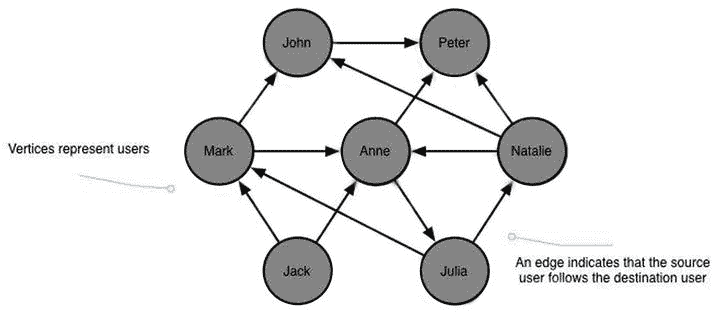

# 揭示 Giraph 中的并行性

本章涵盖

- 每工作节点计算
- Giraph 中的线程安全性
- 图划分的重要性
- 实现自定义分区器

在前面的章节中，你了解了 Giraph 的不同编程原语，并学会了如何使用它们来实现图算法。在实现图算法的过程中，你以抽象的方式考虑图，仅将它们视为可以通过消息相互通信的顶点和边。幸运的是，你无需担心底层发生了什么；也就是说，当 Giraph 在集群上执行你的算法时，这些顶点和边位于何处，或者消息是如何实际实现的。你也不必担心 Giraph 如何将算法的执行并行化。事实上，这正是 Giraph 的一大优势；它为你隐藏了在大型计算集群上执行图算法所带来的复杂性。

随后在第 6 章中，你更深入地了解了 Giraph 的内部架构，并发现它是如何管理超大规模图的并行处理的。你了解到 Giraph 将顶点分组到分区中，并将它们分发给负责处理每个分区的实际机器或工作节点，从而实现并行处理。你还了解到 Giraph 甚至可以在同一工作节点内的不同线程上执行处理，从而实现进一步的并行化。

在本章中，你将重新审视 Giraph 如何并行化大型图的处理，但目标有所不同。你将看到，只需了解一些并行处理机制的知识，就可以在 Giraph 之上构建更高效的应用程序。例如，本章将讨论如何通过工作节点计算的概念来利用顶点到工作节点的分布。具体来说，你将学习如何使用每工作节点计算来增强以顶点为中心的算法，这些计算允许你在物理上位于同一工作节点上的顶点之间共享数据和计算。你将在几个场景中看到，共享数据和计算可以帮助你增加新功能或显著提高应用程序的性能。

本章还将讨论图划分，即顶点在不同工作节点之间的放置。简单的示例描述了不同的图划分策略可能对应用程序性能产生的影响。然后你将学习不同的图挖掘场景如何从不同的划分策略中受益。最后，你将学习如何通过实现自定义分区器来控制图划分以使其对你有益。

## 工作节点计算

正如你在第 6 章中所了解的，Giraph 将图分割成多个分区，并将分区分配给集群机器或工作节点。这使得 Giraph 能够通过将分区分配给不同的工作节点，甚至可能将不同的分区分配给同一工作节点内的不同 CPU 核心来实现图的并行处理。更具体地说，每个工作节点或核心负责为该工作节点或核心上的所有顶点调用 `compute` 函数。到目前为止，很好的一点是，作为程序员，你无需担心图在底层是如何划分的，以及 Giraph 如何处理每个分区；你只需要抽象地思考图和算法，将其视为带有边的顶点以及顶点计算即可。

然而，在本节中，你将发现有时了解分区和工作节点分布这一概念可以帮助你构建更好的应用程序。具体来说，你将学习到一些算法可能不仅受益于以顶点为单位的计算，还可能受益于以工作节点为单位的计算。你将首次执行不属于 Giraph 典型以顶点为中心思维的运算。在这里，你将回顾一些常见的用例，并学习如何利用划分的概念，以便为你的应用程序添加功能或使其更高效。

### 用例：在工作线程间共享数据

每个工作线程的独立计算中最常见的应用场景之一，就是需要在同一个工作线程的所有顶点间共享某种数据结构。通常情况下，顶点计算内部的编程逻辑需要访问数据，这些数据可能来自某个外部服务（例如分布式存储系统），并且对所有顶点都是通用的。

为了更具体地说明，假设你要处理图 9-1 中熟悉的 Twitter 关系图，统计每个用户拥有的男性或女性粉丝数量。



**图 9-1.** 一个 Twitter 关系图示例

事实上，在第 3 章中你已经见过该算法简化版本的伪代码，它仅统计 Twitter 粉丝数。在介绍更复杂的算法之前，我们通过代码清单 9-1 来看看这个简化版应用在实际代码中是什么样子。

**代码清单 9-1.** 统计 Twitter 粉丝数的算法

```java
public static class CountFollowers
extends AbstractComputation<Text, IntWritable, NullWritable, Text, Text> {
    @Override
    public void compute(Vertex<Text, Text, NullWritable> vertex,
                        Iterable<Text> messages) throws IOException {
        if (getSuperstep()==0) {
            sendMessageToAllEdges(vertex, vertex.getId());              #1
            voteToHalt();                                               #1
            return;                                                     #1
        }
        int numFollowers = 0;
        for (Text msg : messages) {                                     #2
            numFollowers++;                                             #2
        }                                                               #2
        vertex.setValue(new IntWritable(numFollowers));                 #3
        voteToHalt();
    }
}
```

#1 在第一个超步中，将 ID 发送给所有邻居并返回

#2 在第二个超步中，顶点统计消息数量，每条消息来自一个粉丝

#3 最后，顶点将其值设为粉丝数，投票中止并隐式返回

在该算法中，第一个超步期间，每个顶点将其 ID 发送给所有它指向的顶点，即它关注的所有用户。第二个超步期间，每个顶点会收到消息：每个粉丝发送一条。此时，它只需统计收到的消息数量，并将结果计数设为其值即可。

接下来，你要修改这个应用，以便根据性别统计粉丝数量。首先要注意，由于性别信息可能不属于用户资料的组成部分，你需要一种方法来自动判断用户是男性还是女性，并为其打上“female”或“male”标签。假设存在一个维护此信息的外部服务，即该服务可以将用户映射到性别。这样的服务本质上会提供一个分类器，当你传入名字时，它能自动检测性别。

你无需关心该服务和分类器的细节。只需假设在应用内调用 `getClassifierFromService()` 可以联系外部服务，并返回一个 `GenderClassifier` 类型的对象。一旦获得了 `GenderClassifier` 对象的实例，你就可以将名字传递给该实例的 `get(String)` 方法，该方法会返回一个字符串，指示“female”或“male”性别。

现在你已知道如何访问外部服务并将名字映射到性别，接下来看看如何在 Giraph 中实现这个应用，如代码清单 9-2 所示。

**代码清单 9-2.** 按性别统计 Twitter 粉丝数的算法

```java
public static class CountFollowersByGender
extends AbstractComputation<Text, Text, NullWritable, Text, Text> {
    @Override
    public void compute(Vertex<Text, Text, NullWritable> vertex,
                        Iterable<Text> messages) throws IOException {
        if (getSuperstep()==0) {
            GenderClassifier classifier = getClassifierFromService();    #1
            String gender = classifier.get(vertex.getId());              #2
            sendMessageToAllEdges(vertex, new Text(gender));             #3
            voteToHalt();                                                #4
            return;                                                      #4
        }
        int femaleFollowers = 0;
        int maleFollowers = 0;
    }
}
```

# 算法实现：基于性别的关注者统计

```java
for (Text msg : messages) {                                    #5
    if (msg.toString().equals("female")) {                       #5
        femaleFollowers++;                                     #5
    } else {                                                     #5
        maleFollowers++;                                       #5
    }                                                            #5
}                                                              #5

String vertexValue =
    "female:"+femaleFollowers+", male:"+maleFollowers;            #6
vertex.setValue(new Text(vertexValue));                        #6
voteToHalt();
}
}
```

## 连接外部服务并获取性别分类器
## 根据姓名从分类器中获取性别
## 向该顶点关注的所有用户发送性别标签
## 如果这是第一个超步，则投票停止并返回
在第二个超步中，消息包含关注者的性别标签。
将性别计数器设置为顶点值。

这个新算法同样相当直接。与简化版相比，区别在于在超步 0 期间，顶点会联系外部服务来获取性别分类器，以判断其代表的用户是男性还是女性。之后，它会向所有该用户关注的用户发送"female"或"male"标签。在第二个超步中，每个已知顶点维护两个独立的计数器：一个用于女性计数器，另一个用于男性计数器。注意，你还需要将值的类型改为`Text`，并将其设置为表示两个计数的字符串。这就是按性别统计关注者所需的全部内容。

现在，这是一种为算法添加此功能的完全有效的方式，但它带来了一个问题。它迫使你每次进行顶点计算时都要访问外部服务。这个看似无害的特性可能会给处理过程增加延迟，从而显著降低应用程序的性能。

然而，你可能已经注意到，在这种场景下，每次顶点计算时你都在重复读取完全相同的信息，即性别分类器对象。理想情况下，你希望避免这种情况，而是将这些信息保存在内存中的某个位置，并在所有顶点之间共享。这样就能避免所有不必要的访问，最终加速计算。

为了实现这一目标，Giraph 提供了一个名为 `WorkerContext` 的工具。`WorkerContext` 是一个对象，它在一个分区内的所有顶点之间共享，并且贯穿算法执行的整个生命周期；每个工作器都有自己的 `WorkerContext`。你可以通过两种方式使用它。首先，你可以在算法执行的预定义时间点执行每个工作器的计算；例如，在超步之前和之后。其次，你也可以用它来维护共享数据结构，从而在每个顶点计算内部进行访问。Giraph 提供了一个抽象类，你可以扩展它以定制适合你的用例。在观察你如何在特定场景中使用它之前，我们先来看看 `WorkerContext` 抽象类的方法，如清单 9-3 所示。

## 清单 9-3. `WorkerContext` 抽象类

```java
public abstract class WorkerContext {
    public void preApplication();        #1
    throws InstantiationException, IllegalAccessException;

    public void postApplication();       #2

    public void preSuperstep();          #3

    public void postSuperstep();         #4
}
```

在每个工作器上，在计算开始前调用。
在每个工作器上，在计算结束后调用。