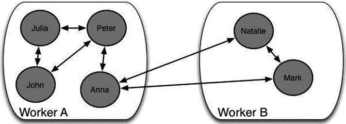

# 排版后的内容：

`MasterGraphPartitioner<I, V, E> createMasterGraphPartitioner();`  #1

`WorkerGraphPartitioner<I, V, E> createWorkerGraphPartitioner();`  #2

`}`

#1 实例化并返回一个 `MasterGraphPartitioner` 对象  
#2 实例化并返回一个 `WorkerGraphPartitioner` 对象

在深入探讨这些接口的具体实现之前，我们首先描述它们的作用，并展示需要实现的各个方法。随后，你将逐一实现它们，以实现实际的哈希分区技术。

第一个接口 `MasterGraphPartitioner` 主要负责建立和维护用于存储所有分区信息的必要数据结构。其方法如列表 9-10 所示。稍后将通过一个示例对其进行详细说明。

**列表 9-10.** `MasterGraphPartitioner` 接口

```
public interface MasterGraphPartitioner<I extends WritableComparable,
    V extends Writable, E extends Writable> {

  Collection<PartitionOwner> createInitialPartitionOwners(
      Collection<WorkerInfo> availableWorkerInfos, int maxWorkers); #1

  Collection<PartitionOwner> generateChangedPartitionOwners(
      Collection<PartitionStats> allPartitionStatsList,
      Collection<WorkerInfo> availableWorkers,
      int maxWorkers,
      long superstep);                                              #2

  Collection<PartitionOwner> getCurrentPartitionOwners();           #3

  PartitionStats createPartitionStats();                            #4
}
```

#1 基于可用工作节点创建 `PartitionOwner` 对象  
#2 在每个超步开始时调用，用于潜在创建新的 `PartitionOwner` 对象  
#3 返回当前 `PartitionOwner` 对象的列表  
#4 返回一个用于保存分区统计信息的对象

这里最重要的数据结构是 `PartitionOwner`。`PartitionOwner` 封装了关于分区本身的信息，也包含了拥有该分区的工作机器（即该分区所在的工作机器）的信息。如你所见，`MasterGraphPartitioner` 负责创建一组 `PartitionOwner` 对象，这些对象通常描述当前场景的配置；也就是说，运行任务的工作节点集合以及将图分割成的分区数量。

`PartitionOwner` 实际上是一个接口，根据你想要维护的分区所有者元数据类型，它可以有不同的实现。在这里，我们不深入探讨 `PartitionOwner` 接口的细节，而是使用 Giraph 已经提供的实现 `BasicPartitionOwner`。`BasicPartitionOwner` 主要包含它所对应的分区 ID，以及该分区所在工作节点的信息。这种 `PartitionOwner` 的实现应该足以满足大多数场景。

但现在让我们看看如何利用这些来实现一个基于哈希的分区器。首先，你实现 `GraphPartitionerFactory` 接口。实现相当简单，如列表 9-11 所示。

**列表 9-11.** 一个 `GraphPartitionerFactory` 实现示例

```
public class HashPartitionerFactory<I extends WritableComparable,
    V extends Writable, E extends Writable>
    implements GraphPartitionerFactory<I, V, E> {

  private ImmutableClassesGiraphConfiguration conf;                  #1

  @Override
  public MasterGraphPartitioner<I, V, E> createMasterGraphPartitioner() {
    return new HashMasterPartitioner<I, V, E>(getConf());            #2
  }

  @Override
  public WorkerGraphPartitioner<I, V, E> createWorkerGraphPartitioner() {
    return new HashWorkerPartitioner<I, V, E>();                     #3
  }

  @Override
  public ImmutableClassesGiraphConfiguration getConf() {
    return conf;                                                     #4
  }

  @Override
  public void setConf(ImmutableClassesGiraphConfiguration conf) {
    this.conf = conf;                                                 #5
  }
}
```

#1 持有作业配置的对象  
#2 返回基于哈希的 `MasterGraphPartitioner` 实现实例  
#3 返回基于哈希的 `WorkerGraphPartitioner` 实现实例  
#4 返回配置对象  
#5 在工厂初始化时调用，用于设置配置对象  

在此实现中，你可以看到工厂仅实例化了两个对象：类型分别为 `MasterGraphPartitioner` 和 `WorkerGraphPartitioner`。接下来，让我们更详细地查看 `HashMasterPartitioner` 的实现，以了解设置 `PartitionOwner` 数据结构的典型方式（参见清单 9-12）。

**清单 9-12.** `HashMasterPartitioner` 的实现

```markdown
```
public class HashMasterPartitioner<I extends WritableComparable,
    V extends Writable, E extends Writable> implements
    MasterGraphPartitioner<I, V, E> {

    private ImmutableClassesGiraphConfiguration conf;                    #1
    private List<PartitionOwner> partitionOwnerList;                     #2

    public HashMasterPartitioner(ImmutableClassesGiraphConfiguration conf) {
        this.conf = conf;                                                #3
    }

    @Override
    public Collection<PartitionOwner> createInitialPartitionOwners(      #4
        Collection<WorkerInfo> availableWorkerInfos, int maxWorkers) {

        int partitionCount = PartitionUtils.computePartitionCount(       #5
            availableWorkerInfos, maxWorkers, conf);

        List<PartitionOwner> ownerList = new ArrayList<PartitionOwner>();
        Iterator<WorkerInfo> workerIt = availableWorkerInfos.iterator();

        for (int i = 0; i < partitionCount; ++i) {
            PartitionOwner owner =                                       #6
                new BasicPartitionOwner(i, workerIt.next());

            if (!workerIt.hasNext()) {                                   #7
                workerIt = availableWorkerInfos.iterator();
            }

            ownerList.add(owner);                                        #8
        }

        this.partitionOwnerList = ownerList;
        return ownerList;
    }

    @Override
    public Collection<PartitionOwner> getCurrentPartitionOwners() {
        return partitionOwnerList;
    }

    @Override
    public Collection<PartitionOwner> generateChangedPartitionOwners(
        Collection<PartitionStats> allPartitionStatsList,
        Collection<WorkerInfo> availableWorkerInfos,
        int maxWorkers,
        long superstep) {

        return PartitionBalancer.balancePartitionsAcrossWorkers(
            conf,
            partitionOwnerList,
            allPartitionStatsList,
            availableWorkerInfos);
    }

    @Override
    public PartitionStats createPartitionStats() {
        return new PartitionStats();
    }

}
```

`#1` 保存配置
`#2` 维护 `PartitionOwner` 对象的列表
`#3` 构造 `HashMasterPartitioner` 时，需传入作业配置
`#4` 在执行前调用，用于创建初始的 `PartitionOwner` 对象集
`#5` 获取分区数量，通常是一个配置选项
`#6` 为每个分区创建一个分区所有者，并指定下一个可用的工作节点
`#7` 如果已为所有工作节点分配了分区，则重新开始
`#8` 创建后，将 `PartitionOwner` 添加到维护的列表中

`HashMasterPartitioner` 实现中最重要的方法是 `createInitialPartitionOwners()`。该方法首先计算你想要的分区数量。这个数字通常是一个配置参数，可能取决于集群中的总核心数等因素。之后，它为每个分区创建一个 `PartitionOwner` 对象，并以轮询方式将其分配给一个可用的工作节点。在此处，你可以应用自己的逻辑。例如，如果通过某些外部服务能够获取每个工作节点的负载信息，你可以将其纳入分区分配策略中。最后，该方法仅返回所创建的 `PartitionOwner` 对象列表。

接下来，你需要实现 `generateChangedPartitionOwners()` 方法。Giraph 会在每个超步执行后调用此方法，让你有机会根据需要更改工作节点的初始分区分配。例如，可能是因为你发现某个工作节点崩溃了，此时需要将其分区分配给另一个工作节点。另一种可能的情况是，你注意到某个工作节点最终拥有的分区超出了其处理能力，此时你可能希望将部分处理任务卸载到另一台工作节点上。在所有这些情况下，每个超步结束后，你都可以通过为分区选择新位置来调整分区。但请注意，不允许更改顶点到分区的分配。

在此特定实现中，修改分区所有者的决策被委托给一个名为 `PartitionBalancer` 的特殊辅助类。简而言之，`PartitionBalancer` 确保每个工作节点被分配大致相同的工作量，从而提供良好的集群利用率。关于平衡器及其重要性的讨论将推迟到下一节。在那里，你还会看到如何在运行时通过 `generateChangedPartitionOwners()` 修改分区。

`createPartitionStats()` 方法返回一个 `PartitionStats` 类型的对象，该对象保存有关分区的有用统计信息。这些统计信息包括分区中的顶点和边数量，以及此分区中顶点发送的消息数。这些统计信息对于应用依赖运行时行为的复杂分区技术可能很有用。更具体地说，你可以使用该类维护的信息来决定当 Giraph 调用 `generateChangedPartitionOwners()` 方法时如何更新分区所有者。Giraph 已经提供了一个基础的 `PartitionStats` 类，其中包含最常见的统计信息，你可以继续使用它。如果你需要，也可以自由扩展此类以维护更多信息，以适应你的特定场景。

现在你已经实现了所有辅助类，接下来就可以实现由 `WorkerGraphPartitioner` 接口定义的分区器主要逻辑了。一旦 Giraph 使用分区器工厂和 `HashMasterPartitioner` 创建了 `PartitionOwner` 对象集合，它就可以将顶点分配给已构建的分区所有者。这就是 `WorkerGraphPartitioner` 的工作。其方法在清单 9-13 中说明。

`清单 9-13.` `WorkerGraphPartitioner` 接口
```

# Giraph 图分区机制详解

## WorkerGraphPartitioner 接口

`WorkerGraphPartitioner` 接口定义了工作节点分区器的核心方法。

```java
public interface WorkerGraphPartitioner<I extends WritableComparable,
    V extends Writable, E extends Writable> {

    PartitionOwner createPartitionOwner();                         #1
    PartitionOwner getPartitionOwner(I vertexId);                  #2
    Collection<PartitionStats> finalizePartitionStats(             #3
        Collection<PartitionStats> workerPartitionStats,
        PartitionStore<I, V, E> partitionStore);
    PartitionExchange updatePartitionOwners(                       #4
        WorkerInfo myWorkerInfo,
        Collection<? extends PartitionOwner> masterSetPartitionOwners,
        PartitionStore<I, V, E> partitionStore);
    Collection<? extends PartitionOwner> getPartitionOwners();     #5

}
```

#1 创建一个空的 `PartitionOwner` 对象
#2 将顶点 ID 映射到 `PartitionOwner`
#3 在超步结束时调用
#4 确定哪些分区必须从特定工作节点发送
#5 返回当前的 `PartitionOwner` 对象列表

`getPartitionOwner()` 方法是其中最重要的，它接收一个顶点 ID 作为输入，并返回该顶点对应的 `PartitionOwner` 对象。Giraph 使用此方法来决定顶点的放置位置。接下来，将通过一个基于哈希的分区器示例，解释 `WorkerGraphPartition` 接口的所有方法。

### HashWorkerPartitioner 实现

清单 9-14 展示了这些方法的实现。

清单 9-14. `HashWorkerPartitioner` 实现

```java
public class HashWorkerPartitioner<I extends WritableComparable,
V extends Writable, E extends Writable>
implements WorkerGraphPartitioner<I, V, E> {

    protected List<PartitionOwner> partitionOwnerList =               #1
        Lists.newArrayList();

    @Override
    public PartitionOwner createPartitionOwner() {
        return new BasicPartitionOwner();                             #2
    }

    @Override
    public PartitionOwner getPartitionOwner(I vertexId) {
        URL url = new URL(vertexId.toString());                      #3
        String domain = url.getHost();                                #3
        return partitionOwnerList.get(                                #4
            Math.abs(domain.hashCode() % partitionOwnerList.size()));
    }

    @Override
    public Collection<PartitionStats> finalizePartitionStats(
        Collection<PartitionStats> workerPartitionStats,
        PartitionStore<I, V, E> partitionStore) {
        return workerPartitionStats;
    }

    @Override
    public PartitionExchange updatePartitionOwners(
        WorkerInfo myWorkerInfo,
        Collection<? extends PartitionOwner> masterSetPartitionOwners,
        PartitionStore<I, V, E> partitionStore) {
        return PartitionBalancer.updatePartitionOwners(partitionOwnerList,
            myWorkerInfo, masterSetPartitionOwners, partitionStore);
    }

    @Override
    public Collection<? extends PartitionOwner> getPartitionOwners() {
        return partitionOwnerList;
    }
}
```

#1 保存当前 `PartitionOwner` 对象的列表
#2 创建一个空的 `BasicPartitionOwner` 对象
#3 从 URL 中提取域名
#4 在域名上应用哈希分区逻辑

基于哈希的分区逻辑核心位于 `getPartitionOwner()` 方法内部。给定一个顶点 ID（即网页 URL），该方法从 URL 中提取域名，然后计算域名的哈希码，并求其除以分区数的余数。结果指示指定顶点应被分配到哪个分区。

请注意，本例中的分区逻辑非常简单，但你可以在该方法内放置任意逻辑，甚至可以连接到负责维护图分区的外部服务。

此外，你还需要实现 `updatePartitionOwners()` 方法。Giraph 会在每个超步结束时调用此方法，用于确定是否以及哪些分区需要从其他工作节点发送过来。此决策同样委托给了 `PartitionBalancer`，稍后将对此类进行介绍。

最后，既然你已经实现了自定义分区器的所有必要部分，你可能会想知道如何实际告知 Giraph 使用它们。要启用自定义分区器，只需将参数 `giraph.graphPartitionerFactoryClass` 设置为你分区器工厂的完整类名即可。像往常一样，你可以通过命令行完成此操作。

在此特定场景中，启动作业时需要在命令行中添加 `–ca giraph.graphPartitionerFactoryClass=HashPartitionerFactory` 选项。其余的工作 Giraph 会自动处理。

## 分区平衡

在前面关于分区的讨论中，你只了解了分区如何影响网络流量，并进而影响应用程序性能。分区还有另一个可能影响性能的方面，称为分区平衡。通常，当所有工作节点包含大致相同数量的顶点或边时，分区是平衡的。但首先，让我们看看平衡为何重要。

考虑之前看到的图，并设想在工作节点间有第三种分区方式，如图 9-8 所示。



图 9-8. 非平衡分区示例

这是一种完全有效的图分区方式，但它存在一个问题。注意，工作节点 A 包含的顶点数远多于工作节点 B，此处是后者的两倍。因为机器上顶点数量越多，其 CPU 负载也越大；这种图在工作节点间的不均匀分布同样会导致 CPU 负载的不平衡。结果，部分工作节点（此处为工作节点 B）未被充分利用，从而无法获得集群的最大性能。

相反，均匀分布工作负载可以有效利用集群资源，并减少总处理时间。`PartitionBalancer` 是一个辅助类，其方法可以找到分区的正确放置位置，从而实现平衡分区。本质上，它利用分区 API 提供的能力，通过 `GraphMasterPartitioner` 的 `generateChangedPartitionOwners()` 方法和 `WorkerGraphPartitioner` 的 `updatePartitionOwners()` 方法在运行时修改分区位置——正如你之前所见。

重要的是，`PartitionBalancer` 支持不同类型的平衡。第一种平衡类型称为顶点平衡，确保每个工作节点持有大致相同数量的顶点。除此之外，它还支持边平衡，尝试确保所有工作节点包含大致相同数量的边。哪种更合适取决于你要运行的算法类型，以及每个工作节点的 `CPU` 负载取决于其持有的顶点数还是边数。

以你在第 4 章中见到的 `PageRank` 算法为例，它用于网页排名。在 `PageRank` 中，每个顶点从其邻居接收消息，每条消息携带一个数值。对于接收到的每条消息，顶点执行一次运算，将消息值累加至其本地排名值。因此，顶点完成的总工作量主要取决于其具有的邻居（即边）数量。所以，为了在工作节点间均匀分布工作负载，你希望每个工作节点拥有大致相同数量的边。

通常，在顶点平衡和边平衡之间进行选择需要对你算法的计算和通信模式有深入了解。通常，只需将算法的计算和通信模式与某些其他算法（如 `PageRank`）进行比较，你可能就能理解哪种平衡类型更合适。无论如何，正确平衡分区可以积极影响算法性能和集群资源利用率。

## 概要

`Giraph` 的编程核心 `API` 隐藏了其并行化图处理过程的细节。与此同时，通过向用户开放这一过程，你能够编写出更高效的应用程序。

- 在某些应用场景下，可能需要跨顶点共享数据，这乍看起来会打破以顶点为中心的计算模型。

- 在这种情况下，`WorkerContext` 变得非常有用。它允许你在每个 `Worker` 的基础上进行计算，并在同一 `Worker` 上的所有顶点之间共享数据结构。这既能简化你的应用，也能提升性能。

- 不要忘记，使用 `WorkerContext` 可能会引发线程安全问题。某些应用可能会修改 `WorkerContext` 持有的数据，并且这种修改可能由不同线程并发进行。请务必将方法声明为 `synchronized`，以避免竞态条件。

- 图的分区方式会对应用的可扩展性和性能产生重大影响。

- 默认情况下，`Giraph` 使用哈希分区，这是一种常见的做法，能使图在机器之间均匀分布，但可能导致较高的网络流量。

- 以智能方式对图进行分区通常取决于具体的图和应用程序。

- 一旦你为你的场景确定了合适的分区方案，请使用 `WorkerGraphPartitioner` 及其所有相关接口来实现自定义分区器。

最后几章重点介绍了 `Giraph` 的内部机制和更高级的特性。在下一章中，我们将延续这一思路。你会再次回顾如何从各种存储系统读取图以及将图写入其中，但这次我们将探讨更高级的存储系统（例如 `HBase`）的场景，它能使你将 `Giraph` 连接到任何数据源。