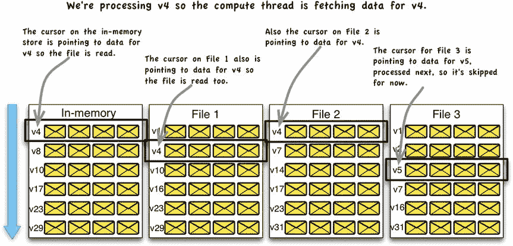

# 排版后的文本

首先，需要注意`serializedEdges`是一个`byte[]`类型的私有字段，用于存储边信息，它属于外部类`ByteArrayEdges`。同样地，`serializedEdgesBytesUsed`是一个`int`类型的私有字段，用于统计该数组中已使用的字节数。在构造时，迭代器将字节数组封装成一个`DataInput`对象，供`Writable`接口读取数据。此外，我们构造了一个`ReusableEdge`类型的`representativeEdge`对象。`ReusableEdge`是 Giraph 内部使用的接口，不向用户开放，它允许在复用`representativeEdge`时覆盖边中的目标顶点 ID。其次，需要注意每次调用`next()`方法时，`representativeEdge`对象都会通过消费封装的数组来重新初始化。这种技术可以节省内存并保持通用接口，因为我们依赖于边必须实现的`Writable`接口。请记住，这种机制会增加 CPU 的压力，使其不得不频繁地序列化和反序列化对象，但通常其优势是值得付出代价的。

### 随机访问友好的出边

如前所述，`HashMapEdges`支持高效的边值查找，但为此会为每条边生成大量对象。在字节数组中支持随机查找需要额外的复杂性，例如对边进行排序并执行二分查找，或每次查找时执行线性查找。此外，前一种方法仅在假设边值大小固定的情况下才可行，但在 Giraph 应用中情况并非总是如此。本节讨论的另一种方法是使用原始类型的哈希映射。开源项目 fastutil\¹为常见的 Java 集合数据结构（如映射、集合、列表等）提供了快速且紧凑的类型特定实现。与使用原生 Java 对象不同，这些数据结构通过预处理器自动生成，适用于不同 Java 原始类型的组合。例如，它提供了一个`Int2ByteMap`接口，该接口扩展了 Java 的`Map<Integer, Byte>`接口，但底层的`Int2ByteOpenHashMap`实现将键存储为`int`，将值存储为`byte`。虽然该接口符合 Java 的集合 API（即映射的方法接受并返回`Integer`和`Byte`类型的对象），但在底层并不使用这些对象，而是使用其原始类型对应物。已有研究表明，该包中的实现通常是速度最快、内存占用最小的。现在，借助这些类，我们可以采用与`ByteArrayEdges`类似的技巧。假设你想优化 LPA 的实现。假设顶点 ID 是整数，边值也是整数。`StrictRandomAccessOutEdges<I, E>`接口扩展了`OutEdges<I, E>`，并提供了两个你感兴趣的方法：`getEdgeValue(I targetVertexId)`和`setEdgeValue(I targetVertexId, E edgeValue)`，分别用于获取和设置边值。当你遍历消息中包含的标签以更新存储在边值中的相应标签时，需要用到这些方法。清单 11-2 展示了基于 fastutil 的`OpenHasMapEdges<IntWritable, IntWritable>`类的实现。为了节省篇幅，省略了一些无关方法的实现。

#### 清单 11-2 OpenHashMapOutEdges

```
public class OpenHashMapEdges extends
    ConfigurableOutEdges<IntWritable, IntWritable> implements
    StrictRandomAccessOutEdges<IntWritable, IntWritable>,
    ReuseObjectsOutEdges<IntWritable, IntWritable> {
  private Int2IntMap map; #1
  private IntWritable repValue = new IntWritable(); #2

  @Override
  public void initialize(Iterable<Edge<IntWritable, IntWritable>> edges) {
    EdgeIterables.initialize(this, edges);
  }

  @Override
  public void add(Edge<IntWritable, IntWritable> edge) { #3
    map.put(edge.getTargetVertexId().get(), edge.getValue().get()); #3
  }

  @Override
  public void remove(IntWritable targetVertexId) { #4
    map.remove(targetVertexId.get()); #4
  }

  @Override
  public int size() {
    return map.size();
  }

  @Override
  public Iterator<Edge<IntWritable, IntWritable>> iterator() {
    return new PrimitiveTypedIterator();
  }

  private class PrimitiveTypedIterator
      extends UnmodifiableIterator<Edge<IntWritable, IntWritable>>{
    private Iterator<Entry<Integer, Integer>> it = #5
        map.entrySet().iterator(); #5
    private ReusableEdge<IntWritable, IntWritable> repEdge = EdgeFactory #6
        .createReusable(new IntWritable(), new IntWritable()); #6

    @Override
    public boolean hasNext() { #7
      return it.hasNext(); #7
    }

    @Override
    public Edge<IntWritable, IntWritable> next() {
      Entry<Long, Short> entry = it.next(); #8
      repEdge.getTargetVertexId().set(entry.getKey()); #8
      repEdge.getValue().set(entry.getValue()); #8
      return repEdge; #8
    }
  }

  @Override
  public void readFields(DataInput in) throws IOException {
    int numEdges = in.readInt();
    initialize(numEdges);
    for (int i = 0; i < numEdges; i++) {
      int id = in.readInt();
      int v = in.readInt();
      map.put(id, v);
    }
  }

  @Override
  public void write(final DataOutput out) throws IOException {
    out.writeInt(map.size());
    for (Entry<Long, Short> e : map.entrySet()) {
      out.writeInt(e.getKey());
      out.writeInt(e.getValue());
    }
  }

  @Override
  public IntWritable getEdgeValue(IntWritable targetVertexId) {
    int v = map.get(targetVertexId.get()); #9
    repValue.set(v); #9
    return repValue; #9
  }

  @Override
  public void setEdgeValue(IntWritable targetVertexId,
      IntWritable edgeValue) {
    map.put(targetVertexId.get(), edgeValue.get()); #10
  }
}
```

- #1：我们将值存储在基于原始类型的映射中。
- #2：我们还为实际类型的边值保留了一个代表对象。
- #3：将添加边的请求代理为对映射的`put`操作。
- #4：将删除边的请求代理为对映射的`remove`操作。
- #5：我们保留一个映射的迭代器，用于后续代理。
- #6：我们在迭代器中保留一个代表边，以便从映射迭代器获取数据时重新初始化。
- #7：将请求代理给内部迭代器。
- #8：使用来自映射的数据重新初始化代表对象。
- #9：从映射中获取数据，并返回更新后的代表对象。
- #10：用新值更新底层映射。

该类非常简洁。我们在内部存储一个 fastutil 原始类型映射，该映射对应于算法所期望的特定类型。从这个意义上说，这种方法不如接受泛型类型的`ByteArrayEdges`通用。实际上，如果要采用这种方式，你必须根据每个不同算法的具体原始类型修改给定的类。这可能需要一些复制粘贴工作，但值得付出努力。对于其余部分，该类将调用代理给内部映射，以获取和设置来自用户的边值。请注意，你还可以通过依赖底层迭代器来代理对迭代器的调用，从而实现代理。关于如何定制`OutEdges`以适应你的算法，从而节省内存并提高速度，这基本上就是你需要了解的全部内容。


好的，这是根据您的要求翻译的中文版本：


### `MessageStore` 接口

消息是填充工作线程堆的另一类数据。某些算法（如 PageRank）产生的消息数量与边数成正比，其他算法产生的消息数量较少，且每个超步的消息数量取决于多种因素，例如图的拓扑结构。此外，某些算法会生成非常大的消息，例如计算聚类系数的算法，它会发送邻居 ID 列表作为消息来检测三角形。为最小化消息的影响，Giraph 采用了与上一节中关于边的技术类似的机制来存储消息。

与`ReusableObjectsOutEdges`接口类似，消息的引用仅在每次调用`compute()`方法时传递给每个顶点的迭代器的`next()`方法之前有效。原因如下：消息以序列化格式存储在字节数组中，迭代器传递给用户的是一个代表消息的对象，该对象在每次调用时都会用消息数据重新初始化。这一技巧由`ByteArrayMessagesPerVertexStore`类实现，该类是`MessageStore`接口的默认实现。

`MessageStore`是 Giraph 存储发送给所有顶点的消息的收件箱。每个工作线程都有一个这样的存储，在存储内部，消息按目标顶点分组，而顶点本身则按分区组织。换句话说，你可以将`MessageStore`想象成一个嵌套的映射（Map），其中分区是外层映射的键，顶点 ID 是内层映射的键。

需要注意的一点是，组合器（Combiner）会显著减少系统中传输的消息数量。这对存储的运行时管理有特别的影响。事实上，当使用组合器时，Giraph 会使用不同的默认实现，因为 Giraph 会在消息到达目标工作线程时，在存储层级将所有传入的消息合并。换句话说，当涉及组合器时，Giraph 在存储中仅保留一条消息（如果有的话）。

那么问题来了：既然 Giraph 提供的默认消息存储已经很高效了，你如何进一步节省内存？思路与上一节中看到的类似。你可以通过使用基于`fastutil`提供的原始类型（primitive types）的类，来使用针对你应用程序中使用的数据类型定制的数据结构。虽然原始存储已经足够紧凑且最小化了对象数量，但为了尽可能通用地支持顶点 ID 类型和消息值，它们仍然基于原生的 Java `HashMap` 类。然而，由于你想要尽可能减小存储的内存占用，你可以放弃这种通用性要求，实现一个完全围绕特定数据类型定义的存储。

我们先来看看 Giraph 中默认实现的工作方式，然后再看看如何为类型为`int`的顶点 ID 和类型为`float`的消息值编写一个消息存储。首先，你将看到`SimpleMessageStore`抽象类，它实现了例如`OneMessagePerVertexStore`类所使用的某些例程。清单 11-3 展示了该类中的部分方法。

**清单 11-3.** `SimpleMessageStore`

```java
public abstract class SimpleMessageStore<I extends WritableComparable,
    M extends Writable, T> implements MessageStore<I, M>  {

    /** Message class */
    protected final MessageValueFactory<M> messageValueFactory;

    /** Service worker */
    protected final CentralizedServiceWorker<I, ?, ?> service;

    /** Map from partition id to map from vertex id to messages for that vertex */
    protected final ConcurrentMap<Integer, ConcurrentMap<I, T>> map; #1

    /** Giraph configuration */
    protected final ImmutableClassesGiraphConfiguration<I, ?, ?> config;

    /**
     * Constructor
     *
     * @param messageValueFactory Message class held in the store
     * @param service Service worker
     */
    // ... 后续代码未列出
}
```


### `SimpleMessageStore` 类

```
/**
 * @param config Giraph 配置
 */
public SimpleMessageStore(
    MessageValueFactory<M> messageValueFactory,
    CentralizedServiceWorker<I, ?, ?> service,
    ImmutableClassesGiraphConfiguration<I, ?, ?> config) {
  this.messageValueFactory = messageValueFactory;
  this.service = service;
  this.config = config;
  map = new MapMaker().concurrencyLevel(
      config.getNettyServerExecutionConcurrency()).makeMap();  // #1
}

/**
 * 从消息存储中获取可迭代的消息集合
 *
 * @param messages 消息存储
 * @return 可迭代的消息集合
 */
protected abstract Iterable<M> getMessagesAsIterable(T messages);  // #2

/**
 * 如果已存在与分区 ID 相关的消息映射，则返回该映射；
 * 否则，创建一个新的映射，放入全局映射中并返回。
 *
 * @param partitionId 分区 ID
 * @return 该分区的消息映射
 */
protected ConcurrentMap<I, T> getOrCreatePartitionMap(int partitionId) {
  ConcurrentMap<I, T> partitionMap = map.get(partitionId);
  if (partitionMap == null) {
    ConcurrentMap<I, T> tmpMap = new MapMaker().concurrencyLevel(
        config.getNettyServerExecutionConcurrency()).makeMap();
    partitionMap = map.putIfAbsent(partitionId, tmpMap);  // #3
    if (partitionMap == null) {  // #3
      partitionMap = tmpMap;  // #3
    }
  }
  return partitionMap;
}

@Override
public Iterable<M> getVertexMessages(I vertexId) throws IOException {
  ConcurrentMap<I, T> partitionMap = map.get(getPartitionId(vertexId));
  if (partitionMap == null) {
    return Collections.<M>emptyList();
  }
  T messages = partitionMap.get(vertexId);
  return (messages == null) ? Collections.<M>emptyList() :  // #4
      getMessagesAsIterable(messages);  // #4
}
```

-   `#1` 消息按分区组织，位于两层嵌套映射内部。
-   `#2` 将消息打包成可迭代对象的方法被保留为抽象方法。
-   `#3` 分区消息被返回，或者创建一个空映射。
-   `#4` 顶点消息从映射中获取，并打包成可迭代对象。

这里有几件事需要注意。首先，由于类本身是抽象的，因此无法实例化，但它提供了一些基本功能来管理前面提到的嵌套映射。特别要注意，`getVertexMessages()` 方法首先获取内部的按分区映射，然后获取顶点消息，接着依赖 `getMessagesAsIterable()` 方法将消息打包成一个可迭代对象，该对象会与顶点一起传递给计算 `compute` 方法。其次，你可能已经注意到，`getMessagesAsIterable()` 的实现并未提供。这正是因为，取决于存储方式，对于给定的顶点，你可能在字节数组中有一个序列化的消息列表，或者当涉及合并器时，你仅有一条单一消息。你需要让实现者进一步处理这个方面。

让我们看看后一种情况。清单 11-4 展示了 `OneMessagePerVertexStore` 的部分实现，如前所述，它通过合并器为每个顶点仅存储一条消息。

**清单 11-4. `OneMessagePerVertexStore`**

```
public class OneMessagePerVertexStore<I extends WritableComparable,
    M extends Writable> extends SimpleMessageStore<I, M, M> {

  /** 消息合并器 */
  private final MessageCombiner<? super I, M> messageCombiner;  // #1

  /**
   * @param messageValueFactory 存储中持有的消息类
   * @param service 服务工作者
   * @param messageCombiner 消息合并器
   * @param config Hadoop 配置
   */
  public OneMessagePerVertexStore(
      MessageValueFactory<M> messageValueFactory,
      CentralizedServiceWorker<I, ?, ?> service,
      MessageCombiner<? super I, M> messageCombiner,
      ImmutableClassesGiraphConfiguration<I, ?, ?> config) {
    super(messageValueFactory, service, config);
    this.messageCombiner = messageCombiner;  // #1
  }

  @Override
  public void addPartitionMessages(
      int partitionId,
      VertexIdMessages<I, M> messages) throws IOException {
    ConcurrentMap<I, M> partitionMap =
        getOrCreatePartitionMap(partitionId);
```


### VertexIdMessageIterator 优化循环

`VertexIdMessageIterator<I, M> vertexIdMessageIterator =`

`messages.getVertexIdMessageIterator();`

此循环进行了优化，以尽量减少创建顶点 ID 和消息对象的数量。

```
while (vertexIdMessageIterator.hasNext()) {
    vertexIdMessageIterator.next();
    I vertexId = vertexIdMessageIterator.getCurrentVertexId();
    M currentMessage =
        partitionMap.get(vertexIdMessageIterator.getCurrentVertexId());
    if (currentMessage == null) { #1
        M newMessage = messageCombiner.createInitialMessage(); #1
        currentMessage = partitionMap.putIfAbsent( #1
            vertexIdMessageIterator.releaseCurrentVertexId(), newMessage); #1
        if (currentMessage == null) { #1
            currentMessage = newMessage; #1
        }
    }
    synchronized (currentMessage) {
        messageCombiner.combine(vertexId, currentMessage, #2
            vertexIdMessageIterator.getCurrentMessage()); #2
    }
}
```

#1 确保每个顶点都有对应的消息
#2 通过将前一条消息与新消息合并来更新消息
#3 返回由单例实现的迭代器

此处您可以注意到`getMesssagesAsIterable()`方法如何将唯一的消息打包到单例迭代器中。您还可以了解`addPartitionMessages()`方法如何将消息插入存储中。此外，消息在接收时会被缓冲，然后按组放入存储中。特别要注意的是，消息在存储中依次与当前存储的消息（如果有）进行合并。

现在您可以查看此类基于原始类型的实现了。清单 11-5 展示了`IntFloatMessageStore`类，顾名思义，这是一个为顶点 ID 为`int`类型、消息为`float`类型的算法设计的消息存储类。此处同样仅呈现与讨论相关的实现部分。

#### 清单 11-5 IntFloatMessageStore

```
public class IntFloatMessageStore
    implements MessageStore<IntWritable, FloatWritable> {
    /** Map from partition id to map from vertex id to message */
    private final Int2ObjectOpenHashMap<Int2FloatOpenHashMap> map;
    /** Message messageCombiner */
    private final
        MessageCombiner<? super IntWritable, FloatWritable> messageCombiner;
    /** Service worker */
    private final CentralizedServiceWorker<IntWritable, ?, ?> service;
    /**
     * Constructor
     *
     * @param service Service worker
     * @param messageCombiner Message messageCombiner
     */
    public IntFloatMessageStore(
        CentralizedServiceWorker<IntWritable, Writable, Writable> service,
        MessageCombiner<? super IntWritable, FloatWritable> messageCombiner) {
        this.service = service;
        this.messageCombiner = messageCombiner;
        map = new Int2ObjectOpenHashMap<Int2FloatOpenHashMap>();
        for (int partitionId : service.getPartitionStore().getPartitionIds()) {
            PartitionStore<IntWritable, Writable, Writable> partitionStore =
                service.getPartitionStore();
            Partition<IntWritable, Writable, Writable> partition =
                partitionStore.getOrCreatePartition(partitionId);
            Int2FloatOpenHashMap partitionMap = #1
                new Int2FloatOpenHashMap((int) partition.getVertexCount()); #1
            map.put(partitionId, partitionMap); #1
            partitionStore.putPartition(partition); #1
        }
    }
    @Override
    public void addPartitionMessages(int partitionId,
        VertexIdMessages<IntWritable, FloatWritable> messages) throws
        IOException {
        IntWritable reusableVertexId = new IntWritable(); #2
        FloatWritable reusableMessage = new FloatWritable(); #2
        FloatWritable reusableCurrentMessage = new FloatWritable(); #2
        Int2FloatOpenHashMap partitionMap = map.get(partitionId);
        synchronized (partitionMap) {
            VertexIdMessageIterator<IntWritable, FloatWritable>
                iterator = messages.getVertexIdMessageIterator();
            while (iterator.hasNext()) {
                iterator.next();
                int vertexId = iterator.getCurrentVertexId().get();
                float message = iterator.getCurrentMessage().get();
                if (partitionMap.containsKey(vertexId)) {  #3
                    reusableVertexId.set(vertexId); #3
                    reusableMessage.set(message); #3
                    reusableCurrentMessage.set(partitionMap.get(vertexId)); #3
                    messageCombiner.combine(reusableVertexId, reusableCurrentMessage,
                        reusableMessage); #4
                    message = reusableCurrentMessage.get(); #4
                }
                partitionMap.put(vertexId, message); #4
            }
        }
    }
    @Override
    public Iterable<FloatWritable> getVertexMessages(
        IntWritable vertexId) throws IOException {
        Int2FloatOpenHashMap partitionMap = getPartitionMap(vertexId);
        if (!partitionMap.containsKey(vertexId.get())) {
            return EmptyIterable.get();
        } else {
            return Collections.singleton(#5
                new FloatWritable(partitionMap.get(vertexId.get()))); #5
        }
    }
}
```

#1 为提高效率，在构造时创建所有分区
#2 使用可重用对象并重新初始化以节省对象创建开销
#3 使用原始类型数据重新初始化对象
#4 使用可重用对象合并当前消息和新消息
#5 返回包含即时创建的对象的单例迭代器

这次外部映射是 fastutil 的`Int2ObjectOpenHashMap`类，因为键是整数分区 ID，值是内部映射对象（本例中为`Int2FloatOpenHashMap`对象），用于将顶点 ID 映射到消息。该类中`addPartitionMessages()`和`getVertexMessages()`方法的工作方式与之前两个类类似。然而这次无法复用`SimpleMessageStore`类的代码，因为所有功能都针对特定的原始类型进行了定制。最后要说明的是如何指定用作消息存储的类。与其他类一样，消息存储类通过 Giraph 参数指定。具体来说，必须使用`giraph.messageStoreFactoryClass`参数来指定一个生成`MessageStore`实现的工厂类。工厂类的示例随 Giraph 源代码中的消息存储一起提供；感兴趣的读者可查阅源代码了解工厂实现的示例。


## 内存外溢

本书多次强调，`Giraph` 专为在内存中计算图算法而设计，这也是其能够在海量图上实现如此快速计算的关键因素。然而，这也可能是 `Giraph` 的弱点，因为有时数据量过大，工作节点可能会耗尽内存。在前面的章节中，您已经了解到 `Giraph` 如何实现一些巧妙的技巧来最小化内存占用，以及如何定制您的数据结构以进一步减少内存使用。然而，有时所有这些努力仍可能不够。在这种情况下，您可以尝试 `Giraph` 将过量数据溢出到磁盘的功能。请记住，此功能应被视为最后的手段，因为过度使用可能会显著降低性能。

`Giraph` 可以在每个超步的计算过程中，将消息和图（包括拓扑结构、顶点和边的值）都存储到本地磁盘。`Giraph` 能够使用磁盘这一事实并不意味着它变成了一个数据库。其对磁盘的访问不应被视为持久化层，而更像是操作系统中的交换分区。它将主存中无法容纳的、过多的状态和图数据溢出到磁盘，以完成计算。换句话说，从用户的角度来看，启用或禁用内存外溢功能运行 `Giraph` 并无区别，除了可能影响性能。用户唯一需要做的是选择溢出哪些内容：是消息、图、还是两者都溢出，以及溢出的程度。本节将简要描述此功能的工作原理，以便您做出选择并找到最适合您应用的方式。

### 内存外溢图

每个工作节点将其分配的顶点存储在所谓的分区内。一个分区内包含了分配给该分区的所有顶点及其边。在一个超步期间，工作节点会逐个处理分区，或者在使用多个计算线程时并行处理多个分区。在分区内部，顶点会逐个处理。内存外溢图功能（简称 OOCG）允许工作节点仅在内存中保留用户指定数量的分区，而其余分区则存储在本地磁盘上。当工作节点处理完所有当前位于内存中的分区后，它会将一些已处理的分区溢出到磁盘，以便将未处理的分区从磁盘加载到内存中。工作节点不会开始溢出或加载任何一个顶点，直到该顶点所属的分区被完全处理。这意味着 OOCG 工作在分区级别粒度上。没有任何单个顶点（或边）会被单独从磁盘溢出或加载。

当 OOCG 默认激活时，`Giraph` 会在内存中保留 N 个分区，其中一部分被视为粘性分区，通常定义为 N - k（这里 N 是始终保持在内存中的分区数量，k 是计算线程或输入线程的数量）。粘性分区是永远不会被交换到磁盘的分区。在使用 k 个计算线程时，您希望保留至少 k 个非粘性分区，这样每个计算线程都可以将一个分区与一个未处理的分区进行交换，而无需等待。默认情况下，哪些分区是粘性的会在计算开始时随机选择，并且不会改变。由于在大多数图算法中，所有分区在每个超步都需要被处理（但不一定是其中的所有顶点）；始终在内存中保留一定数量的粘性分区可以最大限度地减少交换次数。

然而，您的分区算法可能允许将图分割成这样的方式：只有某些分区包含需要处理的活跃顶点，而其他分区在某些超步中可以忽略。针对这些情况，`Giraph` 也可以忽略粘性分区，并在选择哪个分区交换到磁盘以为新分区腾出空间时，使用最近最少使用（LRU）策略。在这种设置下，分区存储实际上像一个缓存一样工作。您可以通过 `Giraph` 的参数 `giraph.useOutOfCoreGraph` 来激活 OOCG，通过参数 `giraph.maxPartitionsInMemory` 来定义内存中保留的分区数量，并且可以通过 `giraph.stickyPartitions` 参数覆盖粘性分区的自动设置。

OOCG 的工作原理很简单。当存储在本地磁盘时，每个分区保存在两个文件中，一个用于顶点，一个用于边。顶点文件的布局是：在一段简短的头信息之后，是通过 `Writable` 接口逐个序列化的顶点序列。类似地，边文件是按照源顶点分组的边序列。将分区溢出到磁盘是 IO 高效的，因为这是对这两个文件进行顺序写入，不涉及读取或寻道操作，从而最大限度地利用了 IO 磁盘带宽。同样，从磁盘读取分区也是顺序读取这两个相同的文件，并通过 `Writable` 接口定义的方法再次解析它们。将顶点和边分别存储在两个不同文件中的原因是为了在可能的情况下最小化 IO。许多算法作用于静态图，例如 PageRank、SSSP、连通分量等。静态图意味着边和顶点不会被添加或删除，并且边值（例如权重）不会改变。根据这个定义，标签传播算法和随机梯度下降算法（均在第 4 章中描述）并不操作静态图，因为它们会改变边值。由于在计算过程中只有顶点值会发生变化，`Giraph` 可以在分区首次被交换到磁盘时，将顶点和边都溢出到本地磁盘。之后再次交换时，只需要将有变化的元素，即顶点值，写入磁盘。当分区被读回内存时，会使用首次写入的边和最近一次写入的顶点。考虑到边是图中最庞大的部分，这节省了大量的写入 IO。用户可以通过 `giraph.isStaticGraph` 参数来指定其算法是否作用于静态图。

最后，您可以使用 `giraph.partitionsDirectory` 参数指定本地磁盘上用于存储内存外溢分区的目录。该参数接受一个以逗号分隔的目录列表。如果有多个磁盘可用，最好在每个磁盘上指定一个目录。OOCG 将分区分布在多个磁盘上，当计算线程将分区从内存交换到磁盘时，它们会并行地进行 IO 操作以实现更快的数据传输，从而最大化吞吐量。


### 核外消息

您已经了解到，Giraph 将传入消息存储在称为消息存储的收件箱中，每个工作节点对应一个。如果消息存储中的消息数量超过了堆能管理的上限，工作节点就会内存溢出。为此，Giraph 允许您设置一个阈值，限制在消息开始写入磁盘之前，内存中最多能存储多少条消息。每当消息存储达到其最大容量时，其内容就会被写入磁盘上的一个文件，并创建一个新的空消息存储来容纳新的传入消息。

更准确地说，核外消息（或 `OOCM`）的工作方式如下。首先，当 `OOCM` 激活时，计算线程会按照顶点 ID 决定的排序顺序处理顶点。其次，当消息存储在达到给定阈值后被写入磁盘时，消息会按照目标顶点 ID 排序后依次存储。自然产生的结果是，文件中按目标顶点 ID 将消息分组在一起，因为排序导致发往同一顶点的所有消息被连续写入。消息在内存中排序后，会以顺序操作的方式非常高效地写入磁盘。第三，由于在一个超步中消息会在不同时间到达，发往特定顶点的消息会分散在多个文件中。这三个要素使得 `OOCM` 无需索引或文件内寻道操作即可从磁盘提供消息。换句话说，它们是通过顺序读取来扫描的。

当一个超步开始且消息存储被打开用于读取时，存储会在每个文件的起始位置设置一个游标。当请求某个特定顶点的消息时，消息存储会检查所有游标，看它们是否指向发往该顶点的消息。如果某个游标确实指向此类消息，则用它从文件中读取消息（实际上是在消费消息时进行流式处理）。请注意，作为读取的副作用，游标会自动前进到下一组消息。如果游标指向的消息是发往不同顶点的，则可以完全跳过该文件对当前顶点的处理。事实上，如果文件包含该顶点的消息，那么这些消息当前应该正被游标指向。这是必要条件，因为消息是按超步处理顺序排序存储的。假设顶点（和消息）是按升序存储的，如果某个游标没有指向给定顶点的消息，那么它一定指向发往一个更大 ID 且仍需处理的顶点的消息。注意，消息存储对指向当前内存中已排序消息的游标执行相同的操作。只要消息是排序的，这些操作对消息的存储位置是透明的。图 11-1 展示了为顶点 v4 读取数据时 `OOCM` 的布局。



*图 11-1. 核外消息为顶点 v4 读取数据*

这种技术非常高效，因为它仅基于对磁盘的顺序写入和读取，因此 IO 效率很高。然而，它需要定期对部分消息进行（内存中的）排序，然后再写入磁盘，如果需要写入磁盘的消息很多，这将会非常昂贵。此外，使用较低的阈值会迫使 Giraph 生成许多小文件。虽然每个文件内的读取在逻辑上是顺序的，但磁盘必须物理地寻道到不同区域来读取每个游标指向的内容。因此，应该在高阈值下使用 `OOCM`，而不是在内存极度紧缺的情况下（在这种情况下，应使用更可预测的 `OOCG`）。`OOCM` 通过 `giraph.useOutOfCoreMessages` 参数激活，阈值通过 `giraph.maxMessagesInMemory` 参数设置。用于存储消息的本地磁盘目录列表通过 `giraph.messagesDirectory` 参数设置。与 `OOCG` 一样，`OOCM` 也可以利用多个磁盘来并行化磁盘 IO。


## Giraph 参数

Giraph 是一个大型系统，与任何足够大的系统一样，它拥有大量影响其行为和性能的参数。要精确地定义某些参数如何对所有应用表征系统的行为和性能是很困难的。更复杂的是，要描述多个参数如何相互影响则更加困难。以下是一份参数列表，并附有关于其作用的说明。其中一些参数很简单；另一些，比如线程数和缓冲区大小，则取决于你的应用程序、图、集群和设置。正如本章开头所述，你需要亲自衡量不同取值对你的应用产生的影响。通过本节内容，你应该能在这方面的探索中得到指引。

*   `giraph.useBigDataIOForMessages=[true|false], 默认 false`：`BigDataIO` 是一组类，通过将多个字节数组包装在一起，可以突破 Java 对字节数组大小的限制。当某些顶点预计会接收到大量消息时，可以使用它。
*   `giraph.jmap.histo.enable=[true|false], 默认 false`：启用此参数后，你要求 JVM 打印工作进程中的对象直方图，甚至可能打印到远程控制器。这对于了解你的内存用在了哪里（即哪些对象使用了内存且应进行优化）非常方便。
*   `giraph.metrics.enable=[true|false], 默认 false`：启用此参数后，你要求 Giraph 打印额外的度量信息，例如每个工作进程将大部分时间花在哪里。例如，你可以测量每个超步和每个工作进程在计算顶点、服务消息等方面所花费的时间。
*   `giraph.oneToAllMsgSending=[true|false], 默认 false`：如果激活此参数，你告诉 Giraph 每个顶点向所有邻居发送相同的消息。例如，PageRank 就是这种情况，但加权 SSSP 不是，因为其消息依赖于每条边的权重。一旦 Giraph 知道这一点，它就可以进行某些优化，以最大限度地减少存储在内存中的消息数量。
*   `giraph.numInputThreads=整数, 默认 1`：可以并发读取输入分片以加快图加载速度。
*   `giraph.numOutputThreads=整数, 默认 1`：可以使用多个线程遍历顶点并在计算结束时输出结果。
*   `giraph.nettyClientThreads=整数, 默认 4`：客户线程负责将数据从工作进程发送到其他工作进程。当你有大量工作进程时，需要增加线程数。线程数过多会增加开销，而线程数过少则会在缓冲区填满时导致网络利用率不足。
*   `giraph.nettyServerThreads=整数, 默认 16`：服务线程负责接收来自其他工作进程的数据。当你有大量工作进程时，需要增加线程数。线程数过多会增加开销，而线程数过少则会在缓冲区填满时导致网络利用率不足。
*   `giraph.serverReceiveBufferSize=整数, 默认 524288`：当你的应用程序发送大量数据时（例如，大量和/或大型消息），需要增大缓冲区大小。这可以避免服务端不断地在小数据块之间进行搬运。
*   `giraph.clientSendBufferSize=整数, 默认 524288`：与服务端缓冲区类似，当你的应用程序发送大量数据时（例如，大量和/或大型消息），需要增大缓冲区大小。这可以避免服务端不断地在小数据块之间进行搬运。

其中一些参数共同发挥作用。特别是缓冲区大小和线程数密切相关。增大缓冲区大小可以确保 IO 开销被分摊。增加线程数可以确保数据不会在缓冲区中停滞。然而，为大量线程使用大缓冲区会增加堆的使用，存在内存溢出的风险。

## 总结

Giraph 是一个大规模图处理系统，它可以在跨越数百台机器的数千个内核上运行你的代码，且复杂性较低。它的通用性，尽管特定于图算法，仍然为针对每种用例进行优化留下了一些空间。特别是，你已经了解了以下内容：

*   存储在内存中并通过网络发送的数据量可能产生瓶颈或阻碍完成计算的能力
*   在商用机器上运行时，某些硬件和 Hadoop 集群设置选择更适合大规模图处理
*   Giraph 使用特定的内存布局来最小化 JVM 中垃圾收集器的影响
*   根据对边的访问模式，不同的边存储可能更合适
*   用户可以为边和消息实现基于原始类型的定制数据结构以减少内存占用
*   必要时，Giraph 可以将过多的数据、图和消息溢出到磁盘

根据应用程序对资源的使用情况，许多参数可以影响其行为和性能。

脚注 1

[`​fastutil.​di.​unimi.​it/​`](http://fastutil.di.unimi.it/)

