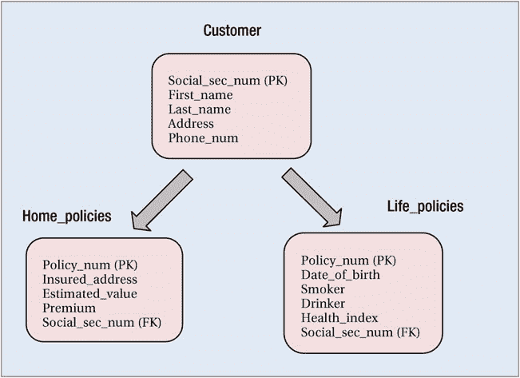

# 关系数据的主要特征

不过，其主要特征在于可以为你的数据定义关系。让我用一个简单的例子来说明。想象一家保险公司向个人客户销售各种（人寿、伤残、房屋）保单。一个很好的标识符（用于唯一标识客户）是客户的社会保险号。由于客户可能从这家保险公司购买多份保单，且这些详细信息可能存储在不同的数据库表中，因此需要有一种方法将所有数据关联到其所属的客户。

关系技术通过将社会保险号设为客户表的**主键**（或称主标识符），并将其设为所有相关表（例如 `life_policies` 或 `home_policies`）的**外键**（或称参照标识符，用于标识信息的父级或来源）来轻松实现这一点。

图 1-1 总结了一个示例实现。

[1](http://www.seas.upenn.edu/~zives/03f/cis550/codd.pdf)  
[www.seas.upenn.edu/~zives/03f/cis550/codd.pdf](http://www.seas.upenn.edu/~zives/03f/cis550/codd.pdf)

> “大型共享数据库数据的关系模型”

**图 1-1.** *数据的关系存储（逻辑层面）*

如图 1-1 所示，保单数据与客户相关联。这种关系是通过使用社会保险号建立的。因此，所有属于某个客户的保单记录都可以通过其社会保险号检索出来。对客户标识符（社会保险号）的任何修改都会传播开来，以维护数据的完整性。

