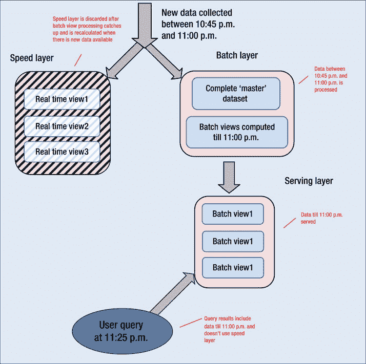

# Encryption and Data Governance

Encrypting data in transit and data stored on `DataNodes` (data at rest) is necessary. There are many ways to achieve "data at rest" encryption for `Hadoop`, and doing so is essential. As for inter-node communication, it can also be configured to be encrypted.

## Chapter 1 ■ RDBMS Meets Hadoop: Integration, Refactoring, and Transition

### Sensitive Information Masking and Data Governance

• **Masking of PII (Personally Identifiable Information) and other sensitive data:** Encryption helps prevent unauthorized access, but even users authorized to access data may not be allowed to see certain sensitive information, such as customer personal information, medical data, etc. Furthermore, federal regulations in certain industries (e.g., insurance, healthcare, finance) prohibit all employees from accessing such data. Therefore, any such sensitive data needs to be masked and protected with additional passwords.

If considering the functions and considerations of a governed data lake (described earlier in this section), its design would be similar to Figure 1-4.

```
Data Governance        Data Governance        Data Governance
(for data within       (for input data)       (for access)
lake) such as
MDM                    Near                   User
integration and        real-                  defined
tagging / linking      time                   access
                       user
Structured             Analytics              Authorization (e.g. Sentry)
data sources                                    Authentication (e.g. Kerberos)
                       Data Lake              (data with encryption at rest and PII
Unstructured                                   masking applied)
data sources
                       Structured and
                       Metadata               Formatted output to Data
                       Unstructured Data      mart / EDW or Analytical
                                              models for advanced
                       Data Quality           analysis (e.g. predictive or
                       processing (e.g.       prescriptive analysis)
                       profiling)
                       Data Analysts /
                       Data Scientists / users
                       users tag and link
                       tag and link metadata
                       data
```

Figure 1-4. Data Lake

## Refactoring with Lambda Architecture

Refactoring applications for a `Hadoop`/`NoSQL` environment involves a complete redesign of the data layer and query layer for `HDFS`/`NoSQL` storage and processing. Typically, `Hadoop` is used for batch processing, meaning that refactoring for `Hadoop` can be problematic for interactive applications that require ad-hoc queries. Especially if the functionality requires low-latency data retrieval, `Hadoop`/`NoSQL` will not meet the needs.

`Nathan Marz` proposed an architectural solution to this problem, called the `Lambda Architecture`. It suggests building a big data system as a series of layers, each providing a specific function, with the next layer building upon the functionality provided by the previous layer (as shown in Figure 1-5). This architectural solution can be used to refactor applications for `Hadoop` or design new applications for `Hadoop`/`NoSQL`.

```
User queries
    |
    v
Speed layer (for real time querying)
    |
    v
Serving layer (serving batch views)
    |
    v
Indexed batch views
    |
    v
Batch layer
    |
    v
Complete dataset
```

Figure 1-5. Layers of the Lambda Architecture

The Lambda Architecture has three layers. The `Batch Layer` is the first layer, which precomputes views for querying. The `Serving Layer` is the second layer, which indexes and serves the views created by the first layer. The `Speed Layer` is the third layer, which provides real-time query capabilities in the Lambda Architecture.

### Batch Layer

# Lambda Architecture 的批处理层（Batch Layer）

在海量数据集上执行查询（`Hadoop` 系统的优势）需要大量资源，且可能非常缓慢，有时甚至会因资源不足而中止。一个巧妙的解决方法是预计算数据并使其准备好用于查询。预计算的数据可以被索引以加速随机读取（因为 `Hadoop` 在这方面表现不佳）。这个概念与 `RDBMS` 中的索引化物化视图并无太大区别。然而，它对 `Hadoop` 世界而言是新的，这些预计算视图或称为批处理视图，构成了 Lambda 架构的批处理层。

当要执行查询时，可以在该批处理视图上设计和运行函数，而不是在完整数据集上运行。一个带索引的批处理视图有助于快速检索所需的值，因为它是数据的带索引子集。可以根据需要为数据集创建多个批处理视图，覆盖不同的功能，适用于各种分析。此外，由于 `Hadoop` 的分布式特性，数据检索的并行性始终得到保证。

例如，一家服装在线零售商通过一个 `Hadoop` 系统收集记录所有用户点击（包括销售交易）的数据。对他们来说，一个按地理位置隔离所有销售交易的批处理视图可能对销售部门有用，而另一个包含用户点击和日期的批处理视图可能对数据科学家分析季节性或年度产品兴趣有用。

在某些情况下，如果数据集非常大，批处理视图本身也可能很大。此时应考虑进一步分解它们。例如，一家在线服装零售商每月生成数十亿条用户点击和销售记录。如果按季度创建批处理视图，数据量可能仍然太大，无法快速处理查询。可以考虑设计额外的月度批处理视图层。这将减少处理时间（因为只需要处理最新月份的数据，而不是一个季度），但它可能会使检索策略复杂化，因为需要确定要查询的正确视图，并且如果时间跨度涉及多个月份，可能需要查询多个视图。

为视图创建索引（在创建批处理视图之后）是一个非常重要的步骤，必须由对数据和功能需求（分析和频繁执行的查询）有深入理解的人员执行。如果索引不匹配查询，就会遇到性能问题。

这种方法的一个明显问题是创建此类批处理视图所需的时间或延迟。由于这些视图是从整个数据集创建的，它们显然会消耗大量系统资源。即使每晚计算一次，它们也不会包含系统收集的所有数据。在这些视图计算期间或之后，数据可能仍会增加，并且查询结果可能会滞后数小时。

Lambda 架构的后续层将解决这个问题。

## 服务层（Serving Layer）

服务层用于提供视图。在批处理层创建的带索引批处理视图需要被“托管”在一个可以低延迟访问的位置。

因此，服务层需要是一个专门的分布式数据库，能够加载批处理视图并支持良好的随机读取和顺序数据检索性能。当批处理层提供新版本的批处理视图时，服务层还需要能够用新版本替换旧版本，以便用户查询返回最新的结果（它需要支持批量更新）。

然而，由于用户查询不会更新批处理视图，服务层无需支持随机写入。由于随机写入是数据库中大部分复杂性的根源，服务层的分布式数据库可以变得极其简单。这种简单性赋予了它们健壮性、可预测性以及易于配置（和操作）的特点。这与 Lambda 架构的理念相吻合，该架构认为应将复杂性从批处理层和速度层转移到本质上可丢弃的速度层。

关于服务层需要记住的最后一点是，没有单一的推荐分布式数据库可以使用。在决定服务层之前，需要考虑数据的性质，因为每个分布式（或 `NoSQL`）数据库都有其自身的优点，必须确保其与数据相匹配。

### 速度层

服务层在批处理层完成批处理视图的计算后进行更新。这意味着在批处理视图更新期间新增的数据是更新后的批处理视图中唯一未包含的数据。速度层的目的是快速（顾名思义）提供这些数据。

速度层的基本功能与批处理层类似，因为它也基于接收到的数据生成视图。区别在于速度层仅处理批处理层尚未处理的新数据或近期数据，而批处理层则使用所有数据来计算视图。另一个区别是批处理层通过重新计算（或重建）来更新视图，而速度层则对视图执行增量处理，仅通过与上次增量处理的时间点进行比较来处理增量（或差异）。

例如，如果速度层中的视图在晚上 10:45 处理，下一次处理在晚上 11:00，那么仅处理在晚上 10:45 到 11:00 之间接收的数据。这些处理差异有助于速度层实现尽可能低的延迟。由于速度层视图几乎是实时的（根据处理延迟，您可能每五分钟处理一次，导致处理或数据延迟为五分钟），您也可以将其称为实时视图。

因此，您可以看到拥有一个近乎实时的系统，能够正确回答任何查询，同时提供基于 Hadoop 系统的所有优势。

图 1-6 展示了如何使用 Lambda 架构的工作流程，使查询能以近乎实时的速度返回结果。

```
新数据收集于
晚上 10:45
至 11:00 之间
数据直到晚上 11:00
已处理并可用
批处理层
速度层
晚上 10:45 至
11:00 之间的数据
正在处理
完整的“主”
实时视图 1
数据集
实时视图 2
批处理视图计算至
晚上 10:45
实时视图 3
服务层
批处理视图 1
数据提供至
晚上 10:45
批处理视图 1
批处理视图 1
查询结果包含
用户查询于
晚上 11:00 前的数据
晚上 11:05
```

**图 1-6. Lambda 架构中的查询处理**



关于 Lambda 架构需要记住的最后一点是：速度层是可丢弃的。任何新数据也会触发批处理层内的处理，并且当实时视图（来自速度层）被使用时，批处理层内会继续进行视图的重新计算。一旦这些批处理视图（来自批处理层）被重新计算并由服务层提供，部分实时视图就不再需要（因为这些数据已通过批处理视图可用）并可以被丢弃。因此，对于前面的例子，如果批处理视图在晚上 11:15 完全处理完毕，那么晚上 11:15 之后的任何查询将按照图 1-7 所示的方式处理。

**图 1-7. Lambda 架构中的可丢弃速度层**

Lambda 架构支持一个名为 `复杂性隔离` 的属性，该属性将处理复杂性推送到结果临时性的层。由于速度层涉及比批处理层或服务层更高的处理复杂性，因此速度层结果临时性这一特性在哲学上与架构相符。

此外，如果出现任何数据或处理问题，速度层的全部内容可以轻松丢弃并快速重建。

我在第[8 章](http://dx.doi.org/10.1007/978-1-4842-1287-5_8)中更详细地讨论了 Lambda 架构，并在第[15 章](http://dx.doi.org/10.1007/978-1-4842-1287-5_15)中提供了一个案例研究。

## 过渡到 Hadoop/NoSQL

`过渡`意味着将现有应用（可能使用`RDBMS`进行数据存储和处理）迁移到基于`Hadoop/NoSQL`的环境中。你可以利用上一节描述的重新架构技术，但还多了一个步骤：数据迁移。此外，你的新系统不一定非要采用 Lambda 架构。你可以根据功能需求和数据量选择合适的`NoSQL`数据库，并让应用前端直接写入该数据库。当然，你必须确保前端能够以`NoSQL`数据库可接受的格式写入数据，并能从中读取数据。

目前有大量`NoSQL`数据库可供选择（根据`nosql-database.org`列出的约有 150 种），它们在功能和特性上差异很大。本节将讨论一些可用于选择最合适`NoSQL`数据库的评判标准。

### 数据类型

你需要考虑计划在`NoSQL`数据库中收集和存储的数据类型。与`RDBMS`不同，`NoSQL`数据库没有统一的数据存储方式。实际上，它们甚至不使用相同的数据存储模型。例如，像`MongoDB`这样的`NoSQL`数据库是文档存储或文档数据库。选择与你的数据类型相匹配的`NoSQL`数据库至关重要。

广义上，`NoSQL`数据库有四种类型：

-   **键值存储：** 这类数据库以键值对形式存储数据，并使用哈希表来索引和管理数据。典型的例子包括`Riak`和`Amazon DynamoDB`。

-   **文档存储：** *文档*是一组键值对。这类数据库系统将数据作为文档存储在数据库（文档集合）中。例如：`MongoDB`和`CouchDB`。

-   **列存储：** 数据在按列（或称为列*族*的列组）组织的存储块中进行保存和处理。例如：`HBase`和`Cassandra`。

-   **图数据库：** 这类数据库允许你存储实体（节点）以及这些实体之间的关系（边）。节点和边具有属性，边还具有方向性意义。图允许数据只存储一次，然后根据节点之间的关系以不同方式进行解释。例如包括`Neo4J`、`OrientDB`和`FlockDB`。

### 数据量

你需要考虑数据量，因为有些`NoSQL`数据库（例如`MongoDB`）为了速度而采用基于内存的计算（因此无法水平扩展），而其他数据库则不然，因此可以轻松扩展。如果你的数据量很大，那么使用像`Cassandra`这样易于扩展的解决方案可能更合适。

### 数据分布

从性能角度考虑，你需要评估数据在地理上需要分布的范围。有些`NoSQL`数据库使用主/从（或“主/辅助”）架构，这种架构只能扩展读取操作，而对等架构则可以同时扩展读取和写入操作。因此，你可以根据应用行为来决定哪种架构更符合你的需求。

### 迁移数据

在确定合适的`NoSQL`解决方案后，你需要设计`ETL`来将数据从应用迁移到目标数据库。有时，在将数据迁移到最终目的地之前，有必要构建一个过渡模型或临时数据库，先将数据移入其中。采取这种方法可能有多种原因，例如源数据库和目标数据库的数据模型存在差异，需要对数据进行反规范化或转换，或者纯粹出于性能原因——源数据库数据量过大，目标数据库可能无法在单次迭代或单个实体中加载。第 7 章将讨论过渡模型的构建。现在，图 1-8 总结了过渡到`Hadoop/NoSQL`的步骤。

```
基于 RDBMS 的
应用
│
确定
NoSQL 方案
│
ETL
│
过渡数据
模型或临时
数据库
│
ETL
│
NoSQL
目标
```

**图 1-8. 过渡到 Hadoop/NoSQL**

### 总结

每个人都希望在自己的环境中利用大数据的强大能力。不幸的是，决策者往往在未考虑所有参数之前就断定大数据适合其组织。有时，技术人员（提供技术评估）缺乏适当经验也是一个问题。

此外，对`NoSQL`数据库及其细微差别缺乏理解是一个主要问题。`Hadoop`实现缺乏正式的框架或设计方法论也无助于事。Lambda 架构虽然刚刚引入，但可能并非在所有可能场景中都适用或有用（除了实现起来并不容易）。

`Hadoop/NoSQL`世界不断演进，充满创新，并由众多聪明才智之士推动。它为各种各样的问题提供了实用的技术和巧妙的解决方案。

你只需要意识到实施过程中的问题，并在引入`NoSQL`之前仔细考虑你的具体环境和需求——仅此而已。

在本章中，我试图总结`Hadoop/NoSQL`实现的优缺点，希望能指导你做出正确的决策。后续章节将详细阐述此处介绍的概念。

---