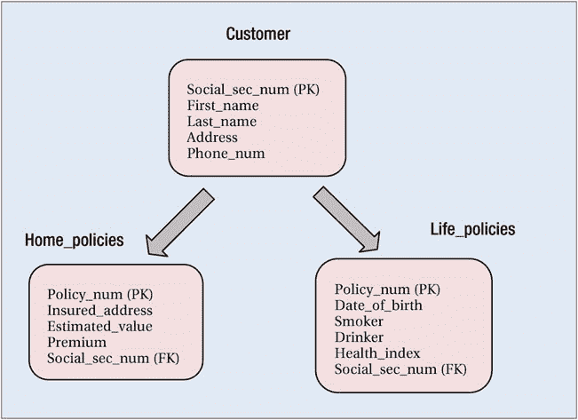
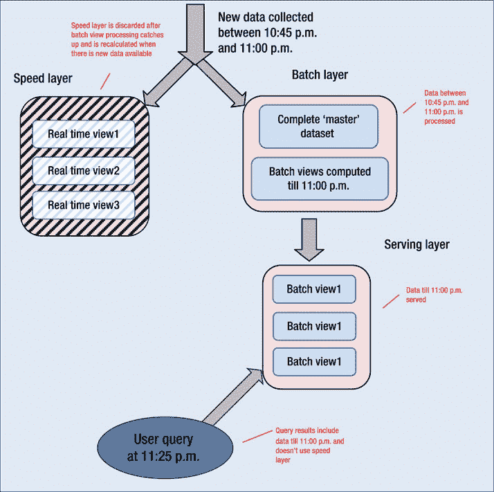

## 第一章 RDBMS 遇到 Hadoop：集成、重新架构与迁移

最近，我在Strata + Hadoop World大会上与一家大型食品企业的高管聊天，该公司使用关系型解决方案存储所有数据。我随口问他是否考虑使用大数据解决方案，他的回答是：“我们已经试过了，太慢了！”我大为惊讶，并再次核实了情况。这家企业甚至聘请了一家主要的`Hadoop`供应商提供咨询服务，却仍然无法利用大数据的力量。

我思考了这个问题以及可能的原因。首先，`Hadoop`供应商可以调优其`Hadoop`安装，但不能保证通用的调优对特定类型的数据有效。其次，这家食品企业的数据库管理员和架构师可能不知道如何转换其关系型数据以供`Hadoop`使用。这并不是孤立事件，大多数希望将关系型数据迁移到`Hadoop`的企业都处于类似境地。结果是`Hadoop`集群运行缓慢且效率低下，性能远未达到大数据宣传所引发的预期。

第三，并非所有`NoSQL`数据库都是同等的。`NoSQL`数据库在处理数据的方式以及内部用于管理数据的模型上差异巨大。它们只对特定类型的数据有效。因此，了解你的数据类型并选择与之匹配的`NoSQL`解决方案至关重要。

最后，将`NoSQL`解决方案应用于关系型数据的成功与否，取决于你确定使用`Hadoop`/`NoSQL`的目标以及适应你的数据量。`Hadoop`并非能神奇地加速所有数据处理的万能药——它仅可用于特定类型的处理（我将在本章中进一步讨论）。而且，`Hadoop`在数据量较大时效果最佳，而对于较小的数据量，由于相关的各种开销，效率并不高。

> **电子补充材料** 本章的在线版本（[doi: 10.1007/978-1-4842-1287-5_1](http://dx.doi.org/10.1007/978-1-4842-1848-8_1)）包含补充材料，仅供授权用户使用。

© Bhushan Lakhe 2016
B. Lakhe，*Practical Hadoop Migration*，DOI 10.1007/978-1-4842-1287-5_1

那么，在定义了问题之后，让我们来思考解决方案。你可能熟悉可用于关系型数据的众多设计方法和框架，但你知道`Hadoop`有类似的资源吗？很可能不知道。这有一个很好的理由——目前还没有。`Lambda`正在作为一种设计方法论被开发（[第 12 章](http://dx.doi.org/10.1007/978-1-4842-1287-5_12)），但它尚未成熟，并且不太容易实现。

那么，替代方案是什么？你是需要依赖数据架构师的专业知识来设计这个迁移过程，还是有通用的步骤可以遵循？你如何确保迁移过程高效且功能可靠？我在本书中回答了这些问题，并展示了如何成功地将你的关系型数据迁移到`Hadoop`。

首先，理解`Hadoop`和`NoSQL`与关系型设计有何不同至关重要。我在本章中简要讨论了这一点，并讨论了使用`Hadoop`和`NoSQL`的好处以及挑战。

同样重要的是决定你的数据（以及你想用它做什么）是否适合使用`Hadoop`。因此，数据类型、数据量以及你的业务需求等因素是需要考虑的重点。还有一些其他因素需要考虑，本章的后半部分将详细讨论。通常，四个“V”（容量、速度、多样性和真实性）将`NoSQL`数据与关系型数据区分开来，但这个经验法则并非总是适用。

那么，让我从关系型技术与`Hadoop`之间的概念差异开始讨论。这就是下一节的内容。

### 关系型数据库与 HDFS NoSQL 数据库之间的概念差异

自E.F. Codd于1970年发表关于关系型设计的论文以来，数据库设计进行过几次改进。当今领先的关系型数据库系统（例如`Oracle`或`Microsoft SQL Server`）可能并未完全遵循Codd的愿景；但无疑在基本没有大修改的情况下使用了其底层概念。存在一个中央数据库服务器，它保存数据并在身份验证后向用户（由数据库管理员定义）提供访问权限。存在数据库对象，例如视图（用于管理细粒度权限）、触发器（用于根据数据“关系”操作数据）或索引（用于在读取或修改数据时提高性能）。

# 关系数据的主要特征

不过，其主要特征在于可以为你的数据定义关系。让我用一个简单的例子来说明。想象一家保险公司向个人客户销售各种（人寿、伤残、房屋）保单。一个很好的标识符（用于唯一标识客户）是客户的社会保险号。由于客户可能从这家保险公司购买多份保单，且这些详细信息可能存储在不同的数据库表中，因此需要有一种方法将所有数据关联到其所属的客户。

关系技术通过将`社会保险号`设为客户表的**主键**（或称主标识符），并将其设为所有相关表（例如 `life_policies` 或 `home_policies`）的**外键**（或称参照标识符，用于标识信息的父级或来源）来轻松实现这一点。

图 1-1 总结了一个示例实现。

[1](http://www.seas.upenn.edu/~zives/03f/cis550/codd.pdf)
[www.seas.upenn.edu/~zives/03f/cis550/codd.pdf](http://www.seas.upenn.edu/~zives/03f/cis550/codd.pdf)

> “大型共享数据库数据的关系模型”



**图 1-1.** *数据的关系存储（逻辑层面）*

如图 1-1 所示，保单数据与客户相关联。这种关系是通过使用`社会保险号`建立的。因此，所有属于某个客户的保单记录都可以通过其`社会保险号`检索出来。对客户标识符（`社会保险号`）的任何修改都会传播开来，以维护数据的完整性。

# Hadoop、NoSQL 和 HBase

接下来，让我讨论一下使用`HDFS`进行存储的`Hadoop`和`NoSQL`数据库。`HBase`是一个流行的`NoSQL`数据库，因此可以作为一个例子。由于`HDFS`是一个分布式文件系统，数据将分散在所有数据节点上，这与集中式服务器相反。`Kerberos`用于身份验证，但与关系数据库相比，`HBase`在细粒度授权方面的能力非常有限。`HBase`提供了索引能力，但其非常有限，无法与`RDBMS`（关系数据库管理系统）提供的高级索引技术相媲美。然而，主要的区别在于缺乏关系。与`RDBMS`不同，`HBase`中的数据没有关联。`HBase`表的数据只是保存在`HDFS`文件中。

如图1-2所示，保单数据不会自动与客户关联。任何必要的关联都必须通过编程方式实现。例如，如果你需要列出客户“艾萨克·牛顿”持有的所有保单，你需要知道保存客户保单的表（此处为`HBase`表`Life_policies`和`Home_policies`）。然后你需要找到一个公共标识符（社会保险号）来匹配属于该客户的行。对标识符的任何更改都不能自动传播，需要手动实现。

# 客户与保单数据

## Customer

```
234-56-2243~Albert~Einstein ~1 oak drive, Palatine, IL 60421~ 8472453333
345-86-1223~Stephen ~Hawking ~100 Maple ct. , Darien , IL ~60561~6304271623
453-65-2244~Thomas ~Edison~55 Pine st. , Naperville , IL 60660~6307246565
294-85-4553 ~Isaac~New ton~99 Redwood drive, Woodridge, IL 60561~6304275454
```

## Life_policies

```
45341441 ~01/24/1962 ~N~Y~72~234-56-2243
41441442 ~03/18/1972 ~Y~Y~60~294-85-4553
41671443 ~10/12/1976 ~Y~N~64~453-65-2244
41489744 ~09/06/1968 ~N~N~82~345-86-1223
```

## Home_policies

```
45341441~1 oak drive, Palatine, IL 60421~500,000~4,000~234 -56-2243
45356442~ 100 Maple ct. , Darien , IL 60561~750,000~5,000~345-86-1223
45987443~55 Pine st. , Naperville , IL 60660~1,100,000~8,000~45 3-65-2244
45671444 ~99 Redwood drive, Woodridge, IL 60561~300,000~2,000~29 4-85-4553
```

`图 1-2. NoSQL 数据存储`

因此，举例来说，如果发现社保号码出现错误，那么所有包含该信息的文件都需要单独（通过编程方式）更新。

与关系型数据库管理系统（`RDBMS`）不同，`HDFS` 或 `HBase` 不提供任何实用程序来帮你完成此操作。原因在于 `HBase`（或任何其他基于 `HDFS` 的 `NoSQL` 数据库）不提供任何参照完整性——这仅仅是由其设计目的决定的。`HBase` 并非为对小型数据集进行交互式查询而设计；它最适合于处理包含不可变数据的大型批处理环境（类似于数据仓库环境）。直到最近，对 `HBase` 的更新还涉及将更改后的行加载到临时表，并与主数据表进行左外连接以覆盖该行（确保临时表和主数据表具有相同的键）。

随着 `HBase` 新版本的推出，现在支持更新、删除和插入操作，但对于小数据集，这些操作会非常慢（与 `RDBMS` 相比），因为它们作为 `Hadoop` `MapReduce` 作业执行，延迟高，并且在作业提交和调度方面会产生大量开销。

由于 `HDFS` 使用大块大小（默认 64 MB）以及将数据分布在大量 `DataNodes` 上的分布式架构（有助于使用 `MapReduce` 或 `Yarn` 进行并行读取），`HBase`（以及其他基于 `HDFS` 的 `NoSQL` 数据库）旨在高效处理大型数据集。任何需要应用的转换都涉及读取整个表，而非单行。使用 `MapReduce`（或在最新版本中使用 `Yarn`）在 `DataNodes` 上进行分布式处理，为此类读取提供了速度和效率。同样，由于分布式架构，将转换后的数据写入新的“文件”（或 `HBase` 的临时表）要高效得多。出于同样的原因，`Hadoop` 和 `NoSQL` 数据库更适合存储（和处理）大型图像或视频文件、大型自然语言文本块、半结构化数据以及传感器数据。

将此与 `RDBMS` 的小页面大小（例如，`Microsoft SQL Server` 使用 8 KB 的页面大小）以及缺乏有效机制来分布读取（或更新）操作进行比较，你就会明白为什么在涉及数据仓库和大型数据集的所有场景中，`NoSQL` 数据库总是胜出。然而，`RDBMS` 的优势在于处理具有复杂关系且需要对其部分进行深入分析的小型数据集。此外，在需要在一个数据集上实现参照完整性的场景中，`NoSQL` 数据库无法与 `RDBMS` 匹敌。

总而言之，`RDBMS` 更适合对需要满足 `ACID`（原子性、一致性、隔离性、持久性）合规性要求的小型数据集执行大量数据操作；而 `NoSQL` 数据库更适合对可以接受“最终一致性”模型的大型数据集执行少量数据操作。

`表 1-1` 提供了两种技术（关系型与 `NoSQL`）之间的便捷比较。

`表 1-1. RDBMS 与 NoSQL 的功能特性对比`

| 特性 | 基于 `HDFS` 的 `NoSQL` | `RDBMS` |
| --- | --- | --- |
| 大型数据集 | 高效且快速 | 效率不高 |
| 小型数据集 | 效率不高 | 高效且快速 |
| 搜索 | 效率不高 | 高效且快速 |
| 大型读取操作 | 高效且快速 | 效率不高 |
| 更新 | 效率不高 | 高效且快速 |
| 数据关系 | 不支持 | 支持 |
| 身份验证/授权 | `Kerberos` | 内置 |
| 数据存储 | 分布在 `DataNodes` 上 | 中央数据库服务器 |
| 符合 `ACID` | 否 | 是 |
| 对数据集的并发更新 | 不支持 | 支持 |
| 容错性 | 内置 | 未内置 |
| 可扩展性 | 易于扩展 | 不易扩展 |

`图 1-3` 展示了（前述示例的）物理数据存储配置，包括一个 `Hadoop` 集群（`Hive`/`NoSQL`）和一个 `RDBMS`（`Microsoft SQL Server`）。

`NameNode`
带有 `NoSQL` 数据的 `Hadoop` 集群仅持有元数据。

# NameNode（仅保存元数据）

请观察每个已复制的`文件名`、`数据块`、`DataNode`两份副本。

`/usr/hive/warehouse/Customer` 1, 2 数据块 1, 3 分布于 `/usr/hive/warehouse/Life_policies` 1, 3 多个 `DataNodes` 2, 3 NoSQL `/usr/hive/warehouse/Home_policies` 2, 3 客户端

## 授权（使用 Sentry）

## 认证（使用 Kerberos）

`DataNodes` 保存：

- `DataNode1`

- `DataNode2`

- `DataNode3`

实际的数据块。

## 用户数据库

`含关系型数据的 RDBMS 服务器`保存数据库元数据及用户数据。`系统数据库`保存服务器元数据。

- `系统数据库`

- `用户数据库 1`：表：`Customer`、`Life_policies`、`Home_policies`

- `用户数据库 2`

`本地存储`保存系统 RDBMS 和用户数据库。

- 本地存储

- `RDBMS 加密`

- `RDBMS 授权`（用户和角色权限）

- `RDBMS 认证`（使用 RDBMS 或操作系统登录）

图 1-3.物理数据存储配置（NoSQL 和 RDBMS）

# 关系型设计与 Hadoop 协同：优势与挑战

前一节讨论了两项技术的差异。那么，为何要将它们结合？需要付出什么努力？是否值得？我将逐一探讨这些问题。

首先从两者结合的优势谈起。若回顾表 1-1，你会发现这些技术能很好地互补。若通过 RDBMS 收集了大量历史数据，便可用 NoSQL 数据库进行分析。这是因为 Hadoop 更擅长读取大规模数据集并进行转换——唯一的前提是转换需应用于整个数据集（以保证效率）。那么，如何在你的环境中最好地利用 Hadoop/NoSQL？以下提供几点思路：

- **将数据转化为（有价值的）信息：** 数据本身只是数字（或文本）。你需要为数据增加视角，使其对业务需求产生价值。Hadoop 可通过生成大量数据分析来协助你。例如，若用 Hadoop 分析汽车传感器生成的数据，它能整合、汇总、分析数据，并按时间切片（如每小时、每日、每周等）提供报告，给你关键统计信息，如发动机平均温度、曲轴平均转速、每小时警告次数等。

- **通过将多数据结构映射到单一数据集获得洞察：** 当使用 RDBMS 管理数据时，你清楚需要在数据使用前指定数据结构。参照上一节示例，若用 SQL Server 存储客户和保单数据，就需定义用户数据库及客户、保单表结构，之后才能存储数据。相比之下，HDFS 中的客户数据仅作为文件保存，可在读取时附加结构。这种称为*读时模式*的概念，在读取数据时提供了极大灵活性。该概念的一个典型应用场景是：存储产品销售额的事实表，既可读取为“年度销售额”，也可读取为“按地区的购买趋势”。

- **利用历史数据进行预测分析：** 在许多场景下，需要分析大量历史数据并用于预测未来趋势。Hadoop 能够（且正在被）成功用于处理 TB 级数据，整合后应用于预测模型。例如，过去十年春秋季的服装购买趋势可帮助百货商店备货正确类型的服装；客户近五年的消费习惯可助其向客户邮递合适的优惠券。

- **构建强健的容错系统：** Hadoop 默认提供容错和冗余。每个数据块均 `replicated thrice` 作为默认配置，并且可以根据需要进行调整。RDBMS 可以配置为实时复制，但任何用于实现复制的解决方案都需要大量的设置和监控，并且由于复制开销而影响性能。此外，由于 Hadoop 实现更新的方式，它也能容忍人为错误，因为更新的数据大多会写入新文件，保留原始数据不变。

- **承担广泛的工作负载**：Hadoop 可用于满足广泛的应用需求。例如，一个社交应用可以接受最终一致性，或追求低延迟读取，以及要求高性能的即席查询。凭借提供内存处理或 ACID 合规性（`Hive 0.14`）的组件（如 `Spark`），Hadoop 现在已成为比任何 RDBMS 都更加通用的平台。

- **设计线性可扩展的系统**：扩展基于 RDBMS 的系统的问题在于它只能垂直扩展——而且这也不容易。这涉及停机时间和风险（因为服务器需要补充额外的硬件资源），尽管（RDBMS）的新版本支持分布式计算模型，但必要的配置很困难，需要复杂的设置和监控。相比之下，Hadoop 可以轻松地进行水平扩展，无需任何停机时间，并且为 Hadoop 集群添加或移除 `DataNode` 既简单又快速。

- **设计可扩展的系统**：Hadoop 集群易于扩展（可以在不中断服务的情况下轻松添加功能）。由于使用了灵活且全面的 `Log4j` API 进行广泛的日志记录，故障排除很容易，并且需要最少的维护或手动干预。相比之下，RDBMS 需要大量的监控和设置才能维持正常运行。

如果 Hadoop 部署有如此多的优势，为什么不是每个人都在他们的环境中实施它？原因（如前所述）是 Hadoop 并非所有类型数据或业务需求的最佳解决方案。此外，即使匹配，在将 Hadoop 引入您的组织时也会遇到许多挑战，我将在下一节中讨论这些挑战。

## 第一章 RDBMS 遇见 Hadoop：集成、重新架构和过渡

### 数据类型

以下是根据您处理的数据类型需要考虑的事项：

- **工作负载**：Hadoop 最适合读取密集型工作负载。如果您有一个事务性系统（当前使用 RDBMS），那么需要额外的工作来派生一个非规范化的类仓库版本的数据库，并通过适当的 Hadoop 工具（如 `Sqoop` 或 `Flume`）将其摄取到 `HDFS` 中。对此数据的任何更新都必须作为从源文件读取、应用更新（视情况而定）并写出到临时文件（该文件成为新源）来处理。尽管某些 NoSQL 数据库的新版本（`Hive 0.14`）支持更新，但以此方式处理更为高效。

- **高延迟**：对于大多数 NoSQL 数据库，延迟会随着吞吐量的增加而增加。如果您的应用程序需要低延迟，您将需要对硬件资源进行基准测试和调整。此任务需要对 Hadoop 监控和各种 Hadoop 守护进程有很好的理解，并且需要具备配置 Hadoop 集群的专业知识。

- **数据依赖**：如果您的关联数据是面向列的或嵌套的（具有多层嵌套），那么您还有更多工作要做。由于 NoSQL 中没有`join`，因此在将数据存储到 NoSQL 数据库（或 `HDFS`）之前，您需要对其进行非规范化处理。此外，对依赖数据的级联更改（类似于 RDBMS 中的外键关系）需要以编程方式处理。NoSQL 数据库中没有可用的工具来提供此功能。

- **模式**：您的模式（对于存储在 RDBMS 中的数据）是静态的，如果您需要使其成为半动态或完全动态，您需要进行适当的更改以适应 NoSQL 的使用。

### 数据量

# Hadoop 不适用于低数据量

`Hadoop` 不适用于低数据量，因为它在读取或写入文件时会带来开销（这些任务会转化为 `MapReduce` 作业，并在执行作业提交或调度时产生大量开销）。关于使用 `Hadoop` 的“神奇数字”临界数据量存在许多争论，但这个数字因数据类型以及业务需求而异。根据个人经验，仅当数据量超过 5 TB（且增长率较高）时，才应考虑使用 `Hadoop`。

### 业务需求

如果你迁移到 `Hadoop` 的业务需求与现有数据不匹配，那么就需要进行额外工作——尤其是当数据类型是 `Hadoop`/`NoSQL` 不擅于处理的那种。例如，如果你的业务需求是对频繁更新的规范化关系数据子集进行复杂分析，那么你需要对数据进行反规范化，并建立策略和时间表来应用更新（每天一次、每天两次等）。此外，根据需求，可能还需要额外工作来将事实数据与维度数据分离。然而，如果你想使用 `Hadoop` 分析数千名潜在客户的浏览习惯，并确定其中转化为实际销售的比例，那么所需的工作可能很少——因为你可能已经在单独的 `NoSQL` 表中获得了所有必要数据——尽管这些数据可能是非结构化或半结构化格式（`NoSQL` 处理这些格式没有问题）。

当然，你的环境可能面临更具体的挑战，这里仅讨论了数据迁移中的挑战。修改前端用户界面（以适配 `Hadoop`/`NoSQL`）也可能会带来额外挑战！

## 决定集成、重构或过渡

一旦你决定在环境中引入 `Hadoop`/`NoSQL`，接下来的一些问题就是：如何让 `Hadoop` 与现有应用程序/数据最佳配合？是将部分应用程序过渡到 `Hadoop`，还是简单地将现有应用程序与 `Hadoop` 集成？更激进的方案是，为 `Hadoop`/`NoSQL` 使用场景完全重新构建应用程序架构。

不幸的是，这些问题没有简短答案，只有仔细考量一系列相关因素后才能做出决策。下一节将讨论这些因素。

### 数据类型

你当前（在应用程序中）拥有的数据类型可能以多种方式产生影响：

- **结构化/非结构化数据**：如果你的大部分应用程序数据是结构化的，并且没有添加任何半结构化或非结构化数据源的可能性，那么最佳方法是集成。最好将现有应用程序与 `Hadoop`/`NoSQL` 集成。你可以考虑设计并实现一个数据湖，或者如果只需分析一小部分数据，则只需建立一个数据摄取过程，将数据复制到 `HDFS`，并使用 `Hive` 或 `HBase` 进行处理以进行分析和查询。或者，如果你有半结构化或非结构化数据源，则根据它们（相对于结构化数据）的比例，你可以完全将应用程序过渡到 `NoSQL`，或者如果你当前（或预期在不久的将来）拥有大量半结构化/非结构化数据，则可以部分（或完全）重新构建应用程序架构以适应 `NoSQL`。

- **规范化的关系数据**：如果你的大部分数据是高度规范化的关系数据，那么你的应用程序可能很复杂，且涉及高度的数据依赖性。由于 `NoSQL` 数据库无法支持数据依赖性和关系，你实际上无法考虑将应用程序重新构建或过渡到 `NoSQL`。最佳选择是集成，并且这还需要额外的努力。

你可以将数据湖视为需要对数据进行反规范化和扁平化（移除层次结构关系）并消除所有数据依赖关系。这个概念类似于构建数据仓库，但不同于维度模型中严格的事实/维度结构，你只需对表进行反规范化，并尝试创建扁平结构，理想情况下不需要连接或只需很少的连接，因为 `Hadoop`/`NoSQL` 不擅长处理连接操作。

### 应用类型

正如你之前所见，`NoSQL` 仅适用于特定类型的应用程序。以下是它如何影响集成、迁移或重新架构的决策：

- **数据集市/分析**：`Hadoop` 最适合单次写入/多次读取的场景，这正是数据集市中发生的情况。数据被增量加载，之后被多次读取/处理以进行分析。仓库数据没有更新，只有增量。这与 `Hadoop` 在大规模读取操作上的高效率（以及更新操作的低效率）特性非常契合。因此，对于数据集市应用，最佳策略是重新架构并迁移到 `Hadoop`/`NoSQL`，而非进行集成。同样，虽然可能无法将整个企业数据仓库（`EDW`）迁移到 `Hadoop`，但完全有可能重新架构并迁移部分数据集市到 `Hadoop`（我在[第 9 章](http://dx.doi.org/10.1007/978-1-4842-1287-5_9)和[第 11 章](http://dx.doi.org/10.1007/978-1-4842-1287-5_11)中详细讨论了可以迁移到 `Hadoop` 的数据集市）。

- **ETL（批处理）应用**：可以有效地利用 `Hadoop`/`NoSQL` 进行 `ETL` 处理，因为在大多数情况下，它涉及读取源数据、应用转换（到完整数据集），并将转换后的数据写入目标。这再次利用了 `Hadoop` 高效的串行读/写能力以及无条件、统一地对大数据集应用转换的能力。因此，对于 `ETL` 应用，最佳策略是重新架构并迁移到 `Hadoop`，而非集成。这里需要注意的是，要确保正在转换的数据中几乎没有（或理想情况下完全没有）数据依赖关系。鉴于 `NoSQL` 缺乏连接能力并且无法处理规范化数据中的关系，要么将数据查找任务保留在 `RDBMS` 中，要么在不可能的情况下，应避免迁移到 `NoSQL`。

- **社交媒体应用**：目前，社交媒体的使用与日俱增，企业喜欢将社交媒体应用用于从产品发布到产品失败后的复盘分析等一切事务。大多数社交媒体数据是非结构化或半结构化的。`NoSQL` 擅长处理这类数据，对于任何此类应用，你都应该认真考虑重新架构并迁移到 `Hadoop`。

- **用户行为捕获**：许多电子商务网站喜欢捕获用户的点击行为并分析他们的浏览习惯。由于此类数据量大且具有非结构化特性，`Hadoop`/`NoSQL` 非常适合处理它。你当然应该将这些应用重新架构/迁移到 `NoSQL`。

- **日志分析应用**：任何中大型公司都会使用大量应用，这些应用会生成大量日志文件。在进行故障排除或处理安全问题时，几乎不可能手动分析这些日志文件。其他重要信息也可以从日志文件中获取，比如批处理任务的平均处理时间、失败次数及其详细信息、用户访问和资源详情（用户访问过的资源）等等。`Hadoop`/`NoSQL` 非常适合处理这种大量半结构化数据，你应该为此目的设计基于 `Hadoop`/`NoSQL` 的新应用，或者将任何现有应用重新架构/迁移到 `Hadoop`。你一定会看到其带来的益处。

业务目标

# 最后但同样重要的一点……

业务目标驱动并凌驾于任何决策之上。以下是一些可能影响集成/重构/迁移决策的业务目标：

- **提供近实时分析：** 在某些情况下，企业可能需要通过为高层管理提供近实时分析数据的方法来获得战略优势。例如，如果首席营销官能够获取按地区（或城市）划分的新产品的最新销售数据，他或许就能更好地解决销售问题。在这种情况下，设计一个数据湖可以快速洞察销售数据。因此，将现有应用与 `Hadoop/NoSQL` 集成是最佳策略。

- **降低硬件成本：** 有时，某个应用对组织很有用，但它需要专有或高成本的硬件。如果存在预算限制或无法超越的组织政策，`Hadoop` 可以有助于降低成本。当然，将应用重构/迁移到 `Hadoop` 需要投入时间/精力/成本；但通过对硬件拥有/租赁成本（以及维护成本）与一次性重构/迁移成本及在更廉价硬件上托管的成本进行比较分析，可以帮助你做出正确的决策。

- **面向可扩展性和容错性设计：** 在某些情况下，可能需要易于扩展性（例如，如果企业预计在不久的将来会有高速增长）和容错性（如果功能需求或客户有要求）。如果这是一个新需求，为现有应用添加这些功能可能会成本过高，而 `Hadoop/NoSQL` 无疑是一个可行的替代方案。对额外硬件、软件和资源（以支持新需求）的成本与一次性重构/迁移成本及在更廉价硬件上的托管成本进行仔细的成本分析，可以帮助你做出正确的决策。

此处我只是简要介绍了上述标准，将在后续章节中更详细地讨论。下一节将介绍这些技术各自涉及的内容。

### 如何集成、重构或迁移

我将在后续章节中详细讨论这些方法。本节的目标仅仅是结合快速示例介绍这些概念。让我从侵入性最小的方式开始：与现有应用的集成。

#### 集成

设想一个场景：一家跨国公司将其数据分散在大型应用中，几乎不可能在保持相同粒度的情况下对这些数据进行联合分析。如果它不能提供从中挖掘新洞察的灵活性，那么将这些数据保存在昂贵的硬件上并投入资源进行维护又有什么意义呢？`数据湖`是一种适用于此类场景的新范式。

`Pentaho` 的 CTO `James Dixon` 被认为是该术语的创造者。数据湖简单来说就是将你的应用数据积累存放在 `HDFS` 中，而不对其应用任何转换。它通常具有以下特征：

- **大容量，低成本：** 数据湖不需要昂贵的硬件来实现一个大型 `Hadoop` 集群。与传统的（使用 `RDBMS` 实现的）数据仓库相比，使用商用硬件可以大幅节省成本（并以极低的成本实现）。

- **数据保真：** 在数据湖中，数据保证以其原始形式保存，并且不应用任何转换。

- **可访问性：** 数据湖消除了按应用、部门、角色等划分数据的多个孤岛，使组织内的每个人都能轻松、平等地访问数据。

- **动态模式：** 存储在数据湖中的数据无需受预定义的刚性模式约束，可以根据需要灵活构建结构。

# RDBMS 与 Hadoop 的相遇：集成、重构与过渡

## 数据湖类别

广义上，数据湖可分类如下：

- **数据存储库：**当来自多个应用程序的数据在无孤岛的情况下进行存储，并通过数据治理以及索引（或编目）进行组织以便快速检索时，便构成了`存储库`。这里的数据已组织好，可供分析，但尚未定义具体分析内容，尽管存储库可能包含来自独立数据集市以及非结构化来源的数据。
- **探索型湖：**拥有专业数据科学家、业务分析师或统计学家的组织，可以对数据湖中存储的数据执行自定义分析查询，以获取新见解。很多时候，这甚至无需 IT 部门介入，纯粹是一项探索性工作，随后通过可视化（提交给高层管理）来验证所执行分析的相关性和实用性。由于数据在数据湖中的存储方式，可以快速迭代这些分析，直至决策者满意。
- **分析型湖：**一些组织拥有成熟的流程，用于为高级分析（如预测分析（可能发生什么）或规范性分析（我们应该怎么做））提供分析模型，并将数据湖中的数据作为这些模型的输入。数据湖（或其子集）也可充当数据集市或企业数据仓库（`EDW`）的暂存区。

## 数据治理的重要性

`治理`是实施数据湖的重要考量因素。为数据湖建立数据治理流程至关重要，以免其沦为数据“沼泽”。例如，元数据可与底层数据分开维护，这一特性也使其更难以治理——除非遵循统一的元数据标准，以帮助用户理解数据间的相互关系。当然，这依旧无法消除最终用户将仅适用于自身业务语境且不遵循组织元数据标准或治理惯例的数据属性赋予数据湖中数据的风险。数据内部语义的一致性问题也可能出现。以下是数据治理的一些重要方面：

- **MDM 集成：**对于数据湖而言，`MDM` 集成是一个双向过程。组织的`主数据`可以是一个良好的起点，但随着用户互动，数据湖中的元数据会随着时间推移而增长和成熟，因为用户的个人视角和见解可能会催生审视（和分析）同一数据的新方法。这是将元数据与底层数据在数据湖中分开维护的一个重要好处。此外，对元数据进行标记和链接有助于进一步组织元数据，并有助于生成更多洞察和智能。
- **数据质量：**数据质量的目标是确保数据湖中的数据有效、一致且可靠。需要使用数据剖析来评估传入数据的质量。`数据剖析`是一个通过分析数据内容和结构来发现数据中矛盾、不一致和冗余的过程。需要设置校正规则来转换数据。需要对校正后的输出进行持续监控，以确保所有定义的规则都能正确转换数据，并根据需要修改或添加规则。
- **安全策略：**一个常见的误解是，既然数据湖中的数据没有孤岛，那么访问控制也同样没有限制。数据治理需要执行身份验证、授权、加密和监控的流程，以降低未经授权访问以及数据更新的风险。
- **加密：**由于 Hadoop 的分布式特性，存在大量的节点间数据传输以及`DataNode`与客户端之间的数据传输。为了防止未经授权的访问。

# Encryption and Data Governance

Encrypting data in transit and data stored on `DataNodes` (data at rest) is necessary. There are many ways to achieve "data at rest" encryption for `Hadoop`, and doing so is essential. As for inter-node communication, it can also be configured to be encrypted.

## Chapter 1 ■ RDBMS Meets Hadoop: Integration, Refactoring, and Transition

### Sensitive Information Masking and Data Governance

• **Masking of PII (Personally Identifiable Information) and other sensitive data:** Encryption helps prevent unauthorized access, but even users authorized to access data may not be allowed to see certain sensitive information, such as customer personal information, medical data, etc. Furthermore, federal regulations in certain industries (e.g., insurance, healthcare, finance) prohibit all employees from accessing such data. Therefore, any such sensitive data needs to be masked and protected with additional passwords.

If considering the functions and considerations of a governed data lake (described earlier in this section), its design would be similar to Figure 1-4.

```
Data Governance        Data Governance        Data Governance
(for data within       (for input data)       (for access)
lake) such as
MDM                    Near                   User
integration and        real-                  defined
tagging / linking      time                   access
                       user
Structured             Analytics              Authorization (e.g. Sentry)
data sources                                    Authentication (e.g. Kerberos)
                       Data Lake              (data with encryption at rest and PII
Unstructured                                   masking applied)
data sources
                       Structured and
                       Metadata               Formatted output to Data
                       Unstructured Data      mart / EDW or Analytical
                                              models for advanced
                       Data Quality           analysis (e.g. predictive or
                       processing (e.g.       prescriptive analysis)
                       profiling)
                       Data Analysts /
                       Data Scientists / users
                       users tag and link
                       tag and link metadata
                       data
```

Figure 1-4. Data Lake

## Refactoring with Lambda Architecture

Refactoring applications for a `Hadoop`/`NoSQL` environment involves a complete redesign of the data layer and query layer for `HDFS`/`NoSQL` storage and processing. Typically, `Hadoop` is used for batch processing, meaning that refactoring for `Hadoop` can be problematic for interactive applications that require ad-hoc queries. Especially if the functionality requires low-latency data retrieval, `Hadoop`/`NoSQL` will not meet the needs.

`Nathan Marz` proposed an architectural solution to this problem, called the `Lambda Architecture`. It suggests building a big data system as a series of layers, each providing a specific function, with the next layer building upon the functionality provided by the previous layer (as shown in Figure 1-5). This architectural solution can be used to refactor applications for `Hadoop` or design new applications for `Hadoop`/`NoSQL`.

```
User queries
    |
    v
Speed layer (for real time querying)
    |
    v
Serving layer (serving batch views)
    |
    v
Indexed batch views
    |
    v
Batch layer
    |
    v
Complete dataset
```

Figure 1-5. Layers of the Lambda Architecture

The Lambda Architecture has three layers. The `Batch Layer` is the first layer, which precomputes views for querying. The `Serving Layer` is the second layer, which indexes and serves the views created by the first layer. The `Speed Layer` is the third layer, which provides real-time query capabilities in the Lambda Architecture.

### Batch Layer

# Lambda Architecture 的批处理层（Batch Layer）

在海量数据集上执行查询（`Hadoop` 系统的优势）需要大量资源，且可能非常缓慢，有时甚至会因资源不足而中止。一个巧妙的解决方法是预计算数据并使其准备好用于查询。预计算的数据可以被索引以加速随机读取（因为 `Hadoop` 在这方面表现不佳）。这个概念与 `RDBMS` 中的索引化物化视图并无太大区别。然而，它对 `Hadoop` 世界而言是新的，这些预计算视图或称为批处理视图，构成了 Lambda 架构的批处理层。

当要执行查询时，可以在该批处理视图上设计和运行函数，而不是在完整数据集上运行。一个带索引的批处理视图有助于快速检索所需的值，因为它是数据的带索引子集。可以根据需要为数据集创建多个批处理视图，覆盖不同的功能，适用于各种分析。此外，由于 `Hadoop` 的分布式特性，数据检索的并行性始终得到保证。

例如，一家服装在线零售商通过一个 `Hadoop` 系统收集记录所有用户点击（包括销售交易）的数据。对他们来说，一个按地理位置隔离所有销售交易的批处理视图可能对销售部门有用，而另一个包含用户点击和日期的批处理视图可能对数据科学家分析季节性或年度产品兴趣有用。

在某些情况下，如果数据集非常大，批处理视图本身也可能很大。此时应考虑进一步分解它们。例如，一家在线服装零售商每月生成数十亿条用户点击和销售记录。如果按季度创建批处理视图，数据量可能仍然太大，无法快速处理查询。可以考虑设计额外的月度批处理视图层。这将减少处理时间（因为只需要处理最新月份的数据，而不是一个季度），但它可能会使检索策略复杂化，因为需要确定要查询的正确视图，并且如果时间跨度涉及多个月份，可能需要查询多个视图。

为视图创建索引（在创建批处理视图之后）是一个非常重要的步骤，必须由对数据和功能需求（分析和频繁执行的查询）有深入理解的人员执行。如果索引不匹配查询，就会遇到性能问题。

这种方法的一个明显问题是创建此类批处理视图所需的时间或延迟。由于这些视图是从整个数据集创建的，它们显然会消耗大量系统资源。即使每晚计算一次，它们也不会包含系统收集的所有数据。在这些视图计算期间或之后，数据可能仍会增加，并且查询结果可能会滞后数小时。

Lambda 架构的后续层将解决这个问题。

## 服务层（Serving Layer）

服务层用于提供视图。在批处理层创建的带索引批处理视图需要被“托管”在一个可以低延迟访问的位置。

因此，服务层需要是一个专门的分布式数据库，能够加载批处理视图并支持良好的随机读取和顺序数据检索性能。当批处理层提供新版本的批处理视图时，服务层还需要能够用新版本替换旧版本，以便用户查询返回最新的结果（它需要支持批量更新）。

然而，由于用户查询不会更新批处理视图，服务层无需支持随机写入。由于随机写入是数据库中大部分复杂性的根源，服务层的分布式数据库可以变得极其简单。这种简单性赋予了它们健壮性、可预测性以及易于配置（和操作）的特点。这与 Lambda 架构的理念相吻合，该架构认为应将复杂性从批处理层和速度层转移到本质上可丢弃的速度层。

关于服务层需要记住的最后一点是，没有单一的推荐分布式数据库可以使用。在决定服务层之前，需要考虑数据的性质，因为每个分布式（或 `NoSQL`）数据库都有其自身的优点，必须确保其与数据相匹配。

### 速度层

服务层在批处理层完成批处理视图的计算后进行更新。这意味着在批处理视图更新期间新增的数据是更新后的批处理视图中唯一未包含的数据。速度层的目的是快速（顾名思义）提供这些数据。

速度层的基本功能与批处理层类似，因为它也基于接收到的数据生成视图。区别在于速度层仅处理批处理层尚未处理的新数据或近期数据，而批处理层则使用所有数据来计算视图。另一个区别是批处理层通过重新计算（或重建）来更新视图，而速度层则对视图执行增量处理，仅通过与上次增量处理的时间点进行比较来处理增量（或差异）。

例如，如果速度层中的视图在晚上 10:45 处理，下一次处理在晚上 11:00，那么仅处理在晚上 10:45 到 11:00 之间接收的数据。这些处理差异有助于速度层实现尽可能低的延迟。由于速度层视图几乎是实时的（根据处理延迟，您可能每五分钟处理一次，导致处理或数据延迟为五分钟），您也可以将其称为实时视图。

因此，您可以看到拥有一个近乎实时的系统，能够正确回答任何查询，同时提供基于 Hadoop 系统的所有优势。

图 1-6 展示了如何使用 Lambda 架构的工作流程，使查询能以近乎实时的速度返回结果。

```
新数据收集于
晚上 10:45
至 11:00 之间
数据直到晚上 11:00
已处理并可用
批处理层
速度层
晚上 10:45 至
11:00 之间的数据
正在处理
完整的“主”
实时视图 1
数据集
实时视图 2
批处理视图计算至
晚上 10:45
实时视图 3
服务层
批处理视图 1
数据提供至
晚上 10:45
批处理视图 1
批处理视图 1
查询结果包含
用户查询于
晚上 11:00 前的数据
晚上 11:05
```

**图 1-6. Lambda 架构中的查询处理**



关于 Lambda 架构需要记住的最后一点是：速度层是可丢弃的。任何新数据也会触发批处理层内的处理，并且当实时视图（来自速度层）被使用时，批处理层内会继续进行视图的重新计算。一旦这些批处理视图（来自批处理层）被重新计算并由服务层提供，部分实时视图就不再需要（因为这些数据已通过批处理视图可用）并可以被丢弃。因此，对于前面的例子，如果批处理视图在晚上 11:15 完全处理完毕，那么晚上 11:15 之后的任何查询将按照图 1-7 所示的方式处理。

**图 1-7. Lambda 架构中的可丢弃速度层**

Lambda 架构支持一个名为 `复杂性隔离` 的属性，该属性将处理复杂性推送到结果临时性的层。由于速度层涉及比批处理层或服务层更高的处理复杂性，因此速度层结果临时性这一特性在哲学上与架构相符。

此外，如果出现任何数据或处理问题，速度层的全部内容可以轻松丢弃并快速重建。

我在第[8 章](http://dx.doi.org/10.1007/978-1-4842-1287-5_8)中更详细地讨论了 Lambda 架构，并在第[15 章](http://dx.doi.org/10.1007/978-1-4842-1287-5_15)中提供了一个案例研究。

## 过渡到 Hadoop/NoSQL

`过渡`意味着将现有应用（可能使用`RDBMS`进行数据存储和处理）迁移到基于`Hadoop/NoSQL`的环境中。你可以利用上一节描述的重新架构技术，但还多了一个步骤：数据迁移。此外，你的新系统不一定非要采用 Lambda 架构。你可以根据功能需求和数据量选择合适的`NoSQL`数据库，并让应用前端直接写入该数据库。当然，你必须确保前端能够以`NoSQL`数据库可接受的格式写入数据，并能从中读取数据。

目前有大量`NoSQL`数据库可供选择（根据`nosql-database.org`列出的约有 150 种），它们在功能和特性上差异很大。本节将讨论一些可用于选择最合适`NoSQL`数据库的评判标准。

### 数据类型

你需要考虑计划在`NoSQL`数据库中收集和存储的数据类型。与`RDBMS`不同，`NoSQL`数据库没有统一的数据存储方式。实际上，它们甚至不使用相同的数据存储模型。例如，像`MongoDB`这样的`NoSQL`数据库是文档存储或文档数据库。选择与你的数据类型相匹配的`NoSQL`数据库至关重要。

广义上，`NoSQL`数据库有四种类型：

-   **键值存储：** 这类数据库以键值对形式存储数据，并使用哈希表来索引和管理数据。典型的例子包括`Riak`和`Amazon DynamoDB`。

-   **文档存储：** *文档*是一组键值对。这类数据库系统将数据作为文档存储在数据库（文档集合）中。例如：`MongoDB`和`CouchDB`。

-   **列存储：** 数据在按列（或称为列*族*的列组）组织的存储块中进行保存和处理。例如：`HBase`和`Cassandra`。

-   **图数据库：** 这类数据库允许你存储实体（节点）以及这些实体之间的关系（边）。节点和边具有属性，边还具有方向性意义。图允许数据只存储一次，然后根据节点之间的关系以不同方式进行解释。例如包括`Neo4J`、`OrientDB`和`FlockDB`。

### 数据量

你需要考虑数据量，因为有些`NoSQL`数据库（例如`MongoDB`）为了速度而采用基于内存的计算（因此无法水平扩展），而其他数据库则不然，因此可以轻松扩展。如果你的数据量很大，那么使用像`Cassandra`这样易于扩展的解决方案可能更合适。

### 数据分布

从性能角度考虑，你需要评估数据在地理上需要分布的范围。有些`NoSQL`数据库使用主/从（或“主/辅助”）架构，这种架构只能扩展读取操作，而对等架构则可以同时扩展读取和写入操作。因此，你可以根据应用行为来决定哪种架构更符合你的需求。

### 迁移数据

在确定合适的`NoSQL`解决方案后，你需要设计`ETL`来将数据从应用迁移到目标数据库。有时，在将数据迁移到最终目的地之前，有必要构建一个过渡模型或临时数据库，先将数据移入其中。采取这种方法可能有多种原因，例如源数据库和目标数据库的数据模型存在差异，需要对数据进行反规范化或转换，或者纯粹出于性能原因——源数据库数据量过大，目标数据库可能无法在单次迭代或单个实体中加载。第 7 章将讨论过渡模型的构建。现在，图 1-8 总结了过渡到`Hadoop/NoSQL`的步骤。

```
基于 RDBMS 的
应用
│
确定
NoSQL 方案
│
ETL
│
过渡数据
模型或临时
数据库
│
ETL
│
NoSQL
目标
```

**图 1-8. 过渡到 Hadoop/NoSQL**

### 总结

每个人都希望在自己的环境中利用大数据的强大能力。不幸的是，决策者往往在未考虑所有参数之前就断定大数据适合其组织。有时，技术人员（提供技术评估）缺乏适当经验也是一个问题。

此外，对`NoSQL`数据库及其细微差别缺乏理解是一个主要问题。`Hadoop`实现缺乏正式的框架或设计方法论也无助于事。Lambda 架构虽然刚刚引入，但可能并非在所有可能场景中都适用或有用（除了实现起来并不容易）。

`Hadoop/NoSQL`世界不断演进，充满创新，并由众多聪明才智之士推动。它为各种各样的问题提供了实用的技术和巧妙的解决方案。

你只需要意识到实施过程中的问题，并在引入`NoSQL`之前仔细考虑你的具体环境和需求——仅此而已。

在本章中，我试图总结`Hadoop/NoSQL`实现的优缺点，希望能指导你做出正确的决策。后续章节将详细阐述此处介绍的概念。

---

