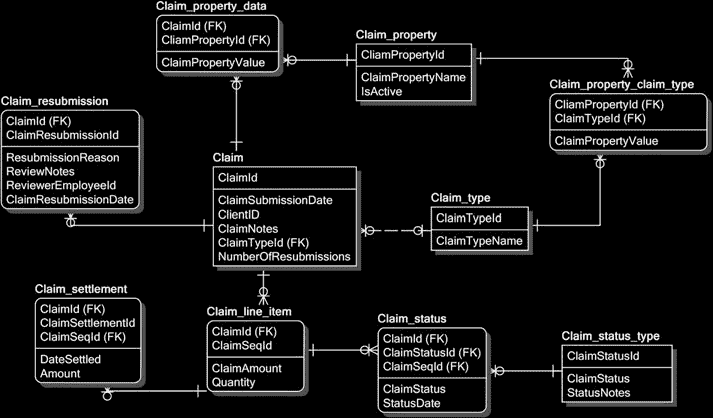

# 假设上述任一模型可用，您可以选择合适的“实体组”（以匹配涵盖业务目标或需求的“主题领域”）。以之前提到的理赔归档系统为例，您可以将“理赔处理”主题领域作为通用模型来启动。图 2-1 展示了理赔处理的概念模型。

## 第 2 章 ■ 理解关系数据库管理系统设计原则

`Claim_resubmission`

`Claim_property`

可能导致

`Claim_property_data`

用于

可能导致

用于

拥有

为

`Claim`

`Policy`

`Claim`

拥有

`Type`

拥有

拥有

属于

`Claim Status`

拥有多个

由……描述

`Policy_holder`

`Claim_line_item`

拥有

通过……结算

`Claim`

为

`Status Type`

`Claim_settlement`

***图 2-1.** 理赔处理的概念模型*

接下来，您可以移除通用模型中与您的需求或目标不符的处理部分。在本例中，您只需归档所有超过两年的理赔数据。因此，您需要关注持有理赔数据的实体组。同时，由于理赔数据在各个规范化实体中关联分布，确保所有相关实体及记录均被归档至关重要。在概念模型中，您可以安全地从所有以 `Claim` 开头的实体入手并对其进行评估。

考虑 `Claim`（理赔详情）、`Claim_resubmission`（重新提交的理赔）、`Claim_line_item`（理赔生命周期详情）或 `Claim_settlement`（理赔结算详情）。

所有这些实体都相互关联并包含有时间限制的理赔详情。因此，应考虑将它们纳入归档范围。`Claim_type`、`Claim_property_data`、`Claim_property` 和 `Claim_status_type` 是不受时间限制的静态参考值，但它们未来可能发生变化，因此对其进行归档依然重要。所以，如果您做出决定并创建一个逻辑模型（按照设计方法的下一步），它将如图 2-2 所示。

## 第 2 章 ■ 理解关系数据库管理系统设计原则

***图 2-2.** 理赔处理的逻辑模型*

这种设计方法的最后一步是利用逻辑模型生成物理模型。由于您希望区分常规的理赔实体与用于归档的实体，您可能需要考虑为用于归档的实体添加一个像 `arch` 这样的前缀。像 Erwin 这样的建模工具可以帮助您根据所选的关系数据库管理系统，将逻辑模型正向工程（或转换）成物理模型。

例如，如果选择 Microsoft SQL Server 作为目标关系数据库管理系统，则将使用 SQL Server 数据类型。同样，Erwin 可以生成 Transact-SQL 脚本，用于在您的 SQL Server 数据库中创建表（以及用于参照完整性的主键和外键）。这是“设计新的归档对象”模块的最终任务。

另一个模块“设计归档数据的查询”将包含编写查询以便将数据移动到新创建的归档对象中的任务。

如果您熟悉软件过程模型，您会注意到这种自顶向下的设计方法与“构建-修复”软件过程模型的工作方式类似。与构建-修复模型一样，您从业务需求开始，构建系统的第一个版本。当您完成详细的模块化设计和各个任务以及构建工作时，业务需求可能已经发生变化，您需要迭代修改系统，以纳入所有最新需求以及对先前需求的变更。

图 2-3 展示了该过程模型。

## 第 2 章 ■ 理解关系数据库管理系统设计原则

业务

需求

变化的业务

构建第一个（或

需求或

添加细节后的

下一个适用的）

版本

运维

模式

退役

开发

维护/增强

***图 2-3.** 软件过程模型：构建-修复模型* 自底向上

