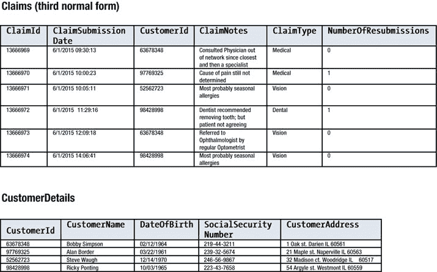
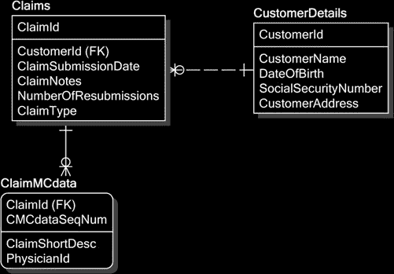
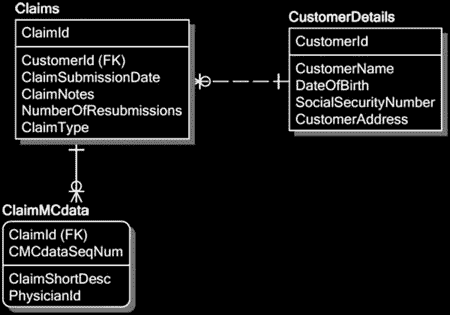
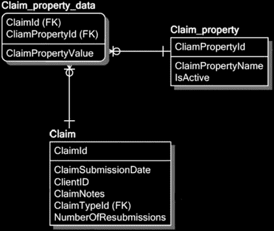
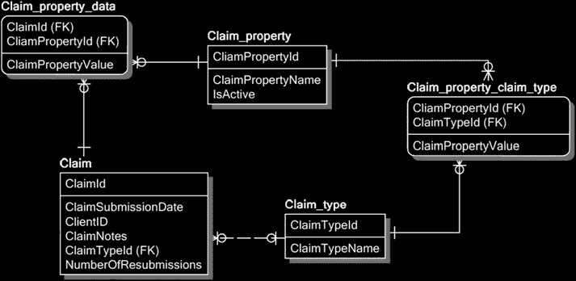
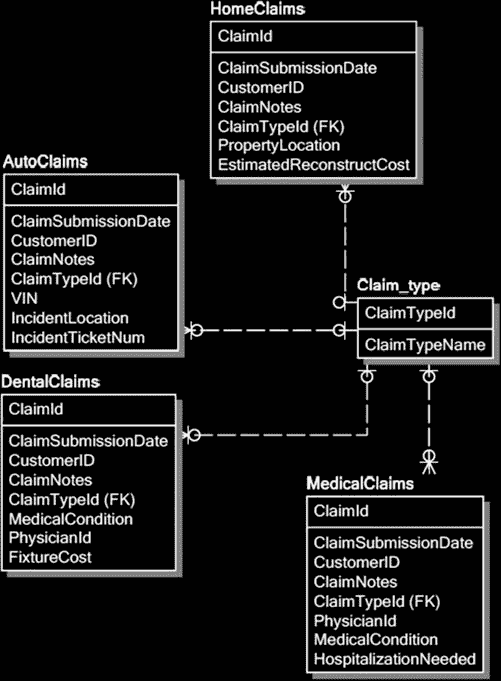

# 第二章 ■ 理解 RDBMS 设计原则

最后，你需要理解，将数据保持在第三范式并不总是最佳选择。出于报告或数据仓库的需求，你需要对数据进行反范式化。我也会通过一个例子来讨论这个概念。

#### 范式

规范化是一个通过识别并消除任何数据冗余，同时保持（数据内部的）交叉引用完好的方式来高效组织数据的过程。其目标是完全消除数据冗余，并获得更好的数据组织。规范化是一个多步骤的过程，根据该过程应用于数据的程度，数据被称为处于*第一*、*第二*或*第三*范式。

还有更高形式的规范化，例如 `BCNF`、第四范式和第五范式，尽管它们多是理论性的，在现实世界中很少使用。

##### 第一范式

第一范式的目标是识别并将任何重复的数据组隔离到单独的表中，当然，同时要保持与源数据的交叉引用完好。一行数据可能包含一个或多个重复组，你需要首先将它们识别出来。以下是一个例子。假设有一家销售健康保险的保险公司。拥有有效保单的客户通过公司呼叫中心接听的免费电话提交索赔。根据简短的对话，通常会为一次索赔捕获以下信息：`ClaimId`、`ClaimSubmissionDate`、`CustomerName`、`DateOfBirth`、
`SocialSecurityNumber`、`CustomerAddress`、`ClaimNotes`、`ClaimType`、

`ClaimShortDesc1`、`PhysicianId1`、`ClaimShortDesc2`、`PhysicianId2`、

`ClaimShortDesc3`、`PhysicianId3`、`NumberOfResubmissions`

`ClaimId` 是一个系统生成的数字，每增加一条新索赔，该数字就会递增。


`ClaimType` 表示索赔类型（例如牙科、眼科、医疗等），`ClaimShortDesc`（1-3）包含了随着索赔处理进展、病情被转诊给其他医生或专科医生时，对实际主诉的简短描述。`PhysicianId`（1-3）是参与患者治疗的医生的标识符。一项索赔可能关联一个或多个（最多三个）医疗状况及对应的医生。

`NumberOfResubmissions` 记录了此项索赔被重新提交处理的次数。以下是示例数据：

```
13666969 , 6/1/2015 09:30:13, Bobby Simpson, 02/12/1964, 219-44-3211, 1 Oak st. Darien IL 60561, Consulted Physician out of network since closest and
then a specialist, Medical, Severe stomach pain, 43211, Cramp of abdominal muscles, 12456, NULL, NULL, 0
```

```
13666970 , 6/1/2015 10:00:23, Alan Border, 03/22/1961, 239-32-5674, 21
Maple st. Naperville IL 60563, Cause of pain still not determined,
Medical, Pain in left shoulder, 31341, Left shoulder dislocation, 11232, Physiotherapy, 54543, 1
```

第二章 ■ 理解关系数据库设计原则

```
13666971 , 6/1/2015 10:05:11, Steve Waugh, 12/14/1970, 246-56-9867, 32
Madison ct. Woodridge IL [  60517](https://www.google.com/search?rlz=1C1PRFC_enUS598US598&espv=2&biw=1600&bih=760&q=60517&stick=H4sIAAAAAAAAAGOovnz8BQMDAx8HsxKXfq6-gWG8RVJeRua0GZGaTLPSNAoS1uSYxetcE9jyHAA5duj3KwAAAA) , Most probably seasonal allergies, Vision, Dry itchy eyes, 73443, Eye infection, 33342, NULL, NULL, 0
```

```
13666972 , 6/1/2015 11:29:16, Ricky Ponting, 10/03/1965, 223-43-7658, 54
Argyle st. Westmont IL 60559, Dentist recommended removing tooth; but
patient not agreeing, Dental, Severe pain in maxillary first molar, 41414, NULL, NULL, NULL, NULL, 1
```

```
13666973 , 6/1/2015 12:09:18, Bobby Simpson, 02/12/1964, 219-44-3211, 1 Oak st. Darien IL 60561, Referred to Ophthalmologist by regular Optometrist,
Vision, Double vision, 33562, Change of prescription, 25251, NULL, NULL, 0
```

```
13666974 , 6/1/2015 14:06:41, Ricky Ponting, 10/03/1965, 223-43-7658, 54
Argyle st. Westmont IL 60559, Most probably seasonal allergies, Vision,
Dry itchy eyes, 63462, NULL, NULL, NULL, NULL, 0
```

快速浏览这些数据会让你意识到，这些数据存在重复组（以粗体标示），进而导致数据重复。它还包含其他一些问题（稍后我会讨论）。重复的数据块是与索赔相关的医疗状况和医生详细信息。

此外，按照这种表结构设计，最多只能记录三项医疗状况及其关联医生。但如果一项索赔关联了超过三项医疗状况，该怎么办？由于这种情况很少发生，该系统的设计人员要求呼叫中心代表创建一个新的索赔，并在当前索赔的备注部分引用这个新编号！这是一个糟糕的变通方法，这个设计问题需要解决。

为了让这个表满足第一范式，你需要将医疗状况数据移到一个单独的表中。这能解决另一个问题（即一项索赔关联超过三项医疗状况）吗？让我们来看看。

现在，在我们将重复数据移到新表之前，需要确保能够对其进行交叉引用，并且它仍然与正确的索赔相关联。首先，看看你是否能为你的 `Claims` 表唯一地标识每一行数据。在这个例子中，你可以做到；因为 `ClaimId` 是系统生成的唯一编号，可以用来唯一标识一行。这种标识符被称为*主键*，并且可以将该列指定为主键列。

接下来，你需要为新表唯一地标识每一行。由于一项索赔关联了多个医疗状况，仅凭 `ClaimId` 不足以作为主键。你还需要额外添加一个序列号来确保主键的唯一性。此外，在这种情况下，序列号确实有意义（因为它记录了针对一项索赔诊断出医疗状况的顺序），并且可能对分析有用。

所以，在将数据移到一个新表（称之为 `ClaimMCdata`）之后，新表将如图 2-6 和图 2-7 所示。

第二章 ■ 理解关系数据库设计原则

**Claims**

**索赔 ID** | **提交日期** | **客户姓名** | **出生日期** | **社保号** | **客户地址** | **索赔备注** | **索赔类型** | **重新提交次数**
--- | --- | --- | --- | --- | --- | --- | --- | ---
6/1/2015 09:30:13 | 鲍比·辛普森 | 02/12/1964 | 219-44-3211 | 1 Oak st. Darien IL 60561 | 咨询了网络外的医生，因为最近，然后找了专科医生 | 医疗 | 0
6/1/2015 10:00:23 | 艾伦·博德 | 03/22/1961 | 239-32-5674 | 21 Maple st. Naperville IL 60563 | 疼痛原因尚未确定 | 医疗 | 1
6/1/2015 10:05:11 | 史蒂夫·沃 | 12/14/1970 | 246-56-9867 | 32 Madison ct. Woodridge IL | 很可能是季节性过敏 | 眼科 | 0
6/1/2015 11:29:16 | 瑞奇·庞廷 | 10/03/1965 | 223-43-7658 | 54 Argyle st. Westmont IL | 牙医建议拔牙；但患者不同意 | 牙科 | 1
6/1/2015 12:09:18 | 鲍比·辛普森 | 02/12/1964 | 219-44-3211 | 1 Oak st. Darien IL 60561 | 由普通验光师转诊至眼科医生 | 眼科 | 0
6/1/2015 14:06:41 | 瑞奇·庞廷 | 10/03/1965 | 223-43-7658 | 54 Argyle st. Westmont IL | 很可能是季节性过敏 | 眼科 | 0

***图 2-6.** 满足第一范式的索赔数据*

**索赔医疗状况数据**

**索赔 ID** | **医疗状况数据序列号** | **索赔简短描述** | **医生 ID**
--- | --- | --- | ---
 | | 严重胃痛 | 43211
 | | 腹肌痉挛 | 12456
 | | 左肩疼痛 | 31341
 | | 左肩脱位 | 11232
 | | 物理治疗 | 54543
 | | 眼睛干痒 | 73443
 | | 眼部感染 | 33342
 | | 上颌第一磨牙严重疼痛 | 41414
 | | 复视 | 33562
 | | 更换处方 | 25251
 | | 眼睛干痒 | 63462

***图 2-7.** 医疗状况数据移至单独的表*

从 `Claims` 表中移除重复组后，你可以看到数据更易于管理（如图 2-6 和图 2-7 所示）。此外，你一定已经注意到，新表 `ClaimMCdata` 不需要像 `ClaimShortDesc1`、`PhysicianId1` 等多列。你只需为每项索赔的每个医疗状况添加一行即可，不再受限于三项医疗状况的限制。因此，一项索赔关联超过三项医疗状况的设计问题也得到了解决。

现在 `Claims` 表满足第一范式，但你还需要考虑下一范式——以及如何达到该范式。

第二章 ■ 理解关系数据库设计原则

##### 第二范式

一个实体满足第二范式的正式定义是：其所有非键属性都单独依赖于整个键属性组，而不依赖于该键属性组的一部分。换句话说，如果一个实体的非键属性不存在任何部分键依赖关系，或者键的任意部分都不能决定一个非键属性，那么该实体就处于第二范式。

因此，很容易看出，具有单一属性作为键的实体自动满足第二范式（因为不存在部分键依赖关系的可能性）。这也是为何系统生成的序列号（用作标识符）作为主键效果良好的原因。

对于 `Claims` 实体（或表），由于系统生成的标识符（`ClaimId`）被用作主键，它自动满足第二范式。对于另一个实体 `ClaimMCdata`，其主键是 `ClaimId` 和 `CMCdataSeqNum` 的组合，并且很容易看出不存在部分键依赖关系，因此它也处于第二范式。

##### 第三范式


一个实体满足第三范式（3NF），当且仅当没有任何非键列（或列组）决定另一个非键列（或列组），并且所有非键列仅由键列组决定（或函数依赖于键列组）。换句话说，需要同时满足以下两个条件：

- 所有非键项仅依赖于键列组。
- 没有非键列（或列组）依赖于另一个非键列（或列组）。

`Claims`和`ClaimMCdata`实体是否满足第三范式？对于`Claims`实体，如果按顺序检查各列，你会发现第四列`DateOfBirth`函数依赖于非键列`SocialSecurityNumber`，而不是依赖于键列`ClaimId`。列`CustomerName`和`CustomerAddress`也依赖于`SocialSecurityNumber`列。由于这违反了第三范式的要求，你需要将这些列移动到一个单独的实体中，并将其命名为`CustomerDetails`。

现在，如果你将所有客户信息列移动到一个单独的实体，如何为一次理赔交叉引用这些信息？你需要为每条客户记录分配一个标识符，该标识符可以放置在索赔记录中，并引用`CustomerDetails`中的客户信息。你可以使用系统生成的顺序号作为标识符，并将其命名为`CustomerId`。

如果你检查`ClaimMCdata`实体，你会发现它已经满足第三范式。非键属性`ClaimShortDesc`和`PhysicianId`仅依赖于键属性`ClaimId`和`CMCdataSeqNum`，而不依赖于任何其他非键属性。

因此，在将客户数据列从`Claims`实体移出后，图 2-8 展示了`Claims`和`CustomerDetails`的样子。



**图 2-8.** 第三范式中的`Claims`和`CustomerDetails`数据

如果你再次检查这些实体（图 2-8），你会发现可以将第三范式的两个条件成功地应用于`Claims`、`ClaimMCdata`和`CustomerDetails`实体。

#### 关系设计中的键

键在关系设计中具有特殊的用途和意义。**键**是一种字母数字模式或列值，用于唯一（部分或完全）标识一个数据行。因此，键可用于标识数据行（主键）、用作备用键或候选键（可以整体或部分用作主键的列）、外键（交叉引用）或代理键（系统生成的顺序数或随机数，对用户透明）。

让我们使用上一节中的实体设计来逐一讲解这些概念。如果你是 IE 逻辑模型表示法的新手，请注意实体框中的横线上方列是主键列。正如你在图 2-9 中所见，`ClaimId`是`Claims`实体的主键，`CustomerId`是`CustomerDetails`实体的主键。

这些（如前所述）是系统生成的数字，确保了该列的唯一性，因此可用于唯一标识一个数据行。根据**代理键**的定义，`ClaimId`和`CustomerId`是代理键的很好的例子。它们是在不存在**自然键**（能够唯一标识数据行的列组合）的情况下使用（或生成）的。



**图 2-9.** 理赔处理的主键和外键

对于`ClaimMCdata`而言，由于一次索赔可能关联多个医疗状况，我将`CMCdataSeqNum`（序列号）添加为主键的一部分，使其能够唯一标识一个数据行。

如图 2-9 所示，`CustomerDetails`实体包含一个**备用键**或**候选键**的例子。如你所知，系统生成的标识符`CustomerId`被用作主键。但也可以使用`SocialSecurityNumber`列作为键，因为它可以唯一标识一个客户。在这种情况下，你无需担心将该列移动到一个单独的表中，因为没有属性仅依赖于`SocialSecurityNumber`。

你可能还记得，在将我所有客户信息移动到一个单独的实体`CustomerDetails`之前，我在索赔记录中放置了一个名为`CustomerId`的标识符，以便交叉引用提交索赔的客户信息。`CustomerId`当然就是`CustomerDetails`实体的主标识符或主键。这种用于从另一个实体交叉引用信息的键被称为**外键**。在 IE 表示法中，外键列用括号中的`FK`标记。你看到的另一个外键是`ClaimMCdata`实体的`ClaimId`。它引用了该医疗状况信息所属的索赔信息。

#### 可选性与基数

可选性与基数是用于描述关系的图例约定。

例如，考虑`Claims`和`ClaimMCdata`之间的关系。乌鸦脚表示“多”，没有乌鸦脚表示“一”。这就是关系的基数。此外，圆圈表示“可选”，竖杠表示“强制”。这就是关系的可选性。

因此，这种关系可以解读为“一次索赔可能导致零个或多个医疗状况记录”。也可以解读为“一条索赔医疗状况记录总是对应一条存在的索赔记录”。



在考虑依赖关系时，一种“标识”子表或依赖表中记录的关系称为标识关系。子表继承父表的主键，并且可能需要补充一个属性来实现唯一性。在图 2-10 中，`Claims`与`ClaimMCdata`之间存在标识关系，并且如你所见，`ClaimMCdata`必须补充一个序列号作为主键的一部分以实现唯一性（因为一条索赔记录可能被多条`ClaimMCdata`记录继承）。

**图 2-10.** 理赔处理中的可选性与基数

也存在非标识关系。例如，前面讨论的`Claims`和`CustomerDetails`实体之间的关系就是一种非标识关系。

`CustomerDetails`记录不会被`Claim`记录继承；外键属性`CustomerId`仅作为指向提交索赔的客户详情的一个指针或交叉引用。关系的非标识性质通过虚线（而非实线）以及`CustomerId`不是`Claim`主键的一部分来体现。

现在，前面模型中的所有关系都是一对多或零对多的基数。如果存在“多对多”基数关系会发生什么？

你需要使用一个映射表将该关系拆分为两个一对多关系。

考虑图 2-11 中所示的理赔处理逻辑模型的一部分。`Claim`和`Claim_property`实体之间存在多对多关系，因为一个属性可能适用于多个索赔，而一次索赔也可能具有多个属性。为了在逻辑模型中表示这种关系，你需要创建一个映射表`Claim_property_data`，将索赔与其各自的属性进行映射，反之亦然。



**图 2-11.** 解决多对多关系

总而言之，可选性与基数明确了关系，有助于更好地记录它们，也使逻辑模型更易读和更易理解。

#### 超类型与子类型


`Supertypes`（超类型）和`subtypes`（子类型）是关系型设计中最有用的逻辑结构之一。`超类型`对应实体类（一组或一类通常与同一业务流程相关联或用于提供相同业务功能的多个实体），而`子类型`也代表着实体类的不同层级。你可以将`超类型`和`子类型`视为实体层面的超集与子集。

`超类型`和`子类型`最适用于概念建模阶段，因此非常适合自上而下的设计方法。它们有助于提供简洁的业务规则文档，并探索备选数据模型。

由于任何关系型数据库管理系统（RDBMS）都不会直接实现`子类型`和`超类型`，因此你需要在逻辑或物理数据建模阶段之前将它们分解为独立的实体。

下面通过一个示例来讨论超类型和子类型的概念。考虑理赔处理逻辑模型的以下部分（再次展示），如图 2-12 所示。概括来说，`Claim`存储索赔数据，`Claim_type`存储所有索赔类型（`汽车`、`健康`、`房屋`等），而`Claim_property`存储索赔的所有可能属性。



**图 2-12.** 使用映射实体根据索赔类型分配属性

正如我已经解释过的，实体`Claim`和`Claim_property`之间存在多对多关系，`Claim_property_data`是一个映射表，用于将索赔与其各自的属性关联起来。类似地，`Claim_property`和`Claim_type`也存在多对多关系，`Claim_property_claim_type`则是一个映射表，用于将索赔类型与其各自的属性关联起来。

这四个表（`Claim_property`、`Claim_property_data`、`Claim_type` 和 `Claim_property_claim_type`）的目的是确保特定类型的索赔仅拥有由其索赔类型管控的必要属性。例如，房屋保险单不会有`VIN`（车辆识别码）作为属性，而汽车保险单则不会有预估重建成本作为属性。

是否可以使用超类型和子类型重新设计逻辑模型的这一部分？可以，如果使用`Claim`作为超类型，并将各种索赔类型（`汽车`、`健康`、`房屋`）作为子类型，则可以重新设计这部分，并且可以移除之前添加的四个表（用于容纳特定索赔类型的属性）。设计将如图 2-13 所示。



**图 2-13.** 使用超类型/子类型根据索赔类型分配属性

扩展后的逻辑模型将如图 2-14 所示。

**图 2-14.** 使用超类型/子类型进行理赔处理的逻辑模型

超类型`Claim`拥有许多通用或共享属性（`ClaimId`、`CustomerId`、`ClaimSubmissionDate`、`ClaimNotes`），这些属性将被所有子类型（`AutoClaims`、`HomeClaims`、`DentalClaims`、`MedicalClaims`）继承，而子类型将拥有它们各自的特定属性。因此，`AutoClaims`可能拥有诸如`InsureeVIN`（被保险人 VIN）、`OtherVehicleVIN`（其他车辆 VIN）、`IncidentLocation`（事件地点）和`TicketNumber`（罚单号）等属性，而`MedicalClaims`可能拥有诸如`MedicalCondition`（医疗状况）、`Physician`（医师）等属性。

这是确保特定索赔类型只存储有效且适用属性的另一种方法。两种设计各有利弊。采用为属性和类型设置独立实体（并使用映射表）的设计提供了更大的灵活性，任何属性的添加或删除都不会导致逻辑模型发生变化。但这种设计更难以理解和维护。采用超类型和子类型的设计则更容易理解和维护，但灵活性较差。对特定索赔类型属性的任何更改都会导致实体结构发生变化，并且难以实施。你可以选择适合自身环境的方法。

关于超类型和子类型，有几点需要注意，这将有助于你更好地理解这些概念：

-   （超类型的）`子类型`应该是**互斥的**（不重叠）且**穷尽的**。在给定的示例中，子类型（`汽车`、`房屋`、`医疗`索赔）是互斥的。但如果存在功能重叠，则会复杂化设计，你需要找到消除重叠的方法。
-   创建**分区**是一种有时用于消除重叠的技术，特别是因为一些 CASE 工具允许将多个分解（分区）划分为完整且不重叠的子类型。例如，如果汽车和房屋保险单都涵盖第三方责任，但承保范围存在差异，则会导致重叠，并可能需要通过分区来解决（例如，涵盖房屋保障的汽车保险单、不涵盖房屋保障的汽车保险单，以及不包含汽车保障的房屋保险单）。
-   `子类型`和`超类型`可以参与关系（与实体类似），但仅限于概念模型（不适用于逻辑/物理模型，因为任何 RDBMS 都不直接支持超类型/子类型）。
-   `子类型`可以用于多层嵌套，并可以形成层级结构。

我希望本章能让你对关系型设计的关键构建块有一个良好的了解。我们将使用所有这些结构来分析一个真实的业务场景，并设计一个逻辑/物理模型来存储相关业务流程执行后的输出结果。

### 总结

许多人可能会质疑，在这个拥有尖端技术和分布式架构的 NoSQL 数据库时代，讨论关系型数据库设计是否还有必要。我个人认为，由于大多数数据库世界仍然在关系型数据库的结构、约束和规范下运行，因此这个讨论仍有其现实意义。除非你理解正在使用的东西，否则你无法将其转化为你想要的样子。大多数现有应用程序都是在较早时期设计的，并且广泛使用了关系型设计特性。要将这些应用程序迁移到更新的技术，你当然需要充分理解使用了哪些特性以及它们的作用。

更重要的是，目前没有专门用于 NoSQL 设计的工具，大多数架构师都使用关系型设计工具来创建面向 NoSQL 数据库的数据模型。例如，重构 RDBMS 数据涉及实体的反规范化和聚合（因为 NoSQL 数据库在处理连接方面不太擅长）。这些任务需要（并且确实）使用关系型数据库建模工具来执行。而且，除非你理解反规范化和聚合的概念，否则你无法修改模型以适应 NoSQL 解决方案。这就是为什么熟悉第 2 章和第 3 章中涵盖的关系型设计概念很重要。再比如，除非你理解规范化数据在关系型数据库中是按行组织的，否则你将难以理解列式 NoSQL 数据库的基于列的存储，或面向文档的 NoSQL 数据库的嵌入式文档结构。

这也意味着你需要理解规范化的概念。


```markdown

# 排版后的文本

许多经过时间考验且有用的关系设计概念被应用于 NoSQL。了解并理解这些关系概念无疑将帮助你与相应的 NoSQL 特性进行类比，从而使学习过程更轻松、更有趣。我将在后续章节（[第 6 章](http://dx.doi.org/10.1007/978-1-4842-1287-5_6)）中演示关系设计如何转变为更扁平、数据重复的版本，以实现列式或文档数据库。尽管数据量因重复而增加，但你可以看到 NoSQL 解决方案的性能如何提升。

另一方面，关于框架或方法论需要记住的一点是：它们是设计指南或建议。你不必逐字遵循，最好根据你的环境尽可能采纳它们。我经常看到最佳的设计案例中，架构师发挥创造力，用一些对其特定目标有用的内容补充了正式的设计步骤。

本章总结了关系设计的主要方法和有用组件。我相信这将帮助你理解使用 `SSADM` 方法进行数据库设计的过程，这也是下一章的主题。

## 第三章：使用 SSADM 进行关系设计

我在 1990 年代为一家英国计算机公司工作，公司政策要求所有新项目使用 `SSADM`（结构化系统分析与设计方法）。当时，我们正在参与伦敦地铁（也称为 *Tube*）自动化的一部分工作。

我拿着我为新模块估算的时间去找经理。估算值很高，他问道：“这些用于收集需求规格和技术系统选项的任务都是什么？”我说这些是基于 `SSADM` 的任务。他回答说：“文档我们可以以后再做。现在，你继续做数据库设计和前端开发。”很多年过去了，这种态度依然没有改变。

现在是一些显而易见的问题：`SSADM` 对于 Hadoop 迁移的相关性是什么？你能将 `SSADM` 用于 NoSQL 数据库吗？为什么它需要成为这本 Hadoop 书的一部分？考虑一下：你可能需要与之接口或迁移到 Hadoop 的大多数系统，在其设计中可能使用了 `SSADM` 的子集。充分理解 `SSADM` 有助于你更好地掌握源系统设计。

更重要的是，无论你是使用关系技术还是 NoSQL 解决方案来实现系统，其逻辑设计过程都保持不变。只有物理实现步骤会根据你选择的目标技术而有所不同。此外，`SSADM` 是当今使用的大多数设计技术的超集。因此，它无疑将帮助你理解 `SSADM` 所规定的广泛设计步骤，并最终帮助你以有条理且自我文档化的方式呈现你的设计。

由于逻辑设计过程独立于用于实现的目标技术，因此你可以使用任何基于 `SSADM` 的工具（或一般而言任何关系设计工具）进行系统设计——即使你计划使用 NoSQL 来实现你的设计。这也是为什么没有专门针对 NoSQL 的设计工具可用的原因。

回到 `SSADM`（以及一般的设计方法论），正式的设计方法论有时会令人望而生畏，原因很简单：架构师和建模者试图将他们的设计塞进设计方法详细描述的特定步骤中。相反，设计者应该将该方法用作框架或指南，并根据自身环境中的必要特定需求补充设计（同时也可以自由省略冗余的步骤）。在 `SSADM` 中，文档也明确提到了根据需要应用（或省略）步骤的必要性。

© Bhushan Lakhe 2016  
B. Lakhe, *Practical Hadoop Migration*, DOI 10.1007/978-1-4842-1287-5_3  
第三章 ■ 使用 SSADM 进行关系设计

```


