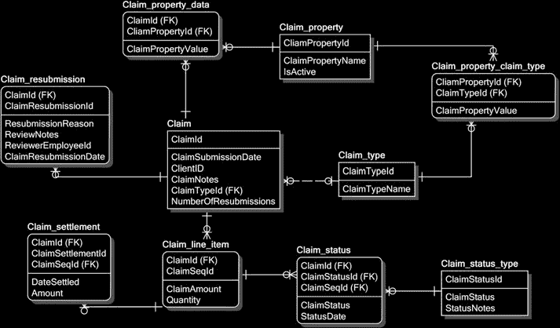
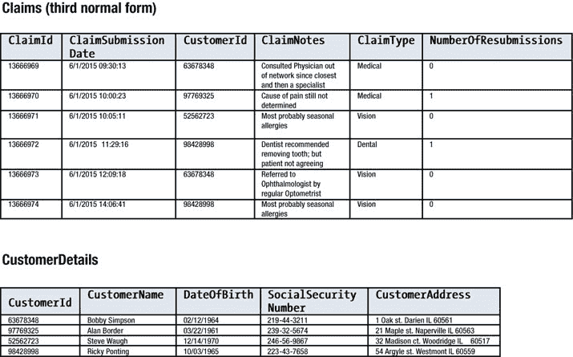
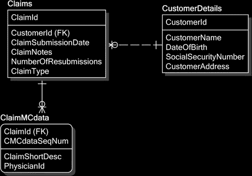
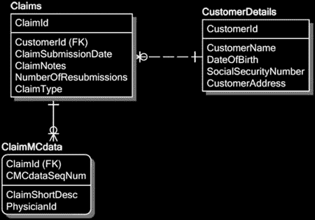
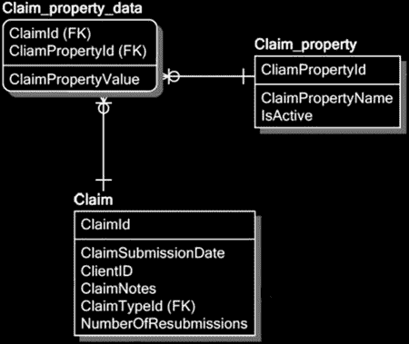
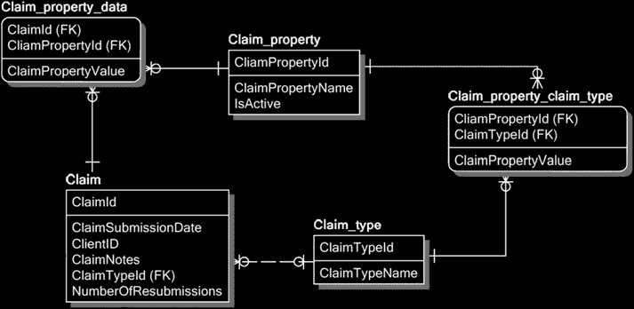
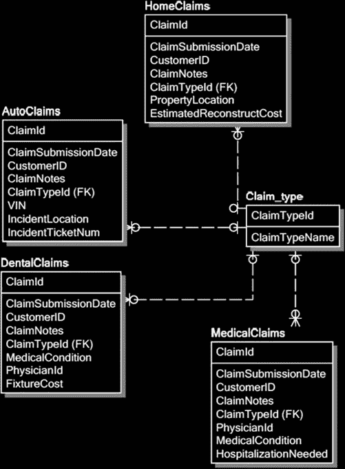

# 第二章

## 理解 RDBMS 设计原则

我一直很喜欢采访我们数据库架构社区中的初级成员。

我曾问一个人是否使用过或听说过“`SSADM`”（结构化系统分析与设计方法）。答案是否定的，老实说，这并不让我惊讶。我想这个术语可能在他之前就过时了，或者可能在美国从未流行过（我在英国职业生涯早期曾使用过它）。但即使是我的一些资深同事和朋友也没有听说过`SSADM`，甚至没听说过埃森哲的`METHOD/1`——这可是非常美国化的方法。

我在芝加哥的工作经历让我意识到，大多数企业在数据库设计方法论方面缺乏认知和理解。我认识的大多数企业数据库设计师所热衷的，不过是`自上而下`、`自下而上`以及`概念模型到物理模型`这些流行词汇。

随后，我也看到了这种漠视在需要对应用进行设计变更或追踪某些变更来源时所带来的影响。

然而，数据库设计并不仅仅关乎方法论。它关乎这些框架的实现。更重要的是，它关乎创建最佳设计，以实现业务流程的自动化、准确表示，并收集/存储执行该业务流程所产生的数据。设计方法应作为参考，并可根据有效实施的需要进行调整。例如，你可能知道，没有一个主流的`RDBMS`（`Oracle`、`Sybase`或`Microsoft SQL Server`）能严格算作“`关系型`”数据库，因为它们并不满足`E.F. Codd`在其论文《大型共享数据仓库的关系数据模型》中指定的所有标准。

因此，将框架作为指导方针来遵循是好的。但系统的功能准确性和性能更为重要——优秀的数据库设计师深知这一点。

近 50 年来，“`关系型`”数据库一直是最流行的数据库，而新的`NoSQL`技术无法提供作为`RDBMS`亮点的某些设计灵活性和易用性。当然，`NoSQL`也有很多优点，但通过其框架（即设计方法论）的健壮性和描述性来理解`RDBMS`的优势，还是很有帮助的。

这些方法论究竟是什么，它们又如何促进设计？我将从一些流行的设计方法（这些方法还不算真正的`方法论`）开始，然后讨论一些更全面、更具描述性的设计方法论。

© Bhushan Lakhe 2016

B. Lakhe 著，《实用 Hadoop 迁移》，DOI 10.1007/978-1-4842-1287-5_2

# 第 2 章 ■ 理解关系型数据库设计原则

在开始概述设计方法论之前，最后再提一点。如果最终目标是使用前沿的分布式 NoSQL 数据库技术，为什么还要花时间理解旧的关系型技术和设计呢？在我看来，这将有助于你更好地迁移你的应用程序。许多技术资源没有机会去理解关系型设计技术（尤其是在新技术不断涌现的当下），而最初的几章会提供一个概述，在某些情况下能快速刷新你的信息。在其他情况下，它们则提供简洁的讨论，以便你深入理解关系型设计方法论。

### 设计方法论概述

设计方法论提供了一个框架，你可以围绕它“构建”并实现你的数据库设计。你可以从业务需求入手，理解业务流程，然后构建流程和数据流。这将引领你形成概念模型，进而形成逻辑数据模型。最后，将逻辑模型实现为物理数据库。搞定！

你能用比这四句话更精炼的方式概括数据库设计吗？嗯，数据库设计远不止这些，因为它总结了你组织中某个特定功能领域的数据处理。所有实体（表）都映射到单个或多个业务流程的（执行）结果，而流程之间的相互关系则通过实体及其属性（列）之间的关系来体现。例如，考虑一个库存管理系统。`Customer` 表对应一个管理（添加、更新或删除）客户详情的业务流程。`Sales` 表对应客户执行的销售交易。随后，`Customer` 表和 `Sales` 表之间的关系准确对应了管理客户详情的流程与管理销售详情的流程之间的关系。

让我先从一个简单的设计方法开始，然后再讨论一些更复杂的方法。

#### 自上而下

自上而下的设计方法（顾名思义）从顶层开始。系统设计始于一个定义系统目的的概览或目标列表。

接着是第一级子系统或模块的设计，然后是后续级别的模块，直到你到达最后一个模块级别——实体本身。一个模块可以有多个子模块，也可以根本没有子模块。在确定整个模块结构后，最后一步才是填充每个模块的细节。这种设计方法更适合于新的应用程序开发或对应用程序进行较大的（模块级）增强。

一个很好的例子是保险公司设计索赔归档系统的需求。目标是：将超过两年的索赔数据迁移到较慢的长期存储（从而释放高速存储用于更高产的目的），修改报表和临时查询系统以访问归档数据库中的旧索赔数据，以及压缩索赔数据库并重建索引以提升性能。

下一节将讨论实现我们目标所需的各种（模块）级别。

#### 自下而上

自下而上的设计方法从底层或最低的业务流程级别开始。单个业务流程以及由此产生的实体及其分组，衍生出“模块”或子系统级别的功能，而子系统（对应于组织内某个部门或分部的业务流程）则组合起来形成一个逻辑模型。概念模型从逻辑模型推导而来，提供了系统的模块化视图，从而便于添加或修改功能。

由于这种设计是建立在模块（或子系统）隔离的基础上，因此始终存在模块间数据不匹配或数据重复的风险。

但它是一种更快速的设计方法，在某些情况下可以节省时间。它更适合于向现有应用程序添加新功能，或者需要重用代码或设计片段以实现快速开发的场景。

如果你要使用自下而上的设计方法来实现前面提到的索赔归档系统，你会从设计实际需要的、用于保存归档数据的实体开始。我将在下一节更详细地讨论这个例子。

#### `SSADM`

`SSADM` 是一种与其名称一样详尽的设计方法论。它从可行性研究开始，最终形成一个精确描述促成该设计的功能需求的物理设计。该方法论讨论了执行每个设计步骤的具体细节，使实现变得简单且成功。`SSADM` 由英国财政部商务办公室在 20 世纪 80 年代早期开发，遵循瀑布软件流程模型。

`SSADM` 的主要设计步骤如下：

*   可行性研究
*   现有环境调查
*   业务系统选项
*   需求规范
*   技术系统选项
*   逻辑设计
*   物理设计

同样，如果你想使用 `SSADM` 来设计一个索赔归档系统，你需要从可行性研究开始，其中包括评估可用的磁盘空间和迁移索赔数据所需的时间。现有环境调查将涉及检查需要移动的数据量。在这种情况下，业务和技术系统选项并不相关，因为是在扩展同一个系统（或应用程序）的功能。需求规范将包含所需功能的细节——新归档对象的设计细节以及归档数据的查询，根据需要修改查询/报表系统以使用新的归档对象，以及压缩/重建索赔数据库索引的说明。逻辑设计和物理设计将包含新设计的归档对象的结构。

### 探索设计方法论

设计方法的目标是精确地表示业务流程及其对一个业务的数据存储需求。有几种方法可以确保你的方法得出正确的模型：数据驱动模型、流程驱动模型、混合模型（数据驱动和流程驱动的结合）、面向对象模型、原型法（`RAD`——快速应用开发）和敏捷模型。在实践中，面向对象设计已不再用于数据库（因为不再使用面向对象数据库），并且除非组织急于快速准备好一个原型，否则大多使用混合模型。通常使用自上而下和自下而上的组合，而不是单一方法。

# 自顶向下设计方法

自顶向下设计方法旨在规划和充分理解系统设计目标。该方法于 20 世纪 70 年代由 IBM 公司的哈兰·米尔斯和尼克劳斯·维尔特提出。其优缺点如下。

## 优点

- 从系统目标/概述入手，有助于设计出更具内聚性的系统。

- 能更好地建立模块间的接口。

- 设计模块化有助于全面、有文档化地覆盖必要的功能。

## 缺点

- 该方法的主要问题是所需开发时间较长。

- 此外，在模块达到最终或实体层级之前，无法启动设计活动。

## 需求阶段

设计方法通常从需求阶段开始（因为除非“需要”数据库，否则无法进行设计）。我见过需求阶段的两种极端情况：要么客户希望直接开始构建概念模型，跳过需求收集和文档工作；要么客户花费过多时间收集需求，以确保无需再回头咨询所设计系统的用户。你需要确保记录了高层级需求，但不要在细节上花费过多时间，因为它们注定会发生变化。

### 需求分类

当然，对需求进行大致分类也可能有所帮助。例如：

- **不可实现的需求**：某些需求无法直接实现，例如“系统需要易于扩展，而无需重新设计”。

- **可实现的需求**：例如，“系统需要自动将新产品纳入相应的产品目录”。

- **冲突的需求**：例如，“每个新产品都需要包含在主目录中”与“季节性产品不应包含在主产品目录中”。

最后，如果你的开发阶段已经规划好，按阶段对需求进行分类也会有所帮助。例如，“行级安全仅在第二阶段需要。”

## 构建第一级模块

下一步是利用需求来记录目标，并构建第一级模块或子系统，以指向构建概念模型（因为自顶向下方法涉及从一个涵盖所有高层需求或目标的通用模型开始）。在本例中，目标如下：

1.  将超过两年的索赔移至较慢的长期存储（从而释放高速存储用于更高效的目的）。

2.  修改报告和临时查询系统，以访问旧索赔的存档索赔对象（因为现在索赔数据分布在两组实体中）。

3.  收缩索赔数据库并重建索引（以获得更好的性能）。

因此，第一级模块将是：

- 归档系统

- 对查询和报告系统的修改

- 数据库维护

### 第二级模块

对于“对查询和报告系统的修改”和“数据库维护”这两个模块，其第二级模块将分别是修改后的脚本和用于数据库维护（收缩、重建索引等）的新脚本。

“归档系统”的第二级模块将是：

- 设计新的归档对象

- 设计用于归档数据的查询

### 第三级及最低层级

第三级及最低层级将是设计实际的归档对象和查询本身。为此，拥有一个概念模型将很有帮助。

## 构建概念模型

对于自顶向下设计方法，你可以从一个涵盖所有高层需求的通用模型开始。但是，如何选择一个符合你需求的通用模型呢？首先，你可以为某个功能区域使用（你所在组织已有的）概念模型，该模型应大致符合你的需求或目标。

如果没有此类模型，你可以审查企业级概念模型（涵盖所有应用领域），并选择其中与你的需求或目标相匹配的部分。

# 假设上述任一模型可用，您可以选择合适的“实体组”（以匹配涵盖业务目标或需求的“主题领域”）。以之前提到的理赔归档系统为例，您可以将“理赔处理”主题领域作为通用模型来启动。图 2-1 展示了理赔处理的概念模型。

## 第 2 章 ■ 理解关系数据库管理系统设计原则

`Claim_resubmission`
`Claim_property`
可能导致
`Claim_property_data`
用于
可能导致
用于
拥有
为
`Claim`
`Policy`
`Claim`
拥有
`Type`
拥有
拥有
属于
`Claim Status`
拥有多个
由……描述
`Policy_holder`
`Claim_line_item`
拥有
通过……结算
`Claim`
为
`Status Type`
`Claim_settlement`

***图 2-1.** 理赔处理的概念模型*

接下来，您可以移除通用模型中与您的需求或目标不符的处理部分。在本例中，您只需归档所有超过两年的理赔数据。因此，您需要关注持有理赔数据的实体组。同时，由于理赔数据在各个规范化实体中关联分布，确保所有相关实体及记录均被归档至关重要。在概念模型中，您可以安全地从所有以 `Claim` 开头的实体入手并对其进行评估。

考虑 `Claim`（理赔详情）、`Claim_resubmission`（重新提交的理赔）、`Claim_line_item`（理赔生命周期详情）或 `Claim_settlement`（理赔结算详情）。

所有这些实体都相互关联并包含有时间限制的理赔详情。因此，应考虑将它们纳入归档范围。`Claim_type`、`Claim_property_data`、`Claim_property` 和 `Claim_status_type` 是不受时间限制的静态参考值，但它们未来可能发生变化，因此对其进行归档依然重要。所以，如果您做出决定并创建一个逻辑模型（按照设计方法的下一步），它将如图 2-2 所示。



***图 2-2.** 理赔处理的逻辑模型*

这种设计方法的最后一步是利用逻辑模型生成物理模型。由于您希望区分常规的理赔实体与用于归档的实体，您可能需要考虑为用于归档的实体添加一个像 `arch` 这样的前缀。像 `Erwin` 这样的建模工具可以帮助您根据所选的关系数据库管理系统，将逻辑模型正向工程（或转换）成物理模型。

例如，如果选择 `Microsoft SQL Server` 作为目标关系数据库管理系统，则将使用 `SQL Server` 数据类型。同样，`Erwin` 可以生成 `Transact-SQL` 脚本，用于在您的 `SQL Server` 数据库中创建表（以及用于参照完整性的主键和外键）。这是“设计新的归档对象”模块的最终任务。

另一个模块“设计归档数据的查询”将包含编写查询以便将数据移动到新创建的归档对象中的任务。

如果您熟悉软件过程模型，您会注意到这种自顶向下的设计方法与“构建-修复”软件过程模型的工作方式类似。与构建-修复模型一样，您从业务需求开始，构建系统的第一个版本。当您完成详细的模块化设计和各个任务以及构建工作时，业务需求可能已经发生变化，您需要迭代修改系统，以纳入所有最新需求以及对先前需求的变更。

图 2-3 展示了该过程模型。

业务
需求
变化的业务
构建第一个（或
需求或
添加细节后的
下一个适用的）
版本
运维
模式
退役
开发
维护/增强

***图 2-3.** 软件过程模型：构建-修复模型* 自底向上

# 理解关系数据库设计原则

## 混合设计方法

回顾一下你最近参与的项目计划（以及设计任务细节），你会发现很难判断出具体采用了哪种设计方法。即使和数据架构师或企业架构师讨论后，你也会清楚地意识到，并没有使用单一的设计方法。相反，采用了一种混合设计方法，很可能是自上而下和自下而上的结合。

大型软件项目通常从特定的高层业务需求和目标开始，然后按照自上而下的方法进行模块设计。然而，这种策略很快就会瓦解，因为模块负责人希望在规定时间内完成自己的任务，因此倾向于复用现有代码，有时甚至复用现有模块。这就将自下而上的方法混入了其中。在某些情况下，现有操作系统的功能会被扩展，以匹配正在设计的系统的目标。

### 自下而上设计方法

使用自下而上的设计方法，初始重点放在构成更高级别模块基础的、最底层的模块级别或单个实体上。设计完这些实体后，将它们分组以形成下一级别的模块。这个过程一直持续到形成一个完整的、能够交付所需功能的分层或模块化系统。

这就像大致了解机器应该做什么，然后非常详细地设计各个模块，这些模块提供所需功能的一部分。最后，你希望各个模块提供的组合功能与机器所需的功能相匹配，并且这些模块能够完美地相互对接。

这种方法的一大优势是可复用性以及它可能节省的时间/金钱。当然，设计者需要具备必要的经验（或直觉）来决定模块的功能。

## 第 2 章 ■ 理解关系数据库设计原则

我们来谈谈如何使用自下而上的方法实现上一节讨论的理赔归档示例。首先，你需要审查理赔处理的概念模型，并确定哪些实体需要归档。

一旦确定了这一点，就需要设计归档实体。通过为它们添加`arch`前缀（以区别于常规理赔实体），你可以设计诸如`arch_claim_item`、`arch_claim_resubmission`、`arch_claim_settlement`等实体。你可以为所有引用或元数据实体（如`Claim_type`或`Claim_status_type`）设置有效性（开始/结束）。

接下来是设计填充这些实体以及从关联理赔表`claim_item`、`claim_resubmission`和`claim_settlement`中移除归档记录所需的流程。之后，新的实体可以被添加到逻辑模型中，并最终作为分组`Archival`添加到概念模型中。

现在，由于任何与理赔相关的查询或报告都需要同时读取常规和归档的理赔数据，因此需要修改报表系统，使其能够根据请求报表的日期从正确的对象中读取数据。这将是这个新系统的下一个模块。

最后，由于大量数据从现有数据库对象中移除并添加到新对象中，必须执行数据库维护以确保数据库性能不受影响。这将是新系统的最后一个模块。因此，最终，理赔处理系统可以拥有一个名为`Archival`的新顶层模块。

如果你仔细审视，就会发现我们设计了同一个系统，但执行步骤的顺序相反。这种设计方法类似于一种称为增量的软件过程模型，如图 2-4 所示。

```
实现并
测试第一个构建
实现、集成并测试
后续构建直至产品完成
运行模式
退役
开发
维护/增强
```

**图 2-4.** *软件过程模型：增量模型*

正如你从图 2-4 中所见，这个系统是使用连续的构建逐步构建的，直到完成所有开发（以提供必要的功能）。你也可以将这种方法视为一系列敏捷冲刺。

#### SSADM

在 20 世纪 70 年代，建立设计方法或框架的初步尝试仅仅是试图将手工系统自动化。它们只是模仿了逻辑业务流程，因此没有增加太多价值。这些半正式的设计方法包含冗余和重复的信息，缺乏方法的清晰性（没有明确定义的步骤），并且存在许多不一致之处。SSADM 是第一次将设计策略形式化的尝试。它始于 1981 年，当前的 SSADM 版本是 1995 年发布的 V4.2。SSADM 在设计中使用了三种主要技术：

- **逻辑数据建模：** 在此 LDM 阶段，识别并记录（正在设计的）系统的数据需求。接着，通过将数据分离为实体（业务流程生成并需要记录的特定信息）和关系（实体之间的关联）来设计模型。

- **数据流建模：** 顾名思义，关注系统内的数据移动。更具体地说，数据流建模（DFM）描述了转换数据的过程或活动，同时考虑了所有的数据存储以及可能作为系统数据源或目标的外部实体。数据移动的方向对于 DFM 也很重要。DFM 是对 Yourdon 和 DeMarco 先前模型的改编。

- **实体行为建模：** 将早期的设计阶段联系起来，以交付一个完整的设计。LDM 将数据分离到实体中。DFM 记录了在系统内转换数据的过程。EBM 将单个实体与影响它们（及它们的数据）的事件或过程，以及这些事件或过程发生的顺序联系起来。

### 可行性研究

项目或产品源于业务目标和需求。在对想法或目标进行初步讨论时，很少关注该目标的可行性或现实性。随后，当管理层要求产品团队实施时，他们必须确定该目标是否可实现（特别是对于潜在的大型项目/产品）。做出此判断需要考虑几个方面：

- *技术* — 该产品或项目在技术上是否可行？

- *资金* — 组织是否有必要的预算来执行该项目？

- *兼容性* — 新产品是否能轻松地与组织内的现有系统对接？

- *完整性* — 新产品是否会以任何方式损害组织的专业（或道德）完整性？

此阶段的输出是一份可行性研究文档。根据 SSADM 指南，该文档还应包含所有已考虑的可行性研究方案的详细信息（包括被拒绝的方案以及拒绝原因）。

## 当前环境调查

这涉及查阅现有的应用程序文档，探索当前应用程序，并与应用程序用户、开发人员和管理员进行讨论，以充分理解系统。这有助于以下方面：

- 理解业务术语

- 理解常用应用程序特性及其使用方法

- 开发数据模型

- 定义应用程序的范围

此阶段的输出是（针对新系统或应用程序的）需求细节、现有服务和用户细节、逻辑和物理数据模型、数据流图以及数据字典（均为针对现有系统的）。

## 业务系统方案

# 系统分析与设计方法

在此阶段，分析师将（开发新系统的）需求与目标同现有系统的功能进行比较。可能只需对现有系统稍作修改即可匹配目标，也可能需要开发一个全新的系统来实现目标并满足需求。

作为此阶段的输出，分析师会制定并提出若干可能的业务系统方案，以实现必要的目标。

## 需求规格说明

这可以说是最重要也是最复杂的步骤。原因之一是分析师需要掌握拟建系统的所有逻辑规格细节。确保这些规格说明无错误、无歧义、一致且简明扼要，这一点当然至关重要。

此步骤复杂的另一个原因在于，分析师需要构建逻辑数据模型（至少是实体关系图）以及数据流图（`DFD`），以确保逻辑规格的准确性，尽管这些并非此阶段的预期输出。

本阶段的输出是一份全面的需求规格说明文档。

---

# 第二章 ■ 理解 RDBMS 设计原则

## 技术系统方案

在较早的阶段，分析师已掌握足够信息来提出可能的业务方案。现在有了现成的技术需求，分析师可以提出若干可用的技术系统方案。这些方案经过评估后，会选定最佳方案，然后进入下一阶段。

### 逻辑设计

此设计阶段规定了与拟建应用相关的过程逻辑图，以及受这些过程影响的实体。同时还包括有关数据及其相互关系的信息。

本阶段的输出包括：
-   数据字典
-   逻辑数据模型
-   逻辑过程模型

### 物理设计

`SSADM` 的最终阶段利用（上一阶段的）逻辑设计规格，将其转换为物理数据库结构（针对拟定的实施目标，例如 `Oracle` 或 `Microsoft SQL Server`）。这涉及：
-   为列附加特定数据库的数据类型
-   使用主键、外键或触发器（将在下一节讨论）以及可空性来实现参照完整性约束
-   定义索引并指定函数细节（结构和实现）
-   列出硬件和软件需求

本阶段的输出是一个完整的物理设计，实施团队（包括管理员）可据此构建所需的系统。

以上就是 `SSADM` 的阶段细节。我将讨论一个使用 `SSADM` 作为设计方法的示例（及完整设计）。与任何其他设计方法一样，使用 `SSADM` 也有其优缺点。

# 第二章 ■ 理解 RDBMS 设计原则

## SSADM 的优缺点

`SSADM` 具有以下优点：
-   系统和物理设计之间实现了极佳的隔离。其好处包括：
    -   可以自由地使用你选择的数据库来实现逻辑设计。
    -   将逻辑设计与物理设计之间的问题隔离开来。事实上，如果在物理实现后发现了逻辑设计的问题，你可以修改物理实现来解决这些问题。
-   拥有清晰定义且文档齐全的步骤，可引导出完整的设计。
-   广泛的资源（分析师、业务用户、管理员、应用用户和开发者）参与其中，提供了良好的视角，这反映在设计之中，同时也降低了（理解或实施需求时）出错的可能性。

现在来看缺点：
-   `SSADM` 的实施时间很长，任何变更都需要通过所有阶段进行处理。例如，如果在进行物理设计时需求发生变化，你需要从检查这些需求的可行性开始，检查它们是否已在现有系统中实现，更改需求规格，然后将变更应用到逻辑/物理数据模型。
-   培训资源使用 `SSADM` 并利用其进行实施需要相当高的成本和时间。

作为结语，我希望你回顾一下瀑布软件过程模型，并思考它和 `SSADM` 之间的相似之处。与 `SSADM` 类似，瀑布模型也很全面，拥有大量的步骤。正如你在图 `2-5` 中所见，对需求或规格的变更会涉及对所有后续阶段进行返工，这可能非常耗时（尽管它确实有助于在系统内保持一致性——在任何阶段，需求规格都与现有的物理系统相匹配）。

---

# 第二章 ■ 理解 RDBMS 设计原则

需求 → 变更的需求 → 验证

验证 → 规格说明 → 验证

验证 → 计划 → 验证

验证 → 设计 → 验证

验证 → 实施 → 验证

验证 → 集成 → 验证

验证 → 运行模式 → 开发 → 维护/增强 → 退役

***图 2-5.** 软件过程模型：瀑布模型*

---

### 数据库设计的组成部分

现在，我们将聚焦于关系型数据库设计中使用的主要结构。你需要在概念设计和逻辑设计阶段使用它们。我相信你之前在某个数据库开发项目中使用过主键、外键或触发器，但了解一下这些组件在关系型设计范畴内的定位仍然很有意义。像超类型或子类型这样的结构并不常用（或者至少不为人所理解），而像基数性（`cardinality`）或自引用关系（`self-referencing relationships`）这样的结构则需要被完全理解，才能设计出好的方案。

最常讨论的关系型概念是*范式*（`normal forms`）。它是关系型设计的一个亮点，但遗憾的是，许多设计人员对此仍不十分清楚。我将通过一个例子来讨论这三个范式。我还会简要介绍博伊斯-科德范式（`BCNF`）供你理解，尽管它更多是理论性的，在实践中很少使用。

---

# 第二章 理解 RDBMS 设计原则

最后，你需要理解，将数据保持在第三范式并不总是最佳选择。出于报告或数据仓库的需求，你需要对数据进行反范式化。我也会通过一个例子来讨论这个概念。

## 范式

规范化是一个通过识别并消除任何数据冗余，同时保持（数据内部的）交叉引用完好的方式来高效组织数据的过程。其目标是完全消除数据冗余，并获得更好的数据组织。规范化是一个多步骤的过程，根据该过程应用于数据的程度，数据被称为处于`第一`、`第二`或`第三`范式。

还有更高形式的规范化，例如`BCNF`、第四范式和第五范式，尽管它们多是理论性的，在现实世界中很少使用。

### 第一范式

第一范式的目标是识别并将任何重复的数据组隔离到单独的表中，当然，同时要保持与源数据的交叉引用完好。一行数据可能包含一个或多个重复组，你需要首先将它们识别出来。以下是一个例子。假设有一家销售健康保险的保险公司。拥有有效保单的客户通过公司呼叫中心接听的免费电话提交索赔。根据简短的对话，通常会为一次索赔捕获以下信息：`ClaimId`、`ClaimSubmissionDate`、`CustomerName`、`DateOfBirth`、
`SocialSecurityNumber`、`CustomerAddress`、`ClaimNotes`、`ClaimType`、
`ClaimShortDesc1`、`PhysicianId1`、`ClaimShortDesc2`、`PhysicianId2`、
`ClaimShortDesc3`、`PhysicianId3`、`NumberOfResubmissions`。

`ClaimId`是一个系统生成的数字，每增加一条新索赔，该数字就会递增。

`ClaimType`表示索赔类型（例如牙科、眼科、医疗等），`ClaimShortDesc`（1-3）包含了随着索赔处理进展、病情被转诊给其他医生或专科医生时，对实际主诉的简短描述。`PhysicianId`（1-3）是参与患者治疗的医生的标识符。一项索赔可能关联一个或多个（最多三个）医疗状况及对应的医生。

`NumberOfResubmissions`记录了此项索赔被重新提交处理的次数。以下是示例数据：

```
13666969 , 6/1/2015 09:30:13, Bobby Simpson, 02/12/1964, 219-44-3211, 1 Oak st. Darien IL 60561, Consulted Physician out of network since closest and
then a specialist, Medical, Severe stomach pain, 43211, Cramp of abdominal muscles, 12456, NULL, NULL, 0
```

```
13666970 , 6/1/2015 10:00:23, Alan Border, 03/22/1961, 239-32-5674, 21
Maple st. Naperville IL 60563, Cause of pain still not determined,
Medical, Pain in left shoulder, 31341, Left shoulder dislocation, 11232, Physiotherapy, 54543, 1
```

```
13666971 , 6/1/2015 10:05:11, Steve Waugh, 12/14/1970, 246-56-9867, 32
Madison ct. Woodridge IL [  60517](https://www.google.com/search?rlz=1C1PRFC_enUS598US598&espv=2&biw=1600&bih=760&q=60517&stick=H4sIAAAAAAAAAGOovnz8BQMDAx8HsxKXfq6-gWG8RVJeRua0GZGaTLPSNAoS1uSYxetcE9jyHAA5duj3KwAAAA) , Most probably seasonal allergies, Vision, Dry itchy eyes, 73443, Eye infection, 33342, NULL, NULL, 0
```

```
13666972 , 6/1/2015 11:29:16, Ricky Ponting, 10/03/1965, 223-43-7658, 54
Argyle st. Westmont IL 60559, Dentist recommended removing tooth; but
patient not agreeing, Dental, Severe pain in maxillary first molar, 41414, NULL, NULL, NULL, NULL, 1
```

```
13666973 , 6/1/2015 12:09:18, Bobby Simpson, 02/12/1964, 219-44-3211, 1 Oak st. Darien IL 60561, Referred to Ophthalmologist by regular Optometrist,
Vision, Double vision, 33562, Change of prescription, 25251, NULL, NULL, 0
```

```
13666974 , 6/1/2015 14:06:41, Ricky Ponting, 10/03/1965, 223-43-7658, 54
Argyle st. Westmont IL 60559, Most probably seasonal allergies, Vision,
Dry itchy eyes, 63462, NULL, NULL, NULL, NULL, 0
```

快速浏览这些数据会让你意识到，这些数据存在重复组（以粗体标示），进而导致数据重复。它还包含其他一些问题（稍后我会讨论）。重复的数据块是与索赔相关的医疗状况和医生详细信息。

此外，按照这种表结构设计，最多只能记录三项医疗状况及其关联医生。但如果一项索赔关联了超过三项医疗状况，该怎么办？由于这种情况很少发生，该系统的设计人员要求呼叫中心代表创建一个新的索赔，并在当前索赔的备注部分引用这个新编号！这是一个糟糕的变通方法，这个设计问题需要解决。

为了让这个表满足第一范式，你需要将医疗状况数据移到一个单独的表中。这能解决另一个问题（即一项索赔关联超过三项医疗状况）吗？让我们来看看。

现在，在我们将重复数据移到新表之前，需要确保能够对其进行交叉引用，并且它仍然与正确的索赔相关联。首先，看看你是否能为你的`Claims`表唯一地标识每一行数据。在这个例子中，你可以做到；因为`ClaimId`是系统生成的唯一编号，可以用来唯一标识一行。这种标识符被称为`主键`，并且可以将该列指定为主键列。

接下来，你需要为新表唯一地标识每一行。由于一项索赔关联了多个医疗状况，仅凭`ClaimId`不足以作为主键。你还需要额外添加一个序列号来确保主键的唯一性。此外，在这种情况下，序列号确实有意义（因为它记录了针对一项索赔诊断出医疗状况的顺序），并且可能对分析有用。

所以，在将数据移到一个新表（称之为`ClaimMCdata`）之后，新表将如图 2-6 和图 2-7 所示。

**Claims**

| 索赔 ID | 提交日期 | 客户姓名 | 出生日期 | 社保号 | 客户地址 | 索赔备注 | 索赔类型 | 重新提交次数 |
| :--- | :--- | :--- | :--- | :--- | :--- | :--- | :--- | :--- |
| 6/1/2015 09:30:13 | 鲍比·辛普森 | 02/12/1964 | 219-44-3211 | 1 Oak st. Darien IL 60561 | 咨询了网络外的医生，因为最近，然后找了专科医生 | 医疗 | 0 |
| 6/1/2015 10:00:23 | 艾伦·博德 | 03/22/1961 | 239-32-5674 | 21 Maple st. Naperville IL 60563 | 疼痛原因尚未确定 | 医疗 | 1 |
| 6/1/2015 10:05:11 | 史蒂夫·沃 | 12/14/1970 | 246-56-9867 | 32 Madison ct. Woodridge IL | 很可能是季节性过敏 | 眼科 | 0 |
| 6/1/2015 11:29:16 | 瑞奇·庞廷 | 10/03/1965 | 223-43-7658 | 54 Argyle st. Westmont IL | 牙医建议拔牙；但患者不同意 | 牙科 | 1 |
| 6/1/2015 12:09:18 | 鲍比·辛普森 | 02/12/1964 | 219-44-3211 | 1 Oak st. Darien IL 60561 | 由普通验光师转诊至眼科医生 | 眼科 | 0 |

# 理解关系数据库设计原则

## 第二范式

一个实体满足第二范式的正式定义是：其所有非键属性都单独依赖于整个键属性组，而不依赖于该键属性组的一部分。换句话说，如果一个实体的非键属性不存在任何部分键依赖关系，或者键的任意部分都不能决定一个非键属性，那么该实体就处于第二范式。

因此，很容易看出，具有单一属性作为键的实体自动满足第二范式（因为不存在部分键依赖关系的可能性）。这也是为何系统生成的序列号（用作标识符）作为主键效果良好的原因。

对于 `Claims` 实体（或表），由于系统生成的标识符（`ClaimId`）被用作主键，它自动满足第二范式。对于另一个实体 `ClaimMCdata`，其主键是 `ClaimId` 和 `CMCdataSeqNum` 的组合，并且很容易看出不存在部分键依赖关系，因此它也处于第二范式。

## 第三范式

一个实体满足第三范式（3NF），当且仅当没有任何非键列（或列组）决定另一个非键列（或列组），并且所有非键列仅由键列组决定（或函数依赖于键列组）。换句话说，需要同时满足以下两个条件：

- 所有非键项仅依赖于键列组。
- 没有非键列（或列组）依赖于另一个非键列（或列组）。

`Claims` 和 `ClaimMCdata` 实体是否满足第三范式？对于 `Claims` 实体，如果按顺序检查各列，你会发现第四列 `DateOfBirth` 函数依赖于非键列 `SocialSecurityNumber`，而不是依赖于键列 `ClaimId`。列 `CustomerName` 和 `CustomerAddress` 也依赖于 `SocialSecurityNumber` 列。由于这违反了第三范式的要求，你需要将这些列移动到一个单独的实体中，并将其命名为 `CustomerDetails`。

现在，如果你将所有客户信息列移动到一个单独的实体，如何为一次理赔交叉引用这些信息？你需要为每条客户记录分配一个标识符，该标识符可以放置在索赔记录中，并引用 `CustomerDetails` 中的客户信息。你可以使用系统生成的顺序号作为标识符，并将其命名为 `CustomerId`。

如果你检查 `ClaimMCdata` 实体，你会发现它已经满足第三范式。非键属性 `ClaimShortDesc` 和 `PhysicianId` 仅依赖于键属性 `ClaimId` 和 `CMCdataSeqNum`，而不依赖于任何其他非键属性。

因此，在将客户数据列从 `Claims` 实体移出后，图 2-8 展示了 `Claims` 和 `CustomerDetails` 的样子。



**图 2-8.** 第三范式中的 `Claims` 和 `CustomerDetails` 数据

如果你再次检查这些实体（图 2-8），你会发现可以将第三范式的两个条件成功地应用于 `Claims`、`ClaimMCdata` 和 `CustomerDetails` 实体。

从 `Claims` 表中移除重复组后，你可以看到数据更易于管理（如图 2-6 和图 2-7 所示）。此外，你一定已经注意到，新表 `ClaimMCdata` 不需要像 `ClaimShortDesc1`、`PhysicianId1` 等多列。你只需为每项索赔的每个医疗状况添加一行即可，不再受限于三项医疗状况的限制。因此，一项索赔关联超过三项医疗状况的设计问题也得到了解决。

现在 `Claims` 表满足第一范式，但你还需要考虑下一范式——以及如何达到该范式。

*图 2-6. 满足第一范式的索赔数据*

**索赔医疗状况数据**

| **索赔 ID** | **医疗状况数据序列号** | **索赔简短描述** | **医生 ID** |
|---|---|---|---|
| | | 严重胃痛 | 43211 |
| | | 腹肌痉挛 | 12456 |
| | | 左肩疼痛 | 31341 |
| | | 左肩脱位 | 11232 |
| | | 物理治疗 | 54543 |
| | | 眼睛干痒 | 73443 |
| | | 眼部感染 | 33342 |
| | | 上颌第一磨牙严重疼痛 | 41414 |
| | | 复视 | 33562 |
| | | 更换处方 | 25251 |
| | | 眼睛干痒 | 63462 |

*图 2-7. 医疗状况数据移至单独的表*

## 关系设计中的键

键在关系设计中具有特殊的用途和意义。**键**是一种字母数字模式或列值，用于唯一（部分或完全）标识一个数据行。因此，键可用于标识数据行（主键）、用作备用键或候选键（可以整体或部分用作主键的列）、外键（交叉引用）或代理键（系统生成的顺序数或随机数，对用户透明）。

让我们使用上一节中的实体设计来逐一讲解这些概念。如果你是 IE 逻辑模型表示法的新手，请注意实体框中的横线上方列是主键列。正如你在图 2-9 中所见，`ClaimId` 是 `Claims` 实体的主键，`CustomerId` 是 `CustomerDetails` 实体的主键。

这些（如前所述）是系统生成的数字，确保了该列的唯一性，因此可用于唯一标识一个数据行。根据**代理键**的定义，`ClaimId` 和 `CustomerId` 是代理键的很好的例子。它们是在不存在**自然键**（能够唯一标识数据行的列组合）的情况下使用（或生成）的。



**图 2-9.** 理赔处理的主键和外键

对于 `ClaimMCdata` 而言，由于一次索赔可能关联多个医疗状况，我将 `CMCdataSeqNum`（序列号）添加为主键的一部分，使其能够唯一标识一个数据行。

如图 2-9 所示，`CustomerDetails` 实体包含一个**备用键**或**候选键**的例子。如你所知，系统生成的标识符 `CustomerId` 被用作主键。但也可以使用 `SocialSecurityNumber` 列作为键，因为它可以唯一标识一个客户。在这种情况下，你无需担心将该列移动到一个单独的表中，因为没有属性仅依赖于 `SocialSecurityNumber`。

你可能还记得，在将我所有客户信息移动到一个单独的实体 `CustomerDetails` 之前，我在索赔记录中放置了一个名为 `CustomerId` 的标识符，以便交叉引用提交索赔的客户信息。`CustomerId` 当然就是 `CustomerDetails` 实体的主标识符或主键。这种用于从另一个实体交叉引用信息的键被称为**外键**。在 IE 表示法中，外键列用括号中的 `FK` 标记。你看到的另一个外键是 `ClaimMCdata` 实体的 `ClaimId`。它引用了该医疗状况信息所属的索赔信息。

## 可选性与基数

可选性与基数是用于描述关系的图例约定。

例如，考虑 `Claims` 和 `ClaimMCdata` 之间的关系。乌鸦脚表示“多”，没有乌鸦脚表示“一”。这就是关系的基数。此外，圆圈表示“可选”，竖杠表示“强制”。这就是关系的可选性。

因此，这种关系可以解读为“一次索赔可能导致零个或多个医疗状况记录”。也可以解读为“一条索赔医疗状况记录总是对应一条存在的索赔记录”。



在考虑依赖关系时，一种“标识”子表或依赖表中记录的关系称为标识关系。子表继承父表的主键，并且可能需要补充一个属性来实现唯一性。在图 2-10 中，`Claims` 与 `ClaimMCdata` 之间存在标识关系，并且如你所见，`ClaimMCdata` 必须补充一个序列号作为主键的一部分以实现唯一性（因为一条索赔记录可能被多条 `ClaimMCdata` 记录继承）。

**图 2-10.** 理赔处理中的可选性与基数

也存在非标识关系。例如，前面讨论的 `Claims` 和 `CustomerDetails` 实体之间的关系就是一种非标识关系。

`CustomerDetails` 记录不会被 `Claim` 记录继承；外键属性 `CustomerId` 仅作为指向提交索赔的客户详情的一个指针或交叉引用。关系的非标识性质通过虚线（而非实线）以及 `CustomerId` 不是 `Claim` 主键的一部分来体现。

现在，前面模型中的所有关系都是一对多或零对多的基数。如果存在“多对多”基数关系会发生什么？

你需要使用一个映射表将该关系拆分为两个一对多关系。

考虑图 2-11 中所示的理赔处理逻辑模型的一部分。`Claim` 和 `Claim_property` 实体之间存在多对多关系，因为一个属性可能适用于多个索赔，而一次索赔也可能具有多个属性。为了在逻辑模型中表示这种关系，你需要创建一个映射表 `Claim_property_data`，将索赔与其各自的属性进行映射，反之亦然。



**图 2-11.** 解决多对多关系

总而言之，可选性与基数明确了关系，有助于更好地记录它们，也使逻辑模型更易读和更易理解。

## 超类型与子类型

# 超类型与子类型

## 超类型和子类型的基本概念
`Supertypes`（超类型）和`subtypes`（子类型）是关系型设计中最有用的逻辑结构之一。`超类型`对应实体类（一组或一类通常与同一业务流程相关联或用于提供相同业务功能的多个实体），而`子类型`也代表着实体类的不同层级。你可以将`超类型`和`子类型`视为实体层面的超集与子集。

`超类型`和`子类型`最适用于概念建模阶段，因此非常适合自上而下的设计方法。它们有助于提供简洁的业务规则文档，并探索备选数据模型。

由于任何关系型数据库管理系统（RDBMS）都不会直接实现`子类型`和`超类型`，因此你需要在逻辑或物理数据建模阶段之前将它们分解为独立的实体。

## 逻辑模型的初始设计
下面通过一个示例来讨论超类型和子类型的概念。考虑理赔处理逻辑模型的以下部分（再次展示），如图 2-12 所示。概括来说，`Claim`存储索赔数据，`Claim_type`存储所有索赔类型（`汽车`、`健康`、`房屋`等），而`Claim_property`存储索赔的所有可能属性。



**图 2-12.** 使用映射实体根据索赔类型分配属性

正如我已经解释过的，实体`Claim`和`Claim_property`之间存在多对多关系，`Claim_property_data`是一个映射表，用于将索赔与其各自的属性关联起来。类似地，`Claim_property`和`Claim_type`也存在多对多关系，`Claim_property_claim_type`则是一个映射表，用于将索赔类型与其各自的属性关联起来。

这四个表（`Claim_property`、`Claim_property_data`、`Claim_type`和`Claim_property_claim_type`）的目的是确保特定类型的索赔仅拥有由其索赔类型管控的必要属性。例如，房屋保险单不会有`VIN`（车辆识别码）作为属性，而汽车保险单则不会有预估重建成本作为属性。

## 使用超类型和子类型的改进设计
是否可以使用超类型和子类型重新设计逻辑模型的这一部分？可以，如果使用`Claim`作为超类型，并将各种索赔类型（`汽车`、`健康`、`房屋`）作为子类型，则可以重新设计这部分，并且可以移除之前添加的四个表（用于容纳特定索赔类型的属性）。设计将如图 2-13 所示。



**图 2-13.** 使用超类型/子类型根据索赔类型分配属性

扩展后的逻辑模型将如图 2-14 所示。

**图 2-14.** 使用超类型/子类型进行理赔处理的逻辑模型

超类型`Claim`拥有许多通用或共享属性（`ClaimId`、`CustomerId`、`ClaimSubmissionDate`、`ClaimNotes`），这些属性将被所有子类型（`AutoClaims`、`HomeClaims`、`DentalClaims`、`MedicalClaims`）继承，而子类型将拥有它们各自的特定属性。因此，`AutoClaims`可能拥有诸如`InsureeVIN`（被保险人 VIN）、`OtherVehicleVIN`（其他车辆 VIN）、`IncidentLocation`（事件地点）和`TicketNumber`（罚单号）等属性，而`MedicalClaims`可能拥有诸如`MedicalCondition`（医疗状况）、`Physician`（医师）等属性。

这是确保特定索赔类型只存储有效且适用属性的另一种方法。

## 设计比较与选择
两种设计各有利弊。采用为属性和类型设置独立实体（并使用映射表）的设计提供了更大的灵活性，任何属性的添加或删除都不会导致逻辑模型发生变化。但这种设计更难以理解和维护。采用超类型和子类型的设计则更容易理解和维护，但灵活性较差。对特定索赔类型属性的任何更改都会导致实体结构发生变化，并且难以实施。你可以选择适合自身环境的方法。

## 超类型和子类型的要点
关于超类型和子类型，有几点需要注意，这将有助于你更好地理解这些概念：

-   （超类型的）`子类型`应该是**互斥的**（不重叠）且**穷尽的**。在给定的示例中，子类型（`汽车`、`房屋`、`医疗`索赔）是互斥的。但如果存在功能重叠，则会复杂化设计，你需要找到消除重叠的方法。

-   创建**分区**是一种有时用于消除重叠的技术，特别是因为一些 CASE 工具允许将多个分解（分区）划分为完整且不重叠的子类型。例如，如果汽车和房屋保险单都涵盖第三方责任，但承保范围存在差异，则会导致重叠，并可能需要通过分区来解决（例如，涵盖房屋保障的汽车保险单、不涵盖房屋保障的汽车保险单，以及不包含汽车保障的房屋保险单）。

-   `子类型`和`超类型`可以参与关系（与实体类似），但仅限于概念模型（不适用于逻辑/物理模型，因为任何 RDBMS 都不直接支持超类型/子类型）。

-   `子类型`可以用于多层嵌套，并可以形成层级结构。

我希望本章能让你对关系型设计的关键构建块有一个良好的了解。我们将使用所有这些结构来分析一个真实的业务场景，并设计一个逻辑/物理模型来存储相关业务流程执行后的输出结果。

### 总结
许多人可能会质疑，在这个拥有尖端技术和分布式架构的 NoSQL 数据库时代，讨论关系型数据库设计是否还有必要。我个人认为，由于大多数数据库世界仍然在关系型数据库的结构、约束和规范下运行，因此这个讨论仍有其现实意义。除非你理解正在使用的东西，否则你无法将其转化为你想要的样子。大多数现有应用程序都是在较早时期设计的，并且广泛使用了关系型设计特性。要将这些应用程序迁移到更新的技术，你当然需要充分理解使用了哪些特性以及它们的作用。

更重要的是，目前没有专门用于 NoSQL 设计的工具，大多数架构师都使用关系型设计工具来创建面向 NoSQL 数据库的数据模型。例如，重构 RDBMS 数据涉及实体的反规范化和聚合（因为 NoSQL 数据库在处理连接方面不太擅长）。这些任务需要（并且确实）使用关系型数据库建模工具来执行。而且，除非你理解反规范化和聚合的概念，否则你无法修改模型以适应 NoSQL 解决方案。这就是为什么熟悉第 2 章和第 3 章中涵盖的关系型设计概念很重要。再比如，除非你理解规范化数据在关系型数据库中是按行组织的，否则你将难以理解列式 NoSQL 数据库的基于列的存储，或面向文档的 NoSQL 数据库的嵌入式文档结构。

这也意味着你需要理解规范化的概念。

