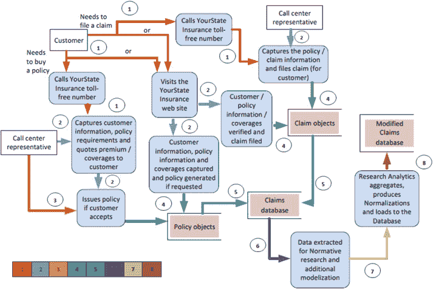
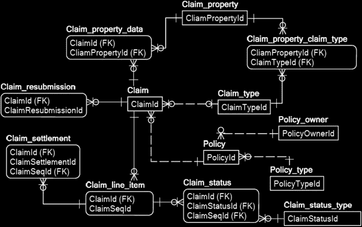

# 第 3 章 ■ 使用 SSADM 进行关系设计

## 用户目录

用户目录列出了（针对拟议系统的）可能的用户及其职务头衔，以及其工作活动的描述。以下是该项目的用户目录：

| **用户** | **活动** |
|----------|----------|
| 理赔员 | 查看或修改现有理赔 |
| IT 人员 | 系统管理与技术支持 |
| 市场人员 | 查看理赔 |
| 呼叫中心代表 | 创建新理赔 |

### 当前环境描述

本节详细描述了现有环境，有助于提供现有系统的概览。它涵盖了硬件和软件配置、数据流和逻辑数据模型。在设计旨在补充当前系统功能的新系统之前，有必要了解现有系统的情况。

### 当前系统描述

**硬件**：基于 Windows 2008 R2（数据中心版）服务器的物理集群，配有 64 个 CPU、1 TB 内存和 20 TB SAN 存储。使用的数据库是 SQL Server 2008 R2（数据中心版）。理赔数据库是最大的数据库之一，大小为 10 TB，涵盖了最近三年的理赔数据。更早的理赔数据则归档在归档数据库中。每日理赔量在 2,000 到 3,000 之间，包括通过 YourState 免费电话以及基于网络的理赔系统提交的理赔。

每晚，自动化流程会根据多个参数（如理赔类型和理赔员的专长、理赔员正在处理的案件数量、地点等）将理赔分配给理赔员。

### 当前物理数据流模型

数据流模型提供了数据如何在现有系统内流动的功能细节。图 3-1 展示了 YourState 保险公司的保单与理赔处理系统的数据流。

**图 3-1.** 保单与理赔处理系统的数据流

如图所示，保单的购买或理赔的提交可以通过在线方式，也可以通过拨打 YourState 免费电话完成。在提交理赔前，需要访问并验证客户、保单和保障范围信息。如果客户拥有必要的保障，则会提交理赔（在理赔数据库中插入记录）。

### 当前逻辑数据模型

逻辑模型显示了系统内关键实体之间的相互关系，并提供了这些关系的细节。图 3-2 中的逻辑数据模型展示了理赔处理系统内关键实体之间的关系。

**图 3-2.** 理赔处理逻辑数据模型

---

## 拟议环境描述

本节描述了拟议新系统的三个重要方面：事件流、数据流以及事件用于捕获数据的功能逻辑。我将详细讨论每个方面。让我们从业务活动模型开始，该模型概述了业务流程，并详细说明了构成流程的活动，同时显示了流程/活动之间的相互连接和交互。

### 业务活动模型

业务活动模型侧重于关键业务流程，并对这些流程中的基本活动进行建模。活动可以进一步细分为任务（以便更清晰）。它还展示了触发业务流程的业务事件，以及启动和执行所需活动所涉及的业务规则。

在图 3-3 中，事件用圆圈表示，活动用矩形表示，业务流程用虚线矩形表示，菱形表示决策点。因此，事件