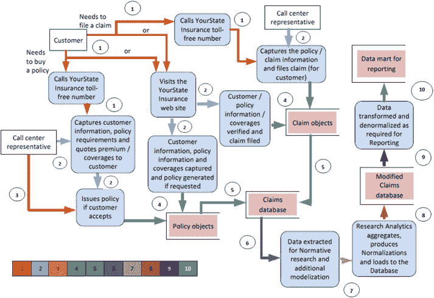
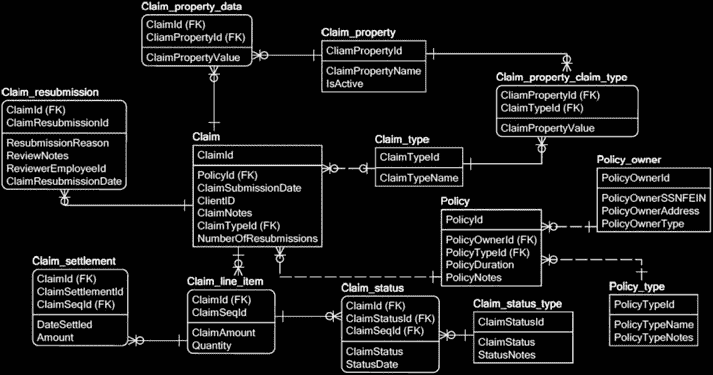
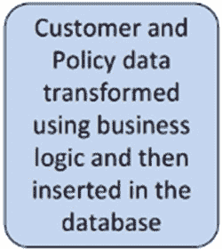

# 潜在客户的“询价请求”触发业务流“保单报价”

潜在客户的“询价请求”会触发业务流“保单报价”，该流程包含一系列基础活动，例如风险管理小组审核文件并出具报价、客户审阅报价，以及在客户有疑问或保留意见时将报价发回风险管理小组进行再次审核与修改。客户接受报价将触发下一个事件“保单签发请求”，进而启动下一个业务流“保单签发”，最终完成保单签发并将信息录入 YourState 保险公司相应的数据库中。

## 第 3 章：使用 SSADM 进行关系型设计

### 风险管理小组

`请求`审核必要文件并出具报价。

### 客户审阅报价

- `拒绝`：发回风险管理小组，获取修改后的反馈报价
- `接受`：业务流`保单签发请求`

### 企业销售小组

`保单文档`准备合同，并归档双方签署的副本。

`保单`签发至客户，并在相关数据库中添加相应记录。

### 业务流：保单签发

***图 3-3.** 比赛中断险保单签发业务活动模型*

总而言之，该业务活动模型完整地捕捉了向潜在客户签发比赛中断险保单的全部业务需求。

## 数据规范

本节描述了为拟议系统存储数据所需的新实体。在这种情况下，需要新增若干实体来支持新的比赛中断险保单，具体如下：

- `PlayerInjuries`：该实体记录棒球运动员过往的棒球相关伤病信息，并与运动员的病史结合使用，以确定该运动员比赛中断险保单的保费。
- `PlayerSchedule`：该实体存储棒球运动员当前赛季及下赛季的赛程详细信息。
- `PlayerChronicConditions`：该实体记录棒球运动员现有的慢性健康状况，并用于确定该运动员比赛中断险保单的保费。
- `PlayerContracts`：该实体记录棒球运动员与其俱乐部（即请求保单覆盖的俱乐部）签订的合同详情，并用于确定该运动员比赛中断险保单的保费。

## 功能规范

本节描述了实施新系统所需的新功能与事件。数据流模型展示了这些事件与功能在整个系统中的位置。针对拟议的比赛中断险保单，新事件如下：

- 比赛中断险保单报价请求
- 比赛中断险保单签发请求
- 比赛中断险保单取消请求
- 比赛中断险保单理赔请求

支持新保单所需的新功能如下：

- `GetPlayerInjuryInfo`：将棒球运动员的过往伤病信息加载至实体`PlayerInjuries`中
- `GetPlayerChronicCondInfo`：将棒球运动员的慢性医疗状况信息加载至实体`PlayerChronicConditions`中
- `GetPlayerContractDetails`：将棒球运动员的合同详细信息加载至实体`PlayerContracts`中
- `GetPlayerScheduleInfo`：将棒球运动员当前赛季及下赛季的赛程信息加载至实体`PlayerSchedule`中
- `CalculateLossOfPlayPremium`：根据提供的文档以及通过功能`GetPlayerInjuryInfo`、`GetPlayerChronicCondInfo`、`GetPlayerContractDetails`和`GetPlayerScheduleInfo`收集的信息，计算合同保费
- `EvalLossOfPlayClaim`：评估客户提交的比赛中断险理赔申请

### 问题定义

本项目的*问题*或需求已在项目启动计划中的项目定义小节中进行了详尽讨论。此外，需求目录也定义了项目的必要性，从而对当前问题进行了阐述。然而，为作简要回顾，以下是按优先级排序的需求（最高优先级在前）：

• 新保险政策“比赛能力丧失”的可行性，该政策将为现役棒球运动员的合同提供保障（不包括已知球员的任何慢性病或既往病史的复发保障）
• 需考虑技术、财务、法律和组织方面的可行性，同时注意该政策的最长保障期限仅为两年（保费重新评估后可续保）
• 该政策的实施可行性（就 IT 部门的设计与开发而言）

## 第 3 章 ■ 使用 SSADM 进行关系型设计

### 可行性研究报告

可行性报告是 SSADM 可行性研究模块的最终成果或交付物。通常包含以下章节和子章节；部分章节可根据个人需求和适用性酌情省略：

• 管理层或执行摘要
• 引言
  • 目的
  • 项目历史
  • 方法论
• 基本信息
  • 现有系统与流程
  • 当前运营情况
  • 物理环境
  • 用户组织
  • 系统目标
  • 问题
  • 假设与约束
• 备选方案
  • 备选方案 1
    • 描述
    • 收益与成本
  • 备选方案 2（更多方案以此类推）
• 备选方案对比
• 建议与结论

仔细回顾前文可知，引言部分所需信息已由项目启动计划中的对应章节提供，基本信息部分所需内容也已由前文讨论的现有环境与拟议环境章节涵盖。接下来，我将重点介绍尚未涵盖的章节，从备选方案部分开始：

• **备选方案**：基于对现有环境、拟议系统需求以及项目启动计划所定义约束的广泛研究，以下备选方案具备可行性：
  • **备选方案 1**：利用业务和 IT 资源，开发一个能与现有保单与理赔处理系统无缝协作的新子系统。
  • **备选方案 2**：由业务分析师和 IT 架构师制定拟议系统的详细规格，然后聘请软件开发公司进行开发。
  • **备选方案 3**：购买提供类似功能的软件应用程序，并由 IT 资源进行定制以匹配所需功能。
  • **备选方案对比**：第一方案（内部开发）可能速度较慢且质量欠佳（取决于资源状况），但成本最低且可控性最强。第二方案（由软件开发商定制开发）速度快、质量可能更高，但成本高昂，且可能对开发过程和功能缺乏足够控制，并可能需要修改（已开发的系统）。第三方案（定制化软件包方案）成本可能最高，但能提供技术支持且易于修改。
• **建议与结论**：对比现有备选方案后，建议采用第一方案，利用内部 IT 资源开发子系统。

前面未涵盖的另一个部分是管理层摘要或执行摘要。现在我来讨论这一点：

• **管理层摘要**：提供简要概述，说明可行性研究的目的、方法、问题与结果。以下是本次可行性研究的管理层摘要：

*本次可行性研究的目的在于，确定为 YourState 保险公司引入一项新的“比赛能力丧失”保险政策（该政策将为现役棒球运动员的合同提供保障，但不包括已知球员的任何慢性病或既往病史的复发保障）是否可行（需考虑技术、财务、法律和组织方面的可行性）。*

*进行本次可行性研究采用的方法是 SSADM（及其可行性模块）。所使用的工作成果均遵循 SSADM 文档中定义的标准。*

*研究过程中未遇到任何问题，共评估了三种备选方案。其中，建议采用内部开发必要子系统并培训内部（YourState）资源来管理系统的方案，因其成本低廉且对开发过程和功能拥有最佳控制权。*

至此，可行性研究模块结束。接下来是：需求分析。

### 需求分析

该模块使用可行性研究模块的输出，并依据 SSADM 指南和技术继续进行设计流程。本模块的重点是通过现有文档以及对支持现有系统的不同角色用户进行访谈，对当前环境进行详细分析。

此分析将生成当前环境的全面文档，涵盖当前系统提供的服务细节、用户及其角色（以及活动）、逻辑数据模型和物理数据流。通过此分析，可以为拟议系统明确业务系统选项。

随后，该模块包含两个主要阶段：当前环境调查和业务系统选项。请注意，此 SSADM 阶段与实施目标（`RDBMS` 或 `NoSQL`）无关。因此，该设计阶段甚至可用于基于 `NoSQL` 的系统。

#### 当前环境调查

此阶段侧重于对现有环境进行彻底分析，并记录当前系统的范围或边界（作为起点）。接下来的任务是记录当前系统提供的功能或服务，以及用户角色和活动。此阶段会产出多项成果或交付物，提供所需的大量信息，并有助于设计业务系统选项。

你可能记得，有些交付物（如逻辑数据模型或物理数据流）在进行可行性研究时已经讨论过，但并未深入展开。我将针对这些交付物补充更多细节，并讨论我尚未提及的其他交付物。让我先从本阶段的输出（或交付物）列表开始：

• 当前数据流模型
• 当前逻辑数据模型
• 需求目录
• 用户目录
• 逻辑数据存储/实体交叉引用
• 当前服务与系统范围的逻辑视图

##### 当前数据流模型

`YourState` 保险公司有一个现有系统，用于为新客户或现有客户处理新保单并进行管理。该系统还存储客户提交的理赔申请及其最新状态。图 3-4 展示了（上一模块已呈现的）数据流模型，并补充了更多细节。

**图 3-4.** 保单与理赔处理系统的详细数据流

让我简要说明一下数据流。新客户可以在线（通过网站）购买 `YourState` 提供的某款保险产品，或拨打免费电话。无论哪种方式，客户信息都会被捕获到保单持有人实体中，保单相关信息则被捕获到保单实体中。在核实所提供信息及支付信息后，会签发一份临时保单。如果所有信息均核实无误且支付成功，则签发正式保单并邮寄给客户。

理赔申请同样可以在线提交或通过拨打 `YourState` 的免费电话提交。

客户信息和理赔详情（在两种情况下）均会被采集，指定的理赔员会核实保单的承保范围（针对提出索赔的保单），然后（必要时）指派现场代理人进行调查。如果无需现场调查，则根据需要向客户索取证明材料。理赔将依据公司规范，并当然遵循县、州和联邦法律进行处理。

## 当前逻辑数据模型

图 3-5 是现有保单与理赔处理系统的逻辑数据模型。它展示了主要实体及其相互关系。

**图 3-5.** 保单与理赔处理系统逻辑数据模型（属性级）

正如您所见，实体 `Claim`（理赔）和 `Policy`（保单）是处理过程的核心。它们（当然）存储了理赔和保单的详细信息。实体 `Policy_owner`（保单持有人）存储了保单持有人（个人或公司）的信息。保单和理赔可以有不同的类型，`Policy_type`（保单类型）和 `Claim_type`（理赔类型）存储了这些详细信息。理赔状态存储在 `Claim_status`（理赔状态）中，而 `Claim_line_item`（理赔明细项）和 `Claim_settlement`（理赔结算）则保存了理赔的结算细节。如果理赔被拒绝并重新提交评估，这些详细信息将存储在实体 `Claim_resubmission`（理赔重新提交）中。该模型使用*鸦足*或*信息工程表示法*来展示不同实体之间的关系。

## 需求目录

本需求目录涉及现有保单与理赔处理系统的开发，可追溯到该系统开发的 2010 年。此前，YourState 保险公司使用的是一个根据其需求定制的打包解决方案，但该方案未能提供所需的所有功能，并且还产生了许可费用以及获取技术支持时的延迟成本。

**项目**：保单/理赔  
**作者**：BL  
**日期**：2010 年 4 月 22 日  
**版本**：3.3  
**页码**：1

**来源**：已批准需求，由  
**优先级**：高  
**负责人**：ST  
**需求编号**：01

**业务发展副总裁**

**功能需求**：  
IT 部门需要为我们的内部使用开发一个全面的保单与理赔处理系统。该系统需要能够采集客户和保单信息，并支持理赔在生命周期内的提交与处理。最新的理赔状态需要易于显示和更新。在签发保单、计算保费以及处理理赔时，需要应用业务逻辑（在需求规格说明书中指定）。

**非功能需求**

| **描述** | **预期要求** | **可接受范围** | **备注** |
| --- | --- | --- | --- |
| 保单/理赔**响应范围** | | | 保单或理赔信息需存入数据库 |
| 通过网页界面提交的信息 | 立即 | 5 秒以内 | 在 5 秒内存入，并收到确认（给录入的代理人） |
| 检索保单/理赔进行显示和更新 | 5 秒 | 10 秒以内 | 代理人必须尽快获取这些信息，这至关重要 |

**收益**  
该系统将帮助我们更有效地管理保单和理赔（与目前使用的打包应用程序相比），并且每年还能为当前软件应用程序节省 50 万美元的许可费用和额外的支持费用。最后，它将减少错误修复和技术支持方面的延迟。

**意见/建议方案**  
由 IT 架构师和业务分析师组成的团队正在进行可行性研究，以确定该项目对 YourState 保险公司是否可行且有益。

**相关文档**  
项目启动计划、访谈和观察笔记（由进行可行性研究的团队收集）、当前和拟议的环境描述。

**决议**  
已获业务发展副总裁和项目委员会批准。

## 用户目录

