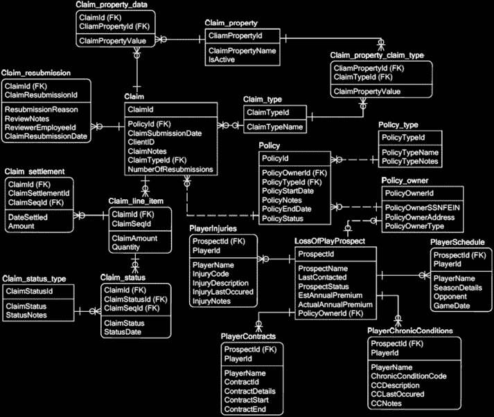

# 用户目录

用户目录列出了现有系统中的用户及其职位和活动描述。以下是该项目的用户目录：

| **用户** | **活动** |
| --- | --- |
| 理赔员 | 查看或修改现有理赔 |
| IT 部门 | 系统管理与技术支持 |
| 市场部 | 查看客户信息、保单和理赔 |
| 呼叫中心代表 | 创建新保单和新理赔 |
| 业务发展及支持部门 | 查看并修改客户及保单信息 |

## 逻辑数据存储/实体交叉引用

该过程涉及比较逻辑数据模型（LDM）与数据流模型（DFM），并解决不一致之处。

为此，需进行以下几项检查：

1. **将 DFM 流程与 LDM 实体匹配**：需要验证 LDM 中的所有实体在 DFM 中都有对应的流程对其进行修改。以下是此类匹配的示例（我并未展示所有匹配项，但找出遗漏的匹配项会是一份很好的练习）。请注意，像`Policy_type`这样的实体保存的是静态参考数据，可能关联着诸如静态数据维护（未在 DFM 中显示）之类的流程。

| **DFM 流程** | **受影响的 LDM 实体** |
| --- | --- |
| *未指定* | `Policy`（保单）、`Policy_owner`（保单持有人） |

第三章 ■ 使用 SSADM 进行关系型设计

2. 逻辑 DFM 中的数据存储应与 LDM 中的实体保持一对一关系。一个数据存储可能包含多个实体，但一个实体只能存在于一个数据存储中。若存在任何例外情况，应逐一说明其合理性。在本案例中，只有一个数据存储（`Claims`（理赔）），且 LDM 中的所有实体都包含在其中。

3. 确保 DFM 中定义的基本流程能够通过导航数据模型获取所需数据。这是对第 1 项的逆向检查，旨在确保 DFM 流程能够访问 LDM 中的实体。对于`Policy`和`Claims`处理系统，DFM 中的所有流程仅写入`Policy`和`Claim`实体，因此通过了此项检查。

## 当前服务与系统范围的逻辑视图

此步骤的主要目的是通过消除外部物理因素、重复和冗余，将当前物理 DFM 转换为逻辑 DFM，并以 LDM（从定义上看已是逻辑层面）作为验证参考。这意味着什么？

数据流模型包含逻辑流程与物理流程的组合。此外，有些数据存储仅为当前系统的物理实现服务，对逻辑实现无贡献。例如，可能存在一个专门用于记录执行数据的存储，以及相应填充数据的流程。这类流程和数据存储需要从数据流模型中剔除（以将其转换为逻辑 DFM）。最后，还需考虑将重复的流程/数据存储进行合并。

在`Policy`和`Claims`处理系统中，我没有展示任何满足物理实现的流程。同样，如前所述，存在用于维护静态参考数据的流程，但我也没有在 DFM 中呈现这些流程。

因此，该 DFM 本身已是逻辑 DFM，很容易就能准备出所提供服务的逻辑视图：

- 添加或修改客户和保单（通过 YourState 网站或免费电话号码）
- 为客户提交并处理理赔（通过 YourState 网站或免费电话号码）

如您所见，该系统的范围也通过指定所提供的服务自动记录在案。

综上所述，创建此服务逻辑视图的目的或好处是什么？逻辑视图有助于阐述系统物理实现背后的思考或策略。因此，当情况发生变化或某项决策受到质疑时，逻辑视图能记录该决策背后的逻辑，便于交叉核对。

第三章 ■ 使用 SSADM 进行关系型设计

## 业务系统方案

在此阶段，完成可行性研究、现有系统调研，并审阅需求及用户目录后，针对所需的逻辑系统存在多种可能性。各个业务系统选项（BSO）中的功能均基于以下实施策略：

1.  不添加“比赛失利”保单。
2.  尝试购买现成的软件包，以提供添加“比赛失利”保单所需的功能。
3.  使用内部 IT 资源开发必要的系统。
4.  雇用合同制专家资源来开发系统。
5.  委托软件开发公司以预定价格开发应用程序。

与上述策略相关的所有 BSO 均未提供理想解决方案，且各有优缺点。最终，经过深思熟虑，三个选项（选项 3、4、5）被列入候选名单，并附上详细分析提交至项目委员会：

-   ***备选方案 1***：利用业务和 IT 资源，开发一个能与现有保单和理赔处理系统无缝协作的新子系统。呼叫中心和保单部门需要为将管理新保单的资源提供额外培训。IT 部门将开发包含额外数据库实体和 Web 界面的子系统。
-   ***优势与成本***：主要优势在于成本低廉以及对开发/功能的完全掌控。采用内部开发，总成本仅约为 20 万美元。
-   ***备选方案 2***：雇用合同制专家资源来开发能提供必要功能的解决方案，并向 IT 资源进行知识转移，以便其进行维护和支持（同时培训呼叫中心和保单部门）。
-   ***优势与成本***：主要优势在于时间、开发质量以及易于修改。尽管使用合同制资源，总成本会比（备选方案 1）略高，为 27.5 万美元。
-   ***备选方案 3***：让业务分析师和 IT 架构师准备拟建系统的详细规格，并雇用一家定制软件开发公司进行开发。呼叫中心和保单部门仍需为将管理新保单的资源提供额外培训。
-   ***优势与成本***：主要优势在于时间和开发质量。尽管采用定制开发，总开发成本会更高，约为 32.5 万美元。

第 3 章 ■ 使用 SSADM 进行关系型设计

-   ***备选方案比较***：第一个备选方案（内部开发）可能速度较慢且质量可能不足（取决于资源），但性价比最高，且控制力最强。第二个备选方案（由合同制资源进行定制开发）速度快，质量可能更高，但成本略高，且对开发的控制力可能不足。第三个备选方案（定制化软件包解决方案）可能成本最高，但提供技术支持且易于变更。
-   ***项目委员会决策与结论***：在比较了可用的备选方案后，项目委员会认为第二个备选方案是 YourState 保险公司的最佳选择，并决定结合内部 IT 资源和合同制专家资源来内部开发该子系统。

### 需求规格说明

这是最复杂的模块，因为其交付物包含完整的逻辑规格。以可行性研究模块中规定的需求为起点，并以需求分析模块中的业务系统选项为框架，来制定一份精确、无歧义且一致的逻辑规格文档。该规格侧重于系统功能而非实现。

架构师通过准备以下交付物来有效制定逻辑规格：

-   数据流模型（DFM）
-   逻辑数据模型（LDM）
-   功能定义（系统运行所需的所有功能的定义）

• `实体生命周期（ELH）`：描述实体整个生命周期中所有事件
• `效应对应图（ECD）`：描述每个事件如何与所有相关实体交互

请注意，无论实现目标（`RDBMS`或`NoSQL`），这一阶段都是有用且必要的。因此，即使是基于`NoSQL`的系统也可以使用此设计阶段。我将以新的“比赛缺席险”保单政策为例，从数据流模型开始，讨论所有这些可交付成果的内容和表示法。

#### 数据流模型

我在上一节详细讨论了当前的保单与索赔处理系统。这使您能够清晰地了解针对客户进行索赔处理或创建新保单的流程。随后，当您州保险公司在其产品组合中新增一项保单政策时，新的处理流程需要与现有的业务流程和标准相匹配，因为无需为每项新增保单设计全新流程。

但是，关于这项新保单，有几点需要记住：

- **附加处理**：由于保费依赖于信息，因此需要生成大量信息请求。
- **不支持在线或电话签发**：涉及的保费（以及保额）相对较大，需要人工核实和签署。因此，保单需在双方签署协议后签发。
- **不支持自动化索赔处理**：任何索赔都需要根据预定逻辑进行处理，并接受全面的人工调查（因为预计索赔金额较高）。

因此，总结而言，“比赛缺席险”保单的签发以及相关索赔的处理，结合了人工流程和自动化逻辑。基于此，图 3-6 展示了“比赛缺席险”保单的数据流模型。

**图 3-6.** *“比赛缺席险”保单与索赔处理的数据流模型*
您可以看到，购买保单和提交索赔是两个独立的处理流程，两者都采用了人工与自动化处理的混合模式。

#### 逻辑数据模型

逻辑数据模型沿用了保单与索赔处理所使用的实体，但这在预期之内且运作良好。新增了五个实体：`LossOfPlayProspect`（比赛缺席险潜在客户）、`PlayerInjuries`（球员伤病）、`PlayerContracts`（球员合同）、`PlayerChronicConditions`（球员慢性疾病）和`PlayerSchedule`（球员赛程）。图 3-7 中的模型展示了它们之间的相互关系。

实体`LossOfPlayProspect`是“比赛缺席险”保单处理的核心，您可以看到其主键（`ProspectId`）作为引用（外键）传播到其他相关实体。当潜在客户（持有棒球球员合同的俱乐部）申请“比赛缺席险”时，会收集关于该球员（其合同需要被保险）的某些数据，并存储在实体`PlayerInjuries`、`PlayerContracts`和`PlayerChronicConditions`中。球员的赛程（当前赛季和下赛季）也存储在一个名为`PlayerSchedule`的实体中。所有这些信息都用于对球员合同进行保险的保费报价。同样，报价的保费可能会经过客户协商，最终保费可能有所不同（因此在实体`LossOfPlayProspect`中设置了单独的列）。此外，由于并非所有潜在客户都会最终成为客户，实体`Policy`（保单）与`LossOfPlayProspect`之间的关系是零对一（在双方都是如此，因为并非每份保单都始于“比赛缺席险”潜在客户）。

**图 3-7.** *“比赛缺席险”保单与索赔处理的逻辑数据模型*

最后，球员合同也会被捕获（供审核）在实体`PlayerContracts`中，实际合同会被扫描并以图像形式存储。

## 函数定义

