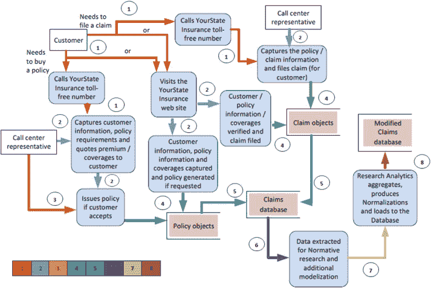
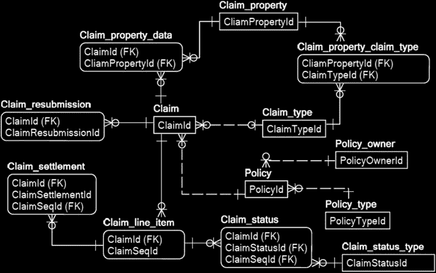
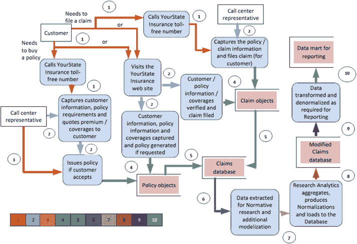
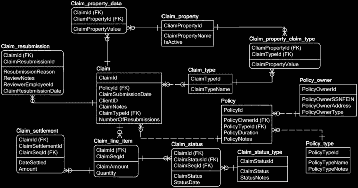
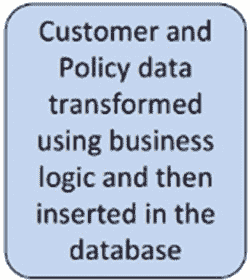
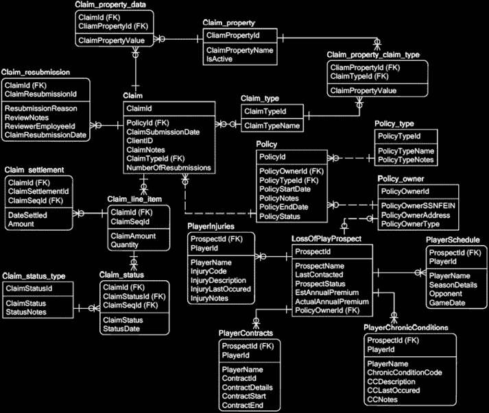
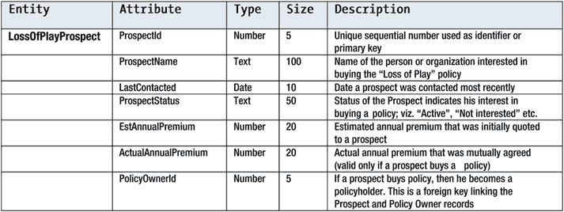
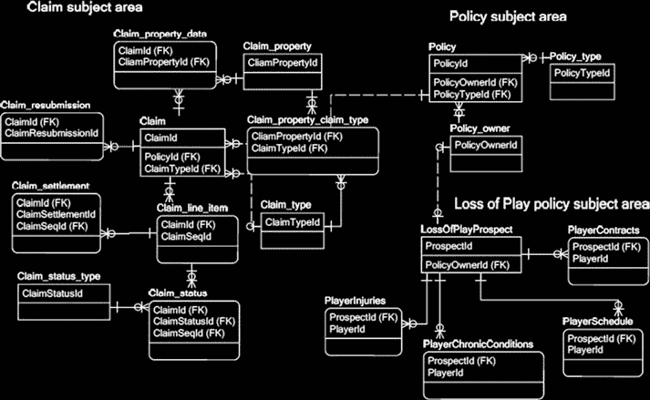
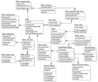
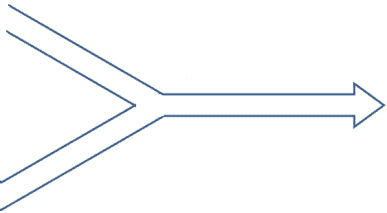

# 第三章：使用 SSADM 进行关系设计

许多经过时间考验且有用的关系设计概念被应用于 NoSQL。了解并理解这些关系概念无疑将帮助你与相应的 NoSQL 特性进行类比，从而使学习过程更轻松、更有趣。我将在后续章节（[第 6 章](http://dx.doi.org/10.1007/978-1-4842-1287-5_6)）中演示关系设计如何转变为更扁平、数据重复的版本，以实现列式或文档数据库。尽管数据量因重复而增加，但你可以看到 NoSQL 解决方案的性能如何提升。

另一方面，关于框架或方法论需要记住的一点是：它们是设计指南或建议。你不必逐字遵循，最好根据你的环境尽可能采纳它们。我经常看到最佳的设计案例中，架构师发挥创造力，用一些对其特定目标有用的内容补充了正式的设计步骤。

本章总结了关系设计的主要方法和有用组件。我相信这将帮助你理解使用 `SSADM` 方法进行数据库设计的过程，这也是下一章的主题。

我在 1990 年代为一家英国计算机公司工作，公司政策要求所有新项目使用 `SSADM`（结构化系统分析与设计方法）。当时，我们正在参与伦敦地铁（也称为 `Tube`）自动化的一部分工作。

我拿着我为新模块估算的时间去找经理。估算值很高，他问道：“这些用于收集需求规格和技术系统选项的任务都是什么？”我说这些是基于 `SSADM` 的任务。他回答说：“文档我们可以以后再做。现在，你继续做数据库设计和前端开发。”很多年过去了，这种态度依然没有改变。

现在是一些显而易见的问题：`SSADM` 对于 `Hadoop` 迁移的相关性是什么？你能将 `SSADM` 用于 NoSQL 数据库吗？为什么它需要成为这本 `Hadoop` 书的一部分？考虑一下：你可能需要与之接口或迁移到 `Hadoop` 的大多数系统，在其设计中可能使用了 `SSADM` 的子集。充分理解 `SSADM` 有助于你更好地掌握源系统设计。

更重要的是，无论你是使用关系技术还是 NoSQL 解决方案来实现系统，其逻辑设计过程都保持不变。只有物理实现步骤会根据你选择的目标技术而有所不同。此外，`SSADM` 是当今使用的大多数设计技术的超集。因此，它无疑将帮助你理解 `SSADM` 所规定的广泛设计步骤，并最终帮助你以有条理且自我文档化的方式呈现你的设计。

由于逻辑设计过程独立于用于实现的目标技术，因此你可以使用任何基于 `SSADM` 的工具（或一般而言任何关系设计工具）进行系统设计——即使你计划使用 NoSQL 来实现你的设计。这也是为什么没有专门针对 NoSQL 的设计工具可用的原因。

回到 `SSADM`（以及一般的设计方法论），正式的设计方法论有时会令人望而生畏，原因很简单：架构师和建模者试图将他们的设计塞进设计方法详细描述的特定步骤中。相反，设计者应该将该方法用作框架或指南，并根据自身环境中的必要特定需求补充设计（同时也可以自由省略冗余的步骤）。在 `SSADM` 中，文档也明确提到了根据需要应用（或省略）步骤的必要性。

© Bhushan Lakhe 2016
B. Lakhe, *Practical Hadoop Migration*, DOI 10.1007/978-1-4842-1287-5_3
第三章 ■ 使用 SSADM 进行关系设计

# 使用 SSADM 进行关系型设计

此外，如果你仔细思考，就会意识到你所遵循的开发流程（基于你的开发/设计经验）与`SSADM`并无太大区别。只是没有像`SSADM`那样被形式化或划分为具体的步骤或模块。例如，你可能不会专门进行“可行性研究”并出具可行性报告，但（很可能）会确认你计划开发的系统在技术上可行、组织需要它，并且管理层愿意为其开发投入资金。`SSADM`的大部分步骤也是如此。

`SSADM`在美洲并不十分流行，但我之所以用它作为设计方法的示例，是因为它的全面性和详尽性。我觉得它能让你很好地理解（正式的）软件开发流程。你需要注意的是，确保由你来主导流程，而不是让流程主导你。

你已经知道`SSADM`包含哪些步骤以及它们（在高层次上）的作用。

在本章中，我将讨论一个真实场景，并利用`SSADM`框架设计一个数据库解决方案，使其能够高效存储业务过程产生的数据（针对我所讨论的场景）。那么，让我们从`SSADM`的第一个模块开始：可行性研究。

### 可行性研究

通俗地说，你（或你的管理层）总会确保你计划实施的系统在实践上是可行的。你也会确认你的组织愿意为此买单。`SSADM`只是将这个流程形式化，并帮助你创建文档，这些文档在未来可能有用，用于记录此次开发的业务需求是什么。

当你依赖非正式的决策方式，或者依赖相关人员的经验时，你可能会忽略一些可能影响决策的方面。`SSADM`能确保你不会这样。此外，无论你的实现目标是基于`RDBMS`的系统还是基于`NoSQL`的解决方案，进行可行性研究都是有用的。因此，这个设计阶段甚至可用于基于`NoSQL`的系统。

那么，如何应用`SSADM`来针对一个真实的业务场景进行可行性研究呢？我先来讨论一下这个场景。

“YourState Insurance”是一家领先的保险公司，向美国客户销售健康保险。该公司富有活力的营销副总裁曾是一名棒球运动员，他想为现役棒球运动员及其俱乐部增加一项“比赛中断”保单。随后，他指示他的研究部门、风险管理小组和 IT 架构小组确定这项新业务是否能够盈利。以下是这项他希望 YourState Insurance 销售的新保单的主要特点：

- 保单将为现役球员的合同提供保险。

- 保单将排除对已知的任何慢性病或既往病史的承保。

- 保单在决定保费时会考虑球员的年龄、过往伤病以及赛程安排。

- 保单仅在两年间隔期内提供保障（针对长期合同），并且价格每两年调整一次。

## 项目启动计划

首先，一名 IT 项目经理（与架构师一起）准备了一份项目启动文档。它包含以下部分：

1.  **引言**：本节提供以下信息：

    -   *项目背景*：历史背景以及究竟是什么促使人们研究这项新的“比赛中断”保单的可行性。

    -   *目标*：SMART（具体的、可衡量的、可实现的、现实的和有时限的）目标。

    -   *项目授权*：来自营销副总裁的正式邮件，授权此项目并确认其赞助。

2.  **项目定义**：定义了项目的所有方面，例如：

# 关键交付物

本项目将交付以下关键成果：

- 商业论证（新政策的收益与风险）及业务系统方案
- 需求规格说明书
- 技术系统方案
- 数据流图
- 逻辑数据模型
- 逻辑过程模型
- 物理数据模型（目标数据库）

# 约束条件

本项目存在以下约束：

-   此项研究的财务预算上限为 250,000 美元，其中包含员工工时成本

-   此项政策研究将限定在纽约州范围内（初期）

-   此项研究仅限于承保金额达 1000 万美元及以上的合同（针对个人运动员）

# 假设前提

做出以下假设：
- 可获得（待投保）运动员的伤病及既往病史数据
- 可获得（待投保运动员所在）俱乐部未来两年的赛程安排

# 排除项
任何在纽约州以外注册或设立总部的棒球俱乐部均不在本政策范围内。

# 接口

本项目将包含以下接口：

-   “棒球比赛缺席”图形用户界面（内部）
-   理赔处理系统（内部）

# 外部依赖

当前依赖项如下：

- 能够访问运动员合同信息
- 能够访问运动员的病史记录

# 容许偏差

项目经理被授权在项目启动后，最高可支出 250,000 美元，并可动用三名资源，为期三个月。

# 收益

本项目的主要收益在于可能新增一条业务线。若项目可行，将有助于贵州保险公司扩展其提供的保单类型。

# 成本

本项目的初始成本为 160,000 美元。

| 领域 | 成本 |
|------|------|
| 项目管理 | $50,000 |
| 基础设施（硬件/软件） | $20,000 |
| IT 资源 | $40,000 |
| 业务资源 | $50,000 |

# 方法/流程/执行与里程碑

-   **方法**: 分析方法将基于 SSADM 设计方法论，交付物将严格遵循 SSADM 模块及其对应的交付成果。
-   **里程碑**: 同样地，里程碑与 SSADM 交付成果紧密对应，具体如下：
    -   可行性研究报告
    -   需求规格说明书
    -   技术系统方案
    -   数据与流程流程图
    -   图形用户界面规格说明
    -   逻辑数据模型
    -   物理数据模型
    -   图形用户界面

# 应急计划
如遇任何意外情况，将寻求一套（可按需定制的）打包解决方案。

# 项目组织结构

- 本项目的 SRO（高级责任负责人）为（市场）副总裁。
- 项目经理向 SRO 汇报，并对项目委员会负责。
- 项目团队成员如下：

| 姓名 | 部门/组织 |
|---|---|
| 解决方案架构师 | IT 部门 |
| 高级分析师 | 研究部门 |
| 高级分析师 | 风险管理组 |

# 沟通与干系人

-   **沟通方式**: 主要沟通渠道包括：

    -   周报

    -   周例会

-   **干系人**: 详见附录 A 中的干系人图谱。

# 报告周期

以下为本项目报告相关详情：

-   **项目启动**: 项目将在 SRO 和项目委员会批准本启动文件后正式启动。

-   **报告周期**:

    -   项目团队向项目经理报告 — 每周
    -   项目经理向 SRO 报告 — 每月
    -   SRO 向项目委员会报告 — 每季度

-   **决策点**: 关键决策必须在每个里程碑完成后做出。若超出商定的容许偏差范围，项目经理将执行例外报告。

-   项目问题将记录在`附录 B`的问题日志中。

-   在所有里程碑完成后，或在（可行性研究）被认为不可行并出具可行性研究报告后，项目将由 SRO 正式关闭。

## 附录 A：干系人图谱

| 干系人 | 利益 | 信息需求 |
|-------------|----------|-------------------------|
| SRO | 发起人 | 关于各里程碑进展的详细信息 |
| 业务发展部 | 发起人 | |

# 新政策将如何惠及各方的详细说明

## 业务部门

### IT 部门

#### 开发部门

开发系统所需的技术细节。

### 理赔部

#### 用户

新系统的使用方式。

- `说明 B：问题日志`

  - `问题编号` | `问题标题` | `问题描述` | `记录人` | `负责人` | `行动与进展` | `行动日期` | `状态`

## 需求与用户目录

需求目录和用户目录对于记录系统的功能需求以及潜在用户（及其角色）至关重要。这些目录还为设计人员（和用户）提供了快速概览，以确保所有需求都已记录在案，并准确反映了所需功能。

---

# 第 3 章 ■ 使用 SSADM 进行关系设计

## 需求目录

需求目录列出了所有功能需求及其衍生出的非功能需求。目录条目还列出了每项功能需求的收益、相关文档和相关需求。对于当前项目，以下是需求目录中的条目：

### 参赛资格丧失保单（需求编号 01）
- **项目**：参赛资格丧失保单
- **作者**：BL
- **日期**：2015 年 6 月 19 日
- **版本**：1
- **页数**：第 1 页，共 3 页
- **来源**：与市场部副总裁讨论
- **优先级**：高
- **负责人**：ST
- **需求编号**：01

**功能需求**：需要为现役棒球运动员及其俱乐部增加一项“参赛资格丧失”保单。该保单应对运动员的现役合同提供保障，但不包括运动员已知的任何慢性病或既往病史。在决定保费及提供保险（仅限两年期续保，适用于长期合同）时，还应考虑运动员的年龄、过往伤病以及赛程安排。保费应每两年调整一次。

**收益**：由于目前市场上此类保单不多，该保单将成为一个新的业务线，可能带来可观的利润。

**注释/建议解决方案**：由一名 IT 架构师和业务分析师组成的团队正在进行可行性研究，以确定该项目对 YourState 保险公司是否可行且有利。

**相关文档**：项目启动计划、访谈和观察记录（由进行可行性研究的团队收集）、当前及拟议环境描述。

**相关需求**：

**决议**：已被市场部副总裁和项目委员会接受。

### 参赛资格丧失保单（需求编号 02）
- **项目**：参赛资格丧失保单
- **作者**：BL
- **日期**：2015 年 6 月 19 日
- **版本**：1
- **页数**：第 2 页，共 3 页
- **来源**：与市场部副总裁讨论
- **优先级**：高
- **负责人**：ST
- **需求编号**：02

**功能需求**：如果可行性研究发现该项目可行，且 YourState 管理层决定将该新保单作为一项新业务线，则需要为拟议的“参赛资格丧失”保单开发一个网络界面。该界面需要将保单数据存储在中央理赔数据库中，并成为理赔部门使用的 YourState 理赔应用程序的一部分。

**业务事件**：添加“参赛资格丧失”网络界面

**非功能需求**：
| 描述 | 预期 | 可接受 | 备注 |
|-----------|----------|------------|----------|
| 理赔响应范围 | 理赔信息需在五秒内存储到数据库中，并（向输入的代理）收到确认 | 立即 | 五秒以内 | 通过网络界面提交的理赔 |

**收益**：理赔部门必须通过该网络界面输入理赔信息或查看/修改理赔状态。

**注释/建议解决方案**：此界面的开发取决于可行性研究（需求编号 01）的结果。如果项目继续进行，则团队将根据设计规范开发必要的网络界面（详情请参阅项目启动计划）。

**相关文档**：项目启动计划、当前及拟议环境描述。

**相关需求**：

**决议**：已被市场部副总裁和项目委员会接受，但须以可行性报告可行作为前提。

# 第 3 章 ■ 使用 SSADM 进行关系设计

## 用户目录

用户目录列出了（针对拟议系统的）可能的用户及其职务头衔，以及其工作活动的描述。以下是该项目的用户目录：

| **用户** | **活动** |
|----------|----------|
| 理赔员 | 查看或修改现有理赔 |
| IT 人员 | 系统管理与技术支持 |
| 市场人员 | 查看理赔 |
| 呼叫中心代表 | 创建新理赔 |

### 当前环境描述

本节详细描述了现有环境，有助于提供现有系统的概览。它涵盖了硬件和软件配置、数据流和逻辑数据模型。在设计旨在补充当前系统功能的新系统之前，有必要了解现有系统的情况。

### 当前系统描述

**硬件**：基于 Windows 2008 R2（数据中心版）服务器的物理集群，配有 64 个 CPU、1 TB 内存和 20 TB SAN 存储。使用的数据库是 SQL Server 2008 R2（数据中心版）。理赔数据库是最大的数据库之一，大小为 10 TB，涵盖了最近三年的理赔数据。更早的理赔数据则归档在归档数据库中。每日理赔量在 2,000 到 3,000 之间，包括通过 YourState 免费电话以及基于网络的理赔系统提交的理赔。

每晚，自动化流程会根据多个参数（如理赔类型和理赔员的专长、理赔员正在处理的案件数量、地点等）将理赔分配给理赔员。

### 当前物理数据流模型

数据流模型提供了数据如何在现有系统内流动的功能细节。图 3-1 展示了 YourState 保险公司的保单与理赔处理系统的数据流。



**图 3-1.** 保单与理赔处理系统的数据流

如图所示，保单的购买或理赔的提交可以通过在线方式，也可以通过拨打 YourState 免费电话完成。在提交理赔前，需要访问并验证客户、保单和保障范围信息。如果客户拥有必要的保障，则会提交理赔（在理赔数据库中插入记录）。

### 当前逻辑数据模型

逻辑模型显示了系统内关键实体之间的相互关系，并提供了这些关系的细节。图 3-2 中的逻辑数据模型展示了理赔处理系统内关键实体之间的关系。



**图 3-2.** 理赔处理逻辑数据模型

---

## 拟议环境描述

本节描述了拟议新系统的三个重要方面：事件流、数据流以及事件用于捕获数据的功能逻辑。我将详细讨论每个方面。让我们从业务活动模型开始，该模型概述了业务流程，并详细说明了构成流程的活动，同时显示了流程/活动之间的相互连接和交互。

### 业务活动模型

业务活动模型侧重于关键业务流程，并对这些流程中的基本活动进行建模。活动可以进一步细分为任务（以便更清晰）。它还展示了触发业务流程的业务事件，以及启动和执行所需活动所涉及的业务规则。

在图 3-3 中，事件用圆圈表示，活动用矩形表示，业务流程用虚线矩形表示，菱形表示决策点。因此，事件

# 潜在客户的“询价请求”触发业务流“保单报价”

潜在客户的“询价请求”会触发业务流“保单报价”，该流程包含一系列基础活动，例如风险管理小组审核文件并出具报价、客户审阅报价，以及在客户有疑问或保留意见时将报价发回风险管理小组进行再次审核与修改。客户接受报价将触发下一个事件“保单签发请求”，进而启动下一个业务流“保单签发”，最终完成保单签发并将信息录入`YourState`保险公司相应的数据库中。

## 第 3 章：使用 SSADM 进行关系型设计

### 风险管理小组

`请求`审核必要文件并出具报价。

### 客户审阅报价

- `拒绝`：发回风险管理小组，获取修改后的反馈报价

- `接受`：业务流`保单签发请求`

### 企业销售小组

`保单文档`准备合同，并归档双方签署的副本。

`保单`签发至客户，并在相关数据库中添加相应记录。

### 业务流：保单签发

 **图 3-3.** 比赛中断险保单签发业务活动模型

总而言之，该业务活动模型完整地捕捉了向潜在客户签发比赛中断险保单的全部业务需求。

## 数据规范

本节描述了为拟议系统存储数据所需的新实体。在这种情况下，需要新增若干实体来支持新的比赛中断险保单，具体如下：

- `PlayerInjuries`：该实体记录棒球运动员过往的棒球相关伤病信息，并与运动员的病史结合使用，以确定该运动员比赛中断险保单的保费。

- `PlayerSchedule`：该实体存储棒球运动员当前赛季及下赛季的赛程详细信息。

- `PlayerChronicConditions`：该实体记录棒球运动员现有的慢性健康状况，并用于确定该运动员比赛中断险保单的保费。

- `PlayerContracts`：该实体记录棒球运动员与其俱乐部（即请求保单覆盖的俱乐部）签订的合同详情，并用于确定该运动员比赛中断险保单的保费。

## 功能规范

本节描述了实施新系统所需的新功能与事件。数据流模型展示了这些事件与功能在整个系统中的位置。针对拟议的比赛中断险保单，新事件如下：

- 比赛中断险保单报价请求
- 比赛中断险保单签发请求
- 比赛中断险保单取消请求
- 比赛中断险保单理赔请求

支持新保单所需的新功能如下：

- `GetPlayerInjuryInfo`：将棒球运动员的过往伤病信息加载至实体`PlayerInjuries`中。
- `GetPlayerChronicCondInfo`：将棒球运动员的慢性医疗状况信息加载至实体`PlayerChronicConditions`中。
- `GetPlayerContractDetails`：将棒球运动员的合同详细信息加载至实体`PlayerContracts`中。
- `GetPlayerScheduleInfo`：将棒球运动员当前赛季及下赛季的赛程信息加载至实体`PlayerSchedule`中。
- `CalculateLossOfPlayPremium`：根据提供的文档以及通过功能`GetPlayerInjuryInfo`、`GetPlayerChronicCondInfo`、`GetPlayerContractDetails`和`GetPlayerScheduleInfo`收集的信息，计算合同保费。
- `EvalLossOfPlayClaim`：评估客户提交的比赛中断险理赔申请。

### 问题定义

本项目的*问题*或需求已在项目启动计划中的项目定义小节中进行了详尽讨论。此外，需求目录也定义了项目的必要性，从而对当前问题进行了阐述。然而，为作简要回顾，以下是按优先级排序的需求（最高优先级在前）：

• 新保险政策“比赛能力丧失”的可行性，该政策将为现役棒球运动员的合同提供保障（不包括已知球员的任何慢性病或既往病史的复发保障）

• 需考虑技术、财务、法律和组织方面的可行性，同时注意该政策的最长保障期限仅为两年（保费重新评估后可续保）

• 该政策的实施可行性（就 IT 部门的设计与开发而言）

### 可行性研究报告

可行性报告是 SSADM 可行性研究模块的最终成果或交付物。通常包含以下章节和子章节；部分章节可根据个人需求和适用性酌情省略：

• 管理层或执行摘要
• 引言
  • 目的
  • 项目历史
  • 方法论
• 基本信息
  • 现有系统与流程
  • 当前运营情况
  • 物理环境
  • 用户组织
  • 系统目标
  • 问题
  • 假设与约束
• 备选方案
  • 备选方案 1
    • 描述
    • 收益与成本
  • 备选方案 2（更多方案以此类推）
• 备选方案对比
• 建议与结论

仔细回顾前文可知，引言部分所需信息已由项目启动计划中的对应章节提供，基本信息部分所需内容也已由前文讨论的现有环境与拟议环境章节涵盖。接下来，我将重点介绍尚未涵盖的章节，从备选方案部分开始：

• **备选方案**：基于对现有环境、拟议系统需求以及项目启动计划所定义约束的广泛研究，以下备选方案具备可行性：
  • **备选方案 1**：利用业务和 IT 资源，开发一个能与现有保单与理赔处理系统无缝协作的新子系统。
  • **备选方案 2**：由业务分析师和 IT 架构师制定拟议系统的详细规格，然后聘请软件开发公司进行开发。
  • **备选方案 3**：购买提供类似功能的软件应用程序，并由 IT 资源进行定制以匹配所需功能。
  • **备选方案对比**：第一方案（内部开发）可能速度较慢且质量欠佳（取决于资源状况），但成本最低且可控性最强。第二方案（由软件开发商定制开发）速度快、质量可能更高，但成本高昂，且可能对开发过程和功能缺乏足够控制，并可能需要修改（已开发的系统）。第三方案（定制化软件包方案）成本可能最高，但能提供技术支持且易于修改。

• **建议与结论**：对比现有备选方案后，建议采用第一方案，利用内部 IT 资源开发子系统。

前面未涵盖的另一个部分是管理层摘要或执行摘要。现在我来讨论这一点：

• **管理层摘要**：提供简要概述，说明可行性研究的目的、方法、问题与结果。以下是本次可行性研究的管理层摘要：

本次可行性研究的目的在于，确定为`YourState`保险公司引入一项新的“比赛能力丧失”保险政策（该政策将为现役棒球运动员的合同提供保障，但不包括已知球员的任何慢性病或既往病史的复发保障）是否可行（需考虑技术、财务、法律和组织方面的可行性）。

进行本次可行性研究采用的方法是 SSADM（及其可行性模块）。所使用的工作成果均遵循 SSADM 文档中定义的标准。

研究过程中未遇到任何问题，共评估了三种备选方案。其中，建议采用内部开发必要子系统并培训内部（`YourState`）资源来管理系统的方案，因其成本低廉且对开发过程和功能拥有最佳控制权。

至此，可行性研究模块结束。接下来是：需求分析。

### 需求分析

该模块使用可行性研究模块的输出，并依据 SSADM 指南和技术继续进行设计流程。本模块的重点是通过现有文档以及对支持现有系统的不同角色用户进行访谈，对当前环境进行详细分析。

此分析将生成当前环境的全面文档，涵盖当前系统提供的服务细节、用户及其角色（以及活动）、逻辑数据模型和物理数据流。通过此分析，可以为拟议系统明确业务系统选项。

随后，该模块包含两个主要阶段：当前环境调查和业务系统选项。请注意，此 SSADM 阶段与实施目标（`RDBMS` 或 `NoSQL`）无关。因此，该设计阶段甚至可用于基于 `NoSQL` 的系统。

#### 当前环境调查

此阶段侧重于对现有环境进行彻底分析，并记录当前系统的范围或边界（作为起点）。接下来的任务是记录当前系统提供的功能或服务，以及用户角色和活动。此阶段会产出多项成果或交付物，提供所需的大量信息，并有助于设计业务系统选项。

你可能记得，有些交付物（如逻辑数据模型或物理数据流）在进行可行性研究时已经讨论过，但并未深入展开。我将针对这些交付物补充更多细节，并讨论我尚未提及的其他交付物。让我先从本阶段的输出（或交付物）列表开始：

• 当前数据流模型
• 当前逻辑数据模型
• 需求目录
• 用户目录
• 逻辑数据存储/实体交叉引用
• 当前服务与系统范围的逻辑视图

##### 当前数据流模型

`YourState` 保险公司有一个现有系统，用于为新客户或现有客户处理新保单并进行管理。该系统还存储客户提交的理赔申请及其最新状态。图 3-4 展示了（上一模块已呈现的）数据流模型，并补充了更多细节。

 **图 3-4.** 保单与理赔处理系统的详细数据流

让我简要说明一下数据流。新客户可以在线（通过网站）购买 `YourState` 提供的某款保险产品，或拨打免费电话。无论哪种方式，客户信息都会被捕获到保单持有人实体中，保单相关信息则被捕获到保单实体中。在核实所提供信息及支付信息后，会签发一份临时保单。如果所有信息均核实无误且支付成功，则签发正式保单并邮寄给客户。

理赔申请同样可以在线提交或通过拨打 `YourState` 的免费电话提交。

客户信息和理赔详情（在两种情况下）均会被采集，指定的理赔员会核实保单的承保范围（针对提出索赔的保单），然后（必要时）指派现场代理人进行调查。如果无需现场调查，则根据需要向客户索取证明材料。理赔将依据公司规范，并当然遵循县、州和联邦法律进行处理。

## 当前逻辑数据模型

图 3-5 是现有保单与理赔处理系统的逻辑数据模型。它展示了主要实体及其相互关系。



**图 3-5.** 保单与理赔处理系统逻辑数据模型（属性级）

正如您所见，实体 `Claim`（理赔）和 `Policy`（保单）是处理过程的核心。它们（当然）存储了理赔和保单的详细信息。实体 `Policy_owner`（保单持有人）存储了保单持有人（个人或公司）的信息。保单和理赔可以有不同的类型，`Policy_type`（保单类型）和 `Claim_type`（理赔类型）存储了这些详细信息。理赔状态存储在 `Claim_status`（理赔状态）中，而 `Claim_line_item`（理赔明细项）和 `Claim_settlement`（理赔结算）则保存了理赔的结算细节。如果理赔被拒绝并重新提交评估，这些详细信息将存储在实体 `Claim_resubmission`（理赔重新提交）中。该模型使用*鸦足*或*信息工程表示法*来展示不同实体之间的关系。

## 需求目录

本需求目录涉及现有保单与理赔处理系统的开发，可追溯到该系统开发的 2010 年。此前，YourState 保险公司使用的是一个根据其需求定制的打包解决方案，但该方案未能提供所需的所有功能，并且还产生了许可费用以及获取技术支持时的延迟成本。

**项目**：保单/理赔
**作者**：BL
**日期**：2010 年 4 月 22 日
**版本**：3.3
**页码**：1
**来源**：已批准需求，由
**优先级**：高
**负责人**：ST
**需求编号**：01
**业务发展副总裁**

**功能需求**：

IT 部门需要为我们的内部使用开发一个全面的保单与理赔处理系统。该系统需要能够采集客户和保单信息，并支持理赔在生命周期内的提交与处理。最新的理赔状态需要易于显示和更新。在签发保单、计算保费以及处理理赔时，需要应用业务逻辑（在需求规格说明书中指定）。

**非功能需求**：

| 描述 | 预期要求 | 可接受范围 | 备注 |
| :--- | :--- | :--- | :--- |
| 保单/理赔**响应范围** | | | 保单或理赔信息需存入数据库 |
| 通过网页界面提交的信息 | 立即 | 5 秒以内 | 在 5 秒内存入，并收到确认（给录入的代理人） |
| 检索保单/理赔进行显示和更新 | 5 秒 | 10 秒以内 | 代理人必须尽快获取这些信息，这至关重要 |

**收益**：
该系统将帮助我们更有效地管理保单和理赔（与目前使用的打包应用程序相比），并且每年还能为当前软件应用程序节省 50 万美元的许可费用和额外的支持费用。最后，它将减少错误修复和技术支持方面的延迟。

**意见/建议方案**：
由 IT 架构师和业务分析师组成的团队正在进行可行性研究，以确定该项目对 YourState 保险公司是否可行且有益。

**相关文档**：
项目启动计划、访谈和观察笔记（由进行可行性研究的团队收集）、当前和拟议的环境描述。

**决议**：
已获业务发展副总裁和项目委员会批准。



## 用户目录

# 用户目录

用户目录列出了现有系统中的用户及其职位和活动描述。以下是该项目的用户目录：

| **用户** | **活动** |
| --- | --- |
| 理赔员 | 查看或修改现有理赔 |
| IT 部门 | 系统管理与技术支持 |
| 市场部 | 查看客户信息、保单和理赔 |
| 呼叫中心代表 | 创建新保单和新理赔 |
| 业务发展及支持部门 | 查看并修改客户及保单信息 |

## 逻辑数据存储/实体交叉引用

该过程涉及比较逻辑数据模型（`LDM`）与数据流模型（`DFM`），并解决不一致之处。为此，需进行以下几项检查：

1.  **将 `DFM` 流程与 `LDM` 实体匹配**：需要验证 `LDM` 中的所有实体在 `DFM` 中都有对应的流程对其进行修改。以下是此类匹配的示例（我并未展示所有匹配项，但找出遗漏的匹配项会是一份很好的练习）。请注意，像`Policy_type`这样的实体保存的是静态参考数据，可能关联着诸如静态数据维护（未在 `DFM` 中显示）之类的流程。

    | **`DFM` 流程** | **受影响的 `LDM` 实体** |
    | --- | --- |
    | *未指定* | `Policy`（保单）、`Policy_owner`（保单持有人） |

    第三章 ■ 使用 `SSADM` 进行关系型设计

2.  逻辑 `DFM` 中的数据存储应与 `LDM` 中的实体保持一对一关系。一个数据存储可能包含多个实体，但一个实体只能存在于一个数据存储中。若存在任何例外情况，应逐一说明其合理性。在本案例中，只有一个数据存储（`Claims`（理赔）），且 `LDM` 中的所有实体都包含在其中。

3.  确保 `DFM` 中定义的基本流程能够通过导航数据模型获取所需数据。这是对第 1 项的逆向检查，旨在确保 `DFM` 流程能够访问 `LDM` 中的实体。对于`Policy`和`Claims`处理系统，`DFM` 中的所有流程仅写入`Policy`和`Claim`实体，因此通过了此项检查。

## 当前服务与系统范围的逻辑视图

此步骤的主要目的是通过消除外部物理因素、重复和冗余，将当前物理 `DFM` 转换为逻辑 `DFM`，并以 `LDM`（从定义上看已是逻辑层面）作为验证参考。这意味着什么？

数据流模型包含逻辑流程与物理流程的组合。此外，有些数据存储仅为当前系统的物理实现服务，对逻辑实现无贡献。例如，可能存在一个专门用于记录执行数据的存储，以及相应填充数据的流程。这类流程和数据存储需要从数据流模型中剔除（以将其转换为逻辑 `DFM`）。最后，还需考虑将重复的流程/数据存储进行合并。

在`Policy`和`Claims`处理系统中，我没有展示任何满足物理实现的流程。同样，如前所述，存在用于维护静态参考数据的流程，但我也没有在 `DFM` 中呈现这些流程。

因此，该 `DFM` 本身已是逻辑 `DFM`，很容易就能准备出所提供服务的逻辑视图：

-   添加或修改客户和保单（通过 YourState 网站或免费电话号码）
-   为客户提交并处理理赔（通过 YourState 网站或免费电话号码）

如您所见，该系统的范围也通过指定所提供的服务自动记录在案。

综上所述，创建此服务逻辑视图的目的或好处是什么？逻辑视图有助于阐述系统物理实现背后的思考或策略。因此，当情况发生变化或某项决策受到质疑时，逻辑视图能记录该决策背后的逻辑，便于交叉核对。

第三章 ■ 使用 `SSADM` 进行关系型设计

## 业务系统方案

在此阶段，完成可行性研究、现有系统调研，并审阅需求及用户目录后，针对所需的逻辑系统存在多种可能性。各个业务系统选项（`BSO`）中的功能均基于以下实施策略：

1.  不添加“比赛失利”保单。
2.  尝试购买现成的软件包，以提供添加“比赛失利”保单所需的功能。
3.  使用内部 IT 资源开发必要的系统。
4.  雇用合同制专家资源来开发系统。
5.  委托软件开发公司以预定价格开发应用程序。

与上述策略相关的所有 `BSO` 均未提供理想解决方案，且各有优缺点。最终，经过深思熟虑，三个选项（选项 3、4、5）被列入候选名单，并附上详细分析提交至项目委员会：

-   **备选方案 1**：利用业务和 IT 资源，开发一个能与现有保单和理赔处理系统无缝协作的新子系统。呼叫中心和保单部门需要为将管理新保单的资源提供额外培训。IT 部门将开发包含额外数据库实体和 Web 界面的子系统。
    -   **优势与成本**：主要优势在于成本低廉以及对开发/功能的完全掌控。采用内部开发，总成本仅约为 20 万美元。

-   **备选方案 2**：雇用合同制专家资源来开发能提供必要功能的解决方案，并向 IT 资源进行知识转移，以便其进行维护和支持（同时培训呼叫中心和保单部门）。
    -   **优势与成本**：主要优势在于时间、开发质量以及易于修改。尽管使用合同制资源，总成本会比（备选方案 1）略高，为 27.5 万美元。

-   **备选方案 3**：让业务分析师和 IT 架构师准备拟建系统的详细规格，并雇用一家定制软件开发公司进行开发。呼叫中心和保单部门仍需为将管理新保单的资源提供额外培训。
    -   **优势与成本**：主要优势在于时间和开发质量。尽管采用定制开发，总开发成本会更高，约为 32.5 万美元。

第 3 章 ■ 使用 `SSADM` 进行关系型设计

-   **备选方案比较**：第一个备选方案（内部开发）可能速度较慢且质量可能不足（取决于资源），但性价比最高，且控制力最强。第二个备选方案（由合同制资源进行定制开发）速度快，质量可能更高，但成本略高，且对开发的控制力可能不足。第三个备选方案（定制化软件包解决方案）可能成本最高，但提供技术支持且易于变更。
-   **项目委员会决策与结论**：在比较了可用的备选方案后，项目委员会认为第二个备选方案是 YourState 保险公司的最佳选择，并决定结合内部 IT 资源和合同制专家资源来内部开发该子系统。

### 需求规格说明

这是最复杂的模块，因为其交付物包含完整的逻辑规格。以可行性研究模块中规定的需求为起点，并以需求分析模块中的业务系统选项为框架，来制定一份精确、无歧义且一致的逻辑规格文档。该规格侧重于系统功能而非实现。

架构师通过准备以下交付物来有效制定逻辑规格：

-   数据流模型（`DFM`）
-   逻辑数据模型（`LDM`）
-   功能定义（系统运行所需的所有功能的定义）
    -   `实体生命周期（ELH）`：描述实体整个生命周期中所有事件
    -   `效应对应图（ECD）`：描述每个事件如何与所有相关实体交互

请注意，无论实现目标（`RDBMS` 或 `NoSQL`），这一阶段都是有用且必要的。因此，即使是基于`NoSQL`的系统也可以使用此设计阶段。我将以新的“比赛缺席险”保单政策为例，从数据流模型开始，讨论所有这些可交付成果的内容和表示法。

#### 数据流模型

我在上一节详细讨论了当前的保单与索赔处理系统。这使您能够清晰地了解针对客户进行索赔处理或创建新保单的流程。随后，当您州保险公司在其产品组合中新增一项保单政策时，新的处理流程需要与现有的业务流程和标准相匹配，因为无需为每项新增保单设计全新流程。

但是，关于这项新保单，有几点需要记住：

-   **附加处理**：由于保费依赖于信息，因此需要生成大量信息请求。
-   **不支持在线或电话签发**：涉及的保费（以及保额）相对较大，需要人工核实和签署。因此，保单需在双方签署协议后签发。
-   **不支持自动化索赔处理**：任何索赔都需要根据预定逻辑进行处理，并接受全面的人工调查（因为预计索赔金额较高）。

因此，总结而言，“比赛缺席险”保单的签发以及相关索赔的处理，结合了人工流程和自动化逻辑。基于此，图 3-6 展示了“比赛缺席险”保单的数据流模型。

**图 3-6.** *“比赛缺席险”保单与索赔处理的数据流模型*

您可以看到，购买保单和提交索赔是两个独立的处理流程，两者都采用了人工与自动化处理的混合模式。



#### 逻辑数据模型

逻辑数据模型沿用了保单与索赔处理所使用的实体，但这在预期之内且运作良好。新增了五个实体：`LossOfPlayProspect`（比赛缺席险潜在客户）、`PlayerInjuries`（球员伤病）、`PlayerContracts`（球员合同）、`PlayerChronicConditions`（球员慢性疾病）和`PlayerSchedule`（球员赛程）。图 3-7 中的模型展示了它们之间的相互关系。

实体`LossOfPlayProspect`是“比赛缺席险”保单处理的核心，您可以看到其主键（`ProspectId`）作为引用（外键）传播到其他相关实体。当潜在客户（持有棒球球员合同的俱乐部）申请“比赛缺席险”时，会收集关于该球员（其合同需要被保险）的某些数据，并存储在实体`PlayerInjuries`、`PlayerContracts`和`PlayerChronicConditions`中。球员的赛程（当前赛季和下赛季）也存储在一个名为`PlayerSchedule`的实体中。所有这些信息都用于对球员合同进行保险的保费报价。同样，报价的保费可能会经过客户协商，最终保费可能有所不同（因此在实体`LossOfPlayProspect`中设置了单独的列）。此外，由于并非所有潜在客户都会最终成为客户，实体`Policy`（保单）与`LossOfPlayProspect`之间的关系是零对一（在双方都是如此，因为并非每份保单都始于“比赛缺席险”潜在客户）。

图 3-7. “比赛缺席险”保单与索赔处理的逻辑数据模型

最后，球员合同也会被捕获（供审核）在实体`PlayerContracts`中，实际合同会被扫描并以图像形式存储。

## 函数定义

# 比赛缺席险策略相关函数

本节定义了向客户提供新比赛缺席险所需的所有函数。部分函数可能在数据库中实现，另一些则可能通过网络界面（供客户和代理人使用）实现。我将据此对函数进行标注。

## `GetPlayerInjuryInfo`

该函数加载 `PlayerInjuries` 实体中棒球运动员的过往伤病信息。数据来源于两个渠道：媒体报道和运动员病史。由于运动员伤病信息录入病史需要一定时间（有时若运动员私下治疗，该伤病甚至不会记录），因此也会利用媒体报道数据进行交叉验证。

从媒体收集数据的过程结合了自动化与人工处理。通过关键词搜索获得的原始数据经人工审核后，相关数据通过 Web 界面输入至临时表中。通过病史获取的数据也通过 Web 界面输入至同一临时表。主管代理人审核数据后调用 `GetPlayerInjuryInfo` 函数，该函数将数据加载至 `PlayerInjuries` 实体。该函数的输入参数为 `ProspectId` 和运动员姓名。

## `GetPlayerChronicCondInfo`

该函数将棒球运动员的慢性病史信息加载至 `PlayerChronicConditions` 实体。与 `GetPlayerInjuryInfo` 类似，来自多个来源的数据先被输入临时表，经审核后再加载至 `PlayerChronicConditions` 实体。该函数的输入参数为 `ProspectId` 和运动员姓名。

## `GetPlayerContractDetails`

该函数将棒球运动员的合同信息加载至 `PlayerContracts` 实体。数据库中存储合同扫描件及起止日期等详细信息。合同数据先加载至临时表，审核通过后加载至 `PlayerContracts` 实体。该函数的输入参数为 `ProspectId` 和运动员姓名。

## `GetPlayerScheduleInfo`

该函数将棒球运动员当前赛季及下赛季的赛程信息加载至 `PlayerSchedule` 实体。运动员的赛程信息需向其所在俱乐部（持有其合同并申请保险覆盖的俱乐部）获取，并与媒体发布的赛程进行交叉验证。赛程信息先加载至临时表，审核后加载至 `PlayerChronicConditions` 实体。该函数的输入参数为 `ProspectId` 和运动员姓名。

# 第 3 章 ■ 使用 SSADM 进行关系设计

## `CalculateLossOfPlayPremium`
该函数利用 `GetPlayerInjuryInfo`、`GetPlayerChronicCondInfo`、`GetPlayerContractDetails` 和 `GetPlayerScheduleInfo` 收集的信息，结合（机密）算法计算合同保费。调用时，输入参数 `ProspectId` 和运动员姓名用于检索必要信息（从相应实体中），并通过计算得出魔法数字（比赛缺席险保费）。

## `EvalLossOfPlayClaim`
该函数基于 YourState 保险公司的特定专有逻辑，对客户提交的比赛缺席险理赔申请进行预评估。仅特定类型的理赔申请可进行预评估，仍需人工干预来验证结果。该函数的目的是筛选出琐碎或无根据的理赔申请，为负责评估理赔的代理人节省时间。输入参数为 `ProspectId` 和运动员姓名。

有一个非常有趣（且完全基于 SSADM）的概念，称为*实体-事件建模*。实体-事件模型是一种图形化表示方式，展示业务事件如何影响信息系统中的实体。业务事件触发流程，流程继而影响实体。实体-事件模型由以下部分组成：

-   实体生命周期图（ELH）
-   效果对应图（ECD）

我将从 ECD 开始，结合符号解释其概念。随后，我将提供比赛缺席险主要事件的 ECD。

# 效果对应图 (`ECDs`)

`ECDs` 描述了每个事件如何与所有相关实体交互，或者特定业务事件如何影响一组特定实体。`ECD` 捕获了由事件更新的系统状态快照。由于 `ECD` 处理的是单个事件，因此它比 `ELH` 更静态，从而充当了 `LDM` 与 `ELH` 对事件序列进行更动态建模之间的桥梁。

“游玩损失”保单可能的主要事件如下：

- 请求“游玩损失”保单报价
- 请求“游玩损失”保单签发
- 请求“游玩损失”保单取消
- 请求“游玩损失”保单理赔

我将为这些事件提供 `ECDs`，并同时讨论相关符号。

## 第 3 章 ■ 使用 SSADM 进行关系设计

保单报价的 `ECD` 很容易理解（见图 3-8）。当流程（`Policy Quote`）开始时，会创建一个 `LossOfPlayProspect` 的标识实例，随后创建多个 `PlayerInjuries`、`PlayerChronicConditions`、`PlayerSchedule` 实例，以及一个 `PlayerContracts` 实例。

右上角的星号表示迭代或多个实例。

**`Policy Quote`**

- `LossOfPlayProspect`
- `PlayerChronicConditions`
- `PlayerInjuries`
- `Player Schedule`
- `PlayerContracts`

（集合）

（集合）

（集合）

- `PlayerChronicConditions`
- `PlayerInjuries`
- `PlayerSchedule`

**图 3-8.** “游玩损失保单报价”事件的 ECD

当需要签发新保单时，会检查潜在客户是否已作为保单持有人存在。如果保单持有人不存在，则创建一个保单持有人实例，并更新相应潜在客户实例的 `PolicyOwnerId`（见图 3-9）。接着，创建一个 `Policy` 实例。

**`Policy Issual`**

- `LossOfPlayProspect`
- `Policy`
- `Policy_owner`

**图 3-9.** “游玩损失保单签发”事件的 ECD

当保单被取消时，相关 `Policy` 实例的状态会被更新，以标记其为无效或已取消（图 3-10）。

**`Policy Cancellation`**

- `Policy`

**图 3-10.** “游玩损失保单取消”事件的 ECD

在提交理赔时，会创建一个 `Claim` 对象的实例，并创建多个 `Claim_property_data` 实例，同时为新增的属性赋予适当的值。见图 3-11。

## 第 3 章 ■ 使用 SSADM 进行关系设计

**`Claim filing`**

- `Claim_property_data`
- `Claim`

（集合）

- `Claim_property_data`

**图 3-11.** “游玩损失保单理赔提交”事件的 ECD

## 实体生命周期图 (`ELHs`)

对于一个实体，`ELH` 按顺序展示了各种业务事件所造成的影响。

`ELHs` 使用结构化设计构造（顺序、选择、迭代和并行）来绘制。使用的符号与 `ECDs` 几乎相同，但增加了层级。第一层是实体本身，第二层是事件类型。第三层包含修改实体（数据）的单个事件。最后一层包含修改实体的处理操作。在某些情况下，第二层和第四层可能不需要，可以省略。

我现在将展示并讨论更常用实体（如 `Policy`、`Claim` 和 `LossOfPlayProspect`）的 `ELHs`。

`Policy` 实体的生命周期非常简单。它要么由代理人创建（源于客户通过 YourState 免费电话的来电），要么通过在线保单请求激活的功能创建（并在基本检查完成后）。

第二层矩形右上角的圆圈表示选择或选项。保单由授权代理人根据需要修改。内部网络界面上提供了一个用于此目的的功能。保单取消是将状态更新为 `inactive` 或 `closed`。见图 3-12。

```
Policy
Create
Modify
Cancel
Create
Create
Update
Update
policy as
policy as per
policy as
status as
per request
```

# 实体 Policy 的 ELH

在创建（或提交）方面，索赔的生命周期与保单类似，但修改涉及索赔的调整或评估。索赔理算员会执行此操作并更新状态（批准或拒绝）。如果获得批准，后续流程将修改`claim_line_item`、`claim_settlement`。如果被拒绝并重新提交以供审查，状态会相应更新，详细信息会记录在`claim_resubmission`实体中。请参见图 3-13。

**图 3-13.** 实体`Claim`的 ELH

## 索赔生命周期

- `提交`索赔
- `结算`
- `重新提交`

索赔理算员进行调查并结算或拒绝索赔，同时更新状态。当客户（应在线或电话要求）重新提交被拒绝的索赔以供审查时，状态会更新。

# 实体 LossOfPlayProspect 的 ELH

在与代理人初次会面并收到相关文件后创建一条记录。由于涉及金额（无论是保费还是索赔）较大，此过程（与其他保单相比）略有不同。如果潜在客户购买了“比赛损失”保单，则系统会更新该潜在客户的 `PolicyOwnerId`。对潜在客户信息的任何其他更新也同样适用。如果潜在客户在 6 个月内未购买保单，其详细信息将被删除。请参见图 3-14。

**图 3-14.** 实体 `LossOfPlayProspect` 的 ELH

| 创建 | 修改 | 删除 |
| :--- | :--- | :--- |
| 代理人在收集相关文件后为潜在客户创建记录 | 更新潜在客户信息，或如果转换为客户（购买保单）则添加 `PolicyOwnerId` | 在预设期限后删除潜在客户 |

---

### 逻辑系统规格说明

本模块涉及组装、链接所有设计交付物，并为物理实施做准备。然而，在准备最终清单之前，需要探索（用于实施的）技术系统选项，并由项目委员会就所选选项做出决定。我将简要讨论本章中所述的新“比赛损失”保单可能的技术系统选项，然后讨论逻辑设计阶段的交付物。几乎所有交付物都已在本章前面部分讨论过，因此我将重点关注尚未讨论的部分。

再次注意，此阶段也与实现目标（`RDBMS` 或 `NoSQL`）无关。此处仅讨论可能的技术选项。您仍然可以根据需要选择目标技术。因此，此设计阶段甚至可用于基于 `NoSQL` 的系统。

#### 技术系统选项

本章讨论的“比赛损失”保单扩展了 YourState 保险公司提供的保单类型，由于该公司已提供大量保单，因此其拥有现有的信息系统，可以通过 Web 界面（以及免费电话号码）销售和支持这些保单。因此，向项目委员会提交了以下技术系统选项：

- **选项 1**：为新保单设计单独的 Web 界面和数据库。使用独立的数据库和 Web 服务器。
- **选项 2**：使用现有的 Web 界面，并添加销售和管理新保单的功能。此外，在现有数据库（供所有其他保单共用）中添加新的数据库对象（根据需要）。最后，扩展现有数据库和 Web 服务器以处理额外的数据和用户流量。
- **选项 3**：设计一个单独的 Web 界面来销售和管理新保单，但共享用于保单和索赔处理的现有数据库。最后，扩展现有数据库和 Web 服务器以处理额外的数据和用户流量。

项目委员会评估了这三个选项，并选择了第三个选项。

随后，我们决定沿用现有数据库，但为处理“游乐损失”保单和索赔开发一套新的 Web 界面。原因之一在于现有界面难以处理手动与自动化混合的流程（因为现有保单的全部处理流程均已实现自动化）。

接着，在审查硬件配置（`Windows 2008 R2 Datacenter edition`、基于服务器的物理集群，含 64 个 CPU、1 TB 内存和 20 TB SAN 存储）后，决定增加 100 GB 内存和 2 TB 存储空间。经评估，操作系统和数据库（`SQL Server 2008 R2 Datacenter edition`）能够处理新增的连接需求。

## 第三章：使用 SSADM 进行关系型设计

#### 逻辑设计

这是一个非常重要的阶段，所有设计交付物在此整合、交叉核对并建立关联，以促进系统物理实现成功。任何设计漏洞都将被识别并解决。同时需添加有助于实施的解释和说明。根据 `SSADM` 指南，该阶段应产出以下交付物：

- 逻辑过程模型
- 更新处理模型（ECD）
- 查询处理模型（EAP）
- 对话设计
- 功能定义
- 菜单与命令结构
- 需求目录
- 数据目录
- 系统 `LDM`

#### 更新处理模型

通常，更新处理模型整合了构成信息系统更新功能的各项操作。该模型最终以结构图形式呈现，并附有对其构成操作的描述。由于功能定义和 `ECD` 能提供关于事件及其对 `LDM` 内实体影响的信息，因此常被用于构建这些模型。我已在本书前半部分讨论了功能定义与 `ECD`，接下来将是一个很好的练习：分离更新功能、为其准备 `ECD`，然后以这些 `ECD` 为起点构建更新处理模型。

请谨记：更新处理模型处于事件层级，而非功能层级。

#### 查询处理模型

查询处理模型与 `UPM` 不同，因为其中不涉及事件（无需围绕事件定义处理流程），且查询本身构成单一功能。因此，`EPM` 处于功能层级。查询访问路径（`EAP`）展示了查询如何与逻辑数据库交互，它是构建 `EPM` 的基础。图 3-15 展示了“游乐损失”保单搜索的 `EAP`。

**操作列表**

| | |
| :--- | :--- |
| `索赔 ID` | `索赔` |
| | 一组`索赔行项目` |

1. 获取输入的`索赔 ID`
2. 检索`索赔`记录，若出错则返回错误信息
3. 获取与该`索赔`相关的所有`索赔行项目`
4. 检查`索赔行项目`是已结算还是已重新提交审核
5. 若已结算，获取结算详情（`索赔结算`）
6. 若已重新提交审核，获取重新提交详情（`索赔重新提交`）
7. 输出已结算行项目的详细信息
8. 输出重新提交行项目的详细信息

***图 3-15.** 索赔状态查询的 EAP*

您可能已经注意到，`EAP` 的符号与 `ELH` 或 `ECD` 完全一致：右上角的星号表示迭代或多个实例，右上角的圆圈表示可选关系（异或关系）。搜索处理的起点由向右下倾斜的箭头指示。输入需要查询详情的`索赔 ID`，并在`索赔`实体中进行搜索。若找到匹配项，则检索索赔记录及其对应的行项目记录。一个`索赔`可能存在多个行项目（如图示），系统将对每个行项目检查状态，以判断该行项目是已结算还是被驳回后重新提交审核。随后，系统输出相应详情以供显示。

根据需要，也可以为其他实体开发搜索功能的 `EAP`。

就 `GUI`（图形用户界面）而言，对话框、菜单和命令结构不在本次讨论范围之内（因为本文重点在于使用 `SSADM` 进行数据库设计），而 `GUI` 交付物与前端 Web 界面相关。唯一剩下的交付物是数据目录或数据字典。

让我简要讨论一下。

## 数据目录

`数据目录`是我们大多数人都熟悉的数据字典。逻辑数据字典推荐采用以下格式。请注意，属性类型和大小并不指向特定的物理数据库实现，因此可能会根据物理实现所针对的数据库系统而变化。图 3-16 仅使用 `LossOfPlayProspect` 实体作为示例（为简洁并与讨论相关，我未包含整个数据字典），因为它能很好地演示该概念并提供必要的理解。



**图 3-16.** 实体 `LossOfPlayProspect` 的数据字典条目

### 物理设计

`SSADM` 的最后一个模块为使用先前模块讨论的技术完成的逻辑设计提供了物理实现指南。

本质上，`SSADM` 作为一种设计方法论，无法深入实现的细节，但它确实提供了高层指导，并试图使实现尽可能高效。实现包含两个方面：

- 物理数据设计
- 物理过程规格

由于本章重点在于数据库设计，我将聚焦于物理数据设计。需要注意的一个重要事项是，物理实现始终依赖于实现者（针对用于实现的平台或软件）的专业知识。

遵循以下步骤：

- 从逻辑数据模型（`LDM`）到物理数据模型的转换
- 初始空间估算与增长预留
- 物理设计的优化与定期维护

在此阶段，物理实现的细节将根据您为实现选择的目标技术（`RDBMS` 或 `NoSQL`）而变化。

#### 逻辑到物理的转换

此转换涉及为逻辑属性替换适当的数据类型，实施参照完整性约束，并向物理数据库添加相关支持对象，以支持逻辑数据模型中指定的关系。

可以使用许多案例工具（例如 `ERwin`）来实现此转换。当然，您需要选择目标数据库系统，然后确保计划使用的案例工具支持它。将逻辑模型转换为物理模型的过程称为*正向工程*，案例工具可以接受逻辑模型作为输入，并将其“正向工程”为物理模型。输出以脚本形式提供（使用目标 `RDBMS` 查询语言），可以在目标服务器上执行这些脚本，以在您选择的数据库中创建必要的数据库对象。这包括数据库表、索引、键（主键/外键）和触发器（如有必要）。

逻辑数据类型被转换为物理数据类型并由 `RDBMS` 实现。此过程完成后，物理数据库结构即可使用。

#### 空间估算与增长预配

物理数据结构（上一步的结果）会占用空间，您需要估算初始存储需求。对于比赛缺席保单，决定增加 2 TB 的存储空间，用于存储保单和索赔数据，以及扫描文档（用于确定保费）和球员合同所需的额外空间。这是一个好的开始，但明年会发生什么？或者后年呢？

您需要了解新保单产生的额外数据的增长率。例如，如果您确定增长率为 15%，那么每年将额外需要 15% 的空间。因此，每年需要 300 GB（2 TB 的 15%）来支持增长。您必须确保每年添加此额外的磁盘空间。

#### 优化物理设计

优化物理设计在很大程度上取决于您选择的目标 `RDBMS`，因为优化是针对数据库系统架构的。然而，部分优化是特定于 `SQL` 的，并且这些调优可以应用于任何支持 `SQL` 的数据库系统。广义上讲，优化或调优可以在以下层级进行：

- *服务器级别*：此调优涉及调整服务器配置参数以支持预期的处理类型。例如，对于 `OLAP` 或数据仓库环境，会读取（而非更新）大量数据。因此，服务器可以在没有任何锁的情况下支持读取（使用最宽松的隔离级别），这将为读取访问提供速度。
- *数据库级别*：这涉及调整数据库设置。使用数据仓库环境的相同示例，由于预计没有更新事务，事务日志可以很小且无需任何恢复机制。
- *应用级别*：这对应用程序数据库进行调优，涉及添加适当的索引或统计信息，并确保所有频繁执行的查询都使用索引扫描（以提高性能）。此外，还会执行目标数据库系统特定的调优。例如，如果目标数据库是 `SQL Server`，则频繁使用的查询应使用聚簇索引（因为这是数据物理存储的顺序）以提高性能。

关于调优需要注意的重要一点是，它不是一次性的设置。您需要定期审查并根据需要调整。您的系统现在可能运行在最佳状态，但这并不能保证六个月后，当添加了 2 TB 数据或更新了 1 TB 数据时，它仍能保持最佳状态。因此，您需要定期审查所有设置并进行调整。此外，索引或统计信息需要经常重建，以保证持续的性能水平。这构成了数据库维护，最好由数据库管理员自动化或安排。

### 总结

在本章中，我讨论了 `SSADM` 以及遵循 `SSADM` 设计方法论的所有可能交付物。`SSADM` 相当古老，并且没有尝试对其进行修改以用于最新的数据库设计技术。然而，这并不意味着它不再相关。事实上，它代表了关系型数据库设计中最全面、最逻辑的设计方法之一，这也是我将其用作示例的主要原因。

只是其中一些技术可以用在 `SSADM` 设计时尚未出现的更高效的技术来替代。

如果您快速浏览一下当今使用的设计方法，您会发现它们代表了 `SSADM` 的子集。没有一种方法在设计任务上如此全面，或涵盖了多年以前 `SSADM` 所交付的全部内容。

这引出了关于 `SSADM` 要指出的第二点。我讨论了所有交付物，但显然它们对于您的环境可能并非必需。您需要有意识地决定哪些交付物是相关的，并仅将这些作为设计的一部分呈现。

此外，由于 `SSADM` 描述的一些技术现在已被更好、更高效的技术所取代，您可以自由地将它们与 `SSADM` 指南结合使用。

毕竟，即使是 `SSADM` 文档也明确指出，所描述的技术是指南，而非需要逐字遵循的规则。

如果您仍然怀疑为什么刚读了一长章讨论 `SSADM` 及其交付物的内容，那么对于您计划从 `RDBMS` 迁移到 `NoSQL` 的任何项目，这都是有用的。

# 关系型数据库管理系统设计与实现工具

数据库。本章旨在帮助你有效理解关系型应用程序的设计文档（以及逻辑/物理设计），并最终协助你成功完成迁移。此外，正如我在每个`SSADM`设计阶段所讨论的，`SSADM`设计技术独立于实现目标（`RDBMS`或`NoSQL`），因此对于你计划实现的任何系统的设计都是有用的。

那是在 2001 年，由于互联网泡沫彻底破灭，预算非常紧张。我当时正在为芝加哥市中心的一家大型保险公司重新设计一个理赔报销系统，需要一个优秀的`CASE`工具。我向我的经理提及此事，他一脸茫然的表情促使我解释了该工具的功能。“嗯，难道你不能用`Word`吗？”我解释说无法用文字处理软件完成所需的操作。下一个问题是是否有任何开源或“免费”软件可用。看到一家准备花费数百万美元进行咨询的公司，却不愿为必要的数据库工具花费几千美元，这着实令人惊讶。

我经常看到人们对许多专门的数据库工具普遍存在漠不关心和缺乏了解的情况。此外，随着技术的发展和新技术、新工具每天涌入市场，新的数据库专业人员很难理解或熟练掌握用于设计、监控或绘制图表（流程图）的数据库工具。我认为，了解可用于`RDBMS`实现的工具类型及其特性将大有裨益。

流行的`RDBMS`实现工具涵盖了从设计到管理和监控的各个方面。任何`RDBMS`的实现都始于设计。常用于设计的工具有两种。第一种是`CASE`工具，它辅助完成概念设计和逻辑设计，以及向物理数据库结构的转换。第二种是绘图或流程图工具，它辅助绘制与数据库设计相关的不同类型的模型。我将在本章中讨论这两种工具。

还有一些应用程序有时被开发人员用来将`RDBMS`数据转换为面向对象的模型。这些框架被称为对象关系映射（`ORM`）框架。如果你计划将关系数据库表示为`ODBMS`（面向对象数据库），它们会很有用。`Hibernate`和`Spring`是可用于此目的的流行框架。它们提供了诸如高性能、可扩展性、可靠性、可扩展性和惯用持久性（能够开发遵循面向对象惯用法的持久化类，包括继承、多态、关联和组合）等特性，有助于成功、快速且简便地完成`ORM`转换，从而缩短你的开发时间。

© Bhushan Lakhe 2016  

B. Lakhe, *Practical Hadoop Migration*, DOI 10.1007/978-1-4842-1287-5_4

回到`RDBMS`，在数据库被设计并实现为物理结构（针对目标`RDBMS`）之后，需要对其进行日常管理和维护。可能需要创建新的数据库，扩展（数据库的）已分配空间，或者添加用户或为新对象提供访问权限。数据库管理工具有助于轻松快速地完成所有这些任务。

最后，需要对数据库（以及数据库服务器）进行性能、未授权访问以及任何可能导致服务中断的故障进行监控。在许多情况下，用于数据库管理的工具也提供监控功能，但某些情况下确实需要使用专门的监控工具，这些工具提供更广泛的功能和灵活性。

### 数据库设计工具

第[3 章讨论了使用`SSADM`作为方法的数据库设计过程](http://dx.doi.org/10.1007/978-1-4842-1287-5_3)。你可能已经注意到，设计过程会产生大量模型和可交付成果。这些模型/可交付成果是相互关联的，因此有必要清晰地展示它们之间的关系。

分别绘制这些模型并展示现有关系既繁琐又耗时。`CASE`工具有助于此过程，它能够辅助构建初始（逻辑/概念）模型，利用该模型生成下一阶段的模型，并持续进行直到达到最后阶段（物理数据结构）。

绘图或流程图工具不提供这种广泛的功能，但拥有庞大的预设计模板库，有助于快速创建流程图或图表。根据个人经验，绘图工具更适用于数据流图或业务活动模型等模型。

#### CASE 工具

`CASE`工具是辅助实施与计算机辅助软件工程（`CASE`）相关过程的工具。它们用于设计和实现软件应用。影响`CASE`工具发展的因素有几个，例如`CAD`（计算机辅助设计）或“活动数据字典”。数据库设计者注意到`CAD`软件包通过其预构建模板、形状库和所需功能为*草图绘制*（手动绘制机器零件设计各种视图并按比例缩放的过程）提供的便捷性。诸如易于修改以及将设计传播到`CNC`机床以进行实际零件制造等更有用的特性也给这些数据库设计者留下了深刻印象。

另一个主要影响是[数据库的数据字典](https://en.wikipedia.org/wiki/Data_dictionary#Data%20dictionary)。设计者通过实验扩展了[字典中保存的元数据范围](https://en.wikipedia.org/wiki/Metadata#Metadata)，使其包含应用程序属性并在运行时进行替换。这种“活动字典”导致了[模型驱动工程](https://en.wikipedia.org/wiki/Model-driven_engineering#Model-driven%20engineering)的出现，但它没有任何元数据的图形表示。一旦（受`CAD`启发）添加了图形表示，就导致了早期`CASE`工具的开发。

那么，`CASE`工具如何帮助数据库设计过程呢？通过帮助设计阶段的图形表示，以及将设计好的模型传播到后续阶段，直到设计过程最终形成物理数据库结构。

由于`CASE`工具辅助完成软件开发生命周期（`SDLC`）中的特定任务，因此它们对于实现数据库设计方法论非常有用。你可能已在[第 3 章](http://dx.doi.org/10.1007/978-1-4842-1287-5_3)中注意到，我使用了`CASE`工具`Erwin`来设计与设计方法`SSADM`相关的各种可交付成果，例如逻辑设计模型（`LDM`）或物理数据模型（`PDM`）。总而言之，`CASE`工具可以通过以下方式辅助设计过程：
- 为你的应用程序设计构建设计层
- 使用主题领域对你的设计进行分类
- 控制模型的物理显示级别
- 根据需要执行正向或逆向工程
- 帮助为你的设计创建可重用组件
- 轻松快速地在各设计阶段间传播变更

### 构建和使用设计层

在应用程序开发过程中，用于特定目的的一组数据模型构成了一个设计层。在这个层次结构中，第一层通常是逻辑数据模型，它概括了（应用程序的）业务需求。第二设计层转换这些业务需求，并为物理数据模型创建相应的数据库实施规则（注意，可以使用通用的`ODBC`作为目标数据库来创建通用的物理模型）。第三层，也是最后一个设计层，针对不同的目标服务器平台，表示同一数据模型的物理实现。

如果来自第一层的逻辑数据模型是一个企业数据模型，那么它可以进一步划分为对应于组织中不同应用程序的逻辑模型。图表 4-1 总结了这些层次。


图 4-1. 关系型 OLTP 应用程序的设计层

关于设计层，最重要的一点是，你必须能够链接不同设计层中的模型，并同步在不同层中所做的更改（即，将更改传播到其他层）。一个成功的层级结构的特点是：使用共同的模型源，在不同设计层之间拥有良好链接的模型，并能够跨设计层应用转换（保持链接的模型同步）。

像`Erwin`、`ER/Studio`或`Enterprise Architect`这样的 CASE 工具提供了所有必要的功能来定义逻辑模型，并应用转换从中派生出通用的或特定的物理模型。这样，链接通过设计层得以维护，任何修改都可以应用到逻辑数据模型，相关的物理模型也能快速重新生成。

### 使用主题域进行分类设计

很多时候，当你开始审查一个大型数据模型时，它会让人望而生畏，且信息性不强或不够直观。原因是它向你展示了大量相关实体，却没有告诉你它们（或其子集）提供什么功能。你只知道该模型属于一个提供某些功能（如会计、人力资源管理、保单与理赔管理等）的系统。

主题域根据实体为信息系统提供的功能子集对它们进行分组。通过这种方式对实体进行分类，主题域提供了对功能的快速子分类，使数据库模型更易于理解和阅读。

考虑前几章中用于保单与理赔处理的逻辑模型。

你已经看到了它在没有主题域时的样子（图[3-7](http://dx.doi.org/10.1007/978-1-4842-1287-5_3#Fig7)）。通过定义主题域，你可以看到图 4-2 中的差异。


图 4-2. 保单与理赔处理应用程序的主题域

正如你所看到的，现在更容易理解实体的来龙去脉，并且你很可能猜出它们的目的。例如，对于“比赛缺失险”主题域，很容易看出`LossOfPlayProspect`实体是该保单处理的核心，而其他实体只是提供关于运动员的信息（其合同是投保人试图投保的）。类似的信息也可以从其他主题域中快速、轻松地推导出来。

当使用 CASE 工具实现主题域时，它们可以单独显示，也可以作为主主题域的一部分显示。即使你没有定义特定的主题域，默认也会定义一个主主题域，并且所有实体都是它的一部分。当你将一个实体添加到某个特定的主题域时，它仍然是主主题域的一部分，并且在一个主题域中对它所做的任何更改都会自动应用到该实体所属的所有其他主题域中。

### 模型的显示级别

CASE 工具为数据模型提供各种显示级别，例如：
- 实体（仅显示实体及其相互关系）
- 属性（显示实体和属性）
- 主键（显示所有实体的主键）
- 键（显示所有实体的主键和外键）

*   定义（显示实体定义和关系）

*   图标（显示实体和图标）

这些显示级别有助于根据你的需要控制可视化。例如，如果你只想显示实体关系，那么实体显示级别就足够了；或者如果你想显示主键和外键关系，那么键显示级别将是合适的（图 4-2 使用了键显示级别）。通过只显示必要的详细程度，显示级别使得更容易关注相关的细节。

### 正向工程与逆向工程

正向工程涉及在目标`RDBMS`的模式/数据库中创建物理表结构。你可以使用设计层概念，并在必要时创建一个通用物理模型作为中间步骤。许多 CASE 工具可以读取使用建模工具准备的数据模型，然后也可以对其进行正向工程。

CASE 工具如何实现这个特性？嗯，作为最后一步，CASE 工具使用目标`RDBMS`支持的查询语言提供数据定义语言（`DDL`）脚本。但在此之前，你可以为目标脚本选择多个选项。这些选项涉及：选择要导入的数据库对象和属性；指定是否要从索引推断主键或关系；设置大小写转换选项；生成索引脚本（用于实现主键、外键和备用键关系）；通过触发器实现参照完整性等，并且可以通过点击菜单轻松选择。



逆向工程，正如你所料，是正向工程的逆过程。它以物理数据库（包含对象）为起点。该过程会读取所有对象的元数据，确定关系，并创建一个物理数据模型。利用现有数据库可以加快新数据模型的设计以及后续新系统的交付。然后（使用物理模型）可以轻松生成逻辑数据模型。如果无法连接到数据库（并读取元数据），也可以使用（需要逆向工程的数据库对象的）`DDL`脚本。图 4-3 总结了这一过程。

```
Database connection
Database DB1

**Physical Data Model**
Reverse engineering function
within a CASE tool

OR

CREATE TABLE Claim (c1 int,
INDEX ix_1 NONCLUSTERED (c1))
CREATE TABLE Policy (c1 int INDEX
ix_1 NONCLUSTERED (c1))
CREATE TABLE LossOfPlayProspect
(c1 int, c2 int INDEX ix_1
NONCLUSTERED)
CREATE TABLE Claim_type (c1 int,
c2 int, INDEX ix_1 NONCLUSTERED
(c1,c2))

DDL script
…………………………………
```

图 4-3. 逆向工程过程

# 排版后的文档

在尝试逆向工程之前，确保为数据库定义了参照完整性约束（或者在`DDL`脚本中编写了脚本）非常重要。否则，你只会看到实体框。当然，模型中可能仍然缺少某些关系，但你需要手动添加它们（例如，递归关系或超类型/子类型关系）。

## 创建可重用组件

`CASE`工具的强项之一是能够创建一系列易于重用的组件。例如，域。一个`域`是一个模型对象，可用于分配属性或列属性。使用域可以使你的模型保持一致，因为你可以多次重用它们。域还可以让你轻松捕获环境的特定设置，以便在数据模型中快速重用。

例如，如果你需要使用一个只包含特定值集合的状态属性，你可以创建一个域并按需使用它。

域还有助于减少开发和维护时间。对域的任何更改都会导致更改所有关联的属性或列。`CASE`工具提供了一个库或字典，用于保存你创建的逻辑和物理域。通常，域的一些属性包括：

-   域名和列名
-   列数据类型、默认值和有效值
-   域注释或说明以及列注释或名称
-   用户定义的属性

`CASE`工具使得在不同模型之间重用实体对象甚至主题区域变得容易。因此，你也可以将它们视为可重用组件。许多`CASE`工具使用为模型输入的实体和属性定义生成数据字典。这些定义也可以（与实体一起）在模型之间重用，并将减少多次输入这些定义的繁琐任务。

## 轻松快速地传播更改

`CASE`工具的功能，如前向和反向工程、模型的物理/逻辑视图以及通用物理模型的快速生成，有助于将任何设计修改快速传播到物理数据结构。如果更改是针对被多个实体引用的关键实体，这一点尤其重要。可以想象，手动尝试级联这样的更改会耗时且可能引入错误。

例如，一家保险公司使用一个上限为 99,999,999 的`ClaimId`。他们推出了一项非常受欢迎的新政策，现在达到了 1 亿以上的门槛。因此，`ClaimId`需要增加大小。`ClaimId`被大量表引用，其大小的更改需要反映在所有那些表中。`CASE`工具可以帮助你快速生成能够轻松且无错误地实现此更改的脚本。

### 图表工具

图表工具的重点是提供大量的形状、图标和模板库，以便快速绘制模型。你可以绘制`SSADM`交付物中包含的任何模型（或流程图）（或其他必要的模型）。`CASE`工具不提供流程图或自由格式的绘图功能。例如，如果你需要绘制数据流图，那么你将需要使用图表工具，而不是`CASE`工具。

最后，图表工具允许你在模型中插入图片、`CAD`图纸、图表、剪贴画或数据图形。当你的模型引用许多外部来源或子系统时，此功能非常有用。

图表工具提供的常见模板/形状库如下：

-   数据流图形状
-   `EPC`（事件流程）图形状
-   工作流对象
-   跨功能流程图图形状
-   `BPMN`基本形状
-   `Gane-Sarson`形状
-   工程（电气/机械/工艺）形状
-   `ER`图
-   `UML`图形状

流行的图表工具包括`Visio`、`Draw.IO`、`Gliffy`、`eDraw`、`Dynamic`。

# 绘图工具及其他

它们提供的模板、形状或功能可能略有不同，但从概念上讲非常相似。

因此，绘图工具在绘制各种模型方面提供了更高的灵活性和速度，但就数据建模而言，它们无法与 CASE 工具提供的功能相媲美。通常，绘图工具无法做到：

- 逆向工程
- 正向工程
- 链接模型
- 传播变更（从一个模型到另一个模型）
- 使用主题域进行分类

CASE 工具和绘图工具各有优势，您的具体需求将决定哪种工具最适合您的环境。两者都提供了多种您可以利用的建模功能。

## 管理与监控应用程序

这些工具旨在协助管理物理数据库结构。

管理数据库系统通常涉及以下任务：创建和管理数据库及对象、用户和角色、空间使用情况、备份计划，以及执行数据库维护（例如重建索引、重新创建统计信息以及执行其他任务）。

监控数据库涉及设置自动化任务，用于监控进程、数据库连接和单个用户的资源使用情况，并在达到特定阈值时设置警报。在某些情况下，监控只是捕获感兴趣的指标并将其存储一段时间（一个月、一年等），以便访问历史使用情况并进行审计。

