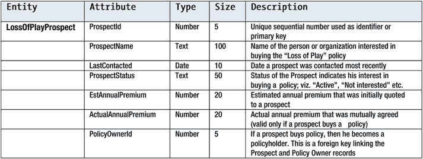

# 实体 LossOfPlayProspect 的 ELH

在与代理人初次会面并收到相关文件后创建一条记录。由于涉及金额（无论是保费还是索赔）较大，此过程（与其他保单相比）略有不同。如果潜在客户购买了“比赛损失”保单，则系统会更新该潜在客户的 `PolicyOwnerId`。对潜在客户信息的任何其他更新也同样适用。如果潜在客户在 6 个月内未购买保单，其详细信息将被删除。请参见图 3-14。

**图 3-14.** 实体 `LossOfPlayProspect` 的 ELH

| 创建 | 修改 | 删除 |
| :--- | :--- | :--- |
| 代理人在收集相关文件后为潜在客户创建记录 | 更新潜在客户信息，或如果转换为客户（购买保单）则添加 `PolicyOwnerId` | 在预设期限后删除潜在客户 |

---

### 逻辑系统规格说明

本模块涉及组装、链接所有设计交付物，并为物理实施做准备。然而，在准备最终清单之前，需要探索（用于实施的）技术系统选项，并由项目委员会就所选选项做出决定。我将简要讨论本章中所述的新“比赛损失”保单可能的技术系统选项，然后讨论逻辑设计阶段的交付物。几乎所有交付物都已在本章前面部分讨论过，因此我将重点关注尚未讨论的部分。

再次注意，此阶段也与实现目标（`RDBMS` 或 `NoSQL`）无关。此处仅讨论可能的技术选项。您仍然可以根据需要选择目标技术。因此，此设计阶段甚至可用于基于 `NoSQL` 的系统。

#### 技术系统选项

本章讨论的“比赛损失”保单扩展了 YourState 保险公司提供的保单类型，由于该公司已提供大量保单，因此其拥有现有的信息系统，可以通过 Web 界面（以及免费电话号码）销售和支持这些保单。因此，向项目委员会提交了以下技术系统选项：

- **选项 1**：为新保单设计单独的 Web 界面和数据库。使用独立的数据库和 Web 服务器。
- **选项 2**：使用现有的 Web 界面，并添加销售和管理新保单的功能。此外，在现有数据库（供所有其他保单共用）中添加新的数据库对象（根据需要）。最后，扩展现有数据库和 Web 服务器以处理额外的数据和用户流量。
- **选项 3**：设计一个单独的 Web 界面来销售和管理新保单，但共享用于保单和索赔处理的现有数据库。最后，扩展现有数据库和 Web 服务器以处理额外的数据和用户流量。

项目委员会评估了这三个选项，并选择了第三个选项。

随后，我们决定沿用现有数据库，但为处理“游乐损失”保单和索赔开发一套新的 Web 界面。原因之一在于现有界面难以处理手动与自动化混合的流程（因为现有保单的全部处理流程均已实现自动化）。

接着，在审查硬件配置（`Windows 2008 R2 Datacenter edition`、基于服务器的物理集群，含 64 个 CPU、1 TB 内存和 20 TB SAN 存储）后，决定增加 100 GB 内存和 2 TB 存储空间。经评估，操作系统和数据库（`SQL Server 2008 R2 Datacenter edition`）能够处理新增的连接需求。

## 第三章：使用 SSADM 进行关系型设计

#### 逻辑设计

这是一个非常重要的阶段，所有设计交付物在此整合、交叉核对并建立关联，以促进系统物理实现成功。任何设计漏洞都将被识别并解决。同时需添加有助于实施的解释和说明。根据 `SSADM` 指南，该阶段应产出以下交付物：

- 逻辑过程模型
- 更新处理模型（ECD）
- 查询处理模型（EAP）
- 对话设计
- 功能定义
- 菜单与命令结构
- 需求目录
- 数据目录
- 系统 `LDM`

#### 更新处理模型

通常，更新处理模型整合了构成信息系统更新功能的各项操作。该模型最终以结构图形式呈现，并附有对其构成操作的描述。由于功能定义和 `ECD` 能提供关于事件及其对 `LDM` 内实体影响的信息，因此常被用于构建这些模型。我已在本书前半部分讨论了功能定义与 `ECD`，接下来将是一个很好的练习：分离更新功能、为其准备 `ECD`，然后以这些 `ECD` 为起点构建更新处理模型。

请谨记：更新处理模型处于事件层级，而非功能层级。

#### 查询处理模型

查询处理模型与 `UPM` 不同，因为其中不涉及事件（无需围绕事件定义处理流程），且查询本身构成单一功能。因此，`EPM` 处于功能层级。查询访问路径（`EAP`）展示了查询如何与逻辑数据库交互，它是构建 `EPM` 的基础。图 3-15 展示了“游乐损失”保单搜索的 `EAP`。

**操作列表**

| | |
| :--- | :--- |
| `索赔 ID` | `索赔` |
| | 一组`索赔行项目` |

1. 获取输入的`索赔 ID`
2. 检索`索赔`记录，若出错则返回错误信息
3. 获取与该`索赔`相关的所有`索赔行项目`
4. 检查`索赔行项目`是已结算还是已重新提交审核
5. 若已结算，获取结算详情（`索赔结算`）
6. 若已重新提交审核，获取重新提交详情（`索赔重新提交`）
7. 输出已结算行项目的详细信息
8. 输出重新提交行项目的详细信息

***图 3-15.** 索赔状态查询的 EAP*

您可能已经注意到，`EAP` 的符号与 `ELH` 或 `ECD` 完全一致：右上角的星号表示迭代或多个实例，右上角的圆圈表示可选关系（异或关系）。搜索处理的起点由向右下倾斜的箭头指示。输入需要查询详情的`索赔 ID`，并在`索赔`实体中进行搜索。若找到匹配项，则检索索赔记录及其对应的行项目记录。一个`索赔`可能存在多个行项目（如图示），系统将对每个行项目检查状态，以判断该行项目是已结算还是被驳回后重新提交审核。随后，系统输出相应详情以供显示。

根据需要，也可以为其他实体开发搜索功能的 `EAP`。

就 `GUI`（图形用户界面）而言，对话框、菜单和命令结构不在本次讨论范围之内（因为本文重点在于使用 `SSADM` 进行数据库设计），而 `GUI` 交付物与前端 Web 界面相关。唯一剩下的交付物是数据目录或数据字典。

让我简要讨论一下。

## 数据目录

`数据目录`是我们大多数人都熟悉的数据字典。逻辑数据字典推荐采用以下格式。请注意，属性类型和大小并不指向特定的物理数据库实现，因此可能会根据物理实现所针对的数据库系统而变化。图 3-16 仅使用 `LossOfPlayProspect` 实体作为示例（为简洁并与讨论相关，我未包含整个数据字典），因为它能很好地演示该概念并提供必要的理解。

**图 3-16.** 实体 `LossOfPlayProspect` 的数据字典条目

### 物理设计

`SSADM` 的最后一个模块为使用先前模块讨论的技术完成的逻辑设计提供了物理实现指南。

本质上，`SSADM` 作为一种设计方法论，无法深入实现的细节，但它确实提供了高层指导，并试图使实现尽可能高效。实现包含两个方面：

- 物理数据设计
- 物理过程规格

由于本章重点在于数据库设计，我将聚焦于物理数据设计。需要注意的一个重要事项是，物理实现始终依赖于实现者（针对用于实现的平台或软件）的专业知识。

遵循以下步骤：

- 从逻辑数据模型（`LDM`）到物理数据模型的转换
- 初始空间估算与增长预留
- 物理设计的优化与定期维护

在此阶段，物理实现的细节将根据您为实现选择的目标技术（`RDBMS` 或 `NoSQL`）而变化。

#### 逻辑到物理的转换

此转换涉及为逻辑属性替换适当的数据类型，实施参照完整性约束，并向物理数据库添加相关支持对象，以支持逻辑数据模型中指定的关系。

可以使用许多案例工具（例如 `ERwin`）来实现此转换。当然，您需要选择目标数据库系统，然后确保计划使用的案例工具支持它。将逻辑模型转换为物理模型的过程称为*正向工程*，案例工具可以接受逻辑模型作为输入，并将其“正向工程”为物理模型。输出以脚本形式提供（使用目标 `RDBMS` 查询语言），可以在目标服务器上执行这些脚本，以在您选择的数据库中创建必要的数据库对象。这包括数据库表、索引、键（主键/外键）和触发器（如有必要）。

逻辑数据类型被转换为物理数据类型并由 `RDBMS` 实现。此过程完成后，物理数据库结构即可使用。

#### 空间估算与增长预配

物理数据结构（上一步的结果）会占用空间，您需要估算初始存储需求。对于比赛缺席保单，决定增加 2 TB 的存储空间，用于存储保单和索赔数据，以及扫描文档（用于确定保费）和球员合同所需的额外空间。这是一个好的开始，但明年会发生什么？或者后年呢？

您需要了解新保单产生的额外数据的增长率。例如，如果您确定增长率为 15%，那么每年将额外需要 15% 的空间。因此，每年需要 300 GB（2 TB 的 15%）来支持增长。您必须确保每年添加此额外的磁盘空间。

#### 优化物理设计

优化物理设计在很大程度上取决于您选择的目标 `RDBMS`，因为优化是针对数据库系统架构的。然而，部分优化是特定于 `SQL` 的，并且这些调优可以应用于任何支持 `SQL` 的数据库系统。广义上讲，优化或调优可以在以下层级进行：

- *服务器级别*：此调优涉及调整服务器配置参数以支持预期的处理类型。例如，对于 `OLAP` 或数据仓库环境，会读取（而非更新）大量数据。因此，服务器可以在没有任何锁的情况下支持读取（使用最宽松的隔离级别），这将为读取访问提供速度。
- *数据库级别*：这涉及调整数据库设置。使用数据仓库环境的相同示例，由于预计没有更新事务，事务日志可以很小且无需任何恢复机制。
- *应用级别*：这对应用程序数据库进行调优，涉及添加适当的索引或统计信息，并确保所有频繁执行的查询都使用索引扫描（以提高性能）。此外，还会执行目标数据库系统特定的调优。例如，如果目标数据库是 `SQL Server`，则频繁使用的查询应使用聚簇索引（因为这是数据物理存储的顺序）以提高性能。

关于调优需要注意的重要一点是，它不是一次性的设置。您需要定期审查并根据需要调整。您的系统现在可能运行在最佳状态，但这并不能保证六个月后，当添加了 2 TB 数据或更新了 1 TB 数据时，它仍能保持最佳状态。因此，您需要定期审查所有设置并进行调整。此外，索引或统计信息需要经常重建，以保证持续的性能水平。这构成了数据库维护，最好由数据库管理员自动化或安排。

### 总结

在本章中，我讨论了 `SSADM` 以及遵循 `SSADM` 设计方法论的所有可能交付物。`SSADM` 相当古老，并且没有尝试对其进行修改以用于最新的数据库设计技术。然而，这并不意味着它不再相关。事实上，它代表了关系型数据库设计中最全面、最逻辑的设计方法之一，这也是我将其用作示例的主要原因。

只是其中一些技术可以用在 `SSADM` 设计时尚未出现的更高效的技术来替代。

如果您快速浏览一下当今使用的设计方法，您会发现它们代表了 `SSADM` 的子集。没有一种方法在设计任务上如此全面，或涵盖了多年以前 `SSADM` 所交付的全部内容。

这引出了关于 `SSADM` 要指出的第二点。我讨论了所有交付物，但显然它们对于您的环境可能并非必需。您需要有意识地决定哪些交付物是相关的，并仅将这些作为设计的一部分呈现。

此外，由于 `SSADM` 描述的一些技术现在已被更好、更高效的技术所取代，您可以自由地将它们与 `SSADM` 指南结合使用。

毕竟，即使是 `SSADM` 文档也明确指出，所描述的技术是指南，而非需要逐字遵循的规则。

如果您仍然怀疑为什么刚读了一长章讨论 `SSADM` 及其交付物的内容，那么对于您计划从 `RDBMS` 迁移到 `NoSQL` 的任何项目，这都是有用的。