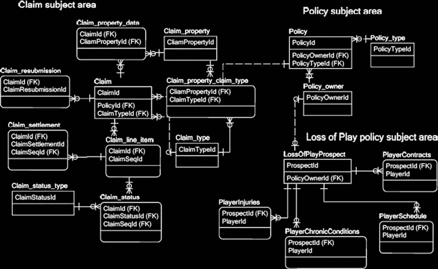
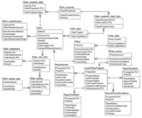
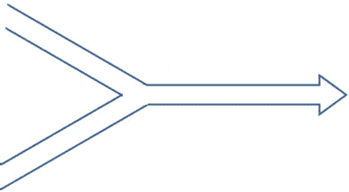

# 关系型数据库管理系统设计与实现工具

数据库。本章旨在帮助你有效理解关系型应用程序的设计文档（以及逻辑/物理设计），并最终协助你成功完成迁移。此外，正如我在每个`SSADM`设计阶段所讨论的，`SSADM`设计技术独立于实现目标（`RDBMS`或`NoSQL`），因此对于你计划实现的任何系统的设计都是有用的。

那是在 2001 年，由于互联网泡沫彻底破灭，预算非常紧张。我当时正在为芝加哥市中心的一家大型保险公司重新设计一个理赔报销系统，需要一个优秀的`CASE`工具。我向我的经理提及此事，他一脸茫然的表情促使我解释了该工具的功能。“嗯，难道你不能用`Word`吗？”我解释说无法用文字处理软件完成所需的操作。下一个问题是是否有任何开源或“免费”软件可用。看到一家准备花费数百万美元进行咨询的公司，却不愿为必要的数据库工具花费几千美元，这着实令人惊讶。

我经常看到人们对许多专门的数据库工具普遍存在漠不关心和缺乏了解的情况。此外，随着技术的发展和新技术、新工具每天涌入市场，新的数据库专业人员很难理解或熟练掌握用于设计、监控或绘制图表（流程图）的数据库工具。我认为，了解可用于`RDBMS`实现的工具类型及其特性将大有裨益。

流行的`RDBMS`实现工具涵盖了从设计到管理和监控的各个方面。任何`RDBMS`的实现都始于设计。常用于设计的工具有两种。第一种是`CASE`工具，它辅助完成概念设计和逻辑设计，以及向物理数据库结构的转换。第二种是绘图或流程图工具，它辅助绘制与数据库设计相关的不同类型的模型。我将在本章中讨论这两种工具。

还有一些应用程序有时被开发人员用来将`RDBMS`数据转换为面向对象的模型。这些框架被称为对象关系映射（`ORM`）框架。如果你计划将关系数据库表示为`ODBMS`（面向对象数据库），它们会很有用。`Hibernate`和`Spring`是可用于此目的的流行框架。它们提供了诸如高性能、可扩展性、可靠性、可扩展性和惯用持久性（能够开发遵循面向对象惯用法的持久化类，包括继承、多态、关联和组合）等特性，有助于成功、快速且简便地完成`ORM`转换，从而缩短你的开发时间。

© Bhushan Lakhe 2016  

B. Lakhe, *Practical Hadoop Migration*, DOI 10.1007/978-1-4842-1287-5_4

回到`RDBMS`，在数据库被设计并实现为物理结构（针对目标`RDBMS`）之后，需要对其进行日常管理和维护。可能需要创建新的数据库，扩展（数据库的）已分配空间，或者添加用户或为新对象提供访问权限。数据库管理工具有助于轻松快速地完成所有这些任务。

最后，需要对数据库（以及数据库服务器）进行性能、未授权访问以及任何可能导致服务中断的故障进行监控。在许多情况下，用于数据库管理的工具也提供监控功能，但某些情况下确实需要使用专门的监控工具，这些工具提供更广泛的功能和灵活性。

### 数据库设计工具

第[3 章讨论了使用`SSADM`作为方法的数据库设计过程](http://dx.doi.org/10.1007/978-1-4842-1287-5_3)。你可能已经注意到，设计过程会产生大量模型和可交付成果。这些模型/可交付成果是相互关联的，因此有必要清晰地展示它们之间的关系。

分别绘制这些模型并展示现有关系既繁琐又耗时。`CASE`工具有助于此过程，它能够辅助构建初始（逻辑/概念）模型，利用该模型生成下一阶段的模型，并持续进行直到达到最后阶段（物理数据结构）。

绘图或流程图工具不提供这种广泛的功能，但拥有庞大的预设计模板库，有助于快速创建流程图或图表。根据个人经验，绘图工具更适用于数据流图或业务活动模型等模型。

#### CASE 工具

`CASE`工具是辅助实施与计算机辅助软件工程（`CASE`）相关过程的工具。它们用于设计和实现软件应用。影响`CASE`工具发展的因素有几个，例如`CAD`（计算机辅助设计）或“活动数据字典”。数据库设计者注意到`CAD`软件包通过其预构建模板、形状库和所需功能为*草图绘制*（手动绘制机器零件设计各种视图并按比例缩放的过程）提供的便捷性。诸如易于修改以及将设计传播到`CNC`机床以进行实际零件制造等更有用的特性也给这些数据库设计者留下了深刻印象。

另一个主要影响是[数据库的数据字典](https://en.wikipedia.org/wiki/Data_dictionary#Data%20dictionary)。设计者通过实验扩展了[字典中保存的元数据范围](https://en.wikipedia.org/wiki/Metadata#Metadata)，使其包含应用程序属性并在运行时进行替换。这种“活动字典”导致了[模型驱动工程](https://en.wikipedia.org/wiki/Model-driven_engineering#Model-driven%20engineering)的出现，但它没有任何元数据的图形表示。一旦（受`CAD`启发）添加了图形表示，就导致了早期`CASE`工具的开发。

那么，`CASE`工具如何帮助数据库设计过程呢？通过帮助设计阶段的图形表示，以及将设计好的模型传播到后续阶段，直到设计过程最终形成物理数据库结构。

由于`CASE`工具辅助完成软件开发生命周期（`SDLC`）中的特定任务，因此它们对于实现数据库设计方法论非常有用。你可能已在[第 3 章](http://dx.doi.org/10.1007/978-1-4842-1287-5_3)中注意到，我使用了`CASE`工具`Erwin`来设计与设计方法`SSADM`相关的各种可交付成果，例如逻辑设计模型（`LDM`）或物理数据模型（`PDM`）。总而言之，`CASE`工具可以通过以下方式辅助设计过程：
- 为你的应用程序设计构建设计层
- 使用主题领域对你的设计进行分类
- 控制模型的物理显示级别
- 根据需要执行正向或逆向工程
- 帮助为你的设计创建可重用组件
- 轻松快速地在各设计阶段间传播变更

### 构建和使用设计层

在应用程序开发过程中，用于特定目的的一组数据模型构成了一个设计层。在这个层次结构中，第一层通常是逻辑数据模型，它概括了（应用程序的）业务需求。第二设计层转换这些业务需求，并为物理数据模型创建相应的数据库实施规则（注意，可以使用通用的`ODBC`作为目标数据库来创建通用的物理模型）。第三层，也是最后一个设计层，针对不同的目标服务器平台，表示同一数据模型的物理实现。

如果来自第一层的逻辑数据模型是一个企业数据模型，那么它可以进一步划分为对应于组织中不同应用程序的逻辑模型。图表 4-1 总结了这些层次。


图 4-1. 关系型 OLTP 应用程序的设计层

关于设计层，最重要的一点是，你必须能够链接不同设计层中的模型，并同步在不同层中所做的更改（即，将更改传播到其他层）。一个成功的层级结构的特点是：使用共同的模型源，在不同设计层之间拥有良好链接的模型，并能够跨设计层应用转换（保持链接的模型同步）。

像`Erwin`、`ER/Studio`或`Enterprise Architect`这样的 CASE 工具提供了所有必要的功能来定义逻辑模型，并应用转换从中派生出通用的或特定的物理模型。这样，链接通过设计层得以维护，任何修改都可以应用到逻辑数据模型，相关的物理模型也能快速重新生成。

### 使用主题域进行分类设计

很多时候，当你开始审查一个大型数据模型时，它会让人望而生畏，且信息性不强或不够直观。原因是它向你展示了大量相关实体，却没有告诉你它们（或其子集）提供什么功能。你只知道该模型属于一个提供某些功能（如会计、人力资源管理、保单与理赔管理等）的系统。

主题域根据实体为信息系统提供的功能子集对它们进行分组。通过这种方式对实体进行分类，主题域提供了对功能的快速子分类，使数据库模型更易于理解和阅读。

考虑前几章中用于保单与理赔处理的逻辑模型。

你已经看到了它在没有主题域时的样子（图[3-7](http://dx.doi.org/10.1007/978-1-4842-1287-5_3#Fig7)）。通过定义主题域，你可以看到图 4-2 中的差异。


图 4-2. 保单与理赔处理应用程序的主题域

正如你所看到的，现在更容易理解实体的来龙去脉，并且你很可能猜出它们的目的。例如，对于“比赛缺失险”主题域，很容易看出`LossOfPlayProspect`实体是该保单处理的核心，而其他实体只是提供关于运动员的信息（其合同是投保人试图投保的）。类似的信息也可以从其他主题域中快速、轻松地推导出来。

当使用 CASE 工具实现主题域时，它们可以单独显示，也可以作为主主题域的一部分显示。即使你没有定义特定的主题域，默认也会定义一个主主题域，并且所有实体都是它的一部分。当你将一个实体添加到某个特定的主题域时，它仍然是主主题域的一部分，并且在一个主题域中对它所做的任何更改都会自动应用到该实体所属的所有其他主题域中。

### 模型的显示级别

CASE 工具为数据模型提供各种显示级别，例如：
- 实体（仅显示实体及其相互关系）
- 属性（显示实体和属性）
- 主键（显示所有实体的主键）
- 键（显示所有实体的主键和外键）

*   定义（显示实体定义和关系）

*   图标（显示实体和图标）

这些显示级别有助于根据你的需要控制可视化。例如，如果你只想显示实体关系，那么实体显示级别就足够了；或者如果你想显示主键和外键关系，那么键显示级别将是合适的（图 4-2 使用了键显示级别）。通过只显示必要的详细程度，显示级别使得更容易关注相关的细节。

### 正向工程与逆向工程

正向工程涉及在目标`RDBMS`的模式/数据库中创建物理表结构。你可以使用设计层概念，并在必要时创建一个通用物理模型作为中间步骤。许多 CASE 工具可以读取使用建模工具准备的数据模型，然后也可以对其进行正向工程。

CASE 工具如何实现这个特性？嗯，作为最后一步，CASE 工具使用目标`RDBMS`支持的查询语言提供数据定义语言（`DDL`）脚本。但在此之前，你可以为目标脚本选择多个选项。这些选项涉及：选择要导入的数据库对象和属性；指定是否要从索引推断主键或关系；设置大小写转换选项；生成索引脚本（用于实现主键、外键和备用键关系）；通过触发器实现参照完整性等，并且可以通过点击菜单轻松选择。



逆向工程，正如你所料，是正向工程的逆过程。它以物理数据库（包含对象）为起点。该过程会读取所有对象的元数据，确定关系，并创建一个物理数据模型。利用现有数据库可以加快新数据模型的设计以及后续新系统的交付。然后（使用物理模型）可以轻松生成逻辑数据模型。如果无法连接到数据库（并读取元数据），也可以使用（需要逆向工程的数据库对象的）`DDL`脚本。图 4-3 总结了这一过程。

```
Database connection
Database DB1

**Physical Data Model**
Reverse engineering function
within a CASE tool

OR

CREATE TABLE Claim (c1 int,
INDEX ix_1 NONCLUSTERED (c1))
CREATE TABLE Policy (c1 int INDEX
ix_1 NONCLUSTERED (c1))
CREATE TABLE LossOfPlayProspect
(c1 int, c2 int INDEX ix_1
NONCLUSTERED)
CREATE TABLE Claim_type (c1 int,
c2 int, INDEX ix_1 NONCLUSTERED
(c1,c2))

DDL script
…………………………………
```

图 4-3. 逆向工程过程