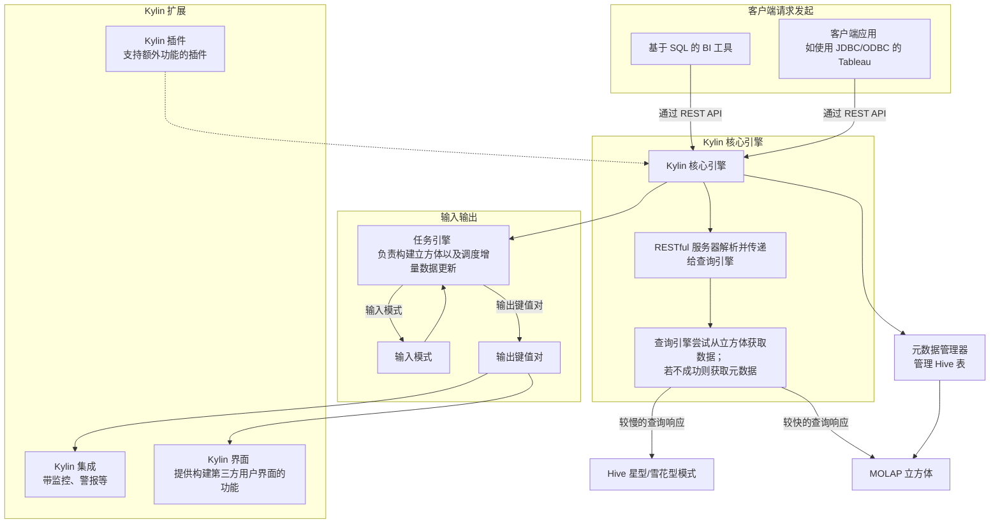
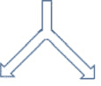

# Apache Kylin 特性概述

- **可扩展且快速的 OLAP 引擎：** `Kylin` 能够降低对超大数据集的查询延迟。这归功于其预构建立方体及计算的架构。

- **支持 `ANSI SQL` 与交互式查询：** 由于我们长期使用 SQL，`Kylin` 对大多数 `ANSI SQL` 查询函数的支持是一项实用特性，可加速开发流程。交互式查询通过预构建的立方体提供灵活性与速度。

- **MOLAP 立方体：** 利用文件存储和预构建计算，为 MOLAP（多维立方体）提供了速度。此外，传统 MOLAP 的弱点（立方体内数据包含限制）在 `Kylin` 中不复存在。例如，用户可轻松在 `Kylin` 中为超过 100 亿条原始数据记录预构建一个立方体。

- **`BI` 工具集成：** 与 `BI` 工具的集成对于执行高级分析和生成报告至关重要。`Kylin` 可与 `Tableau`、`Spotfire`、`Microstrategy` 等商业智能工具及许多第三方应用程序进行交互。

- **开源 `ODBC` 驱动程序：** `Kylin` 的 `ODBC` 驱动程序专为按需访问数据源而开发，并已与报表编写应用程序 `Tableau` 进行了充分测试。该驱动程序已向 `Apache` 社区开源，便于用户根据特定用途进行定制。

- **简单高效的管理：** 以下特性提供了易用性和管理便利性：

  - 作业管理与监控

  - 压缩与编码以减少存储需求

  - 立方体的增量数据刷新（允许仅处理变更数据，减少处理时间）

  - 用于管理、构建、监控和查询立方体的 Web 界面

- **性能提升：** 以下特性提供了额外的性能增强：

  - `Kylin` 利用 `HBase` 协处理器提升查询性能。对于简单的加法或聚合操作（如 `sum`、`count` 或 `like`），将计算下推到 region 服务器或主服务器（可直接在数据上工作，无网络流量开销），可显著提升性能。

  - `Kylin` 使用 `HyperLogLog` 算法来确定查询中的去重计数。该算法近似计算数据集中不同元素的数量，显著减少内存消耗，并允许使用超大数据集。

- **灵活细粒度的安全机制：** `Kylin` 允许在立方体或项目粒度级别设置 `ACL`（访问控制列表），并支持集成 `LDAP`。这有助于轻松与企业安全体系集成。

- **容错性：** `Kylin` 在系统层和数据层均支持容错：

  - **数据容错：** `Kylin` 中的立方体可被划分为多个段，其优势在于可以刷新（或重建）单个段而不影响整个立方体。因此，您可以按需制定每日、每周或每月构建段的策略。检测到的任何数据错误或所需更改均可应用于粒度最小的段，从而实现有效的容错，无需重建整个立方体。无法由最小粒度处理的数据变更，则需要在更高层级重建（例如，一周后发现的数据问题需要重建每周的段）。因此，您需要在数据容错和查询性能之间取得平衡。更高的段粒度能提供更高的数据错误/变更容忍度，但也会导致每次查询扫描更多数据。重要的是，当立方体的某些段正在重建时，该立方体仍可继续使用。

  - **系统容错：** `Kylin` 继承了 `HDFS` 和 `HBase` 提供的系统冗余和容错能力。此外，您可以安全地重试任何失败的构建步骤而不会产生任何负面影响。这确保了构建最终版本的完整性和正确性，无论中间发生多少次失败或重试。

## 第 5 章：Hadoop 生态系统

我在前几节讨论了 `Spark SQL` 和 `Presto`。目前已有多种 `SQL-on-Hadoop` 工具可用。那么为什么要使用 `Kylin` 呢？因为大多数这些工具需要部分或完全扫描数据集来回答你的查询。不仅如此，查询中的任何连接操作都可能触发跨节点的数据传输，并且根据网络流量延迟，你收到的响应可能并不理想。

相比之下，`Kylin` 会预先计算所有维度的聚合结果，并将结果值存储在数据立方体中。构建立方体的过程非常全面，考虑了所有可能的维度组合，从而确保对更多查询的覆盖。此外，`Kylin` 会生成预连接的 `HiveQL`（基于元数据），用于将事实表与维度表连接起来。预连接和预聚合的结果存储在 `HBase` 中。因此，大多数查询由 MOLAP（多维 OLAP）立方体提供服务，速度非常快。无法使用立方体的查询会被路由到保存元数据的 `Hive` 表，从而以 ROLAP（基于星型或雪花型模式的关联 OLAP）的方式执行。本质上，`Kylin` 提供了 HOLAP（混合 OLAP）架构。

`Kylin` 的下一个版本计划用 `Spark SQL` 取代 `Hive`（以获得更高的速度和内存处理能力），采用 Lambda 架构（提供近实时结果）、内存分析（提升性能）和容量管理。此外，还计划使用 Spark 引擎。

图 5-4 中的流程图总结了 `Kylin` 内部的立方体构建过程。

1. 为维度表构建字典
2. 执行 `Hive` 查询
3. 执行 `MapReduce` 任务以将事实表与维度表连接并复制到 `HDFS`
4. 构建扁平表
5. 构建 cuboid（作为 `HDFS` 序列文件）包含所有可能的维度组合的聚合结果并关联事实表
6. 计算 `HDFS` 序列文件的键分布
7. 将 `HDFS` 序列文件转换为 `HBase HFile`
8. 将 `HFile` 加载到 `HBase` 并均匀拆分键

**图 5-4.** *`Kylin` 立方体构建过程*

最后，让我用一个全面的 `Kylin` 架构图来总结这一讨论。图 5-5 显示了 `Kylin` 引擎的主要组件：`REST` 服务器、查询引擎、元数据管理器和任务引擎。



**图 5-5.** *`Kylin` 架构*

`REST` 服务器与客户端查询交互，并将查询传递给查询引擎。如果查询结果可以通过立方体数据计算得出，则结果几乎立即返回；但如果无法（从立方体数据中）计算，则会使用较慢的路径，即使用 `Hive` 模式。你可以根据需要为 `Kylin` 核心引擎添加扩展或接口。

### 内存处理工具

在过去几年中，基于内存的处理主要由 `Spark` 和 `Storm` 主导。尽管这两者都是功能极其强大且实用的产品，但 `Apache Flink` 具备一些功能，使其相对于这些经过验证的成熟产品具有明显优势。

#### Flink

`Flink` 是一个大规模数据处理引擎，提供内存数据流处理，因此对于数据密集型以及迭代型任务来说，处理速度极快。`Flink` 与 `Spark` 有何不同？嗯，`Spark` 主要是一个批处理框架，可以近似模拟流处理。`Flink` 主要是一个流处理框架，同时也能执行批处理。`Spark` 并非纯粹的流处理引擎，实际上它是对输入数据的较小部分执行快速批量操作，也就是“微批处理”。

对于大多数应用来说，这可能不是问题，但对于金融或实时系统（需要低延迟的情况），每一毫秒都至关重要，即使微小的性能问题也可能导致严重的经济损失。

你还可以将 `Flink` 视为 `Hadoop MapReduce` 的替代品，它支持批处理和流模式，并使用有向图（而非映射和归约任务），从而利用内存处理获得更好的性能。

`Flink` 拥有出色的优化引擎。`Flink` 优化器会分析（提交到集群的）输入代码，并根据其判断，为在特定环境（可能因集群硬件和节点数量而异）下执行该代码决定最佳管道。

在性能方面，迭代处理会在同一节点上执行（而非让集群独立运行每次迭代）。使用优化器提示，还可以仅对数据集中可能已发生变化的部分执行增量迭代。

`Flink` 可以与 `YARN` 协同工作，并且可以直接在其执行引擎上运行现有的 `MapReduce` 任务，为已经使用 `MapReduce` 的组织提供了轻松的升级路径。

最后，`Flink` 可以与 `Apache Tez` 配合使用（仅用于批处理），在一定程度上为了可扩展性而牺牲性能。

在内存管理方面，`Flink` 在 `JVM` 内部（`DataFlow` 引擎的 `JVM` 中）实现了自己的内存管理，从而帮助应用轻松扩展，并减少 `JVM` 垃圾回收开销的影响。这（几乎）也消除了 `Spark` 集群上常见的内存使用异常（或峰值）。你可以通过内置的 HTML 查看器，将 `Flink` 为你的任务构建的管道导出为 `JSON` 表示，从而使调试变得容易。

对于流处理应用而言，容错性是一个重要的考量因素，`Flink` 的容错机制基于 `Chandy-Lamport` 分布式快照。该算法使得分布式系统中的进程能够确定计算过程中的全局状态，并可用于检查点。该机制仅使用少量系统资源（从而保持高吞吐率），同时提供有保证的一致性水平。

许多使用 Hadoop 的组织正在选择实时流处理架构，以取代现有的批处理架构。静态的 HDFS 文件正在被事件流所补充，批量工作负载正被流处理器取代，以提供更低延迟的应用。这种转变的主要原因是，构成 Hadoop 集群大部分工作负载的数据集和用例都是基于事件的（例如，事件或审计日志）。另一个原因是，现在的流处理技术已经足够成熟，可以处理更复杂的需求。

最后，还有一些应用（如处理传感器数据）需要连续查询，这只能由流处理架构来支持。

通常，流处理架构由以下模块组成：

- 收集和整合事件流

- 集中收集、保存流并分发它们

- 分析流并创建衍生流

第一步通常使用 `Flume` 或 `Sqoop` 等应用完成，但很大程度上取决于数据源。输入事件可能包含来自（关系型/NoSQL）数据库的数据、机器生成的日志或传感器数据。这些数据需要被清洗和整合。

像 `Kafka` 这样的应用可用于执行第二步。`Kafka` 可以收集事件流和日志，并对它们进行缓冲。`Kafka` 在保存和分发流的同时，还提供了容错能力（这在此场景中是必要的）。

最后一步涉及对流进行分析。这可能包括创建计数器、聚合它们、合并流，或创建派生数据流以供进一步使用。`Apache Flink` 可以（并且确实被）用于实施这一步。

## Flink 架构

请记住，`Flink` 只是一个用于分布式数据分析的框架。在核心层面，`Flink` 拥有一个流式迭代数据流引擎。`Flink` 在核心引擎之上使用了两个主要的 API（用于处理批处理数据的 `DataSet API` 和用于处理事件流的 `DataStream API`），以提供同样轻松处理不同类型数据的通用功能。`Flink` 日益增长的流行度催生了基于这两个主要 API 构建的领域特定库和 API 的开发。

目前，可用的库包括：机器学习库、图分析库 (`Gelly`) 以及一个类似 SQL 的 API (`Table`)。此外，还有其他在 `Flink` 之上运行的项目，例如 `Google Cloud Dataflow` 和 `Apache MRQL`。最后，`Flink` 核心引擎可以与各种数据处理框架（如 `YARN`/`Apache Tez`）协同工作，可以作为独立的 `Flink` 集群运行，也可以嵌入到其他应用中。图 5-6 总结了该架构。



### 图 5-6. Flink 架构

```
编程客户端 -> 访问 Flink 库
           |
           V
上层项目 (Google Dataflow, MRQL)
           |
           V
库 (Hadoop M/R, Gelly, Table, FlinkML)
           |
           V
用于批处理 -> Dataset API
用于事件流处理 -> DataStream API
           |
           V
Flink 数据流引擎
           |
           V
数据处理框架 (YARN, Tez, Flink 集群)
```

## 搜索与消息传递工具

搜索工具提供索引和搜索（主要是）文本数据的能力。因此，它们仅适用于某些类型的数据。出于显而易见的原因，这些（用于 `Hadoop` 的）搜索工具不如关系数据库的搜索工具那样灵活或广泛，但它们确实占有一席之地。由于许多 `NoSQL` 数据库缺乏必要的二级索引能力，这些产品有时被用来增强它们。用于 `Hadoop` 的 `Solr` 和 `Elastic Search` 是该类别中的热门产品，两者都使用 `Lucene` 作为底层索引引擎。

消息传递系统以源-目标和发布-订阅模式传递消息。通常，这些系统运行在像 `Flink` 或 `Spark Streaming` 这样的实时流处理器之上。`Kafka` 是一种流行的消息传递系统（在上一节中简要讨论过），它还允许你对消息进行随机访问。

### 总结

如果你在过去五年中使用过 `Hadoop`，你可能已经注意到 `Hadoop` 世界处于不断变化的状态，新的应用几乎每天都在增加（或消失）。几乎不可能跟踪所有的新项目，因此，为你的大数据需求选择完美同步的组件是一项艰巨的任务。当你最终确定时，新的组件就会出现，它们可能更适合你的需求！

在本章中，我试图提供一个关于当前可用产品类别和新产品的整体视图，希望这能为你提供一个良好的概述和起点。然而，你在选择必须满足业务需求的组件时，仍然需要进行自己的研究和尽职调查。请记住，如果一个新组件（刚刚进入市场）更适合你的需求，但会使你的项目截止日期推迟一个月，那么如果它能让你在竞争中占据优势或大幅提高流程效率，这应该是可以接受的。

你还需要明白，选择这些组件中的任何一个都涉及复杂的工程权衡，你需要选择涉及最少权衡（且收益最大）的选项。你的首要目标应作为一个良好的起点（用于选择主要组件），并应尝试围绕它构建一个系统。

本章也作为从关系技术向大数据世界过渡的桥梁。后续章节将讨论实施大数据解决方案的设计概念，因此本章讨论的 `Hadoop` 产品类别将有助于理解这些概念。

# 第 6 章 为 NoSQL 重新设计架构：设计原则、模型与最佳实践

我最近参加了一个由 Doug Laney 主讲的关于*数据货币化*的高德纳研讨会。Doug 谈到了一个有趣的概念，即为你组织历史上收集的数据赋予货币价值。他还谈到了*数据易货*的概念，以及用信息而不是金钱来缴税（显然他向几位 `IRS` 官员提过这个，并享受了他们的反应）。Doug 恰当地将数据经济学称为*信息经济学*。我认为，创建一个新学科来有效地将数据货币化，凸显了数据（和信息）在当今世界日益增长的重要性。

现在想想信息经济学背后的根本问题——你如何组织、整合、分析和呈现大量数据？由于这个概念涉及利用你组织多年来收集的所有数据，数据量将会很大。同时，像其他需要销售的东西一样，最终产品需要有用且具有可呈现性。大数据解决方案可以成功地用于组织和分析大量数据。当然，你需要为 `NoSQL` 的使用重新设计你的数据架构，因为关系数据不能直接用于 `NoSQL` 数据库。需要应用某些转换，我将在本章中讨论这些。

关系数据库有很多特性，你会想当然地认为任何数据库系统都具备。例如，定义细粒度的安全（或授权）、参照完整性约束或统计信息。此外，像并发更新或数据类型验证等事情都由 `RDBMS` 自动处理。

对于 `NoSQL` 数据库，只有部分这些特性可用，但通常需要附加组件（以及大量的额外工作来安装/配置/与其他组件集成）或涉及时间和资金的定制开发。例如，你必须转换数据以保持数据完整性（在没有参照完整性的情况下），或者在缺乏高级索引或统计信息的情况下提供更好的性能。`RDBMS` 在一个（相对）易于使用的包中为你提供了所有这些特性。

参照完整性的缺失促使数据反规范化。这让我们想起了数据仓库，尽管转换技术相似，但 `NoSQL` 通过完全消除任何连接操作，将这一点推向了更远。你可能还记得，对于星型模式，事实表需要与适当的维度表连接，以实现有效（且灵活）的数据过滤。而对于 `NoSQL` 数据库，即使是这些连接也是不可取的。因此，需要完全消除连接。

另一件要记住的重要事情是，许多数据完整性、验证或并发特性对于许多应用来说并非必需，这实际上促进了 `NoSQL` 数据库的发展——它们用这些特性换取了更好的性能和可扩展性。

还需要考虑一些非数据中心因素，例如安全性（认证/授权）或并发性，因为 `RDBMS` 默认提供这些特性，而在 `NoSQL` 解决方案中则不容易获得。