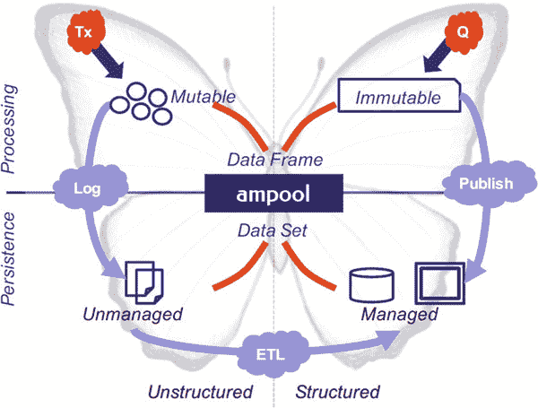
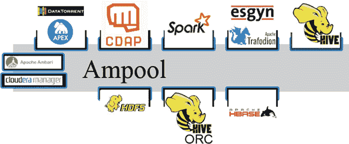

# Butterfly 架构

Butterfly 架构的主要意图是，在一个单一平台上统一批处理层、服务层和速度层的数据处理任务。要实现 Butterfly 架构，我们需要使用新的、更通用的抽象来处理数据，这些抽象不同于当前的抽象（例如文件、目录或表和索引）。在 Butterfly 架构中，我们将数据组织为三种抽象的集合：

-   **数据集（Datasets）**：这是最灵活的抽象，是任意记录的分区集合。记录没有强加任何结构。换句话说，记录中内容的解释留给了处理框架，并借助系统目录来完成。这相当于读取时定义模式（schema-on-read）的数据，这是当前 Hadoop/NoSQL 数据系统管理的唯一数据类型。系统目录存储了关于每个数据集的信息（以及多个数据集之间的关系）。每个数据集都有一个唯一的标识符，目录是一组逻辑上的 RDF 三元组，表示为 `(Relation, Object1, Object2)`。例如，为了表示 ID 为 `4596` 的数据集被命名为 `SearchLog`，目录中有一个条目 `(NameOf, 4596, "SearchLog")`。再举一个例子，为了表示数据集 `4596` 的位置在 HDFS 中，系统目录中存在一个条目 `(Location, 4596, "hdfs://namenode:port/user/data/something")`。请注意，这是关于数据集系统元数据的逻辑表示，为了效率考虑，可以在物理上表示为一组固定宽度的表。这些数据集可以存储在多个存储系统上，甚至单个数据集的多个分区也可以分布在多个存储后端上。此外，当数据集以字节流形式存储在文件中或通过网络传输时，其序列化和反序列化格式由用户或操作员定义。

-   **数据框（Dataframes）**：数据框是结构化的数据集。它们使用包含在单个记录中的用户指定的分区键进行分区。数据框可以是可变的或不可变的。*不可变*数据框（一旦创建）不能以任何方式进行修改，而可变数据框的单个记录可以插入、更新或删除。它们通常由多个计算框架通过处理数据集而创建。数据框与关系数据库管理系统（RDBMS）中预定义模式的结构化表非常相似。不可变数据框适用于分析型工作负载，而可变数据框用于事务性的增删改查（CRUD）工作负载。

-   **事件流（Event streams）**：事件流是无界的数据框。这些记录（事件）中的至少一个字段大多是单调递增的。通常，这个字段是时间戳或序列号。可选地，流可以指定窗口大小，要么是记录数（对于单调递增字段，则是其序列号），要么是时间跨度（对于单调递增字段，则是其时间戳）。在一个窗口内，事件可能出现一些乱序到达。然而，在窗口之间，序列号或时间戳是严格单调递增的。

Butterfly 架构的主要区别特征在于，在以上每种数据抽象之上，计算范式的灵活性。因此，多种计算引擎，例如 MPP SQL 引擎（`Apache Impala`、`Apache Drill` 或 `Apache HAWQ`）、`MapReduce`、`Apache Spark`、`Apache Flink`、`Apache Hive` 或 `Apache Tez`，都可以处理数据集、数据框和事件流。

这些计算步骤可以串联起来形成*数据管道（data pipelines）*，并由外部调度器编排。一个资源管理器（与可感知数据的可插拔资源调度器相关联）是实现 Butterfly 架构的必需品。`Apache YARN` 和 `Apache Mesos`，以及编排框架（例如 `Kubernetes` 或混合资源管理框架，如 `Apache Myriad`（孵化中））在过去几年中已经出现，以履行这一角色。Butterfly 架构及其相关的数据流如图 9-9 所示。

**图 9-9.** Butterfly 架构

## Butterfly 架构的存储

为了高效地实现 Butterfly 架构，需要一个快速的存储引擎，用于跨数据管道的数据交换，以及流式数据摄入和分析。需要为不可变和可变数据框提供优化的实现，以支持快速的批量查询和快速的事务处理，从而允许在单个系统中共存多种工作负载。传统的基于磁盘的存储系统使得这种统一变得极其困难。然而，NVMe 连接的闪存、NVDIMM（非易失性内存模块）以及新一代持久内存（SCM，即存储级内存）的出现，为高吞吐的扫描导向型工作负载和低延迟的随机访问工作负载提供了可以共存的完美存储介质。表 9-1 描述了各种存储层的当前和预期性能，以及它们的大致相关成本。

**表 9-1.** 存储类型及其成本

| 存储类型 | 每 GB 大致成本 | 每 GB 的 I/O OPS/秒 | 每 GB 的吞吐量 | 十亿 IOPS 成本 | 每秒 GB 级别吞吐量的成本 |
|---|---|---|---|---|---|
| DRAM | $6 | 2000 万 | 50 GB/s | $300 | $0.12 |
| SCM | $2 (预计) | 1000 万 | 10 GB/s | $200 | $0.20 |
| NAND Flash | $0.50 | 100 万 | 1 GB/s | $500 | $0.50 |
| HDD | $0.03 | 100 MB/s | 100 MB/s | $30,000 | $0.30 |

正如表 9-1 所示，当前一代 DDR4 DRAM 对于吞吐量密集型工作负载最具成本效益，而新兴的存储级内存（SCM）对于随机访问工作负载最具成本效益。当然，成本并非构建系统的唯一考量因素——存储密度和功耗也是另外两个需要考虑的因素。由于新型 SCM 有望比 DRAM 拥有高得多的密度和低得多的功耗，它们有潜力成为快速统一数据平台的主存储层。

大多数现有的数据库和数据存储系统都是基于 HDD 的性能特征和存储密度设计的。因此，它们倾向于不惜一切代价避免随机访问，并且为了避免长延迟，它们倾向于通过将数据分布在磁盘阵列中的多个硬盘驱动器上，或者昂贵的服务器端 DRAM 中预先获取所有数据，同时在存储在硬盘驱动器上的数据上运行顺序访问工作负载，来实现随机访问工作负载的并行化。因而，它们引入了大量复杂性来保证数据在不同工作负载间的一致性及可用性（以防磁盘故障）。此外，硬盘驱动器（含有机械部件）比 Flash、SCM 和 DRAM 等固态设备更容易发生故障。

为了完全实现蝴蝶架构，需要经济高效地利用各种类别的固态内存。Ampool 正在构建一种新颖的存储技术来实现蝴蝶架构。

## Ampool

Ampool 的核心产品是一种以内存为中心、分布式、数据感知的对象存储，针对事务和分析工作负载进行了优化。Ampool 产品的这些特性将在下一节中讨论：

**以内存为中心**：尽管多年来 DRAM 成本迅速下降，但与其他存储介质（如 SSD 和硬盘驱动器）相比仍然非常高昂。幸运的是，在企业中需要分析的数据并非全都需要 DRAM 所提供的性能。此外，随着数据老化，其被访问的频率会越来越低。因此，冷数据可以存储在硬盘驱动器上，温数据可以存储在 SSD 上，而只有最常访问（且需要最快访问速度）的数据才能存储在 DRAM 中。手动在这些存储层之间移动数据既繁琐又容易出错。Ampool 实现了智能分层，可以监控数据的使用情况，并在数据被不频繁访问时自动在各层之间移动数据。

**分布式**：尽管多年来 DRAM 和存储密度大幅增加，但向单个系统添加越来越多的 DRAM 和存储（垂直扩展）并不会使整体系统性能与成本成比例地扩展。因此，即使是内存中心的存储系统也需要进行集群和分布式设计，以实现线性扩展、容错和灾难恢复。Ampool 存储从一开始就被设计为分布式系统。数据在集群中不同机器的地址空间之间进行复制（以实现高可用性）。此外，数据的变更通过跨广域网的可扩展消息总线进行传播（以实现灾难恢复）。

**对象存储**：从历史上看，最常见的存储系统类型分为块存储或文件系统。两者各有优势。*块存储*可以跨不同的操作系统共享，并且访问随机数据块的开销要低得多。然而，对于当今大规模数据工作负载而言，为获取单个数据块而进行的网络往返往往是不够的。此外，由于读写的基本单元是 4 KB 的块，小的更新（以及小的读取）会导致网络或本地磁盘上产生大量不必要的数据流量。文件系统是最常用的存储抽象，并存在于多种操作系统的各种版本中。此外，有多家供应商提供多种可扩展的分布式文件系统。但是，实现文件系统语义（涉及维护和遍历分层命名空间结构）、维护文件系统操作的一致性和原子性、以及在文件中实现原地随机读写，会给文件系统服务器（以及客户端）带来大量开销。通常，文件系统的读/写访问有 50–100 微秒的延迟。当文件系统构建在缓慢的旋转磁盘（其延迟为 10 毫秒）之上时，与底层存储介质的延迟相比，文件系统的延迟可以忽略不计。然而，对于只有几微秒延迟的新型快速随机访问存储（如 SSD 和 NVRAM），文件系统抽象的开销变得极其高昂。

在过去十年中，由于公有云及其托管存储解决方案的出现，第三种存储抽象——对象存储——变得流行起来。对象存储具有扁平化的层级结构。要访问一个对象，只需要一个桶 ID 和一个对象 ID（而非遍历分层命名空间）。此外，对象存储为每个对象和桶关联了丰富的元数据，因此诸如过滤器和内容搜索等操作可以被下推到存储层，从而减少网络带宽需求和 CPU 负载。对象存储是新型存储介质的理想选择，因为它具有较低的 CPU 开销、更简单的语义和可扩展性——尤其是在大量数据以对象形式存储时。

**数据感知**：大多数现有的对象存储本身并不解释对象的内容。因此，其效用有限，实际上，对象存储最常见的用途是作为二进制大对象存储，用于存储和检索多媒体（如图像或视频）。如果要对存储在对象存储中的数据执行分析工作负载，则需要将整个对象（大小可能为兆字节或千兆字节）获取到 CPU，对其施加模式，进行反序列化，然后在其上执行必要的分析计算。Ampool 对象存储存储关于对象的广泛元数据（如模式、版本、分区键以及对象内容的各种统计信息），使得诸如投影、过滤和聚合等常见操作可以被下推到对象存储中。这有助于加速大多数分析计算，并避免其他分布式存储系统中普遍存在的网络瓶颈。当前版本 Ampool 的框图如图图 9-10 所示。

***图 9-10.** Ampool 架构*

除了核心的以内存为中心的对象存储之外，`Ampool` 还包含了几个优化后的连接器，使得现有计算引擎能够高效地向 `Ampool` 对象存储中存取数据。虽然每个新版本的 `Ampool` 都快速增加连接器的数量，但当前开箱即用的连接器包括 `Apache Spark`、`Apache Hive`、`Apache Trafodion`（与 `Esgyn Corporation` 合作）、`Apache Apex`（与 `Datatorrent, Inc.` 合作）以及 `CDAP`（`Cask Data Application Platform`，与 `Cask Data, Inc.` 合作）。尽管 `Ampool` 系统本身就是一个完全分布式的存储系统，能够维护大量运行中的持久化数据，但它仍提供了多个持久化存储连接器来加载和存储数据。可用的连接器包括 `Hadoop Distributed File System`（`HDFS`）、`Apache Hive` 和 `Apache HBase`。`Ampool` 既可以作为独立系统与 `Hadoop` 组件一起部署，也可以集成到现有的正在运行的 `Hadoop` 集群中（无论是通过 `Apache Ambari` 还是 `Cloudera Manager`），并且可以通过提供的工具进行监控和管理，或者将 `Ampool` 生成的 `JMX` 指标连接到任何兼容 `JMX` 的监控系统。

通过为（不可变和可变的）DataFrame、数据集以及事件流扩展提供快速的分析型存储，`Ampool` 弥补了实现蝴蝶架构所缺失的一环，并允许将各种事务型和分析型工作负载统一起来。

## 示例用例：广告技术数据管道

`Acme.io` 是一家非常受欢迎的内容聚合公司，拥有一个基于 Web 的门户网站和一个移动应用，用户数量达数千万，他们每天会多次使用多个设备访问，以获取高度个性化的内容。`Acme` 有多家广告客户付费在所有设备上展示其广告。`Acme` 是众多“Web 3.0”公司之一，对其用户的精确兴趣以及确切的人口统计数据有着深刻的理解——并基于此来个性化内容。

它拥有一个不断增长的用户兴趣分类体系，广告商可以按人口统计数据以及用户的精确兴趣来定向投放广告。以下是 `Acme` 的业务数据概览：

- 1 亿注册用户，其中日活跃用户 5000 万
- 在 10,000 个广告活动中投放了 100,000 条广告
- 1000 万个内容条目（新闻、照片、音频、视频）
- 用户兴趣涉及 50 个主题和 500 个子主题中的 50,000 个关键词

`Acme` 有数百台机器用于投放广告。通过一种独特的匹配算法来获取用户的兴趣点，它能在几毫秒内找到最佳匹配，并在合适的内容中展示广告。

`Acme` 拥有众多数据科学家和 `Hadoop` 方面的专家。它运营着一个大型 `Hadoop` 集群，用于向用户提供个性化的内容推荐。然而，`Hadoop` 的批处理特性至今仍阻碍着该公司利用该 `Hadoop` 基础设施进行实时广告投放、对广告日志进行流式分析，以及向客户提供关于广告活动效果的实时反馈。

此外，为了满足其业务和营销分析师对广告数据执行即席查询以触达更广泛客户群体的需求，`Acme` 除了实时分析和批处理分析系统之外，还建立了一个独立的数据存储库。结果，其数据基础设施的运营成本增加了两倍多。更糟糕的是，`Acme` 仅仅为了在这三个平台之间保持数据同步就承担了巨大的开销。

由于同一份数据存储在多个地方，导致了数据延迟、数据不一致、数据清洗工作重复，以及确保数据质量和维护数据治理方面的难题。这浪费了 `Acme` 数据科学家和大数据基础设施专家超过 80% 的宝贵时间。

