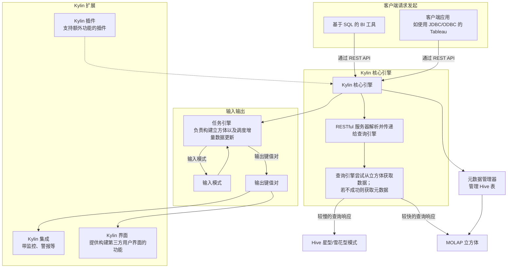
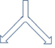

#### 第五章 Hadoop 生态系统

几年前的一个晚上，我乘坐火车回家，正在浏览新出的 Hadoop 工具。旁边的一位乘客偷偷瞄着我的笔记本电脑，不一会儿，他的好奇心被彻底勾了起来。“你是做什么工作的？”他问道。我说我是一名架构师，专注于大数据和仓库领域。“大数据！”他惊呼道。“对我来说听起来像黑魔法。”这是几年前常见的看法，并且自那以后也没有太大改变。

当你开始使用 Hadoop 生态系统时，常常会感到困惑和不知所措，需要花时间了解和认识每一个重要（且流行）的组件。本章旨在通过提供关于重要组件和可供部署选择的供应商应用程序的简洁信息，来加速这一过程。

`Hadoop` 生态系统是数据处理技术这一新兴领域的最新成员，并将持续存在。就像 80 年代和 90 年代的 `UNIX` 一样，它正处于变革之中，新产品几乎每天都在涌现。要跟上新产品的步伐极其困难，但花点时间简要了解一下与 `Hadoop` 和 `NoSQL` 相关的各类新产品可能是值得的。这些产品在不久的将来可能会发生变化，但本章旨在让您对领先者及其提供的特性有良好的理解。

我所考虑的（`Hadoop` 产品的）类别是通用的，例如查询工具、分析工具、搜索工具、消息系统、数据库等。然而，所包含的工具则提供特定的功能。我也尽量专注于开源产品（少数有价格的商业产品例外），因为它们易于访问，便于进行实验和创新。如您所知，大数据完全是关于创新的。我还收录了一些处于孵化阶段（在 Apache）的产品，以及一些不太为人所知但很有用的产品。

我讨论了查询工具 `Shark`（现在是 `Spark SQL`）。您可以把 `Shark` 看作是使用 `Spark` 引擎（代替 `MapReduce`）的 `Hive`。`Kylin` 由 eBay 贡献，是一个出色的分析工具。它可以帮助您为存储在 `HDFS` 内的数据构建多维数据集。由于没有新的消息工具，我将简要讨论 `Kafka`，并出于同样的原因讨论 `Solr`/`Elastic` 搜索（作为搜索工具）。内存处理仍然主要由 `Spark` 主导，但 `Apache Flink` 是该领域的新玩家。`Flink` 是一个大规模数据处理引擎，提供内存数据流，因此对于数据密集型以及迭代型作业，处理速度极快。

© Bhushan Lakhe 2016

B. Lakhe, *Practical Hadoop Migration*, DOI 10.1007/978-1-4842-1287-5_5

##### 查询工具

*查询*工具是一个接口，允许您根据特定标准选择或过滤数据，从而提供数据的子集。在 `NoSQL` 世界中创建此类特定子集非常重要，因为 `NoSQL` 数据库系统（和 `Hadoop`）处理的是数据集，而非数据库和表。理解数据集的概念以及它们与传统关系数据库中存储的数据有何不同也非常重要。关于查询工具，需要记住的另一件重要事情是：它们没有自己的数据存储。一些查询工具（如 `Hive`）将元数据存储在仓库中，但不存储它们正在处理的数据。

在此之前，此类查询工具（尤其是支持 SQL 接口的）的选择非常有限。而且 `MapReduce` 性能是一个限制。现在，像 `Stinger`、`Impala`、`Presto` 和 `Shark`（`Spark SQL`）这样的下一代产品不使用 `MapReduce`，并声称延迟低。其中一些工具使用自己的分布式引擎进行查询处理（和执行），而 `Spark SQL` 使用 `Spark` 引擎。内存处理是 `Spark` 的一个关键优势，但其他内存解决方案也在涌现。

# NoSQL 解决方案与 SQL 查询性能

像 `VoltDB` 和 `SploutSQL` 这样的 `NoSQL` 解决方案可以为您的 `Hadoop` 数据提升性能。像 `Hive` 这样流行的查询工具，正通过 `Spark` 或 `Apache Tez`（由 `Hortonworks` 开发）等分布式框架进行性能革新，以减少延迟并提升表现。这种方法有哪些好处？它又如何帮助您？我将在稍后详细讨论，并从 `Spark SQL` 开始。

## Spark SQL

三年前，`Spark SQL` 的前身是加州大学伯克利分校的 `Shark`，它是作为性能中等的 `Hive` 的一种更快的 `SQL` 替代方案而开发的。`Shark` 有效地质疑了在通用数据处理引擎上进行查询处理低效的说法。

这是第一次在通用处理引擎（`Spark`）之上构建交互式 `SQL` 工具，并且表现得如此出色。在通用处理引擎之上拥有一个 `SQL` 引擎还带来了额外的好处，例如整合了批处理、流处理和机器学习等多种数据访问方法。

最近，`Shark` 的开发已经终止，并合并到了 `Spark SQL` 项目中。同时，`Hive on Spark`（[HIVE-7292](https://issues.apache.org/jira/browse/HIVE-7292)）也已被引入。现在，`Spark SQL` 将为现有的 `Shark` 用户提供 `Shark` 的所有功能（以及一些额外功能）。因此，`Spark SQL` 不仅提供了从 `Shark 0.9` 服务器的升级路径，还提供了与 `Spark` 程序集成等新功能。

尽管 `Spark SQL`（相比 `Hive`）有很多优势，但许多组织目前仍广泛使用 `Hive`。`Hive` 社区提出了一项[新倡议](https://issues.apache.org/jira/browse/HIVE-7292)，该倡议将为 `Hive` 添加 `Spark` 作为替代执行引擎（代替 `MapReduce`）。这将使他们更容易过渡到 `Spark`。该倡议被称为“Hive on Spark”，即 `HIVE-7292`。

图 5-1 总结了 `Hive`、`HIVE-7292` 和 `Spark SQL` 之间的架构差异。

`Spark SQL` | `HIVE-7292` | `Hive`
--- | --- | ---
SQL 接口 | Hive 接口 | Hive 接口
SPARK 引擎 | SPARK 引擎 | MapReduce 引擎
| | | 数据存储在 HDFS 中

*图 5-1. Spark SQL、Hive 和 HIVE-7292 之间的架构差异*

几年前，当 `Shark` 项目启动时，`Hive`（使用 `MapReduce`）是 `Hadoop` 唯一可用的 `SQL` 接口。`Hive` 将 `SQL` 编译成 `MapReduce` 任务，并支持多种格式。性能问题迫使人们使用需要刚性且冗长的 `ETL` 管道的专有企业数据仓库（`EDW`）来补充 `Hive`。巨大的性能差异质疑了通用数据处理引擎本身的查询处理能力，并引发了猜测：是否需要专门的运行时引擎（如 `EDW`）来保证性能？

`Shark` 有效地证明了性能缺陷（导致 `Hive` 变慢）是 `Hive` 架构固有的，可以通过使用 `Spark`（而不是 `MapReduce`）作为处理引擎来克服。此外，这种解决方案的扩展性与 `MapReduce` 一样好。一个强大的 `SQL` 查询引擎与通用数据处理引擎协同工作，有助于支持各种类型的数据访问，例如批处理、流处理或机器学习，并使高级模型更容易应用于数据。

开始时，`Shark` 通过使用 `Spark` 作为物理执行引擎（而不是 `MapReduce`）来实现性能提升（超过 `Hive`），同时仍然使用 `Hive` 代码库。`Shark` 开发团队意识到 `Hive` 代码库是一个巨大的负担，因为它难以维护和优化。此外，使用这个专为 `MapReduce` 设计的代码库几乎不可能实现性能优化和复杂的分析。随后，决定停止 `Shark` 的开发，并将资源重新用于开发 `Spark` 的新组件——`Spark SQL`。

当然，开发团队在设计 `Spark SQL` 时，积极运用了通过用户使用 `Shark` 所获得的知识和理解，从而产生了更强大的 `SQL` 接口，同时也保持了与 `Shark`/`Hive` 的兼容性。此外，`Spark SQL` 支持所有现有的 `Hive` 数据格式、用户自定义函数（`UDF`）以及 `Hive` 元存储。最后，随着 `Spark`（`1.1.0`）下一版本中将引入的功能，`Spark SQL` 的速度将比 `Shark` 快几乎一个数量级。因此，它将成为处理结构化或半结构化数据的绝佳资源，并支持从各种格式和来源（如 `JSON`、`Parquet`、`Hive` 或任何其他 `EDW`）摄取数据，以及使用复杂的编程 API 进行高级分析。`Spark SQL` 的长期目标是提供一个同时支持 `SQL` 和高级分析（机器学习、统计学等）的接口。

总结一下，以下是 `Spark SQL`（最新版本）的一些关键特性：

- **内存中数据处理：** `Spark SQL` 提供了明确将数据加载到内存中以加速查询处理的选项。此外，它使用一种高效的、压缩的、面向列的格式在内存中保存数据，有助于容纳更大的数据集。

- **容错性：** `Spark SQL` 既适用于短查询，也适用于长查询。由于它使用 `Spark` 引擎进行处理，因此可以从查询中途的故障中恢复。

- **数据源 API：** 提供用于加载和存储数据的单一接口。它提供了 `Apache Spark` 发行版中预打包的数据源，并提供了集成外部（自定义）数据源的接口。内置或预打包数据源的示例包括 `JSON`、`JDBC`、`Parquet`、`Hive`、`MySQL`、`PostgreSQL`、`HDFS` 和 `AWS S3`。（当前可用的）外部数据源包括 `CSV`、[Apache Avro](http://spark-packages.org/package/databricks/spark-avro)、`HBase`、`Cassandra`、`Elasticsearch` 和 `Amazon Redshift`。

- **Dataframes：** *dataframe* 是一个按命名列组织的分布式数据集。逻辑上，它类似于关系数据库中的表或 `R`/`Python` 中的 `Dataframe`。Dataframes 可以来自结构化数据文件、`Hive` 表、外部数据库或现有的弹性分布式数据集（`RDD`），后者是一个不可变的、分布式的记录集合，可以存储在内存或磁盘上。

- **Catalyst（基于规则和成本的优化器）：** Dataframes 向核心 `Spark` 引擎暴露了更多的应用语义，因此 `Spark` 可以使用 `Catalyst` 来优化查询。

- **Python API (PySpark)：** `Python` 在大数据领域被广泛使用，但由于语言的动态性更强，`Python` 程序的性能不如 `JVM`。使用新的 `DataFrame` API，`Python` 程序现在可以达到与 `JVM` 相同的性能，因为 `Catalyst` 优化器会将 `DataFrame` 操作编译成 `JVM` 字节码。

- **统计和数学函数：** `Spark SQL` 支持多种函数，例如随机数据生成、摘要和描述性统计、样本协方差和相关性、交叉表（又称列联表），以及像 `cos`、`sin`、`floor`、`ceil` 这样的数学函数。

图 5-2 展示了 `Spark` 生态系统以及 `Spark SQL` 在其中的位置。

`Spark SQL` | **用户接口** | **流处理** | **数据源 API** | `PySpark` API | `Dataframes` | **数学与统计函数** | **MLlib** | **GraphX** | `Catalyst` 优化器 | **Spark R**
--- | --- | --- | --- | --- | --- | --- | --- | --- | --- | ---
| | | | | | | | | | **Spark 核心引擎** |

*图 5-2. Spark 生态系统*

## Presto

`Presto` 是由 `Facebook` 开发并开源给 `Apache` 社区使用的分布式 `SQL` 查询引擎。它针对交互式查询（包括复杂的分析查询）进行了优化。您可以使用标准的 `ANSI SQL` 语法，包括聚合、连接和窗口函数。

`Presto`不使用 MapReduce 作为底层执行模型。例如，Hive 将查询转换为一系列按预定顺序单独执行的 MapReduce 任务。每个任务从磁盘读取数据，并将中间输出结果写回磁盘。相比之下，`Presto`引擎使用支持 SQL 语义的自定义查询和执行引擎。由于所有处理都在内存中进行，并且各阶段之间通过网络进行流水线式传输，因此避免了不必要的 I/O（以及相关的延迟）。这种流水线执行模型并行运行各个阶段，并在一阶段数据可用时立即将其传递给下一阶段。这有助于减少多种查询类型的延迟。

图 5-3 展示了 `Presto` 的系统架构。客户端发起查询并将 SQL 发送至 `Presto 协调器`进程。协调器负责对输入的查询进行解析、分析和规划执行。调度器负责协调执行流水线，根据节点的网络邻近度（优先选用离数据最近的节点）分配工作，并监控进度。


## 协调组件

`Presto 协调器` 处理

检索并处理数据

`元数据 API`

发起查询

`Presto 工作节点`

解析器 / 规划器

转换

`流 API`

`Presto 客户端`

分析器

调度器

转换

`流 API`

`Presto 存储驱动`

`数据位置 API`

转换

`流 API`

数据存储 (HBase、HDFS 等)

向客户端输出转换后的数据

数据源

***图 5-3.** Presto 架构*

调度器还负责生成工作线程（根据需要）。这些工作线程访问存储（使用相应的存储驱动）并检索数据。然后，客户端从输出阶段拉取整合并处理后的数据，而输出阶段则从底层中间阶段拉取数据。如前所述，所有这些处理都在内存中进行，因此能够加快整个查询处理的速度。

## 分析工具

分析工具是指那些扫描大部分（或全部）数据并执行处理，从而从中提取信息或知识的工具。广义上，这些工具可分为两类。第一类是执行聚合操作的工具（这些聚合操作与数据仓库查询执行的聚合非常相似）。其中一些工具支持 SQL，另一些则不支持。我将在此子类别中讨论一个有趣的产品（Apache Kylin）。

我的第二类包括提供执行自定义算法处理能力的工具，包括预测性和规范性分析。传统上，这些是通过使用 HBase 或 Cassandra 配合 HDFS 存储来完成的。Spark 是该领域的最新成员，具有更好的性能，但其他有趣的工具也提供此功能。

一些 NoSQL 数据库不提供聚合支持（例如 Cassandra、HBase）。在数据摄入时预计算聚合结果并将其存储起来（以供后续使用）是一种替代方案。

最后，还有一些产品不属于任何单一类别。例如，Druid（用于聚合的 NoSQL 分析引擎）可以像 Storm 一样实时摄入数据。Druid 将聚合结果存储在内存中（跨集群）以实现更快的访问。

### Apache Kylin

Apache Kylin 是由 eBay 开发的开源分布式分析工具。Kylin 提供 SQL 接口以及在 Hadoop 上执行多维分析（OLAP）的能力，并支持超大数据集。为了增强这些性能，Kylin 预先构建了 MOLAP 立方体。此外，它具有分布式架构，可以受益于 MapReduce（或任何其他处理分布式数据的框架），并且还提供了高并发性。除了 SQL 接口，Kylin 还能很好地与其他 BI 工具（如 Spotfire、Tableau 或 MicroStrategy）配合使用。

以下是 Kylin 的主要特性：

# Apache Kylin 特性概述

- **可扩展且快速的 OLAP 引擎：** `Kylin` 能够降低对超大数据集的查询延迟。这归功于其预构建立方体及计算的架构。

- **支持 `ANSI SQL` 与交互式查询：** 由于我们长期使用 SQL，`Kylin` 对大多数 `ANSI SQL` 查询函数的支持是一项实用特性，可加速开发流程。交互式查询通过预构建的立方体提供灵活性与速度。

- **MOLAP 立方体：** 利用文件存储和预构建计算，为 MOLAP（多维立方体）提供了速度。此外，传统 MOLAP 的弱点（立方体内数据包含限制）在 `Kylin` 中不复存在。例如，用户可轻松在 `Kylin` 中为超过 100 亿条原始数据记录预构建一个立方体。

- **`BI` 工具集成：** 与 `BI` 工具的集成对于执行高级分析和生成报告至关重要。`Kylin` 可与 `Tableau`、`Spotfire`、`Microstrategy` 等商业智能工具及许多第三方应用程序进行交互。

- **开源 `ODBC` 驱动程序：** `Kylin` 的 `ODBC` 驱动程序专为按需访问数据源而开发，并已与报表编写应用程序 `Tableau` 进行了充分测试。该驱动程序已向 `Apache` 社区开源，便于用户根据特定用途进行定制。

- **简单高效的管理：** 以下特性提供了易用性和管理便利性：

  - 作业管理与监控

  - 压缩与编码以减少存储需求

  - 立方体的增量数据刷新（允许仅处理变更数据，减少处理时间）

  - 用于管理、构建、监控和查询立方体的 Web 界面

- **性能提升：** 以下特性提供了额外的性能增强：

  - `Kylin` 利用 `HBase` 协处理器提升查询性能。对于简单的加法或聚合操作（如 `sum`、`count` 或 `like`），将计算下推到 region 服务器或主服务器（可直接在数据上工作，无网络流量开销），可显著提升性能。

  - `Kylin` 使用 `HyperLogLog` 算法来确定查询中的去重计数。该算法近似计算数据集中不同元素的数量，显著减少内存消耗，并允许使用超大数据集。

- **灵活细粒度的安全机制：** `Kylin` 允许在立方体或项目粒度级别设置 `ACL`（访问控制列表），并支持集成 `LDAP`。这有助于轻松与企业安全体系集成。

- **容错性：** `Kylin` 在系统层和数据层均支持容错：

  - **数据容错：** `Kylin` 中的立方体可被划分为多个段，其优势在于可以刷新（或重建）单个段而不影响整个立方体。因此，您可以按需制定每日、每周或每月构建段的策略。检测到的任何数据错误或所需更改均可应用于粒度最小的段，从而实现有效的容错，无需重建整个立方体。无法由最小粒度处理的数据变更，则需要在更高层级重建（例如，一周后发现的数据问题需要重建每周的段）。因此，您需要在数据容错和查询性能之间取得平衡。更高的段粒度能提供更高的数据错误/变更容忍度，但也会导致每次查询扫描更多数据。重要的是，当立方体的某些段正在重建时，该立方体仍可继续使用。

  - **系统容错：** `Kylin` 继承了 `HDFS` 和 `HBase` 提供的系统冗余和容错能力。此外，您可以安全地重试任何失败的构建步骤而不会产生任何负面影响。这确保了构建最终版本的完整性和正确性，无论中间发生多少次失败或重试。

## 第 5 章：Hadoop 生态系统

我在前几节讨论了 `Spark SQL` 和 `Presto`。目前已有多种 `SQL-on-Hadoop` 工具可用。那么为什么要使用 `Kylin` 呢？因为大多数这些工具需要部分或完全扫描数据集来回答你的查询。不仅如此，查询中的任何连接操作都可能触发跨节点的数据传输，并且根据网络流量延迟，你收到的响应可能并不理想。

相比之下，`Kylin` 会预先计算所有维度的聚合结果，并将结果值存储在数据立方体中。构建立方体的过程非常全面，考虑了所有可能的维度组合，从而确保对更多查询的覆盖。此外，`Kylin` 会生成预连接的 `HiveQL`（基于元数据），用于将事实表与维度表连接起来。预连接和预聚合的结果存储在 `HBase` 中。因此，大多数查询由 MOLAP（多维 OLAP）立方体提供服务，速度非常快。无法使用立方体的查询会被路由到保存元数据的 `Hive` 表，从而以 ROLAP（基于星型或雪花型模式的关联 OLAP）的方式执行。本质上，`Kylin` 提供了 HOLAP（混合 OLAP）架构。

`Kylin` 的下一个版本计划用 `Spark SQL` 取代 `Hive`（以获得更高的速度和内存处理能力），采用 Lambda 架构（提供近实时结果）、内存分析（提升性能）和容量管理。此外，还计划使用 Spark 引擎。

图 5-4 中的流程图总结了 `Kylin` 内部的立方体构建过程。

1. 为维度表构建字典
2. 执行 `Hive` 查询
3. 执行 `MapReduce` 任务以将事实表与维度表连接并复制到 `HDFS`
4. 构建扁平表
5. 构建 cuboid（作为 `HDFS` 序列文件）包含所有可能的维度组合的聚合结果并关联事实表
6. 计算 `HDFS` 序列文件的键分布
7. 将 `HDFS` 序列文件转换为 `HBase HFile`
8. 将 `HFile` 加载到 `HBase` 并均匀拆分键

**图 5-4.** *`Kylin` 立方体构建过程*

最后，让我用一个全面的 `Kylin` 架构图来总结这一讨论。图 5-5 显示了 `Kylin` 引擎的主要组件：`REST` 服务器、查询引擎、元数据管理器和任务引擎。



**图 5-5.** *`Kylin` 架构*

`REST` 服务器与客户端查询交互，并将查询传递给查询引擎。如果查询结果可以通过立方体数据计算得出，则结果几乎立即返回；但如果无法（从立方体数据中）计算，则会使用较慢的路径，即使用 `Hive` 模式。你可以根据需要为 `Kylin` 核心引擎添加扩展或接口。

### 内存处理工具

在过去几年中，基于内存的处理主要由 `Spark` 和 `Storm` 主导。尽管这两者都是功能极其强大且实用的产品，但 `Apache Flink` 具备一些功能，使其相对于这些经过验证的成熟产品具有明显优势。

#### Flink

`Flink` 是一个大规模数据处理引擎，提供内存数据流处理，因此对于数据密集型以及迭代型任务来说，处理速度极快。`Flink` 与 `Spark` 有何不同？嗯，`Spark` 主要是一个批处理框架，可以近似模拟流处理。`Flink` 主要是一个流处理框架，同时也能执行批处理。`Spark` 并非纯粹的流处理引擎，实际上它是对输入数据的较小部分执行快速批量操作，也就是“微批处理”。

对于大多数应用来说，这可能不是问题，但对于金融或实时系统（需要低延迟的情况），每一毫秒都至关重要，即使微小的性能问题也可能导致严重的经济损失。

你还可以将 `Flink` 视为 `Hadoop MapReduce` 的替代品，它支持批处理和流模式，并使用有向图（而非映射和归约任务），从而利用内存处理获得更好的性能。

`Flink` 拥有出色的优化引擎。`Flink` 优化器会分析（提交到集群的）输入代码，并根据其判断，为在特定环境（可能因集群硬件和节点数量而异）下执行该代码决定最佳管道。

在性能方面，迭代处理会在同一节点上执行（而非让集群独立运行每次迭代）。使用优化器提示，还可以仅对数据集中可能已发生变化的部分执行增量迭代。

`Flink` 可以与 `YARN` 协同工作，并且可以直接在其执行引擎上运行现有的 `MapReduce` 任务，为已经使用 `MapReduce` 的组织提供了轻松的升级路径。

最后，`Flink` 可以与 `Apache Tez` 配合使用（仅用于批处理），在一定程度上为了可扩展性而牺牲性能。

在内存管理方面，`Flink` 在 `JVM` 内部（`DataFlow` 引擎的 `JVM` 中）实现了自己的内存管理，从而帮助应用轻松扩展，并减少 `JVM` 垃圾回收开销的影响。这（几乎）也消除了 `Spark` 集群上常见的内存使用异常（或峰值）。你可以通过内置的 HTML 查看器，将 `Flink` 为你的任务构建的管道导出为 `JSON` 表示，从而使调试变得容易。

对于流处理应用而言，容错性是一个重要的考量因素，`Flink` 的容错机制基于 `Chandy-Lamport` 分布式快照。该算法使得分布式系统中的进程能够确定计算过程中的全局状态，并可用于检查点。该机制仅使用少量系统资源（从而保持高吞吐率），同时提供有保证的一致性水平。

许多使用 Hadoop 的组织正在选择实时流处理架构，以取代现有的批处理架构。静态的 HDFS 文件正在被事件流所补充，批量工作负载正被流处理器取代，以提供更低延迟的应用。这种转变的主要原因是，构成 Hadoop 集群大部分工作负载的数据集和用例都是基于事件的（例如，事件或审计日志）。另一个原因是，现在的流处理技术已经足够成熟，可以处理更复杂的需求。

最后，还有一些应用（如处理传感器数据）需要连续查询，这只能由流处理架构来支持。

通常，流处理架构由以下模块组成：

- 收集和整合事件流

- 集中收集、保存流并分发它们

- 分析流并创建衍生流

第一步通常使用 `Flume` 或 `Sqoop` 等应用完成，但很大程度上取决于数据源。输入事件可能包含来自（关系型/NoSQL）数据库的数据、机器生成的日志或传感器数据。这些数据需要被清洗和整合。

像 `Kafka` 这样的应用可用于执行第二步。`Kafka` 可以收集事件流和日志，并对它们进行缓冲。`Kafka` 在保存和分发流的同时，还提供了容错能力（这在此场景中是必要的）。

最后一步涉及对流进行分析。这可能包括创建计数器、聚合它们、合并流，或创建派生数据流以供进一步使用。`Apache Flink` 可以（并且确实被）用于实施这一步。

## Flink 架构

请记住，`Flink` 只是一个用于分布式数据分析的框架。在核心层面，`Flink` 拥有一个流式迭代数据流引擎。`Flink` 在核心引擎之上使用了两个主要的 API（用于处理批处理数据的 `DataSet API` 和用于处理事件流的 `DataStream API`），以提供同样轻松处理不同类型数据的通用功能。`Flink` 日益增长的流行度催生了基于这两个主要 API 构建的领域特定库和 API 的开发。

目前，可用的库包括：机器学习库、图分析库 (`Gelly`) 以及一个类似 SQL 的 API (`Table`)。此外，还有其他在 `Flink` 之上运行的项目，例如 `Google Cloud Dataflow` 和 `Apache MRQL`。最后，`Flink` 核心引擎可以与各种数据处理框架（如 `YARN`/`Apache Tez`）协同工作，可以作为独立的 `Flink` 集群运行，也可以嵌入到其他应用中。图 5-6 总结了该架构。



### 图 5-6. Flink 架构

```
编程客户端 -> 访问 Flink 库
           |
           V
上层项目 (Google Dataflow, MRQL)
           |
           V
库 (Hadoop M/R, Gelly, Table, FlinkML)
           |
           V
用于批处理 -> Dataset API
用于事件流处理 -> DataStream API
           |
           V
Flink 数据流引擎
           |
           V
数据处理框架 (YARN, Tez, Flink 集群)
```

## 搜索与消息传递工具

搜索工具提供索引和搜索（主要是）文本数据的能力。因此，它们仅适用于某些类型的数据。出于显而易见的原因，这些（用于 `Hadoop` 的）搜索工具不如关系数据库的搜索工具那样灵活或广泛，但它们确实占有一席之地。由于许多 `NoSQL` 数据库缺乏必要的二级索引能力，这些产品有时被用来增强它们。用于 `Hadoop` 的 `Solr` 和 `Elastic Search` 是该类别中的热门产品，两者都使用 `Lucene` 作为底层索引引擎。

消息传递系统以源-目标和发布-订阅模式传递消息。通常，这些系统运行在像 `Flink` 或 `Spark Streaming` 这样的实时流处理器之上。`Kafka` 是一种流行的消息传递系统（在上一节中简要讨论过），它还允许你对消息进行随机访问。

### 总结

如果你在过去五年中使用过 `Hadoop`，你可能已经注意到 `Hadoop` 世界处于不断变化的状态，新的应用几乎每天都在增加（或消失）。几乎不可能跟踪所有的新项目，因此，为你的大数据需求选择完美同步的组件是一项艰巨的任务。当你最终确定时，新的组件就会出现，它们可能更适合你的需求！

在本章中，我试图提供一个关于当前可用产品类别和新产品的整体视图，希望这能为你提供一个良好的概述和起点。然而，你在选择必须满足业务需求的组件时，仍然需要进行自己的研究和尽职调查。请记住，如果一个新组件（刚刚进入市场）更适合你的需求，但会使你的项目截止日期推迟一个月，那么如果它能让你在竞争中占据优势或大幅提高流程效率，这应该是可以接受的。

你还需要明白，选择这些组件中的任何一个都涉及复杂的工程权衡，你需要选择涉及最少权衡（且收益最大）的选项。你的首要目标应作为一个良好的起点（用于选择主要组件），并应尝试围绕它构建一个系统。

本章也作为从关系技术向大数据世界过渡的桥梁。后续章节将讨论实施大数据解决方案的设计概念，因此本章讨论的 `Hadoop` 产品类别将有助于理解这些概念。

