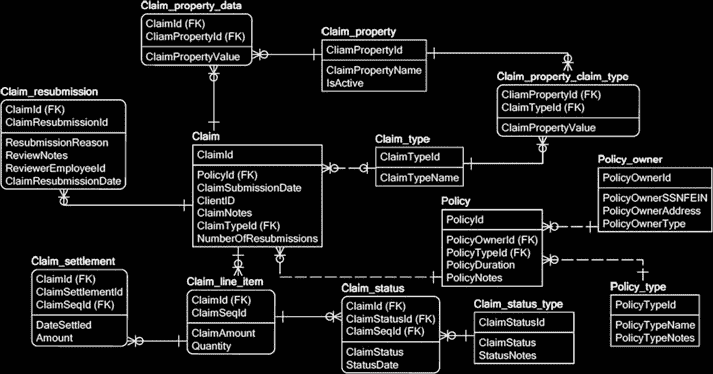

# 第 10 章：计算集群规模

第 10 章讨论了如何计算（用于生产环境的）集群规模。这里我将从工作节点配置和节点总数开始。节点上的操作系统和其他基本应用程序需要一些空间（本例中约为总空间的 2%，因为 2 TB 的 2% 是 40 GB——这对于操作系统和软件来说足够了。尽管我提供了为操作系统和软件预留存储空间的一般指南和百分比，您还需要考虑磁盘驱动器的大小以及大致需要多少空间），并且数据块会根据复制因子（默认为 3）进行复制。

考虑：

`每节点 HDFS 空间 = (每节点原始磁盘空间 – 2% 非 DFS 本地存储) / (复制因子)`

从以下启动（独立）工作节点配置开始：

- 最新一代处理器，共 12 核
- 每核心 4 GB 内存
- 每核心 2 TB SATA 磁盘
- 1GbE 网卡

`每节点 HDFS 空间 = (2 TB – 2% 非 DFS 本地存储) / 3`

`每节点 HDFS 空间` 为 653 GB：

`工作节点数 = 总 HDFS 空间 / 每节点 HDFS 空间`

`工作节点数 = 60 TB / 653 GB = 92`。

对于名称节点：

- 共 6 核
- 4 GB 内存（3 GB + 每 100 TB 原始磁盘空间额外 1 GB）
- 需要复制（用于故障切换）
- RAID-1 存储
- 名称节点应在 64 位操作系统上运行，以避免 JVM 堆大小的 3 GB 限制

对于 YARN，您可以使用 4 GB 内存和 4 核 CPU 作为资源管理器的初始配置。如果资源使用率达到上限，请相应调整资源分配。总结一下，您需要一个包含 92 个数据节点、一个名称节点（采用故障切换配置的两个节点）以及一个用于 YARN 资源管理器的节点的 95 节点集群。

您可以根据第 10 章提供的指南计算开发环境的规模。为了获得良好性能，可以在数据节点上使用提供 7,200 RPM 的 SSHD（固态混合硬盘）存储或提供 10,000 RPM 的 SATA III 驱动器。

最后，网络邻近性或属于同一子网将有助于减少节点间的网络流量并提供良好性能。

## 第 11 章：案例研究：实现 Lambda 架构

## 软件

一个基于浏览器的应用程序允许 Yourtown 的客户输入理赔。理赔数据使用 VoltDB 存储，并每小时推送到 HDFS/Hive。批处理层视图基于这些数据构建。因此，批处理层使用 HDFS/Hive。对于服务层，我将使用一个名为 Splout SQL 的只读数据库。更多关于 Splout SQL 的信息请参见第 9 章。对于速度层，我将使用 Spark（以及 Spark SQL）。

## 数据库设计

理赔系统有大量包含众多列的表，用于捕获所有细节。然而，这些数据大部分并非欺诈检测所需。同时，我也不想过分简化使用大量参数进行预测的预测建模过程。因此，我将使用一些参数来演示欺诈检测的概念，但请注意，这是一个复杂的过程，需要的信息远比我在此能提供的要多。

你可能还记得第 3 章中用作示例的逻辑模型（图 3-5）。

由于该模型相当通用，我在此将其作为示例重现。

就我们而言，我们可以使用以下表（存储在 HDFS 中的主数据）来构建批处理视图：

- `Claim`（理赔）
- `Claim_status_type`（理赔状态类型）
- `Policy`（保单）
- `Policy_owner`（保单持有人）
- `Claim_line_item`（理赔明细项）
- `Claim_status`（理赔状态）
- `Claim_type`（理赔类型）
- `Policy_type`（保单类型）

此外，我们可以假设 `Policy_owner`（保单持有人）实体具有附加列 `PolicyOwnerDOB`（保单持有人出生日期）和 `PolicyStartDate`（保单起始日期），而 `Claim`（理赔）实体具有附加列 `ClaimWeatherCond`（理赔提交时的天气状况）。一个附加实体 `PO_Drv_Hist`（保单持有人驾驶历史）保存保单持有人的驾驶历史详情，并具有图 11-1 所示的属性。

- `PolicyOwnerId (FK)`（保单持有人 ID，外键）
- `ViolationNum`（违章编号）
- `ViolationSeverity`（违章严重程度）
- `ViolationDate`（违章日期）
- `ViolationDetails`（违章详情）

***图 11-1.** `PO_Drv_Hist` 实体*

`PolicyOwner`（保单持有人）和 `PO_Drv_Hist` 实体之间存在 *一对多* 关系（从设计中可以看出）。一个保单持有人可能有一个或多个违章。如果没有违章，则在 `PO_Drv_Hist` 实体中将不会有该 `PolicyOwner`（保单持有人）的记录。

如您所见，主数据是规范化的形式，但 Lambda 架构允许您保持主数据的规范化。但是，您可以为了批处理（及后续）层而对数据进行反规范化。

## 考虑基于事实的模型

让我们考虑为这些数据应用一个基于事实的模型。如第 9 章所述，一个处于第三范式且在其适当数据表中包含时间戳（用于保存历史）的数据模型可以构成一个基于事实的模型。

在这种情况下，所考虑的数据模型已经处于第三范式。那些会频繁添加记录的动态表（`Claim`（理赔）、`Claim_resubmission`（理赔重提交）、`Claim_settlement`（理赔结算）、`Claim_status`（理赔状态））已经包含了一个用于捕获日期/时间的列。对于 `Policy`（保单），我添加了 `PolicyStartDate`（保单起始日期）列来保存保单添加时的日期。保存应用程序元数据的静态表（`Claim_type`（理赔类型）、`Claim_status_type`（理赔状态类型）等）没有时间戳列（而对于基于事实的模型，它们应该具有）。

但是，您可以假设（对于此示例）静态数据不会改变，因此您可以对数据进行反规范化（利用现有的静态数据）并将其用于您的批处理层视图。换句话说，主数据可以被视为一个基于事实的模型。

## 用于判定欺诈的数据条件

讨论用于判定欺诈的数据条件将帮助您设计批处理层视图（因为您可以随后确定视图所需的数据）：

1.  如果客户在过去 12 个月内提交了超过 5 次理赔，则其下一次理赔存在欺诈可能性。
2.  晚上 10 点后提交理赔的时间表明存在欺诈可能性。
3.  诸如雪、雨、暴风雨、雪崩、龙卷风等天气状况表明存在欺诈可能性。
4.  过去 12 个月内至少有 2 次 1 级违章的青少年驾驶员可能会提交欺诈性理赔。
5.  过去 12 个月内至少有 3 次 1 级违章的驾驶员可能会提交欺诈性理赔。

保险公司（基于其预测模型）确定，满足条件 (1) 以及另外两个其他条件的理赔需要被放入*额外评估/调查*队列。同时，满足条件 2、3 以及条件 4 或 5 之一的理赔也需要被放入*额外评估/调查*队列。

所有其他理赔均无需任何额外限制即可快速处理，因为它们被视为真实的。

### 批处理层设计

首先，我们对数据进行反规范化。我将从 `Claim`（理赔）实体开始，如您所见，我包含了来自实体 `Claim_line_item`（理赔明细项）、`Claim_status`（理赔状态）、`Claim_status_type`（理赔状态类型）和 `Claim_type`（理赔类型）的列。此外，我只包含了需要的列。这将用于与理赔相关的批处理视图。

下一步，我将对 `Policy`（保单）实体进行反规范化，并包含来自实体 `Policy_owner`（保单持有人）和 `Policy_type`（保单类型）的列。这将用于与保单相关的批处理视图。

请注意，我为两个视图都添加了 `LastModified`（最后修改时间）属性（因为它们没有用于时间变化的属性）。反规范化的实体如图 11-2 所示。

- `ClaimId`（理赔 ID）
- `PolicyId`（保单 ID）
- `ClaimSeqId`（理赔序列 ID）
- `PolicyOwnerId`（保单持有人 ID）
- `PolicyId (FK)`（保单 ID，外键）
- `PolicyOwnerDOB`（保单持有人出生日期）

