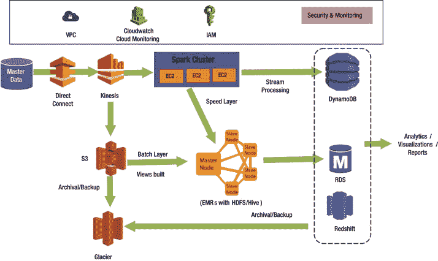

# 第 11 章 ■ 案例研究：实现 Lambda 架构

第 [9 章](http://dx.doi.org/10.1007/978-1-4842-1287-5_9) 详细讨论了 Spark 与 Hadoop 对接的所有操作细节。在此，我将简要讨论如何使用 Spark SQL 从 Hive 获取数据（到 DataFrames）以及针对 Spark 中的 Hive 表执行 DML（数据操作语言——更新、插入或删除命令）语句。

如您所知，Spark 使用 DataFrames 和 RDD（弹性分布式数据集）作为内存结构，您可以利用它们进行查询和性能优化。Spark 还允许您使用 `sqlContext` 针对 Hive 数据库执行查询。首先，您需要构造一个 `HiveContext`，它继承自 `SQLContext`，并允许您在 Hive MetaStore 中查找表，还支持使用 HiveQL 执行查询。此处，我使用 Scala，而 `sc` 是一个现有的 `SparkContext`（您可以在 Spark shell 中使用 Python 或 R）：
```scala
val sqlContext = new org.apache.spark.sql.hive.HiveContext(sc)
```
```scala
val sqlContext.sql("Create table MaxTable as select ViewName, max(CreatedAt) from BatchProcHist group by ViewName having ViewName = 'ClaimDefView'")
```
```scala
val sqlContext.sql("Insert into MaxTable select ViewName, max(CreatedAt) from BatchProcHist group by ViewName having ViewName = 'ClaimDefView_S'")
```
您可以类似地执行所有必要的 HiveQL 命令来创建速度层视图 `ClaimDefView_S`。在最后一步（视图创建后），无需创建视图，您可以直接执行 `select` 语句并将结果读取到 DataFrames 中，如下所示：
```scala
val resultsDF = sqlContext.sql("Select P.PolicyOwnerID, P.PolicyId,
C.Claimcount from PolicyMaster P, ClaimDeftemp12 C where P.PolicyId =
C.PolicyId;")
```
您可以将生成的 DataFrames 注册为临时表，然后对其执行任意查询：
```scala
val resultsDF.registerTempTable("ClaimDefView_S")

val results = sqlContext.sql("SELECT PolicyOwnerId FROM ClaimDefView_S")
```
您需要使用一个能够从 Hive 和 Spark 读取数据的查询工具来合并批处理层和速度层视图的结果。有足够多的选择，当然您也可以将 Spark SQL 本身用作查询工具。

## 存储结构（用于主数据和视图）

第 [10 章](http://dx.doi.org/10.1007/978-1-4842-1287-5_10) 讨论了如何选择最佳文件格式。在本节中，我将应用第 [9 章](http://dx.doi.org/10.1007/978-1-4842-1287-5_9) 讨论的概念。因此，让我简要考虑选择正确格式的几个参数：
*   查询类型（您计划执行的）是首要且最重要的因素。正如您从批处理视图中所见，构建主数据的查询涉及从较大的列集中选择一小部分列，并带有少量过滤条件。此外，构建批处理层视图需要多种聚合操作。
*   您所需的压缩量。对于一个 30 TB（且每月增长 1%）的数据集，压缩是必要的。
*   确保您的 NoSQL 解决方案支持您计划使用的存储格式。
现在，您可能会从第 [9 章](http://dx.doi.org/10.1007/978-1-4842-1287-5_9) 回忆起列式格式提供良好的压缩，并且更适合需要聚合操作（如 `count`、`avg`、`min`、`max`）的数据。此外，对于涉及选择一小部分列以及使用少量列作为过滤条件（在 `where` 子句中）的用例，列式格式提供了良好的性能。
因此，您将从使用列式格式存储数据中受益。接下来的决定是选择哪种列式格式。流行的格式包括 RCFile、ORCFile 和 Parquet。
RCFile 格式是第一个引入的列式格式，并且在 Hadoop 生态系统内（几乎所有 Hadoop 工具都支持它）以及 Hadoop 外部的工具中得到最广泛的支持。与 Parquet 和 ORCFiles 相比，RCFile 缺乏许多高级功能，例如支持存储更复杂的数据类型或提供加密。但是，对于当前示例，不需要支持复杂数据类型，也不需要加密。因此，可以使用 RCFile 格式。
如果您发现性能问题，请切换到 Parquet，它提供更好的压缩，并在压缩和速度之间取得平衡。此外，Parquet 在 Hadoop 以及外部（Hadoop 生态系统）工具中都得到了广泛支持。
您应该使用一个先进的分布式处理框架（如 YARN 或 Spark）来帮助您加速处理这些数据并提供最佳性能（因为数据量相当大）。

### 其他性能考虑

对于此示例，我并未考虑操作系统配置的调优，因为操作系统可用的选项数量很多。由于配置会发生变化（取决于您选择的操作系统或框架），我认为不可能提供更精细的细节。但是，您可以参考第 [9 章](http://dx.doi.org/10.1007/978-1-4842-1287-5_9) 中的 HDFS 和 YARN 调优指南。
若您计划使用 YARN，[第 10 章](http://dx.doi.org/10.1007/978-1-4842-1287-5_10) 是一个很好的起点。此外，如果您使用 Spark，除了[第 10 章](http://dx.doi.org/10.1007/978-1-4842-1287-5_10) 中的通用指南外，还有针对 JVM 调优的特定准则。
由于 Spark 可能会在内存中保存大量数据，因此它依赖于 Java 的内存管理和垃圾回收。因此，理解和调优 Java 的 GC 选项（和参数）可以帮助您为 Spark 应用程序获得最佳性能。GC 的一个常见问题是垃圾回收耗时过长，从而影响程序性能，有时甚至会导致崩溃。
Java 应用程序可以采用以下两种垃圾回收策略之一：
-   **并发标记清除垃圾回收**：此策略旨在降低延迟，因此不进行压缩（以节省时间）。它更适合实时应用程序。
-   **并行旧式垃圾回收**：此策略追求更高吞吐量，因此执行全堆压缩，这会导致较大的性能损失。它更适合异步或批处理（用于执行聚合、分析等操作的程序）。
JVM 1.6 版本引入了第三种垃圾回收选项，称为 Garbage-First GC（`G1 GC`）。`G1` 收集器旨在同时实现高吞吐量和低延迟，因此是一个不错的选择。
首先，请注意 Spark 如何使用 JVM。Spark 的执行器将 JVM 堆空间分为两部分。第一部分用于保存持久缓存到内存中的数据。第二部分用作 JVM 堆空间（用于在转换期间为 RDD 分配内存）。
您可以使用 `spark.storage.memoryFraction` 参数调整（这两部分的）比例。这让 Spark 能够控制缓存 RDD 的总大小（小于`(RDD 堆空间大小 * spark.storage.memoryFraction)`）。在进行有意义的 GC 分析时，您需要考虑这两部分的内存使用情况。
如果您观察到 GC 耗时更长，应首先检查 Spark 应用程序的内存空间使用情况。如果您的应用程序为 RDD 使用较少的内存空间，那么它将为程序执行留下更多的堆空间，从而提高 GC 效率。如有必要，您可以通过清理不再使用的缓存 RDD 来提升性能。
最好使用新的 `G1` 收集器，因为它能更好地处理 Spark 应用程序中常见的堆大小增长问题。当然，无法为 GC 调优提供一个通用的策略。您需要理解（Spark 的）日志记录，并将其与内存管理的其他参数结合使用来进行调优。
索引是另一个我没有考虑到的方面，因为您环境中的索引将取决于查询类型及其频率。最后，出于两个原因，我使用了通用的存储解决方案（HDFS 与 Hive）。首先，Lambda 具有多层结构，需要通过使用广泛支持的组件来确保多个组件的兼容性。其次，您具体使用的 NoSQL 解决方案将取决于您的特定数据类型以及您打算用它做什么（在处理方面）。所以，我使用某个特定的 NoSQL 解决方案可能只对少数人有用。
我列出这些（我未考虑到的）方面，更多是作为提醒，以便您为自己的特定环境进行考量。

### 参考架构

在本章中，我讨论了使用 Lambda 架构为业务需求设计和实现基于 Hadoop 的解决方案的所有方面。我从硬件、软件开始，然后讨论了根据 Lambda 框架进行的设计。最后，我讨论了实现步骤。当然，生产级别的实现涉及许多额外组件，例如网络、监控、警报等，才能确保成功实施。因此，回顾一些完整的架构将有助于您了解基于 Hadoop 系统的生产实现涉及哪些内容。这些组件（当然）会根据供应商（例如，Microsoft、AWS、Hortonworks、Cloudera 等）而变化。例如，图 11-3 展示了一个使用 AWS 组件实现的 Lambda。您可以看到使用了 `Kinesis` 来获取流数据，并使用了 `Spark` 集群（使用 `EC2` 实现）来处理这些数据。批处理层通过 `EMR` 实现，这些 `EMR` 构成了一个由一个 `MasterNode` 和四个 `DataNode` 组成的 Hadoop 集群。速度层的视图可以通过 `DynamoDB` 交付，并与批处理层视图结合，提供给任何报表、仪表板（可视化）或分析解决方案。由于这是一个生产实现，您可以观察到使用相应的 AWS 组件来实施安全、监控和备份/归档。



图 11-3. 使用 AWS 组件的 Lambda 实现

类似架构也可以使用 Microsoft 组件或 Hortonworks/Cloudera 组件构建。

## 针对最新架构的实现变更

Kappa 架构、Fast Data 架构和 Butterfly 架构是当前最新或*未来状态*的架构。如果您必须使用这些架构来实现（我前面章节示例中的）系统，则需要进行一些更改。我不会讨论完整的重新实现，而只会关注架构的组件级变更。我将从 Kappa 架构开始。

### 使用 Kappa 架构重新实现

首先要注意的是应用 Kappa 架构替代 Lambda 架构的可能性。

请注意，只有当速度层和批处理层的预期输出相同时，Kappa 才能替代 Lambda。如果速度和批处理算法的预期输出不同，则批处理和速度层无法合并，必须使用 Lambda 架构。在我前面章节的示例中，速度层和批处理层的预期输出是相同的，因此可以使用 Kappa 架构。

简单回顾一下，Kappa 涉及使用一个流处理引擎（`Spark`、`Kafka` 等），它允许您保留可能需要重新处理的数据的完整日志。如果需要重新处理，请启动流处理作业的第二个实例，该实例将从保留数据的开头开始处理，并将输出写入新的目的地（例如，表或文件）。当第二个作业完成处理后，将应用程序切换为从新的输出目的地读取数据。之后，您可以停止旧版本的作业并删除旧的输出目的地。

### Kappa 架构实现

你可以在前文讨论的示例中应用 Kappa 架构。首先，它只有一个层——流处理层。可以创建文件流来从主数据文件中读取数据，并创建相应的 `DStreams`。`Spark Streaming` 可以对这些 `DStreams` 应用转换和聚合函数，并将其保存在内存中或输出为文件（到 `HDFS`）。对于新数据的处理，`Spark Streaming` 会监控数据目录，并处理该目录中创建的任何新文件。由于新的主数据是作为新的 Hive 分区添加的（以我的示例为例），可以将这些文件从暂存位置复制到 Spark 数据目录。新文件将作为新的 `DStreams` 被流式处理，并与保存历史数据的 `DStreams` 进行连接，然后对结果 `DStreams` 应用相同的转换和聚合函数，从而获得最新的数据集（与你通过合并批处理层视图和速度层视图得到的结果相同）。最终生成的 `DStream` 可以根据需要以 `dataframe` 或 Hive 表的形式提供给客户端应用程序。

如果转换函数发生变化，或发现数据或处理问题，可以启动一个新的 `Spark Streaming` 作业，对从主数据创建的新 `DStream` 重新应用转换，完成后，即可使用新的目标地址来服务客户端应用程序。图 11-4 展示了架构细节。

图 11-4. 应用于 Lambda 案例研究的 Kappa 架构

### 快速数据架构的变化

你可能需要实现快速数据架构。*快速数据* 指的是由移动设备、社交媒体网络、传感器等（几乎）持续生成的数据，数据管道会在毫秒内处理这些新数据并对其进行分析。

以我的示例为例，这意味着需要将实时捕获的新数据流与历史数据流进行连接，并对其应用转换和聚合函数。

图 11-4 中定义的 Kappa 架构基本适用，但需要做一些修改。需要修改的部分是新数据的处理方式。不再是在数据目录中查找新文件，而是增加一个类似 `Kafka` 的机制来捕获多个数据流，并在将其传递给 `Spark Streaming` 作为流处理引擎的新 `DStream` 之前进行合并。然后，新的 `DStream` 将与历史的 `DStream` 进行连接，并对其应用转换/聚合函数。

### 蝴蝶架构的变化

蝴蝶架构在第 9 章中结合一个真实示例进行了详细讨论。由于硬件与软件的协同作用（软件有效驱动硬件资源），它提供了巨大的性能优势。如果你打算使用蝴蝶架构来实现本章讨论的示例，你需要遵循以下步骤：

-   通过来自 `Kafka` 代理的事件（插入操作）摄取输入数据流
-   解析事件，确定数据属于哪个速度层视图
-   更新相应的速度层视图
-   跟踪总更新次数
-   当 1% 的记录是新的（针对某个速度层视图）时，触发批处理计算，更新批处理视图，并重置更新计数器

### 总结