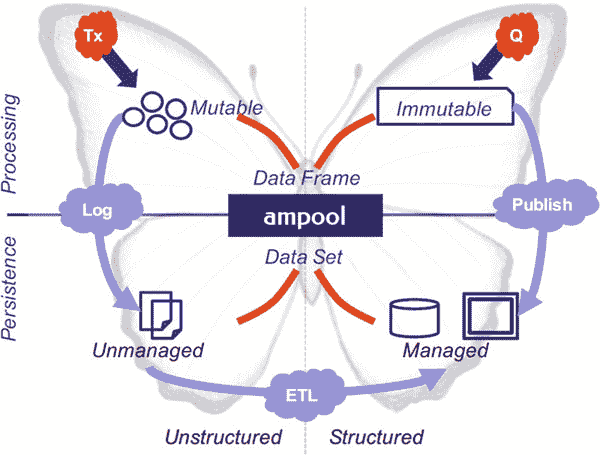
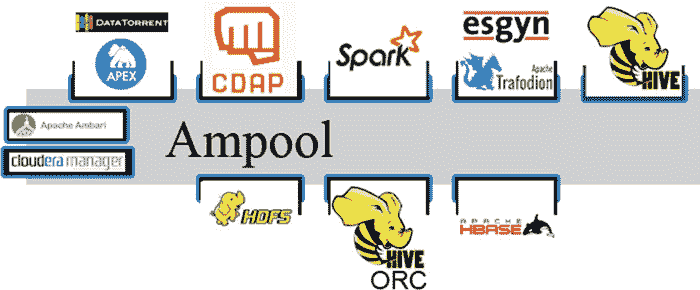

## 第九章：用于实时 Hadoop 应用的 Lambda 架构

不久前，我在 IBM 全球服务部门面试一个数据库管理员职位的候选人。

我问候选人，他们在客户现场作为数据库管理员应该执行的最重要任务是什么。我期望的答案是生产环境备份，而六名候选人中只有一人回答正确。一个简单的任务，却被大多数人忽视了。奇怪的是，正是缺乏一个明确定义的数据备份流程，最终导致了 Nathan Marz 提出了大数据领域最受关注的架构之一。根据他自己的承认（在他的著作《大数据：可扩展实时数据系统的原则与最佳实践》（Manning 出版社，2015 年）中），Nathan 在进行日常维护工作之前忽略了备份数据，并且由于维护涉及删除数据，意外删除了一些重要数据，导致项目进度倒退了数周。这段经历显然塑造了他关于系统应该如何架构的看法。这让他意识到，新的架构不仅应该能够容忍机器故障，还应该能够容忍人为错误。

Lambda 架构（由 Nathan 设计）专注于不可变数据和批量计算，而非增量计算。Lambda 的基本前提是，增量计算和更新会增加处理的复杂性，从而影响性能。通过避免（或至少减少）增量更新，可以简化架构并使其更高效。数据不可变性通过构建一个批量层（不修改主数据集）来提供，该层满足用户查询和数据需求。还有一个服务层，用于提高数据分发的效率。

最后一个层（速度层）是唯一执行增量计算的层，用于获取在批量层计算之后数据的最新修改。这样，涉及增量计算的数据量就很小，整体性能影响也最小。查询响应是使用组合数据集（来自批量层和速度层的数据的并集）来计算的。

© Bhushan Lakhe 2016

B. Lakhe, 《Practical Hadoop Migration》, DOI 10.1007/978-1-4842-1287-5_9

你可以看到，这种架构简化了许多任务。添加新功能很容易，因为它可能只涉及添加处理逻辑（查询）或最多添加新的视图（对批量层的增强）。从人为错误中恢复很容易实现，因为你可以根据需要从批量层或速度层重建视图。性能优化也可以很容易地实现，只需根据需要调整批量层或对视图进行索引。最后，这种架构足够通用，可以应用于任何数据处理环境。

# Lambda 架构

这只是对 Lambda 架构的简要介绍，但你可以看到这种架构对于使用 NoSQL 数据库设计实时或近实时系统是多么有用。将 Hadoop 众所周知的好处（容错性、分布式计算、低成本、高性能、可扩展性）添加到该解决方案中，你就可以使用这种架构来设计一个高效、经济且高性能的实时系统。

Lambda 架构具有以下目标：

- 处理过程应保持（基础）数据不变，并构建一个访问层（针对用户查询进行优化），以便于从人为错误中轻松恢复。
- 处理过程应异步执行，提前于（数据访问）时间，并以批处理模式进行。
- 增量计算应减少到最低限度（或尽可能消除）。

现在，让我们详细讨论 Lambda 架构的各个层次，以及如何使用它构建一个良好的实时系统。

## 定义和使用 Lambda 层次

在上一节中，我讨论了 Lambda 架构的起源和理念。我还简要提到了 Lambda 的层次或组件及其用途。在本节中，我将详细讨论这些内容，并解释如何在实际场景中实现它们。

这些层次是逻辑上的，或者说是在概念层面上的。在实现它们时，你需要使用的 NoSQL 数据库是物理存在的，并且在单独使用时有其自身的缺陷。了解它们的优势（和劣势）对于你的实现是有益的。例如，像 `Cassandra` 这样的列式数据库可以提供高吞吐量，但其数据模型非常有限（与 RDBMS 相比）。因此，在将你的关系型模式适配到它时需要做一些工作。我将在[第 8 章](http://dx.doi.org/10.1007/978-1-4842-1287-5_8)中讨论这种转换，正如你所看到的，要成功转换，需要完成几个任务。

另外需要注意的是，任何 NoSQL 数据库单独使用时，其关联的数据集具有可变性。然而，当这些 NoSQL 数据库作为 Lambda 架构的一部分使用时，整个解决方案很容易克服可变性问题，并且对人为错误具有容错性。让我们来看看这是如何实现的。我将从第一层——批处理层开始。

## 批处理层

在处理海量数据集时，延迟是一个常见的问题。像 `MapReduce` 或 `YARN` 这样的分布式处理机制可能会尝试将其最小化，但考虑到这些海量数据集用于分析以及所涉及的复杂处理，总处理时间在大多数情况下是不可接受的。因此，要么需要将处理划分为更小的单元（这并不总是可能的），要么限制可能的用户查询范围。Lambda 架构试图通过基于预期的查询对数据（称为*主数据*）进行预计算来改善这种情况。该技术涉及构建视图（并为其建立索引），这些视图可能支持大多数用户查询或对数据的读取访问。由于这些视图是从大型数据集计算得出的，因此构建需要时间，所以此操作是异步执行的，或者以*批处理模式*执行。这些预先计算的视图构成了 Lambda 架构的*批处理层*或第一层。

我将讨论如何使用主数据构建这些视图，但首先，我将讨论设计和创建主数据集（你需要用于批处理层的数据集）。

### 设计你的主数据

考虑到所有可能的情况，你可能需要重新架构（或迁移）现有的基于 RDBMS 的应用程序到 NoSQL（如果需要近实时查询），或者你可能正在设计一个全新的基于 NoSQL 的系统，并需要近实时查询。需要遵循的步骤是相似的，并且从[第 2 章](http://dx.doi.org/10.1007/978-1-4842-1287-5_2)和[第 3 章](http://dx.doi.org/10.1007/978-1-4842-1287-5_3)中讨论的逻辑模型开始。

# 为 NoSQL 构建逻辑数据模型或许看似奇怪

为 NoSQL 实现构建逻辑数据模型或许看似奇怪，但如[第 3 章](http://dx.doi.org/10.1007/978-1-4842-1287-5_3)所述，有几个令人信服的理由。主要原因之一是缺乏针对 NoSQL 建模的建模工具和技术。另一个原因是，分析业务流程并建立数据（由该流程生成）捕获模型的过程几乎保持不变。发生变化的是模型的最终表示形式以及存储方式。Nathan Marz 提出了一种基于“事实”的模型来保存主数据集。

## 基于事实的模型

首先，让我们将数据定义为无法从任何其他信息中推导出的信息。对于基于事实的模型，数据被解构为称为事实的基本单位。事实数据是不可变的，或者说不可更新。因此，对数据的任何更新都会导致添加新的数据行（或单位），并通过时间戳加以区分。这是为了确保信息（或传统意义上的历史记录）不会丢失。数据不可变性有两个重要优势：

- **人为容错性**：对于可变数据模型，任何错误或不当的数据修改都可能永久覆盖正确数据且无法恢复。而对于不可变模型，不良数据可以直接删除，不会产生任何负面影响。
- **简洁性**：可变数据模型需要对数据进行索引以便快速检索和更新。对于不可变数据模型，则不需要索引，因为只需将新数据附加到主数据集即可。这简化了主数据的存储。

那么，“事实”是如何从数据中生成的？又是如何使其不可变的呢？让我通过一个例子来讨论这个概念。`DataScourerNinjas.com` 拥有一个非常有趣的商业模式。它获取并跟踪数千家公司的信息，并将其出售给开发软件的公司。这些信息对于软件制造商针对其开发的特定软件定位这些公司非常有用。

图 9-1 展示了 `DataScourerNinjas` 收集的数据类型：

| 客户 | 业务类别 | 业务详情 | 年收入 | 去年利润 | IT 软件或供应商 | 帮助台软件或供应商 |
| --- | --- | --- | --- | --- | --- | --- |
| 丰田汽车 | 汽车 | 轿车、SUV、小型货车 | 700 亿美元 | 30 亿美元 | ADP | Zendesk |
| 埃森哲 | 咨询 | 管理与技术咨询 | 320 亿美元 | 30 亿美元 | 定制 | Salesforce |
| 通用电气 | 能源 | 配电、电动机 | 1480 亿美元 | 150 亿美元 | ADP | SAP – CRM |

图 9-1. 潜在的企业软件销售目标（可变信息）

考虑这样一种情况：其中一个条目“去年利润”（针对所有公司）以及另一家公司的所有条目都检测到数据问题。数据不可靠，需要重新收集（部分或全部）。或者，考虑一种场景，需要记录某家公司过去六个月的值（因为那是它“符合条件”供 `DataScourerNinjas` 跟踪信息的时间）。以下是这些情况下该数据存在的问题：

- 无法得知数据是在不同时间分批收集的。
- 无法得知过去的历史值是什么（因为部分数据被覆盖了）。

这是一个可变模式的例子。当数据发生变化时，它会覆盖现有数据。此外，由于部分数据可能比其他数据更动态（更频繁地变化），理想情况下应该能够分别维护所有部分数据的历史记录。这在可变模式下是不可能的。那么，如何解决上述设计问题呢？

Lambda 有一个可能的解决方案：基于事实的模式。如何将上述可变模式表示为不可变的基于事实的模式？请看图 9-2。

```json
{
  "company": "丰田汽车",
  "category": "汽车",
  "details": "轿车、SUV、小型货车",
  "revenue": "700 亿美元",
  "lastYearProfit": "30 亿美元",
  "itSoftwareOrVendor": "ADP",
  "helpDeskSoftwareOrVendor": "Zendesk"
}
```

# 第 9 章 - 面向实时 Hadoop 应用的 Lambda 架构

## `CorpBusDetails`（企业业务详情）

| **企业** | **时间戳** | **类别** | **详细信息** |
| --------------- | ------------- | ------------ | ----------- |
| 丰田汽车 | 2015 年 8 月 1 日 09:30:13 | 汽车 | 轿车、SUV、小型货车 |
| 埃森哲 | 2015 年 9 月 2 日 10:00:23 | 咨询 | 管理与技术咨询 |
| 通用电气 | 2015 年 9 月 13 日 10:05:11 | 能源 | 电力分配、电动机 |

## `CorpITDetails`（企业 IT 详情）

| **企业** | **IT 人员规模** | **时间戳** |
| --------------- | --------------- | ------------- |
| 丰田汽车 | 10,000 | 2015 年 8 月 1 日 09:30:13 |
| 埃森哲 | （缺失） | 2015 年 9 月 2 日 10:00:23 |
| 通用电气 | 10,000 | 2015 年 9 月 13 日 10:05:11 |

## `CorpCustSupDetails`（企业客服详情）

| **客服支持** | **企业** | **男性员工** | **时间戳** |
| ---------------- | --------------- | --------- | ------------- |
| 丰田汽车 | （未知规模？） | 2015 年 8 月 1 日 09:30:13 |
| 埃森哲 | （未知？） | 2015 年 9 月 2 日 10:00:23 |
| 通用电气 | （未知？） | 2015 年 9 月 13 日 10:05:11 |

## `CorpHelpDeskDetails`（企业服务台详情）

| **服务台软件或供应商** | **企业** | **时间戳** |
| ------------------------------- | --------------- | ------------- |
| Zendesk | 丰田汽车 | 2015 年 8 月 1 日 09:30:13 |
| Salesforce | 埃森哲 | 2015 年 9 月 2 日 10:00:23 |
| SAP CRM | 通用电气 | 2015 年 9 月 13 日 10:05:11 |

## `CorpFinDetails`（企业财务详情）

| **企业** | **去年利润** | **年收入** | **时间戳** |
| --------------- | -------------------- | ------------------ | ------------- |
| 丰田汽车 | 40 亿美元 | 700 亿美元 | 2015 年 1 月 1 日 00:00:01 |
| 埃森哲 | 30 亿美元 | 320 亿美元 | 2015 年 1 月 1 日 00:00:01 |
| 通用电气 | 150 亿美元 | 1480 亿美元 | 2015 年 1 月 1 日 00:00:01 |
| 丰田汽车 | 30 亿美元 | 500 亿美元 | 2014 年 1 月 1 日 00:00:01 |
| 埃森哲 | 20 亿美元 | 220 亿美元 | 2014 年 1 月 1 日 00:00:01 |
| 通用电气 | 100 亿美元 | 1380 亿美元 | 2014 年 1 月 1 日 00:00:01 |

## `CorpPayrollDetails`（企业薪资详情）

| **薪资软件或供应商** | **企业** | **时间戳** |
| ----------------------------- | --------------- | ------------- |
| ADP | 丰田汽车 | 2015 年 8 月 1 日 09:30:13 |
| 定制系统 | 埃森哲 | 2015 年 9 月 2 日 10:00:23 |
| ADP | 通用电气 | 2015 年 9 月 13 日 10:05:11 |

*图 9-2. 基于事实的不可变模式*

这个想法其实非常简单。首先，将可以（彼此）独立变化的“事实”分离开来，然后（分别）对其进行追踪。考虑一下刚刚给出的例子。对于一家企业来说，如果出现某个引发大量客户反应的问题，客服支持的力度可能会暂时增强。但这可能并不会影响他们使用的薪资软件或 IT 人员规模。因此，将这些事实分离并分别维护独立的历史记录非常重要。那么，如何实现不可变性呢？每当数值发生变化时，就会添加一行新记录，同时附上时间戳（对应于数值变化发生时的日期/时间）。这些数值可能在不同时间点发生变化，但总有办法可以知道每次变化的发生时间。

你可能会注意到，`Corporation`（企业）这一列出现在了所有数据集中。原因在于它被用作一个标识符，用以（跨不同事实）唯一地标识数据。在这个案例中，它标识了数据所代表的企业。然而，它并非唯一的标识符，因为新添加的记录只有时间戳不同。因此，唯一的标识符将是`Corporation`（企业）*与*`Timestamp`（时间戳）的组合。让我们看看如何利用这个模型来支持我作为示例的信息追踪系统中的事实，图 9-3。

## 信息追踪系统

- **埃森哲**使用`Salesforce`作为服务台软件
- **通用电气**拥有`IT 人员规模`为 10,000
  *(截至 2015 年 9 月 2 日 10:00:23)*
  *(截至 2015 年 9 月 13 日 10:05:11)*

事实是原子的，因此不能再被分解为有意义的组成部分。

事实带有时间戳以保证其不可变性，并且是永恒成立的真理。

- **丰田汽车**使用`ADP`作为薪资供应商
- **丰田汽车**的`客服支持`规模为 2000
  *(截至 2015 年 8 月 1 日 09:30:13)*
  *(截至 2015 年 8 月 1 日 09:30:13)*

*图 9-3. 由不可变追踪系统模式表示的事实*

考虑这样一个事实：*截至 2015 年 9 月 2 日 10:00:23，埃森哲使用`Salesforce`作为服务台软件*。它是永恒成立的真理并且是不可变的——因为未来将会添加一条带有相应时间戳的新事实，而这条事实将保持原样（未修改）。

与关系型数据库不同，在关系型数据库中你需要操心底层关系、数据间的互联互通以及更新性能，而这里你可以持续添加数百万条事实——每条都带有时间戳，便于高效批量处理，无需担心任何更新问题。此外，由于不涉及增量处理，你也不必担心性能问题。下一节中，我将讨论这种基于事实的模型如何用于批量处理。

## 将基于事实的模型应用于关系型应用

尽管 Lambda 架构将`事实`定义为数据的基本单元，但在实际系统中，对于包含结构化数据的场景，一个事实可以是由特定列组构成的原子数据单元，并能通过唯一标识符（主键）来识别，因为非键列仅依赖于键列来实现标识。因此，用关系术语来说，一个`事实`可以是一个符合第三范式的关系表。（我确信 Nathan 在设计 Lambda 架构时并未设想这种解释，但看看它如何经过一些修改后应用于关系型系统，确实很有意思。）考虑一个简化的销售管理系统。零售商销售多种产品，并将销售记录录入表中，如图 9-4 所示。销售数据是反范式化的，并且其中的“事实”（本例中的产品、客户和位置元数据）是可变的。为什么这些数据是可变的？试想一种情况：客户 JCPenney 决定搬到另一个地点，或者零售商决定将商品“男式条纹棉质衬衫”存放在不同的仓库。首先，更新所有行中相应的元数据会很困难（且缓慢）。其次，更新后信息或历史记录会丢失，因为无法指定修改的日期/时间。

**客户**

| **销售 ID** | **销售日期** | **总销售额** | **产品** | **产品类型** | **产品位置** | **产品价格** | **客户名** | **地址** | **类型** |
| --- | --- | --- | --- | --- | --- | --- | --- | --- | --- |
| 8/1/2015 09:30:13 | $3,450 | 男式条纹棉质衬衫 | 男式棉质服装 | 1234 Lemont 路 达里恩 IL 60561 | $23 | JCPenney | 1 Oak St. 达里恩 IL 60561 | 企业客户 |
| 9/2/2015 10:00:23 | $7,740 | 男式牛仔短裤 | 男式牛仔服装（中号） | 1649 Halstead St. 芝加哥 IL 60604 | $18 | Kohls | 21 Maple St. 内珀维尔 IL | 企业客户 |

| 日期时间 | 总销售额 | 产品名称 | 产品类别 | 客户地址 | 产品价格 | 零售商 | 商家地址 | 客户类型 |
| :--- | :--- | :--- | :--- | :--- | :--- | :--- | :--- | :--- |
| 9/13/2015 10:05:11 | $9,966 | 女式纯棉裙（黑色） | 女式棉质服装 | 1234 Lemont 路 达里恩 IL 60561 | $33 | Kohls | 21 Maple St. 内珀维尔 IL | 企业客户 |
| 10/16/2015 11:29:16 | $3,120 | 灰色羊毛围巾 | 女式羊毛配饰 | 1234 Lemont 路 达里恩 IL 60561 | $10 | Old Navy | 54 Argyle St. 韦斯特蒙特 IL | 企业客户 |
| 10/13/2015 12:09:18 | $9,656 | 女式羊毛裙（波点） | 女式羊毛服装 | 1649 Halstead St. 芝加哥 IL 60604 | $34 | Old Navy | 54 Argyle St. 韦斯特蒙特 IL | 企业客户 |
| 10/20/2015 14:06:41 | $2,160 | 男式手套（黑色皮革） | 男式皮革配饰 | 1649 Halstead St. 芝加哥 IL 60604 | $20 | JCPenney | 1 Oak St. 达里恩 IL 60561 | 企业客户 |

*图 9-4. 反范式化的可变销售模式*

这些数据能否用基于事实的模型来表示（尤其是考虑到经过修改的事实定义）？

按照以下步骤将此模式转换为`不可变`的基于事实的模式：

- 提取原子逻辑分组
- 为每个分组添加时间戳

如图 9-5 所示，我为每个表都添加了标识符，销售表中不再包含任何元数据。元数据被移至单独的表中，但为了使其不可变，需要添加一个时间戳列。这样，每一行都将反映特定日期/时间的值，信息也不会丢失。不可变数据现在将如图 9-5 所示。

**销售**

| `销售 ID` | `销售日期` | `总销售额` | `产品 ID` | `客户 ID` | `位置 ID` |
| :--- | :--- | :--- | :--- | :--- | :--- |
| 8/1/2015 09:30:13 | $3,450 | | | | |
| 9/2/2015 10:00:23 | $7,740 | | | | |

**位置**

| `位置 ID` | `街道` | `城市` | `州` | `邮编` | `L 时间戳` |
| :--- | :--- | :--- | :--- | :--- | :--- |
| 1234 Lemont | 达里恩 | IL | | | 8/1/2015 |

```sql
SELECT
    s."销售 ID",
    s."销售日期",
    s."总销售额",
    s."产品 ID",
    p."产品名称",
    p."产品类别",
    s."客户 ID",
    c."客户名称",
    c."客户类型",
    s."位置 ID",
    l."街道",
    l."城市",
    l."州",
    l."邮编",
    s."零售商 ID",
    r."零售商名称",
    r."商家地址"
FROM "销售事实表" AS s
JOIN "产品维度表" AS p ON s."产品 ID" = p."产品 ID"
JOIN "客户维度表" AS c ON s."客户 ID" = c."客户 ID"
JOIN "位置维度表" AS l ON s."位置 ID" = l."位置 ID"
JOIN "零售商维度表" AS r ON s."零售商 ID" = r."零售商 ID";
```

# 路线

**09:30:13** | **9/1 3/2015 10:05:11** | **$9,966**

**芝加哥** | **伊利诺伊州** | **9/2 /2015**

**霍尔斯特德街** | **10:00:23** | **10/1 6/2015 11:29:16**

**$3,120** | **13666973 5** | **10/1 3/2015 12:09:18**

**$9,656** | **10/20/2015 14:06:41** | **$2,160**

## 产品

| **产品** | **位置** | **单价** | **产品名称** | **产品类别** | **产品时间戳** | **ID** |
|----------|----------|----------|-------------|--------------|----------------|--------|
| **ID** | **价格** | | | | | |
| 男士条纹 | 男士棉质 | $23 | 8/1/2015 09:30:13 | 棉质衬衫（大号） | 服装 | |
| 男士牛仔 | 男士牛仔布 | $18 | 9/2 /2015 10:00:23 | 短裤（中号） | 服装 | |
| 女士纯色 | 女士棉质 | $33 | 9/1 3/2015 10:05:11 | 棉质裙（黑色） | 服装 | |
| 灰色羊毛围巾 | 女士羊毛 | $10 | 10/1 6/2015 11:29:16 | 配饰 | | |
| 女士羊毛 | 女士羊毛 | $34 | 10/1 3/2015 12:09:18 | 裙子（波点） | 服装 | |
| 男士手套 | 男士皮革 | $20 | 10/20/2015 14:06:41 | （黑色皮革） | 配饰 | |

## 客户

| **客户** | **客户街道** | **客户名称** | **客户类型** | **客户城市** | **客户州** | **客户邮编** | **客户时间戳** |
|----------|-------------|--------------|--------------|--------------|------------|--------------|----------------|
| **ID** | **地址** | | | | | | |
| JCPenney | 企业 | 1 Oak St. | 达里恩 | 伊利诺伊州 | | 8/1/2015 09:30:13 | |
| Kohls | 企业 | 21 Maple St. | 内珀维尔 | 伊利诺伊州 | | 9/2 /2015 10:00:23 | |
| Old Navy | 企业 | 54 Argyle St. | 韦斯特蒙特 | 伊利诺伊州 | | 10/1 3/2015 12:09:18 | |

***图 9-5.** 销售模式的不可变版本*

另一个需要考虑的问题是数据的唯一性。由于数据行的任何更改都可能生成新行，因此唯一标识符（`ID`列，例如我定义的 `CustomerID`、`LocationID` 等）如果不辅以时间戳，将不会是唯一的。Lambda 建议为每个事实添加一个时间戳列，在我们的示例中，每个数据表标识一个事实。这种方法也能提供完整的变更历史，因为我们假设任何列值发生变化时都会新增一行。

这种模式的不可变性也使其变得*永恒正确*。实际上，任何数据行都提供了其包含信息在关联时间戳所指示日期/时间点的正确版本。接下来，我将演示如何使用此模型来支持我所举例的销售管理系统中的事实。

图 9-6 展示了销售管理系统中的事实示例，并演示了事实的两个重要属性：*原子性*和*永恒正确性*。

- **JCPenney** 是一个新客户（自 `8/1/2015 09:30:13` 起）
- 客户 **Old Navy** 购买了 312 条**灰色羊毛围巾**（自 `10/16/2015 11:29:16` 起）
- 事实是原子性的，因此不能再进一步划分为有意义的组成部分。

**销售管理系统**

事实带有时间戳以支持不可变性，并且是永恒正确的。

- 产品 **男士条纹棉质衬衫（大号）** 在位置 **1234 Lemont road, Darien, IL 60561** 有售（自 `8/1/2015 09:30:13` 起）
- 位置 **1649 Halstead St, Chicago, IL 60604** 可用（自 `9/2/2015 10:00:23` 起）

***图 9-6.** 由不可变销售模式表示的事实*

事实是*原子性*的，因为无法将它们进一步划分为有意义的组成部分。例如，JC Penney 是客户（因为它购买了商品）这个事实不能再细分，因为该事实的部分内容在销售管理系统的上下文中（甚至在其他任何情况下）都将失去意义。原子性的一个重要结果是不同事实之间的信息非冗余性。时间戳提供了时间上下文，因为一个事实在特定时间点成为真实（或开始存在），并且在之后*永恒正确*。这两个属性使得基于事实的模型对于你的数据集来说既简单又富有表现力。

最后，关于这个销售管理系统示例，需要注意的一个重要点是，它使用了复杂事实，而非 Lambda 架构建议的列式事实。*列式*事实（为维护列的历史变更而添加时间戳）可能适用于数据组件较少的系统，但在复杂的关系型应用中则无法实现。而我的重点是实现 Lambda 架构，以重构关系型系统或设计具有大量数据组件的复杂系统。

如果你熟悉数据仓库系统，你可能也会联想到维护属性或列历史记录的 `Type 2` 维度。总结来说，基于事实的模式提供了以下好处：

- **特定时间查询**：可以查询数据集中支持的任意特定时间点的历史值。例如，如果你需要了解 `Kohl's` 在 2015 年 9 月 1 日至 2015 年 10 月 30 日期间的总销售额，或截至 2015 年 9 月 15 日可用的产品，这些都能轻松实现并得到支持。
- **人为错误容忍度**：可以通过简单地移除或删除错误事实来实现。有效事实不受影响。
- **规范化和反规范化的优势**：这个关键优势源于 Lambda 架构的结构。基于事实的模型是规范化的，用于数据存储。数据更新通过插入具有最新时间戳的新行来处理。如你所知，规范化模型的查询性能不佳。因此，数据存储和查询处理层是分离的，查询由反规范化的视图支持，这些视图作为批处理层的一部分构建。这样，你就能同时拥有数据的规范化和反规范化形式，并受益于两者的优点。

设计好模式后，你可以使用第 8 章讨论的技术，将其调整为适合你环境的 NoSQL 解决方案，并用于数据存储。

基于事实的模型是一个概念性或逻辑模型，可以使用适当的 NoSQL 解决方案来实现。在下一节中，我将讨论为查询处理构建反规范化的批处理视图。

### 构建批处理视图

构建批处理视图的目的是提升用户访问（如查询、报表等）的性能。任何与庞大数据集（这通常是使用 NoSQL 的情况）的用户交互都需要大量资源，可能仍然性能不佳（缓慢），甚至可能因资源不足而失败。如果预先执行连接和聚合操作，并将结果存储为数据对象，那么使用这些数据对象（而非主数据集）的任何查询都可能表现更好。可以对预计算数据建立索引，以加速读取和随机查找（这是 `Hadoop` 和 NoSQL 不擅长的领域）。此概念非常类似于可以建立索引的 `RDBMS` *物化视图*。这些预计算视图或*批处理视图*构成了 Lambda 架构的批处理层。

### 为基于事实的模型设计批处理视图

在设计批处理视图时，你需要关注首要目标：任何需要对主数据集执行的查询，现在都应通过对（新设计的）批处理视图执行函数来完成，而不是对整个数据集进行操作。这样，已建立索引的批处理视图就能促进快速检索所需的值。你可以为数据集创建多个批处理视图，以涵盖应用程序所需的所有功能。

然而，创建的批处理视图越多，重建批处理层所需的时间就越长。因此，你必须维持一个平衡（在视图数量和可用处理时间之间），并确定一个最优的视图数量，以匹配你的处理能力、优先级（基于查询频率）和重建所需的处理时间。

需要注意的一个重要点是，如果你使用基于 `Hadoop` 的 NoSQL 解决方案（由于 `Hadoop` 的分布式特性），数据检索和处理的并行性总是有保证的。当然，使用 `HDFS` 存储你的主数据集和批处理视图还有其他好处。

# 构建批量视图

我将探讨如何为先前设计的基于事实模型的应用程序（信息跟踪系统和销售管理系统）构建批量视图。信息跟踪系统由`DataScourerNinjas`设计，供其潜在客户使用，这些客户是设计和销售具有特定功能（如薪资、客户关系管理等）的软件公司。

根据他们的经验，大多数软件公司寻找在过去五年中保持盈利且拥有大量客户支持团队（至少平均 1000 人）的潜在客户。有些公司则关注过去三年的短期盈利能力，但坚持与 IT 部门中大学毕业生占比高（至少 60%）的公司合作。此外，由于这些软件产品针对特定行业，聚焦于特定业务类别的公司至关重要。考虑到这些因素，他们设计了以下批量视图：
-   过去五年盈利的公司（包含列：`Corporation`，`Profit_last_year`）
-   过去五年平均客户支持团队规模达到 1000 人（或以上）的公司
-   过去三年 IT 部门中大学毕业生比例至少达到 60%（平均）的公司

设计批量视图时还需考虑其大小。在某些情况下，如果数据集非常庞大，批量视图也会变得巨大，您可能需要考虑进一步拆分它们。例如，考虑正在讨论的信息跟踪系统。假设出现巨大繁荣，导致数千家新公司成立，并且`DataScourerNinjas`成功获取了这些公司的数据。如果您按月创建批量视图，查询快速处理的数据量可能仍然很大，您可能希望重新设计批量层，改为按周甚至按天创建视图。这将增加（总）处理时间（因为您将按周或按天处理，而不是按月），但有助于提升性能并减少速度层的大小（以及处理量）。

## 实施批量视图

关于上一节设计的批量视图，有几点需要考虑。该视图可以轻松使用`HDFS`进行存储，并配合任何可用的 NoSQL 解决方案（如`HBase`、`Cassandra`或`MongoDB`）来实现。或者，您可以将数据保留在`HDFS`中，并使用`Hive`进行元数据管理，使用`MySQL`来保存元数据。`Nathan`建议您使用`Java`或任何其他您选择的语言来编写自己的函数和抽象层，因为使用现成的 NoSQL 解决方案会增加复杂性并可能影响性能。

我将使用`Hive`来演示（设计和构建批量视图的）概念，原因有几个。考虑到各种分布式引擎的不断涌现（至少在近期），编写`MapReduce`代码有其自身的局限性。此外，我并不期望所有使用本书的人都精通`Java`或`C#`编程。本章更多是关于理解 Lambda 架构的概念，而不是编写可直接用于生产环境的代码。

此外，为了追加垂直或基于时间的数据，`Nathan`开发了一个基于`Java`的应用程序，名为`Pail`。您可以将`Pail`视为`HDFS`的一个容器。`Thrift`（`Nathan`用于序列化的接口）模式会创建`Java`对象。这些`Thrift Java`对象通过实现`PailStructure`接口来进行序列化和反序列化，并且也有助于实现垂直分区。这些是使用`Java`编程的高级主题——因此，我倾向于采用一种更通用的方法（可能对更广泛的读者来说更容易理解），即使用`Hive`分区（按天、按周或按月，取决于您的应用需求）来追加新数据。我使用`Hive`分区来演示如何管理主数据集的新数据，并在创建的批量视图中进行处理的这一概念。

您可以假设 Web 界面使用基于内存的数据库解决方案（如`VoltDB`、`Apache Geode`或`Ampool`）来保存一天的数据，然后每晚将其传输到`HDFS`。因此，我将创建四个`Hive`表来保存该系统的主数据。这是实施前面讨论的批量视图所需的第一步。我还使用了时间戳来对表进行分区。

如果您需要执行事务或需要 ACID 支持，则需要在创建新表之前对`Hive`进行一些配置更改。您可能知道，从`0.14`版本开始，`Hive`支持`CRUD`（创建、读取、更新、删除）操作。要启用对`CRUD`操作的支持，请确保您的`hive-site.xml`文件配置了以下参数：
-   `hive.support.concurrency` – `true`
-   `hive.enforce.bucketing` – `true`
-   `hive.exec.dynamic.partition.mode` – `nonstrict`
-   `hive.txn.manager` – `org.apache.hadoop.hive.ql.lockmgr.DbTxnManager`
-   `hive.compactor.initiator.on` – `true`
-   `hive.compactor.worker.threads` – `1`

实施这些配置更改后，重启`Hive`。此外，在使用`ZooKeeper Hive`锁管理器时，必须运行`ZooKeeper`实例。

有关其他设置细节，请参阅以下链接：
-   `http://zookeeper.apache.org/doc/r3.1.2/recipes.html#sc_recipes_Locks`
-   `https://cwiki.apache.org/confluence/display/Hive/Hive+Transactions#HiveTransactions-LockManager`

请记住，仅对使用`ORC`文件格式存储的对象支持事务。最后，您需要在创建表时启用对 ACID 属性的支持，并指定分桶列或键列（顺便提一下，这些列不能被更新）。因此，您的`CREATE TABLE`语句需要包含以下构造：
```
clustered by <key column(s)> into <number of buckets> stored as orc TBLPROPERTIES ('transactional'='true')
```

我的示例未使用事务支持，因此以下是创建这些`Hive`表的代码：
```sql
CREATE TABLE CorpBusDetails(
    Corporation STRING,
    BusCategory STRING,
    BusDetails STRING
)
PARTITIONED BY (AsOf TIMESTAMP)
ROW FORMAT DELIMITED FIELDS TERMINATED BY "\;";

CREATE TABLE CorpCustSupDetails(
    Corporation STRING,
    CustSuppStrength INT,
    Males INT)
PARTITIONED BY (AsOf TIMESTAMP)
ROW FORMAT DELIMITED FIELDS TERMINATED BY "\;";

CREATE TABLE CorpITDetails(
    Corporation STRING,
    ITStrength INT,
    ColGrads INT)
PARTITIONED BY (AsOf TIMESTAMP)
ROW FORMAT DELIMITED FIELDS TERMINATED BY "\;";

CREATE TABLE CorpFinDetails(
    Corporation STRING,
    YrlyRevenue BIGINT,
    ProfLastYear BIGINT)
PARTITIONED BY (AsOf TIMESTAMP)
ROW FORMAT DELIMITED FIELDS TERMINATED BY "\;";
```

请注意，这些表以文件形式存储在`HDFS`中，而`Hive`仅保存元数据，以便更有效地管理数据修改（以及通过查询进行的数据操作）。那么，新数据如何每日添加呢？使用动态分区。

您需要为您的 Hive 安装启用动态分区并调整一些配置参数。详细信息请阅读 [`cwiki.apache.org/confluence/display/Hive/LanguageManual+DML#LanguageManualDML-DynamicPartitionInserts`](https://cwiki.apache.org/confluence/display/Hive/LanguageManual+DML#LanguageManualDML-DynamicPartitionInserts)。

## 数据追加与配置

任何新数据都可以通过创建一个临时表（指向包含新数据的文件）并向表中添加新分区来追加，如下所示：

### 批处理视图创建过程

```sql
CREATE EXTERNAL TABLE CorpBusDetails_stg(
Corporation STRING,
BusCategory STRING,
BusDetails STRING,
AsOf TIMESTAMP
) ROW FORMAT DELIMITED FIELDS TERMINATED BY "\;"
LOCATION "/TrackingInfo/CorpBusDetails/staging";

FROM CorpBusDetails_stg INSERT OVERWRITE TABLE CorpBusDetails PARTITION
(AsOf) SELECT Corporation,BusCategory,BusDetails,AsOf;
```

您会注意到，临时表多了一个列，并指向一个用于`CorpBusDetails`表的临时目录（存放新数据）。同样的原则可以应用于向`CorpCustSupDetails`和`CorpProfitDetails`表添加新数据。此外，将新数据文件复制到相应的临时目录、创建临时表以及向基表添加新分区的过程可以自动化和安排调度。

下一步是创建批处理视图。我首先会创建一个名为`BatchProcHist`的表，用于记录批处理视图的历史信息：

```sql
CREATE TABLE BatchProcHist(
ViewName STRING,
CreatedAt timestamp)
ROW FORMAT DELIMITED FIELDS TERMINATED BY "\;";
```

接下来，我将创建第一个视图：过去 5 年盈利的公司。最简单的判断方法是将过去五年的利润相加，并确保其和为正整数。以下是如何使用临时表快速计算的方法：

```sql
Create table Profitemp1 as Select ProfLastYear, AsOf, Corporation from
CorpProfitDetails where year(AsOf) <= year(from_unixtime(unix_timestamp())) and year(AsOf) >= (year(from_unixtime(unix_timestamp())) – 5)

Create table ProfLFiveView as select Corporation, sum(ProfLastYear) as
ProfLastFive from Profitemp1 group by Corporation having sum(ProfLastYear) > 0

INSERT INTO TABLE BatchProcHist
VALUES ('ProfLFiveView', from_unixtime(unix_timestamp()));
```

正如您所观察到的，在创建第一个批处理视图后，我还向`BatchProcHist`表写入了一条历史记录。

第二个视图涉及计算平均值（过去五年平均客户支持人员数量等于或超过 1000 的公司）。由于您需要在速度层计算最新的平均值，因此还需要存储用于计算该平均值的记录计数：

```sql
Create table CustSuptemp1 as Select CustSuppStrength, AsOf, Corporation from CorpCustSupDetails where year(AsOf) <= year(from_unixtime(unix_timestamp())) and year(AsOf) >= (year(from_unixtime(unix_timestamp())) – 5)

Create table AveCS1000View as select Corporation, sum(CustSuppStrength)
as TotalCustSup, count(CustSuppStrength) as CountCustSup,
(sum(CustSuppStrength) / count(CustSuppStrength)) as AveLastFive from
CustSuptemp1 group by Corporation having (AveLastFive >= 1000)

INSERT INTO TABLE BatchProcHist
VALUES ('AveCS1000View', from_unixtime(unix_timestamp()));
```

此时可以删除临时表（`Profitemp1`、`Profitemp2`和`CustSuptemp1`）。下次重新构建这些批处理视图时，它们会被重新创建。

您可以构建最后一个批处理视图（作为练习），并且可以根据需要支持的功能类似地构建其他视图。最后一步，需要创建二级索引以促进快速检索，但这在服务层完成。举个例子，针对设计的第一个批处理视图，以下二级索引将有助于提升性能：
- `Corporation`
- `ProfLastFive`, `Corporation`

请记住，创建二级索引会消耗处理时间和磁盘空间。因此，在设计这些索引并优化其使用时需要格外小心。此外，由于对视图进行索引是一个非常关键的步骤（从性能、磁盘空间和处理时间的角度来看），这需要由既熟悉您的数据又了解功能需求（分析和频繁执行的查询）的人员来执行。如果您的索引与查询不匹配，您将遇到性能问题，并且还会浪费宝贵的系统资源（和时间）来构建它们。

关于批处理视图，需要重点注意的一点是数据集的大小和可变性。如果您的数据集非常庞大或高度动态，生成的批处理视图可能会非常巨大，或者可能会丢失大量新数据，您可能需要以更小的批次进行处理。例如，考虑跟踪系统示例。假设市场突然繁荣，每周都有大量新公司加入到`DataScourerNinjas`的数据库中。如果您每月重新构建一次批处理视图，那么在此期间可能会添加大量不属于批处理视图的新数据（虽然可以通过速度层提供查询，但由于记录量更大，可能会降低速度层的效率和速度）。因此，您可能希望每周而不是每月重新构建批处理视图。这也有助于保持速度层的规模较小且易于管理。

对于庞大的数据集，您可能希望按周（而不是按月）拆分批处理视图，因为这将减少每次视图的处理资源和时间（因为您只需要处理一周的数据，而不是一个月），但可能会使您的检索策略复杂化（因为您需要确定要查询的正确视图，如果查询的时间跨度跨越多周，还可能需要查询多个视图）。

最后，您可能会对这种方法的明显疑问是关于创建此类批处理视图所需的时间或延迟。由于这些视图是从整个主数据集创建的，显然它们会消耗大量的系统资源，并且计算可能无法在可用的维护窗口内完成。即使可以完成，它们也可能不包含系统收集的所有数据，因为数据可能在视图计算期间（或之后）被添加，而您的查询结果可能已经过时数小时。`Lambda` 如何提供近实时的结果？答案在于 `Lambda` 的后续几层以及它们克服数据延迟问题的方式。

### 服务层

服务层“服务”批处理视图，或以最小延迟提供快速访问。因此，服务层需要是一个专门化的分布式数据库，能够托管批处理视图，并支持良好的随机和顺序数据访问性能。服务层还需要能够在批处理层重新构建批处理视图时快速地将旧版本替换为新版本，以便用户查询能够返回最新的结果。因此，它需要支持批量更新。

# 实时 Hadoop 应用的 Lambda 架构

## 服务层

这里需要记住的重点是，服务层替换的是由批处理层`重新构建`的新批处理视图，而非增量处理。`Lambda`架构在批处理层或服务层都不执行任何增量处理。增量处理存在若干问题。任何增量处理都涉及更新、插入和删除操作。所有这些操作都涉及随机写入，因为数据库需要管理存储空间。例如，如果某个键列被更新，该记录需要移动到不同的数据页，这将涉及从一个页面删除记录，并在另一个页面上插入记录。第一个操作会在页面上留下未使用的空间，而第二个操作则需要数据库服务器查找未使用的空间。只要有足够的空间可用，记录就会被随机插入（当然，会遵循某种插入算法）。

类似地，当记录被删除时，页面上就会释放出可用空间。因此，增量处理会产生零散的未使用空间，从而需要进行在线压缩以有效管理空间。这种处理会消耗宝贵的系统资源，而这些资源本可用于其他用途。增量处理增加的另一个复杂性是需要原子化写入，并且还要同步读写操作，以确保永远不会读取到半写入的值。这当然需要通过`隔离级别`和`ACID`事务来实现，并给处理增加了大量复杂性。因此，如果不需要增量处理，您的数据库服务器就不会承受管理`在线压缩`或满足`ACID`合规性的运维负担。

总结而言，服务层应具备以下特性：
- 能够托管批处理视图，优化延迟和吞吐量
- 无需支持随机写入，但需能以批处理更新的方式替换批处理视图
- 容错性（因为视图可以随时从批处理层快速重新部署）
- 健壮性、可预测性以及易于配置（和运维）
- 具备索引能力以支持快速检索

关于服务层，最后一点需要记住的是，并没有唯一的分布式数据库可供推荐或使用。在决定服务层之前，您需要考虑数据本身的特性，因为每种分布式（或`NoSQL`）数据库都有自己的优势，您需要确保它与您的数据匹配。

## ElephantDB

Nathan 建议使用`ElephantDB`；这是一个能从`Hadoop`提供或部署键值数据以实现快速高效访问的数据库。`ElephantDB`有两个主要组件：
- `MapReduce`作业用来创建索引化键值数据集（存储在分布式文件系统上）的库
- 能够提供已部署数据集的只读、随机访问子集的守护进程或后台进程

用于提供完整数据集的服务集群被称为一个`环`（`ring`）。`ElephantDB`服务器不支持随机写入，并使用`Thrift`接口，这使得大多数编程语言都能轻松地从中读取数据。

`ElephantDB`与`Hive`的集成并不容易，使用它需要高级编程知识。此外，在`ElephantDB`中使用索引也存在限制，并且它不提供用于查询的`SQL`接口。随后，我将使用`SploutSQL`作为服务层，因为`SploutSQL`不需要任何编程即可部署或服务`Hive`对象，并且还提供`SQL`作为查询语言，这简化了查询操作，并省去了学习新查询语言的时间。

## Splout SQL

`Splout SQL`是一个只读数据库，这简化了其架构。以下是其架构的显著特点：
- `Splout`可以安装在一组普通硬件机器上，形成一个集群。每台机器（或节点）运行一个`DNode`服务，并且可选地运行一个`QNode`服务（一个集群中至少必须有一个`QNode`服务）。
- `QNodes`通过`REST API`与用户交互，负责处理用户查询或接收部署请求。
- `QNodes`与适当的`DNode(s)`通信以处理查询，而`DNode(s)`则返回所需的数据集。
- `Splout`利用`Hadoop`集群对数据进行索引（以及通过预采样进行平衡），作为数据部署请求的一部分，`DNodes`会检索生成的结果文件。您可以在插入前对数据进行排序，以保证连续性并最大程度减少磁盘寻道。
- 数据根据需求进行分区，并分布到各个节点上。此外，查询仅限于单个分区，因此速度很快。
- 数据的生成和部署可以同时进行，互不影响。
- 通过使用`Hadoop`继承了高可用性和可扩展性。
- 数据被部署为`表空间`（`Tablespace`），这是一个具有共同分区模式的表集合。
- 为了方便管理，`Tablespaces`带有版本号，并且可以同时部署多个`Tablespaces`。
- `Splout`可以直接从`Hive`、Cascading 或`Pig`导入数据。
- `QNodes`和`DNodes`以`Java`服务的形式实现。
- `Splout`使用`Pangool`进行低级别的`Java Hadoop`开发，并生成供`DNodes`用于服务数据的`SQLite`文件。

图 9-7 总结了`Splout`的处理流程和接口。

```
客户端连接（查询），  
客户端连接  
部署或回滚请求  
`QNodes`的数量可  
`QNode`层用于根 根据用户流量  
据`REST API`与客  进行配置  
户端交互  

QNODE    QNODE    QNODE

`DNodes`的数量可  
根据数据量进行  
配置  

DNODE    DNODE    DNODE    DNODE

`DNode`层用于与  
`Splout Hadoop`集群  
交互并使用  
`Pangool Hadoop` API  
检索数据  

Splout Hadoop 集群  
来自`Hive`、`Cascading`或`Pig`的源数据
```

***图 9-7.** Splout SQL 处理流程与接口*

要使用`Splout SQL`，您需要先安装它。请参阅 [`sploutsql.com/gettingstarted.html`](http://sploutsql.com/gettingstarted.html) 上的说明。安装后，您需要配置`Splout`，并指定 jar 文件以及`Hadoop`安装的路径。之后，您可以在`Splout`集群节点上启动`QNode`和`DNode`服务。如果您要从`Hive`导入数据（如同我在示例中所做的那样），请将`Hive`的 conf/ 和 lib/ 文件夹添加到 `HADOOP_CLASSPATH`环境变量中：

```
export HADOOP_CLASSPATH=$HADOOP_CLASSPATH:$HIVE_HOME/conf:$HIVE_HOME/lib/*
```

接下来，创建表空间和表。在我示例中的信息跟踪系统中，我创建了一个批处理视图（作为一个`Hive`表）。我将讨论使用`Splout SQL`来服务或部署它的步骤。首先，要创建或生成一个表空间，您需要使用 generate 工具。该工具使用一个`JSON`格式的表空间描述符，如下所示。您需要指定输入类型以及`Hive`数据库和表名。请注意，您不需要指定输入路径，因为您已经指定了`Hive`的安装目录，因此`Splout`可以定位到相应的`Hive`元存储，并从正确的数据库中检索所需的`Hive`表。表空间描述符文件可以在`Splout SQL`的安装目录中创建：

```
{
    "name": "AveCS1000Space",
    "nPartitions": 1,
    "partitionedTables": [{
        "name": "AveCS1000View",
        "partitionFields": "Corporation",
        "tableInputs": [{
            "inputType": "HIVE",
            "hiveTableName": "AveCS1000View",
            "hiveDbName": "TrackInfo"
        }]
    }]
}
```

这些信息存储在文件 `AveCS1000Space.json` 中。该表空间将被命名为 `AveCS1000Space`，当前只定义了一个表 `AveCS1000View`——这是在上一节中创建的。数据库名为 `TrackInfo`，我选择为我的数据创建一个分区。我使用 `Corporation` 作为分区列，因为该列将出现在几乎所有的查询中。

正确分区表空间至关重要，因为它用于在索引和部署数据之前平衡数据。通常，表空间内表的常用键列会用作分区键。表空间内的所有表都需要使用相同类型的列作为分区键。例如，如果表空间 A 包含表 `Tbl1` 和 `Tbl2`，并且 `Tbl1` 是按一对 (`string`, `int`) 列分区的，那么 `Tbl2` 也应按一对 (`string`, `int`) 列分区。

请注意，当表按单个或多个列分区时，`Splout` 会将这些列的值拼接起来形成单个字符串。因此，分区是行的函数，也可以使用任意函数进行分区（例如，一个 JavaScript 函数，它提取字段的最后五个字符）。

## 回到部署

可以从命令行执行以下命令来生成表空间 `AveCS1000Space`（从 `Splout SQL` 安装目录执行）：

```markdown
# 使用 Hadoop 和 Splout 部署和查询数据

```
hadoop jar splout-*-hadoop.jar generate -tf file:///\`pwd\`/ AveCS1000Space.json -o out-TrackingInfo_splout_example
```

为了提升性能，你可能需要为表空间添加索引，`Splout` 允许你轻松地添加索引。你只需修改用于生成表空间的命令即可。例如，以下索引有助于提升性能：
`TotalCustSup`, `Corporation`

以下命令将在生成表空间 `AveCS1000Space` 的同时添加第二个索引：

```
hadoop jar splout-hadoop-*-hadoop.jar simple-generate –it HIVE –hdb TrackInfo –htn AveCS1000View -o out-TrackingInfo_splout_example -pby Corporation -p 1 -idx "TotalCustSup" -t AveCS1000View -tb AveCS1000Space
```

我没有包含列 `Corporation`，因为它是一个分区列，并且已经被索引了。`-idx` 选项只是向索引中添加更多列。另外，请注意我正在使用一个不同的生成器（`simple-generate`）而不是之前使用的那个（`generate`），因此命令行选项是不同的。没有 json 配置文件，因此所有配置（例如 Hive 数据库、表名、分区列等）都必须通过命令指定。

使用 `simple-generate` 而非 `generate` 的一个主要缺点是，你的表空间中只能有一个表，但这通常是常见情况。以追踪信息系统为例，如果你需要补充索引的话，则需要为四个批处理视图（或 Hive/Splout 表）生成四个独立的表空间。如果不需要，那么你可以简单地创建一个包含所有四个表的单一表空间（使用 `generate` 生成器而不是 `simple-generate`）。

成功生成表空间后，按如下方式部署它：

```
hadoop jar splout-hadoop-*-hadoop.jar deploy -q http://localhost:4412 -root out-TrackingInfo_splout_example -ts AveCS1000Space
```

请注意，`localhost` 是 QNode（客户端连接到的节点）运行的主机，`localhost` 将在运行时自动被替换为第一个有效的私有 IP 地址（按配置文件中的指定）。

一旦表空间部署完毕，你就可以在任何查询中使用它。例如，如果你需要使用丰田汽车公司的信息来填充一个网页应用，你可以像下面这样使用 REST API：

```
http://localhost:4412/api/query/ AveCS1000Space?sql=SELECT * FROM AveCS1000View;&key='Toyota Motors'
```

我已经演示了如何成功地使用 `Splout SQL` 来提供批处理视图，供你的应用程序使用。接下来，我将讨论如何访问尚未被批处理层处理的数据，并将其包含在你的查询结果中。

### 速度层

你已经看到，批处理层的延迟使得访问最新或近乎实时的数据变得困难。速度层的目的是使这些数据能够无延迟地可用。在功能方面，速度层与批处理层非常相似（因为它也基于主数据生成视图）。不同之处在于，速度层只处理新的或最近的数据（尚未被批处理层处理），而批处理层则使用所有数据来计算视图。

另一个区别是，批处理层通过重新计算（或重建）来更新视图，而速度层则对视图执行增量处理，并且只处理自上次增量处理之后发生的增量（或新）事务。因此，如果您的传入数据事务带有时间戳，并且您从主数据集中提取它们，那么根据记录是被修改还是新增，您可以相应地修改速度层视图。

考虑到速度层处理（与批处理层相比）的差异，您会意识到速度层的架构会根据速度层（或近乎实时）视图是同步更新还是异步更新而有所不同。

我所说的同步更新是指将主数据的任何更新直接应用到速度层视图。由于集群总是有固定或预设的容量（用于处理更新或任何其他数据密集型操作），因此在高峰使用期间，它可能会因请求而过载。这可能会影响性能和功能（如果某些请求由于资源不可用而被拒绝）。相比之下，异步更新请求被放入队列中，实际的更新在稍后时间发生。应用异步更新的延迟将取决于许多因素，例如更新量、所需的（和可用的）处理资源、对近乎实时数据的功能需求等，但它确实提供了一种有效的方式来容纳更多数量的请求，并且不受高峰使用峰值的影响。

异步更新提供了许多好处，例如处理来自队列的多个消息、提高吞吐量以及通过缓冲额外请求来处理变化的负载（直到负载减少且处理资源可用）。同步更新没有这些好处，因为没有可用的机制来控制更新量，因此它很容易使数据库系统过载和崩溃，或导致请求被丢弃、超时以及其他可能中断应用程序的错误。

使用同步还是异步更新的决定也可以基于应用程序执行的处理类型。例如，同步更新可用于需要用户交互的事务系统，这需要与用户界面协调，并且需要保证请求的完成。异步更新对于分析型应用或更侧重于复杂计算和聚合而非交互式用户输入的应用更为有用。考虑到异步处理的好处，我建议使用它，除非您有非常特殊的需求需要将实时数据整合到速度层视图中。

### 实现速度层所需特性

总而言之，在实现速度层时，您需要支持以下特性：

-   随机读写
-   支持广泛的数据类型，包括日期/时间
-   能够执行计划内或临时的更新
-   能够以可接受的性能水平支持连接和任何增量更新任务（更新、插入）
-   支持索引并提供 SQL 查询接口，以实现高性能和易用性
-   能够轻松地与 Hadoop 生态系统对接
-   提供可扩展性和容错性
-   能够提供内存处理以提高性能
```

# 面向实时 Hadoop 应用的 Lambda 架构

## 评估与选择

在仔细评估了各种选项后，我筛选出了 `Spark SQL` 和 `VoltDB`。然而，我很快意识到 `VoltDB` 无法从 Hive（或 HDFS）读取数据，因此将其排除。虽然在比较这两个选项时，我发现 `Spark SQL` 自身也存在一些缺陷，并且，尽管这些缺陷与我举例说明的场景关系不大，但在某些情况下可能至关重要。它们是：

- `Spark SQL` 不支持事务。
- `Spark SQL` 的 `DataFrame` 不支持索引。索引有助于提升随机读/写性能。
- `Spark SQL` 本身不含存储功能，因此你需要使用外部数据存储。

我在第 5 章的“[查询工具](http://dx.doi.org/10.1007/978-1-4842-1287-5_5)”一节以及“Spark SQL”小节中详细讨论了 `Spark SQL`。这有助于你理解 Spark 架构以及 `Spark SQL` 在其中所处的位置。

## 构建速度层

现在，让我演示如何将 `Spark SQL` 用作速度层。我已经演示了如何为跟踪信息系统构建批处理层和服务层。现在我将构建一个速度层。

Lambda 架构将速度层定义为由批处理层尚未处理的记录组成。因此，第一步需要确定哪些是尚未处理的记录。你或许还记得，在构建批处理视图后，会向 `BatchProcHist` 表中插入一条历史记录。因此，批处理视图的最新记录可以告诉我们最近一次构建的日期/时间，从而有助于确定哪些是未处理的记录。由于 Hive 不支持将查询结果赋值给变量，我将把第一个批处理视图的最新记录写入一个表：

```sql
Create table MaxTable as select ViewName, max(CreatedAt) as MaxDate from
BatchProcHist group by ViewName having ViewName = 'ProfLFiveView';
```

但是，如果在此批处理视图构建之后，速度层已经处理了主数据集中的任何新记录，会发生什么？嗯，你需要检查这一点，并仅考虑未处理的记录来更新视图（此视图现在是注册为表的 `Spark` `DataFrame`）。我将速度层视图称为 `ProfLFiveView_S`。与批处理视图类似，速度层视图也会写入审计表 `BatchProcHist`。因此，我将把第一个速度层视图的最新记录写入同一个表（即我之前捕获第一个批处理视图最新记录的表）：

```sql
Insert into MaxTable select ViewName, max(CreatedAt) from BatchProcHist
group by ViewName having ViewName = 'ProfLFiveView_S';
```

现在，我只需要确定这些记录中哪一条是最新的，并以此为基础来处理第一个速度层视图的记录：

```sql
Create table MaxTbl1 as select max(MaxDate) as MaxDate from MaxTable;
```

最后，从主数据集中获取未处理的记录，并创建速度层视图。同时，添加时间戳并向审计历史表中写入一条记录：

```sql
Create table Profitemp1_S as Select a.ProfLastYear, a.AsOf, a.Corporation
from CorpProfitDetails a, MaxTbl1 b where a.AsOf > b.MaxDate;

Create table ProfLFiveView_S as select Corporation, sum(ProfLastYear) as
ProfLastFive from Profitemp1 group by Corporation;

INSERT INTO TABLE BatchProcHist
VALUES ('ProfLFiveView_S', from_unixtime(unix_timestamp()));
```

此时可以删除临时表 `MaxTable`、`Profitemp1_S` 和 `MaxTbl1`。另请注意，在创建视图 `ProfLFiveView_S` 时，我并没有使用 `having sum(ProfLastYear) > 0` 这个条件。原因是这个总和仅针对过去五年盈利的公司的那些新记录。要获取最新的总和，需要将其与批处理层的总和相加，更新的利润将自动确定（新记录的总利润或亏损将由正数或负数来体现）。

假设速度层视图每周构建一次。那么，当你需要更新速度层视图以适应新数据并移除已属于批处理层视图一部分的数据时（如果批处理层视图在此期间被重建），会发生什么？

有两种可行的方法：

- 仅考虑未处理的记录来重建速度层视图（就像我们第一次构建的那样）。
- 在第一轮处理之后不要删除临时表 `Profitemp1_S`，而是从中删除已过期的记录（这些记录已是重建后的批处理视图的一部分）并添加新记录。然后，只需执行聚合操作并重建速度层视图 `ProfLFiveView_S`。

请记住，要执行删除操作，你需要更改 Hive 的 CRUD 支持配置，并为表 `Profitemp1_S` 启用事务支持（在批处理层视图部分已讨论过）。

我会根据速度层视图的大小来决定选择哪种方案。如果视图不算特别大并且可以快速重建，我会选择重建方案。然而，如果视图很大，需要大量的处理和时间来重建，我会启用事务支持，只需向临时表 `Profitemp1` 中添加新记录并移除已处理（由批处理层处理）的记录。可以使用相同的逻辑（如本节前面所述）来获取批处理和速度层视图的最新处理日期/时间，然后根据需要从主数据集中检索未处理的记录。在调整了 `Profitemp1` 表中的记录（删除过期记录并添加未处理记录）之后，即可执行聚合操作以构建更新后的视图。

另一个需要考虑的关键点是速度层处理对批处理层处理的依赖。至少，你需要过期或移除已被批处理层处理的速度层记录。当然，你也可以重建或向速度层视图中添加任何新记录。

## 为第二个批处理视图构建速度层

接下来，我将讨论为第二个批处理视图构建速度层视图。你可能还记得，这涉及计算平均值（过去五年平均客户支持人员数量等于或超过 1,000 的公司）。我将讨论如何为对应的速度层视图计算更新后的平均值。

作为第一步，我们获取视图 `AveCS1000View` 的最远处理时间（批处理层和速度层）：

```sql
Create table MaxTable as select ViewName, max(CreatedAt) from BatchProcHist group by ViewName having ViewName = 'AveCS1000View';

Insert into MaxTable select ViewName, max(CreatedAt) from BatchProcHist
group by ViewName having ViewName = 'AveCS1000View_S';
```

现在，我只需要确定这些记录中哪一条是最新的，并以此为基础来处理第一个速度层视图的记录：

```sql
Create table MaxTbl1 as select max(MaxDate) as MaxDate from MaxTable;
```

最后，从主数据集中获取未处理的记录，并创建速度层视图。同时，添加时间戳并向审计历史表中写入一条记录：

```sql
Create table CustSuptemp1_S as Select a.CustSuppStrength, a.AsOf,
a.Corporation from CorpCustSupDetails a, MaxTbl1 b where a.AsOf > b.MaxDate;

Create table CustSuptemp2_S as select Corporation, sum(CustSuppStrength) as TotalCustSup, count(CustSuppStrength) as CountCustSup from CustSuptemp1_S
group by Corporation;

Create table AveCS1000View_S as select a.Corporation, (a.TotalCustSup +
b.TotalCustSup) as TotalCustSup, (a.CountCustSup + b.CountCustSup) as
CountCustSup, ((a.TotalCustSup + b.TotalCustSup) / (a.CountCustSup +
b.CountCustSup)) as AveLastFive from CustSuptemp2_S a, AveCS1000View b where a.Corporation = b.Corporation and (AveLastFive >= 1000);

INSERT INTO TABLE BatchProcHist
VALUES ('AveCS1000View_S', from_unixtime(unix_timestamp()));
```

请注意，我不得不使用一个额外的临时表，以便能够为未处理的记录以及来自相应批处理视图的记录添加并计数 `CustSuppStrength` 数值——因为该视图计算的是平均值。

在讨论了开发速度层的所有这些逻辑之后，让我转向使用 Spark 的接口和速度层的实现。如你所知，Spark 使用数据框和 RDD（弹性分布式数据集）作为内存结构，你可以利用它们进行查询和性能优化。Spark 还允许你使用 `SQLContext` 对 Hive 数据库执行查询。这两个概念对于速度层的实现都很有用。你可以在 Spark shell 中使用 Scala、Python 或 R。

首先，你需要构建一个 `HiveContext`，它继承自 `SQLContext`，使你能够查找 Hive MetaStore 中的表，并支持使用 HiveQL 进行查询。你不需要现有的 Hive 部署来创建 `HiveContext`。如果没有指定 Hive 配置和目录的 `hive-site.xml`，该上下文会自动在当前目录中创建 `metastore_db` 和 `warehouse`。这里，我使用 Scala，并且 `sc` 是一个现有的 `SparkContext`：

```scala
val sqlContext = new org.apache.spark.sql.hive.HiveContext(sc)
```

```sql
val sqlContext.sql("Create table MaxTable as select ViewName, max(CreatedAt) from BatchProcHist group by ViewName having ViewName = 'AveCS1000View'")
val sqlContext.sql("Insert into MaxTable select ViewName, max(CreatedAt) from BatchProcHist group by ViewName having ViewName = 'AveCS1000View _S'")
```

你可以类似地执行所有必要的 HiveQL 命令来创建速度层视图 `AveCS1000View_S`。对于最后一步（当视图创建时），你可以不创建视图，而直接执行 select 语句并将结果读入数据框，如下所示：

```scala
val resultsDF = sqlContext.sql("select a.Corporation, (a.TotalCustSup + b.TotalCustSup) as TotalCustSup, (a.CountCustSup + b.CountCustSup) as CountCustSup, ((a.TotalCustSup + b.TotalCustSup) / (a.CountCustSup + b.CountCustSup)) as AveLastFive from CustSuptemp2_S a, AveCS1000View b where a.Corporation = b.Corporation and (AveLastFive >= 1000)")
```

你可以将结果数据框注册为临时表，然后对其执行任何查询：

```scala
val resultsDF.registerTempTable("AveCS1000View _S")
val results = sqlContext.sql("SELECT Corporation FROM AveCS1000View _S")
```

你需要使用一个能够从 Hive 和 Spark 读取数据的查询工具，以结合批处理层和速度层视图的结果。有足够多的选择，当然你也可以使用 Spark SQL 作为查询工具。

关于 Hive 和 Spark SQL 的集成，有几点需要注意。由于 Hive 依赖项数量庞大，它并未包含在默认的 Spark 程序集中。你可以通过向 Spark 的构建添加 `-Phive` 和 `-Phive-thriftserver` 标志来启用 Hive 支持。这将构建一个新的包含 Hive 的程序集 jar。确保此 Hive 程序集 jar 存在于所有数据节点上，因为它们需要访问 Hive 的序列化和反序列化库（SerDes）才能访问存储在 Hive 中的数据。

此外，通过将你的 `hive-site.xml` 文件复制到 `$HADOOP_HOME/conf` 目录中来提供 Hive 配置。请注意，如果你使用的是 YARN 集群（`yarn-cluster` 模式），则 datanucleus 的 jar 文件应位于 `lib_managed/jars` 目录中，而 `hive-site.xml` 应位于 `$HADOOP_HOME/conf` 目录下，以便 YARN 集群启动的驱动程序和所有执行器使用。实现这一点的最简单方法是通过 `spark-submit` 命令的 `--jars` 选项和 `--file` 选项来添加它们。

人们常说 Lambda 架构最大的问题在于需要为批处理层和速度层维护两套独立的代码。通过使用 Spark SQL 和 Hive，我认为无需维护两套代码——一套就够了。这无疑简化了实现。

### 使用 Lambda 架构的优缺点

`Lambda` 架构定义了批处理和流处理如何协同工作，以在使用 `NoSQL` 解决方案的同时提供完整的解决方案。`Lambda` 架构使你能够以近乎实时的方式高效地对所有数据运行即席查询。

其核心理念是将结果预计算为一组视图，并查询这些视图而非主数据集。与传统的 `NoSQL` 架构（或缺乏架构的情况）相比，该架构提供了诸多优势，并重新定义了 `NoSQL` 和 `Hadoop` 在数据处理中的角色。然而，`Lambda` 架构也存在一些问题。它无法解决你所有的数据处理难题。本节将讨论 `Lambda` 架构的优缺点，首先从优点开始。

## Lambda 架构的优点

最常被讨论的优点之一是数据的不可变性。此外，存储层和查询层可以拥有不同的存储结构。另一个受欢迎的特性是 `Lambda` 架构的重新处理能力。下面简要介绍所有这些特性：

-   `Lambda` 架构强调数据的不可变性。输入数据被保留且不做任何更改。处理并转换后的数据会单独写出，但始终可以访问其原始形式接收到的输入数据。这也保护了数据免受人为错误或硬件故障的破坏，并增强了架构的弹性。
-   数据通过一系列模块化阶段进行转换，这有助于调试（每个阶段独立进行），并使工作流程易于管理。
-   可以轻松地重新处理数据（再次处理输入数据以重新导出输出）。为什么需要这样做？你的应用程序中总有可能存在代码变更（由于功能变更或发现问题/错误）。如果使用修改后的代码从输入流中导出输出数据，你将需要使用新代码重新处理输入。回想一下，每次处理新数据时，批处理层都会被重建。因此，默认情况下就支持和执行数据的重新处理。
-   `Lambda` 架构使你能够以规范化形式存储主数据集，同时根据需要在反规范化实时视图和批处理视图时提供灵活性。这有助于提升对 `NoSQL` 数据的查询性能，因为 `NoSQL` 数据库通常不擅长处理连接或子查询。数据分离还允许你根据需要微调每个数据层。
-   主数据集（作为不可变的数据存储）可以作为可靠的分析来源。由于它包含所有应用程序数据的完整记录或历史，因此可以分析任何数据子集或在其中寻找模式。
-   `Lambda` 架构便于在你的查询中使用近乎实时的数据。

## Lambda 架构的问题

`Lambda` 架构有很多有用的特性，但它能适用于所有情况和所有类型的数据吗？在使用它时是否存在任何需要解决的固有弱点或缺陷？我将探讨这些问题的答案以及更多内容：

-   `Lambda` 架构（以及`Nathan`）假设实时处理与批处理相比准确性更低、能力更弱且不必要地更复杂。这并不一定正确。例如，许多领先的流处理系统（`Storm`、`Spark`、`Amazon Kinesis`）能够提供与任何批处理系统一样强大的语义保证。
-   “`Lambda` 架构击败了 CAP 定理”的说法是不正确的。`Lambda` 本质上是一种用于异步处理的架构。因此，计算出的结果与输入数据并不立即保持一致。
-   `Lambda` 架构的一个大问题是你需要在两个独立的分布式系统（分别用于批处理层和速度层）中维护代码（这些代码需要产生相同的结果）。由于你需要专门为代码所运行的框架进行工程化设计，因此实现 `Lambda` 架构的系统所产生的操作复杂性是巨大的。

解决此问题的一种建议方法是使用一种能够抽象化实时框架和批处理框架的语言或框架。这样，你的代码可以根据需要用于流处理或`MapReduce`。`Kappa` 架构和`Butterfly` 架构（由 `Milind Bhandarkar` 提出）旨在克服这个问题。本章将讨论这两种架构。

-   管理和调优两个操作系统（分别用于批处理层和速度层）的运营负担非常重。此外，每当你计划添加新功能时，你只能考虑那些两个系统都能支持的功能。这可能会阻止你使用流行的 `Hadoop` 组件和工具，例如 `Hive`、`Pig`、`Crunch`、`Cascading`、`Oozie` 等。

`Lambda` 架构有其优缺点，并不适用于所有类型的数据或业务目标。目前已有一种名为 `Kappa` 的替代方案，我将在下一节中介绍。

## Kappa 架构

2014 年夏天，`Jay Kreps` 在 `O’Reilly Radar` 的一篇文章中创造了 `Kappa` 架构这个术语。`Jay` 只是在评论 `Lambda` 架构及其问题。那么，什么是 `Kappa`？它与 `Lambda` 有何不同？

概念非常简单。使用一个允许你保留可能需要重新处理的数据的完整日志的流处理引擎（`Spark`、`Kafka` 等）。如果需要重新处理，则启动流处理作业的第二个实例，该实例将从所保留数据的开头开始处理，并将输出写入新的目标位置（如表或文件）。当第二个作业完成处理后，将应用程序切换为从新的输出目标位置读取数据。之后，你可以停止旧版本的作业并删除旧的输出目标位置。图 `9-8` 展示了 `Kappa` 架构。

```
客户端

流处理引擎

查询
请求

当前流
当前作业的输出
处理作业

输入数据
流

新流
新作业的输出
处理作业

服务层
```

`图 9-8.` Kappa 架构

设计 `Kappa` 架构的原因之一是为了避免为批处理层和速度层维护两个独立的代码库。此外，如果批处理层和速度层被流处理层（由流处理引擎处理）取代，那么单一流处理引擎需要处理实时数据处理以及持续的数据重新处理（当代码更改时需要重新处理数据）。

因此，`Kappa` 架构包含两层：流处理层和服务层。流处理层负责执行流处理作业。通常，一个流处理作业负责实时数据处理。如果流处理作业发生代码更改并且需要重新处理数据，则额外执行修改后的流处理作业以完成该任务。服务层用于查询结果。

各种开源技术，如 `Apache Kafka`、`HBase`、`HDFS`、`Spark`、`Drill`、`Storm` 或 `Samza`，都可以用来实现 `Kappa` 架构。例如，可以使用像 `Apache Kafka` 这样的发布-订阅消息系统来摄取数据。`HDFS` 可用于持久化存储。任何低延迟系统（如 `Apache Storm`、`Samza` 或 `Spark Streaming`）都可用于实现 `Kappa` 架构中的流处理层。

现在，可以使用 `Apache Spark` 来开发 `Lambda` 架构中的批处理层和速度层（以实现单一代码库）。服务层可以使用 `Apache Drill` 通过 `Splout` 查询来实现。如何在两种架构之间进行选择？这取决于需要实现的应用程序的特性。

例如，当需要应用于实时数据和历史数据的算法完全相同时，采用 `Kappa 架构` 是一个很好的选择。但如果实时算法和批处理算法的预期输出不同，那么批处理层和实时层就无法合并，此时必须使用 `Lambda 架构`。是否存在这种情况呢？考虑这样一个场景：你的批处理层需要处理十亿条记录，并计算每日和每周平均值。此时，生成批处理模型将耗费大量时间和资源，以至于你需要使用近似模型来计算实时视图。因此，你无法合并批处理层和实时层的处理流程，也就不能使用 `Kappa`——`Lambda` 将是唯一可能的模型。

我已经强调了 `Kappa 架构` 的多个优势，但你需要明白，它并非适用于所有场景。它不能解决你所有的大数据处理问题。当然还有其他替代方案，例如由 Michael Hausenblas 提出的 `Zeta 架构` 或 `Iot-a`。目前已有多种架构方案可供选择，你应该评估自身环境，并根据你的数据、处理需求、业务目标和可用硬件资源做出审慎决策。

# 第九章 ■ 实时 Hadoop 应用的 Lambda 架构

## 未来架构 1

正如我们目睹当前数据架构的变革，传统 RDBMS 正被大规模非关系型存储（如`HDFS`、`MongoDB`、`Cassandra`和`HBase`）所补充一样，一场更为根本的转变正在到来，它将要求对现代数据架构进行更大规模的改动。虽然当前的转变是由互联世界的业务需求所驱动，但下一波浪潮将由运营成本优化、底层基础设施技术的变革性改进，以及物联网 (IoT)、深度学习、对话式用户界面 (CUI) 等新型用例所主导。

为了对数据架构的未来走向做出大胆推测，让我们简要回顾一下我们是如何走到当前数据架构这一步的。

### 一点历史

在关系型数据库普及之前，多种数据模型曾被使用，其中层次型和导航型数据系统在基于大型机的系统中得到了广泛应用。由于这些数据系统的客户端数量有限，它们仍然是单体式的，并且通常由大型机制造商提供，与硬件捆绑销售。

随着关系模型被提出（超过 40 年前）并被认定适用于大多数数据应用，它在银行、保险和金融服务行业的常见用例中变得非常流行。关系型数据库系统成为各行各业默认的后端数据系统（作为记录存储）。

客户端-服务器系统（多个客户端访问同一台服务器存储和提供的数据）的出现，使得前期数据建模、`SQL`、正式的数据操作语义（`ACID`）变得重要，这带来了查询并发性的改进、基于规则和基于成本的查询优化、以及标准访问方法（`ODBC`和`JDBC`），并最终产生了大量用于构建数据库支持的应用和数据可视化的可视化工具。

客户端对这些操作型数据库的访问，混合了针对单条或极少记录的`CRUD`原语操作。为了在多个`CRUD`操作之间提供一致性，引入了事务的概念（即要么所有操作都原子性地执行，要么全部不执行）。因此，这些数据系统被称为`OLTP`（在线事务处理）系统，其性能以每秒事务数来衡量。

大多数商业智能 (BI) 和报表工作负载使用截然不同的访问模式。这些查询主要是对大量历史数据的只读查询。尽管操作型数据系统最初被用于同时处理事务型和分析型工作负载，但它们无法同时满足低延迟事务和高吞吐量分析的需求。因此，为了服务于这类新型应用，专门用于`OLAP`（在线分析处理）的数据系统被设计出来。

> 1 本节由 Ampool, Inc. 创始人 Milind Bhandarkar 博士友情贡献。Milind 的简要介绍包含在他所写的序言中。

# 第九章 ■ 实时 Hadoop 应用的 Lambda 架构

由于这些 `OLAP` 系统必须处理大量历史数据，它们通常被构建为基于无共享分布式架构的 `MPP`（大规模并行处理）系统。这在组织内部造成了两种结构化数据的孤岛——一种用于结构化事务，另一种用于结构化分析。尽管这两种系统都是为了应对关系数据模型而设计的，但通常需要跨多个部门集成多个事务型数据存储，才能为分析型数据系统提供完整的历史数据。因此，定期进行 `ETL`（提取-转换-加载）的概念应运而生，它会捕获多个事务型数据存储中的数据变更，映射它们之间的关系，并将其按照星型模式或雪花型模式结构化到事实表/维度表中。分析型查询引擎及其存储与事务型对应物截然不同，因为一旦存储，分析型数据几乎永远不需要更改（因为它是对业务交易的历史记录）。

在结构化的操作型和分析型数据存储世界中，半结构化数据（如服务器日志）和非结构化数据（如客户互动中的自然语言交流）要么被丢弃，要么被保存在归档存储中以备合规要求。集中式文件系统对于半结构化和非结构化的历史数据集成为一种流行的数据存储选择，并配有专门的访问层（如关键字搜索）。

`Apache Hadoop` 旨在通过在商用硬件上提供 `HDFS`，并将其与名为 `MapReduce` 的批处理导向的灵活分布式数据处理范式相结合，来解决半结构化和非结构化数据分析工作负载的问题。随着 `Hadoop` 生态系统的扩展，它开始处理越来越多的数据处理工作负载。因此，出现了诸如 `Pig` 之类的脚本语言、类似 SQL 的查询语言（如 `Hive`），以及一个使用 `HDFS` 进行持久化存储的 NoSQL 存储 `HBase`。

最终，计算资源管理能力与批处理导向的编程模型分离开来，使得大量数据处理框架能够在 `HDFS` 中存储的数据之上运行。这些框架包括传统的 `MPP` 数据仓库（如 `Apache HAWQ`）、流式分析系统（如 `Apache Apex`）和事务型 SQL 引擎（如 `Apache Trafodion`）。这催生了数据湖的概念，即所有企业内部和外部数据源的原始数据都会被加载到一个湖中，并可使用同类最佳的数据处理引擎在同一份粒度数据上进行灵活分析。

尽管 `Apache Hadoop` 及其相关项目已经迅速发展，试图提供一个统一的分析平台，但 `Hadoop` 的核心关键组件 `HDFS` 从未被设计用于处理交互式、流式和事务型工作负载，因此反而成为了实现这一目标的障碍。结果，诸如 `Lambda` 和 `Kappa` 架构等多种架构被提出（以统一多种数据处理工作负载）。不幸的是，它们的实现仍然相当困难。

# Lambda 架构及其挑战

对于 Lambda 架构而言，速度层、服务层和批处理层需要针对相同功能（取决于所需的速度和规模）使用三种不同的数据处理框架实现，并且实现者负责在这三层之间传输数据——这是一项艰巨的任务。此外，如果不引入另一个分布式事务引擎（在数据应用和 Lambda 架构之间），就无法保证这三层之间的数据一致性。

# Kappa 架构

Kappa 架构由 `Apache Kafka` 的创建者提出，它依赖于分布式日志作为数据的主要来源。`分布式日志`实现了数据生产者和数据消费者之间的解耦。它允许不同的批量分析引擎和流式分析引擎从同一个数据总线消费数据，从而解决了 Lambda 架构中引入的数据一致性问题。但是，在速度层、服务层和批处理层中使用三种不同引擎进行数据处理的困难仍然存在。

在同一个统一架构中实现速度层、服务层和批处理层的主要困难在于 `Hadoop` 生态系统中分布式文件系统的缺陷。如果我们能够提供一个 `HDFS` 的替代品（或者，我们能够用一个存储组件来增强 `HDFS`，使其既能服务于速度层和服务层，又能与 `HDFS` 保持数据一致性以用于批处理），那么我们就可以真正提供一个统一的数据处理平台。这一观察引出了下面将要描述的 `Butterfly` 架构。

# Butterfly 架构

Butterfly 架构的主要意图是，在一个单一平台上统一批处理层、服务层和速度层的数据处理任务。要实现 Butterfly 架构，我们需要使用新的、更通用的抽象来处理数据，这些抽象不同于当前的抽象（例如文件、目录或表和索引）。在 Butterfly 架构中，我们将数据组织为三种抽象的集合：

- **数据集（Datasets）**：这是最灵活的抽象，是任意记录的分区集合。记录没有强加任何结构。换句话说，记录中内容的解释留给了处理框架，并借助系统目录来完成。这相当于读取时定义模式（schema-on-read）的数据，这是当前 Hadoop/NoSQL 数据系统管理的唯一数据类型。系统目录存储了关于每个数据集的信息（以及多个数据集之间的关系）。每个数据集都有一个唯一的标识符，目录是一组逻辑上的 RDF 三元组，表示为 `(Relation, Object1, Object2)`。例如，为了表示 ID 为 `4596` 的数据集被命名为 `SearchLog`，目录中有一个条目 `(NameOf, 4596, "SearchLog")`。再举一个例子，为了表示数据集 `4596` 的位置在 HDFS 中，系统目录中存在一个条目 `(Location, 4596, "hdfs://namenode:port/user/data/something")`。请注意，这是关于数据集系统元数据的逻辑表示，为了效率考虑，可以在物理上表示为一组固定宽度的表。这些数据集可以存储在多个存储系统上，甚至单个数据集的多个分区也可以分布在多个存储后端上。此外，当数据集以字节流形式存储在文件中或通过网络传输时，其序列化和反序列化格式由用户或操作员定义。

- **数据框（Dataframes）**：数据框是结构化的数据集。它们使用包含在单个记录中的用户指定的分区键进行分区。数据框可以是可变的或不可变的。*不可变*数据框（一旦创建）不能以任何方式进行修改，而可变数据框的单个记录可以插入、更新或删除。它们通常由多个计算框架通过处理数据集而创建。数据框与关系数据库管理系统（RDBMS）中预定义模式的结构化表非常相似。不可变数据框适用于分析型工作负载，而可变数据框用于事务性的增删改查（CRUD）工作负载。

- **事件流（Event streams）**：事件流是无界的数据框。这些记录（事件）中的至少一个字段大多是单调递增的。通常，这个字段是时间戳或序列号。可选地，流可以指定窗口大小，要么是记录数（对于单调递增字段，则是其序列号），要么是时间跨度（对于单调递增字段，则是其时间戳）。在一个窗口内，事件可能出现一些乱序到达。然而，在窗口之间，序列号或时间戳是严格单调递增的。

Butterfly 架构的主要区别特征在于，在以上每种数据抽象之上，计算范式的灵活性。因此，多种计算引擎，例如 MPP SQL 引擎（`Apache Impala`、`Apache Drill` 或 `Apache HAWQ`）、`MapReduce`、`Apache Spark`、`Apache Flink`、`Apache Hive` 或 `Apache Tez`，都可以处理数据集、数据框和事件流。

这些计算步骤可以串联起来形成*数据管道（data pipelines）*，并由外部调度器编排。一个资源管理器（与可感知数据的可插拔资源调度器相关联）是实现 Butterfly 架构的必需品。`Apache YARN` 和 `Apache Mesos`，以及编排框架（例如 `Kubernetes` 或混合资源管理框架，如 `Apache Myriad`（孵化中））在过去几年中已经出现，以履行这一角色。Butterfly 架构及其相关的数据流如图 9-9 所示。



**图 9-9.** Butterfly 架构

## Butterfly 架构的存储

为了高效地实现 Butterfly 架构，需要一个快速的存储引擎，用于跨数据管道的数据交换，以及流式数据摄入和分析。需要为不可变和可变数据框提供优化的实现，以支持快速的批量查询和快速的事务处理，从而允许在单个系统中共存多种工作负载。传统的基于磁盘的存储系统使得这种统一变得极其困难。然而，`NVMe` 连接的闪存、`NVDIMM`（非易失性内存模块）以及新一代持久内存（`SCM`，即存储级内存）的出现，为高吞吐的扫描导向型工作负载和低延迟的随机访问工作负载提供了可以共存的完美存储介质。表 9-1 描述了各种存储层的当前和预期性能，以及它们的大致相关成本。

**表 9-1.** 存储类型及其成本

| 存储类型 | 每 GB 大致成本 | 每 GB 的 I/O OPS/秒 | 每 GB 的吞吐量 | 十亿 IOPS 成本 | 每秒 GB 级别吞吐量的成本 |
|---|---|---|---|---|---|
| `DRAM` | $6 | 2000 万 | 50 GB/s | $300 | $0.12 |
| `SCM` | $2 (预计) | 1000 万 | 10 GB/s | $200 | $0.20 |
| `NAND Flash` | $0.50 | 100 万 | 1 GB/s | $500 | $0.50 |
| `HDD` | $0.03 | 100 MB/s | 100 MB/s | $30,000 | $0.30 |

正如表 9-1 所示，当前一代 DDR4 `DRAM` 对于吞吐量密集型工作负载最具成本效益，而新兴的存储级内存（`SCM`）对于随机访问工作负载最具成本效益。当然，成本并非构建系统的唯一考量因素——存储密度和功耗也是另外两个需要考虑的因素。由于新型 `SCM` 有望比 `DRAM` 拥有高得多的密度和低得多的功耗，它们有潜力成为快速统一数据平台的主存储层。

大多数现有的数据库和数据存储系统都是基于 `HDD` 的性能特征和存储密度设计的。因此，它们倾向于不惜一切代价避免随机访问，并且为了避免长延迟，它们倾向于通过将数据分布在磁盘阵列中的多个硬盘驱动器上，或者昂贵的服务器端 `DRAM` 中预先获取所有数据，同时在存储在硬盘驱动器上的数据上运行顺序访问工作负载，来实现随机访问工作负载的并行化。因而，它们引入了大量复杂性来保证数据在不同工作负载间的一致性及可用性（以防磁盘故障）。此外，硬盘驱动器（含有机械部件）比 `Flash`、`SCM` 和 `DRAM` 等固态设备更容易发生故障。

为了完全实现蝴蝶架构，需要经济高效地利用各种类别的固态内存。`Ampool` 正在构建一种新颖的存储技术来实现蝴蝶架构。

## Ampool

`Ampool` 的核心产品是一种以内存为中心、分布式、数据感知的对象存储，针对事务和分析工作负载进行了优化。`Ampool` 产品的这些特性将在下一节中讨论：

### 以内存为中心
尽管多年来 `DRAM` 成本迅速下降，但与其他存储介质（如 `SSD` 和硬盘驱动器）相比仍然非常高昂。幸运的是，在企业中需要分析的数据并非全都需要 `DRAM` 所提供的性能。此外，随着数据老化，其被访问的频率会越来越低。因此，冷数据可以存储在硬盘驱动器上，温数据可以存储在 `SSD` 上，而只有最常访问（且需要最快访问速度）的数据才能存储在 `DRAM` 中。手动在这些存储层之间移动数据既繁琐又容易出错。`Ampool` 实现了智能分层，可以监控数据的使用情况，并在数据被不频繁访问时自动在各层之间移动数据。

### 分布式
尽管多年来 `DRAM` 和存储密度大幅增加，但向单个系统添加越来越多的 `DRAM` 和存储（垂直扩展）并不会使整体系统性能与成本成比例地扩展。因此，即使是内存中心的存储系统也需要进行集群和分布式设计，以实现线性扩展、容错和灾难恢复。`Ampool` 存储从一开始就被设计为分布式系统。数据在集群中不同机器的地址空间之间进行复制（以实现高可用性）。此外，数据的变更通过跨广域网的可扩展消息总线进行传播（以实现灾难恢复）。

### 对象存储
从历史上看，最常见的存储系统类型分为块存储或文件系统。两者各有优势。*块存储*可以跨不同的操作系统共享，并且访问随机数据块的开销要低得多。然而，对于当今大规模数据工作负载而言，为获取单个数据块而进行的网络往返往往是不够的。此外，由于读写的基本单元是 4 KB 的块，小的更新（以及小的读取）会导致网络或本地磁盘上产生大量不必要的数据流量。文件系统是最常用的存储抽象，并存在于多种操作系统的各种版本中。此外，有多家供应商提供多种可扩展的分布式文件系统。但是，实现文件系统语义（涉及维护和遍历分层命名空间结构）、维护文件系统操作的一致性和原子性、以及在文件中实现原地随机读写，会给文件系统服务器（以及客户端）带来大量开销。通常，文件系统的读/写访问有 50–100 微秒的延迟。当文件系统构建在缓慢的旋转磁盘（其延迟为 10 毫秒）之上时，与底层存储介质的延迟相比，文件系统的延迟可以忽略不计。然而，对于只有几微秒延迟的新型快速随机访问存储（如 `SSD` 和 `NVRAM`），文件系统抽象的开销变得极其高昂。



在过去十年中，由于公有云及其托管存储解决方案的出现，第三种存储抽象——对象存储——变得流行起来。对象存储具有扁平化的层级结构。要访问一个对象，只需要一个桶 ID 和一个对象 ID（而非遍历分层命名空间）。此外，对象存储为每个对象和桶关联了丰富的元数据，因此诸如过滤器和内容搜索等操作可以被下推到存储层，从而减少网络带宽需求和 CPU 负载。对象存储是新型存储介质的理想选择，因为它具有较低的 CPU 开销、更简单的语义和可扩展性——尤其是在大量数据以对象形式存储时。

## 数据感知

大多数现有的对象存储本身并不解释对象的内容。因此，其效用有限，实际上，对象存储最常见的用途是作为二进制大对象存储，用于存储和检索多媒体（如图像或视频）。如果要对存储在对象存储中的数据执行分析工作负载，则需要将整个对象（大小可能为兆字节或千兆字节）获取到 CPU，对其施加模式，进行反序列化，然后在其上执行必要的分析计算。`Ampool` 对象存储存储关于对象的广泛元数据（如模式、版本、分区键以及对象内容的各种统计信息），使得诸如投影、过滤和聚合等常见操作可以被下推到对象存储中。这有助于加速大多数分析计算，并避免其他分布式存储系统中普遍存在的网络瓶颈。当前版本 `Ampool` 的框图如图图 9-10 所示。

### 图 9-10. `Ampool` 架构

除了核心的以内存为中心的对象存储之外，`Ampool` 还包含了几个优化后的连接器，使得现有计算引擎能够高效地向 `Ampool` 对象存储中存取数据。虽然每个新版本的 `Ampool` 都快速增加连接器的数量，但当前开箱即用的连接器包括 `Apache Spark`、`Apache Hive`、`Apache Trafodion`（与 `Esgyn Corporation` 合作）、`Apache Apex`（与 `Datatorrent, Inc.` 合作）以及 `CDAP`（`Cask Data Application Platform`，与 `Cask Data, Inc.` 合作）。尽管 `Ampool` 系统本身就是一个完全分布式的存储系统，能够维护大量运行中的持久化数据，但它仍提供了多个持久化存储连接器来加载和存储数据。可用的连接器包括 `Hadoop Distributed File System`（`HDFS`）、`Apache Hive` 和 `Apache HBase`。`Ampool` 既可以作为独立系统与 `Hadoop` 组件一起部署，也可以集成到现有的正在运行的 `Hadoop` 集群中（无论是通过 `Apache Ambari` 还是 `Cloudera Manager`），并且可以通过提供的工具进行监控和管理，或者将 `Ampool` 生成的 `JMX` 指标连接到任何兼容 `JMX` 的监控系统。

### 通过为（不可变和可变的）`DataFrame`、数据集以及事件流扩展提供快速的分析型存储

`Ampool` 弥补了实现蝴蝶架构所缺失的一环，并允许将各种事务型和分析型工作负载统一起来。

## 示例用例：广告技术数据管道

`Acme.io` 是一家非常受欢迎的内容聚合公司，拥有一个基于 Web 的门户网站和一个移动应用，用户数量达数千万，他们每天会多次使用多个设备访问，以获取高度个性化的内容。`Acme` 有多家广告客户付费在所有设备上展示其广告。`Acme` 是众多“Web 3.0”公司之一，对其用户的精确兴趣以及确切的人口统计数据有着深刻的理解——并基于此来个性化内容。

它拥有一个不断增长的用户兴趣分类体系，广告商可以按人口统计数据以及用户的精确兴趣来定向投放广告。以下是 `Acme` 的业务数据概览：

- 1 亿注册用户，其中日活跃用户 5000 万

- 在 10,000 个广告活动中投放了 100,000 条广告

- 1000 万个内容条目（新闻、照片、音频、视频）

- 用户兴趣涉及 50 个主题和 500 个子主题中的 50,000 个关键词

`Acme` 有数百台机器用于投放广告。通过一种独特的匹配算法来获取用户的兴趣点，它能在几毫秒内找到最佳匹配，并在合适的内容中展示广告。

`Acme` 拥有众多数据科学家和 `Hadoop` 方面的专家。它运营着一个大型 `Hadoop` 集群，用于向用户提供个性化的内容推荐。然而，`Hadoop` 的批处理特性至今仍阻碍着该公司利用该 `Hadoop` 基础设施进行实时广告投放、对广告日志进行流式分析，以及向客户提供关于广告活动效果的实时反馈。

此外，为了满足其业务和营销分析师对广告数据执行即席查询以触达更广泛客户群体的需求，`Acme` 除了实时分析和批处理分析系统之外，还建立了一个独立的数据存储库。结果，其数据基础设施的运营成本增加了两倍多。更糟糕的是，`Acme` 仅仅为了在这三个平台之间保持数据同步就承担了巨大的开销。

由于同一份数据存储在多个地方，导致了数据延迟、数据不一致、数据清洗工作重复，以及确保数据质量和维护数据治理方面的难题。这浪费了 `Acme` 数据科学家和大数据基础设施专家超过 80% 的宝贵时间。

# Acme 数据基础设施分析

Acme 的架构师和技术专家们决定用现代闪存和基于内存的架构替换整个数据基础设施，并与 Acme 数据管道开发者进行了深入探讨。他们意识到，必须用这些崭新、陌生且尚未成熟的技术重写过去五年的数据分析工作。仅对数据从业者进行再培训就需要数年时间。于是，他们决定对数据基础设施进行渐进式的、零散升级，从当前的 `Lambda` 架构转向蝴蝶架构，并使用 `Ampool` 以内存为中心的存储方案。

## 数据

Acme 数据分析管道中精确使用四个大型数据集：用户画像、广告、内容元数据和广告投放日志。

### 用户画像

用户画像包含每个注册用户的详细信息。用户画像的模式如下：

-   `UserID`：`UUID`
-   `Age`：`0..255`
-   `Sex`：`M/F/Unknown`
-   `Location`：`Lat-Long`
-   `Registration timestamp`：`TS`
-   `Interests`：`(topic:subtopic:keyword)` 的逗号分隔列表

### 广告

该数据集包含所有可用于在内容中展示的广告的详细信息。该数据集的模式如下：

-   `AdID`：`UUID`
-   `CampaignID`：`UUID`
-   `CustomerID`：`UUID`
-   `AdType`：`{banner, modal, search, video}`
-   `AdPlatform`：`{web, mobile}`
-   `Keywords`：`(topic:subtopic:keyword)` 的逗号分隔列表
-   `PPC`：`$ per click`
-   `PPM`：`$ per 1000 display`
-   `PPB`：`$ per conversion`

### 内容元数据

内容数据集包含有关内容的所有元数据。该数据集的模式如下：

-   `ContentID`：`UUID`
-   `ContentType`：`{news, video, audio, photo}`
-   `Keywords`：`(topic:subtopic:keyword)` 的逗号分隔列表

### 广告投放日志

该数据集从广告服务器持续流式传输。此日志中的每个条目都包含以下字段，其中一些可能为空：

-   `TimeStamp`：`TS`
-   `IPAddress`：`IPv4/IPv6`
-   `UserID`：`UUID`
-   `AdID`：`UUID`
-   `ContentID`：`UUID`
-   `AdType`：`{banner, modal, search, video}`
-   `AdPlatform`：`{web, mobile}`
-   `EventType`：`{View, Click, Conversion}`

## 计算

在 Acme 的广告分析数据管道中，对数据执行以下计算步骤。

### 数据摄取与流式分析

广告服务器将广告点击、浏览和转化事件生成到 `Kafka` 代理。`Kafka` 消费者嵌入在 `Apache Apex (DataTorrent)` 流式分析平台中。对于每条消费的事件，执行以下计算：

1.  解析事件记录
2.  提取时间戳、广告 ID、事件类型和广告类型
3.  根据广告 ID 查找活动 ID
4.  对每个广告 ID 和活动 ID 的事件类型进行窗口聚合
5.  将这些聚合结果存储到 `Ampool` 中
6.  在 `DataTorrent` 的流式可视化仪表板中，为某个活动 ID 及其下的所有广告可视化这些聚合结果
7.  流式分析的输出如下：
    -   `(Ad-ID, Time-Window, Number-Of-Views, Number-Of-Clicks, Number-Of-Conversions, Total-PPV, Total, PPC, Total PPConversion)`
    -   `(Campaign-ID, Time Window, Number-Of-Views, Number-Of-Clicks, Number-Of-Conversions, Total-PPV, Total, PPC, Total PPConversion)`

第二个流式摄取管道负责保持用户表、广告表和内容表及时更新。在广告被展示、点击和转化的同时，有新用户注册，现有用户信息被更新。新的广告活动被创建，现有活动被修改，新广告被创建，现有广告被更新。

这些插入和更新是同时进行的，而非周期性的。在第二个管道中，我们使用 `Kafka` 消费者获取插入和更新记录，并将这些插入和更新实时应用于 `Ampool` 中的相应表。该管道的步骤如下：

1.  从 `Kafka` 代理摄取一个 `{user, campaign, ad}` `{update, insert}` 事件。
2.  解析事件以确定需要更新哪个表。
3.  更新相应的表。
4.  跟踪总的更新次数。
5.  当有 1% 的记录是新增或已更新时，启动批处理计算并重置更新计数器。

### 批量模型构建

在此面向批处理的计算中，我们构建广告定向模型。该管道的输入是用户表、广告表和内容表。该管道的输出是两个新表：

1.  `(User-ID, Ad-Id1, weight1, Ad-Id2, weight2, Ad-Id3, weight3)`
2.  `(Content-ID, Ad-Id1, weight1, Ad-Id2, weight2, Ad-Id3, weight3)`

这些表代表了每个用户和所有内容的最相关的三个广告。这些表随后用于广告投放系统，以便当用户访问特定内容时，系统会根据在用户表和内容表中的各一次查找，从这些广告中选择最佳匹配项。

广告与用户或内容的相关性由关键词、主题和子主题列表的余弦相似度决定。这个使用 `CDAP` 构建的批量模型构建管道包含以下步骤：

1.  一个 `MapReduce` 作业，用于从用户表和广告表中提取相关字段，并根据主题、子主题和关键词进行连接。
2.  一个 `Spark` 作业，用于筛选出前三个匹配的关键词，并使用余弦相似度计算这些关键词对应的广告权重。
3.  对内容表和广告表重复上述步骤。

### 交互式和临时 SQL 查询

使用 `Apache Trafodion (EsgynDB)` 对活动和广告的不同窗口聚合结果执行交互式和临时查询。以下是一些查询示例：

1.  某个广告的`{每分钟、每小时、每日}`转化率是多少？某个活动呢？
2.  对于某个活动，每小时有多少广告被点击（占浏览量的百分比）？
3.  某个活动全天应付给 `Acme.io` 多少钱？
4.  每小时点击量最高的广告和活动是哪些？
5.  `Acme` 有多少年龄在 `0–21`、`21–40` 的男性用户？

这些查询的结果可以显示在屏幕上（交互式），对于产生时间窗口数据的查询，可以使用 `Tableau` 等工具进行可视化。

### 总结

几年前，当 Nathan Marz 首次提出 `Lambda` 架构时，大数据社区一片欢腾，因为当时还没有使用 `Hadoop` 实时处理流式数据的方案。`Hadoop` 和 `NoSQL` 的角色仅限于 ETL 或最多是批处理。`Lambda` 的引入改变了这一切。它首次证明了 `Hadoop` 在实时处理方面也有用武之地。

然而，随着兴奋感消退，这种架构的问题很快显现出来。`Lambda` 是一个不错的起点，但你需要根据自身环境进行调整。在大多数情况下，使用 `Lambda` 也会限制你对 `Hadoop` 生态系统组件的选择。Nathan 通过为每个与 `Lambda` 相关的小任务开发 `Java` 代码来演示他的概念，但这并不实用。如果你打算利用环境中的各种生产系统来构建数据湖（我认为这是 `Lambda` 最主要的应用场景），那么为这些系统开发基于事实的模型将是一项艰巨且耗时的任务。我已经通过一个实际示例演示了该过程。这应该能让你对所需的工作量有清晰的认识。

那么，你可以在哪里使用 `Lambda`？它真的有实际用途吗？您可以遵循

