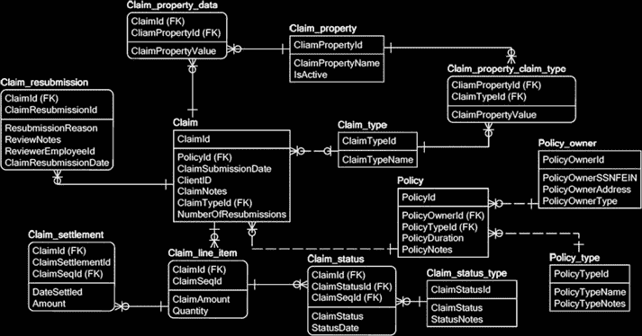
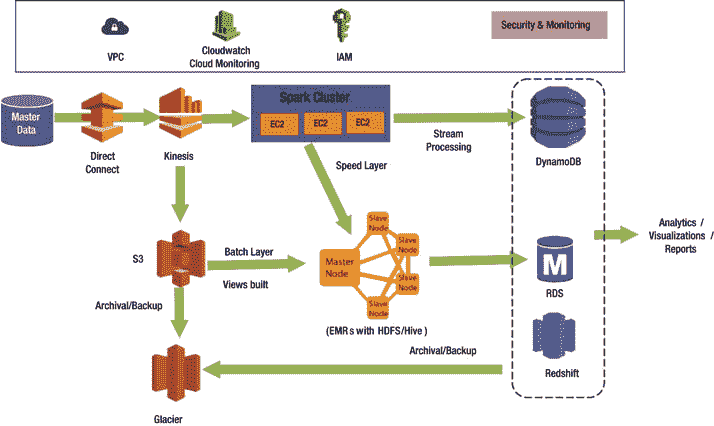

### 第十一章：案例研究：实现 Lambda 架构

Lambda架构是大数据架构中最早出现的明确理念之一，像任何新架构一样，它既有追随者也有批评者。如何决定站在哪一边？我的答案很简单：这取决于该架构对你环境的适用性。Lambda绝对不适合所有大数据用例。也许像Kappa或Fast Data这样的更新架构更适合你的环境。也许你甚至不需要基于架构的方法，可以直接从数据湖开始，按需设计分析。每个环境在某些方面都是独特的，需要特殊的设计考量，但诀窍是从通用方法开始，并且选择最合适的那一个。

为什么需要寻找新的数据架构方法？嗯，当前的基于RDBMS或NoSQL的系统并不具有韧性。由于大多数数据系统支持创建、读取、更新和删除（CRUD）操作，更新和删除操作可能导致数据损坏。例如，当你只想删除一行时，可能会删除大量行。软件错误或硬件故障也可能损坏数据。Lambda架构中主数据的不可变性为此问题提供了有效的解决方案。

此外，对于当前的数据库系统，你总是在设计中需要做出权衡，因为要么优化数据存储（第三范式的规范化设计），要么优化查询处理（反规范化设计——通常是第一或第二范式）。Lambda通过将主数据（使用第三范式存储）与查询层（存储为反规范化视图）分离，解决了这一难题。

那么，不可变数据存储如何捕获数据的变化？通过将数据划分为多个“事实”，并在时间维度上捕获这些事实的变化。因此，对事实的任何更改都会作为新的事实记录存储，并带有时间戳（指示更改发生的时间）。考虑一个员工记录。员工的地址是一个事实。每次员工搬家时，都可以添加一条新的事实记录，并附带一个时间戳，指示搬家时间。这保留了员工的居住历史（类似于数据仓库中的类型2维度）——但更重要的是，它保留了与员工相关的所有事实（就其地址而言）。当然，你可以根据需要以任何方式使用这些事实。

最后，Lambda层如何促进近实时数据交付？我将通过一个真实案例研究进行讨论。我将简要讨论针对同一用例的Kappa和Fast Data设计变更。我将从描述业务问题开始。

---

© Bhushan Lakhe 2016

B. Lakhe, *Practical Hadoop Migration*, DOI 10.1007/978-1-4842-1287-5_11

### 业务问题与解决方案

Yourtown Insurance是一家汽车保险公司，最近不得不处理大量欺诈性索赔。随后，该公司增加了严格的指导方针和大量额外的索赔处理流程。这导致处理时间增加了两倍，拥有真实索赔的客户感到不满，并将业务转移到了其他保险公司。

Yourtown Insurance聘请了业务流程（以及软件性能）专家，他们分析了过去的索赔（使用统计模型），并创建了一个预测模型来判断索赔是否可能具有欺诈性。如果确定索赔可能存在欺诈性，则将其定向到特殊队列，该队列执行额外处理，并在必要时启动调查。其余的索赔（被判定为非欺诈性的）则快速处理，就像在添加额外处理之前一样。

这一策略缩短了（真实）索赔的处理时间，同时仍然能够以约80%的准确率识别欺诈性索赔。顾问向IT部门保证，随着时间的推移，他们构建的预测模型将变得更加准确并提供更高的准确率。该模型基于许多因素构建，用于判断欺诈性索赔，例如：客户在去年提交的索赔数量、索赔提交时间、索赔提交时的天气状况、客户年龄、客户驾驶记录等。模型评估的结果确定，上述因素的某些值表明存在欺诈（或不存在欺诈）。

因此，需要针对汇总（或计算出的）客户数据实时检查索赔参数。由于索赔数据量非常大（30 TB，每月增长1%），因此决定使用`Hadoop`进行数据处理，并且由于需要实时处理，因此选择了Lambda架构。根据数据量，同意批处理层应每周末重建一次，速度层应保存过去六天的数据。欺诈判断将基于历史数据（通过批处理层获得）和最新数据（通过速度层获得）进行。

本章将讨论使用适当的硬件、软件和需要开发的程序来设计和实现该解决方案。

### 解决方案设计

我从构建`Hadoop`集群所需的硬件开始，因为性能始于合适的硬件。然后讨论必要的软件组件以及任何自定义设置（根据需要）。

#### 硬件

该系统的数据大小为 30 TB，每月增长 1%。未来四年，总增长约为 50%，即 15 TB。由于批处理层会反规范化数据，可以假设大约需要额外 30% 的存储空间，因此总空间需求为 60 TB。现在，如果你想在批处理层重建期间保持系统可用，则需要将空间`翻倍`（因为需要在删除旧视图之前构建新视图）。在本例中，可以假设在批处理层重建期间系统将不可用。因此，最终空间需求为 60 TB。

# 第 10 章：计算集群规模

第 10 章讨论了如何计算（用于生产环境的）集群规模。这里我将从工作节点配置和节点总数开始。节点上的操作系统和其他基本应用程序需要一些空间（本例中约为总空间的 2%，因为 2 TB 的 2% 是 40 GB——这对于操作系统和软件来说足够了。尽管我提供了为操作系统和软件预留存储空间的一般指南和百分比，您还需要考虑磁盘驱动器的大小以及大致需要多少空间），并且数据块会根据复制因子（默认为 3）进行复制。

考虑：

`每节点 HDFS 空间 = (每节点原始磁盘空间 – 2% 非 DFS 本地存储) / (复制因子)`

从以下启动（独立）工作节点配置开始：

- 最新一代处理器，共 12 核

- 每核心 4 GB 内存

- 每核心 2 TB `SATA` 磁盘

- 1GbE 网卡

`每节点 HDFS 空间 = (2 TB – 2% 非 DFS 本地存储) / 3`

`每节点 HDFS 空间` 为 653 GB：

`工作节点数 = 总 HDFS 空间 / 每节点 HDFS 空间`

`工作节点数 = 60 TB / 653 GB = 92`。

对于名称节点：

- 共 6 核

- 4 GB 内存（3 GB + 每 100 TB 原始磁盘空间额外 1 GB）

- 需要复制（用于故障切换）

- `RAID-1` 存储

- 名称节点应在 64 位操作系统上运行，以避免 `JVM` 堆大小的 3 GB 限制

对于 `YARN`，您可以使用 4 GB 内存和 4 核 CPU 作为资源管理器的初始配置。如果资源使用率达到上限，请相应调整资源分配。总结一下，您需要一个包含 92 个数据节点、一个名称节点（采用故障切换配置的两个节点）以及一个用于 `YARN` 资源管理器的节点的 95 节点集群。

您可以根据第 10 章提供的指南计算开发环境的规模。为了获得良好性能，可以在数据节点上使用提供 7,200 RPM 的 `SSHD`（固态混合硬盘）存储或提供 10,000 RPM 的 `SATA III` 驱动器。

最后，网络邻近性或属于同一子网将有助于减少节点间的网络流量并提供良好性能。



## 第 11 章：案例研究：实现 Lambda 架构

## 软件

一个基于浏览器的应用程序允许 Yourtown 的客户输入理赔。理赔数据使用 `VoltDB` 存储，并每小时推送到 `HDFS/Hive`。批处理层视图基于这些数据构建。因此，批处理层使用 `HDFS/Hive`。对于服务层，我将使用一个名为 `Splout SQL` 的只读数据库。更多关于 `Splout SQL` 的信息请参见第 9 章。对于速度层，我将使用 `Spark`（以及 `Spark SQL`）。

## 数据库设计

理赔系统有大量包含众多列的表，用于捕获所有细节。然而，这些数据大部分并非欺诈检测所需。同时，我也不想过分简化使用大量参数进行预测的预测建模过程。因此，我将使用一些参数来演示欺诈检测的概念，但请注意，这是一个复杂的过程，需要的信息远比我在此能提供的要多。

你可能还记得第 3 章中用作示例的逻辑模型（图 3-5）。

由于该模型相当通用，我在此将其作为示例重现。

就我们而言，我们可以使用以下表（存储在 `HDFS` 中的主数据）来构建批处理视图：

- `Claim`（理赔）

- `Claim_status_type`（理赔状态类型）

- `Policy`（保单）

- `Policy_owner`（保单持有人）

- `Claim_line_item`（理赔明细项）

- `Claim_status`（理赔状态）

- `Claim_type`（理赔类型）

- `Policy_type`（保单类型）

此外，我们可以假设 `Policy_owner`（保单持有人）实体具有附加列 `PolicyOwnerDOB`（保单持有人出生日期）和 `PolicyStartDate`（保单起始日期），而 `Claim`（理赔）实体具有附加列 `ClaimWeatherCond`（理赔提交时的天气状况）。一个附加实体 `PO_Drv_Hist`（保单持有人驾驶历史）保存保单持有人的驾驶历史详情，并具有图 11-1 所示的属性。

- `PolicyOwnerId (FK)`（保单持有人 ID，外键）

- `ViolationNum`（违章编号）

- `ViolationSeverity`（违章严重程度）

- `ViolationDate`（违章日期）

- `ViolationDetails`（违章详情）

图 11-1.`PO_Drv_Hist` 实体

`PolicyOwner`（保单持有人）和 `PO_Drv_Hist` 实体之间存在 *一对多* 关系（从设计中可以看出）。一个保单持有人可能有一个或多个违章。如果没有违章，则在 `PO_Drv_Hist` 实体中将不会有该 `PolicyOwner`（保单持有人）的记录。

如您所见，主数据是规范化的形式，但 `Lambda` 架构允许您保持主数据的规范化。但是，您可以为了批处理（及后续）层而对数据进行反规范化。

## 考虑基于事实的模型

让我们考虑为这些数据应用一个基于事实的模型。如第 9 章所述，一个处于第三范式且在其适当数据表中包含时间戳（用于保存历史）的数据模型可以构成一个基于事实的模型。

在这种情况下，所考虑的数据模型已经处于第三范式。那些会频繁添加记录的动态表（`Claim`（理赔）、`Claim_resubmission`（理赔重提交）、`Claim_settlement`（理赔结算）、`Claim_status`（理赔状态））已经包含了一个用于捕获日期/时间的列。对于 `Policy`（保单），我添加了 `PolicyStartDate`（保单起始日期）列来保存保单添加时的日期。保存应用程序元数据的静态表（`Claim_type`（理赔类型）、`Claim_status_type`（理赔状态类型）等）没有时间戳列（而对于基于事实的模型，它们应该具有）。

但是，您可以假设（对于此示例）静态数据不会改变，因此您可以对数据进行反规范化（利用现有的静态数据）并将其用于您的批处理层视图。换句话说，主数据可以被视为一个基于事实的模型。

## 用于判定欺诈的数据条件

讨论用于判定欺诈的数据条件将帮助您设计批处理层视图（因为您可以随后确定视图所需的数据）：

1.  如果客户在过去 12 个月内提交了超过 5 次理赔，则其下一次理赔存在欺诈可能性。

2.  晚上 10 点后提交理赔的时间表明存在欺诈可能性。

3.  诸如雪、雨、暴风雨、雪崩、龙卷风等天气状况表明存在欺诈可能性。

4.  过去 12 个月内至少有 2 次 1 级违章的青少年驾驶员可能会提交欺诈性理赔。

5.  过去 12 个月内至少有 3 次 1 级违章的驾驶员可能会提交欺诈性理赔。

保险公司（基于其预测模型）确定，满足条件 (1) 以及另外两个其他条件的理赔需要被放入*额外评估/调查*队列。同时，满足条件 2、3 以及条件 4 或 5 之一的理赔也需要被放入*额外评估/调查*队列。

所有其他理赔均无需任何额外限制即可快速处理，因为它们被视为真实的。

### 批处理层设计

首先，我们对数据进行反规范化。我将从 `Claim`（理赔）实体开始，如您所见，我包含了来自实体 `Claim_line_item`（理赔明细项）、`Claim_status`（理赔状态）、`Claim_status_type`（理赔状态类型）和 `Claim_type`（理赔类型）的列。此外，我只包含了需要的列。这将用于与理赔相关的批处理视图。

下一步，我将对 `Policy`（保单）实体进行反规范化，并包含来自实体 `Policy_owner`（保单持有人）和 `Policy_type`（保单类型）的列。这将用于与保单相关的批处理视图。

请注意，我为两个视图都添加了 `LastModified`（最后修改时间）属性（因为它们没有用于时间变化的属性）。反规范化的实体如图 11-2 所示。

- `ClaimId`（理赔 ID）

- `PolicyId`（保单 ID）

- `ClaimSeqId`（理赔序列 ID）

- `PolicyOwnerId`（保单持有人 ID）

- `PolicyId (FK)`（保单 ID，外键）

- `PolicyOwnerDOB`（保单持有人出生日期）

# 排版后的文本

`ClaimSubmissionDate`
`PolicyOwnerSSNFEIN`
`ClaimType`
`PolicyOwnerType`
`ClaimAmount`
`PolicyType`
`ClaimStatus`
`PolicyStartDate`
`ClaimWeatherCond`
`PolicyEndDate`
`LastModified`
`LastModified`

**图 11-2. 反范式化的理赔与保单实体**

我将从与理赔相关的批处理视图开始：
1. 该批处理视图的第一步将统计过去 12 个月内每个保单的理赔数量，并生成一个计数大于 5 的临时表。第二步，将该临时表与反范式化的`Policy`实体进行连接，以获取保单持有人的详细信息，构成该批处理视图。
2. 第二个批处理视图将根据天气条件（如雪、雨、暴风雨、雪崩或龙卷风）对理赔进行筛选。

接下来是与保单相关的批处理视图：
3. 第三个批处理视图将列出在过去 12 个月内至少发生 2 次 1 级违规的青少年驾驶员。第一步，使用`PO_Drv_Hist`实体填充一个临时表，其中包含过去 12 个月内发生 2 次或以上 1 级违规的驾驶员。然后，使用反范式化`Policy`实体中的`DOB`（出生日期）筛选出年龄小于或等于 19 岁的驾驶员条目。
4. 第四个批处理视图将使用为第三个批处理视图创建的临时表，并筛选出年龄大于 19 岁的驾驶员条目。

下一步，你需要从存储在`HDFS`中的主数据中推导出这些视图。请注意，这些*视图*实际上就是`Hive`表。我将在下一节中描述具体的处理过程。

## 第 11 章 ■ 案例研究：实现 Lambda 架构

### 实现批处理层

如第 9 章所述，出于多种原因，我将使用`HDFS`来存储主数据和批处理层视图（`Hive`表）。`Hive`实际上用于元数据管理，你可以使用`MySQL`来存储元数据。

此外，对于追加垂直或基于时间的数据，我将使用`Hive`分区（可根据应用需求按日、周或月进行分区）来追加新数据。我使用`Hive`分区来演示如何管理主数据集的新数据，并在创建的批处理视图中对其进行处理。我使用时间戳`LastModified`来对表进行分区。以下是构成主数据的`Hive`表：

```sql
CREATE TABLE ClaimsMaster(
  ClaimId INT,
  ClaimSeqId INT,
  PolicyId INT,
  ClaimSubmissionDate TIMESTAMP,
  ClaimType STRING,
  ClaimAmount INT,
  ClaimSTATUS STRING,
  ClaimWeatherCond STRING
)
PARTITIONED BY (LastModified TIMESTAMP)
ROW FORMAT DELIMITED FIELDS TERMINATED BY "\;";

CREATE TABLE PolicyMaster(
  PolicyId INT,
  PolicyOwnerId INT,
  PolicyOwnerDOB DATE,
  PolicyOwnerSSNFEIN STRING,
  PolicyOwnerType STRING,
  PolicyType STRING,
  PolicyStartDate TIMESTAMP,
  PolicyEndDate TIMESTAMP
)
PARTITIONED BY (LastModified TIMESTAMP)
ROW FORMAT DELIMITED FIELDS TERMINATED BY "\;";

CREATE TABLE PO_Drv_Hist(
  PolicyOwnerId INT,
  ViolationNum SMALLINT,
  ViolationSeverity TINYINT,
  ViolationDate TIMESTAMP,
  ViolationDetails STRING
)
PARTITIONED BY (LastModified TIMESTAMP)
ROW FORMAT DELIMITED FIELDS TERMINATED BY "\;";
```

### 下一步是向这些存储主数据的表中添加新数据

如你所知，这些表以文件形式存储在`HDFS`中，而`Hive`则保存元数据以更有效地管理数据修改。新数据可以每天（或按任何其他必要频率）使用动态分区添加。你可以创建一个暂存表（指向包含新数据的文件），并如下所示向表中添加新分区：

```sql
CREATE EXTERNAL TABLE ClaimsMaster_stg(
  ClaimId INT,
  ClaimSeqId INT,
  PolicyId INT,
  ClaimSubmissionDate TIMESTAMP,
  ClaimType STRING,
  ClaimAmount INT,
  ClaimSTATUS STRING,
  ClaimWeatherCond STRING,
  LastModified TIMESTAMP
) ROW FORMAT DELIMITED FIELDS TERMINATED BY "\;"
LOCATION "/InsuranceExample/ClaimsMaster/staging";

FROM ClaimsMaster_stg INSERT OVERWRITE TABLE ClaimsMaster PARTITION
(LastModified) SELECT ClaimId, ClaimSeqId, PolicyId,
```

`ClaimSubmissionDate`, `ClaimType`, `ClaimAmount`, `ClaimSTATUS`, `ClaimWeatherCond`, `LastModified`；

请注意，临时表中包含一个额外列，指向表`ClaimsMaster`的临时目录（用于存放新数据）。同样的原理也适用于向表`PolicyMaster`和`PO_Drv_Hist`添加新数据。此外，将新数据文件复制到相应临时目录、创建临时表以及向基表添加新分区的过程，都可以实现自动化并按计划执行。

现在我来创建批处理视图。首先创建一个表`BatchProcHist`，用于维护已创建批处理视图的历史记录：

```sql
CREATE TABLE BatchProcHist(
  ViewName STRING,
  CreatedAt timestamp)
ROW FORMAT DELIMITED FIELDS TERMINATED BY "\;";
```

现在创建第一个视图，用于列出过去 12 个月内索赔次数超过 5 次的保单持有人。第一步，获取过去 12 个月内索赔次数超过 5 次的保单列表，并写入临时表：

```sql
Create table ClaimDeftemp1 as 
  Select PolicyId, count(ClaimId) as Claimcount 
  from ClaimsMaster 
  where datediff(current_date, add_months(to_date(ClaimSubmissionDate),12)) <= 0
  group by PolicyId 
  having count(ClaimId) > 5
```

请注意，这里我只考虑了`ClaimSubmissionDate`的日期部分，并在其基础上加一年后与当前日期进行比较。

### 第 11 章 ■ 案例研究：实现 Lambda 架构

下一步，将此临时表与反规范化后的保单实体进行关联，以获取保单持有人的详细信息，从而构成批处理视图：

```sql
Create table ClaimDefView as 
  Select P.PolicyOwnerID, P.PolicyId, C.Claimcount 
  from PolicyMaster P, ClaimDeftemp1 C 
  where P.PolicyId = C.PolicyId;
```

最后，写入历史记录表：

```sql
INSERT INTO TABLE BatchProcHist
VALUES ('ClaimDefView', from_unixtime(unix_timestamp()));
```

第二个批处理视图根据天气条件（如雪、雨、暴风雨、雪崩或龙卷风）过滤索赔记录：

```sql
CREATE table ClaimWeatherView as 
  Select distinct ClaimId, ClaimWeatherCond 
  from ClaimsMaster 
  where ClaimWeatherCond in ('Snow','Rain','Storm','Avalanche','Tornado');
```

写入历史记录表：

```markdown
## 第 11 章 ■ 案例研究：实现 Lambda 架构

```sql
INSERT INTO TABLE BatchProcHist
VALUES ('ClaimWeatherView', from_unixtime(unix_timestamp()));
```

第三个批处理视图的目标是列出在过去 12 个月内至少有 2 次 1 级严重违规的青少年驾驶员。首先，我填充一个临时表（列出过去 12 个月内违规次数为 2 次及以上的驾驶员）：

```sql
Create table TeenageVioltemp1 as 
  Select PolicyOwnerId, count(ViolationSeverity) as TotalViolations
  from PO_Drv_Hist 
  where (datediff(current_date, add_months(to_date(ViolationDate),12)) <= 0) 
    and (ViolationSeverity = 1)
  group by PolicyOwnerId
  having count(ViolationSeverity) > 2
```

接下来，使用反规范化保单实体中的出生日期（`DOB`）对临时表中的条目进行过滤，仅保留 19 岁及以下的驾驶员：

```sql
Create table TeenageViolView as 
  Select T.PolicyOwnerId, T.TotalViolations
  from TeenageVioltemp1 T, PolicyMaster P 
  where T.PolicyOwnerId = P.PolicyOwnerId
    and (datediff(current_date, add_months(P.PolicyOwnerDOB,228)) <= 0)
```

写入历史记录表：

```sql
INSERT INTO TABLE BatchProcHist
VALUES ('TeenageViolView', from_unixtime(unix_timestamp()));
```

我使用了 `add_months` 函数为驾驶员的出生日期加上 228 个月（即 19 年），并计算差值（以判断驾驶员是否为青少年）。

第四个批处理视图列出违规次数为 3 次及以上的成年驾驶员。因此，我将创建一个新的临时表（与第三个批处理视图类似），并过滤掉年龄大于 19 岁的驾驶员：

```sql
Create table Violtemp1 as 
  Select PolicyOwnerId, count(ViolationSeverity) as TotalViolations
  from PO_Drv_Hist 
  where (datediff(current_date, add_months(to_date(ViolationDate),12)) <= 0) 
    and (ViolationSeverity = 1)
  group by PolicyOwnerId
  having count(ViolationSeverity) > 3
```

过滤成年驾驶员：

```sql
CREATE TABLE AdultViolView AS
SELECT T.PolicyOwnerId, T.TotalViolations
FROM Violtemp1 T, PolicyMaster P
WHERE T.PolicyOwnerId = P.PolicyOwnerId
  AND (DATEDIFF(ADD_MONTHS(P.PolicyOwnerDOB, 228), CURRENT_DATE) < 0);
```

写入历史表：

```sql
INSERT INTO TABLE BatchProcHist
VALUES ('AdultViolView', FROM_UNIXTIME(UNIX_TIMESTAMP()));
```

`重要提示：` 不要忘记删除您创建的临时表——否则脚本将报错终止。

因此，创建完批次视图后，下一步就是提供或展示它们。

### 实现服务层

我在[第 9 章](http://dx.doi.org/10.1007/978-1-4842-1287-5_9)讨论了服务层的功能和特点。基本上，它“服务”批次视图，或者以最小延迟提供快速访问。这就是为什么服务层需要是一个专门的分布式数据库，它必须能够：
- 存储批次视图，并支持良好的随机和顺序数据访问性能（仅读取）。
- 能够快速将批次视图替换为批次层重建的新版本（即支持批量更新）。
- 容错性（因为视图可以从批次层快速重新部署）。
- 具备索引能力以实现快速检索。

[第 9 章](http://dx.doi.org/10.1007/978-1-4842-1287-5_9)中的解决方案是 `Splout SQL` —— 我将再次使用它。关于 `Splout SQL` 的架构和操作细节，请参见[第 9 章](http://dx.doi.org/10.1007/978-1-4842-1287-5_9)。`Splout SQL` 可用于将批次层视图部署为表空间内的表。`表空间`用于对具有相同键列的多个表进行分组。其优势在于，您可以使用相同的分区键对多个表进行分区。对于 `Splout SQL` 来说，分区非常重要，因为它用于在索引和部署之前平衡数据。请注意，当一个表按单列或多列分区时，`Splout`会将这些列的值连接起来形成一个字符串。因此，分区是行的函数，也可以使用任意函数进行分区（例如，一个只使用某列前八个字符的`JavaScript`函数）。

以我的示例为例，请注意批次视图 1、3 和 4 都使用 `PolicyOwnerId` 作为键列。因此，您可以使用这三个批次视图（或 `Hive` 表）设计一个表空间。

另一个表空间可以容纳使用 `ClaimId` 作为键列的第二个批次视图。

因此，作为下一步，您需要生成表空间和表。

要创建或生成表空间，您需要使用 `generate` 工具。该工具使用一个 `JSON` 表空间描述符，如下所示。您需要指定输入类型以及 `Hive` 数据库和表名。表空间描述符文件可以创建在 `Splout SQL` 安装目录中：

```json
{
  "name": "PolicyTblspace",
  "nPartitions": 12,
  "partitionedTables": [
    {
      "name": "ClaimDefView",
      "partitionFields": "PolicyOwnerId",
      "tableInputs": [
        {
          "inputType": "HIVE",
          "hiveTableName": "ClaimDefView",
          "hiveDbName": "MyHiveDB"
        }
      ]
    },
    {
      "name": "TeenageViolView",
      "partitionFields": "PolicyOwnerId",
      "tableInputs": [
        {
          "inputType": "HIVE",
          "hiveTableName": "TeenageViolView",
          "hiveDbName": "MyHiveDB"
        }
      ]
    },
    {
      "name": "AdultViolView",
      "partitionFields": "PolicyOwnerId",
      "tableInputs": [
        {
          "inputType": "HIVE",
          "hiveTableName": "AdultViolView",
          "hiveDbName": "MyHiveDB"
        }
      ]
    }
  ]
}
```

让我快速回顾一下这个文件（`PolicyTblspace.json`）中的信息。

表空间将被命名为 `PolicyTblspace`，目前定义了三个表（或批次视图）：`ClaimDefView`、`TeenageViolView`和`AdultViolView`，这些是在上一节中创建的。数据库名称是 `MyHiveDB`（您需要使用您创建 `Hive` 表所在的数据库名称），并且我为我的数据创建了 12 个分区。我使用 `PolicyOwnerId` 作为分区列，因为该列将是几乎所有查询的一部分。

要部署此表空间，可以从（Linux）命令行执行以下命令，以生成表空间 `PolicyTblspace`（从 `Splout SQL` 安装目录）：

```bash
hadoop jar splout-*-hadoop.jar generate -tf file:///`pwd`/ PolicyTblspace.json -o out-MyHiveDB_splout_example
```
```

为了提升性能，您可能需要向表空间添加索引，`Splout`允许您轻松添加索引。注意，您必须使用一个名为`simple-generate`的不同生成器，而不是用于生成`PolicyTblspace`表空间的`generate`表空间生成器。使用`simple-generate`生成器的限制是，您的表空间只能包含一个表。由于示例中的另一个表空间只有一个表（或批次视图），我将针对该表空间演示`simple-generate`的用法。以下命令将在生成表空间`ClaimTblspace`时创建一个额外的索引：

```bash
hadoop jar splout-hadoop-*-hadoop.jar simple-generate –it HIVE –hdb MyHiveDB –htn ClaimWeatherView -o out-MyHiveDB_splout_example -pby ClaimId -p 1 -idx "ClaimWeatherCond" -t ClaimWeatherView -tb ClaimTblspace
```

请注意，我没有包含`ClaimId`列，因为它是一个分区列并且已经被索引。`-idx`选项只是向索引中添加更多列（在此例中是`ClaimWeatherCond`）。另请注意，这里没有`JSON`配置文件，因此所有配置（例如`Hive`数据库、表名、分区列等）都通过命令指定。

表空间成功生成后，您需要按如下方式部署它们：

```bash
hadoop jar splout-hadoop-*-hadoop.jar deploy -q http://localhost:4412 -root out-MyHiveDB1_splout_example -ts PolicyTblspace

hadoop jar splout-hadoop-*-hadoop.jar deploy -q http://localhost:4412 -root out-MyHiveDB2_splout_example -ts ClaimTblspace
```

`localhost`是运行中的`QNode`主机（客户端与之连接），`localhost`将在运行时自动替换为第一个有效的私有 IP 地址（根据配置文件中的指定）。

一旦表空间被部署，您就可以在任何查询中使用它。例如，如果需要检查某个特定理赔（`ClaimId=14124736`）是否是在恶劣天气条件下提交的，您可以使用`REST API`，如下所示：

```
http://localhost:4412/api/query/ClaimTblspace?sql=SELECT * FROM ClaimWeatherView;&key=14124736
```

您可以使用`Splout SQL`（或任何其他您喜欢的数据库解决方案）来部署批次层视图，如本节所示。接下来，我将讨论如何访问批次层尚未处理的数据，并将其包含在查询结果中。

### 实现速度层

回顾一下，速度层的目的是使批次层视图尚未处理的数据能够无延迟地可用。速度层视图与批次层视图的另一个区别是，批次层通过重新计算（或重建）来更新视图，而速度层对视图执行增量处理，只处理自上次增量处理之后发生的增量（或新）事务。因此，如果您的传入数据事务带有时间戳，并且您将其从主数据集中提取出来，那么根据记录是被修改还是被添加，您可以相应地修改您的速度层视图。

接下来需要考虑的是，是否需要同步更新速度层（将对主数据的任何更新直接应用于速度层视图），还是异步更新（将请求排队，实际更新稍后进行）。在本例中，异步更新将更为有用，因为分析应用更侧重于复杂的计算和聚合，而非交互式用户输入。此外，考虑到数据量庞大，能够对更新有更多控制权会很有益（例如，通过临时分配额外的请求来处理变化的工作负载）。

我将使用`Spark`来实现速度层。更具体地说，我将使用`Spark`处理引擎和`Spark SQL`。

由于 Lambda 架构定义速度层由批处理层尚未处理过的记录组成，因此需要确定这些记录是什么。你可能还记得，每次构建批处理视图后，都会在表`BatchProcHist`中插入一条历史记录。因此，批处理视图的最新记录可以告诉我们最近一次构建的日期/时间，从而帮助我们确定哪些是未处理的记录。我将把第一个批处理视图的最新记录写入一个表（因为 Hive 不支持将查询结果赋值给变量）：

```
Create table MaxTable as select ViewName, max(CreatedAt) as MaxDate from BatchProcHist group by ViewName having ViewName = 'ClaimDefView';
```

这样就能得到批处理层视图构建的最新日期/时间。

然而，由于速度层视图的处理频率更高，你还需要确定速度层上次处理记录的日期/时间（因为只需要考虑未处理的记录），以便更新视图（这里是一个注册为表的 Spark 数据帧）。我将速度层视图命名为`ClaimDefView_S`。由于速度层视图也会写入审计表`BatchProcHist`，我将把第一个速度层视图的最新记录写入同一个表（其中已经捕获了第一个批处理视图的最新记录）：

```
Insert into MaxTable select ViewName, max(CreatedAt) from BatchProcHist group by ViewName having ViewName = 'ClaimDefView_S';
```

现在，我只需要确定这些记录中哪一个是最近的（以防批处理层在上次速度层构建之后又重新构建），并将其作为处理第一个速度层视图记录的基础：

```
Create table MaxTbl1 as select max(MaxDate) as MaxDate from MaxTable;
```

最后，从主数据集中获取未处理的记录，并创建速度层视图。同时，添加时间戳并将一条记录写入审计历史表：

```
Create table ClaimDeftemp11 as Select PolicyId, ClaimId from ClaimsMaster a, MaxTbl1 b where where a.LastModified > b.MaxDate;

Create table ClaimDeftemp12 as Select PolicyId, count(ClaimId) as Claimcount from ClaimDeftemp11 where datediff(current_date, add_months(to_date(ClaimSubmissionDate),12)) <= 0 group by PolicyId having count(ClaimId) > 5
```

作为最后一步，我将把这个临时表与反规范化的`Policy`实体进行连接，以获取构成批处理视图的策略所有者详细信息，并将一条记录写入历史表：

```
Create table ClaimDefView_S as Select P.PolicyOwnerID, P.PolicyId, C.Claimcount from PolicyMaster P, ClaimDeftemp12 C where P.PolicyId = C.PolicyId;

INSERT INTO TABLE BatchProcHist VALUES ('ClaimDefView_S', from_unixtime(unix_timestamp());
```

现在删除临时表（因为我们可能会为下一个速度层视图重新创建其中一些表）：

```
Drop Table MaxTable;
Drop Table MaxTbl1;
Drop Table ClaimDeftemp11;
Drop Table ClaimDeftemp12;
```

其他速度层视图可以类似地创建如下：

```
--视图 2;
Create table MaxTable as select ViewName, max(CreatedAt) as MaxDate from BatchProcHist group by ViewName having ViewName = 'ClaimWeatherView';

Insert into MaxTable select ViewName, max(CreatedAt) from BatchProcHist group by ViewName having ViewName = 'ClaimWeatherView_S';
```

# 排版后的文本

```sql
group by ViewName having ViewName = 'ClaimWeatherView_S';
```

```sql
Create table MaxTbl1 as select max(MaxDate) as MaxDate from MaxTable;
```

```sql
CREATE table ClaimWeatherView_S as Select distinct a.ClaimId,
a.ClaimWeatherCond from ClaimsMaster a, MaxTbl1 b where a.LastModified > b.MaxDate and a.ClaimWeatherCond in ('Snow','Rain','Storm','Avalanche',
'Tornado');
```

```sql
INSERT INTO TABLE BatchProcHist
VALUES ('ClaimWeatherView_S', from_unixtime(unix_timestamp());
```

```sql
Drop Table MaxTable;
Drop Table MaxTbl1;
```

```sql
--View 3;

Create table MaxTable as select ViewName, max(CreatedAt) as MaxDate from
BatchProcHist group by ViewName having ViewName = 'TeenageViolView';
```

```sql
Insert into MaxTable select ViewName, max(CreatedAt) from BatchProcHist
group by ViewName having ViewName = 'TeenageViolView_S';
```

```sql
Create table MaxTbl1 as select max(MaxDate) as MaxDate from MaxTable;
```

```sql
Create table TeenageVioltemp11 as Select a.PolicyOwnerId,
a.ViolationSeverity from PO_Drv_Hist a, MaxTbl1 b where a.LastModified > b.MaxDate;
```

```sql
Create table TeenageVioltemp12 as Select PolicyOwnerId,
count(ViolationSeverity) as TotalViolations
from TeenageVioltemp11 where (datediff(current_date, add_months
(to_date(ViolationDate),12)) <= 0) and (ViolationSeverity = 1)
group by PolicyOwnerId
having count(ViolationSeverity) > 2
```

# 第 11 章 ■ 案例研究：实现 Lambda 架构

```sql
Create table TeenageViolView_S as Select T.PolicyOwnerId, T.TotalViolations from TeenageVioltemp12 T, PolicyMaster P where T.PolicyOwnerId =
P.PolicyOwnerId and
(datediff(current_date,add_months(P.PolicyOwnerDOB,228)) <= 0)
```

```sql
INSERT INTO TABLE BatchProcHist
VALUES ('TeenageViolView_S', from_unixtime(unix_timestamp());
```

```sql
Drop Table MaxTable;
Drop Table MaxTbl1;
Drop Table TeenageVioltemp11;
Drop Table TeenageVioltemp12;
```

```sql
--View 4;

Create table MaxTable as select ViewName, max(CreatedAt) as MaxDate from
BatchProcHist group by ViewName having ViewName = 'AdultViolView';
```

```sql
Insert into MaxTable select ViewName, max(CreatedAt) from BatchProcHist
group by ViewName having ViewName = 'AdultViolView_S';
```

```sql
Create table MaxTbl1 as select max(MaxDate) as MaxDate from MaxTable;
```

```sql
Create table Violtemp11 as Select a.PolicyOwnerId, a.ViolationSeverity from PO_Drv_Hist a, MaxTbl1 b where a.LastModified > b.MaxDate;
```

```sql
Create table Violtemp12 as Select PolicyOwnerId, count(ViolationSeverity) as TotalViolations
from Violtemp11 where (datediff(current_date, add_months
(to_date(ViolationDate),12)) <= 0) and (ViolationSeverity = 1)
group by PolicyOwnerId
having count(ViolationSeverity) > 3
```

```sql
Create table AdultViolView_S as Select T.PolicyOwnerId, T.TotalViolations
from Violtemp12 T, PolicyMaster P where T.PolicyOwnerId = P.PolicyOwnerId and
(datediff(add_months(P.PolicyOwnerDOB,228),current_date) < 0)
```

```sql
INSERT INTO TABLE BatchProcHist
VALUES ('AdultViolView_S', from_unixtime(unix_timestamp());
```

```sql
Drop Table MaxTable;
Drop Table MaxTbl1;
Drop Table Violtemp11;
Drop Table Violtemp12;
```

# 第 11 章 ■ 案例研究：实现 Lambda 架构

第 [9 章](http://dx.doi.org/10.1007/978-1-4842-1287-5_9) 详细讨论了 Spark 与 Hadoop 对接的所有操作细节。在此，我将简要讨论如何使用 Spark SQL 从 Hive 获取数据（到 DataFrames）以及针对 Spark 中的 Hive 表执行 DML（数据操作语言——更新、插入或删除命令）语句。

如您所知，Spark 使用 DataFrames 和 RDD（弹性分布式数据集）作为内存结构，您可以利用它们进行查询和性能优化。Spark 还允许您使用 `sqlContext` 针对 Hive 数据库执行查询。首先，您需要构造一个 `HiveContext`，它继承自 `SQLContext`，并允许您在 Hive MetaStore 中查找表，还支持使用 HiveQL 执行查询。此处，我使用 Scala，而 `sc` 是一个现有的 `SparkContext`（您可以在 Spark shell 中使用 Python 或 R）：
```scala
val sqlContext = new org.apache.spark.sql.hive.HiveContext(sc)
```
```scala
val sqlContext.sql("Create table MaxTable as select ViewName, max(CreatedAt) from BatchProcHist group by ViewName having ViewName = 'ClaimDefView'")
```
```scala
val sqlContext.sql("Insert into MaxTable select ViewName, max(CreatedAt) from BatchProcHist group by ViewName having ViewName = 'ClaimDefView_S'")
```
您可以类似地执行所有必要的 HiveQL 命令来创建速度层视图 `ClaimDefView_S`。在最后一步（视图创建后），无需创建视图，您可以直接执行 `select` 语句并将结果读取到 DataFrames 中，如下所示：
```scala
val resultsDF = sqlContext.sql("Select P.PolicyOwnerID, P.PolicyId,
C.Claimcount from PolicyMaster P, ClaimDeftemp12 C where P.PolicyId =
C.PolicyId;")
```
您可以将生成的 DataFrames 注册为临时表，然后对其执行任意查询：
```scala
val resultsDF.registerTempTable("ClaimDefView_S")

val results = sqlContext.sql("SELECT PolicyOwnerId FROM ClaimDefView_S")
```
您需要使用一个能够从 Hive 和 Spark 读取数据的查询工具来合并批处理层和速度层视图的结果。有足够多的选择，当然您也可以将 Spark SQL 本身用作查询工具。

## 存储结构（用于主数据和视图）

第 [10 章](http://dx.doi.org/10.1007/978-1-4842-1287-5_10) 讨论了如何选择最佳文件格式。在本节中，我将应用第 [9 章](http://dx.doi.org/10.1007/978-1-4842-1287-5_9) 讨论的概念。因此，让我简要考虑选择正确格式的几个参数：
*   查询类型（您计划执行的）是首要且最重要的因素。正如您从批处理视图中所见，构建主数据的查询涉及从较大的列集中选择一小部分列，并带有少量过滤条件。此外，构建批处理层视图需要多种聚合操作。
*   您所需的压缩量。对于一个 30 TB（且每月增长 1%）的数据集，压缩是必要的。
*   确保您的 NoSQL 解决方案支持您计划使用的存储格式。
现在，您可能会从第 [9 章](http://dx.doi.org/10.1007/978-1-4842-1287-5_9) 回忆起列式格式提供良好的压缩，并且更适合需要聚合操作（如 `count`、`avg`、`min`、`max`）的数据。此外，对于涉及选择一小部分列以及使用少量列作为过滤条件（在 `where` 子句中）的用例，列式格式提供了良好的性能。
因此，您将从使用列式格式存储数据中受益。接下来的决定是选择哪种列式格式。流行的格式包括 RCFile、ORCFile 和 Parquet。
RCFile 格式是第一个引入的列式格式，并且在 Hadoop 生态系统内（几乎所有 Hadoop 工具都支持它）以及 Hadoop 外部的工具中得到最广泛的支持。与 Parquet 和 ORCFiles 相比，RCFile 缺乏许多高级功能，例如支持存储更复杂的数据类型或提供加密。但是，对于当前示例，不需要支持复杂数据类型，也不需要加密。因此，可以使用 RCFile 格式。
如果您发现性能问题，请切换到 Parquet，它提供更好的压缩，并在压缩和速度之间取得平衡。此外，Parquet 在 Hadoop 以及外部（Hadoop 生态系统）工具中都得到了广泛支持。
您应该使用一个先进的分布式处理框架（如 YARN 或 Spark）来帮助您加速处理这些数据并提供最佳性能（因为数据量相当大）。

### 其他性能考虑

对于此示例，我并未考虑操作系统配置的调优，因为操作系统可用的选项数量很多。由于配置会发生变化（取决于您选择的操作系统或框架），我认为不可能提供更精细的细节。但是，您可以参考第 [9 章](http://dx.doi.org/10.1007/978-1-4842-1287-5_9) 中的 HDFS 和 YARN 调优指南。
若您计划使用 YARN，[第 10 章](http://dx.doi.org/10.1007/978-1-4842-1287-5_10) 是一个很好的起点。此外，如果您使用 Spark，除了[第 10 章](http://dx.doi.org/10.1007/978-1-4842-1287-5_10) 中的通用指南外，还有针对 JVM 调优的特定准则。
由于 Spark 可能会在内存中保存大量数据，因此它依赖于 Java 的内存管理和垃圾回收。因此，理解和调优 Java 的 GC 选项（和参数）可以帮助您为 Spark 应用程序获得最佳性能。GC 的一个常见问题是垃圾回收耗时过长，从而影响程序性能，有时甚至会导致崩溃。
Java 应用程序可以采用以下两种垃圾回收策略之一：
-   **并发标记清除垃圾回收**：此策略旨在降低延迟，因此不进行压缩（以节省时间）。它更适合实时应用程序。
-   **并行旧式垃圾回收**：此策略追求更高吞吐量，因此执行全堆压缩，这会导致较大的性能损失。它更适合异步或批处理（用于执行聚合、分析等操作的程序）。
JVM 1.6 版本引入了第三种垃圾回收选项，称为 Garbage-First GC（`G1 GC`）。`G1` 收集器旨在同时实现高吞吐量和低延迟，因此是一个不错的选择。
首先，请注意 Spark 如何使用 JVM。Spark 的执行器将 JVM 堆空间分为两部分。第一部分用于保存持久缓存到内存中的数据。第二部分用作 JVM 堆空间（用于在转换期间为 RDD 分配内存）。
您可以使用 `spark.storage.memoryFraction` 参数调整（这两部分的）比例。这让 Spark 能够控制缓存 RDD 的总大小（小于`(RDD 堆空间大小 * spark.storage.memoryFraction)`）。在进行有意义的 GC 分析时，您需要考虑这两部分的内存使用情况。
如果您观察到 GC 耗时更长，应首先检查 Spark 应用程序的内存空间使用情况。如果您的应用程序为 RDD 使用较少的内存空间，那么它将为程序执行留下更多的堆空间，从而提高 GC 效率。如有必要，您可以通过清理不再使用的缓存 RDD 来提升性能。
最好使用新的 `G1` 收集器，因为它能更好地处理 Spark 应用程序中常见的堆大小增长问题。当然，无法为 GC 调优提供一个通用的策略。您需要理解（Spark 的）日志记录，并将其与内存管理的其他参数结合使用来进行调优。
索引是另一个我没有考虑到的方面，因为您环境中的索引将取决于查询类型及其频率。最后，出于两个原因，我使用了通用的存储解决方案（HDFS 与 Hive）。首先，Lambda 具有多层结构，需要通过使用广泛支持的组件来确保多个组件的兼容性。其次，您具体使用的 NoSQL 解决方案将取决于您的特定数据类型以及您打算用它做什么（在处理方面）。所以，我使用某个特定的 NoSQL 解决方案可能只对少数人有用。
我列出这些（我未考虑到的）方面，更多是作为提醒，以便您为自己的特定环境进行考量。

### 参考架构

在本章中，我讨论了使用 Lambda 架构为业务需求设计和实现基于 Hadoop 的解决方案的所有方面。我从硬件、软件开始，然后讨论了根据 Lambda 框架进行的设计。最后，我讨论了实现步骤。当然，生产级别的实现涉及许多额外组件，例如网络、监控、警报等，才能确保成功实施。因此，回顾一些完整的架构将有助于您了解基于 Hadoop 系统的生产实现涉及哪些内容。这些组件（当然）会根据供应商（例如，Microsoft、AWS、Hortonworks、Cloudera 等）而变化。例如，图 11-3 展示了一个使用 AWS 组件实现的 Lambda。您可以看到使用了 `Kinesis` 来获取流数据，并使用了 `Spark` 集群（使用 `EC2` 实现）来处理这些数据。批处理层通过 `EMR` 实现，这些 `EMR` 构成了一个由一个 `MasterNode` 和四个 `DataNode` 组成的 Hadoop 集群。速度层的视图可以通过 `DynamoDB` 交付，并与批处理层视图结合，提供给任何报表、仪表板（可视化）或分析解决方案。由于这是一个生产实现，您可以观察到使用相应的 AWS 组件来实施安全、监控和备份/归档。



图 11-3. 使用 AWS 组件的 Lambda 实现

类似架构也可以使用 Microsoft 组件或 Hortonworks/Cloudera 组件构建。

## 针对最新架构的实现变更

Kappa 架构、Fast Data 架构和 Butterfly 架构是当前最新或*未来状态*的架构。如果您必须使用这些架构来实现（我前面章节示例中的）系统，则需要进行一些更改。我不会讨论完整的重新实现，而只会关注架构的组件级变更。我将从 Kappa 架构开始。

### 使用 Kappa 架构重新实现

首先要注意的是应用 Kappa 架构替代 Lambda 架构的可能性。

请注意，只有当速度层和批处理层的预期输出相同时，Kappa 才能替代 Lambda。如果速度和批处理算法的预期输出不同，则批处理和速度层无法合并，必须使用 Lambda 架构。在我前面章节的示例中，速度层和批处理层的预期输出是相同的，因此可以使用 Kappa 架构。

简单回顾一下，Kappa 涉及使用一个流处理引擎（`Spark`、`Kafka` 等），它允许您保留可能需要重新处理的数据的完整日志。如果需要重新处理，请启动流处理作业的第二个实例，该实例将从保留数据的开头开始处理，并将输出写入新的目的地（例如，表或文件）。当第二个作业完成处理后，将应用程序切换为从新的输出目的地读取数据。之后，您可以停止旧版本的作业并删除旧的输出目的地。

### Kappa 架构实现

你可以在前文讨论的示例中应用 Kappa 架构。首先，它只有一个层——流处理层。可以创建文件流来从主数据文件中读取数据，并创建相应的 `DStreams`。`Spark Streaming` 可以对这些 `DStreams` 应用转换和聚合函数，并将其保存在内存中或输出为文件（到 `HDFS`）。对于新数据的处理，`Spark Streaming` 会监控数据目录，并处理该目录中创建的任何新文件。由于新的主数据是作为新的 Hive 分区添加的（以我的示例为例），可以将这些文件从暂存位置复制到 Spark 数据目录。新文件将作为新的 `DStreams` 被流式处理，并与保存历史数据的 `DStreams` 进行连接，然后对结果 `DStreams` 应用相同的转换和聚合函数，从而获得最新的数据集（与你通过合并批处理层视图和速度层视图得到的结果相同）。最终生成的 `DStream` 可以根据需要以 `dataframe` 或 Hive 表的形式提供给客户端应用程序。

如果转换函数发生变化，或发现数据或处理问题，可以启动一个新的 `Spark Streaming` 作业，对从主数据创建的新 `DStream` 重新应用转换，完成后，即可使用新的目标地址来服务客户端应用程序。图 11-4 展示了架构细节。

图 11-4. 应用于 Lambda 案例研究的 Kappa 架构

### 快速数据架构的变化

你可能需要实现快速数据架构。*快速数据* 指的是由移动设备、社交媒体网络、传感器等（几乎）持续生成的数据，数据管道会在毫秒内处理这些新数据并对其进行分析。

以我的示例为例，这意味着需要将实时捕获的新数据流与历史数据流进行连接，并对其应用转换和聚合函数。

图 11-4 中定义的 Kappa 架构基本适用，但需要做一些修改。需要修改的部分是新数据的处理方式。不再是在数据目录中查找新文件，而是增加一个类似 `Kafka` 的机制来捕获多个数据流，并在将其传递给 `Spark Streaming` 作为流处理引擎的新 `DStream` 之前进行合并。然后，新的 `DStream` 将与历史的 `DStream` 进行连接，并对其应用转换/聚合函数。

### 蝴蝶架构的变化

蝴蝶架构在第 9 章中结合一个真实示例进行了详细讨论。由于硬件与软件的协同作用（软件有效驱动硬件资源），它提供了巨大的性能优势。如果你打算使用蝴蝶架构来实现本章讨论的示例，你需要遵循以下步骤：

-   通过来自 `Kafka` 代理的事件（插入操作）摄取输入数据流
-   解析事件，确定数据属于哪个速度层视图
-   更新相应的速度层视图
-   跟踪总更新次数
-   当 1% 的记录是新的（针对某个速度层视图）时，触发批处理计算，更新批处理视图，并重置更新计数器

### 总结

# 在本章中，我试图涵盖基于Lambda架构的Hadoop实现的所有方面。请注意，这是一个通用实现，旨在让你了解在你的环境中实现Lambda所涉及的步骤。

另外，请注意，我的方法讨论的是来自关系型数据库的数据，而非基于点击流的Web应用程序。采用这种方法有几个原因。

最主要的原因是，大多数生产系统都基于关系型数据。

基于社交媒体、传感器或移动设备的新数据仍未成为主流。它们主要被用作补充或辅助数据。此外，大多数点击流应用程序包含半结构化（或非结构化）数据，这些数据差异很大，因此单一示例可能并不具有很好的代表性。

本章（以及本书）更多地是关于将基于关系技术的系统迁移、集成或过渡到Hadoop。因此，我使用`RDBMS`数据作为你将处理的源数据示例。实际上，大多数情况确实如此。那么，你在何处以及如何能够使用Hadoop？你可以使用Hadoop来移动、转换、聚合数据，并使其为分析做好准备。哪种类型的分析？这完全取决于你的具体用例。

Hadoop的应用涵盖范围很广，从发现零售商品购买趋势的历史规律，到根据产前生物学数据准确预测出生状况。澳大利亚的一家医院使用Hadoop分析大量的产前数据，以预测婴儿可能患有的疾病，并准备好相应的资源。保险公司和信用卡公司使用Hadoop建立预测模型以防范欺诈。Hadoop还被用于交通分析和最佳路线预测。其可能性是无穷无尽的。

但请记住，Hadoop只是一个强大的工具，其最佳使用效果取决于用户或设计者的技能水平（和创造力）。新的技术、架构和应用程序每天都在涌现。目前它确实是一种新兴技术。希望我已经提供了一些有用的信息和思路方向，帮助你利用这项技术。

当你在自己的环境中实施迁移或集成时，你将需要使用额外的工具或技术。一些遗留系统不会让你轻易地提取数据。幸运的是，有足够多的论坛和用户群可以提供帮助。你很少会遇到提问却无人回答的情况。协作和知识共享的精神是Hadoop及其周围构建的任何开源解决方案的最大优势之一。我祝你在实现基于Hadoop的系统时好运，并希望你能够成功地将现有系统与它们连接起来！

# 索引

## A

分析型数据湖（Analytical lakes）

- `数据湖`
  - `分析型数据湖`

分析工具（Analytical tools），103

- 复杂事件处理，186–187
- `Apache Kylin`
- 事件流处理，184–186
- 容错性，5, 8, 11, 106, 110, 112, 114, 118, 210, 230, 244, 262, 267
- 实时分析，184
- `MOLAP立方体`，109
- `OLAP引擎`，109

认证（Authentication），160
授权（Authorization），160–161

## B

批处理层设计（Batch layer design），211, 284–285

最佳实践（Best practices）
- 原子聚合，147
- 降维，147
- 模式灵活性，146

业务活动模型（Business activity model），63–64, 90
业务系统选项（Business system options），29, 37, 55, 68, 74–75
蝴蝶架构（Butterfly architecture），235–26, 240–243, 246–247, 299, 301

## C

`CASE`工具，33, 51, 87, 90–96, 99

列式数据库，123–124, 138–139, 191
- `Cassandra`，21–22, 106, 108, 139, 210

`NoSQL`的并发与安全，130, 138

## D

数据清洗，164–165

数据湖
- `分析型数据湖`
- `数据水库`

数据剖析，165–167

数据质量服务，163–167
- 治理引擎，159–160
- 脱敏，159, 161
- 存储库，159
- 服务，159

数据规范，64

数据仓库
- 雪花模式，152, 154
- 星型模式，153–154

数据库管理，90, 97

数据库设计，2, 27–28, 40–41, 85–86, 90–91, 282–283

`DataFrames`，106, 233, 241, 246, 296

反规范化，52, 118, 132–138, 141, 146

设计方法论
- 自底向上，27, 29, 34–35
- `SSADM`，27, 29, 36, 91
- 自顶向下，28, 30–33

图表工具，93, 95–96

文档型数据库，121–122, 138, 143–144
- `MongoDB`，21, 143–144

## E

效果对应图（`ECD`），75, 79–81
加密，162–163

查询处理模型（`EPM`），84–85

实体生命周期（`ELH`），75, 79, 81–82

探索型数据湖
- 聚类，179–181
- 相关性，177–179
- 探索性分析，169
- 层次聚类，179–180
- `K-means聚类`，180
- `R`绘图，172–174
- 可视化，169

## F

基于事实的模型，211–215, 283

快速数据架构（Fast Data architecture），299–301

可行性研究，29, 36–38, 54–55
可行性研究报告，66–67

文件格式
- 列式
  - `ORCFile`，271–273
  - `Parquet`，273
  - `RCFile`，272
- 行式
  - `Avro`，270–271
  - 序列文件，269
  - 文本，268–269

`Flume`
- 代理（agent），190–191, 198, 200
- 拦截器（interceptors），203
- 接收器（sink），201
- 源（source），201

`Flink`，113–115

正向工程与逆向工程，93–94
欺诈，284

功能
- 定义，65, 75, 78, 84
- 规范，65

未来架构
- `Ampool`
  - 批处理模型，249–250
  - 数据感知，245
  - 以内存为中心，243
  - 对象存储，244
  - 流式分析，246, 248–249
- 蝴蝶架构
  - `dataframes`，241
  - 数据集，240
  - 事件流，241

## G

图数据库
- `LinkedIn`的架构，125
- `Neo4j`，22, 126

## H

硬件，254–255, 280–281
- 配置，253–254

`HDFS`，2–6, 132, 162, 191, 199, 201, 219–221, 230, 237, 239, 240, 246, 258–259, 263, 272, 282, 285–287, 297–298, 300
- 配置，254–255, 258–260

## I

索引
- 位图，274–275
- 紧凑型，274

内存数据处理，106

## J

`JVM`，106, 113, 199, 260–261
- 配置，261–262

## K

`Kappa架构`，195, 236–237, 239–240

关系型设计中的键，45–46

键值存储，21
- `Memcached`，119

## L

Lambda
- 批处理层，17–18
- 批处理层视图，18
- 基于事实的模型，211–214
- 容错，13
- 不可变模式，213
- 主数据，211
- 服务层
  - `Splout SQL`，225–228
    - `Dnode`，225–228
    - `QNode`，225–226
    - `Tablespaces`，226–228, 290–291
- 速度层
  - `DataFrames`，230
  - `Spark SQL`，104–107

Lambda架构
- 批处理层，17–18
- 服务层，18
- 速度层，18–21

逻辑数据
- 模型，77–78
- 存储，72–73

## M

`MapReduce`配置，262

监控，96, 98–99

## N

范式
- 第一范式，41–43
- 第二范式，44
- 第三范式，44–45

`NoSQL`，21, 86, 88, 117–147, 210, 218, 234–235, 275–276, 297–298

## O

操作系统配置，255–257
可选性与基数，46–48

## P

物理数据流模型，61–62

`Presto`，107–108

项目启动计划，55–58

## Q

查询工具，104

## R

`RDBMS`，1–22, 27–51, 89–99, 117–118, 120, 123–124, 130–132, 137, 139, 143–144, 190–191, 196, 210–211, 218, 238, 274, 276, 301

参考架构，298–299

需求
- 分析，68–69
- 规范，37, 75–76
- 用户目录，68

可复用组件，94–95

## S

搜索与消息工具，115

服务层设计，18, 224–225
- `Splout SQL`，225–228

速度层设计，229–234
- `Spark SQL`，225–229

`Sqoop`，189–204
- 连接器，195–196

存储结构，296–297

流式数据
- `Samza`，193–195
- `Spark`，191–192
- `Storm`，192–193

主题域，92–93, 152
子类型与超类型，48–51

## T, U, V, W, X

过渡模型，132–135

数据类型
- 列存储，21
- 文档存储，21
- 图数据库，22
- 键值存储，21

## Y, Z

`YARN`配置，260

