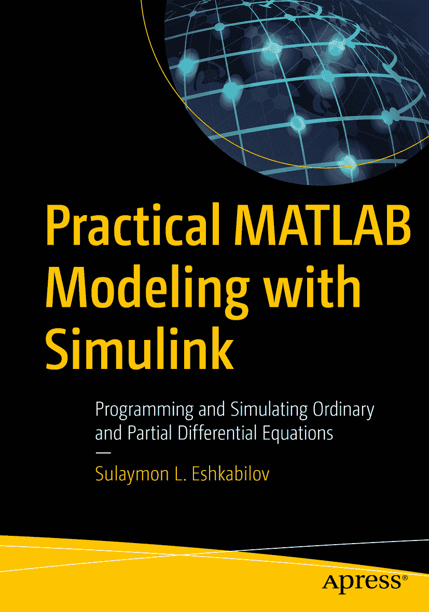

ISBN 978-1-4842-5798-2 e-ISBN 978-1-4842-5799-9 [`doi.org/10.1007/978-1-4842-5799-9`](https://doi.org/10.1007/978-1-4842-5799-9)  
© Sulaymon L. Eshkabilov 2020  
本作品受版权保护。出版商保留所有权利，无论涉及材料的全部或部分，特别是翻译、重印、重用插图、朗诵、广播、以缩微胶片或任何其他物理方式复制，以及传输或信息存储与检索、电子改编、计算机软件，或通过目前已知或未来开发的相似或不同方法进行的处理。本书中可能出现的商标名称、标识和图片。对于每个出现的商标名称、标识或图片，我们并非每次均使用商标符号，而是仅以编辑方式使用这些名称、标识和图片，以惠及商标所有者，无意侵犯商标权。本出版物中使用商品名称、商标、服务标志及类似术语，即使未加以标识，也不应被视为对其是否受所有权保护的看法。尽管本书中的建议和信息在出版时被认为是真实准确的，但作者、编辑或出版商均不对可能出现的任何错误或遗漏承担法律责任。出版商对本书所载内容不作任何明示或暗示的保证。本书通过 Springer Science+Business Media 在全球图书贸易中发行，地址：1 New York Plaza, New York, NY 10004, U.S.A. 电话：1-800-SPRINGER，传真：(201) 348-4505，电子邮件：orders-ny@springer-sbm.com，或访问 www.springeronline.com。Apress Media, LLC 是加利福尼亚州的有限责任公司，其唯一成员（所有者）是 Springer Science + Business Media Finance Inc (SSBM Finance Inc)。SSBM Finance Inc 是特拉华州的一家公司。

*谨以此书纪念我的父亲。*  
*献给我的母亲。*  
*献给我的妻子尼戈拉，感谢我们共度的 25 年美好时光。*

