# 2. 一阶常微分方程的数值方法

本章专门探讨使用数值方法求解常微分方程的初值问题。我们将使用的方法包括欧拉法、龙格-库塔法、亚当斯法、泰勒法、米尔恩法和亚当斯-莫尔顿法。具体来说，我们将评估它们的精度和效率。在这些方法中，欧拉法是最简单的一种，实际上包含多种类型，例如前向、后向和改进（修正）欧拉法。

## 欧拉法

如前所述，有三种不同的欧拉法用于计算初值问题的数值解。它们是前向欧拉法、改进欧拉法和后向欧拉法；其中最简单的是前向法。

前向欧拉法表述如下：

```
{
y_i = y_{i-1} + hk
k = f(t_{i-1}, y_{i-1})
t_i = t_{i-1} + h
```

其中 `y[0] = y(t[0])`，且 `i = 1, 2, 3, …, N`。式 (2-1) 所示的前向法可以通过以下算法实现数值搜索解：

```
步骤 1. 定义 `f(t, y)`。
步骤 2. 输入初始条件：`t[0]` 和 `y[0]`。
步骤 3. 输入步长 `h` 和步数 `N`。
步骤 4. 输出 `t[0]` 和 `y[0]`。
步骤 5. 对 `i` 从 `1` 到 `N`，执行步骤 6 和步骤 7。
步骤 6.
k = f(t, y)
y = y + hk
t = t + h
步骤 7. 输出 `t` 和 `y`。
步骤 8. 结束。
```

有时步骤 6 不易理解，在实现上也可能存在困难。该步骤可以用以下表达式更明确地解释：

```
y_1 = y_0 + f(t_0, y_0)(t_1 - t_0)
y_2 = y_1 + f(t_1, y_1)(t_2 - t_1)
y_3 = y_2 + f(t_2, y_2)(t_3 - t_2)
```

因此，我们可以表述如下：

```
y_{i+1} = y_i + f(t_i, y_i)(t_{i+1} - t_i)
```

其中 `i = 1, 2, 3, …, N`。

如果引入等间距步长 `h = t_1 - t_0 = t_2 - t_1 = …`，则 `y[i+1] = y[i] + f[i]h`，其中 `i = 1, 2, 3, …, N`。

### 示例 1

以下是示例问题：`˙y + 2y - e^{-t} = 3`，初始条件（ICs）为：`y(0) = 1`。

为了计算给定一阶非齐次常微分方程问题在 `t = 0...10` 范围内的数值解，我们取 `h = 0.05`（时间步长），并将给定问题方程重写为 `˙y = 3 - 2y + e^{-t}`，该式也可写作 `f(t, y) = 3 - 2y + e^{-t}`。

当 `t[0] = 0` 时，
`y_0 = 1`

当 `t[1] = 0.05` 时，
`y[0] = 1`，`k = f(t[0], y[0]) = 3 - 2 * 1 + e⁰ = 2`
`y[1] = y[0] + h * k = 1 + 0.05 * 2 = 1.1`

当 `t[2] = 0.1` 时，
`y[1] = 1.1`，`k = f(t[1], y[1]) = 3 - 2 * 1.1 + e^{-0.1} = 1.7512`
`y_2 = y_1 + k*h = 1.1 + 1.7512 * 0.05 = 1.1876`
…

现在，基于我们推导出的内容，我们将脚本（`Example1.m`）整合起来，以获得该问题的完整数值解，如下所示：

```matlab
% Example1.m
%% 欧拉前向法。
% 第 1 部分
clc; clearvars; close all;
t0=0;                  % 初始时间
tend=10;               % 结束时间
h=.05;                 % 时间步长
t=t0:h:tend;           % 仿真时间范围
steps=length(t)-1;     % 步数
y0=1;                  % 初始条件 y0 在 t0 处
f=zeros(size(t));      % 内存分配
y1=[y0, f(1, end-1)];  % 内存分配
for ii=1:steps
f(ii)=3+exp(-t(ii))-2*y1(ii);
y1(ii+1)=y1(ii)+f(ii)*h;
end
plot(t, y1, 'b-', 'linewidth', 1.5), grid on
xlabel('\it t')
ylabel('\it y(t)')
hold on
```

## 改进欧拉法

改进欧拉法在某些文献中被称为*修正欧拉法*或*休恩法*。它是一种显式方法，其实现方式与前向欧拉法类似，但第 6 步除外。其第 6 步的实现如下所示：

`y_{i+1} = y_i + (f(t_i, y_i) + f(t_i + h, y_i + h*f_i)) * h/2`； (2-2)

方程（2-2）所示的改进欧拉法，通过以下算法在数值搜索解答中实现：

```
第 1 步。定义 `f(t, y)`。
第 2 步。输入初始条件：`t[0]` 和 `y[0]`。
第 3 步。输入步长 `h` 和步数 `N`。
第 4 步。输出 `t[0]` 和 `y[0]`。
第 5 步。对于从 `1` 到 `N` 的 `i`，执行第 6 步和第 7 步。
第 6 步。
k_1 = f(t_i, y_i)
k_2 = f(t_i + h, y_i + h*k_1)
y_i = y_i + (k_1 + k_2) * h/2
t = t + h
第 7 步。输出 `t` 和 `y`。
第 8 步。结束。
```

在此方法中，第 6 步与前向欧拉法中所给出的步骤略有不同。该步骤可以通过以下表达式更明确地解释。以上述常微分方程问题的示例可以重写此过程，使其表达式更明确：`˙y + 2y - e^{-t} = 3`，`y(0) = 1`。

```
k_{1,i} = f(t_i, y_i) = 3 + e^{-t_i} - 2y_i;
k_{2,i} = f(t_i + h, y_i + h * k_{1,i}) = 3 + e^{-(t_i + h)} - 2(y_i + h*k_{1,i});
y_{i+1} = y_i + (k_{1,i} + k_{2,i}) * (h/2).
```

我们不一定需要 `[t[i+1] = t[i] + h]`，换句话说，根据参考文献 [1]，区间内不必采用均匀时间步长。可变步长求解器也将在后续章节中讨论。该方法的所有描述步骤均在脚本 `Example1.m` 的第 2 部分中实现，如下所示：

```matlab
%% 欧拉改进法或休恩法。
% 第 2 部分
%{
y(n+1)=y(n)+( f(tn,y(n)) + f(tn+h, y(n)+h*fn) )*0.5*h;
或使用不同的表达式（第 6 步与欧拉法不同）：
k1 =f(t,y) = 3+exp(-t(ii))-2*y(ii);
k2 =f(t+h, y+h*k1) = 3 + exp(-(t(ii)+h))-2*(y(ii)+h*k1);
y(ii+1) = y(ii)+(h/2)*(k1(ii)+k2(ii))
%}
f(1) = 3 + exp(-t(1))-2*y0;
f=[f(1), zeros(1, steps-1)];   % 内存分配
y2=[y0, zeros(1, steps-1)];    % 内存分配
for jj=1:steps
f(jj+1)=3+exp(-(t(jj)+h))-2*(y2(jj)+h*f(jj));
y2(jj+1)=y2(jj)+(f(jj)+f(jj+1))*.5*h;
end
plot(t,y2, 'k--', 'linewidth',1.5)
```

# 后向欧拉法

后向欧拉法是一种一阶隐式方法。该方法可用方程（2-3）所示的表达式表示。

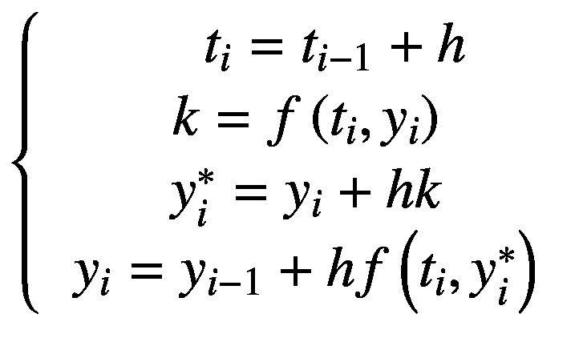

(2-3)

其中 `i` = 1, 2, 3, …, `N`。

在方程（2-3）的公式中，唯一棘手的问题是如何计算 `y_i^{\ast }`。有多种计算方法，其中一种是用前向欧拉法来预测 `y_i^{\ast }`，如方程（2-3）所示，然后根据方程（2-3）的公式重新计算 `y[i]` 来对其进行校正。另一种求 `y_i^{\ast }` 的方法是使用牛顿-拉夫逊法，或基于给定的初值问题方程使用代数公式。前面描述的后向欧拉法可以通过以下算法在数值搜索求解中实现：

步骤 1. 定义 `f(t, y)`。

步骤 2. 输入初始条件：`t[0]` 和 `y[0]`。

步骤 3. 输入步长 `h` 和步数 `N`。

步骤 4. 输出 `t[0]` 和 `y[0]`。

步骤 5. 对于从 1 到 `N` 的 `i`，执行步骤 6 和步骤 7。

步骤 6.

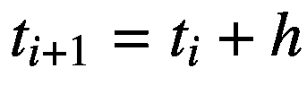

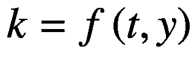

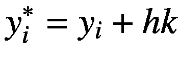

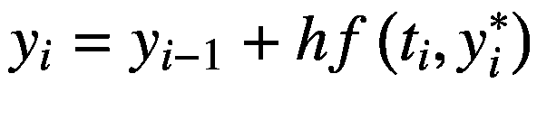

步骤 7. 输出 `t` 和 `y`。

步骤 8. 结束。

在后向欧拉法中，由于 `y_i^{\ast }` 的公式隐含表达，步骤 6 显得复杂；因此，这种方法不易理解，有时用户可能会觉得难以实现。这一步可以用以下表达式更清晰地解释：

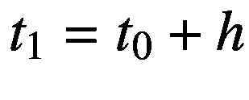

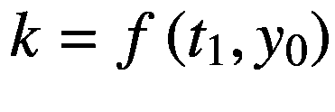

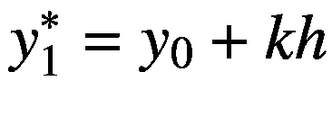

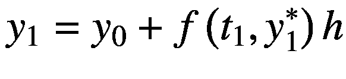

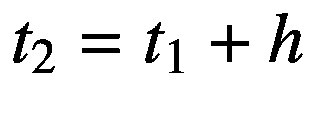

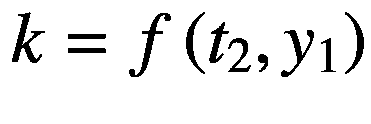

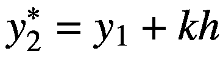

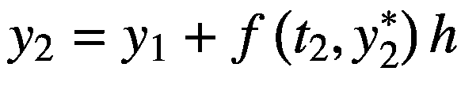

因此，

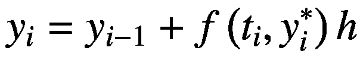

其中 `i` = 1, 2, 3, …, `N`。

如果我们引入等间距步长 `h` = `t[1]` − `t[0]` = `t[2]` − `t[1]` = …，那么 `y[i + 1]` = `y[i]` + `f[i]` * `h`，其中 `i` = 1, 2, 3, …, `N`。

## 示例 2

示例问题如下：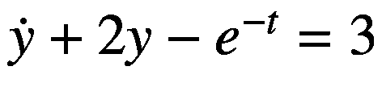 `y(0) = 1`。让我们针对 `t` = 0...10，时间步长 `h` = 0.05 来计算该问题的数值解。首先，重写给定的问题方程：

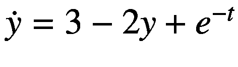

这也可以写成：`f(t, y) = 3 - 2y + e^{-t}`。

现在，基于我们已推导的内容，我们编写脚本 (`Example2.m`) 的第 3 部分来获得该问题的完整数值解，如下所示：

```matlab
%% Example2.m: 欧拉后向法（一阶隐式）
% 第 3 部分
f=zeros(1,steps);             % 内存分配
T=zeros(1, steps);            % 内存分配
yNEW=zeros(1,steps+1);        % 内存分配
y3=[y0, zeros(1,steps-1)];    % 内存分配
for ii=1:steps
T(ii+1)=T(ii)+h;
f(ii)=3-2*y3(ii)+exp(-T(ii));
yNEW(ii)=y3(ii)+h*f(ii);
f(ii+1)=3-2*yNEW(ii)+exp(-T(ii+1));
y3(ii+1)=y3(ii)+f(ii+1)*h;
end
plot(T, y3, 'm-.','linewidth', 1.5),grid on
title('\it 欧拉法求解结果: $$ \frac{dy}{dt}+2*y-e^{-t}=3, y(0)=1 $$', 'interpreter', 'latex')
legend('\it 欧拉前向法 ', '\it 改进欧拉法', '\it 欧拉后向法')
xlabel '\it t'; ylabel('\it 解, y(t)'), shg
```

从图 2-1 所示的绘制结果可以看出，前向法、改进法（休恩法）和后向法（隐式法）这三种解法产生了明显不同的解。在这些方法中，后向欧拉法得到的结果最精确，但由于需要额外计算 `y_i^{\ast }`，其计算时间成本最高。

 `y(0) = 1`) 的仿真结果](img/490522_1_En_2_Fig1_HTML.png)

后向欧拉法在示例 , `y(0) = 1` 中再次得到演示。该问题可以重新表述如下：

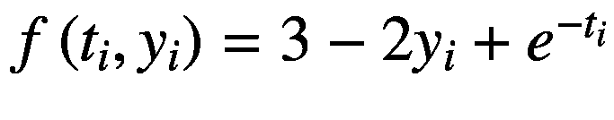 对于 `i` = 1, 2, 3, …, `N`

因此，后向欧拉法可以用更清晰的索引表示如下：

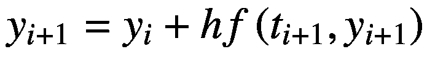

此外，针对给定的问题，可以将其重写如下：

$$ {y}_{i+1}={y}_i+ hf\left({t}_{i+1},{y}_{i+1}\right)={y}_i+h\left(3-2{y}_{i+1}+{e}^{-{t}_{i+1}}\right) $$

$$ {y}_{i+1}={y}_i+h\left(3-2{y}_{i+1}+{e}^{-{t}_{i+1}}\right)\overset{得到}{\to }{y}_{i+1}=\frac{y_i+h\left(3+{e}^{-{t}_{i+1}}\right)}{1+2h} $$

现在，公式 $$ {y}_{i+1}=\frac{y_i+h\left(3+{e}^{-{t}_{i+1}}\right)}{1+2h} $$ 是显式的，可以对 `i` = 1, 2, 3, …, `N` 求解，其中 `t[1]` = `t[0]` = 0 且 `y[1]` = `y` (`t[0]`) = 1，并通过 `Example2.m` 的第 4 部分实现，如下所示：

```matlab
%% 欧拉后向法（另一种方法）。Example2.m
% 第 4 部分
% 内存分配以加速计算
T=zeros(1, steps);          % 内存分配
y4=[y0, zeros(1,steps-1)];  % 内存分配
for ii=1:steps
T(ii+1)=T(ii)+h;
y4(ii+1)=(y4(ii)+h*(3+exp(-T(ii+1))))/(1+2*h);
end
```

# 中点法

中点法是一种二阶显式方法，包含两个步骤，可用公式 (2-4) 中的表达式表示。

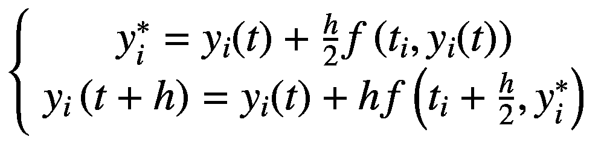

(2-4)

其中 `i` = 1, 2, 3, …, `N`。

该方法相对简单，可通过以下算法直接实现：

步骤 1. 定义 `f(t, y)`。

步骤 2. 输入初始条件：`t[0]` 和 `y[0]`。

步骤 3. 输入步长 `h` 和步数 `N`。

步骤 4. 输出 `t[0]` 和 `y[0]`。

步骤 5. 对于从 `1` 到 `N` 的 `i`，执行步骤 6 和步骤 7。

步骤 6.

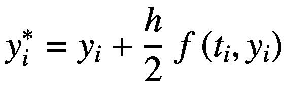
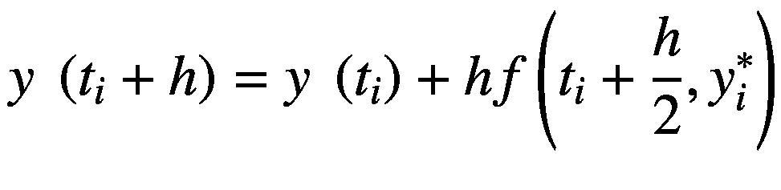

步骤 7. 输出 `t` 和 `y`。

步骤 8. 结束。

与前述方法类似，我们使用更明确的公式来描述步骤 6。

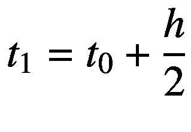
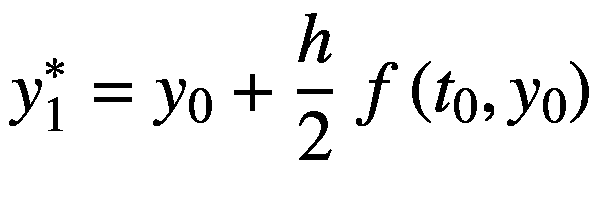
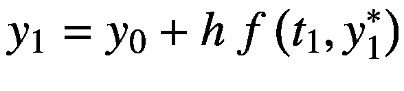
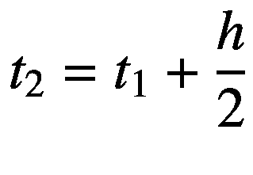
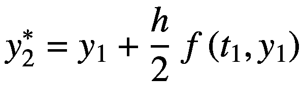
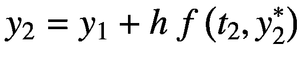

## 示例 3

示例如下： `y(0) = 1`。我们针对 `t = 0...10` 的问题，以 `h = 0.05` 的时间步长计算数值解。首先，将给定的问题方程改写为 。这也可以写成如下形式：`f(t, y) = 3 − 2y + e^(-t)`。

现在，基于我们的推导，编写脚本（`Example3.m`）的第 5 部分，以获得该问题的数值解，如下所示：

```
%%  2nd ORDER(explicit): Mid-Point Rule method
% Example3.m: dy/dt=3-2*y+exp(-t); with ICs: y(0)=1.0
% Part 5
yp=zeros(1,steps);          % Memory allocation
y5=[y0, zeros(1,steps-1)];  % Memory allocation
f1=3-2*y5(1)+exp(-t(1));
f=[f1, zeros(1, steps-1)];  % Memory allocation
for ii=1:steps
yp(ii)=y5(ii)+(h/2)*f(ii);
f(ii+1)=3-2*yp(ii)+exp(-(t(ii)+h/2));
y5(ii+1)=y5(ii)+h*f(ii+1);
end
plot(t, y5, 'g:', 'linewidth', 2.2)
title('\it Solutions of: $$ \frac{dy}{dt}+2*y-e^{-t}=3, y(0)=1 $$', 'interpreter', 'latex')
xlabel('\it t'), ylabel('\it y(t)')
% Compute the analytical solution:
syms u(x) x
Du=diff(u, x);
Equation=Du==3+exp(-x)-2*u;
IC = u(0)==1;
u_sol=dsolve(Equation, IC);
Solution=vectorize(u_sol);
x=t;
Solution=eval(Solution);
plot(t, Solution, 'r-.', 'linewidth', 2)
legend('\it Euler forward ', '\it Euler improved', '\it Euler  backward',...
'\it Mid-point rule','\it Analytical Solution', 'location', 'SouthEast')
xlim([0, 5])
hold off
```

我们还通过以下脚本（作为现有脚本 `Example3.m` 中的一个附加单元格）将所有模拟数据合并，从而获得这些模拟的数值结果，如下所示：

| 时间 | 欧拉前向法 | 改进欧拉法 | 欧拉后向法 | 中点法 | 欧拉后向法（另一种方式） | 解析解（精确） |
| --- | --- | --- | --- | --- | --- | --- |
| `0.00` | `1.00000` | `1.00000` | `1.00000` | `1.00000` | `1.00000` | `1.00000` |
| `0.05` | `1.10000` | `1.09378` | `1.08756` | `1.08869` | `1.09377` | `1.09397` |
| `0.10` | `1.18756` | `1.17612` | `1.16517` | `1.16721` | `1.17609` | `1.17674` |
| `0.15` | `1.26405` | `1.24853` | `1.23381` | `1.23659` | `1.24849` | `1.24948` |
| `0.20` | `1.33068` | `1.31204` | `1.29440` | `1.29775` | `1.31199` | `1.31325` |
| `0.25` | `1.38855` | `1.36760` | `1.34775` | `1.35154` | `1.36754` | `1.36900` |
| `0.30` | `1.43863` | `1.41605` | `1.39460` | `1.39871` | `1.41599` | `1.41760` |
| `0.35` | `1.48181` | `1.45816` | `1.43562` | `1.43995` | `1.45810` | `1.45981` |
| `0.40` | `1.51886` | `1.49461` | `1.47141` | `1.47588` | `1.49454` | `1.49633` |
| `0.45` | `1.55049` | `1.52603` | `1.50251` | `1.50705` | `1.52596` | `1.52777` |
| `0.50` | `1.57732` | `1.55296` | `1.52942` | `1.53398` | `1.55288` | `1.55471` |
| `0.55` | `1.59992` | `1.57590` | `1.55259` | `1.55712` | `1.57583` | `1.57764` |

| `0.60` | `1.61877` | `1.59531` | `1.57241` | `1.57687` | `1.59523` | `1.59702` |
| `0.65` | `1.63434` | `1.61158` | `1.58925` | `1.59361` | `1.61150` | `1.61325` |
| `0.70` | `1.64701` | `1.62507` | `1.60344` | `1.60767` | `1.62500` | `1.62669` |
| `0.75` | `1.65713` | `1.63612` | `1.61526` | `1.61936` | `1.63604` | `1.63767` |
| `0.80` | `1.66504` | `1.64499` | `1.62500` | `1.62893` | `1.64492` | `1.64648` |
| `0.85` | `1.67100` | `1.65197` | `1.63287` | `1.63664` | `1.65189` | `1.65339` |
| `0.90` | `1.67527` | `1.65727` | `1.63910` | `1.64270` | `1.65720` | `1.65862` |
| `0.95` | `1.67807` | `1.66111` | `1.64389` | `1.64730` | `1.66104` | `1.66239` |
| `1.00` | `1.67960` | `1.66368` | `1.64740` | `1.65063` | `1.66360` | `1.66488` |
| `1.95` | `1.61462` | `1.61168` | `1.60815` | `1.60889` | `1.61164` | `1.61191` |
| `2.00` | `1.61027` | `1.60766` | `1.60447` | `1.60515` | `1.60762` | `1.60786` |
| `...` |
| `2.95` | `1.54814` | `1.54824` | `1.54816` | `1.54819` | `1.54823` | `1.54823` |
| `3.00` | `1.54594` | `1.54608` | `1.54605` | `1.54607` | `1.54607` | `1.54607` |
| `...` |
| `4.95` | `1.50687` | `1.50702` | `1.50718` | `1.50715` | `1.50702` | `1.50701` |
| `5.00` | `1.50654` | `1.50668` | `1.50683` | `1.50680` | `1.50668` | `1.50667` |
| `...` |
| `10.00` | `1.50004` | `1.50005` | `1.50005` | `1.50005` | `1.50005` | `1.50005` |

```matlab
%% Combine all data of simulations from four methods
DATA = [t; y1; y2; y3; y4; y5; Solution];
fid = fopen('Example1_Out.dat','w');
fprintf(fid,'%2.2f  %4.5f %6.5f %6.5f %6.5f %6.5f %6.5f\n',DATA);
fclose(fid);
type Example1_Out.dat  % View output data file
```

从以表格形式呈现（写入输出文件 `IVP_ODE.txt`）并绘制在图 2-2 中的数值模拟结果可以清楚地看出，改进欧拉法（Heun 法）和欧拉后向法比另外两种方法（前向法和中点法）收敛更快，且更接近解析解。还值得一提的是，这些方法的精度在很大程度上取决于步长和问题类型，例如刚性或非刚性 ODE。此外，改进欧拉法（Heun 法）和欧拉后向法在计算时间方面比另外两种方法成本更高。

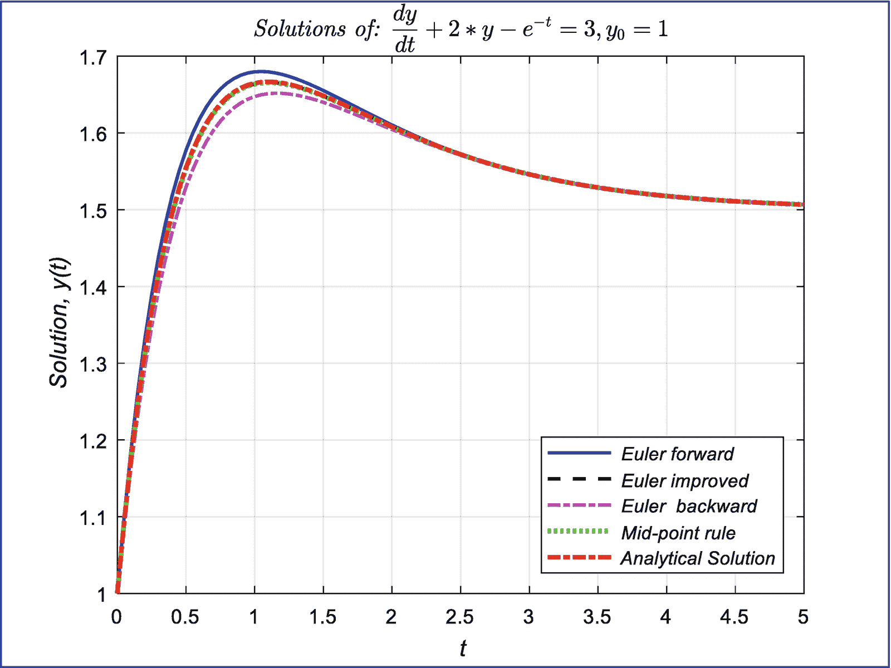

图 2-2

欧拉前向法、改进欧拉法、欧拉后向法和中点法与该问题解析解的模拟结果对比

# 拉尔斯顿方法

拉尔斯顿方法与改进欧拉法（霍因法）类似，但系数略有不同。其表达式如公式(2-5)所示。

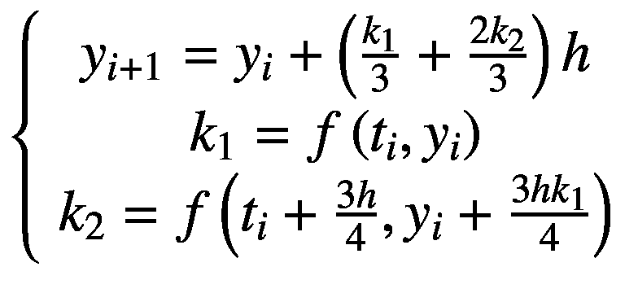

(2-5)

从表达式可以看出，这是一种显式方法，其实现方式与改进欧拉法算法类似。我们在现有脚本（`Example3.m`）中新增一个单元作为第 6 部分，如下所示：

```
%% Ralston Method
% Part 6
k1=zeros(1,steps);        % Memory allocation
k2=zeros(1,steps);        % Memory allocation
y6=[y0, zeros(1,steps)];  % Memory allocation
for jj=1:steps
k1(jj) = 3 + exp(-t(jj))-2*y6(jj);
k2(jj) = 3 + exp(-(t(jj)+3*h/4))-2*(y6(jj)+3*h*k1(jj)/4);
y6(jj+1)=y6(jj)+(k1(jj)+2*k2(jj))*h/3;
end
figure
plot(t, y6, 'b-',t, y1, 'r--','linewidth', 2)
legend('\it Ralston method','\it Euler forward method'), grid on
title('\it Solutions of: $$ \frac{dy}{dt}+2*y-e^{-t}=3, y_0=1 $$', 'interpreter', 'latex')
xlabel('\it t'), ylabel('\it Solution, y(t)'), shg
```

我们将拉尔斯顿法的结果与前向欧拉法的结果绘图比较，得到如图 2-3 所示的曲线图。

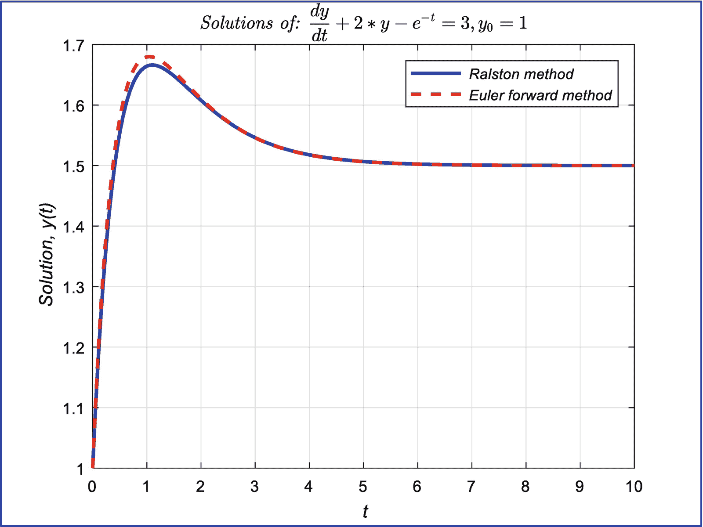

**图 2-3** 拉尔斯顿法与欧拉前向法的解对比

从图 2-3 的曲线可以看出，作为两步法的拉尔斯顿法，其性能优于相对粗糙但在计算时间上更高效的前向欧拉法。

## 龙格-库塔法

龙格-库塔法可以按不同阶次实现，例如一阶龙格-库塔法（等同于欧拉法）、二阶龙格-库塔法（等同于霍因法），以及经典的四阶和五阶龙格-库塔法。这些方法也可采用与欧拉法算法类似的算法实现，只需在第 6 步中引入一些更改。因此，在龙格-库塔法中，通过根据公式(2-6)计算函数值，对前向欧拉法算法的第 6 步进行了如下更改。

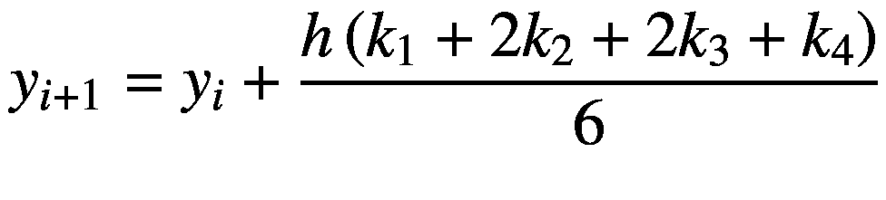

(2-6)

项 `k[1]`、`k[2]`、`k[3]`、`k[4]` 由下式计算：

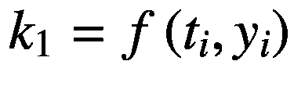

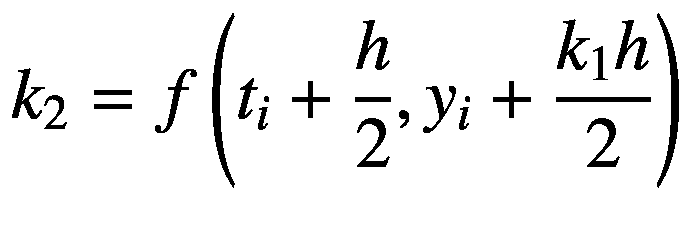

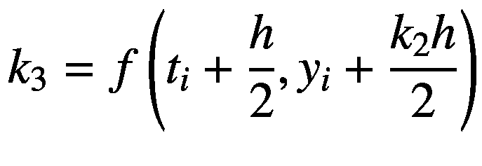

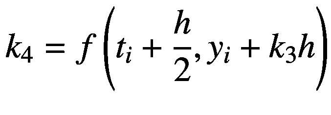

其中 `i = 0, 1, 2, …, N - 1`。总和 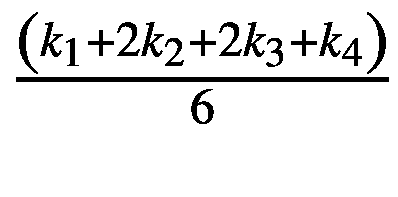 可解释为平均斜率。

### 示例 4

以下是示例问题：，`y(0) = 1`。让我们计算 `t = 0...10`、时间步长 `h = 0.05` 时的数值解，并将给定的问题方程重写为 。这也可以表示为 `f(t, y) = 3 - 2y + e^(-t)`，其中 `t = 0...10`。

对于 `t[0] = 0`，

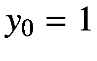

对于 `t[1] = 0.05`，

`y[0] = 1`，`k[1] = f(t[0], y[0]) = 3 - 2 * 1 + e⁰ = 2`

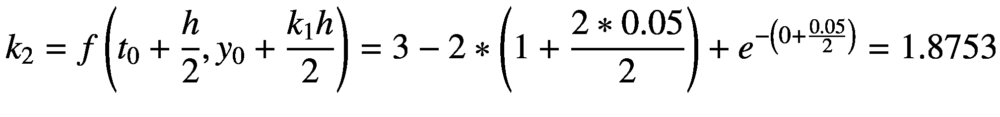

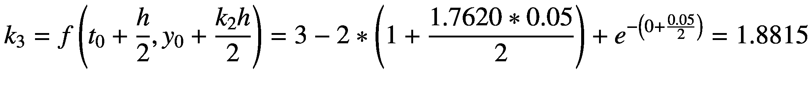

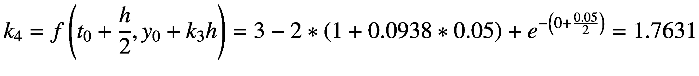

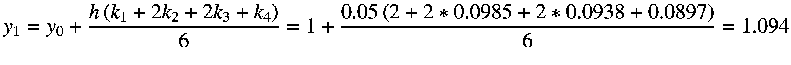

对于 `t[2] = 0.1`，

`y[1] = 1.094`，`k[1] = f(t[1], y[1]) = 3 - 2 * 1.094 + e^(-0.1) = 1.7633`

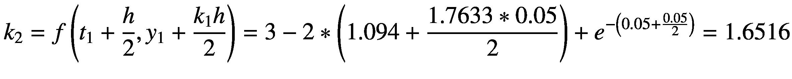

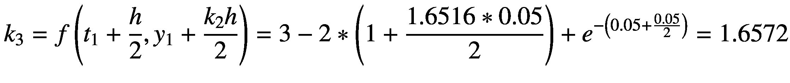

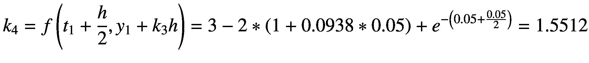

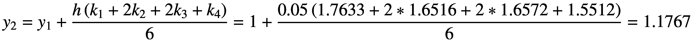

现在，我们在现有脚本（`Example1.m`）中，将经典四阶龙格-库塔法前述的所有六步流程实现为一个新的单元。

```matlab
%% 4th-Order RUNGE-KUTTA Method. Example4.m
% Part 7
% EXAMPLE. y'+2*y-exp(-t)=3 with ICs: y(0)=1\. t=0...10.
%{
Step 6 changed from Euler's Method
k_n1=f(t(n), y(n))
k_n2=f(t(n)+h/2, yn+k_n1*h/2)
k_n3=f(t(n)+h/2, yn+k_n2*h/2)
k_n4=f(t(n)+h, yn+k_n3*h)
y(n+1)=y(n)+h*(k_n1+2*k_n2+2*k_n3+k_n4)/6;
%}
k1=zeros(1,steps);         % Memory allocation
k2=k1;                     % Memory allocation
k3=k1;                     % Memory allocation
k4=k1;                     % Memory allocation
y7=[y0, zeros(1,steps)];   % Memory allocation
for ii=1:steps
k1(ii)=3+exp(-t(ii))-2*y7(ii);
k2(ii)=3+exp(-(t(ii)+h/2))-2*(y7(ii)+k1(ii)*h/2);
k3(ii)=3+exp(-(t(ii)+h/2))-2*(y7(ii)+k2(ii)*h/2);
k4(ii)=3+exp(-(t(ii)+h))-2*(y7(ii)+k3(ii)*h);
y7(ii+1)=y7(ii)+h*(k1(ii)+2*k2(ii)+2*k3(ii)+k4(ii))/6;
end
figure
plot(t, y7, 'k-.', 'linewidth', 1.5), grid on
hold on
plot(t, Solution, 'r-.', 'linewidth', 1.5)
legend('\it Runge-Kutta Method','\it Analytic solution')
title('\it Numerical Solutions of: $$ \frac{dy}{dt}+2*y-e^{-t}=3, y_0 = 1 $$', 'interpreter', 'latex')
xlabel('\it t'), ylabel('\it Solution, y(t)')
xlim([0, 5]), shg
hold off
```

执行脚本 `Example4.m` 的第 7 部分后，我们得到如图 2-4 所示的曲线图。从图中可以看出，对于给定的一阶常微分方程问题，经典四阶龙格-库塔法表现出色，并且与解析解完美收敛。


**图 2-4** 通过四阶龙格-库塔法求解的一阶常微分方程数值解与解析法（`dsolve()`）的对比

# 龙格-库塔-吉尔法

龙格-库塔方法有几种改进版本，龙格-库塔-吉尔法便是其中之一。该方法旨在**最小化舍入误差**，其表达式如公式(2-7)所示。

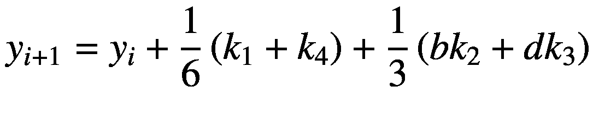
(2-7)

公式(2-7)中的项 `k[1]`、`k[2]`、`k[3]`、`k[4]` 由以下表达式计算得出：

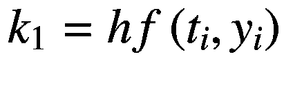

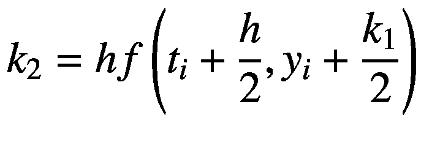

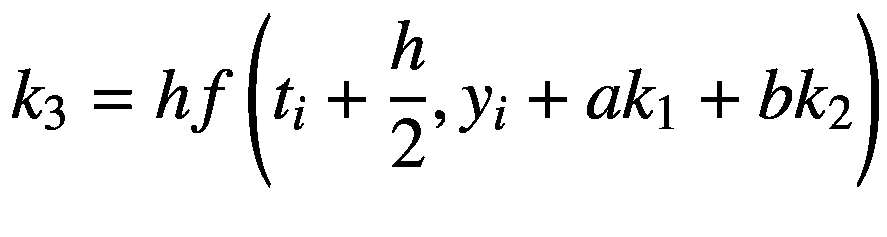

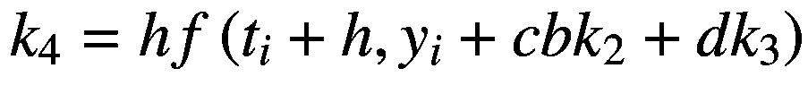

通常，使用以下项 `a`、`b`、`c`、`d` 的值：

，，，

其中 `i` = 0, 1, 2, …, `N` − 1。

现在，我们将上述表达式作为一个额外的代码单元实现到我们的脚本 (`Example1.m`) 中，用于计算  且 `y(0)` = 1 的数值解，如下所示：

```
%% Runge-Kutta-Gill method
% EXAMPLE. y'+2*y-exp(-t)=3 with ICs: y(0)=1\. t=0...10.
% Part 8
a=(sqrt(2)-1)/2; b=(2-sqrt(2))/2; c=-sqrt(2)/2; d=1+sqrt(2)/2;
y8=[y0, zeros(1, steps-1)];
for ii=1:steps
k1(ii)=h*(3+exp(-t(ii))-2*y8(ii));
k2(ii)=h*(3+exp(-(t(ii)+h/2))-2*(y8(ii)+k1(ii)*h/2));
k3(ii)=h*(3+exp(-(t(ii)+h/2))-2*(y8(ii)+a*k1(ii)+b*k2(ii)));
k4(ii)=h*(3+exp(-(t(ii)+h/2))-2*(y8(ii)+c*k2(ii)+d*k3(ii)));
y8(ii+1)=y8(ii)+(k1(ii)+k4(ii))/6+(b*k2(ii)+d*k3(ii))/3;
end
DATA1 = [t; y1; y7; y8; Solution];
% Data export
fid1 = fopen('Example1_Out2.dat', 'w');
fprintf(fid1, 'time  Euler-F  Runge-K  RK-Gill Analytic \n');
fprintf(fid1,'%2.2f  %4.5f %4.5f %4.5f %4.5f\n',DATA1);
fclose(fid1);
type Example1_Out2.dat    % View the imported data on the command window
```

现在，我们比较示例  分别通过前向欧拉法、经典四阶龙格-库塔法、龙格-库塔-吉尔法以及解析法得到的数值模拟结果。

| 时间 | 前向欧拉法 | 四阶龙格-库塔法 | 四阶龙格-库塔-吉尔法 | 解析解 |
| --- | --- | --- | --- | --- |
| `0.00000` | `1.00000` | `1.00000` | `1.00000` | `1.00000` |
| `0.05000` | `1.10000` | `1.09397` | `1.09462` | `1.09397` |
| `0.10000` | `1.18756` | `1.17674` | `1.17791` | `1.17674` |
| `0.15000` | `1.26405` | `1.24948` | `1.25106` | `1.24948` |
| `0.20000` | `1.33068` | `1.31325` | `1.31516` | `1.31325` |
| `0.25000` | `1.38855` | `1.36900` | `1.37116` | `1.36900` |
| `0.30000` | `1.43863` | `1.41760` | `1.41993` | `1.41760` |
| `0.35000` | `1.48181` | `1.45981` | `1.46227` | `1.45981` |
| `0.40000` | `1.51886` | `1.49633` | `1.49887` | `1.49633` |
| `0.45000` | `1.55049` | `1.52777` | `1.53036` | `1.52777` |
| `0.50000` | `1.57732` | `1.55471` | `1.55731` | `1.55471` |
| `0.55000` | `1.59992` | `1.57764` | `1.58022` | `1.57764` |
| `0.60000` | `1.61877` | `1.59702` | `1.59956` | `1.59702` |
| `0.65000` | `1.63434` | `1.61325` | `1.61574` | `1.61325` |
| `0.70000` | `1.64701` | `1.62669` | `1.62911` | `1.62669` |
| `0.75000` | `1.65713` | `1.63767` | `1.64001` | `1.63767` |
| `0.80000` | `1.66504` | `1.64648` | `1.64874` | `1.64648` |
| `0.85000` | `1.67100` | `1.65339` | `1.65556` | `1.65339` |
| `0.90000` | `1.67527` | `1.65862` | `1.66069` | `1.65862` |
| `0.95000` | `1.67807` | `1.66239` | `1.66436` | `1.66239` |
| `1.00000` | `1.67960` | `1.66488` | `1.66675` | `1.66488` |

从这些数值模拟中，我们可以得出结论，经典的四阶龙格-库塔法的性能远优于前向欧拉法。局部截断误差如下：

前向欧拉法：

四阶龙格-库塔法：

在四阶龙格-库塔法的每一步中，需要进行四次函数求值。因此，当需要进行大规模且复杂的计算时，该方法的计算成本将高于欧拉法。

## 龙格-库塔-费尔伯格方法

这是高阶龙格-库塔方法的另一种改进版本，包含六个系数（而非四个）。该方法由方程（2-8）的表达式定义。


(2-8)

系数项，如`k[1]`、`k[2]`、`k[3]`、`k[4]`、`k[5]`、`k[6]`，通过以下表达式计算：


其局部误差为：。其全局误差为：。

龙格-库塔-费尔伯格方法的误差估计公式如下：


(2-9)

现在，我们实现方程(2-8)和(2-9)所示表达式中给出的所有这些过程，以求解前面的示例（`Example4.m`），并在每个计算步骤中计算误差值，如下所示：

```matlab
%% 在 `Example4.m` 中实现的龙格-库塔-费尔伯格方法
% 示例. `y'+2*y-exp(-t)=3` 初始条件: `y(0)=1`\. `t=0...10`.
% 第 9 部分
`F=@(t,y)(3-2*y+exp(-t));`
`y9=[y0, ones(1,steps-1)];`  % 内存分配
`e=zeros(1, steps);`         % 内存分配
for `n`=1:`steps`
`k_n1`=`h`*`F`(`t`(`n`), `y9`(`n`));
`k_n2`=`h`*`F`(`t`(`n`)+`h`/4, `y9`(`n`)+`k_n1`/4);
`k_n3`=`h`*`F`(`t`(`n`)+3*`h`/8, `y9`(`n`)+3*`k_n1`/32+9*`k_n2`/32);
`k_n4`=`h`*`F`(`t`(`n`)+12*`h`/13, `y9`(`n`)+1932*`k_n1`/2197-...
7200*`k_n2`/2197+7296*`k_n3`/2197);
`k_n5`=`h`*`F`(`t`(`n`)+`h`, `y9`(`n`)+439*`k_n1`/216-8*`k_n2`+...
3680*`k_n3`/513-845*`k_n4`/4104);
`k_n6`=`h`*`F`(`t`(`n`)+`h`/2,`y9`(`n`)-8*`k_n1`/27+2*`k_n2`-...
3544*`k_n3`/2565+1859*`k_n4`/4104-11*`k_n5`/40);
`y9`(`n`+1)=`y9`(`n`)+(16*`k_n1`/135+6656*`k_n3`/12825+...
28561*`k_n4`/56430-9*`k_n5`/50+2*`k_n6`/55);
`e`(`n`)=`k_n1`/360-128*`k_n3`/4275-2197*`k_n4`/7524+`k_n5`/50+2*`k_n6`/55;
end
subplot(211)
% 使用 `dsolve` 求得的该问题解析解
plot(`t`, `y9`, 'ko', `t`, `Solution`, 'r-', 'linewidth', 1.5)
legend('\it 龙格-库塔-费尔伯格方法','\it 解析解', 'location', 'southeast')
title('\it 数值解: $$ \frac{dy}{dt}+2*y-e^{-t}=3, y_0 = 1 $$', 'interpreter', 'latex')
xlabel('\it t'), ylabel('\it 解, y(t)')
xlim([0, 5]), grid on
subplot(212)
plot(`e`, 'r-', 'linewidth', 1.5), grid on
title('\it 全局误差: \epsilon')
xlabel('\it t'), ylabel('\it \epsilon(t)')
shg
```

从使用龙格-库塔-费尔伯格方法求解给定一阶微分方程的脚本 `Example4.m` 的仿真结果（如图2-5所示）来看，我们可以发现，在大约70个计算步骤之后，全局误差几乎变为零。另外，必须注意，这是一个非刚性常微分方程问题。


**图 2-5** 问题的数值模拟： `y(0) = 1`

## 亚当斯-巴什福思方法

亚当斯-巴什福思是一种两步法。该方法在不同文献中有多种不同的表述形式，其中一种是用迭代索引表示的，如下所示：


(2-10)

方程(2-10)中的表达式需要两个值，即`y[i+1]`和`y[i]`，才能计算`y[i+2]`的值。对于初值问题，`y[0]`（可以理解为`y[1]`）总是给定的。然而，这对于此计算过程来说是不够的。因此，在这种情况下，我们可以额外采用欧拉（向前）方法作为一个步骤。此外，也可以在这一步中采用泰勒级数方法，然后使用方程(2-10)所示的公式进行后续的其他迭代过程。

### 示例 5

示例问题如下： `y[0]` = 0.5

该给定示例的方程可表示为 ，其解函数为 `f(t, y)` = −2*ty*²。让我们在模拟中采用均匀时间步长 `h` = 0.01。


. . .

Adams-Bashforth 方法在 `Example2.m` 脚本中实现，使用的是与前几种方法（如欧拉方法实现算法）相同的算法步骤，但第 6 步除外，该步骤在公式（2-10）的推导中有所说明。求解结果如图 2-6 所示。


**图 2-6** 两步 Adams-Bashforth 方法

```matlab
% Example5.m
%% ADAMS or ADAMS-Bashforth 2-step Method
% EXAMPLE 2. dy/dt=-2*t*(y²); with ICs: y(0)=0.5
% Part 1.
Fn=0.5;              % ICs: u0 at t0
tend=10;             % max. time limit
h=.01;               % time step size
t=0:h:tend;          % time space
steps=length(t);     % number of steps
% NB: Dy = f(y,t)=-2*y²*t defined via Function Handle
Fcn=@(Fn,t)(-2*(Fn.²).*t);
% Memory allocation:
Fn=[Fn(1), zeros(1,steps-1)];
fn=[Fcn(Fn(1), t(1)),zeros(1,steps-1)];
for ii=1:steps-2
% EULER's method starts from here
Fn(ii+1)=Fn(ii)+h*Fcn(Fn(ii),t(ii));
% Adams-Bashforth method starts from here
fn(ii+2)=Fcn(Fn(ii+1),t(ii+1));
Fn(ii+2)=Fn(ii+1)+(h/2)*(3*fn(ii+1)-fn(ii));
end
figure
plot(t, Fn, 'r:+', 'linewidth', 2), hold on
syms u(T) T
Du = diff(u, T);
Equation=Du==-2*u²*T;
IC=u(0)==0.5;
u=dsolve(Equation, IC);      % Analytical Solution:
U=vectorize(u);
T=t;
U=eval(U);
A =plot(T, U);
A.Color=[.2 .5 .5];
A.LineWidth=A.LineWidth+1.5;
title('Solution of: $$ \frac{dy}{dt}+2*y²*t=0,  y_0=0.5 $$', 'interpreter', 'latex')
legend('\it Adams-Bashforth Method 2-step solver', '\it Analytical solution')
xlabel('\it t')
ylabel('\it Solution, y(t)')
grid on; shg
```

这是三步 Adams-Bashforth 方法 [5]：


(2-11)

这是四步 Adams-Bashforth 方法：


(2-12)

这是五步 Adams-Bashforth 方法：


(2-13)

用公式（2-11）、（2-12）和（2-13）所表示的三步、四步和五步 Adams-Bashforth 方法的实现方式与两步 Adams-Bashforth 方法类似。首先，使用前向欧拉方法求出 `y[i]` 的值，然后通过两步和三步 Adams-Bashforth 方法计算后续的值，例如第二个和第三个值 `y[i+1]` 和 `y[i+2]`。其他值 `y[i+3]` 和 `y[i+4]` 则分别由四步和五步 Adams-Bashforth 方法计算得出。

以下是基于三步、四步和五步 Adams-Bashforth 方法编写的脚本（`Example5.m`）的其他部分：

## ADAMS-Bashforth 方法：3步、4步和5步
```matlab
%% ADAMS-Bashforth 3-step Method
% EXAMPLE 5. dy/dt=-2*t*(y²); with ICs: y(0)=0.5
% Part 2.
% NB: Dy = f(y,t)=-2*y²*t defined via Function Handle
Fcn=@(Fn,t)(-2*(Fn.²).*t);
% Memory allocation with ZERO matrices
Fn=[Fn(1), zeros(1,steps-1)];
fn=[Fcn(Fn(1),t(1)), zeros(1,steps-1)];
for ii=1:steps-3
    % EULER's method is used here
    Fn(ii+1)=Fn(ii)+h*Fcn(Fn(ii),t(ii));
    % 2-step ADAMS-Bashforth method is used here
    Fn(ii+2)=Fn(ii+1)+h*(1.5*Fcn(Fn(ii+1),t(ii+1))-0.5*Fcn(Fn(ii),t(ii)));
    fn(ii+2)=Fcn(Fn(ii+2),t(ii+2));
    % ADAMS-Bashforth method: 3-step starts from here
    Fn(ii+3)=Fn(ii+2)+h*((23/12)*fn(ii+2)-(4/3)*fn(ii+1)+(5/12)*fn(ii));
end
plot(t, Fn, 'g:x', 'linewidth', 2), grid on
% ADAMS or ADAMS-Bashforth 4-step Method
Fcn=@(Fn,t)(-2*(Fn.²).*t);
% Memory allocation with ZERO matrices
Fn=[Fn(1), zeros(1,steps-1)];
fn=[Fcn(Fn(1),t(1)), zeros(1,steps-1)];
for ii=1:steps-4
    % EULER's method is used here
    Fn(ii+1)=Fn(ii)+h*Fcn(Fn(ii),t(ii));
    % ADAMS-Bashforth method: 2-step
    Fn(ii+2)=Fn(ii+1)+h*(1.5*Fcn(Fn(ii+1),t(ii+1))-0.5*Fcn(Fn(ii),t(ii)));
    % ADAMS-Bashforth method: 3-step
    Fn(ii+3)=Fn(ii+2)+h*((23/12)*fn(ii+2)-(4/3)*fn(ii+1)+(5/12)*fn(ii));
    fn(ii+3)=Fcn(Fn(ii+3),t(ii+3));
    % ADAMS-Bashforth method: 4-step starts from here
    Fn(ii+4)=Fn(ii+3)+h*((55/24)*fn(ii+3)-...
        (59/24)*fn(ii+2)+(37/24)*fn(ii+1)-(3/8)*fn(ii));
end
plot(t, Fn, 'm--', 'linewidth', 2), grid on
%  ADAMS-Bashforth 5-step Method
Fcn=@(Fn,t)(-2*(Fn.²).*t);
% Memory allocation with ZERO matrices
Fn=[Fn(1), zeros(1,steps-1)];
fn=[Fcn(Fn(1), t(1)), zeros(1,steps-1)];
for ii=1:steps-5
    % EULER's method is used here
    Fn(ii+1)=Fn(ii)+h*Fcn(Fn(ii),t(ii));
    % ADAMS-Bashforth method: 2-step
    Fn(ii+2)=Fn(ii+1)+h*(1.5*Fcn(Fn(ii+1),t(ii+1))-0.5*Fcn(Fn(ii),t(ii)));
    % ADAMS-Bashforth method: 3-step
    Fn(ii+3)=Fn(ii+2)+h*((23/12)*fn(ii+2)-(4/3)*fn(ii+1)+(5/12)*fn(ii));
    % ADAMS-Bashforth method: 4-step
    Fn(ii+4)=Fn(ii+3)+h*((55/24)*fn(ii+3)-(59/24)*fn(ii+2)+...
        (37/24)*fn(ii+1)-(3/8)*fn(ii));
    fn(ii+5)=Fcn(Fn(ii+4),t(ii+4));
    % ADAMS-Bashforth method: 5-step starts from here
    Fn(ii+5)=Fn(ii+4)+h*((1901/720)*fn(ii+4)-...
        (1387/360)*fn(ii+3)+(109/30)*fn(ii+2)-...
        (637/360)*fn(ii+1)+(251/720)*fn(ii));
end
plot(t, Fn, 'k-', 'linewidth', 2), grid on
title('Solution of: $$ \frac{dy}{dt}+2*y²*t=0,  y_0=0.5 $$', 'interpreter', 'latex')
legend('AB Method 2-step', 'Analytical solution', 'AB Method 3-step',...
    'AB Method 4-step', 'AB Method 5-step'), shg
```
通过执行该脚本，我们得到图 2-7 所示的绘图，该图显示了 Adams-Bashforth 三步、四步和五步方法的计算结果，并与使用 `dsolve()` 计算的问题解析解得出的数值结果进行了对比。


**图 2-7** Adams-Bashforth 方法（三步、四步和五步）与使用 `dsolve()` 所得解析解的仿真对比

从仿真的曲线图（图 2-6 和 2-7）可以看出，对于给定的一阶常微分方程，采用两步、三步、四步和五步的 Adams-Bashforth 方法得到的结果与解析解高度吻合，以至于更高阶 Adams-Bashforth 方法的精度提升在图中并不明显。事实上，Adams-Bashforth 方法的精度取决于给定的常微分方程类型（刚性或非刚性、线性或非线性），并且可以通过增加计算时间来显著提高精度。

## 米尔恩方法
米尔恩方法是另一种显式多步常微分方程求解器，其公式如下：

 (2-14)

在实现方程 (2-14) 中的米尔恩方法时，与 Adams-Bashforth 方法类似，我们需要采用其他方法来定义 `y[i]`、`y[i+1]`、`y[i+2]` 的值。示例如下：
欧拉前向法：`y[i+1] = y[i] + h * f(t[i], y[i])`
Adams-Bashforth 方法：

## 示例 6
示例问题如下：![$$ \frac{dy}{dt}=1-t\sqrt[3]{y} $$](images/490522_1_En_2_Chapter/490522_1_En_2_Chapter_TeX_IEq35.png)，`y(0) = 1`。
以下是在 `Example3.m` 脚本中实现米尔恩方法以求解该问题的代码：

## 米尔恩方法

以下是使用米尔恩方法求解微分方程的 MATLAB 脚本示例。

```matlab
% Example6.m
%% 米尔恩方法
% f(y,t) 的第一项由欧拉方法求得
% f(y,t) 的第二项由两步 Adams-Bashforth 方法求得
y0=1;                        % 初始条件：t0 时刻的 u0
tend=5;                      % 最大时间限制
h=.01;                       % 时间步长
t=0:h:tend;                  % 时间空间
steps=length(t);             % 步数
fun = @(t, y)(1-t*y^(1/3));
% 内存分配
y=[y0, zeros(1,steps-1)];
for ii=1:steps-3
    % 此处使用欧拉方法
    y(ii+1)=y(ii)+h*fun(t(ii), y(ii));
    % 此处使用两步 Adams-Bashforth 方法
    y(ii+2)=y(ii+1)+(3/2)*h*fun(t(ii+1),y(ii+1))-(1/2)*h*fun(t(ii),y(ii));
    % 米尔恩方法从这里开始
    y(ii+3)=y(ii)+(h/3)*(8*fun(t(ii+2),y(ii+2))-4*fun(t(ii+1),...
        y(ii+1))+8*fun(t(ii),y(ii)));
end
plot(t, y, 'b-', 'linewidth', 1.5), grid on
title('\it Milne method solution of: $$ \frac{dy}{dt}=1-t*y^\frac{1}{3} $$', 'interpreter', 'latex')
xlabel '\it t'; ylabel '\it Solution, y(t)'; shg
```

上述脚本（`Example3.m`）求解练习问题的数值解如图 2-8 所示。


**图 2-8**

使用米尔恩方法计算 ![$$ \frac{dy}{dt}=1-t\sqrt[3]{y} $$](images/490522_1_En_2_Chapter/490522_1_En_2_Chapter_TeX_IEq36.png)，`y(0) = 1` 的数值解

## 泰勒级数法

泰勒级数法是求解一阶常微分方程的最简单技巧之一。该方法可以用以下公式表示：


(2-15)

其中 `h` 是步长，等于 `t[i+1] - t[i]`。该技术需要根据截断项数，计算给定问题方程在 `t[i]` 处的若干阶导数。从方程 (2-15) 所示的公式可以看出，一阶泰勒级数展开等价于前向欧拉方程。通过增加泰勒级数的阶数，我们可以获得更精确的数值结果。同时，应该注意，泰勒级数的阶数越高，计算成本也越高。方程 (2-15) 中的导数  是通过对给定问题方程  进行微分得到的。由于根据前面写出的公式，我们知道函数 `f` 依赖于两个变量 `y` 和 `t`，并且 `y` 是 `t` 的函数，因此在对函数关于 `t` 求微分时，我们必须小心谨慎。现在，来看一个具体示例，以便更明确地解释泰勒级数的应用。

### 示例 7

以下是示例问题：，`y(0) = 1`。我们使用包含两项的泰勒级数法来计算给定一阶常微分方程的数值解。首先，计算给定一阶常微分方程的二阶和三阶导数，如下所示： 和 。

利用已求得的表达式，我们写出用于计算二阶和三阶泰勒级数展开式中 `y[i + 1]` 的公式。问题的二阶泰勒级数展开式如下：

问题的三阶泰勒级数展开式如下：

现在，我们将所有这些内容实现在名为 `Example4.m` 的脚本中，并通过执行该脚本来获得数值解。

```matlab
% Taylor series method
% Example7.m solves dy/dt=3+exp(-t)-2*y; y(0)=1
t0=0;
tend=10;
h=0.05;
t=t0:h:tend;
steps=length(t)-1;
y0=1;
y2=[y0, zeros(1, steps-1)];   % Memory allocation for 2nd-order
y3=[y0, zeros(1, steps-1)];   % Memory allocation for 3rd-order
for ii=1:steps
    % 2nd-order Taylor series:
    y2(ii+1)=y2(ii)+h*(3+exp(-t(ii))-2*y2(ii))+...
        (h²/2)*(-exp(-t(ii))-2*(3+exp(-t(ii))-2*y2(ii)));
    % 3rd-order Taylor series:
    y3(ii+1)=y3(ii)+h*(3+exp(-t(ii))-2*y3(ii))+...
        (h²/2)*(-exp(-t(ii))-2*(3+exp(-t(ii))-2*y3(ii)))+...
        (h³/6)*(exp(-t(ii))-2*(-exp(-t(ii))-2*(3+exp(-t(ii))-2*y3(ii))));
end
plot(t, y2, 'bx--', t,y3, 'ko:', 'linewidth', 1.5), grid minor
xlabel '\it t', ylabel('\it Solution, y(t)')
syms u(x)  x
Du=diff(u, x);
Equation=Du==3+exp(-x)-2*u;
IC = u(0)==1;
u_sol=dsolve(Equation, IC);
U_sol=vectorize(u_sol); x=t;
Solution=eval(U_sol);
hold on
plot(x, Solution, 'r-', 'linewidth', 1.5)
title('\it Solutions of: $$ \frac{dy}{dt}+2*y-e^{-t}=3, y_0=1 $$', 'Interpreter', 'latex')
legend('\it 2nd order Taylor series','\it 3rd order Taylor series', '\it Analytical solution'), hold off
```

通过执行前面的脚本，我们得到了图 2-9 所示的图形，该图展示了二阶和三阶泰勒级数解与其解析解的完美收敛性。


**图 2-9.**  的泰勒级数数值解与解析解的对比

从图 2-9 可以看出，通过二阶和三阶泰勒级数求得的解几乎看不到任何发散，并且通过泰勒级数法求得的数值解与解析解具有良好的收敛性。因此，可以得出结论，对于给定的问题，二阶泰勒级数的精度已经足够。

## 亚当斯-莫尔顿法

与龙格-库塔法和亚当斯-巴什福思法不同，亚当斯-莫尔顿法是一种隐式的预测-校正型常微分方程求解器。单步亚当斯-莫尔顿法 [2] 用以下简单的隐式公式表达：

 (2-16)

方程 (2-16) 中的表达式也称为*后向欧拉法*，我们之前在讨论欧拉法时已经介绍过。

在实现此方法时，可以使用以下公式：

* `y[i + 1]^(P) = y[i] + h f(t[i], y[i])` 预测步（前向欧拉法）
* `y[i + 1] = y[i] + h f(t[i + 1], y[i + 1]^(P))` 校正步（后向欧拉法）

以下是两步亚当斯-莫尔顿法：

 (2-17)

这也称为*梯形法则法*，可以通过以下表达式之一定义：

*  预测步（前向欧拉法）
* ，适用于 `y[i] = y[i - 1] + h f(t[i - 1], y[i - 1])` 的另一种预测步
* ，用于迭代过程的校正步

以下是三步亚当斯-莫尔顿法：

 (2-18)

方程 (2-18) 中的方法将使用以下附加的（预测步和校正步）表达式实现：

*  预测步
*  校正步
*  用于迭代的预测步
*  用于迭代过程的校正步

以下是四步亚当斯-莫尔顿法：

 (2-19)

方程 (2-19) 中的表达式应使用以下附加的（预测步和校正步）表达式实现：

*  预测步
*  校正步
*  预测器
*  校正器
*  用于迭代的预测器
*  用于迭代的校正器

以下是五步 Adams-Moulton 方法：

同样，方程式 (2-20)中的表达式将通过以下预测器-校正器步骤实现：

 预测器

 校正器

 预测器

 校正器

 预测器

 校正器

 预测器

 用于迭代过程的校正器

## 示例 8

求解以下问题：  `y[0]` = 0.5。现在，我们将通过一个脚本文件 (`Example8.m`) 来实现之前所有的表达式，以计算给定问题的数值解： `y[0]` = 0.5。

```matlab
% Example8.m
%% ADAMS-Moulton 1, 2, 3, 4 and 5 step Methods.
clc; close all; clearvars
`Fn0`=0.5;            % ICs: u0 at t0
`tend`=10;            % end time
`h`=.1;               % time step size
`t`=0:`h`:`tend`;         % time space
`steps`=`length`(`t`);    % number of steps
% Part 1
% ADAMS-Moulton 1-step Method
% NB: Dy = f(y,t)=-2*y²*t defined via Function Handle
`Fcn`=@(`Fn`,`t`)(-2*(`Fn`.²).*`t`);
% Memory allocation with ZERO matrices
`Fn`=[`Fn0`, `zeros`(1,`steps`-1)];
for `ii`=1:`steps`-1
    % EULER's forward method is used here
    `Fn`(`ii`+1)=`Fn`(`ii`)+`h`*`Fcn`(`Fn`(`ii`), `t`(`ii`));
    % ADAMS-Moulton method: 2-step starts from here
    `Fn`(`ii`+1)=`Fn`(`ii`)+`h`*`Fcn`(`Fn`(`ii`+1), `t`(`ii`+1));
end
`plot`(`t`, `Fn`, 'bs-'), `grid` on
`hold` on
%%   ADAMS-Moulton 2-step Method
% Part 2
`Fcn`=@(`Fn`,`t`)(-2*(`Fn`.²).*`t`);
% Memory allocation with ZERO matrices
`Fn`=[`Fn`(1), `zeros`(1,`steps`-1)];
for `ii`=1:`steps`-1
    % EULER's forward method is used here
    `Fn`(`ii`+1)=`Fn`(`ii`)+`h`*`Fcn`(`Fn`(`ii`), `t`(`ii`));
    % ADAMS-Moulton method: 2-step starts from here
    `Fn`(`ii`+1)=`Fn`(`ii`)+(`h`/2)*(`Fcn`(`Fn`(`ii`+1), `t`(`ii`+1))+`Fcn`(`Fn`(`ii`),`t`(`ii`)));
end
`plot`(`t`, `Fn`, 'mx--'), `grid` on
%%  ADAMS-Moulton 3-step Method
% Part 3
% Memory allocation with ZERO matrices
`Fn`=[`Fn0`, `zeros`(1,`steps`-1)];
for `ii`=1:`steps`-2
    % Predicted value by Euler's forward method
    `Fn`(`ii`+1)=`Fn`(`ii`)+`h`*`Fcn`(`Fn`(`ii`),`t`(`ii`));
    % Corrected value by trapezoidal rule
    `Fn`(`ii`+1)=`Fn`(`ii`)+(`h`/2)*(`Fcn`(`Fn`(`ii`+1),`t`(`ii`+1))+`Fcn`(`Fn`(`ii`), `t`(`ii`)));
    % Predicted solution:
    `Fn`(`ii`+2)=`Fn`(`ii`+1)+(3*`h`/2)*`Fcn`(`Fn`(`ii`+1), `t`(`ii`+1))-(`h`/2)*`Fcn`(`Fn`(`ii`), `t`(`ii`));
    % ADAMS-Moulton method: 3-step starts from here
    `Fn`(`ii`+2)=`Fn`(`ii`+1)+`h`*((5/12)*`Fcn`(`Fn`(`ii`+2),`t`(`ii`+2))+...
        (2/3)*`Fcn`(`Fn`(`ii`+1),`t`(`ii`+1))-(1/12)*`Fcn`(`Fn`(`ii`),`t`(`ii`)));
end
`plot`(`t`, `Fn`, 'ko-'), `grid` on
%%  ADAMS-Moulton 4-step Method
% Part 4
% Memory allocation with ZERO matrices
`Fn`=[`Fn0`, `zeros`(1,`steps`-1)];
for `ii`=1:`steps`-3
    % Predicted value by Euler's forward method
    `Fn`(`ii`+1)=`Fn`(`ii`)+`h`*`Fcn`(`Fn`(`ii`),`t`(`ii`));
    % Corrected value by trapezoidal rule
    `Fn`(`ii`+1)=`Fn`(`ii`)+(`h`/2)*(`Fcn`(`Fn`(`ii`+1), `t`(`ii`+1))+`Fcn`(`Fn`(`ii`), `t`(`ii`)));
    % Predicted value
    `Fn`(`ii`+2)=`Fn`(`ii`+1)+(3*`h`/2)*`Fcn`(`Fn`(`ii`+1),`t`(`ii`+1))-...
        (`h`/2)*`Fcn`(`Fn`(`ii`),`t`(`ii`));
    % Corrected value
    `Fn`(`ii`+2)=`Fn`(`ii`+1)+`h`*((5/12)*`Fcn`(`Fn`(`ii`+2),`t`(`ii`+2))+...
        (2/3)*`Fcn`(`Fn`(`ii`+1),`t`(`ii`+1))-(1/2)*`Fcn`(`Fn`(`ii`),`t`(`ii`)));
    % Predicted solution:
    `Fn`(`ii`+3)=`Fn`(`ii`+2)+`h`*((23/12)*`Fcn`(`Fn`(`ii`+2), `t`(`ii`+2))-...
        (4/3)*`Fcn`(`Fn`(`ii`+1), `t`(`ii`+1))+(5/12)*`Fcn`(`Fn`(`ii`),`t`(`ii`)));
    % ADAMS-Moulton method: 4-step starts from here
    `Fn`(`ii`+3)=`Fn`(`ii`+2)+`h`*((3/8)*`Fcn`(`Fn`(`ii`+3),`t`(`ii`+3))+...
        (19/24)*`Fcn`(`Fn`(`ii`+2),`t`(`ii`+2))-(5/24)*`Fcn`(`Fn`(`ii`+1),`t`(`ii`+1))+...
        (1/24)*`Fcn`(`Fn`(`ii`),`t`(`ii`)));
end
`plot`(`t`, `Fn`, 'gh--'), `grid` on
%%  ADAMS-Moulton 5-step Method
% Part 4
% Memory allocation with ZERO matrices
`Fn`=[`Fn`(1), `zeros`(1,`steps`-1)];
for `k`=1:`steps`-4
    % Predicted value by Euler's forward method
    `Fn`(`k`+1)=`Fn`(`k`)+`h`*`Fcn`(`Fn`(`k`),`t`(`k`));
    % Corrected value by trapezoidal rule
    `Fn`(`k`+1)=`Fn`(`k`)+(`h`/2)*(`Fcn`(`Fn`(`k`+1), `t`(`k`+1))+`Fcn`(`Fn`(`k`), `t`(`k`)));
    % Predicted value
    `Fn`(`k`+2)=`Fn`(`k`+1)+(3*`h`/2)*`Fcn`(`Fn`(`k`+1), `t`(`k`+1))- (`h`/2)*`Fcn`(`Fn`(`k`),`t`(`k`));
    % Corrected value
    `Fn`(`k`+2)=`Fn`(`k`+1)+`h`*((5/12)*`Fcn`(`Fn`(`k`+2),`t`(`k`+2))+...
        (2/3)*`Fcn`(`Fn`(`k`+1),`t`(`k`+1))-(1/2)*`Fcn`(`Fn`(`k`),`t`(`k`)));
    % Predicted value
    `Fn`(`k`+3)=`Fn`(`k`+2)+`h`*((23/12)*`Fcn`(`Fn`(`k`+2), `t`(`k`+2))-...
        (4/3)*`Fcn`(`Fn`(`k`+2), `t`(`k`+2))+(5/12)*`Fcn`(`Fn`(`k`),`t`(`k`)));
    % Corrected value
    `Fn`(`k`+3)=`Fn`(`k`+2)+`h`*((3/8)*`Fcn`(`Fn`(`k`+3),`t`(`k`+3))+...
        (19/24)*`Fcn`(`Fn`(`k`+2),`t`(`k`+2))-(5/24)*`Fcn`(`Fn`(`k`+1),`t`(`k`+1))+...
        (1/24)*`Fcn`(`Fn`(`k`),`t`(`k`)));
    % Predicted solution:
    `Fn`(`k`+4)=`Fn`(`k`+3)+`h`*((55/24)*`Fcn`(`Fn`(`k`+3), `t`(`k`+3))-...
        (59/24)*`Fcn`(`Fn`(`k`+2),`t`(`k`+2))+(37/24)*`Fcn`(`Fn`(`k`+1),`t`(`k`+1))-...
        (3/8)*`Fcn`(`Fn`(`k`),`t`(`k`)));
    % ADAMS-Moulton method: 5-step starts from here
    `Fn`(`k`+4)=`Fn`(`k`+3)+`h`*((251/720)*`Fcn`(`Fn`(`k`+4),`t`(`k`+4))+...
        (646/720)*`Fcn`(`Fn`(`k`+3),`t`(`k`+3))-(264/720)*`Fcn`(`Fn`(`k`+2),`t`(`k`+2))+ ...
        (106/720)*`Fcn`(`Fn`(`k`+1),`t`(`k`+1))-(19/720)*`Fcn`(`Fn`(`k`),`t`(`k`)));
end
`plot`(`t`, `Fn`, 'c--', 'linewidth', 2), `grid` on
`title`('\it Solutions of Adams-Moulton method: $$\frac{dy}{dt}= -2*u²*t, u_0=0.5$$ ', 'interpreter', 'latex')
`legend`('1-step', '2-step','3-step', '4-step','5-step')
`xlabel` '\it t', `ylabel`('\it Solution, y(t)'), `shg`
```

仿真结果如图 2-10 所示；收敛性良好，且对于该给定问题，Adams-Moulton 方法的单步、两步与更高步数方法之间的差异微乎其微。需要指出的是，采用更高步数的方法总能获得更高的精度；然而，更高的精度也意味着更高的计算成本，这一点同样适用于之前讨论过的多步方法，例如 Runge-Kutta 法、Adams-Bashforth 法、Milne 法和泰勒级数法。


图 2-10

单步、两步、三步、四步和五步 Adams-Moulton 方法的仿真结果

我们已经分析了几种用于求解常微分方程的显式、隐式、单步和多步数值方法。在显式方法中，我们涵盖了欧拉方法（前向和改进型）、拉尔斯顿法、龙格-库塔法、Adams-Bashforth 法（二、三、四、五步）、Milne 法和泰勒级数法，这些方法均为显式定义，对于非刚性常微分方程初值问题能提供良好结果，并且计算成本相对较低，易于实现。这些方法最大的缺点之一是无法为许多刚性问题提供精确解。

此外，我们还研究了用于求解刚性常微分方程数值解而采用的隐式定义预测-校正法。这些方法包括后向欧拉法、Adams-Moulton 法和 Milne 法。预测-校正法在求解过程中非常稳定，但实现成本较高，由于其额外的计算步骤，仿真成本远高于显式方法。预测-校正法顾名思义，首先对给定问题预测一个候选解，然后对该预测解进行校正。这类方法中最简单的一种是后向欧拉法，它首先通过前向欧拉法或牛顿-拉夫逊法预测一个解，然后进行校正。同样的技术也适用于高阶预测-校正法。在许多文献中，这些方法被归类为不同阶数的 Adams-Moulton 法[2]。

## MATLAB 内置常微分方程求解器

在 MATLAB 中，有一些内置的常微分方程求解器，例如`ode15s`、`ode15i`、`ode23`、`ode23s`、`ode23t`、`ode23tb`、`ode45`和`ode113`，它们能高效地求解多种不同类型初值问题的数值解。这些求解器基于显式龙格-库塔法和隐式 Adams-Bashforth-Moulton 法，并结合了不同的实现算法和 ODE 求解方法，例如 Dormand-Prince 法（`ode45`）、Bogacki-Shampine 法（`ode23`）、Rosenbrock 法（`ode23s`）、梯形法则（`ode23t`）、Adams-Bashforth-Moulton 法（`ode113`）、Gear 法（`ode15s`）等。使用 MATLAB 内置的 ODE 求解器相对简单。以下是 ODE 求解器的一般语法格式：

```
solver(odefun,tspan,y0)
[T,Y] = solver(odefun,tspan,y0)
[T,Y] = solver(odefun,tspan,y0,options)
[T,Y,TE,YE,IE] = solver(odefun,tspan,y0,options)
sol = solver(odefun,[t0 tf],y0...)
```

可以根据给定的问题类型选择任意求解器，具体取决于给定问题是刚性的（刚性程度如何，例如非常刚性或中等刚性）还是非刚性的，以及是显式还是隐式：`ode15s`、`ode15i`、`ode23`、`ode23s`、`ode23t`、`ode23tb`、`ode45`和`ode113`。

值得注意的是，需要谨慎选择 ODE 求解器的类型。在选择求解器类型时，应考虑以下建议和要点。这些内容取自 MATLAB 软件包的帮助库。

| 求解器类型 | 问题类型 | 精度 | 适用场景 |
| :--- | :--- | :--- | :--- |
| `ode15i` | 完全隐式 | 中等 | 仅适用于完全隐式初值问题 |
| `ode15s` | 刚性 | 低到中等 | 当`ode45`因问题刚度导致求解过慢时 |
| `ode23` | 非刚性 | 低 | 适用于误差容限较粗糙的中等刚度问题 |
| `ode23s` | 刚性 | 低 | 适用于误差容限较粗糙的刚性问题 |
| `ode23t` | 中等刚度 | 低 | 适用于中等刚度问题 |
| `ode23tb` | 刚性 | 低 | 适用于误差容限较粗糙的刚性问题 |
| `ode45` | 非刚性 | 中等 | 推荐用于大多数问题；是应首先尝试的 ODE 求解器 |
| `ode113` | 非刚性 | 低到高 | 适用于误差容限严格的问题 |

此外，这些求解器的效率取决于所选的步长类型（固定或可变）、步长大小，以及直接影响到仿真结果精度和计算过程效率的相对误差容限与绝对误差容限。使用内置 ODE 求解器时，步长可以选择为可变（自动选择）或由用户固定/指定。所有内置 ODE 求解器默认会根据给定初值问题的类型（例如刚度水平）和求解搜索空间自动采用可变步长。通过设置选项，可以在 ODE 求解器中控制误差容限。接下来，我们将通过实际练习来研究 ODE 内置求解器的所有这些关键方面和设置。

ODE 求解器的`odefun`函数可以通过以下方式定义：

*   使用函数句柄（`@`）的匿名函数
*   函数文件（`*.m`文件）
*   `matlabFunction`，利用符号数学工具箱生成的函数文件（`*.m`文件）
*   内联函数（在未来的 MATLAB 版本中，此功能将被移除）

**注意**

在调用名为`odefun`的函数时需要小心。如果它是通过匿名函数（`@`）或内联函数定义的，则应按以下命令语法调用：

```
[T Y]=ODEx(my_Function, t, y0);
```

如果我们通过函数文件定义给定问题（函数/表达式），则需要使用以下命令语法之一：

```
[T Y]=ODEx(@Fun_File, t, y0);
[T Y]=ODEx('Fun_File', t, y0);
```

时间空间可以预定义为一个行向量或列向量的时间值，或者仅包含起始值和结束值两个元素，例如`t = linspace(0, 13, 1000)`，`t = 0:0.001:13`，`t = [0, 13]`。

`ODEx`求解器会根据给定 ODE 的性质（刚性或非刚性，线性或非线性等）自动采用不同数量的步数或步长。

### 示例 9

以下是示例问题：，`y[0] = 0.5`。在这个案例中，我们名为 `Fun_File.m` 的函数文件通过下一个函数文件来定义。

```
function F=Fun_File(t, y)
F=(-2*y^2*t);
```

我们将研究几个不同的问题，以展示如何实现这些内置工具及其选项来定义 `odefun`。在第一个示例中，我们展示如何使用匿名函数 (`@`) 来模拟一个一阶常微分方程 (ODE)：，`y[0] = 0.5`。

以下脚本 (`ExampleODE1.m`) 展示了如何使用匿名函数 (`@`) 和固定步长 *h* = 0.1 来实现`ode45`、`ode23`和`ode113`求解器。

```
%%  ExampleODE1.m
% Part 1
% dy/dt=-2*t*(y^2); with ICs: y(0)=0.5
% We test methods for simulation time
clearvars; close all; clc;
F=@(t,y)(-2*y^2*t);
tmax=10;        % max. time limit
h=0.1;          % time step size is defined by a user!!!
t=0:h:tmax;     % time space
y0=0.5;         % ICs: y0 at t0
[time Yode45]=ode45(F, t, y0);
[time Yode23]=ode23(F, t, y0);
[time Yode113]=ode113(F, t, y0);
plot(time,Yode45,'ks-',time,Yode23,'ro-.',time, Yode113,'bx--') grid on
title('\it Solutions of: $$\frac{dy}{dt}+2*t^2=0, y_0 = 0.5$$', 'interpreter', 'latex')
legend ('ode45','ode23','ode113')
xlabel('\it t'), ylabel('\it Solution, y(t)'), shg
```

该脚本的输出如图 2-11 所示。从图中我们可以得出结论，对于给定问题，`ode23`、`ode45`和`ode113`在固定步长 *h* = 0.1 的情况下表现良好。

# 使用MATLAB求解器进行变步长仿真与精度比较


图 2-11 `ode23`、`ode45` 和 `ode113` 的仿真结果

## 注意

如果我们不指定输出变量名称（例如，`ode45(F, t, y0))`），那么所选求解器会将计算结果显示在绘图图形中，并且数值输出不会保存在工作区中。

## 问题描述

让我们来看一下 MATLAB 内置求解器在求解给定问题（示例 1：, `y[0] = 0.5`）时如何采用变步长，以及步长将如何影响仿真精度和计算（用时）成本。

## 求解器性能测试

```
%%  ExampleODE1.m
% Part 2
clearvars
F=@(t,y)(-2*y²*t);
tmax=10;            % max. time limit
t=[0,tmax];         % time space
y0=0.5;             % ICs: y0 at t0
tic;
[time, Yode45]=ode45(F, t, y0);
Tode45=toc;
fprintf('Tode45= %2.6f  \n', Tode45)
%
clearvars
F=@(t,y)(-2*y²*t);
tmax=10;             % max. time limit
t=[0,tmax];          % time space
y0=0.5;              % ICs: y0 at t0
tic
[time, Yode23]=ode23(F, t, y0);
Tode23=toc;
fprintf('Tode23= %2.6f  \n', Tode23)
clearvars
%
F=@(t,y)(-2*y²*t);
tmax=10;             % max. time limit
t=[0,tmax];          % time space
y0=0.5;              % ICs: y0 at t0
tic
[time, Yode113]=ode113(F, t, y0);
Tode113=toc;
fprintf('Tode113= %2.6f \n', Tode113)
```

在脚本的第 2 部分中，时间空间（`[t[0], t[end]]`）由初始时间和结束时间值定义。因此，在这种情况下，每个求解器在执行仿真时都采用了变步长。仿真是在一台装有 Windows 10（Intel Core i7: 6500 CPU at 2.50 GHz, with 8 GB RAM）的笔记本电脑上进行的。该脚本输出了以下数据，即求解器 `ode45`、`ode23` 和 `ode113` 的计算时间：

```
Tode45 = 0.003818
Tode23 = 0.004526
Tode113 = 0.008329
```

请注意，`ode45` 的计算时间（`Tode45`）（以秒为单位）是最短的。

## 与前向欧拉法及解析解的比较

让我们将 `ode45` 的仿真结果与采用固定步长的前向欧拉法以及解析解进行比较，如下所示：

```
%%  ExampleODE1.m
% Part 3
% Forward EULER method (1st order explicit)
% EXAMPLE #2: dy/dt=-2*t*(y²); with ICs: y(0)=0.5
clearvars; close all
tic
tmax=10;              % max. time limit
h=0.001;              % time step size
t=0:h:tmax;           % time space
steps=length(t)-1;    % # of steps
y0=0.5;               % ICs: y0 at t0
f=zeros(1,length(t)); % Memory allocation
y=[y0, zeros(1,steps)];   % Memory allocation
for ii=1:steps
f(ii)=-2*y(ii).²*t(ii);
y(ii+1)=y(ii)+h*f(ii);
end
TEf=toc;
fprintf('TEf= %2.6f \n', TEf)
clearvars f y0 h t TEf steps tmax ii
%%
tic
F=@(t,y)(-2*y²*t);
tmax=10;            % max. time limit
h=.001;             % time step size
t=0:h:tmax;         % time space
y0=0.5;             % ICs: y0 at t0
[time, Yode23]=ode23(F, t, y0);
Tode23=toc;
fprintf('Tode23= %2.6f \n', Tode23)
% Analytical solution:
syms u(T)  T
Du = diff(u, T);
Equation=Du==-2*u²*T;
IC = u(0)==0.5;
u=dsolve(Equation,IC);
U=double(subs(u,'T',t));
plot(t, y, 'b-', t, Yode23, 'r-.', t, U, 'm:', 'linewidth',1.5)
xlim([1.399 1.3996])
grid on
legend('\it Euler forward', '\it ode23', '\it Analytical solution')
title('\it Solutions of: $$frac{dy}{dt}+2*t*y²=0, y_0=0.5 $$', 'interpreter', 'latex')
shg
```

脚本的输出如下：

```
T_Euler = 0.000312
Tode45 = 0.120490
```

从计算结果我们可以得出结论，对于这个非刚性问题，前向欧拉法的脚本解决方案在求解速度上大约是 `ode45` 求解器的 386 倍，这意味着在计算时间方面它的成本效益高出 386 倍。同时，如图 2-12 所示，其精度相当高，误差很小。这个例子很好地展示了选择合适的数值求解方法以节省大量计算时间的重要性。


图 2-12 前向欧拉法与 MATLAB `ode45` 内置求解器的对比研究

# 求解器的 OPTIONS、ODESET 和 ODEPLOT 工具

`OPTIONS` 设置在获取数值解的过程中至关重要。例如，通过 `ODESET`，我们可以设置相对精度容差（`RelTol`），它控制解中正确的十进制小数位数（`RelTol` <= 10^(-*p*)，其中 *p* 为正确位数），以及绝对容差（误差边界：`AbsTol`），它决定了当解趋近于零时的精度。在每个迭代步中，都会计算并验证方程（2-21）所示的不等式，该不等式通过相对和绝对误差容差来评估误差信号 *E*[*i*]。


(2-21)

例如，在 MATLAB 中，默认的相对误差容差（`RelTol`）设为 0.001，这大致相当于 0.1% 的精度。

```
options = odeset('name1', value1, 'name2', value2,...)
options = odeset(oldopts, 'name1', value1,...)
options = odeset(oldopts, newopts)
```

`ODESET` 用于设置或调整 `ODEx` 求解器的选项。根据给定的问题类型、精度级别（绝对和相对误差容差）、计算时间以及额外的输入数据，可以调整许多选项。例如，对于之前的示例（示例 1： *y*[0] = 0.5），我们可以对其选项进行如下调整以提高精度，并获取输出函数值及绘制计算值作为输出：

```
options=odeset('OutputFcn',@odeplot,'RelTol',1e-5,'AbsTol',1e-7);
ode45(@(t,y)(-2*y²*t), [0, 5], 0.5, options);
```

这两行命令模拟了该问题，并通过一个交互式构建的图形输出仿真结果，我们可以从中观察解在指定解空间（例如，*t* ∈ [0, 5]）内如何收敛。如果我们不需要输出函数（`'OutputFcn'`）或想跳过它，则应该用空矩阵（[ ], [ ]）代替 `['OutputFcn', @odeplot]`，或者直接省略 `['OutputFcn', @odeplot]`，如下所示：

```
options =odeset([],[], 'RelTol', 1e-5, 'AbsTol', 1e-7);
[time Yode45]=ode45(@(t,y)(-2*y²*t), [0, 5], 0.5, options);
```

或

```
options =odeset('RelTol', 1e-5, 'AbsTol', 1e-7);
[time Yode45]=ode45(@(t,y)(-2*y²*t), [0, 5], 0.5, options);
```

此外，如果我们对 `ODESET` 选项的默认值不满意，还可以相应地调整其他一些选项。借助 `ODESET` 选项，我们还可以打印出所选 `ODE` 求解器（例如 `ode23`、`ode45`、`ode15s`、`ode113`）执行仿真迭代的统计数据（例如，成功步数、失败次数以及仿真过程组件）。当处理具有较大解搜索空间的刚性问题时，统计数据信息对于基准测试目的可能非常有用。

## 示例 10

示例问题如下： *y*[0] = 2.5。以下是用于计算并比较几个使用 `ODESET` 函数设置选项的 ODE 求解器的解决方案脚本（`ODEx_Compare.m`）：

```
clearvars; clc
disp('ODE45 性能: ')
tic;
options=odeset('stats','on','RelTol',1e-5,'AbsTol',1e-7);
ode45(@(t,y)(-200*t*y²), [0, 2], 2.5, options);
toc;
disp('%--------------------------------%    ')
clearvars
disp ('ODE113 性能: ')
tic;
options=odeset('stats','on','RelTol',1e-5,'AbsTol',1e-7);
ode113(@(t,y)(-200*t*y²), [0, 2], 2.5, options);
toc;
disp('%--------------------------------%    ')
clearvars
disp('ODE23s 性能: ')
tic;
options=odeset('stats','on','RelTol',1e-5,'AbsTol',1e-7);
ode23s(@(t,y)(-200*t*y²), [0, 2], 2.5, options);
toc;
disp('%--------------------------------%    ')
clearvars
disp('ODE15s 性能: ')
tic;
ode15s(@(t,y)(-200*t*y²),[0,2], 2.5, odeset('stats','on', ... 'RelTol', 1e-5,'AbsTol',1e-7));
toc;
disp('% ------------------------------%     ')
clearvars
disp('ODE23 性能: ')
tic;
ode23(@(t,y)(-200*t*y²), [0, 2], 2.5,... odeset('stats','on','RelTol',1e-5,'AbsTol',1e-7));
toc;
disp('%--------------------------------%    ')
```

以下是各求解器及其统计数据的对比分析：

```
ODE45 性能:
37 次成功步
3 次失败尝试
241 次函数计算
已用时间: 0.284619 秒.
%--------------------------------%
ODE113 性能:
83 次成功步
4 次失败尝试
171 次函数计算
已用时间: 0.172783 秒.
%--------------------------------%
ODE23s 性能:
204 次成功步
1 次失败尝试
821 次函数计算
204 次偏导计算
205 次 LU 分解
615 次线性系统求解
已用时间: 0.298206 秒.
%--------------------------------%
ODE15s 性能:
122 次成功步
4 次失败尝试
212 次函数计算
1 次偏导计算
24 次 LU 分解
208 次线性系统求解
已用时间: 0.212456 秒.
% ------------------------------%
ODE23 性能:
152 次成功步
7 次失败尝试
478 次函数计算
已用时间: 0.194447 秒.
%-------------------------------%
```

从脚本 `ODEx_Compare.m` 的对比仿真可以看出，对于给定的这个一阶 ODE 仿真，求解器 `ode113` 是这五个求解器中最快的。实际上，MATLAB 的所有 `ODEx` 求解器在仿真开始时都会花费相当大一部分计算时间。因此，为了减少计算时间，只有在我们能够为一个合适的初始步长做出合理预估时，才应引入该初始步长。如果指定了错误的初始步长，可能会导致解不准确。可以使用 `ODESET` 选项来引入初始步长，如下面的命令语法所示。例如，如果我们想引入初始步长为 0.0025，那么下面这个 `ODESET` 命令是合适的：

```
options=odeset('InitialStep', 2.5e-3);
```

现在，如果我们使用指定的初始步长 0.0025 以及调整过的相对和绝对误差容差来测试前面的示例，就会发现 `ode23` 是所有被测试 `ODEx` 求解器中效率最高的，其执行速度大约比其他任何使用的求解器快 10 倍。

**注意**：仅当您知道或能够预估一个合适且匹配的初始步长，并且该步长能显著减少计算/仿真时间时，才指定求解器的初始步长。否则，最好让所选求解器自动选择初始步长。

`ODEXTEND` 是 ODE 求解器的另一个工具，在我们处理大规模且计算成本高昂的问题时可能会很有用。`ODEXTEND` 工具用于在计算过程完成后计算额外的（扩展的）解点。例如，对于示例 2，该函数工具可以如下使用：

% 已计算的点：
```matlab
SOL=ode23(@(t,y)(-200*t*y²), [0, 2], 2.5, []);
%% 扩展解点计算到 5 秒：
Tf =5;
Fun=@(t,y)(-200*t.*y.²);
solext = odextend(SOL, Fun, Tf);
plot(solext.x, solext.y(:,:), 'ko'), shg
```

这样，无需重新计算已有的数据点，就可以计算出额外的解点。

让我们看几个示例，以展示如何使用 `ODESET` 来设置 ODE 选项。

## 示例 11

给定一个一阶常微分方程 (ODE)，示例如下：，`y(0) = 3`，`n = 1, 2, 3, 4, 5, 6`。我们需要针对五个不同的 `n` 值计算该一阶 ODE 的数值解。该 ODE 可以使用 `dsolve()` 进行求解以找到其解析解。这里，我们将展示如何针对基于循环的问题使用 `ODEx` 求解器选项，以及预设 ODE 求解器的相对和绝对误差容限值的重要性。解决方案脚本 (`ODE1sim.m`) 在一个 `[for, end]` 循环内针对不同的 `n` 值求解给定的问题。

```matlab
function ODE1sim
% Numerical solutions of: y'+nty=0; y(0)=3; for t=[0, 3.5];
% For n=1, 2, 3, 4, 5, 6.
y0=3;               % 初始条件
t=[0, 3.5];         % 仿真时间
% RelTol 为相对容差
% AbsTol 为绝对容差
options =odeset('RelTol', 1e-2, 'AbsTol', 1e-1);
for n=1:6
[T,Y] = ode23(@DY1, t, y0, options, n);
if n==1
plot(T,Y, 'b-'); hold on
end
if n==2
plot(T, Y, 'kx-')
end
if n==3
plot(T, Y, 'ro--')
end
if n==4
plot(T, Y, 'kv-.')
end
if n==5
plot(T, Y, 'mp:')
end
if n==6
plot(T, Y, 'cd-')
end
end
legend('n=1','n=2','n=3', 'n=4','n=5','n=6')
title('\it Solution of: $$ \frac{dy}{dt}+n*t*y=0, n=1,2...6, y_0=3 $$', 'interpreter', 'latex')
xlabel('\it t'), ylabel('\it Solution, y(t)'), grid on
hold off
function dy = DY1(t,y, n)
dy= -n.*t.*y;
end
end
```

实际上，该脚本过于冗长，对于更大的 `n` 值效率不高。此外，图 2-13 中的曲线并不平滑，这是因为相对和绝对误差容限的值调整不当，而这些值是 `ODESET` 选择的默认值。


**图 2-13** 仿真  `y(0) = 3`，`n = 1, 2, 3, 4, 5, 6`

以下是针对该问题的一个紧凑解决方案 `ODE1simOK.m`，其中在 `ODESET` 内预设了 `ODEPLOT` 选项作为 `OuputFcn`。

```matlab
function ODE1simOK
% Numerical solutions of: y'+nty=0; y(0)=3; for t=[0, 3.5];
% For n=1, 2, 3, 4, 5 and 6.
%       color (color type): b-blue; g-green; r-red; m-magenta;
%       c-cyan; y-yellow; k-black.
%       lines (line type): - solid line; : colon; -- dashed line;
%       mark (marker type): o-circle; d-diamond; x-cross;
%       s-square; h-hexagon; + plus sign; * asterisk; etc.
y0=1;         % 初始条件
t=[0, 3.5];   % 仿真时间
% 预定义绘图标记标签：
labels = {};
color = 'bgrckmbgrckm';
lines = '--:-:-.--:-:-.';
mark  = 'od+xhsp*^>cs<d+xh';
% RelTol 为相对容差
% AbsTol 为绝对容差
options =odeset('RelTol', 1e-5, 'AbsTol', 1e-7);
labels=cell(1,6);
for n=1:6
[T,Y] = ode23(@DY1, t, y0, options, n);
style = [color(n) lines(n) mark(n)];
labels{n} = ['n = ' num2str(n)];
plot(T,Y,style), hold on
end
legend(labels{:},'Best'), grid on
title('Simulation of: $$ \frac{dy}{dt}+n*t*y=0, n=1,2...6 $$', 'interpreter', 'latex')
xlabel('\it t'), ylabel('\it  Solution, y(t)')
hold off
function dy = DY1(t,y, n)
dy= -n.*t.*y;
end
end
```

该脚本相当紧凑，并生成了下一个交互式构建的图形，如图 2-14 所示。


**图 2-14** 仿真 ，其中 `y(0) = 3`，`n = 1, 2, 3, 4, 5, 6`

图 2-14 中显示的解决方案比图 2-13 中显示的更精确。这种精度是通过略微收紧调整的相对和绝对误差容限实现的，如果对精度有更高要求，这些容限甚至可以进一步收紧。此外，后一个脚本由于使用了通过 `ODESET` 预设的 `ODEPLOT` 选项而更加紧凑。而且，它具有更高的精度，并对相对和绝对误差容限有更严格的控制。

在本节中，我们简要介绍了 ODE 内置求解器以及如何设置它们的参数，例如相对和绝对误差容限，如何使用 `ODESET` 绘制输出，以及如何通过几个一阶 ODE 的示例，使用 `ODEEXTEND` 计算已求解 ODE 的扩展附加值。所有这些工具和过程也适用于二阶及更高阶的 ODE，这将在下一章讨论。

## Simulink 建模

在本章中，我们将仅限于解释如何使用标准且基础的 Simulink 模块来求解和仿真几个 ODE 问题，并提供一些关于工具和选项的说明性注释和建议（有关 Simulink 建模的更多详细信息，请参见 [3]）。我们首先对几个简单的一阶 ODE 进行建模，以演示在 Simulink 环境中对 ODE 建模的简便性。

## 示例 12

以下是示例问题：，`y[0] = 0.5`。（请注意，此问题此前已通过几种不同的方法解决。）给定的问题按照以下步骤在 Simulink 中建模：

**第 1 步。** 重写给定的问题：。

**第 2 步。** 开始构建求解模型。

为了从  得到 `y(t)`，我们需要对  进行积分。该过程的另一种解释是在 `s` 域（使用拉普拉斯变换）：如果对  执行拉普拉斯变换，我们将得到 `s Y(s) – y(t[0])`。为了从 `s Y(s)` 得到 `Y(s)`，我们需要将 `s Y(s)` 乘以 ，这代表积分。

可以从 `Simulink` 库浏览器中获取一个积分器模块 ，该浏览器可通过单击  启动，然后选择 `Libraries` ➤ `Simulink` ➤ `Continuous`。从右侧窗格中，我们选取 `[Integrator]` 模块并将其拖入模型区域。

或者，从 2018a 开始，`Simulink` 的最新版本有一个用户友好的新颖选项，只需单击模型窗口的空白区域，搜索框就会弹出，如下所示：。通过输入 `in`，会弹出如图 2-15 所示的下拉选项。


**图 2-15：** `Simulink` 模型搜索框的下拉选项

在下拉选项中，第一个是如图 2-16 所示的 `Integrator`；按下键盘上的 `Enter` 键。这将创建带有初始条件提示的积分器模块，如下所示：。类似地，所有其他模块都可以直接带入空白的模型窗口，而无需跳转至 `Simulink` 库 。例如，`Gain` 模块可以通过输入 `g` 获得，如下所示：，第一个模块就是 `Gain` 模块。接着，按下 `Enter`，`Gain` 模块就会弹出：。这个模块有一个指定增益值的选项。以类似的方式，我们可以找到模型所需的所有其他模块。


**图 2-16：** `Simulink` 积分器模块

> **注意：** 模型窗口区域中的这个搜索选项新功能从 `MATLAB`/`Simulink` 2018a 版本开始提供。

在此步骤中，给定的初始条件也可以在积分器模块参数中定义，该参数可通过双击模块打开。可以在积分器参数中将初始条件设置为内部或外部，如图 2-17 所示。


**图 2-17：** 积分器模块的初始条件设置选项

在进行常微分方程的 `Simulink` 建模时，我们总是需要从 `[Integrator]` 模块开始。这是在 `Simulink` 环境中构建微分方程或通过微分方程表述的问题的仿真模型时，首要的基本步骤。如果给定的问题具有零初始条件，那么我们就不必担心分配初始条件。默认情况下，积分器的初始条件设置为零。

在此给定示例中，初始条件值为 `0.5`，我们输入该值；然后点击 `Apply` 和 `OK`。在给定的代数表达式  中，我们有一个乘积 (`-2 * t * y²`)、常量增益 (`-2`)、输入信号（时间，`t`）以及数学运算 (`y²`)。此外，其他模块，如 `[Out1]` 和 `[Scope]` 模块，可以添加到模型中以查看和获取计算结果。此模型中使用的七个模块中的四个可以从 `Libraries` ➤ `Simulink` ➤ `Commonly Used Blocks` 中获取：`[Gain]`、`[Product]`、`[Out1]` 和 `[Scope]`。


**图 2-18：** 模型的模块

此外，我们还需要一个输入信号（时间），它是一个 `[Clock]` 模块，位于 `Libraries` ➤ `Simulink` ➤ `Sources`：`[Clock]`。将其拖放到我们的模型窗口中，得到下一组模块，如图 2-19 所示。


**图 2-19：** 模型的模块

最后，最后一个模块 `[Math Function]`，取自 `Simulink`/`Math operations`。它带有菜单选项，可以从中选择数学函数，例如指数、对数、平方、幂等。最后，我们模型所需的所有模块列表就完整了。模块 `[Math Function]`（图 2-20）用于根据来自 `[Integrator]` 模块输出端口的信号计算 `y²`。


**图 2-20：** 模型的模块

现在我们收集了所有必要的模块，但仍需对所选模块的参数进行一些调整和更改。我们可以将常量 `[Gain]` 的值从 `1` 改为 `-2`，这可以通过双击模块，在 `[Gain]` 模块的弹出窗口中更改其增益值，然后点击 `OK` 来完成。我们可以通过双击 `[Math Function]` 模块并选择函数类型 `[square]`（即 `u²`），然后点击 `OK` 来更改其功能。为了获得更好或更可读的模型视图，我们可以通过点击模块并按 `Ctrl+I`，或右键单击并选择模块的 `Rotate & Flip` 选项，来将某些模块（例如 `[Math Function]`）翻转/旋转 180 度。执行这些操作后，我们得到如图 2-21 所示的模块组。


**图 2-21：** 模型的模块

对于第三步，我们通过从一个模块的输出端口向另一个模块的输入端口拖动信号线，或者通过点击一个模块并在按住 `Ctrl` 键的同时点击下一个模块，来连接所有模块。模块按以下顺序连接：

-   对于输入信号，`[Clock]` 与 `[Gain]` 模块相连。
-   `[Gain]` 模块与 `[Product]` 模块相连。
-   `[Product]` 模块与 `[Integrator]` 模块相连。
-   `[Integrator]` 模块与 `[Scope]`、`[Out1]` 和 `[Product]` 模块相连。

最终，我们得到了如下所示的完整模型`Example_2_1ODE.mdl`，如图2-22所示。


**图 2-22**  且`y[0] = 0.5`的完整Simulink模型

对于步骤4，在连接所有模块后，可以根据所使用的Simulink版本，将创建好的模型保存为`*.mdl`或`*.slx`文件扩展名。创建的Simulink模型中所有未知的参数可以在命令窗口中，或者在Simulink内部的“模型属性/回调/InitFcn”中进行定义。完成所有四个步骤后，我们可以将Simulink模型保存为`Example_2_1ODE.mdl`，如图2-22所示。

我们通过点击“运行”图标或按下`Ctrl+T`来仿真创建的Simulink模型。然后，我们可以通过双击`[Scope]`模块查看仿真结果。此外，我们还可以从MATLAB工作区中的`[Out1]`模块获得仿真结果，这些结果以两个变量`tout`和`yout`的形式呈现，这两个变量是`[Out1]`模块输出数据集的默认名称。这是将Simulink模型中的仿真结果获取到MATLAB工作区的少数几种可行方法之一。另一种可能更简单的方法是使用“配置属性”：`[Scope]`模块。要使用此选项（图2-23），请点击图标并选择“配置属性”。将会弹出一个“示波器”窗口。转到“记录”选项卡，并选中“将数据记录到工作区”选项。如有必要，可以更改变量名和保存格式类型。第三种从Simulink模型中保存仿真数据或任何信号值的方法是使用`To Workspace`模块，将任意模块的信号连接到该模块，该模块会收集信号并将其保存到MATLAB工作区。该模块位于Simulink库中，被称为“Sinks”。此模块中的默认变量名为`simout`，可以重命名，并且如有必要可以更改其数据结构类型。


**图 2-23** 交互式地更改`[Scope]`模块的显示选项

最后，仿真结果显示在`[Scope]`模块中，如图2-24所示，其属性已更改。


**图 2-24** `[Scope]`模块的显示选项更改后，`[Scope]`块中的仿真结果

> **注意** 对于不同的Simulink版本，`[Scope]`模块的参数图标和选项会有所不同。

通过使用`[Scope]`模块的参数选项，可以调整绘制数据中的一些内容，例如背景、坐标轴颜色、线型、标记类型以及绘制数据点的颜色。此外，还可以添加图形标题和图例功能，并可调整数据保存选项。

模型参数，例如求解器类型、求解器、步长、相对和绝对容差、过零检测等，可以通过配置参数进行调整。可以通过点击并选择其下拉选项中的“模型配置参数 `Ctrl+E`”，按下`Ctrl+E`，或者选择“工具 ➤ 模型浏览器 ➤ 模型层次结构 ➤ 配置”来访问它们，如图2-25所示。


**图 2-25** 调整配置参数

求解器选项中有几个参数。我们可能需要调整它们以达到数值解所需精度和计算时间效率。这些参数包括：类型（变步长或固定步长）、求解器、步长、相对和绝对误差容限以及过零检测。以下是变步长求解器：`ode45`（Dormand-Prince，默认）、`ode23`（Bogacki-Shampine）、`ode113`（Adams）、`ode15s`（stiff/NDF）、`ode23t`（梯形规则）、`ode23tb`（stiff/TR-BD2）。固定步长求解器有：离散（无连续状态）、`ode1`（Euler）、`ode2`（Heun）、`ode3`（Bogacki-Shampine）、`ode4`（龙格-库塔）等。

Simulink模型可以与MATLAB关联，并且可以在不启动Simulink包的情况下，从命令窗口、M文件或函数文件中进行仿真。要执行一个Simulink模型（例如，`MODELname.mdl`或`MODELname.slx`），我们需要使用带有`sim()`的标准命令语法：

```
sim('MODELname');
sim('MODELname', [time0, timeEND]);
```

这将对名为`MODELname.mdl`的Simulink模型进行仿真，仿真时间范围为`[time0, timeEND]`；此外，我们可以在仿真Simulink模型时指定输出数据名称。

```
[Tout, Uout] = sim('MODELname', [time0, timeEND]);
```

获得输出数据`[Tout, Uout]`后，我们可以执行进一步的数值分析，并绘制获得的结果。在我们开发的模型(`Example_2_1ODE.mdl`)示例中，我们可以使用以下命令对该模型进行仿真：

```
[Tout, Uout] = sim('Example_2_1ODE', [0, 10]);
```

## SIMSET

Simulink模型的求解器选项（设置），例如求解器类型、相对和绝对误差容限、过零点等，可以使用命令`simset()`进行调整。示例如下：

```
OPTIONS = simset('solver','ode3', 'reltol', 1e-3, 'abstol', 1e-5, 'zerocross', 'off');
[Tout, Uout] = sim('Example_2_1ODE', [0, 10], OPTIONS);
```

此外，MATLAB中还有其他的优化选项可用于调整Simulink模型选项，例如`optimset`、`sdo.OptimizeOptions`等。

```
opt = sdo.OptimizeOptions(Name, Value)
```

这可以应用于前面提到的示例，以使用非线性最小二乘优化，命令如下：

```
opts = sdo.OptimizeOptions('Method', 'lsqnonlin');
```

这将优化方法设置为Simulink模型求解器中的非线性最小二乘法。

前面描述的步骤和流程是Simulink模型开发和仿真的通用关键步骤。需要指出的是，在先前创建的模型中，有两个模块，例如`[Out1]`和`[Scope]`，它们不会直接影响模型性能仿真结果。另一点需要注意的是，有些模块是可以互换的。例如，具有内部初始条件选项的`[Integrator]`模块可以更改为具有外部初始条件源的`[Integrator]`模块。另一个例子是，`[Divide]`模块也可以被更改并转换为`[Product]`模块。任何模型都可以通过使用不同的模块并组合数学和代数运算，以几种不同的方式开发出来。

