# 3. 二阶常微分方程的数值方法

二阶或更高阶的常微分方程对于物理学、工程学和自然科学中的广泛问题至关重要。例如，波动方程、电磁现象、热传导和流体力学都是用二阶或更高阶常微分方程建模的。通常，二阶常微分方程的形式如方程 (3-1) 所示。

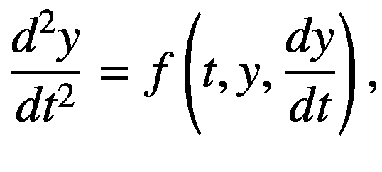

(3-1)

通常，自变量用`t`表示，在许多物理系统中，它通常是一个自变量（例如，相对于时间）。还有许多系统使用`x`、`y`和`z`或其他变量。

一个`n`阶线性微分方程可以用如下一般形式表示：

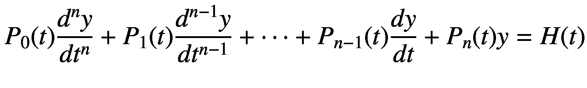

(3-2)

其中`P0`、`P1`...`Pn`和`H(t)`是在某个区间`α` < `t` < `β`上的连续实值函数，并且在该区间内`P0`不接近于零。如果我们用`P0`除以方程 (3-2)，得到以下方程：

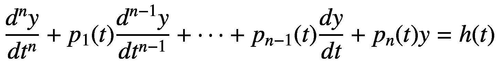

(3-3)

方程 (3-3) 也可以重写如下：

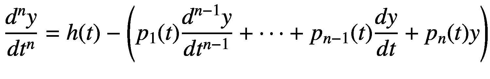

(3-4)

并且也可以写成：

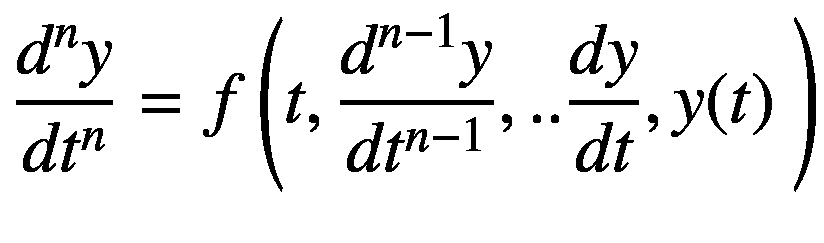

(3-5)

方程 (3-5) 类似于二阶常微分方程的方程 (3-1)。

让我们看几个二阶常微分方程的例子，以展示如何使用欧拉法、龙格-库塔法、亚当斯-巴什福思法和亚当斯-莫尔顿法以及其他方法。此外，我们还演示了如何使用 MATLAB 内置的常微分方程求解器和工具（包括`dsolve()`）来计算数值解和解析解。

一阶常微分方程所采用的方法和先前的做法对于二阶及更高阶常微分方程是相似且有效的。对于所有显式定义的常微分方程，需要多一个（或多个）步骤，即将给定的二阶或更高阶常微分方程重写为一阶常微分方程组。对于隐式定义的常微分方程，我们通过使用 MATLAB 内置求解器`ode15i`和 Simulink 演示了一种单独的方法。

## 欧拉法

在前面的章节中，我们详细介绍了欧拉法的公式推导和实现算法，以展示如何数值求解一阶常微分方程。对于高阶常微分方程，欧拉法的实现步骤相同，只是中间多了一些步骤。因此，在本节中，我们将局限于通过 MATLAB 脚本实现欧拉法，直接计算二阶及更高阶常微分方程的数值解。

### 示例 1

给定一个二阶非齐次常微分方程，示例问题如下：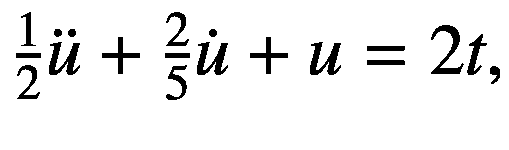 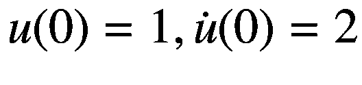。

在编写基于欧拉法的脚本之前，我们需要通过引入新变量，将给定的二阶常微分方程重写为两个一阶常微分方程组成的方程组。

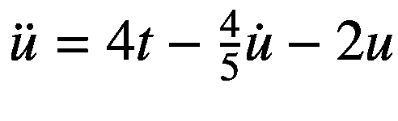 需要重写如下：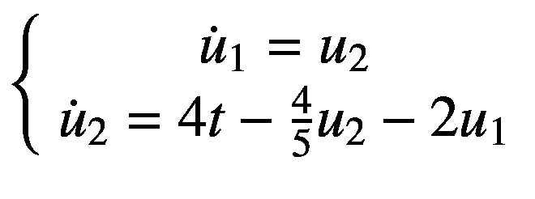。

注意`u[1]` = `u`且。

上述重写后的一阶常微分方程组可以通过多种方式在脚本中实现，例如，直接在脚本中编写方程组、使用匿名函数（`@`）、使用函数或使用函数文件。请注意，从 MATLAB 2018a 开始，在脚本中实现函数是有效的。

以下是嵌入欧拉前向法以计算给定问题数值解（如图 3-1 所示）的脚本（名为`Example1_2ndODE.m`）：

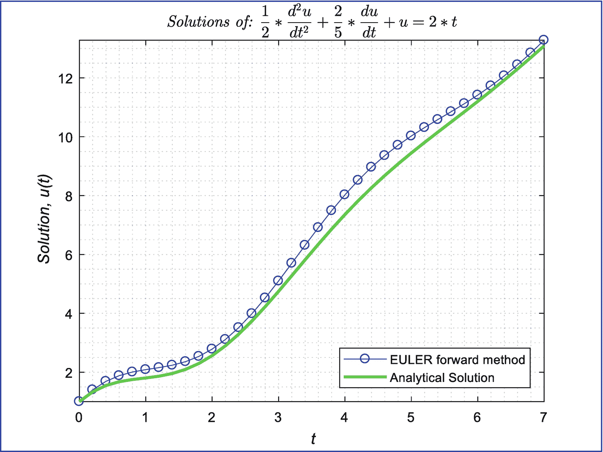

图 3-1

前向欧拉法与用`dsolve()`求解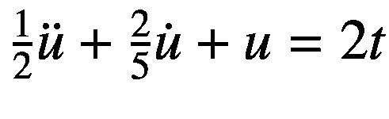,  得到的解析解对比

```
% 示例 1。 (1/2)*u"+(2/5)*u'+u=2*t，初始条件：u(0)=1 & u'(0)=2
% 使用欧拉前向法和 DSOLVE 求解。
clearvars, close all; clc
h=0.2;         % 时间步长
tmax=7;        % 仿真结束时间
t0=0;          % 仿真开始时间
t=t0:h:tmax;
steps=length(t);   % 评估步数
u(1,:)=[1 2];      % 初始条件
%{
注意：u(t) 的维数是二维的，这是因为
有两个变量用于将二阶常微分方程重写为两个一阶常微分方程。
%}
% 方法 #1。 直接表达常微分方程组的方式
for k=2:steps
f=[u(k-1,2), 4*t(k)-(4/5)*u(k-1,2)-2*u(k-1,1)];
u(k,:)=u(k-1,:)+f*h;
end
% 方法 #2。 匿名函数 (@)
%{
F = @(t, u1, u2)([u2, 4*t-(4/5)*u2-2*u1]);
for k=2:steps
F1=F(t(k-1), u(k-1, 1), u(k-1, 2));
u(k,:)=u(k-1,:)+F1*h;
end
%}
% 方法 #3。  函数文件，命名为：FuFu.m
%{
function dudt = FuFu(t, u1, u2)
dudt = [u2, 4*t-(4/5)*u2-2*u1]
end
%}
%{
for k=2:steps
F1=feval(@FuFu,t(k-1), u(k-1, 1), u(k-1, 2));
u(k,:)=u(k-1,:)+F1*h;
end
%}
% 方法 #4
%{
syms T u1 u2
f=[u2, 4*T-(4/5)*u2-2*u1];
matlabFunction(f, 'file', 'F');
for k=2:steps
F1=feval(@F, t(k-1), u(k-1, 1), u(k-1, 2));
u(k,:)=u(k-1,:)+F1*h;
end
%}
plot(t, u(:,1), 'bo'), grid minor, hold on
% 问题的解析解：
syms x(T) Dx T
Dx=diff(x, T);
D2x=diff(x, T, 2);
Equation=D2x==-(4/5)*Dx-2*x+(4*T);
ICs = [x(0)==1, Dx(0)==2];
y=dsolve(Equation, ICs);
Y=double(subs(y,'T',t));
% 或使用：U=vectorize(u); T=t; U=eval(U);
plot(t, Y, 'g-', 'linewidth', 2)
legend('欧拉前向法','解析解', 'location', 'southeast')
title('\it 解的：$$\frac{1}{2}*\frac{d²u}{dt²}+\frac{2}{5}*\frac{du}{dt}+u=2*t $$', 'interpreter', 'latex')
xlabel('\it t'), ylabel('\it 解, u(t)'), hold off
axis tight; shg
```

在前面的示例中应该注意，通过减小步长（`h`），欧拉法的精度会显著提高，就像一阶常微分方程一样。

好的，作为高级文档工程师和翻译员，我将遵循您的注意事项，将给定的英文文本翻译成中文，并保留所有格式。

## 示例 2

给定一个二阶齐次常微分方程，示例问题如下： 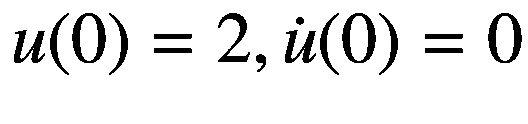。

在这个例子中，和前面的问题一样，我们通过引入新变量，将给定的二阶微分方程改写为两个一阶常微分方程。

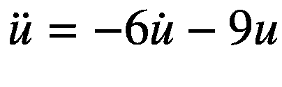 应改写为两个一阶常微分方程：。

注意 `u[1] = u` 且 。

以下是嵌入了前向欧拉法来计算该问题数值解的脚本（`Example2_2ndODE.m`）。请注意，由两个一阶常微分方程定义的给定系统，在循环中被定义为一个二维函数。在此示例中，我们演示了步长对计算出的数值解相对于系统解析解的精度的影响。

```
% EXAMPLE 2\.  u"+6*u'+9*u=0with ICs: u(0)=2 & u'(0)=0
% solved by EULER’s Forward Method and DSOLVE.
clearvars, close all
h=0.1;             % time step size
tend=2.5;          % End of calc's/simulations
t0=0;              % Start of calc's/simulations
t=t0:h:tend;       % Time space
steps=length(t);   % How many steps of evaluations
u(1,:)=[2 0];      % Initial Conditions
% NB: Size of the u(t) is two-dimensional
for k=1:steps-1
f1=[u(k,2), -9*u(k,1)-6*u(k,2)];
% f1(k,:)=[u(k,2), -9*u(k,1)-6*u(k,2)]; % If we need f1 values.
u(k+1,:)=u(k,:)+f1*h;
end
plot(t, u(:,1), 'b--x', 'linewidth', 2), grid on, hold on
% Study step size change effects on errors
h1=0.025;          % time step size
t=t0:h1:tend;
step=length(t);    % How many steps of evaluations
y(1,:)=[2 0];      % Initial Conditions
for k=1:step-1
ff1=[y(k,2), -9*y(k,1)-6*y(k,2)];
y(k+1,:)=y(k,:)+ff1*h1;
end
plot(t, y(:,1), 'g--', 'linewidth', 2)
% Analytical solution of the problem:
syms x(T) Dx T
Dx=diff(x, T);
D2x=diff(x,T,2);
Equation=D2x==-6*Dx-9*x;
ICs=[x(0)==2, Dx(0)==0];
Y=dsolve(Equation, ICs);
Y=double(subs(Y,'T',t));
plot(t, Y, 'k-', 'linewidth', 1.5)
title('\it Solution of: $$ \frac{d²u}{dt²}+6*\frac{du}{dt}+9*u=0, u_0=2, du_0=0 $$', 'interpreter', 'latex')
xlabel '\it t', ylabel '\it Solution, u(t)'
legend('EULER Method: h= 0.1', 'EULER Method: h = 0.05', 'Analytic Solution')
err1= abs((Y(end)-u(end,1))/Y(end))*100;
err2= abs((Y(end)-y(end,1))/Y(end))*100;
error1=['Error (h=0.1): ', num2str(err1),      '%'];
error2=['Error (h=0.025): ', num2str(err2),  '%'];
text(1.0, .75, error1, 'color', 'r', 'fontsize', 14)
text(1.0, .6, error2, 'color', 'r', 'fontsize', 14)
axis([0, 3.5 -0.1 2.25])
hold off
axis tight
```

执行上述脚本后，会显示出数值解的图形（如图 3-2 所示）。

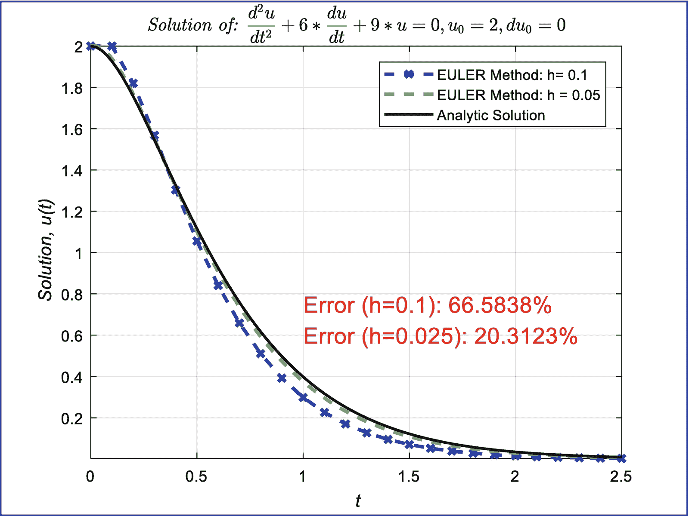

**图 3-2** 针对 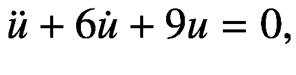  使用前向欧拉法得到的仿真结果

从这些仿真结果（如图 3-2 所示）可以看出，将步长减小到原来的四分之一，我们可以将精度提高三倍以上。这是一个显著的改进，但这是以计算时间增加四倍为代价的。

### 示例 3

给定一个二阶非齐次常微分方程，示例问题如下：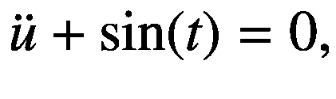 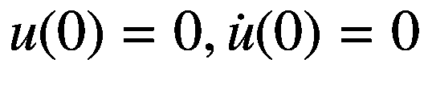。

同样在编写脚本之前，我们将给定问题改写为两个一阶常微分方程。

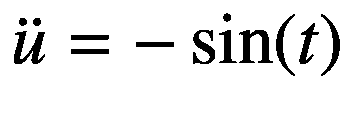 被重写为：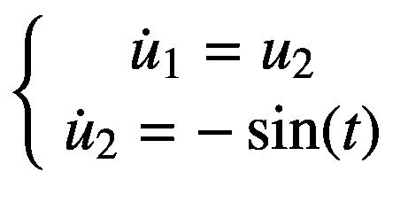

注意 `u[1] = u` 且 。

以下是一个脚本（`Example3_2ndODE.m`），它嵌入了前向欧拉法来寻找该问题的数值解（如图 3-3 所示）。请注意，在我们的脚本中，一阶常微分方程组是直接表示的，如上文重写的公式所示。

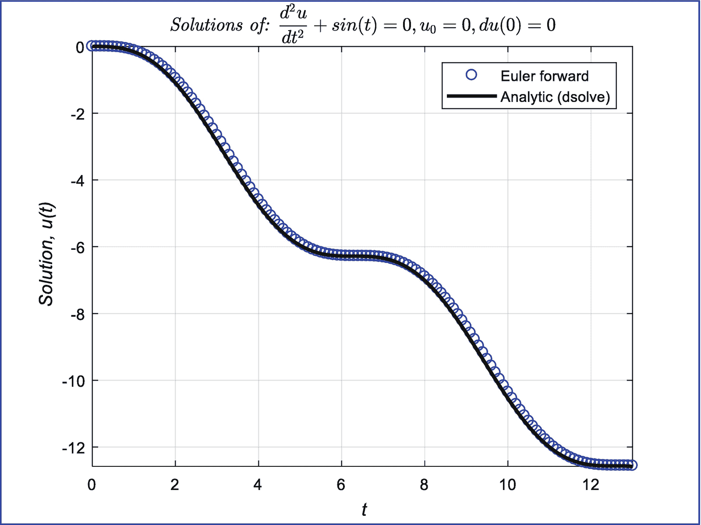

**图 3-3** 前向欧拉法与解析解（`dsolve`）的仿真结果对比。示例 3：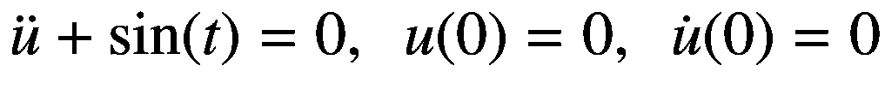。

```
% Example3_2ndODE.m
%% EXAMPLE 3\.  u"=-sin(t) with ICs: u(0)=0 & u'(0)=0
% solved by forward EULER Method and DSOLVE
clc, clearvars; close all
h=0.1;                   % Time step size
tend=13;                 % End of calc's/simulations
t0=0;                    % Start of calc's/simulations
t=t0:h:tend;             % Time space
steps=length(t);         % How many steps of evaluations
u(1,:)=[0 0];            % Initial Conditions
for k=1:steps-1
f1=[u(k,2), -sin(t(k))];
u(k+1,:)=u(k,:)+f1*h;
end
plot(t', u(:,1),'bo')
hold on, axis tight
clearvars u
% Analytical solution of the problem:
syms u(T) T
Du=diff(u, T);
D2u=diff(u, T, 2);
Equation=D2u==-sin(T);
ICs = [u(0)==0, Du(0)==0];
u=dsolve(Equation, ICs);
U=vectorize(u);
T=t;
U=eval(U);
plot(T, U, 'k-', 'linewidth', 2), grid on
legend('Euler forward', 'Analytic (dsolve)')
title('\it Solutions of: $$ \frac{d²u}{dt²}+sin(t)=0, u_0=0, du(0)=0 $$', 'interpreter', 'latex')
xlabel('\it t'), ylabel('\it Solution, u(t)')
shg
```

### 示例 4

给定一个二阶非齐次常微分方程，示例如下：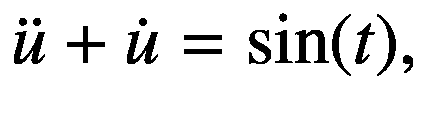 。

同样，在创建脚本之前，我们将给定的问题重写为两个一阶常微分方程。

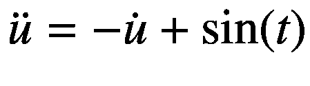 被重写为：

注意 `u[1] = u` 且 。

以下是一个脚本（`Example4_2ndODE.m`），它嵌入了前向欧拉法来求该问题的数值解（如图 3-4 所示）。注意，在我们的脚本中，一阶常微分方程组是直接在一个`for ... end`循环中表达的，如之前重写的公式所示。

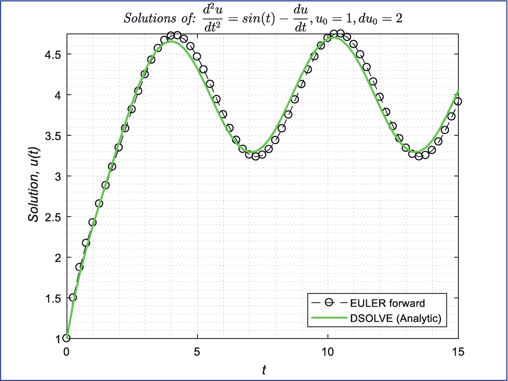

**图 3-4** 示例 4 的仿真结果：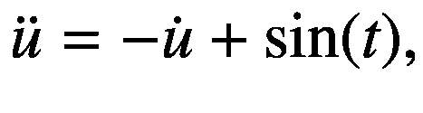 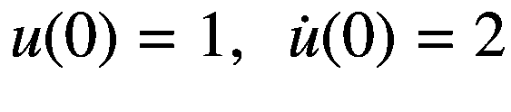

# Example 4

```
% Example4_2ndODE.m
%% EXAMPLE 4\. u"+u'=sin(t) with ICs: [1, 2]
% by EULER Forward Method& DSOLVE (analytical solution)
clearvars; clc; close all
u=[1, 2];            % ICs: u0 at t0
tmax=15;             % max. time limit
h=0.25;              % time step size
t=0:h:tmax;          % time space
steps=length(t);     % # of steps
f = @(t, u)([u(2), -u(2)+sin(t)]);
for k=1:steps-1
u(k+1,:)=u(k,:)+f(t(k), u(k,:)).*h;
end
plot(t, u(:,1),'k--o'), grid minor; hold on
% Analytical solution of the problem:
syms u(T) T
Du=diff(u, T);
D2u=diff(u, T, 2);
Equation=D2u==sin(T)-Du;
ICs = [u(0)==1, Du(0)==2];
u=dsolve(Equation, ICs);
U=double(subs(u,'T',t));
plot(t, U, 'g-', 'linewidth', 1.5)
title('\it Solutions of: $$ \frac{d²u}{dt²}=sin(t)-\frac{du}{dt}, u_0=1, du_0=2 $$', 'Interpreter', 'latex')
legend('EULER forward', 'DSOLVE (Analytic)', 'location', 'southeast')
xlabel '\it t', ylabel('\it Solution, u(t)')
axis tight, hold off
```

# Example 5

给定一个二阶非齐次常微分方程，示例如下：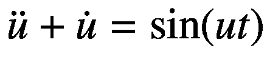，。

注意，这是一个非线性和非齐次的二阶常微分方程。让我们再次测试为欧拉法选择步长的重要性。

同样，在创建脚本之前，我们用两个一阶常微分方程重写给定的问题。

 用下式表达：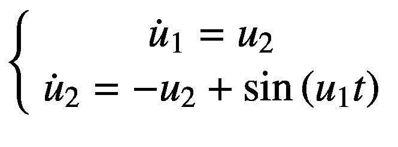

注意 `u[1] = u` 且 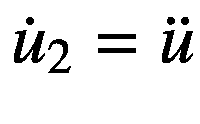。

以下是一个脚本（`Example5_2ndODE.m`），它嵌入了前向欧拉法来求该问题的数值解（如图 3-3 所示）。注意，在我们的脚本中，一阶常微分方程组是直接在脚本中的 `[for ... end]` 循环、匿名函数（`@`）、符号 `matlabFunction` 以及一个函数文件中实现的。选择的步长分别为 0.025、0.05、0.10 和 0.20。

```
% Example5_2ndODE.m
%% EXAMPLE 5\.  u"=-u'+sin(t*u) with ICs: u(0)=1 & u'(0)=2
% solved by Forward EULER  Method
clearvars; clc; close all
h1=0.025;            % Time step size
tmax=13;             % End of simulations
t0=0;                % Start of simulations
t=t0:h1:tmax;        % Time space
steps=length(t);     % How many steps of evaluations
u(1,:)=[1 2];        % Initial Conditions
% NB: Size of the u(t) is two-dimensional
% Direct method (direct expression)
for k=1:steps-1
f1=[u(k,2), -u(k,2)+sin(t(k)*u(k,1))];
u(k+1,:)=u(k,:)+f1*h1;
end
plot(t, u(:,1),'b-', 'linewidth', 2), grid minor
hold on
clearvars t u
h2=0.05;             % Time step size
t=t0:h2:tmax;
steps=length(t);
u(1,:)=[1 2];        % Initial Conditions
% Way # 2\. Anonymous function (@)
F = @(t, u1, u2)([u2, -u2+sin(t*u1)]);
for k=1:steps-1
u(k+1,:)=u(k,:)+F(t(k), u(k,1), u(k,2))*h2;
end
plot(t, u(:,1),'g-.', 'linewidth', 2), grid on
clearvars t u
h3=0.1;              % Step size
t=t0:h3:tmax;        % Time space
steps = numel(t);    % Number of steps
u(1,:)=[1 2];        % Initial Conditions
% Way # 3\. MatlabFunction
syms T u1 u2
F=[u2, -u2+sin(T*u1)];
matlabFunction(F, 'file', 'F5');
for k=1:steps-1
u(k+1,:)=u(k,:)+h3*feval(@F5, t(k), u(k,1), u(k,2));
end
plot(t, u(:,1),'r:', 'linewidth', 2), grid on
clearvars t u
h4=0.2;              % Step size
t=t0:h4:tmax;        % Time space
steps = numel(t);    % Number of steps
u(1,:)=[1 2];        % Initial Conditions
% Way # 4\. Function File: FuFu5.m
for k=1:steps-1
u(k+1,:)=u(k,:)+h4*feval(@FuFu5, t(k), u(k,1), u(k,2));
end
plot(t, u(:,1),'k--', 'linewidth', 2), grid on
title('\it Numerical Solutions of: $$ \frac{d²u}{dt²}=sin(t*u)-\frac{du}{dt}, u_0 = 1, du_0 = 2 $$', 'interpreter', 'latex')
xlabel('\it t'), ylabel('\it Solution, u(t)')
xlim([0, 23])
legend('h = 0.025', 'h = 0.05', 'h = 0.1', 'h = 0.2', 'location', 'southeast')
axis tight
function du = FuFu5(T, u1, u2)
du = [u2, -u2+sin(T*u1)];
end
```

从图 3-5 所示的仿真结果中可以清楚地看到，如果选择的步长不合适，求得的数值解将与真实解产生显著偏离。

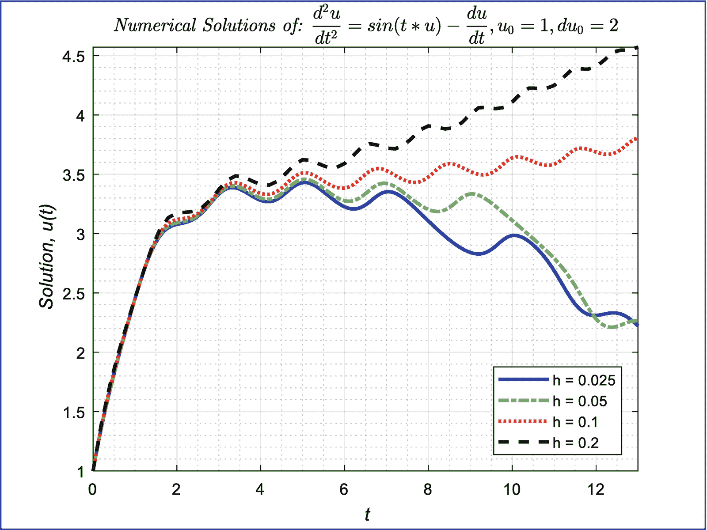

**图 3-5** 示例的仿真结果：`$$ \ddot{u}=-\dot{u}+\mathit{\sin}(ut) $$`，`$$ u(0)=1,\kern0.5em \dot{u}(0)=2 $$`

基于我们研究过的示例，我们可以对欧拉法做出以下一般性评述：
-   它们简单易行，便于通过脚本实现。因此，在使用其他更高阶、更复杂或计算成本更高的方法之前，先从这些方法入手是合乎逻辑的。
-   它们适用于计算粗略的近似解。然而，其效率和准确性取决于所选步长和给定的常微分方程类型，例如线性或非线性、齐次或非齐次、刚性或非刚性。
-   使用欧拉法计算解的准确性，可以通过与其他方法进行比较来评估。

## 龙格-库塔法

我们已经阐述了不同阶数的龙格-库塔法，并了解了它们求解一阶常微分方程的实现算法步骤。因此，在本节中，我们将重点介绍如何通过脚本实现经典的 4/5 阶龙格-库塔法，来求解二阶及更高阶常微分方程的数值解。

## 示例 6

给定一个二阶非齐次常微分方程，示例如下：`$$ \frac{1}{2}\ddot{u}+\frac{2}{5}\dot{u}+u=2t, $$`，`$$ u(0)=1,\dot{u}(0)=2 $$`。

首先，在实现龙格-库塔方法时，我们需要引入新变量（类似于欧拉方法），将给定的二阶常微分方程重写为两个一阶常微分方程构成的方程组。

`$$ \ddot{u}=4t-\frac{4}{5}\dot{u}-2u $$` 被转换为：`$$ \left\{\begin{array}{c}{\dot{u}}_1={u}_2\\ {}{\dot{u}}_2=4t-\frac{4}{5}{u}_2-2{u}_1\end{array}\right. $$`

注意 `u[1]` = `u` 且 `$$ {\dot{u}}_2={\ddot{u}}_1 $$`。

前面写好的这个一阶常微分方程组有多种实现方式。它们分别是匿名函数（`@`）、函数文件、符号 `matlabFunction` 以及直接方法。以下脚本 `RK_2ndODE_ex6.m` 基于 **4 阶**龙格-库塔方法计算给定问题的数值解。在本示例中，我们采用不同的步长，即 `h` = 0.1、0.2、0.3 和 0.4，并将求得的数值解与使用 `dsolve()` 计算的解析解进行比较。

# 示例 7

示例问题如下：，初始条件为：。

我们通过引入新变量，将给定的方程表达为两个一阶常微分方程。

将重写为：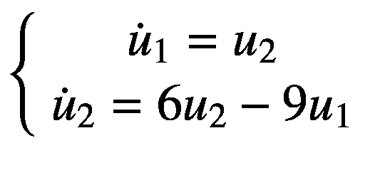

注意，这里`u`[1] = `u`，且 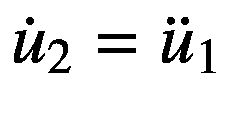。

以下是一个名为 `RK_2ndODE_ex7.m` 的脚本，它嵌入了四阶龙格-库塔法和前向欧拉法，并将它们的数值解与通过 `dsolve()` 求得的解析解进行比较。请注意，给定的方程组使用 `matlabFunction` 为龙格-库塔法进行了表达，该函数会自动生成一个函数文件。对于欧拉法，给定的方程组则是直接实现的。

```
### 示例 7

```
% RK_2ndODE_ex7.m
% 示例 7\. x"+9x'+6x=0，初始条件：x(0)=2, Dx(0)=0
% 四阶龙格-库塔法
clearvars; close all
h=0.2;              % 时间步长
t0=0;               % 计算/仿真起始时间
tmax=3;             % 计算/仿真结束时间
t=t0:h:tmax;        % 时间空间
steps=length(t);    % 评估步数
u(1,:)=[2 0];       % 初始条件
% 龙格-库塔法
syms u1 u2
f=[u2, -6.*u1-9*u2]; matlabFunction(f, 'file', 'RK_ex2');
for ii=1:steps-1
k1=feval(@RK_ex2, u(ii,1), u(ii,2));
k2=feval(@RK_ex2, u(ii,1)+h*k1(:,1)/2,u(ii,2)+h*k1(:,2)/2);
k3=feval(@RK_ex2, u(ii,1)+h*k2(:,1)/2,u(ii,2)+h*k2(:,2)/2);
k4=feval(@RK_ex2, u(ii,1)+h*k3(:,1),u(ii,2)+h*k3(:,2));
u(ii+1,:)=u(ii,:)+h*(k1+2*k2+2*k3+k4)/6;
end
plot(t(:)', u(:,1), 'ko'), hold on
% 前向欧拉法
for k=1:steps-1
f1=[u(k,2), -6*u(k,1)-9*u(k,2)];
u(k+1,:)=u(k,:)+f1*h;
end
plot(t, u(:,1), 'b--*')
% 解析解：
y=dsolve('D2x=-6*x-9*Dx', 'x(0)=2, Dx(0)=0','t');
Y=double(subs(y,'t',t)); plot(t, Y, 'g-', 'linewidth', 2)
grid on, xlabel('\it t'), ylabel('\it 解, u(t)')
legend('RK: h = 0.2 ','EM: h = 0.2',  '解析解 (dsolve)')
title('Runge-Kutta, Euler Forward vs. Analytical Solutions of: $$ \frac{d²}{dt²}+9*\frac{du}{dt}+6*u=0 $$', 'interpreter', 'latex')
xlim([0, 3])
hold off; shg
```

对于采用大步长（`h=0.2`）的前向欧拉法来说，这是一个中等刚性的问题。它的表现不如龙格-库塔法，如图 3-7 所示。

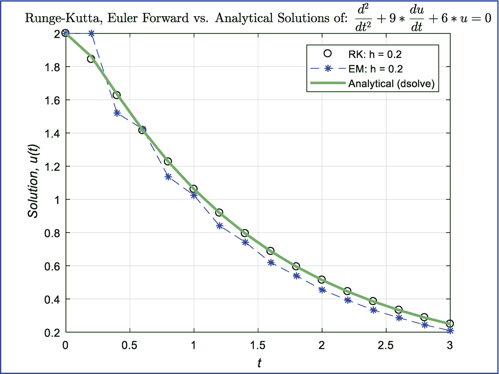

**图 3-7** 问题的仿真：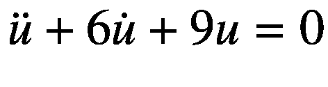，初始条件：

### 示例 8

给定一个二阶齐次常微分方程，示例问题如下：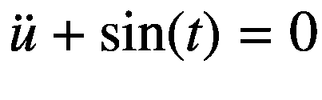，初始条件为：。

同样，在开始编写脚本之前，我们先将给定问题重写为两个一阶常微分方程。

将  写为：

注意，这里`u1` = `u`，且 。

以下脚本 `RK_2ndODE_ex8.m` 嵌入了龙格-库塔法，用于求解该问题的数值解。请注意，在此脚本中，一阶常微分方程组是通过一个名为 `FF` 的匿名函数（`@`）定义的。

```
% RK_2ndODE_ex8.m
% 示例 8\. u"=-sin(t)，初始条件：u(0)=0 & u'(0)=0
clearvars; close all; clc
h=0.3;             % 步长
t0=0;              % 仿真起始时间
tmax=13;           % 仿真结束时间
t=t0:h:tmax;       % 仿真时间空间
steps=length(t);   % 仿真步数
u(1,:)=[0, 0];     % 初始条件
% 龙格-库塔法：
FF=@(t, u1, u2)([u2,-sin(t)]);
for ii=1:steps-1
k1=FF(t(ii), u(ii,1), u(ii,2));
k2=FF(t(ii)+h/2, u(ii,1)+h*k1(:,1)/2,u(ii,2)+h*k1(:,2)/2);
k3=FF(t(ii)+h/2,u(ii,1)+h*k2(:,1)/2,u(ii,2)+h*k2(:,2)/2);
k4=FF(t(ii)+h,u(ii,1)+h*k3(:,1),u(ii,2)+h*k3(:,2));
u(ii+1,:)=u(ii,:)+h*(k1+2*k2+2*k3+k4)/6;
end
plot(t, u(:,1), 'k--+'), grid on; hold on
% 前向欧拉法：
for ii=1:steps-1
u(ii+1,:)=u(ii,:)+h*[u(ii,2), -sin(t(ii))];
end
plot(t, u(:,1), 'r-.p')
% 解析解：
y=dsolve('D2y=-sin(t)', 'y(0)=0, Dy(0)=0','t');
Y=double(subs(y,'t',t));
plot(t, Y, 'm-', 'linewidth', 1.5)
title('Runge-Kutta, Euler Forward vs. Analytical Solutions of: $$ \frac{d²}{dt²}+sin(t)=0 $$', 'interpreter', 'latex')
xlabel '\it t'; ylabel '\it 解, u(t)'
legend('RK: h = 0.3', 'EM: h = 0.3', 'DSOLVE')
hold off; axis tight; shg
```

同样，图 3-8 中显示的仿真结果表明，通过龙格-库塔法计算的数值解与解析解吻合良好，而通过前向欧拉法计算的数值解与解析解的值存在一些偏差。

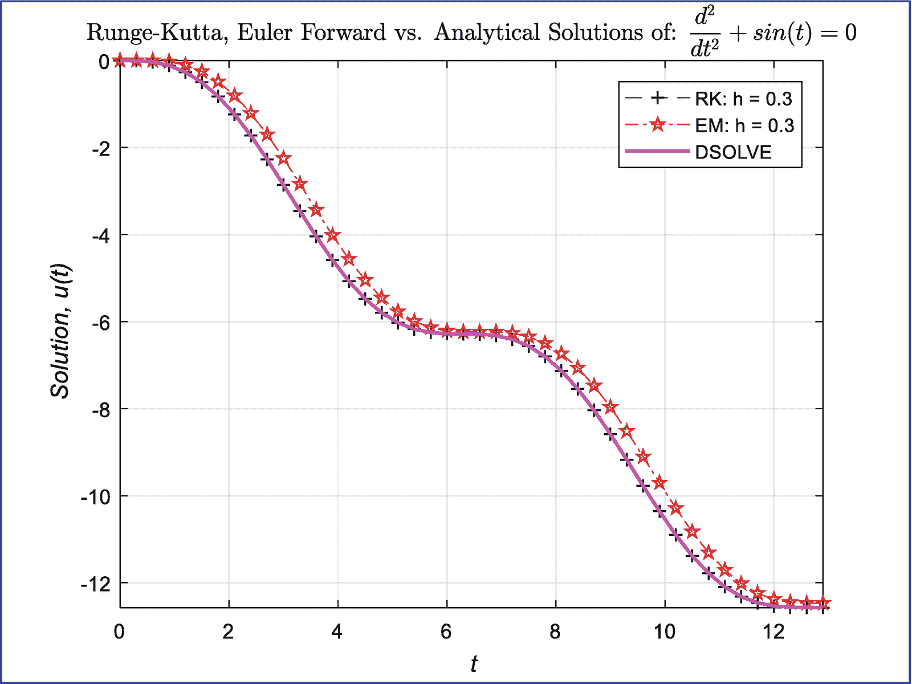

**图 3-8** 问题的仿真：，初始条件：

### 示例 9

给定一个二阶非齐次常微分方程，示例问题如下：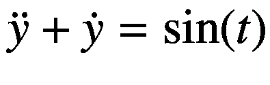，初始条件为 。

在开始编写脚本之前，我们再次将给定问题重写为两个一阶常微分方程。

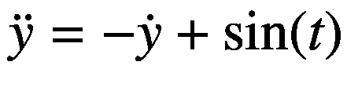 可表示为：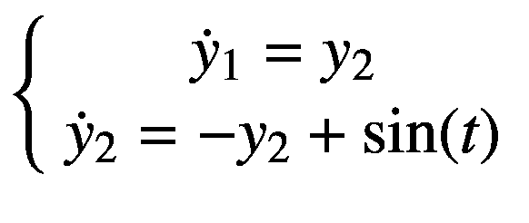

注意，`y1` = `y`，且 。
```

以下脚本（`RK_2ndODE_ex9.m`）嵌入了龙格-库塔法和前向欧拉法，用于计算该问题的数值解。请注意，在此脚本中，我们直接根据之前为龙格-库塔法和前向欧拉法重写的两个一阶常微分方程，嵌入了该一阶常微分方程组。

```matlab
% RK_2ndODE_ex9.m
% 示例 9.  y"+y'=sin(t) 初始条件: [1, 2]
clearvars; close all; clc
h=0.25;                  % 步长
t0=0;                    % 仿真起始时间
tmax=13;                 % 仿真结束时间
t=t0:h:tmax;             % 仿真时间向量
steps=length(t);         % 仿真步数
y(1,:)=[1, 2];           % 初始条件
% 龙格-库塔法:
for ii=1:steps-1
k1=[y(ii,2),             sin(t(ii))-y(ii,2)];
k2=[y(ii,2)+k1(:,1)*h/2, sin(t(ii)+h/2)-y(ii,2)+k1(:,2)*h/2];
k3=[y(ii,2)+k2(:,1)*h/2, sin(t(ii)+h/2)-y(ii,2)+k2(:,2)*h/2];
k4=[y(ii,2)+k3(:,1)*h,   sin(t(ii)+h)-y(ii,2)+k3(:,2)*h];
y(ii+1,:)=y(ii,:)+h*(k1+2*k2+2*k3+k4)/6;
end
plot(t, y(:,1), 'k--', 'linewidth', 1.5)
grid on; hold on
% 前向欧拉法:
for ii=1:steps-1
y(ii+1,:)=y(ii,:)+h*[y(ii,2), sin(t(ii))-y(ii,2)];
end
plot(t, y(:,1), 'r-.+', 'linewidth', 1.5)
% 解析解:
y=dsolve('D2y=-Dy+sin(t)', 'y(0)=1, Dy(0)=2','t');
Y=double(subs(y,'t',t));
plot(t, Y, 'm-', 'linewidth', 1.5)
title('\it 龙格-库塔法、欧拉法与解析解对比: $$ \frac{d²u}{dt²}=sin(t)-\frac{du}{dt} $$', 'Interpreter', 'latex')
xlabel '\it t'; ylabel '\it 解, u(t)'
legend('龙格-库塔法: h = 0.25', '欧拉法: h = 0.25', '解析解', 'location', 'southeast')
hold off; axis tight; shg
```

从问题 、  的仿真结果（如图 3-9 所示）可以清楚地看出，在步长较大（*h* = 0.25）时，龙格-库塔法的性能不如前向欧拉法，尽管其计算时间和仿真步数成本是其四倍。

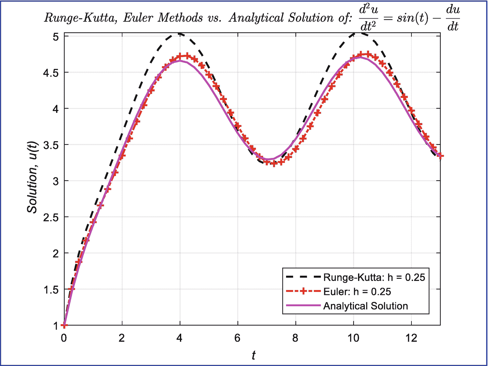

**图 3-9** 问题的仿真结果：、 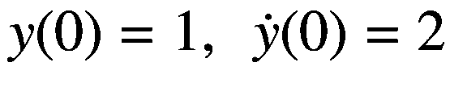

### 示例 10

给定一个二阶非齐次非线性常微分方程，示例问题如下：，初始条件为 。

在编写脚本之前，我们再次将给定问题表示为两个一阶常微分方程。

 可表示为：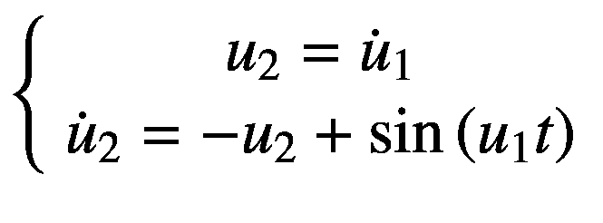

注意，`u[1] = u`，且 。

以下是一个名为 `RK_2ndODE_ex10.m` 的脚本，它嵌入了龙格-库塔法和前向欧拉法，并比较了它们在两种不同步长（*h* = 0.05 和 *h* = 0.01）下的结果。两种方法的一阶常微分方程组都直接在 `for ... end` 循环内表示。

```markdown
## 示例 10. u"=-u'+sin(t*u) 初始条件: u(0)=1 & u'(0)=2

```matlab
% RK_2ndODE_ex10.m
% 示例 10.  u"=-u'+sin(t*u) 初始条件: u(0)=1 & u'(0)=2
clearvars; close all; clc
h=0.05;              % 步长
t0=0;                % 仿真起始时间
tmax=15;             % 仿真结束时间
t=t0:h:tmax;         % 仿真时间向量
steps=length(t);     % 仿真步数
u(1,:)=[1, 2];       % 初始条件
% 龙格-库塔法: h = 0.05
for ii=1:steps-1
k1=[u(ii,2),             sin(u(ii,1)*t(ii))-u(ii,2)];
k2=[u(ii,2)+k1(:,1)*h/2, sin(u(ii,1)*t(ii)+h/2)-...
u(ii,2)+k1(:,2)*h/2];
k3=[u(ii,2)+k2(:,1)*h/2, sin(u(ii,1)*t(ii)+h/2)- ...
u(ii,2)+k2(:,2)*h/2];
k4=[u(ii,2)+k3(:,1)*h,   sin(u(ii,1)*t(ii)+h)-u(ii,2)+k3(:,2)*h];
u(ii+1,:)=u(ii,:)+h*(k1+2*k2+2*k3+k4)/6;
end
subplot(211)
plot(t(:)', u(:,1), 'k--x'), grid on; hold on
title('龙格-库塔法 vs. 欧拉法求解: $$ \frac{d²u}{dt²}+\frac{du}{dt}=sin(t*u) $$', 'interpreter', 'latex')
xlabel '\it t'; ylabel '\it 解, u(t)'
clearvars t u k1 k2 k3 k4
h=0.01;            % 步长
t=t0:h:tmax; steps=length(t);    u(1,:)=[1, 2];
% 龙格-库塔法: h = 0.01
for ii=1:steps-1
k1=[u(ii,2),             sin(u(ii,1)*t(ii))-u(ii,2)];
k2=[u(ii,2)+k1(:,1)*h/2, sin(u(ii,1)*t(ii)+h/2)-...
u(ii,2)+k1(:,2)*h/2];
k3=[u(ii,2)+k2(:,1)*h/2, sin(u(ii,1)*t(ii)+h/2)-...
u(ii,2)+k2(:,2)*h/2];
k4=[u(ii,2)+k3(:,1)*h,   sin(u(ii,1)*t(ii)+h)-u(ii,2)+k3(:,2)*h];
u(ii+1,:)=u(ii,:)+h*(k1+2*k2+2*k3+k4)/6;
end
subplot(212)
plot(t(:)', u(:,1), 'k--x'), hold on
clearvars -except t0 tmax
h=0.05;            % 步长
t=t0:h:tmax;
steps=length(t);
u(1,:)=[1, 2];
% 前向欧拉法: h = 0.05
for ii=1:steps-1
u(ii+1,:)=u(ii,:)+h*[u(ii,2), sin(u(ii,1)*t(ii))-u(ii,2)];
end
subplot(211)
plot(t(:)', u(:,1), 'r-', 'linewidth', 1.5), grid on
legend('RK: h = 0.05', 'EM: h = 0.05')
clearvars t u
h=0.01;            % 步长
t=t0:h:tmax;
steps=length(t);
u(1,:)=[1, 2];
% 前向欧拉法: h = 0.01
for ii=1:steps-1
u(ii+1,:)=u(ii,:)+h*[u(ii,2), sin(u(ii,1)*t(ii))-u(ii,2)];
end
subplot(212)
plot(t(:)', u(:,1), 'r-', 'linewidth',1.5), grid on
xlabel '\it t'; ylabel '\it 解, u(t)'
legend( 'RK: h = 0.01',  'EM: h = 0.01')
hold off; axis tight; shg
```

从本例的仿真结果（如图 3-10 所示）可以看出，两种方法对所选的步长都非常敏感。当使用相当小的步长（`h` = 0.01）时，两种方法（如图 3-10 下方的子图所示）都能很好地收敛。

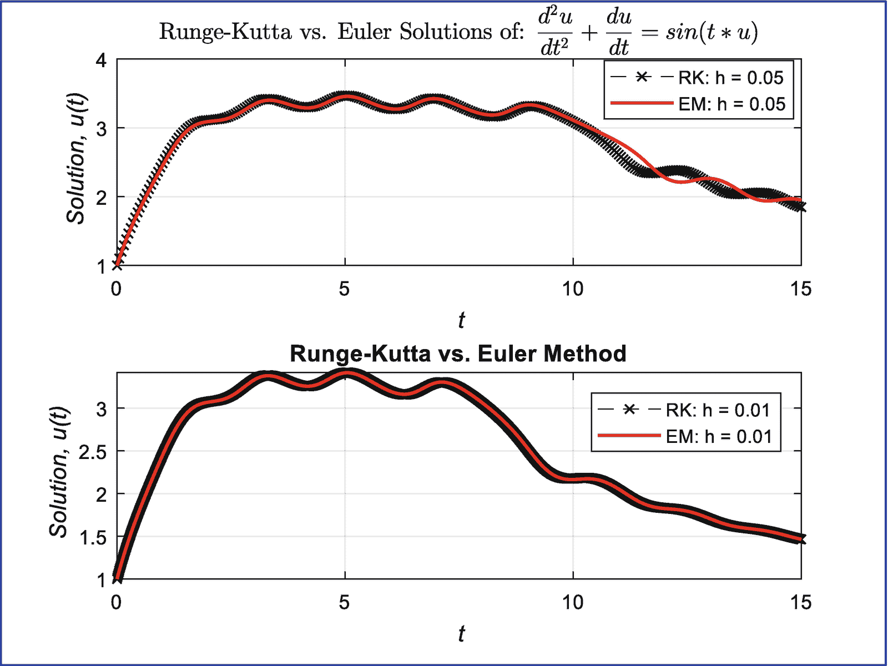

**图 3-10** 示例的仿真结果：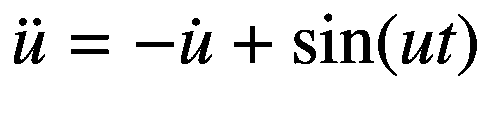，。

从二阶常微分方程的练习中可以看出，在求解线性非齐次常微分方程时，龙格-库塔法在精度上明显优于前向欧拉法。另一方面，在求解非线性非齐次常微分方程时，前向欧拉法的表现相当不错。
```

# Adams-Moulton 方法

在之前关于一阶常微分方程的章节中，我们构建了一阶、二阶和五阶 Adams-Moulton 方法，并描述了其求解常微分方程初值问题的实现算法。与欧拉法或龙格-库塔法不同，该方法是一种使用隐式格式定义的预测-校正法。在此，我们将重点介绍如何通过 MATLAB 脚本实现一阶、二阶、三阶、四阶和五阶 Adams-Moulton 方法，以计算二阶常微分方程的数值解。

## 示例 11

这是示例问题：，。

同样，在编写脚本之前，我们将给定问题用两个一阶常微分方程表示。

 表示为：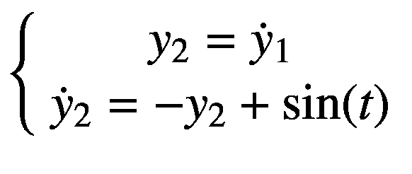

请注意，`y[1]` = `y` 且 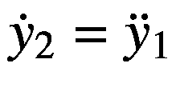。

这是一个脚本（`Adams_Moulton_2ndODE_ex11.m`），其中嵌入了不同阶次的 Adams-Moulton 方法来计算该问题的数值解。请注意，在我们的脚本中，一阶常微分方程组通过匿名函数（`@`）定义为二维函数。

# Adams-Moulton 方法数值模拟

## Part 1: 1st-order Method
```matlab
% ADAMS-Moulton 1st order method
% Adams_Moulton_2ndODE_ex11.m
% Part 1
clearvars; close all
Fn(1,:)=[1, 2];      % ICs: u0 at t0
tend=15;             % max. time limit
h=0.10;              % time step size
t=0:h:tend;          % time space
steps=length(t);     % # of steps
% Function is defined via anonymous function:
Fcn =@(t, y1, y2)([y2, -y2+sin(t)]);
for ii=1:steps-1
    % Predicted solution by EULER's forward method here:
    Fn(ii+1,:)=Fn(ii,:)+h*Fcn(t(ii), Fn(ii, 1),Fn(ii,2));
    % ADAMS-Moulton method: 2-step starts from here
    Fn(ii+1,:)=Fn(ii,:)+h*Fcn(t(ii+1),Fn(ii, 1),Fn(ii,2));
end
plot(t, Fn(:,1), 'bs-'), grid on; hold on
```

## Part 2: 2-step Method
```matlab
% ADAMS-Moulton 2-step Method
% Part 2
clearvars Fn
Fn(1,:)=[1, 2];      % ICs: u0 at t0
Fcn =@(t, y1, y2)([y2, -y2+sin(t)]);
for ii=1:steps-1
    % EULER's forward method is used here
    Fn(ii+1,:)=Fn(ii,:)+h*Fcn(t(ii), Fn(ii, 1),Fn(ii,2));
    % ADAMS-Moulton method: 2-step starts from here
    Fn(ii+1,:)=Fn(ii,:)+(h/2)*(Fcn(t(ii+1),Fn(ii+1,1),Fn(ii+1,2))+...
                                Fcn(t(ii),Fn(ii,1),Fn(ii,2)));
end
plot(t, Fn(:,1), 'mx--')
```

## Part 3: 3-step Method
```matlab
% ADAMS-Moulton 3-step Method
% Part 3
clearvars Fn
Fn(1,:)=[1, 2];
Fcn =@(t, y1, y2)([y2, -y2+sin(t)]);
for k=1:steps-2
    % 1st: Predicted value by EULER's forward method
    Fn(k+1,:)=Fn(k,:)+h*Fcn(t(k), Fn(k, 1),Fn(k,2));
    % 2nd: Corrected value by trapezoidal rule
    Fn(k+1,:)=Fn(k,:)+(h/2)*(Fcn(t(k+1),Fn(k+1,1),Fn(k+1,2))+ ...
                             Fcn(t(k),Fn(k,1),Fn(k,2)));
    % Predicted solution:
    Fn(k+2,:)=Fn(k+1,:)+(3*h/2)*Fcn(t(k+1),Fn(k+1,1),Fn(k+1,2))-...
                         (h/2)*Fcn(t(k),Fn(k,1),Fn(k,2));
    % ADAMS-Moulton method: 3-step starts from here
    Fn(k+2,:)=Fn(k+1,:)+h*((5/12)*Fcn(t(k+2),Fn(k+2,1),Fn(k+2,2))+...
                            (2/3)*Fcn(t(k+1),Fn(k+1,1),Fn(k+1,2))-...
                            (1/12)*Fcn(t(k),Fn(k,1),Fn(k,2)));
end
plot(t, Fn(:,1), 'ko:')
```

## Part 4: 4-step Method
```matlab
% ADAMS-Moulton 4-step Method
% Part 4
clearvars Fn
Fn(1,:)=[1, 2];
Fcn =@(t, y1, y2)([y2, -y2+sin(t)]);
for k=1:steps-3
    % 1st Predicted value: by Euler's forward method
    Fn(k+1,:)=Fn(k,:)+h*Fcn(t(k),Fn(k,1),Fn(k,2));
    % 1st Corrected value: by trapezoidal rule
    Fn(k+1,:)=Fn(k,:)+(h/2)*(Fcn(t(k+1),Fn(k+1,1),Fn(k+1,2))+...
                             Fcn(t(k),Fn(k,1),Fn(k,2)));
    % 2nd Predicted value
    Fn(k+2,:)=Fn(k+1,:)+(3*h/2)*Fcn(t(k+1),Fn(k+1,1),Fn(k+1,2))-...
                         (h/2)*Fcn(t(k),Fn(k,1),Fn(k,2));
    % 2nd Corrected value
    Fn(k+2,:)=Fn(k+1,:)+h*((5/12)*Fcn(t(k+2),Fn(k+2,1),Fn(k+2,2))+...
                            (2/3)*Fcn(t(k+1),Fn(k+1,1),Fn(k+1,2))-...
                            (1/2)*Fcn(t(k),Fn(k,1),Fn(k,2)));
    % Predicted solution:
    Fn(k+3,:)=Fn(k+2,:)+h*((23/12)*Fcn(t(k+2),Fn(k+2,1),Fn(k+2,2))-...
                           (4/3)*Fcn(t(k+1),Fn(k+1,1),Fn(k+1,2))+...
                           (5/12)*Fcn(t(k),Fn(k,1),Fn(k,2)));
    % Corrected solution by ADAMS-Moulton method 4-step from here:
    Fn(k+3,:)=Fn(k+2,:)+h*((3/8)*Fcn(t(k+3),Fn(k+3,1),Fn(k+3,2))+...
                           (19/24)*Fcn(t(k+2),Fn(k+2,1),Fn(k+2,2))-...
                           (5/24)*Fcn(t(k+1),Fn(k+1,1),Fn(k+1,2))+...
                           (1/24)*Fcn(t(k),Fn(k,1),Fn(k,2)));
end
plot(t, Fn(:,1), 'k-.*')
```

## Part 5: 5th-order Method
```matlab
% ADAMS-Moulton's 5th-order method
% Part 5
clearvars Fn
Fn(1,:)=[1, 2];
Fcn =@(t, y1, y2)([y2, -y2+sin(t)]);
for k=1:steps-4
    % 1st Predicted value: by Euler's forward method
    Fn(k+1,:)=Fn(k,:)+h*Fcn(t(k),Fn(k,1),Fn(k,2));
    % 1st Corrected value: by trapezoidal rule
    Fn(k+1,:)=Fn(k,:)+(h/2)*(Fcn(t(k+1),Fn(k+1,1),Fn(k+1,2))+...
                             Fcn(t(k),Fn(k,1),Fn(k,2)));
    % 2nd Predicted value
    Fn(k+2,:)=Fn(k+1,:)+(3*h/2)*Fcn(t(k+1),Fn(k+1,1),Fn(k+1,2))-...
                         (h/2)*Fcn(t(k),Fn(k,1),Fn(k,2));
    % 2nd Corrected value
    Fn(k+2,:)=Fn(k+1,:)+h*((5/12)*Fcn(t(k+2),Fn(k+2,1),Fn(k+2,2))+...
                            (2/3)*Fcn(t(k+1),Fn(k+1,1),Fn(k+1,2))-...
                            (1/2)*Fcn(t(k),Fn(k,1),Fn(k,2)));
    % 3rd Predicted solution:
    Fn(k+3,:)=Fn(k+2,:)+h*((23/12)*Fcn(t(k+2),Fn(k+2,1),Fn(k+2,2))-...
                           (4/3)*Fcn(t(k+1),Fn(k+1,1),Fn(k+1,2))+...
                           (5/12)*Fcn(t(k),Fn(k,1),Fn(k,2)));
    % Corrected solution by ADAMS-Moulton method 4-step from here:
    Fn(k+3,:)=Fn(k+2,:)+h*((3/8)*Fcn(t(k+3),Fn(k+3,1),Fn(k+3,2))+...
                           (19/24)*Fcn(t(k+2),Fn(k+2,1),Fn(k+2,2))-...
                           (5/24)*Fcn(t(k+1),Fn(k+1,1),Fn(k+1,2))+...
                           (1/24)*Fcn(t(k),Fn(k,1),Fn(k,2)));
    % Predicted solution:
    Fn(k+4,:)=Fn(k+3,:)+h*((55/24)*Fcn(t(k+3),Fn(k+3,1),Fn(k+3,2))-...
                           (59/24)*Fcn(t(k+2),Fn(k+2,1),Fn(k+2,2))+...
                           (37/24)*Fcn(t(k+1),Fn(k+1,1),Fn(k+1,2))-...
                           (3/8)*Fcn(t(k),Fn(k,1),Fn(k,2)));
    % Corrected solution by ADAMS-Moulton 5-step method from here:
    Fn(k+4,:)=Fn(k+3,:)+h*((251/720)*Fcn(t(k+4),Fn(k+4,1),Fn(k+4,2))+...
                           (646/720)*Fcn(t(k+3),Fn(k+3,1),Fn(k+3,2))-...
                           (264/720)*Fcn(t(k+2),Fn(k+2,1),Fn(k+2,2))+...
                           (106/720)*Fcn(t(k+1),Fn(k+1,1),Fn(k+1,2))-...
                           (19/720)*Fcn(t(k),Fn(k,1),Fn(k,2)));
end
plot(t, Fn(:,1), 'g--', 'linewidth', 2), grid on
title('Adams-Moulton method simulation of: $$ \frac{d²y}{dt²} = sin(t)-\frac{dy}{dt} $$', 'interpreter', 'latex')
xlabel '\it t', ylabel('\it Solution, y(t)')
```

## Analytical Solution and Visualization
```matlab
% Analytical solution of the problem:
Y=dsolve('D2u=-Du+sin(T)', 'u(0)=1, Du(0)=2','T');
Y=double(subs(Y,'T',t));
plot(t, Y, 'r-')
legend('1-step','2-step','3-step','4-step','5-step', 'DOLVE', 'location', 'southeast')
hold off
```

从使用不同阶次（或步数）的 Adams-Moulton 方法所得的模拟结果图（如图 3-11 所示）可以看出，该方法对于给定问题表现良好，其不同阶次的求解器产生的计算结果与使用 `dsolve()` 计算得到的解析解具有良好的一致性。对于任何显式定义的二阶或更高阶常微分方程初值问题，我们可以通过类似的方式实现该方法及之前的脚本，只需根据给定问题对脚本内容进行几处更改。脚本中唯一需要更改的是初始条件和模拟时间，最后一项重要的更改是根据给定问题的公式重新定义匿名函数（`@`）。例如，我们可以轻松编辑之前的脚本，来计算另一个二阶常微分方程的数值解。

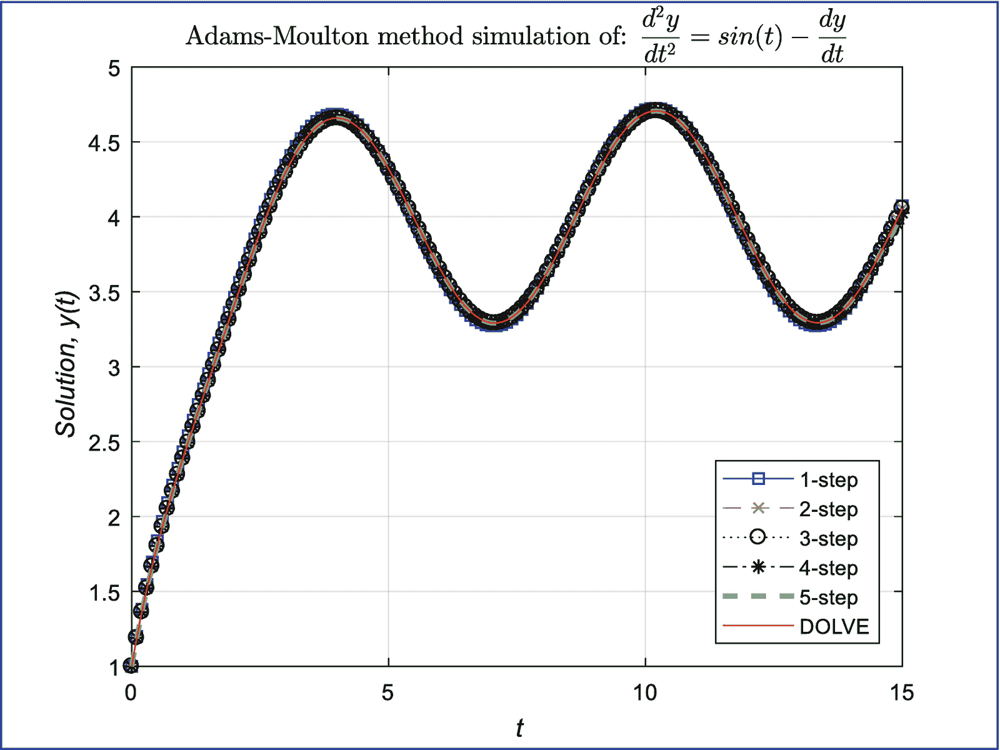

**图 3-11** 示例的模拟结果：，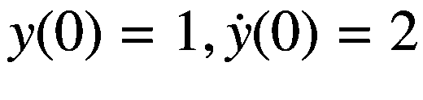

## 示例 12

以下是示例问题：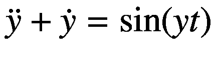，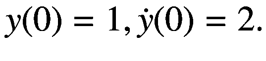

通过应用一步、两步、三步、四步和五步的亚当斯-莫尔顿方法，我们可以通过编辑之前的脚本 `Adams_Moulton_2ndODE_ex1.m`，编写一个名为 `Adams_Moulton_2ndODE_ex12.m` 的新脚本来求解给定的非齐次常微分方程。

# Adams_Moulton_2ndODE_ex12.m
## 示例 12\. y"+y'=sin(yt) 初始条件: [1, 2]
### 亚当斯-莫尔顿一阶方法
% 第一部分
`clearvars`; `close all`
`Fn(1,:)=[1, 2];`     % 初始条件: `t0` 处的 `u0`
`tend=13;`            % 仿真结束时间
`h=0.1;`             % 步长
`t=0:h:tend;`        % 仿真空间
`steps=length(t);`   % 步数
% 注意: y"+y'=sin(yt) =>DDy = f(t,y,dy)=sin(yt)-dy 通过匿名函数 (`@`) 定义:
`Fcn =@(t, u1, u2)([u2, -u2+sin(u1*t)]);`
```
for ii=1:steps-1
    % 1 步: 此处使用欧拉前向法
    Fn(ii,:)=Fn(ii,:)+h*Fcn(t(ii), Fn(ii, 1),Fn(ii,2));
    % 亚当斯-莫尔顿方法从此处开始
    Fn(ii+1,:)=Fn(ii,:)+h*Fcn(t(ii+1),Fn(ii, 1),Fn(ii,2));
end
subplot(211)
plot(t, Fn(:,1), 'bs-'), grid on; hold on
```

## 亚当斯-莫尔顿二阶方法
% 第二部分
`clearvars` `Fn`
`Fn(1,:)=[1, 2];`
```
for ii=1:steps-1
    % 通过欧拉前向法预测:
    Fn(ii+1,:)=Fn(ii,:)+h*Fcn(t(ii), Fn(ii, 1),Fn(ii,2));
    % 通过亚当斯-莫尔顿方法校正
    Fn(ii+1,:)=Fn(ii,:)+(h/2)*(Fcn(t(ii+1),Fn(ii+1,1),Fn(ii+1,2))+ ...
                               Fcn(t(ii),Fn(ii,1),Fn(ii,2)));
end
plot(t, Fn(:,1), 'm--p', 'markersize', 9), grid on
```

## 亚当斯-莫尔顿三阶方法
% 第三部分
`clearvars` `Fn`
`Fn(1,:)=[1, 2];`
```
for ii=1:steps-2
    % 1 步: 通过欧拉前向法预测值
    Fn(ii+1,:)=Fn(ii,:)+h*Fcn(t(ii), Fn(ii, 1),Fn(ii,2));
    % 2 步: 通过梯形法则校正值
    Fn(ii+1,:)=Fn(ii,:)+(h/2)*(Fcn(t(ii+1),Fn(ii+1,1),Fn(ii+1,2))+...
                               Fcn(t(ii),Fn(ii,1),Fn(ii,2)));
    % 预测解:
    Fn(ii+2,:)=Fn(ii+1,:)+(3*h/2)*Fcn(t(ii+1),Fn(ii+1,1),Fn(ii+1,2))-...
                           (h/2)*Fcn(t(ii),Fn(ii,1),Fn(ii,2));
    % 亚当斯-莫尔顿方法: 三步法从此处开始
    Fn(ii+2,:)=Fn(ii+1,:)+h*((5/12)*Fcn(t(ii+2),Fn(ii+2,1),Fn(ii+2,2))+...
                             (2/3)*Fcn(t(ii+1),Fn(ii+1,1),Fn(ii+1,2))-...
                             (1/12)*Fcn(t(ii),Fn(ii,1),Fn(ii,2)));
end
plot(t, Fn(:,1), 'k-', 'linewidth', 2.5), grid on
legend('1 步', '2 步','3 步'), hold off
title('亚当斯-莫尔顿方法仿真: $$ \frac{d²y}{dt²} = sin(yt)-\frac{dy}{dt} $$', 'interpreter', 'latex')
xlim([0, 13]), xlabel( '\it t'), ylabel('\it 解, y(t)')
```

## 亚当斯-莫尔顿四阶方法
% 第四部分
`clearvars` `Fn`
`Fn(1,:)=[1, 2];`
```
for ii=1:steps-3
    % 1 步: 通过欧拉前向法预测值
    Fn(ii+1,:)=Fn(ii,:)+h*Fcn(t(ii), Fn(ii, 1),Fn(ii,2));
    % 2 步: 通过梯形法则校正值
    Fn(ii+1,:)=Fn(ii,:)+(h/2)*(Fcn(t(ii+1),Fn(ii+1,1), Fn(ii+1,2))+... Fcn(t(ii),Fn(ii,1),Fn(ii,2)));
    % 3 步: 预测解:
    Fn(ii+2,:)=Fn(ii+1,:)+(3*h/2)*Fcn(t(ii+1),Fn(ii+1,1),Fn(ii+1,2))-...
                           (h/2)*Fcn(t(ii),Fn(ii,1),Fn(ii,2));
    % 3 步: 校正亚当斯-莫尔顿方法:
    Fn(ii+2,:)=Fn(ii+1,:)+h*((5/12)*Fcn(t(ii+2),Fn(ii+2,1),Fn(ii+2,2))...
                            +(2/3)*Fcn(t(ii+1),Fn(ii+1,1),Fn(ii+1,2))-...
                            (1/12)*Fcn(t(ii),Fn(ii,1),Fn(ii,2)));
    % 预测解:
    Fn(ii+3,:)=Fn(ii+2,:)+h*((23/12)*Fcn(t(ii+2),Fn(ii+2,1),Fn(ii+2,2))...
                            -(4/3)*Fcn(t(ii+1),Fn(ii+1,1),Fn(ii+1,2))+...
                            (5/12)*Fcn(t(ii),Fn(ii,1),Fn(ii,2)));
    % 通过亚当斯-莫尔顿方法校正解 四步法从此处开始:
    Fn(ii+3,:)=Fn(ii+2,:)+h*((3/8)*Fcn(t(ii+3),Fn(ii+3,1),Fn(ii+3,2))+...
                            (19/24)*Fcn(t(ii+2),Fn(ii+2,1),Fn(ii+2,2))-...
                            (5/24)*Fcn(t(ii+1),Fn(ii+1,1),Fn(ii+1,2))+...
                            (1/24)*Fcn(t(ii),Fn(ii,1),Fn(ii,2)));
end
subplot(212)
plot(t, Fn(:,1), 'k:o', 'markersize',9, 'markerfacecolor', 'y'), hold on
```

## 亚当斯-莫尔顿五阶方法
% 第五部分
`clearvars` `Fn`
`Fn(1,:)=[1, 2];`
```
for ii=1:steps-4
    % 1 步: 通过欧拉前向法预测值
    Fn(ii+1,:)=Fn(ii,:)+h*Fun(t(ii), Fn(ii, 1),Fn(ii,2));
    % 2 步: 通过梯形法则校正值
    Fn(ii+1,:)=Fn(ii,:)+(h/2)*(Fun(t(ii+1),Fn(ii+1,1),Fn(ii+1,2))+...
                               Fun(t(ii),Fn(ii,1),Fn(ii,2)));
    % 3 步: 预测解:
    Fn(ii+2,:)=Fn(ii+1,:)+(3*h/2)*Fun(t(ii+1),Fn(ii+1,1),Fn(ii+1,2))-...
                           (h/2)*Fun(t(ii),Fn(ii,1),Fn(ii,2));
    % 3 步: 校正亚当斯-莫尔顿方法:
    Fn(ii+2,:)=Fn(ii+1,:)+h*((5/12)*Fun(t(ii+2),Fn(ii+2,1),Fn(ii+2,2))+...
                             (2/3)*Fun(t(ii+1),Fn(ii+1,1),Fn(ii+1,2))-...
                             (1/12)*Fun(t(ii),Fn(ii,1),Fn(ii,2)));
    % 预测解:
    Fn(ii+3,:)=Fn(ii+2,:)+h*((23/12)*Fun(t(ii+2),Fn(ii+2,1),Fn(ii+2,2))...
                            -(4/3)*Fun(t(ii+1),Fn(ii+1,1),Fn(ii+1,2))+...
                            (5/12)*Fun(t(ii),Fn(ii,1),Fn(ii,2)));
    % 通过亚当斯-莫尔顿方法校正解 四步法从此处开始:
    Fn(ii+3,:)=Fn(ii+2,:)+h*((3/8)*Fun(t(ii+3),Fn(ii+3,1),Fn(ii+3,2))+...
                            (19/24)*Fun(t(ii+2),Fn(ii+2,1),Fn(ii+2,2))-...
                            (5/24)*Fun(t(ii+1),Fn(ii+1,1),Fn(ii+1,2))+...
                            (1/24)*Fun(t(ii),Fn(ii,1),Fn(ii,2)));
    % 预测解:
    Fn(ii+4,:)=Fn(ii+3,:)+h*((55/24)*Fun(t(ii+3),Fn(ii+3,1),Fn(ii+3,2)) ...
                            -(59/24)*Fun(t(ii+2),Fn(ii+2,1),Fn(ii+2,2))+...
                            (37/24)*Fun(t(ii+1),Fn(ii+1,1),Fn(ii+1,2))-...
                            (3/8)*Fun(t(ii),Fn(ii,1),Fn(ii,2)));
    % 通过亚当斯-莫尔顿五步法校正解从此处开始:
    Fn(ii+4,:)=Fn(ii+3,:)+ ...      h*((251/720)*Fun(t(ii+4),Fn(ii+4,1),Fn(ii+4,2))+...
                            (646/720)*Fun(t(ii+3),Fn(ii+3,1),Fn(ii+3,2))-...
                            (264/720)*Fun(t(ii+2),Fn(ii+2,1),Fn(ii+2,2))+...
                            (106/720)*Fun(t(ii+1),Fn(ii+1,1),Fn(ii+1,2))-...
                            (19/720)*Fun(t(ii),Fn(ii,1),Fn(ii,2)));
end
plot(t, Fn(:,1), 'r-', 'linewidth', 2.5), grid on
legend('4 步','5 步')
xlabel( '\it t'), ylabel('\it 解, y(t)');
hold off; shg
xlim([0, 13])
```

从绘制的结果（如图 3-12 所示）中，我们可以得出结论：通过亚当斯-莫尔顿高阶求解器（两步、三步、四步和五步求解方法）找到的解紧密收敛。它们比一步求解器精确得多。然而，与亚当斯-巴什福思和龙格-库塔方法类似，阶数越高，计算时间成本也大幅增加。


**图 3-12** 示例仿真：，

## Simulink 建模

使用 `Simulink` 建模求解二阶或更高阶常微分方程与求解一阶常微分方程非常相似，区别在于需要额外的一个或多个 `Integrator` 模块，以便从二阶或更高阶导数变量中获得解。让我们通过几个示例来演示如何使用 `Simulink` 建模求解二阶常微分方程。

## 示例 13

示例问题如下：，。

在开始建模之前，我们首先重写给定的二阶常微分方程，如下所示：


请注意，要得到 *u*(*t*)，必须对进行两次积分，如图 3-13 所示。


**图 3-13** — 使用`Integrator`模块进行二重积分

给定的问题已在 `Sim_Model_2ndODE_ex13.mdl` 中建模，如图 3-14 所示。


**图 3-14** — 问题的 `Simulink` 模型：，

对于图 3-14 所示的 `Simulink` 模型，`Integrator1` 模块的内部初始条件值为 `2.0`，另一个模块的内部初始条件值为 `1.0`。执行该模型（图 3-14）后，即可获得显示在 `Scope` 模块中的仿真结果。

， 的仿真结果显示在 `Scope` 模块中，如图 3-15 所示。注意，在显示的 `Scope` 模块中，我们做了一些调整，包括设置其背景颜色、从模块参数中绘制数据点（标记和线型），以及设置绘制的数据点的颜色，这些操作类似于 `MATLAB` 的绘图工具。

**注：** 自 `MATLAB` 2012/`Simulink` 8.0 起，`Scope` 模块参数中提供了更改背景颜色、更改绘制数据的线型和标记类型、更改坐标轴颜色以及添加图例的选项。


**图 3-15** — 图 3-14 中 `Simulink` 模型的 `Scope` 模块显示的仿真结果

---

## 示例 14

示例问题如下：，。

此问题的建模步骤与上一个问题相似，区别在于有两个增益 *K*[1] 和 *K*[2]，它们可以在命令窗口中指定，或通过从模型窗口菜单中选择 **文件** → **模型属性** → **回调** → **初始化函数** 进行初始化。

该练习的 `Simulink` 模型被命名为 `Sim_Model_2ndODE_ex14.mdl`，如图 3-16 所示。


**图 3-16** — ， 的 `Simulink` 模型

还可以使用带有外部初始条件的积分器模块。这可以通过双击 `Integrator` 模块并从下拉菜单中选择初始条件源来实现，如图 3-17 所示。


**图 3-17** — `Integrator` 模块参数设置

按下 `应用` 和 `确定` 确认后，我们得到以下更新后的模型模块：


对于这个更改后的 `Integrator` 模块，现在我们添加一个 `常量` 模块作为初始条件的源值，更新后的模型 (`Sim_Model_2ndODE_ex2.mdl`) 将如图 3-18 所示。


**图 3-18** — ， 的另一种 `Simulink` 模型

首先初始化增益值 (*K*[1] =  − 6， *K*[2] =  − 9)，然后对我们创建的模型进行仿真，即可在示波器模块中获得如图 3-19 所示的输出。


**图 3-19** — *K*[1] = − 6， *K*[2] =  − 9 时，， 的仿真结果

同样，在图 3-19 所示的`[Scope]`模块参数中，我们对绘制数据点的标记、线条颜色和类型做了一些调整。此外，在输出信号的`[Scope]`显示中，我们为其分配了一个标题 *u*(*t*)。为此，我们首先选择连接到示波器的信号线，然后右键单击并选择 **属性** → **信号名称**：*u*(*t*)。当处理连接到同一个`[Scope]`显示的两个或多个信号时，此选项有助于识别信号。

---

### 示例 15

示例问题如下：。给定的问题可以重写为：。

此问题相对简单，其数值解可以通过模型 `Sim_Model_2ndODE_ex15.mdl` 计算得到，该模型与上一个问题的仿真模型类似，都采用了二重积分。

在我们开发的 Simulink 模型中（图 3-20），模型版本 A 和模型版本 B 的输入信号模块不同。这是一个很好的例子，说明我们可以轻松地将一种类型的模块替换为另一种类型，以简化模型。两个版本的模型产生的结果相同，可以从图 3-21 所示的`[Scope2]`结果中观察到。


**图 3-21** — `[Scope2]`显示了图 3-20 中两个模型的仿真结果


**图 3-20** —   的 Simulink 模型的两个版本

### 示例 16

示例问题如下：, 。

首先，将给定的二阶常微分方程改写为以下形式：。注意，该问题是通过闭环反馈系统建模的（因为在本例中，我们有 ），这不同于之前属于开环系统的例子（之前只有 ）。图 3-22 展示了完整的 Simulink 模型 `Sim_Model_2ndODE_ex16.mdl`。图 3-23 展示了所构建 Simulink 模型的仿真结果。


**图 3-23** 图 3-22 中 Simulink 模型的 `[Scope]` 模块显示的仿真结果


**图 3-22** Simulink 模型，对应 , 

从 `[Scope]` 窗口显示的图中可以看出，结果似乎不太平滑，这是由于模型求解器的步长和误差容限选择不当所致。所有调整和设置都可以通过相应修改配置参数来完成，可通过点击菜单面板 `Model Configuration Parameters` （适用于 MATLAB R2012b 或更新版本）进入；然后选择 `Solver`，或者从菜单栏选择 `Tools` ➤ `Model Explorer` ➤ `Configuration` ➤ `Solver`。

## 非零初始条件

并非所有初值问题都从零（时间）初始条件开始。让我们求解一个从非零初始点开始的初值问题。

### 示例 17

示例问题如下：，初始条件为：；。

这里有一个 Simulink 模型 `Sim_Model_2ndODE_ex17.mdl`，它以两个不同版本创建，其中一个版本（版本 1）使用 `[Second-Order Integrator]` 实现，另一个版本（版本 2）使用两个一阶 `[Integrator]` 模块实现。两个版本的模型是等价的，并且两个初始条件被预定义为内部参数。构建的 Simulink 仿真模型如图 3-24 所示。


**图 3-24** Simulink 模型，对应  ；

在此给定示例中，初值问题并非从 *t* = 0 开始，而是从 *t* =  开始。因此，仿真必须从 *t* =  开始，这可以在 Simulink 模型参数中轻松实现。为此，我们在配置参数中进行修改。选择 `Solver` ➤ `Start Time`，并将 0 替换为 `pi/3`，如图 3-25 中突出显示的那样。


**图 3-25** 配置参数设置以设定仿真时间

注意，`[Second-Order (double) Integrator]` 模块从 MATLAB 2011/Simulink 开始提供。

# ODEx 求解器

通过仿真图 3-24 所示的模型，我们从 `[Scope]` 窗口获得了两个版本模型的结果（如图 3-27 所示）。`[Scope]` 模块包含来自版本 1 的 `` 输出信号以及来自版本 2 的 `x(t)` 信号。我们通过右键单击选项，为来自版本 1 的 `` 信号和来自版本 2 的 `x(t)` 信号指定了信号名称。单击信号线，然后右键单击并选择 `Properties` > `Signal name`。输入 `x(t)` 并点击 `Apply` 和 `OK`，如图 3-26 所示。最后，图 3-27 所示的仿真结果包含了所有指定的图例。


**图 3-27** 仿真结果 ``


**图 3-26** 使用右键单击选项设置信号名称

从图 3-27 示波器中显示的输出可以看出，这两个版本的模型给出了相同的结果。

总结所有 Simulink 建模的示例，从学习的角度来看，在 Simulink 中对常微分方程进行编程或建模相对简单。

我们已经介绍了用于一阶常微分方程的 MATLAB 内置求解器。在本节中，我们将使用内置求解器和工具来求解二阶及更高阶的常微分方程。在这方面，我们用于一阶常微分方程的所有内置工具都是有效的，并且使用相同的命令语法。在求解二阶或更高阶常微分方程时，我们需要将给定问题改写为一阶常微分方程组。

## 示例 18

以下是示例问题：`` ``。

在编写用于 MATLAB 内置 ODE 求解器的命令脚本之前，我们需要通过引入新变量，将给定的二阶 ODE 重写为一阶 ODE 方程组。

`` 被重写为如下形式：``

注意 `u[1] = u` 且 ``。

前面写出的一阶 ODE 方程组可以在脚本中使用 `matlabFunction`、匿名函数（`@`）、函数文件和内联函数（将在未来的 MATLAB 版本中移除）来表达。

**注意**

如果给定的问题不是刚性的或隐式定义的，`ode45` 是求解初值问题（IVPs）时推荐首选尝试的求解器。

该脚本（`ODEx_solvers_EX18.m`）嵌入了 ODE 求解器（如 `ode45`、`ode23` 和 `ode113`）的命令语法，用于计算给定问题的数值解。计算得到的数值解如图 3-28 所示。

```matlab
% ODEx_solvers_EX18.m
clearvars; close all
t0=0;               % 仿真开始时间
tend=5;             % 仿真结束时间
t=[t0, tend];
u(1,:)=[1; 2];      % 初始条件
% ode45 - 龙格-库塔 4/5 阶
Fun1 = inline('[u(2); 4*t-2*u(1)-u(2).*(4/5)]','t', 'u');
[T1, U1]=ode45(Fun1, t, u, []);
plot(T1, U1(:,1), 'rp', 'markersize', 9); grid on; hold on
% ode23 - 龙格-库塔 2/3 阶
Fun2=@(t, u)([u(2); 4*t-u(1).*2-u(2).*(4/5)]);
[T2, U2]=ode23(Fun2, t, u);
plot(T2, U2(:,1), 'b:o', 'markersize', 9)
% ode113 - 亚当斯高阶法
[T3, U3]=ode113(@Fun3, t, u);
plot(T3, U3(:,1), 'k-', 'linewidth', 2)
legend('ode45', 'ode23', 'ode113')
title('Simulation of: (1/2)ddy+(2/5)dy+y=2t')
xlabel('Time, t'), ylabel('Solution, u(t)'), axis tight
```

被基于亚当斯方法的 `ode113` 求解器调用的函数 m 文件 `Fun3.m` 如下所示：


**图 3-28**

示例仿真：`` ``

```matlab
function f = Fun3(t,u)
% Fun3.m 是一个函数文件。
% 此函数文件被求解器 ode113 调用。
f = [u(2); t.*4.0-u(1).*2.0-u(2).*(4.0./5.0)];
end
```

## 示例 19

以下是示例问题：``，``。

在本例中，与上一个问题类似，我们可以通过引入新变量，将给定问题重写为两个一阶 ODE。

`` 被重写为如下形式：``

注意 `u[1] = u` 且 ``。

以下是脚本（`ODEx_solvers_EX19.m`），它嵌入了基于龙格-库塔方法的 `ode45`、用于刚性问题的 `ode15s` 以及高阶亚当斯法的 `ode113` 等 MATLAB 求解器，用于计算问题的数值解：

## 示例 19

### 示例 19

```matlab
% ODEx_solvers_EX19.m
clearvars; close all
t0=0; tend=5;  t=[t0, tend]; u(1,:)=[2 0];
% ode45 - 4/5 阶龙格-库塔法
Fun1 = inline('[u(2); -6*u(1)-9*u(2)]','t', 'u');
[T1, U1]=ode45(Fun1, t, u, []);
plot(T1, U1(:,1), 'r*', 'markersize', 9), grid on; hold on
% ode15s - 刚性问题求解器
Fun2=@(t, u)([u(2); -6*u(1)-9*u(2)]);
[T2, U2]=ode15s(Fun2, t, u,[]); plot(T2, U2(:,1), 'bo', 'markersize', 9)
% ode113 - 亚当斯高阶法
[T3, U3]=ode113(Fun2, t, u,[]);
plot(T3, U3(:,1), 'k-.', 'linewidth', 2)
legend('ode45', 'ode15s', 'ode113',0)
title('Simulation: ddy+9dy+6y=0\. ode45, ode15s, ode113')
xlabel('Time, t'); ylabel('Solution, u(t)')
```

仿真结果（如图 3-29 所示）表明，由`ode45`、`ode15s`和`ode113`求解器计算得到的解高度趋同。


**图 3-29**

对比仿真： 

## 示例 20

下面是示例问题：

请注意，在该问题中，初始条件设定在 `t` = 1。

在本例中，我们同样从引入新变量，将给定的二阶问题重写为两个一阶常微分方程开始。

 被重写为：

请注意 `y`[1] = `y` 且  。

以下名为 `ODEx_solvers_EX20.m` 的脚本嵌入了 `ode45` 求解器，并执行名为 `ICs_non_Zero_2ODE.mdl` 的 Simulink 模型，以计算给定问题的数值解：

```matlab
% ODEx_solvers_EX20.m
% 给定： t*y"+2y'+4y=4，初始条件： y(1)=1, y'(1)=1
% 注意：仿真起始点不是 "0" 而是 1
t=[1,50];  % 注意：仿真从 1 开始。
y_s=inline('[y(2); (1/t)*(4-2*y(2)-4*y(1))]', 't', 'y');
ICs=[1, 1]; options=odeset('reltol', 1e-6);
[time, y_sol]=ode45(y_s, t, ICs, options);
plot(time, y_sol(:,1),'r', 'linewidth', 2), grid on
title('模拟 t*ddy+2dy+4y=4，初始条件 y(1)=1, dy(1)=1')
xlabel('时间, t'), ylabel('解, y(t)'), ylim([.8 1.35]); hold on
% 通过 SIMULINK 模拟： ode23
opts=simset('reltol',1e-6,'solver', 'ode23');
K=4; sim('ICs_non_Zero_2ODE_EX3', [1, 50], opts);
plot(SIM_outs(:,1), SIM_outs(:,2), 'bo-' ,'linewidth', 1)
legend('ode45', 'Simulink ode23', 0); hold off
```

图 3-30 展示了一个以两个不同版本创建的 Simulink 模型 (`ICs_non_Zero_2ODE_EX3.mdl`)。两者输出相同的结果。后一模型（替代模型）通过选择 Simulink 库 ➤ 用户自定义函数，采用函数模块  开发而成。[积分器]模块中的初始条件作为内部初始条件实现，仿真时间设置为从 `t` = 1 *秒*开始。仿真结果如图 3-31 所示。

**注意：** 对于初始值问题起始时间非零的 Simulink 模型，仿真必须从给定的初始时间（值）开始。例如，对于  仿真必须从  开始。


**图 3-31** 使用 MATLAB 的 `ode45` 求解器和 Simulink 的 `ode23` 求解器对问题进行仿真


**图 3-30** 示例 20 的 Simulink 模型 (`ICs_non_Zero_2ODE_EX3.mdl`)

## 示例 21

下面是示例问题：

请注意，在该问题中，初始条件设定在 

在本例中，我们同样通过引入新变量，将给定的二阶问题表示为两个一阶常微分方程开始。

 表示为：

请注意 `y`[1] = `y` 且  。

脚本 `ODEx_solvers_EX21.m` 嵌入了 Simulink 的 `ode23`、MATLAB 的 `ode45`、通过脚本实现的四阶龙格-库塔方法以计算数值解，以及 `dsolve()` 以计算问题的解析解。该示例的 Simulink 模型 (`ICs_non_Zero_2ODE_EX4.mdl`) 如图 3-32 所示。


`**图 3-32**` 问题的 Simulink 模型 (`ICs_non_Zero_2ODE_EX4.mdl`)

```
% ODEx_solvers_EX21.m
% 给定： y"-2y'+5y=0, y(pi/2)=0, y'(pi/2)=2
clearvars; close all
%% SIMULINK 解法
%!!! 注意：计算从 pi/2 开始
opts=simset('reltol',1e-5,'solver', 'ode23');
[time, Yout]=sim('ICs_non_Zero_2ODE_EX4', [pi/2, 2*pi], opts);
plot(time, Yout(:,1), 'm--o', 'markersize', 9), hold on
%% 龙格-库塔（基于 ode45 求解器）解法
% 注意：计算从 pi/2 开始，这是初始条件的设定点。
ICs=[0; 2];    %初始条件
ts=pi/2;       %!!! 注意：计算从 pi/2 开始
tend=2*pi;
U(1,:)=[0, 2];
[time,u_sol]=ode45(@(t,u)([u(2); 2*u(2)-5*u(1)]),[ts,tend], ICs);
plot(time, u_sol(:,1), 'b>', 'markersize', 9), hold on
%% 龙格-库塔（基于脚本）解法
% 注意：计算从 pi/2 开始，这是初始条件的设定点。
U(1,:)=[0, 2];    %初始条件
ts=pi/2;          %!!! 注意：计算从 pi/2 开始
h=pi/20; tend=2*pi; t=ts:h:tend; steps=length(t);
FF=@(t, u1, u2)([u2, 2*u2-5*u1]);
for ii=1:steps-1
k1=FF(t(ii), U(ii,1), U(ii,2));
k2=FF(t(ii)+h/2,U(ii,1)+h*k1(:,1)/2,U(ii,2)+h*k1(:,2)/2);
k3=FF(t(ii)+h/2,U(ii,1)+h*k2(:,1)/2,U(ii,2)+h*k2(:,2)/2);
k4=FF(t(ii)+h,U(ii,1)+h*k3(:,1),U(ii,2)+h*k3(:,2));
U(ii+1,:)=U(ii,:)+h*(k1+2*k2+2*k3+k4)/6;
end
plot(t(:)',U(:,1),'k:p','markersize', 13, 'markerfacecolor', 'c')
%% 解析解：通过 dsolve
y=dsolve('D2y=2*Dy-5*y', 'y(pi/2)=0', 'Dy(pi/2)=2', 'x');
display('y(t) 为'); pretty(y); y=vectorize(y); x=t; Yt=eval(y);
plot(t, Yt, 'g-', 'linewidth', 2.5), grid on; hold on
legend('Simulink(ode23 ~变步长)','ODE45','RK 四阶脚本','解析解')
title('ddy-2dy+5y=0, y(\pi/2)=0, dy(\pi/2)=2')
xlabel('t, 时间'), ylabel('y(t), 解'), hold off; shg
```

执行上述脚本 (`ODEx_solversEX4.m`) 后，该脚本还会执行 Simulink 模型 (`ICs_non_Zero_2ODE_EX21.mdl`)，即可得到显示所有结果的图（如图 3-33 所示）。


`**图 3-33**` 问题的仿真结果

此外，在命令行窗口中得到以下符号表达式，即问题的解析解：

```
y(t) 为
/   pi \
- sin(2 x) exp| - -- | exp(x)
\   2  /
```

从图 3-33 所示的图中可以清楚地看到，采用 `ode23` 变步长求解器的 Simulink 模型和四阶龙格-库塔方法计算出的数值解与给定二阶常微分方程的解析解良好收敛。

## `diff()`

`diff()` 是 MATLAB 的一个内置函数，用于计算差分和近似导数。它的工作方式类似于泰勒级数方法，通过评估函数的近似导数来计算计算演化中的差分。让我们考虑以下示例并应用 `diff` 函数。

### 示例 22

火星着陆器在着陆时的速度和加速度运动方程如下：


与之前的问题不同，本例中我们并不关心着陆器的位移 `y(t)`；而是需要评估其着陆时的速度（`\dot{y}(t)=v(t)`）和加速度（`\ddot{y}(t)=a(t)`），其中 `m` 是火星着陆器的质量，`k` 是阻尼系数，`g` 是火星的重力加速度。在本数值模拟中，我们使用以下数值：

![$$ m=150\ \left[ kg\right],k=1.2\ \left[N\ m\ s\right],g=3.885\ \left[\frac{m}{s²}\right]. $$](images/490522_1_En_3_Chapter/490522_1_En_3_Chapter_TeX_IEq145.png)

在本例中，我们再次通过引入新变量，将给定的二阶常微分方程重写为两个一阶常微分方程。

`\ddot{y}+(k/m)\dot{y}²=g` 表示如下：


请注意，`y[1] = y` 且 `\dot{y}_2 = \ddot{y}_1`。

以下是嵌入了 `ode45` 求解器和 `diff` 函数的脚本（`MARS_lander.m`）：

```
%%  MARS Lander Vehicle velocity and acceleration while landing
%   MARS_lander.m
t=0:.05:6; u0=[20, 67.0556]; g=3.885; k=1.2; m=150;
%F=inline('[u(2); g-(k/m)*(u(2).²)]', 't', 'u');
Flander=@(t, u)([u(2); g-(k/m)*(u(2).²)]);
[time, Uout]=ode45(Flander, t, u0, []);
% Acceleration is a derivative of velocity!
acc = diff(Uout(:,2))/(time(2)-time(1));
plot(t,Uout(:,2),'ro',t(2:end),acc,'bs'); hold on
% Time derivative:
Ttt=[diff(t);diff(t)];
% Velocity:
Utt=diff(Uout);
% Acceleration:
UT=Utt./Ttt';
plot(t(2:end),UT(:,1),'b-',t(2:end),UT(:,2), ...
'm--','linewidth',2.5)
legend({'Velocity1 [m/s]';'Acceleration1 [m²/s]';...
'Velocity2'; 'Acceleration2'},0); grid minor
title('Mars lander"s velocity and acceleration during landing')
xlabel('time'), ylabel('v, a'), shg
```

从图 3-34 所示的图形可以看出，对于给定问题（火星着陆器着陆时的运动方程），`ode45` 和 `diff` 这两种方法都生成了良好收敛的解。


`**图 3-34**`

使用 `ode45` 和 `diff` 评估的火星着陆器速度和加速度

当需要计算复杂函数的符号导数时，使用 `diff()` 非常简便。以下是一个示例：

通过对几个二阶常微分方程的仿真示例，我们演示了如何实现欧拉法、龙格-库塔法、龙格-库塔-吉尔法、龙格-库塔-费尔伯格法、亚当斯-巴什福思法、米尔恩法、亚当斯-莫尔顿法以及泰勒级数法来求解常微分方程。此外，我们还使用了`MATLAB`内置的`ODE`求解器和工具，例如`ode23`、`ode23tb`、`ode45`、`ode113`、`odeset`和`diff()`。同时，我们还演示了使用求解器（如`ode2`、`ode3`、`ode23`、`ode45`）和工具（如`simset`和`sim`）的`Simulink`建模技术。所有这些方法和工具都适用于所有显式定义的常微分方程及常微分方程组。这些方法的效率和精度取决于给定的`ODE`方程类型，例如线性或非线性、齐次或非齐次、刚性或非刚性。此外，所采用的数值方法的精度和效率还取决于用户选择/设置的误差容限和步长。

```matlab
>> syms x y t
>> F=[sin(10*t); x²+y³+2*x*y²; t²*sinc(2*x/y)];
dF=[diff(F(1),t); diff(F(2), x, y); diff(F(3), x, y)]
dF =
10*cos(10*t)
3*y² + 4*x*y
(t²*sin((2*pi*x)/y))/(2*pi*x) - (t²*cos((2*pi*x)/y))/y
>> pretty(dF)
+-                                     -+
|              10 cos(10 t)             |
|                                       |
|                 2                     |
|              3 y  + 4 x y             |
|                                       |
|   2    / 2 pi x \    2    / 2 pi x \  |
|  t  sin| ------ |   t  cos| ------ |  |
|        \   y    /         \   y    /  |
|  ---------------- - ----------------  |
|       2 pi x               y          |
+-                                     -+
```

