# 4. 刚性 ODE 问题

在本章中，我们将探讨求解刚性 ODE 的几种不同方法。我们将再次介绍如何运用欧拉法、龙格-库塔法以及预测-校正法。我们还将使用亚当斯-莫尔顿法和 MATLAB 内置求解器，即 `ode15s`、`ode23s`、`ode23tb`、`ode45` 和 `ode113`，然后对所有方法进行比较，以找出在精度和计算时间方面最有效的方法。在许多 MATLAB 参考资料中，对于非常刚性的 ODE，推荐使用求解器 `ode15s`。我们将验证它是否确实最高效。

## 示例 1

给定一个中等刚度的常微分方程，示例问题如下：`dy/dt + 100y = 0, y(0) = 1`。

为了对常微分方程求解器和方法进行对比分析，我们将首先使用**前向欧拉法**，以（时间）步长 0.015 计算给定练习的数值解，然后以步长 0.0075（比第一个步长小两倍）重复仿真。接着，我们使用 `dsolve()` 求解析解，并再次使用步长为 0.0075 的**四阶/五阶龙格-库塔法**求数值解。所有这些步骤均在以下脚本中实现，该脚本名为 `STIFF_1ODE_EX1.m`：

```
%% STIFF_1ODE_EX1.m
% 问题的解析解为 y(t)=exp(-100t)。
% 欧拉前向法：
close all; clearvars; clc
y0=1;                  % 初始条件
dt1=1.5e-2;            % 步长 1
dt2=0.75e-2;           % 步长 2
tstart=0;
tend=.25;
t1=tstart:dt1:tend;    % 第一次尝试的仿真时间空间
t2=tstart:dt2:tend;    % 第二次尝试的仿真时间空间
steps1=length(t1);     % 第一次迭代的循环次数
f=@(y)(-100*y);
y=[y0, zeros(1,steps1-1)]; h=dt1;
for ii=1:steps1-1
y(ii+1)=y(ii)+f(y(ii))*h;
end
figure, plot(t1, y, 'bo-'); hold on
steps2=length(t2);     % 第二次迭代的循环次数
y=[y(1), zeros(1,steps2-1)]; h=dt2;
for ii=1:steps2-1
y(ii+1)=y(ii)+f(y(ii))*h;
end
plot(t2, y, 'rd-'); Y=dsolve('Dy=-100*y', 'y(0)=1', 't');
YY=vectorize(Y); t=t1;
YY=eval(YY);
plot(t1, YY, 'k-', 'linewidth',1.5)
title('\it 刚性问题的解：$$ \frac{dy}{dt}=-100*y, y_0=1 $$', 'interpreter', 'latex')
xlabel('t'); ylabel( 'y(t)'); xlim([0, .3])
grid on
%% 通过脚本实现的四阶龙格-库塔法
u(1)=1;     % 初始条件：u(0)=1，从索引 1 开始
u=[u(1), zeros(1,steps2-1)];
for ii=1:steps2-1
k1=f(u(ii)); k2=f(u(ii)+h*k1(:,1)/2); k3=f(u(ii)+h*k2(:,1)/2);
k4=f(u(ii)+h*k3(:,1)); u(ii+1)=u(ii)+h*(k1+2*k2+2*k3+k4)/6;
end
plot(t2, u, 'mp--', 'linewidth',1.0)
legend('欧拉前向法：h=0.015', '欧拉前向法：h=0.0075',...
'dsolve（解析解）', '龙格-库塔法：h=0.0075')
grid on
axis tight
hold off; shg
```

从仿真结果（如图 4-1 所示）可以看出，如果选取的步长大于所需值，则在将前向欧拉法用于刚性问题时，会观察到明显的波动和不稳定解。因此，在使用欧拉法和龙格-库塔法（这两者均为预测型常微分方程求解器）时，如何选择步长是一个值得关注的问题。

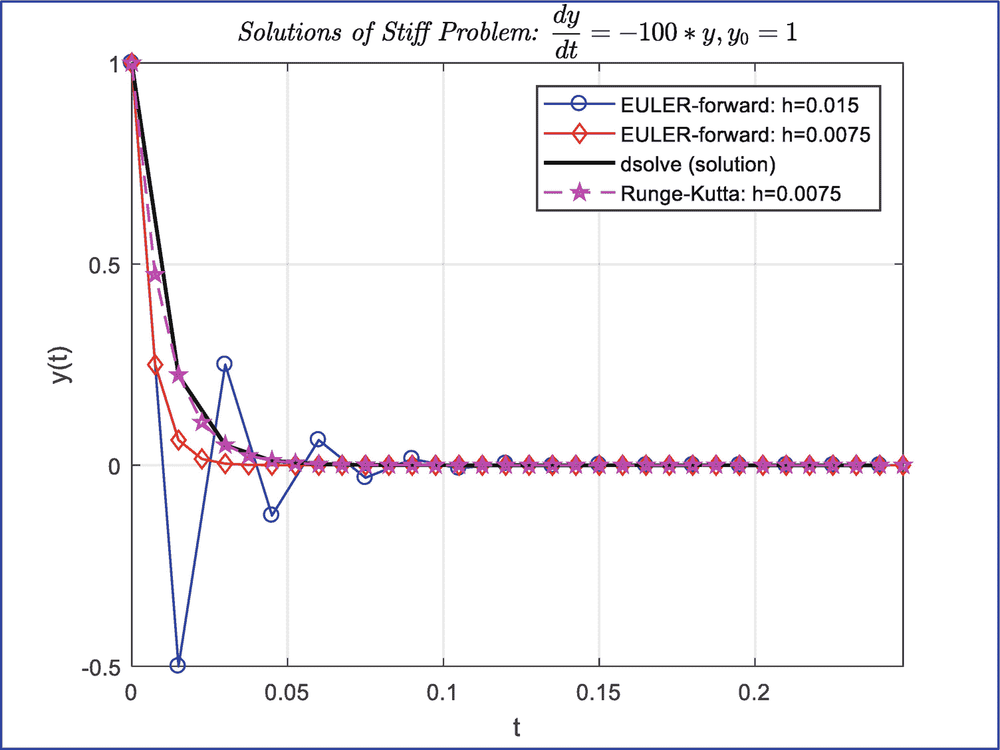

*图 4-1* – 一阶刚性常微分方程的仿真结果：`dy/dt + 100y = 0，y(0) = 1`

## 示例 2

这是一个刚性更强的问题：`dy/dt + 1000y = 0，y(0) = 1`。在本问题的仿真中，我们使用 MATLAB 内置的常微分方程求解器，即 `ode45` 和 `ode15s`，并比较它们在计算时间方面的效率（`STIFF_1ODE_EX2.m`）。

```
%% STIFF_1ODE_EX2.m
close all; clearvars
%{
注意：该问题的解衰减至零。如果求解器
产生一个负的近似解，它会通过此值开始追踪
常微分方程的解，解会趋向负无穷，
计算失败。因此，使用 ODESET 的 NonNegative 属性可以防止
这种情况发生。
非负性适用于 ode45、ode113，不适用于 ode15i、ode15s、ode23s、ode23t、ode23tb。
%}
% x1=1; time=[0, 15];
tic;
opts=odeset('NonNegative',1,'reltol', 1e-3, 'abstol', 1e-5);
[t1, xODE45]=ode45(@(t,x)(-1000*x), [0, 15], 1, opts);
Time_ODE45=toc; fprintf('Time_ODE45 = %2.6f\n', Time_ODE45)
%% MATLAB 刚性问题求解器 ODE15s
clearvars
tic;
opts=odeset('reltol', 1e-3, 'abstol', 1e-5);
[t, xODE15s]=ode15s(@(t,x)(-1000*x), [0, 15], 1, opts);
Time_ODE15s=toc; fprintf('Time_ODE15s = %2.6f\n', Time_ODE15s)
```

执行脚本后，我们在命令窗口中获取以下输出：

```
Time_ODE45 = 0.632997
Time_ODE15s = 0.013348
```

从计算时间的输出来看，显然求解器 `ode15s` 在计算时间方面效率更高。如果我们绘制两个求解器的仿真结果，会得到与问题解析解非常接近的收敛结果。对于中等刚性问题，`ode45` 可以表现得相对不错。请注意，并非所有常微分方程求解器在其默认设置下都能正确评估非常刚性初值问题的数值解。让我们考虑下一个一阶刚性常微分方程练习。

### 示例 3

以下是示例问题：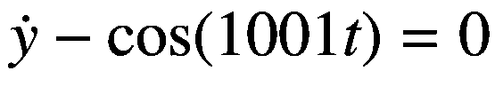 初始条件为 `y(0) = 1.001`。该问题存在解析解，如下所示：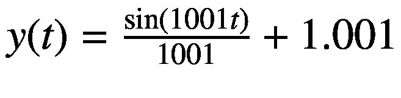。

我们使用内置求解器（如 `ode23`、`ode23s`、`ode45`、`ode113` 和 `ode15s`）以及前向欧拉法（`STIFF_1ODE_EX3.m`）来计算给定一阶常微分方程的数值解。

```
% STIFF_1ODE_EX3.m
clearvars; close all
% Numerical solutions with ODEx:
Fun=@(t,y)(cos(1001*t)); Time=[0,0.75]; y0=1.001;
[t1, y1]=ode23s(Fun, Time, y0);
[t2, y2]=ode45(Fun, Time, y0);
[t3, y3]=ode113(Fun, Time, y0);
[t4, y4]=ode15s(Fun, Time, y0);
subplot(211)
plot(t1, y1, 'rs--', 'markersize', 9, 'markerfacecolor', 'c')
hold on
plot(t2, y2, 'bh-.', 'markersize', 9, 'markerfacecolor', 'y')
plot(t3, y3, 'm-', 'linewidth', 1.5)
legend('ode23s','ode45','ode113')
title('\it Solutions of Stiff Problem: $$ \frac{dy}{dt}=cos(1001*t, y_0=1.001 $$', 'interpreter', 'latex')
xlabel('\it t'); ylabel( '\it y(t)'); axis tight; grid on
subplot(212)
plot( t4, y4, 'b--o', 'markersize', 9, 'markerfacecolor', 'y'), hold on
% Euler forward method:
y(1)=y0; h=1e-2; t=0:h:0.75; steps=length(t);
f=@(t, y)(cos(1001*t)); y=[y(1), zeros(1, length(t)-1)];
for ii=1:steps-1
F=f(t(ii), y(ii));
y(ii+1)=y(ii)+h*F;
end
plot(t, y, 'm', 'linewidth', 1.5)
% Analytical Solution:
clearvars t y
syms y(t)
Dy=diff(y); y=dsolve(Dy==cos(1001*t), y(0)==1.001); y=vectorize(y);
t=0:.01:0.75; y=eval(y); plot(t, y, 'k--', 'linewidth', 1.5),
hold on;
legend( 'ode15s', 'Euler forward','Analytical Sol')
xlabel('\it t'); ylabel( '\it y(t)'); shg
axis([0 .75 .95 1.33]), grid on
```

在此练习中，对于给定的一阶刚性常微分方程，可以清晰地看到，求解器 `ode23`、`ode23s`、`ode45` 和 `ode15s`（即使是推荐的求解器）给出了错误或虚假的解（如图 4-2 所示）。相反，高阶求解器 `ode113` 以及前向欧拉法这种粗略近似方法却能得出足够正确的解，且与解析解结果吻合良好。另外，值得指出的是，当使用内置 ODEx 求解器及其默认设置（如相对和绝对误差容限）计算刚性常微分方程的数值解时，即使我们选择了推荐的求解器 `ode15s`，也并非总能得到精确的数值解。

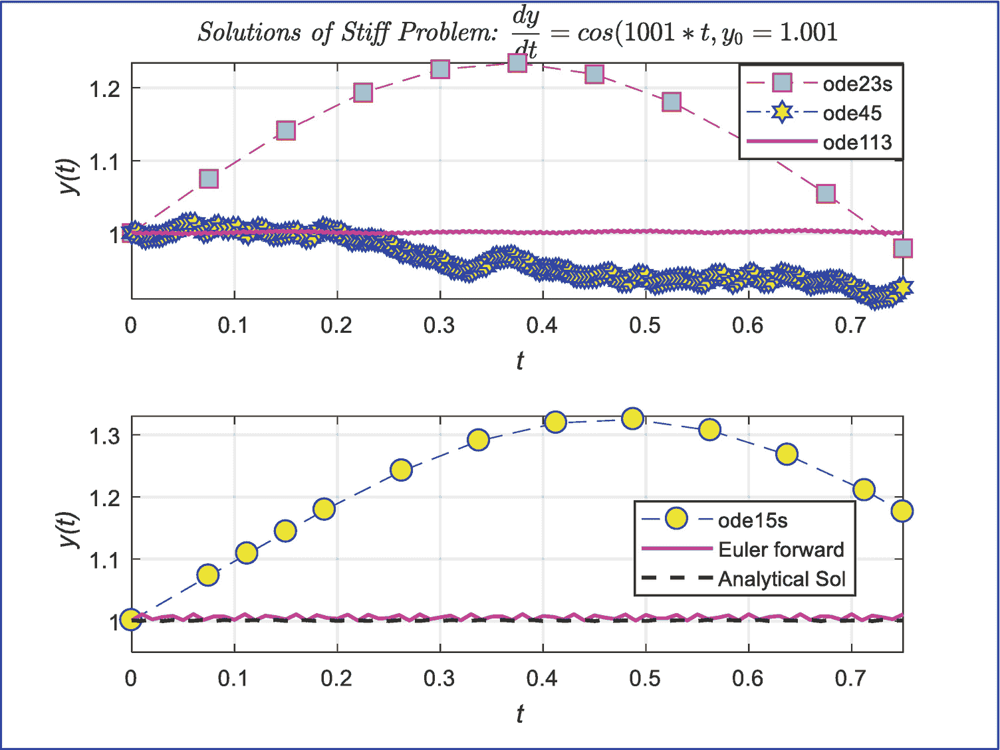

图 4-2

一阶刚性常微分方程仿真： 初始条件为 `y(0) = 1.001`

**注意**
包括 `ode15s` 在内的大多数内置 ODEx 求解器，在默认设置下无法计算出非常刚硬初值问题的精确数值解。必须相应地调整设置。在解决某些非常刚硬的常微分方程时，高阶求解器 `ode113` 可能是个例外。

接下来，我们用多个内置 ODEx 求解器来考虑另一个中等刚度的二阶齐次常微分方程练习。

### 示例 4

以下是示例问题：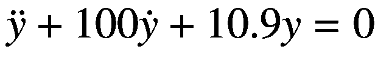，`y(0) = 1`，`\dot{y}(0) = 0`。

首先，我们将给定的二阶常微分方程重写为两个一阶常微分方程组成的方程组，如下所示：

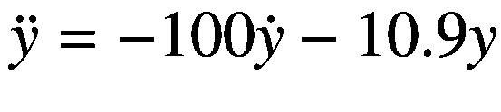 => 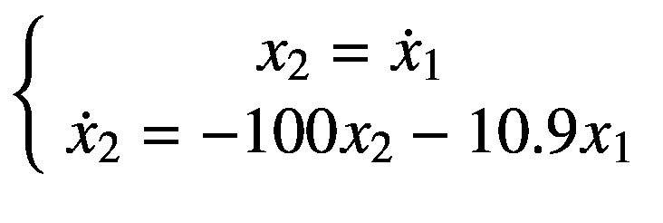

该方程组被编码在一个名为 `A1_Stiff.m` 的函数文件中。

```
function Dxdt=A2_Stiff(T, X)
%%% Note: Given Equation is 2nd Order ODE.
%      ddy+100*dy+10.9*y(t)=0
%      The Function File Is Saved Under The Name: A2_Stiff.M
Dxdt=[X(2);
-100*X(2)-10.9*X(1)];
end
```

函数文件 `A2_stiff.m` 被脚本 `STIFF_2ODE_EX4.m` 调用，以使用多个内置 ODEx 求解器仿真给定的二阶常微分方程。

```
% STIFF_2ODE_EX4.m
ICs=[1 0]; ts=[0, 100];
OPTs=odeset('RelTol', 1e-6, 'AbsTol', 1e-8);
tic;
[t, x_ODE45]=ode45(@A2_Stiff,  ts, ICs, OPTs);
t_ODE45=toc;
fprintf('Time_ode45 = %2.6f \n', t_ODE45)
clearvars
ICs=[1 0]; ts=[0, 100];
OPTs=odeset('RelTol', 1e-6, 'AbsTol', 1e-8);
tic;
[t1, x_ODE23s]=ode23s(@A2_Stiff, ts, ICs, OPTs);
t_ODE23s=toc;
fprintf('Time_ode23 = %2.6f \n', t_ODE23s)
clearvars
ICs=[1 0]; ts=[0, 100];
OPTs=odeset('RelTol', 1e-6, 'AbsTol', 1e-8);
tic;
[t2, x_ODE113]=ode113(@A2_Stiff, ts, ICs, OPTs);
t_ODE113=toc;
fprintf('Time_ode113 = %2.6f \n', t_ODE113)
clearvars
ICs=[1 0]; ts=[0, 100];
OPTs=odeset('RelTol', 1e-6, 'AbsTol', 1e-8);
tic;
[t3, Y_ODE23tb]=ode23tb(@A2_Stiff, ts, ICs, OPTs);
t_ODE23tb=toc;
fprintf('Time_ode23tb = %2.6f \n', t_ODE23tb)
clearvars
ICs=[1 0]; ts=[0, 100];
OPTs=odeset('RelTol', 1e-6, 'AbsTol', 1e-8);
tic;
[t4, x_ODE15s]=ode15s(@A2_Stiff,  ts, ICs, OPTs);
t_ODE15s=toc;
fprintf('Time_ode15s = %2.6f \n', t_ODE15s)
```

在一台笔记本电脑（配备 Windows 10、Intel Core i7 芯片、2.5 GHz 和 8GB RAM）上执行该脚本后，得到了以下结果。可以清晰地看出，`ode15s` 在计算（已耗用）时间效率上明显优于所有其他常微分方程求解器。

```
Time_ode45 = 0.232020
Time_ode23 = 0.098099
Time_ode113 = 0.480924
Time_ode23tb = 0.084671
Time_ode15s = 0.028107
```

这展示了 MATLAB/Simulink 中可用于刚性常微分方程问题的求解器的效率。

### 雅可比矩阵

# 雅可比矩阵在刚性ODE求解中的应用

使用雅可比矩阵配合内置ODEx求解器求解刚性常微分方程可以加速计算过程。雅可比矩阵的性质仅与刚性问题求解器相关，即 `ode15s`、`ode23s`、`ode23t`、`ode23tb` 和 `ode15i`，并且它们不仅在计算中，而且在可靠性问题上都扮演着重要角色。请注意，`ode15i` 的雅可比矩阵具有不同的性质。

雅可比矩阵是关于定义微分方程的给定函数的偏导数矩阵。例如，给定一个向量 `h`：

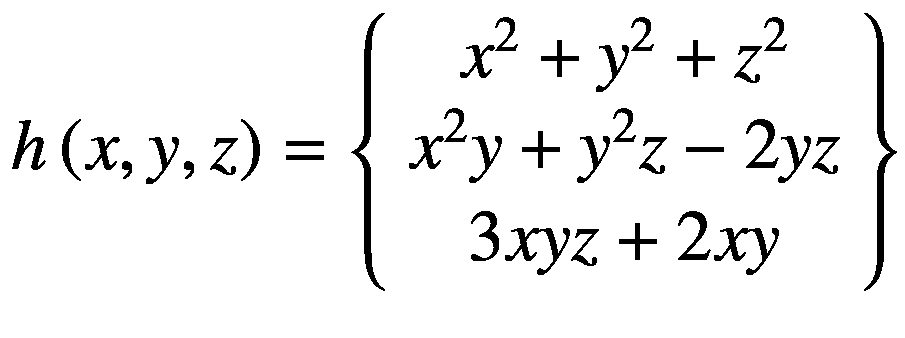

向量 `h(x, y, z)` 关于向量 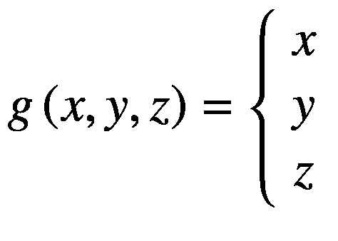 的雅可比矩阵可以通过符号数学工具箱工具/命令按以下方式计算：

```matlab
>> syms x y z
>> h=[x²+y²+z²; x²+y²*z-2*y*z; 3*x*y*z-2*x*y];
>> g=[x, y, z];
>> Jac_h=jacobian(h, g)
Jac_h =
[         2*x,         2*y,       2*z]
[         2*x, 2*y*z - 2*z, y² - 2*y]
[ 3*y*z - 2*y, 3*x*z - 2*x,     3*x*y]
```

现在，我们可以通过使用刚性问题的雅可比矩阵来验证其在解决问题中的重要性。请注意，接下来我们将通过二阶常微分方程（切比雪夫微分方程）来阐明雅可比矩阵。

## 示例 5

切比雪夫微分方程定义如下：

 且满足 `|t| < 1` 和 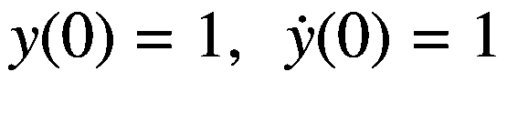

让我们计算 `n = 0, 1, 2, …, 9` 时切比雪夫微分方程解的数值。

第一步，我们需要通过引入新变量，将切比雪夫方程重写为两个一阶微分方程。

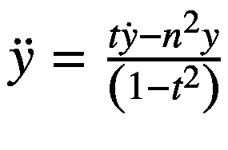 => 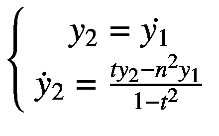

第二步，我们求前面描述的微分方程组的雅可比矩阵。

```matlab
>> syms y1 y2 n t
>> C1=[y2; (t*y2-n²*y1)/(1-t²)];
>> G=[y1, y2];
>> JC1=jacobian(C1, G)
JC1 =
[             0,            1]
[ n²/(t² - 1), -t/(t² - 1)]
>> pretty(JC1)
+-                  -+
|     0,       1     |
|                    |
|     2              |
|    n         t     |
|  ------, - ------  |
|   2         2      |
|  t  - 1    t  - 1  |
+-                  -+
```

基于计算出的切比雪夫微分方程雅可比矩阵及其初始条件，我们编写下一个脚本，命名为 `ChebyshevDemo.m`：

```matlab
function ChebyshevDemo
% HELP: ChebyshevDemo.m 是一个模拟切比雪夫方程
%      数值解的脚本：
%      (1-t²)*ddy-t*dy+n²*y=0
%      其中 n=0,1,2,3,4,5,6, ...
%      t 定义满足 |t|.xsh+od+*^v'；
options = odeset('RelTol',1e-4,'AbsTol',1e-5,'Jacobian',@JC1);
for ii = 1:10
[t, Y]   = ode15s(@D2Y, t,[y0, dy0], options, ii-1);
Stylo    = [Colorit(ii) Lineit(ii) Markit(ii)];
Labelit{ii} = ['n= ' num2str(ii-1)]; plot(t, Y(:,1),Stylo), hold on
end
xlabel('\it t'), ylabel('\it 解, y(t)')
legend(Labelit{:}, 'location', 'northwest'), grid on
title('\it 切比雪夫方程的解，n=0,1...9'), hold off
function ddy=D2Y(t, y, n)
% 切比雪夫微分方程
ddy=[y(2);
(t.*y(2)-n.²*y(1))./(1-t.²)];
function J=JC1(t, y, n)
% 计算雅可比矩阵
J=[0, 1;
n²/(t²-1), -t/(t²-1)];
```

执行脚本 `ChebyshevDemo.m` 后，我们得到图 4-3 所示的图形，其中包含 `n = 0, 1, … 9` 不同取值下切比雪夫微分方程的 10 条曲线。

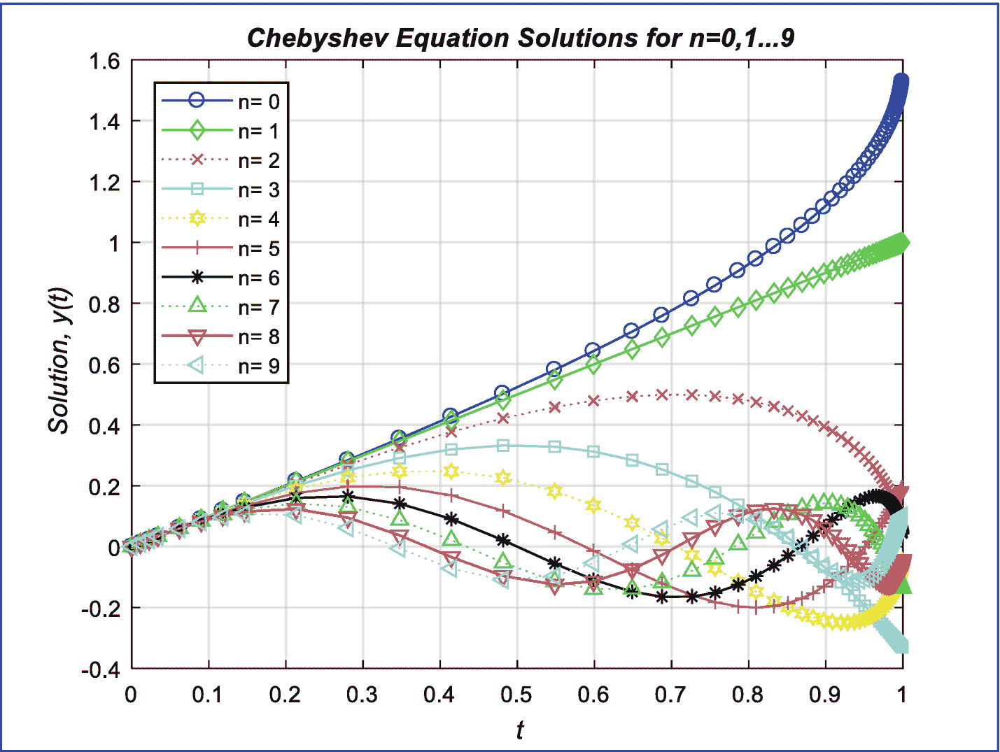

**图 4-3** 切比雪夫微分方程的模拟：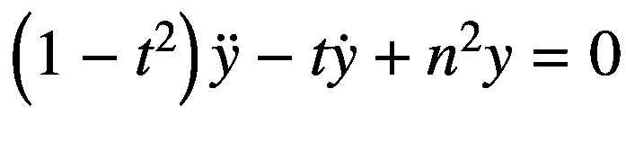 满足 `|t| < 1` 和 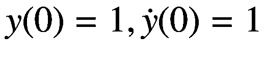，其中 `n = 0, 1, 2, … , 9`

> **注意**

> 雅可比矩阵是ODEx求解器的重要组成部分。因此，如果提供了雅可比矩阵，求解器的计算效率将得到提升，尤其是在解空间较大时。

## 示例 6

这是另一个适用于相对刚性微分方程的好例子。给定的问题描述了一个整流电路电压：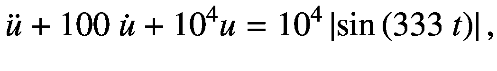 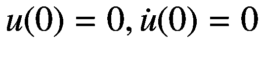。

首先，如同我们在前面的示例中所做的那样，将问题重写为两个一阶微分方程。

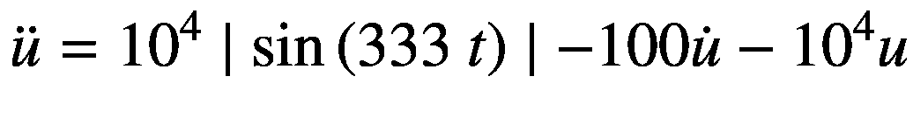 => 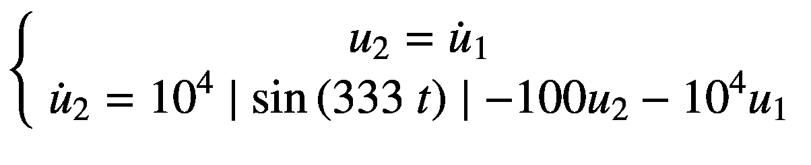

这个二阶刚性常微分方程的仿真模型通过脚本 `STIFF_2ODE_EX6.m` 和 Simulink 模型 `EL_Circuit.mdl` 的两个版本实现。

### 示例：二阶常微分方程 ~ 整流电路电压仿真

```matlab
% Stiff_2ODE_EX6.m
% 示例：二阶常微分方程 ~ 整流电路电压
clearvars; close all
u(1,:)=[0, 0];        % 初始条件
h=1e-4;               % 时间步长
t=0:h:.1;             % 仿真时间空间
steps=length(t);      % 步数
f=@(t, u1,u2)([u2, 1e4*abs(sin(333*t))-1e4*u1-100*u2]);
tic;
for ii=1:steps-1
F=f(t(ii), u(ii,1), u(ii,2));
u(ii+1,:)=u(ii,:)+h*F;
end
t_EF=toc;
plot(t, abs(sin(333*t)),'r', t, u(:,1), 'bd')
axis([0, .1 0, 1.2]),
xlabel( '\it t')
ylabel('\it 输出电压, u(t)')
title('Simulation of: $$ \frac{d²u}{dt²}+100*\frac{du}{dt}+10⁴*u=10⁴*|sin(333*t)| $$', ...
'Interpreter', 'latex')
hold on
fprintf('使用前向欧拉法的仿真时间为： %3.5f\n', t_EF)
% ODE23s
clearvars
t=[0,.1];ICs=[0, 0];
FFm=@(tm, um)([um(2); 1e4*abs(sin(333*tm))-1e4*um(1)-100*um(2)]);
options=odeset('reltol', 1e-4);
tm=t;
tic
[Tm, Um]=ode23s(FFm, tm', ICs, options);
t_ode23s=toc;
fprintf('使用 ode23s 的仿真时间为：   %3.5f\n', t_ode23s)
plot(Tm,Um(:,1),'k--+'),
% 通过 SIMULINK
% Simulink 模型：EL_circuit.mdl 创建了两个版本
% 相对容差设置为：1e-4
clearvars
options=simset('reltol', 1e-4);
tic
[tout, yout]=sim('EL_Circuit', [0, .1], options);
t_SIM=toc;
plot(tout, yout(:,1), 'm-', 'linewidth', 1.5)
legend('输入：|sin(333*t)|','前向欧拉脚本', ...
'ode23s', 'Simulink：ode15s','location', 'northeast'), shg
fprintf('使用 Simulink ode15s 的仿真时间为： %3.5f\n', t_SIM)
```

通过执行上述调用图 4-4 中所示 Simulink 模型 `EL_Circuit.mdl` 的脚本 `STIFF_2ODE_EX6.m`，我们得到如图 4-5 所示的仿真结果，即计算时间效率和数值结果。

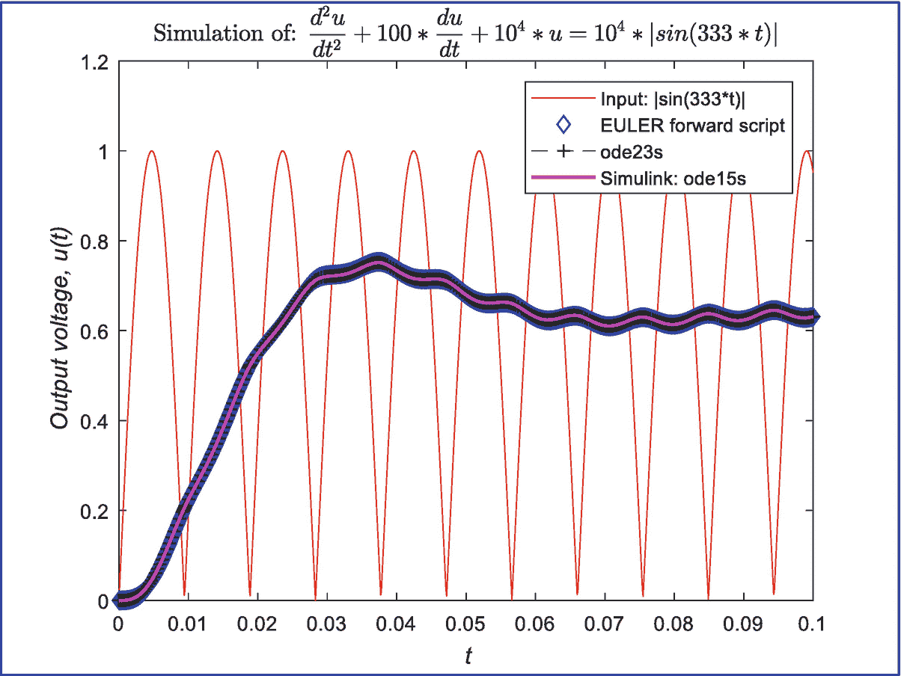

**图 4-5** 整流电路仿真

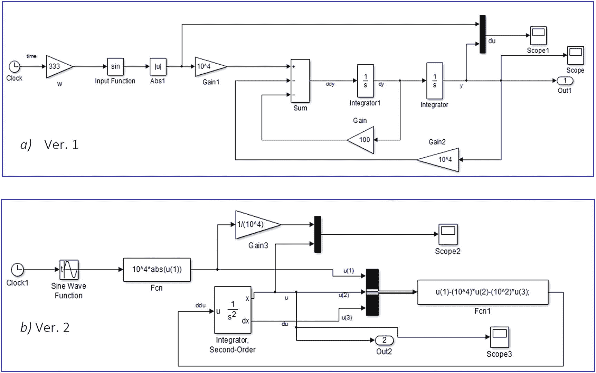

**图 4-4** `EL_Circuit.mdl` 的两个 Simulink 模型版本

```
使用前向欧拉法的仿真时间为：   0.03180
使用 ode23s 的仿真时间为：     0.63395
使用 Simulink ode15s 的仿真时间为： 0.27289
```

在本练习中，前向欧拉法（如图 4-5 所示）在计算时间效率方面明显优于另外两个 MATLAB/Simulink ODE 求解器 `ode23s` 和 `ode15s`。

在本章中，我们通过六个练习对刚性问题的模拟，研究了不同数值求解器的效率和精度；我们使用了 `ode15s`（推荐使用）、`ode23s`（推荐使用）、`ode23`（不推荐）、`ode113`（不推荐）、`ode45`（不推荐）以及基于前向欧拉法、梯形法和 Adams-Moulton 法的脚本。对于非常刚性的问题，`ode15s` 优于所有其他求解器，正如 MATLAB 教程所推荐的那样，但我们需要仔细调整其设置，例如相对误差容限和绝对误差容限，并且，在处理非常刚性问题时，如果可行，还应使用 `odeset` 提供问题的雅可比矩阵（参见示例 5）。此外，在示例 6 中，我们看到了前向欧拉法由于其计算时间效率高，可以作为替代方案或用于对某些刚性问题进行初步评估的情况。

