# 1. 常微分方程的解析解

工程应用中的许多建模问题都可以用常微分方程来表述。*微分方程*有几种不同的定义；其中最简单的定义之一是 [1] 中给出的：“微分方程是包含导数的任何方程，无论是常导数还是偏导数。” 从这个定义中，我们可以推导出两种微分方程：常微分方程 (ODE) 和偏微分方程 (PDE)。ODE 包含一种导数或一个自变量，而 PDE 包含两种或更多种导数或自变量。例如，一阶 ODE 的一般形式可以表示为：

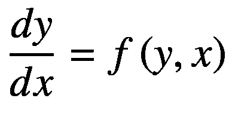

(1-1)

其中 `y(x)` 是因变量，其值取决于自变量 `x` 的值。ODE 的另一个很好的例子是牛顿第二运动定律，其公式为：

`ma` 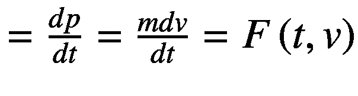 (1-2)

其中 `F(t, v)` 是力，它是时间 (`t`) 和速度 (`v`) 的函数；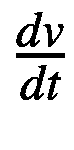 是运动物体的速度变化率（加速度）；`m` 是运动物体的质量；`a` 是运动物体的加速度；`p` 是动量；而 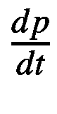 是其导数。

先前牛顿第二定律的公式也可以改写为以下形式：

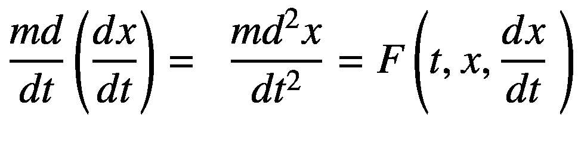

(1-3)

其中运动物体的位移 (`x`) 的导数 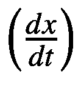 就是速度 (`v`)。换句话说，速度是运动物体的位移 `x(t)` 随时间的变化率。这可以用图 1-1 所示的流程图来直观表示。

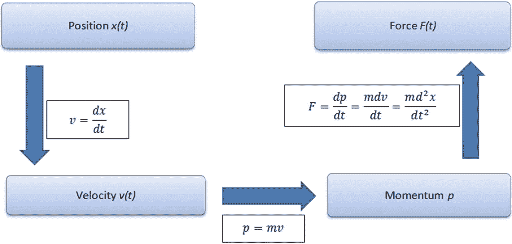

**图 1-1** 表达运动物体的运动及所受力的流程图

## 常微分方程分类

与 ODE 相关的问题分为两类。

- **初值问题 (IVPs)：** 例如：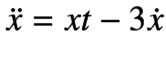 ，初值条件为：`x(0) = 3`，`\dot{x}(0) = 1`。

- **边值问题 (BVPs)：** 例如： ，边值条件为：`x(0) = 3`，`x(2) = 1.50`。

IVP 由 ODE 以及在解域内某一点上未知函数的指定值（称为*初值条件*）共同定义。在 ODE 的 IVP 中，可能存在唯一解、无解或多解。根据定义，ODE 的 IVP 可以显式定义或隐式定义。大多数 IVP 是显式定义的。

我们将从显式定义的 IVP 开始，然后转向隐式定义的 IVP。除了按解的类型（解值在解搜索空间中的变化方式）分类外，IVP 还分为刚性问题和非刚性问题。此外，ODE 要么是线性的要么是非线性的，要么是齐次的要么是非齐次的。

以下是一些不同 ODE 类型、类别和分组的具体示例：

- 刚性 ODE：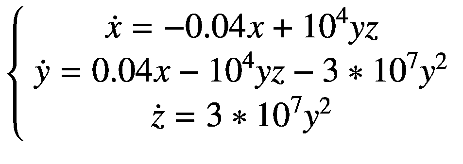 `t ∈ [0, 40]`

- 非刚性 ODE：`\dot{y} + 2y = 2t`，`\ddot{w} + \dot{w} = 5`

- 线性 ODE：`dv/dt = 9.81 - 0.198v`，`\ddot{x} + 3\dot{x} + 5x = 0`

- 非线性 ODE：`dv/dt = 9.81 - 0.198v²`，`\ddot{x} + 3x\dot{x} + 5x² = 0`

- 齐次 ODE：`\dot{y} + 2y = 0`，`\ddot{x} + 3\dot{x} + 5x = 0`

- 非齐次 ODE：`\dot{y} + 2y = sin(x)`，`\ddot{x} + 3\dot{x} + 5x = e^{2t}`

本章包含了几个 ODE 及其应用领域的示例。

### 示例 1

本示例展示了一个指数增长问题。该方程可以描述生物有机体（细菌）的无约束增长、房地产或投资的价值、热门社交网站的会员数、零售业务的增长、电气系统的正反馈或生成的化学反应。它由以下一阶 ODE 描述：

`dy/dt = μy` 的解为：`y(t) = y[0]e^(μt)`

### 示例 2

本示例演示指数衰减。该方程可描述自然界和工程学中的许多现象，例如放射性衰变、反应器中化学物质的洗出、电容器的放电以及河流中物质的分解。指数衰减由以下一阶常微分方程（ODE）表示：

`dy/dt = -μy` 的解为：`y(t) = y[0]*e^(−μt)`

示例 1 和 2 是一阶常微分方程的两个简单例子。

### 示例 3

下落物体的运动使用牛顿第二定律表达如下：

`m*d²y/dt² = mg - γ*dy/dt`

这是一个二阶常微分方程，其通解形式如下：

`y(t) = C1*e^(−γt/m) - m*(mg - gγt)/γ² + C2`

其中，`m` 是下落物体的质量；`g` 是重力加速度；`γ` 是下落物体的空气阻力系数。这里共有三个参数。具体来说，`m`、`g` 和 `γ` 是常数，而两个参数随时间变化：`d²y/dt²`（加速度）和 `dy/dt`（速度）。在使用运动方程求解下落物体通解时，`C1` 和 `C2` 是由初始条件决定的任意数，换言之，可以根据下落物体的初始条件计算得出。

有几种方法可以评估 ODE 的解析解，包括变量分离法、引入新变量法等。我们通过这些类型的 ODE 的具体示例来展示，并解释如何使用 MATLAB/Simulink 环境中的脚本和建立模型，采用不同技术来评估其解析解和计算数值解。我们通过具体示例评估 ODE 的解析解，并演示如何使用符号数学工具箱¹ 和 MuPAD² 笔记本的内置函数。我们将重点更多地放在符号数学工具箱的命令语法上，而非 MuPAD 笔记本。原因在于，在 MATLAB 的未来版本中，对 MuPAD 笔记本的技术支持将被移除。

数值方法有很多种，包括欧拉法（前向、后向、改进）、休恩法、中点法则、龙格-库塔法、龙格-库塔-吉尔法、亚当斯-巴什福斯法、米尔恩法、亚当斯-莫尔顿法、泰勒级数法和梯形法则法。其中一些方法是显式的，另一些是隐式的。为了演示如何应用这些方法，我们将首先简要描述它们的公式，然后针对其实现算法明确编写脚本（程序）。我们不试图推导这些数值方法中使用的任何公式，并且有许多文献来源 [2, 3, 4, 5] 解释了这些方法的理论方面。

在使用数值方法求解初值问题（IVP）时，我们首先从一个初始点（初始条件）开始，然后随时间向前迈出一步（等步长或变步长）来计算数值解。前面提到的一些数值方法（如欧拉法）是单步法，而其他方法（龙格-库塔法、亚当斯-巴什福斯法、米尔恩法、亚当斯-莫尔顿法、泰勒级数法）是多步法。单步法仅需前一点及其导数值来确定当前值。其他方法，如龙格-库塔法，会进行一些中间步骤以获得更高阶的步长，然后在进行下一步之前丢弃之前的值。与单步法不同，多步法会保留并使用前几步的值，而不是丢弃它们。通过这种方式，多步法将先前获得的几个值（解）及其导数值联系起来。所有这些方法，例如单步法和多步法，都是根据其计算特定类型 ODE 的 IVP 数值解时的准确性以及计算时间和资源（例如机器时间）效率来评估的。

## ODE 的解析解

符号数学工具箱（或 MuPAD 笔记本）具有多个函数，能够评估许多可解析求解的 ODE 的解析解。有两个命令（内置函数）——`dsolve()` 和 `ilaplace/laplace`——可用于评估某些 ODE 的解析解。

请注意，在本节中，我们通过几个一阶和二阶 ODE 以及耦合微分方程系统的示例来演示如何计算 ODE 的解析解。

### `dsolve()`

`dsolve()` 是一个 ODE 求解器工具，用于在 MATLAB 中计算任何给定 ODE 的解析（或通解）。`dsolve()` 可以使用以下通用语法：

```
Solution = dsolve(equation)
Solution = dsolve(equation, conditions)
Solution = dsolve(equation, conditions, Name, Value)
[y1,...,yN] = dsolve(equations)
[y1,...,yN] = dsolve(equations, conditions)
[y1,...,yN] = dsolve(equations, conditions, Name, Value)
```

### 示例 4

给定一个 ODE：`dy/dt + 2t*y² = 0`。注意，未指定初始条件或边界条件。以下命令可用于计算给定示例的通解。

```
>> y_solution=dsolve('Dy=-2*y²*t')
y_solution=-1/(C3-t²)
```

注意，`C3` 由给定 ODE 的初始条件或边界条件定义。

还有一个替代命令。对于较新版本的 `MATLAB`（从 `MATLAB` 2012 开始），可以使用以下命令语法来解决给定的问题：

```
>>syms y(t); y_sol=dsolve(diff(y) == -2*y²*t)
y_sol =

-1/(-t² + C3)
```

### 示例 5

给定一个 ODE：`dy/dt + 2t*y² = 0`，初始条件为 `y(0) = 0.5`。

```
>> Solution=dsolve('Dy=-2*y²*t', 'y(0)=0.5')
Solution =
1/(t² + 2)
```

以下是适用于较新版本 `MATLAB` 的替代命令语法：

```
>> syms y(t); Solution=dsolve(diff(y) == -2*y²*t, y(0)==0.5)
Solution =
1/(t² + 2)
```

这是另一种适用于较新版本 `MATLAB` 的替代语法：

```
>> syms y(t) t; Dy=diff(y, t); Equation = Dy ==-2*y²*t; IC=y(0)==0.5; Solution=dsolve(Equation, IC); pretty(Solution)

t  + 2
```

得到的解析解是符号形式，因此可以使用 `ezplot` 或推荐的 `fplot` 进行绘图（图 1-2）。（`ezplot` 将不再受 `MATLAB` 未来版本的支持。）

**图 1-2** *`dy/dt + 2t*y² = 0, y(0) = 0.5` 的解析解*

```
>> fplot(Solution, [-5, 5], 'r--o'), grid on
>>title('Solution of: $$ \frac{dy}{dt}+2y²t=0, y_0 = 0.5 $$', 'interpreter', 'latex')
>> xlabel('\it t'), ylabel '\it Solution, y(t)'
```

可以通过向量化（参数化）得到的符号公式（解）来计算所得解析解（方程）的数值，如下所示：

```
>> ysol=vectorize(solution)
ysol =
1./(t.² + 2)
>> t=(-5:.1:5); ysol_values=eval(ysol);
```

计算数值解值的另一种方法是使用 `fplot`，如下所示：

```
[t, yt]=fplot(Solution, [-5, 5]);
```

### 示例 6

给定 ``。注意，该练习题有一个未指定的参数 `k`。

```
>> syms k
>> solution=dsolve('Dy=-k*y²*t', 'y(0)=0.5')
solution =
1/((k*t²)/2 + 2)
```

以下是备选命令语法：

```
>> syms y(t) k; solution=dsolve(diff(y) == -k*y²*t, y(0)==0.5)
solution =
1/((k*t²)/2 + 2)
```

### 示例 7

给定 ``。让我们在 `MuPAD` 笔记中求解该练习题。图 1-3 显示了用于计算该练习题解析解的命令。

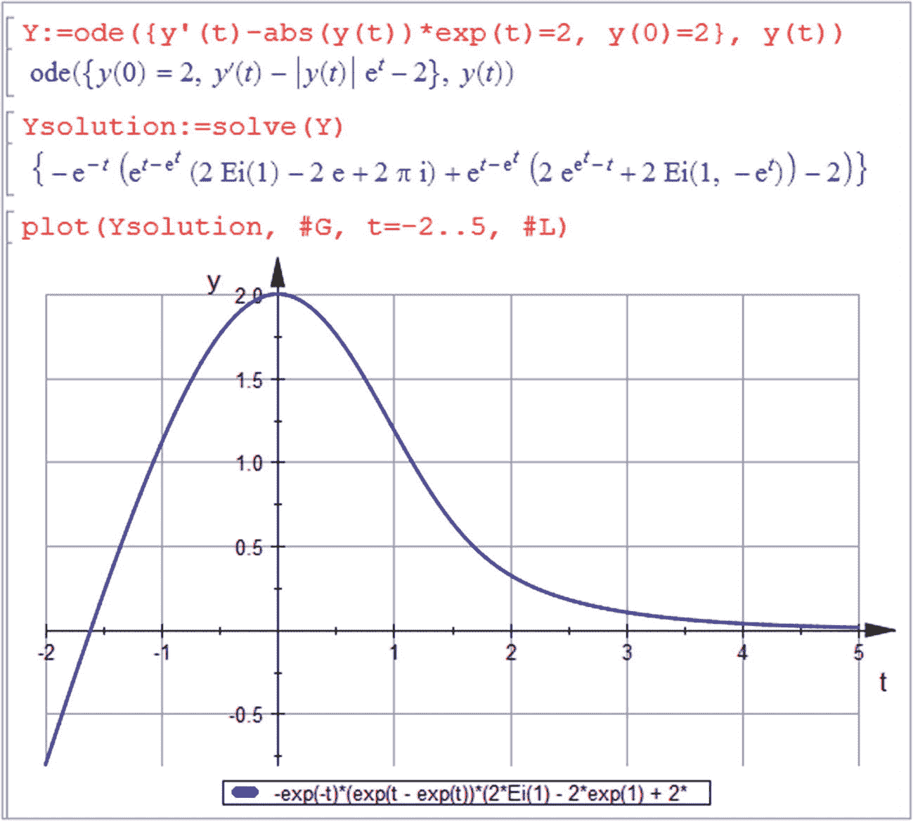

图 1-3

*用于解析求解* `` *的 `MuPAD` 命令*

**注意**

`dsolve()` 中的选项需要根据问题类型进行适当设置。对于 `MATLAB` 2008–2010 或更早版本，应将 `IgnoreAnalyticConstraints` 设置为 `none` 以获取所有或任何可能的解。

示例如下：

```
solution=dsolve('Dy=-k*y²*t', 'y(0)=0.5', ... 'IgnoreAnalyticConstraints', 'none')
```

**注意**

对于 `MATLAB` 2012 或更新版本，应将 `IgnoreAnalyticConstraints` 设置为 `false` 以获取所有参数值的所有可能正确答案。否则，`dsolve()` 可能会因其预代数简化而输出不正确的答案。

示例如下：

```
solution=dsolve(diff(y)==-k*y²*t, y(0)==0.5, ... 'IgnoreAnalyticConstraints', false)
```

### 二阶常微分方程组和常微分方程组

有许多过程和现象通过二阶微分方程表达，例如弹簧质量系统的简谐运动、具有一定加速度的物体运动（牛顿第二定律）、阻尼振动、电阻-电容-电感电路中的电流等。一般形式下，二阶常微分方程以两种不同形式表达：齐次形式，如方程 (1-4) 所示；非齐次形式，如方程 (1-5) 所示。

``

(1-4)

``

(1-5)

注意，方程 1-4 中的齐次常微分方程总是有一个平凡解，即 `y(x) = 0`，它满足方程 1-4 中给出的方程。关于独立函数 `p(x)`、`q(x)` 和 `g(x)`，常微分方程可能是线性的或非线性的。在某些情况下，独立函数 `p(x)`、`q(x)` 和 `g(x)` 可能是常数值或非常数值。

让我们考虑几个例子，使用 `MATLAB` 的符号数学工具箱通过二阶常微分方程计算通解和特解。

### 示例 8

给定常微分方程 ``

```
usol=dsolve('D2u+100*u=2.5*sin(10*t)', 'u(0)=0', 'Du(0) 0');
pretty(usol)
```

```
%% 备选语法
syms u(t)
Du = diff(u);
u(t) = dsolve(diff(u, 2)==2.5*sin(10*t)-100*u, u(0)==0, Du(0) == 0);
pretty(u(t))
```

执行这两个简短脚本/命令后的输出如下：

```
3 sin(10 t)   sin(30 t)
----------- - --------- -
320          320
/ t  sin(20 t) \
cos(10 t) | - - -------- |
\ 8     160    /
```

### 示例 9

给定常微分方程组 ``。

给定的问题是一个由两个一阶常微分方程组成的方程组。这个问题可以像前面的例子那样直接使用 `dsolve()` 求解，如下所示：

```matlab
%% 使用 dsolve 求解由两个一阶常微分方程组成的方程组
yt=dsolve('Dy1=y2', 'Dy2=-y1-0.125*y2','y1(0)=1', 'y2(0)=0');
pretty(yt.y1)
pretty(yt.y2)
```

```matlab
%% 备选语法
syms y1(t) y2(t)
z=dsolve(diff(y1,1)==y2, diff(y2,1)==(-y1-0.125*y2), y1(0)==1, y2(0)==0);
pretty(z.y1), pretty(z.y2)
```

命令窗口中显示的计算出的解析解如下：

```
/    1/2   \             /    1/2   \
| 255    t |      1/2    | 255    t |
cos| -------- |   255    sin| -------- |
\    16    /             \    16    /
--------------- + ----------------------
1/16                    1/16
exp(t)              255 exp(t)
/    1/2   \
1/2    | 255    t |
16 255    sin| -------- |
\    16    /
- -------------------------
1/16
255 exp(t)
```

计算出的解析解如下：

`![$$ {y}_1(t)=\frac{\mathit{\cos}\left(\frac{\sqrt{255}t}{16}\right)}{\sqrt[16]{e^t}}+\frac{\sqrt{255}\mathit{\sin}\left(\frac{\sqrt{255}t}{16}\right)}{255\sqrt[16]{e^t}} $$](images/490522_1_En_1_Chapter/490522_1_En_1_Chapter_TeX_Equc.png)`

`![$$ {y}_2(t)=-\frac{16\sqrt{255}\mathit{\sin}\left(\frac{\sqrt{255}t}{16}\right)}{255\sqrt[16]{e^t}} $$](images/490522_1_En_1_Chapter/490522_1_En_1_Chapter_TeX_Equd.png)`

### 示例 10

给定二阶常微分方程 ``，初始条件为：`y(0) = 0` 且 ``。

```matlab
>> Solution_dsolve=dsolve('2*D2y+3*(Dy³)-cos(100*t)*abs(y)-2=0', ... 'y(0)=0','Dy(0) =0');
Warning: Explicit solution could not be found.
> In dsolve at 194
```

这是许多无法通过使用 `dsolve()` 解析求解的常微分方程的一个很好的例子。

让我们考虑几个例子，在 MuPAD 笔记本中计算常微分方程的解析解，这些笔记本通过在命令窗口中输入如下命令来打开：

```matlab
>> mupad
```

### 示例 11

让我们考虑一个二阶常微分方程，如图 1-4 所示：``

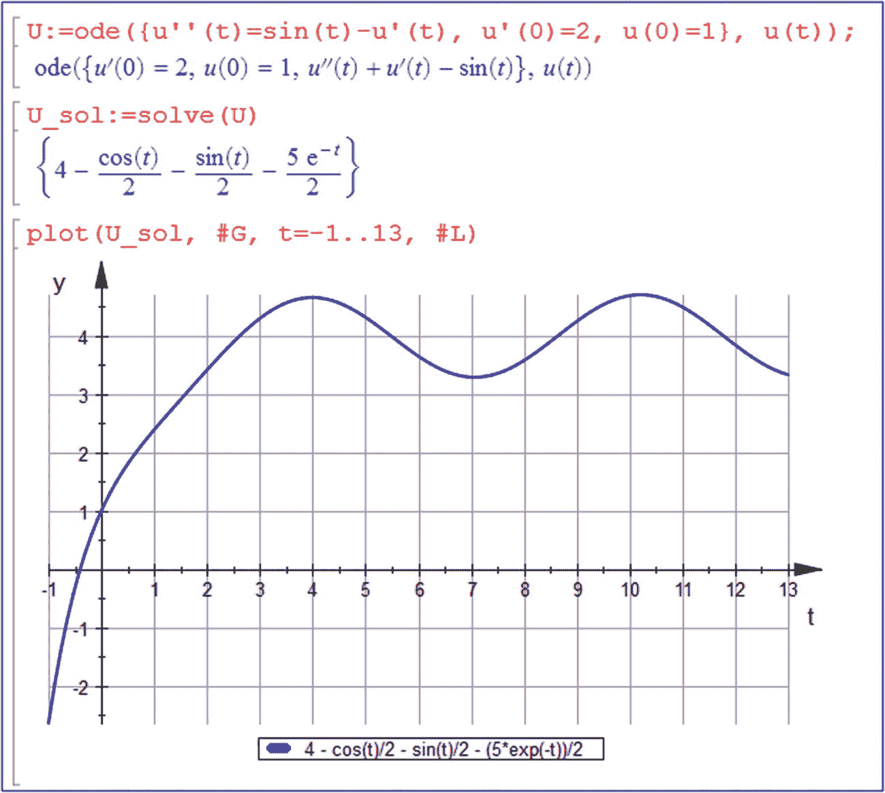

图 1-4

用于求解二阶常微分方程的 MuPAD 工具

### 示例 12

给定 `` `y(0) = 0`，``。这是一个二阶非齐次非线性常微分方程。以下是 MuPAD 笔记中给定示例的求解语法（求解命令）。

```matlab
Y:=ode({y″(t)+3∗(y′(t)³)-y(t)∗abs(y(t))=2,y(0)=0,y′(0)=0},y(t))
```

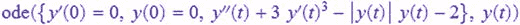

```matlab
Ys olution:=solve(Y)
```


在该练习题中未计算出任何解。当 MuPAD 笔记（符号数学工具箱）无法计算给定常微分方程问题的解析解时，它会重写给定的问题表述，并且不生成任何解析解表达式。

### 示例 13

给定 ``，初始条件为：`y(0)` = `a` 和 ``。这是一个二阶线性常微分方程。`[A, B, C, D]` 和 `[a, b]` 都是标量。让我们编写一个 Unicode 代码，能够针对这些标量的任意值求解给定的常微分方程。

以下是使用符号数学工具箱中的 `dsolve()` 和 `syms` 函数的求解脚本（`Unicode_2nd_ODE.m`）：

```matlab
% Unicode_2nd_ODE.m
syms y(t) t
Dy=diff(y, t);
D2y=diff(y, t, 2);
fprintf('要求解： A*ddy+B*dy+C*y=D，初始条件： y(0)=a, dy(0)=b \n')
fprintf('请输入 [A, B, C, D] 和 [a, b] 的值 \n');
A = input('输入 A = ');
B = input('输入 B = ');
C = input('输入 C = ');
D = input('输入 D = ');
a = input('输入 a = ');
b = input('输入 b = ');
% 给定的 ODE 方程：
Equation = D2y==(1/A)*(D - B*Dy-C*y);
ICs = [y(0)==a; Dy(0)==b];
Solution=dsolve(Equation, ICs);
% 在命令窗口中显示计算出的解析解：
pretty(Solution)
fplot(Solution, [0, 5], 'b-'), grid on
xlabel('\it t')
ylabel('\it 解, y(t) ')
title('\it 的解: $$\frac{A*d²y}{dt²}+\frac{B*dy}{dt}+C*y=D, y(0)=a, dy(0)=b$$', 'interpreter', 'latex')
gtext(['\it A = '  num2str(A), '\it,  B = '  num2str(B), '\it,  C = '  num2str(C), '\it,  D = '  num2str(D)])
gtext(['\it 初始条件:  a = '  num2str(a), '\it,  b = '  num2str(b)])
grid on; shg
```

现在，让我们测试代码来求解这个方程：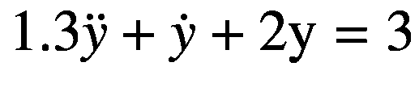，`y(0)` = 1，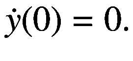

```
要求解： A*ddy+B*dy+C*y=D，初始条件： y(0)=a, dy(0)=b
请输入 [A, B, C, D] 和 [a, b] 的值
输入 A = 1.3
输入 B = 1
输入 C = 2
输入 D = 3
输入 a = 1
输入 b = 0
/   5 t \    / sqrt(235) t \
sqrt(235) exp| - --- | sin| ----------- |
3                \    13 /    \      13     /
- - -----------------------------------------
2                       94
/   5 t \    / sqrt(235) t \
exp| - --- | cos| ----------- |
\    13 /    \      13     /
- -------------------------------
```

此外，我们得到下一个绘图，如图 1-5 所示，该图展示了计算出的解析解 `y(t)` 的数值。

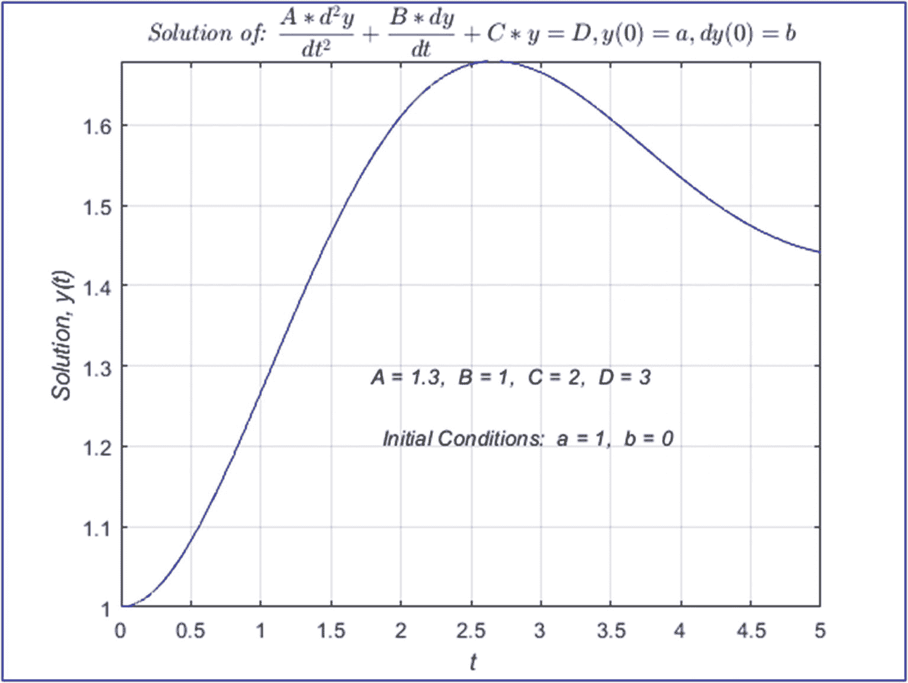

图 1-5 `二阶 ODE 的解:` 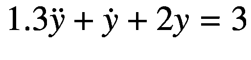 `y(0)` = 1, 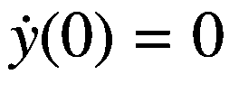

您可以使用此代码求解任何具有标量 `[A, B, C, D]` 值的初值问题的二阶 ODE。此代码可以类似地扩展以求解三阶、四阶或更高阶的 ODE。这是另一个可求解高达四阶 ODE 的替代脚本（`Unicode_4th_order_ODE.m`）：

```
% Unicode_4th_order_ODE.m
%% Unicode 用于求解高达 4 阶非齐次线性 ODE 的初值问题
%
%  方程： Ax+B*dx + C*ddx + ... = F
%  用户输入（1）为 ODE 阶数：N
%  用户输入（2）为系数值：A, B, C, ....
%  用户输入（3）为初始条件：IC1, IC2, IC3,...
syms x(t)
Dx=diff(x, t);
D2x=diff(x, t, 2);
D3x=diff(x, t, 3);
D4x=diff(x, t, 4);
D5x=diff(x, t, 5);
D6x=diff(x, t, 6);
D7x=diff(x, t, 7);
N = input('ODE 的阶数： N  =  ');
if N == 1
disp('求解： A*x+B*dx=F 带一个初始条件： x(0) = ? ')
A = input(' 输入：  A =         ');
B = input(' 输入：  B =         ');
F = input(' 输入：  F =         ');
EQN = A*x+B*Dx==F;
IC1 = input(' 输入： x(0) =    ');
IC = x(0)==IC1;
Str0 ='的解： $$ A*x+B*\frac{dx}{dt}=F $$';
Str1=sprintf('A = %d,  B = %d, F = %d',  A, B, F);
Str2 =(['初始条件： [ '  num2str(IC1), ' ]' ]);
elseif N == 2
disp('求解： A*x+B*dx+C*ddx=E 带两个初始条件： x(0) = ?, dx(0) = ? ')
A = input(' 输入：  A =         ');
B = input(' 输入：  B =         ');
C = input(' 输入：  C =         ');
F = input(' 输入：  F =         ');
EQN = A*x+B*Dx+C*D2x==F;
IC1 = input(' 输入：   x(0) =    ');
IC2 = input(' 输入： dx(0) =    ');
IC = [x(0)==IC1, Dx(0)==IC2];
Str0 ='的解： $$ A*x+B*\frac{dx}{dt}+C*\frac{d²x}{dt²}=F $$';
Str1=sprintf('A = %d,  B = %d, C = %d, F = %d',  A, B, C, F);
Str2 =(['初始条件： [ ' num2str(IC1), ', ' num2str(IC2), ' ]']);
elseif N == 3
disp('求解： A*x+B*dx+C*ddx+D*dddx=F ')
disp('带三个初始条件： x(0) = ?, dx(0) = ? ddx(0) = ?')
A = input(' 输入：  A =         ');
B = input(' 输入：  B =         ');
C = input(' 输入：  C =        ');
D = input(' 输入：  D =        ');
F = input(' 输入：  F =         ');
EQN = A*x+B*Dx+C*D2x+D*D3x==F;
IC1 = input(' 输入：    x(0) =    ');
IC2 = input(' 输入：  dx(0) =    ');
IC3 = input(' 输入： ddx(0) =    ');
IC = [x(0)==IC1, Dx(0)==IC2, D2x(0)==IC3];
Str0 ='的解： $$ A*x+B*\frac{dx}{dt}+C*\frac{d²x}{dt²}+D*\frac{d³x}{dt³}=F $$';
Str1=sprintf('A = %d,  B = %d, C = %d, D = %d, F = %d',  A, B, C, D, F);
Str2 =(['初始条件： [ '  num2str(IC1), ', ' num2str(IC2), ', ' num2str(IC3),' ]']);
else
disp('求解： a*x+b*dx+c*ddx+d*dddx+e*ddddx=0 ')
disp('带四个初始条件： x(0) = ?, dx(0) = ? ddx(0) = ?, dddx(0) = ?')
A = input(' 输入：  A =        ');
B = input(' 输入：  B =        ');
C = input(' 输入：  C =        ');
D = input(' 输入：  D =        ');
E = input(' 输入：  E =        ');
F = input(' 输入：  F =        ');
EQN = A*x+B*Dx+C*D2x+D*D3x+E*D4x==F;
IC1 = input(' 输入：   x(0)  =    ');
IC2 = input(' 输入：  dx(0)  =    ');
IC3 = input(' 输入： ddx(0)  =    ');
IC4 = input(' 输入： dddx(0) =   ');
IC = [x(0)==IC1, Dx(0)==IC2, D2x(0)==IC3, D3x(0)==IC4];
Str0 ='的解： $$ A*x+B*\frac{dx}{dt}+C*\frac{d²x}{dt²}+D*\frac{d³x}{dt³} +E*\frac{d⁴y}{dt⁴}=F $$';
Str1=sprintf('A = %d,  B = %d, C = %d, D = %d,  E = %d, F = %d',  A, B, C, D, E, F);
Str2 =(['初始条件： [ '  num2str(IC1),', ' num2str(IC2), ', ' num2str(IC3), ', ' num2str(IC3) ' ]']);
end
Solution = dsolve(EQN, IC);
fplot(Solution, [0, 3*pi], 'LineWidth', 2), grid on
xlabel('\it t')
ylabel('\it 解, x(t) ')
title(Str0, 'Interpreter', 'latex')
gtext(Str1)
gtext(Str2)
grid on; shg
```

使用此脚本（`Unicode_4th_order_ODE.m`），用户可以根据输入获得高达四阶的非齐次线性 ODE 的解析解和数值解。