# 5. 高阶与耦合常微分方程

本章致力于数值求解高阶和耦合常微分方程（ODE）。通常，求解高阶 ODE 和耦合 ODE 系统所使用的步骤与二阶 ODE 相似，唯一的区别在于，在将给定的高阶 ODE 改写为一阶 ODE 系统时，需要为新变量添加额外的步骤。

## 四阶 ODE 问题

让我们考虑以下四阶非齐次 ODE：

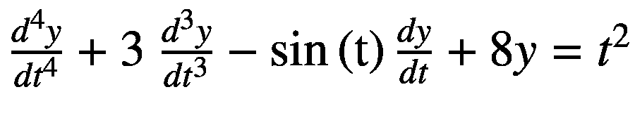，`y(0) = 50`，`dy(0) = 40`，`d²y(0) = 30`，`d³y(0) = 20`。

上述给定的四阶 ODE 可以通过如下四个一阶 ODE 组成的系统重写：

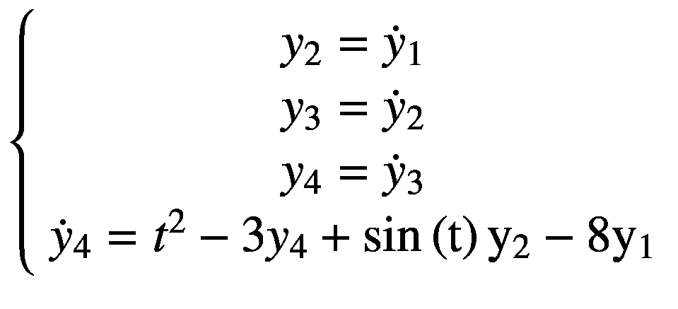

该系统通过脚本 `SOLVE_4order_ODE.m` 实现：

```matlab
function SOLVE_4order_ODE
% 帮助：使用 f4ode（嵌套函数）的 EXE4orderODE.m
%       对问题进行仿真。
close all
time=[0, 2*pi]; y0=[50, 40, 30, 20];
[t, y]=ode45(@f4ode, time, y0, odeset('reltol', 1e-8));
figure('name', 'Simulate with ODE45'),
plot(t,y(:,1), 'b-', t,y(:,2), 'r--',t,y(:,3), ...
'k:',t,y(:,4), 'm-.','linewidth', 1.5)
legend('\it y(t)', '\it dy','\it ddy','\it dddy',... 'location','best')
title('ODE45 仿真: $$ \frac{d⁴y}{dt⁴}+3*\frac{d³y}{dt³}-sin(t)*\frac{dy}{dt}+8*y=t² $$', 'interpreter', 'latex')
grid on, ylim([-700 300]), xlim([0, 2*pi])
xlabel('\it t')
ylabel('\it 解: $$ \frac{d³y}{dt³}, \frac{d²y}{dt²}, \frac{dy}{dt}, y(t) $$', 'interpreter', 'latex')
grid on
figure('name','Simulate with ODE23');
ode23(@f4ode, time, y0, odeset('reltol', 1e-8))
ylim([-700 300]), xlim([0, 2*pi])
legend('\it y(t)', '\it dy','\it ddy','\it dddy', 'location','best')
title('ODE23 仿真: $$ \frac{d⁴y}{dt⁴}+3*\frac{d³y}{dt³}-sin(t)*\frac{dy}{dt}+8*y=t² $$', 'interpreter', 'latex')
xlabel('\it t')
ylabel('\it 解: $$ \frac{d³y}{dt³}, \frac{d²y}{dt²}, \frac{dy}{dt}, y(t) $$', 'interpreter', 'latex')
grid on
function f=f4ode(t, y)
% 给定的四阶 ODE 为： y""+3*y"'-sin(t)*y'+8*y=t²
f=[y(2); y(3); y(4); t.²-3.*y(4)+sin(t).*y(2)-8.*y(1)];
end
end
```

使用 `ode45` 的仿真结果（如图 5-1 所示）与使用 `ode23` 得到的结果（此处未显示绘图）吻合良好。注意，在脚本 `SOLVE_4order_ODE.m` 中，使用了一个嵌套函数 (`f4ode`) 来表达给定的四阶 ODE，该函数也可用匿名函数替代。示例如下：

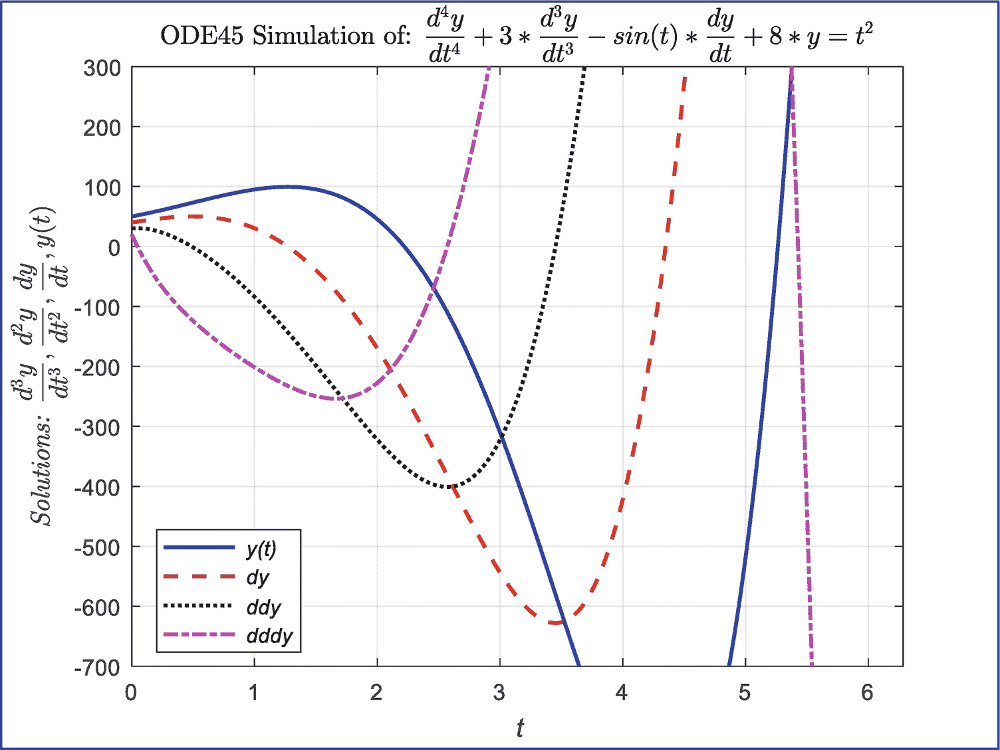

图 5-1：四阶非齐次非线性 ODE 问题的仿真

```matlab
f4ode=@(t, y)([y(2); y(3); y(4); t.²-3.*y(4)+sin(t).*y(2)-8.*y(1)]);
```

那么调用 `ode45` 或 `ode23` 的语法如下：

```matlab
[t, y]=ode45(f4ode, time, y0, odeset('reltol', 1e-8));
```

图 5-2 展示了给定四阶 ODE 问题的两个版本的 Simulink 模型（`Fourth_order_ODE.slx`）。

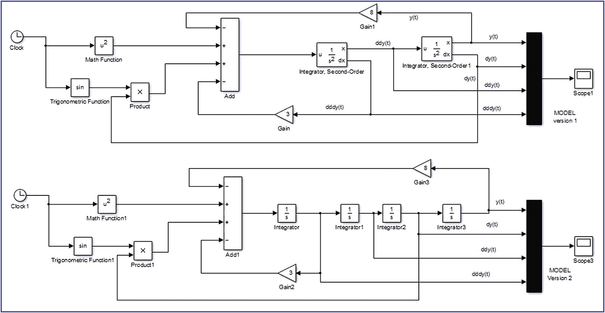

图 5-2：四阶非齐次 ODE 的 Simulink 模型

注意，在第一个和`二阶积分器`模块中，所有初始条件（IC）都是内部源的输入。两个模型唯一的区别在于：第一个模型中使用了两个`二阶积分器`模块，而第二个模型中使用了四个一阶`积分器`模块。注意，在图 1-3 所示的仿真结果中，输出信号名称显示在图例中。也就是说，这些名称是通过将连接到 `Mux` 模块的每个信号分别命名为 `y(t)`、`dy(t)`、`ddy(t)`、`dddy(t)` 获得的。您可以通过右键单击并逐一重命名信号来重命名这些信号。来自 Simulink 模型 `Fourth_order_ODE.slx` 的仿真结果（图 5-3）与来自脚本 `SOLVE_4order_ODE.m` 的 `ode45` 求解器输出（如图 5-1 所示）是一致的。

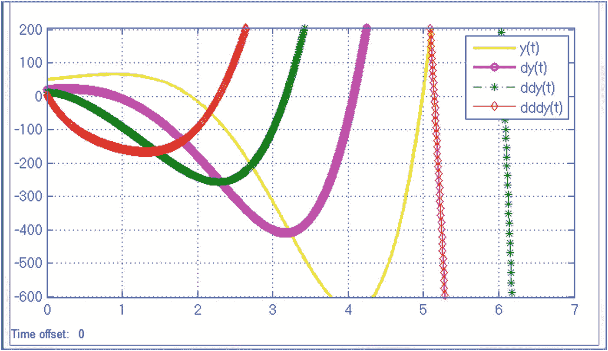

图 5-3：`Scope` 中显示的 Simulink 模型仿真结果

从我们对高阶 ODE 的仿真可以看出，计算高阶 ODE 的数值解与二阶 ODE 类似，用于仿真高阶 ODE 的工具和函数与我们在求解一阶和二阶 ODE 时使用的相同。我们在高阶 ODE 中遇到的唯一区别是，在脚本中将高阶 ODE 改写为一阶 ODE 时需要额外的步骤，并且在 Simulink 建模中需要额外的`积分器`模块。

## Robertson 问题

Robertson 问题 [1] 描述了化学反应，并常被用作针对刚性初值问题 (IVP) 的 ODE 求解器的测试问题。它是用于耦合系统以及刚性 ODE 问题的一个很好的例子。Robertson 问题由以下耦合的一阶微分方程组描述：

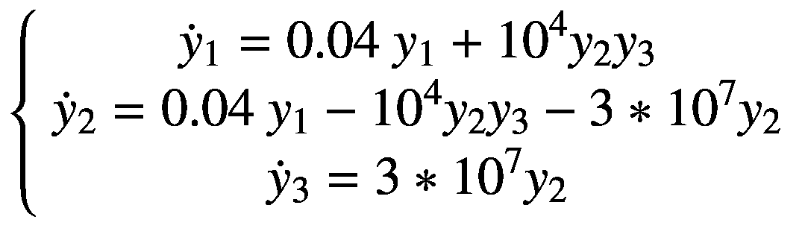

其初始条件为 `y1(0) = 1`，`y2(0) = 0`，`y3(0) = 0`。

这个问题可以相对容易地通过 Simulink 建模实现。图 5-4 显示了 Simulink 模型（`Robertson_problem.mdl`），图 5-5 显示了仿真结果。

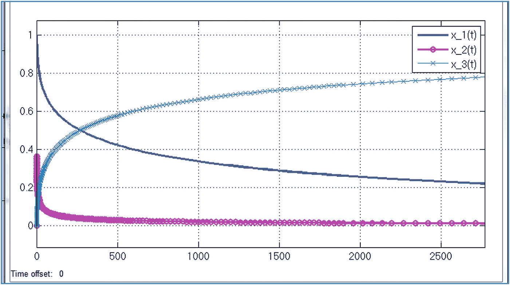

图 5-5：Robertson 问题的 Simulink 模型仿真结果（放大视图）

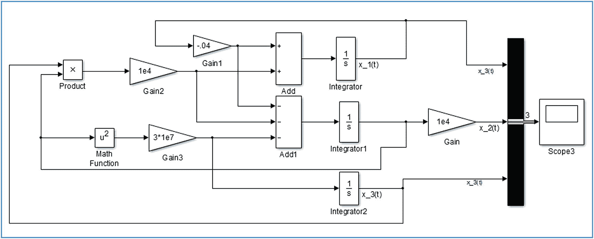

图 5-4：Simulink 中的 Robertson 问题模型（`Robertson_problem.mdl`）

Robertson 问题是用于演示刚性 ODE 的一个很好的例子。其数值解是通过 Simulink 建模方法计算的，并且计算出的解被证明是相当稳定的。然而，为了评估所开发的 Simulink 模型的精度和计算时间效率，需要使用其他方法（如 Milne 方法、Adams-Moulton 方法或改进的 Euler 方法）或内置的 ODEx 求解器（如`ode15`、`ode23s`和`ode113`）来开发其他数值仿真模型。

# 阿克苏诺贝尔问题

阿克苏诺贝尔问题源自位于荷兰阿纳姆的阿克苏诺贝尔中央研究院。它描述了一个化学过程，其中两种物质 FLB 和 ZHU 混合，同时持续添加二氧化碳。产生的一种重要物质是 ZLA。出于商业价值考虑，这里使用的化学物质名称是虚构的。这个阿克苏诺贝尔问题是取自 W. Lioen 和 H. de Swart [2] 编写的 ODE 问题集中的一个化学阿克苏诺贝尔问题的版本。该问题的数学表述形式如下：

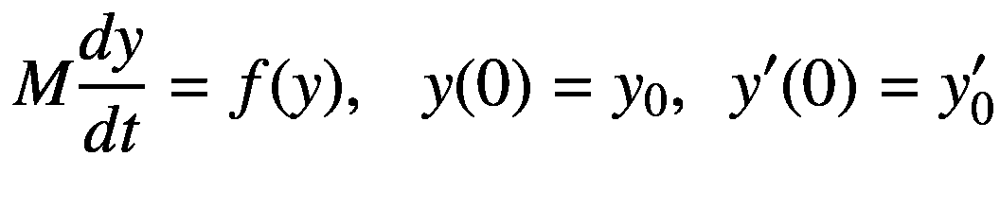

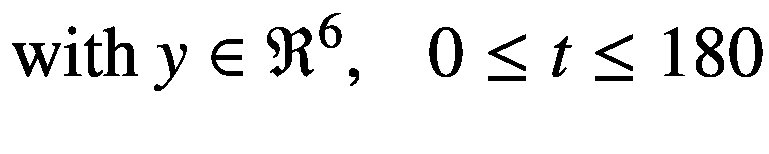

矩阵`M`的秩为 5，具体如下：


函数`f`如下：

![$$ f(y)=\left(\genfrac{}{}{0pt}{}{\begin{array}{ccc}-2{r}_1&amp; +2{r}_2&amp; -{r}_3\\ {}-\frac{1}{2}{r}_1&amp; 0&amp; 0\\ {}{r}_1&amp; -{r}_2&amp; +{r}_3\end{array}}{\begin{array}{ccc}0&amp; -{r}_2&amp; +{r}_3\\ {}0&amp; {r}_2&amp; -{r}_3\\ {}{K}_s{y}_1{y}_4-{y}_6&amp; 0&amp; 0\end{array}}\genfrac{}{}{0pt}{}{\begin{array}{ccc}-{r}_4&amp; 0&amp; 0\\ {}-{r}_4&amp; -\frac{1}{2}{r}_5&amp; +{F}_{in}\\ {}0&amp; 0&amp; 0\end{array}}{\begin{array}{ccc}-2{r}_4&amp; 0&amp; 0\\ {}0&amp; +{r}_5&amp; 0\\ {}0&amp; 0&amp; 0\end{array}}\right) $$](img/490522_1_En_5_Chapter_TeX_Equf.png)

其中`r_i`和`F_in`是辅助变量，如下所示：

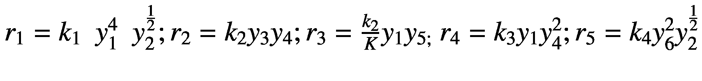；

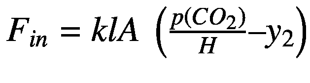

参数`k1`、`k2`、`k3`、`k4`、`K`、`klA`、`p(CO2)`和`H`的值如下：

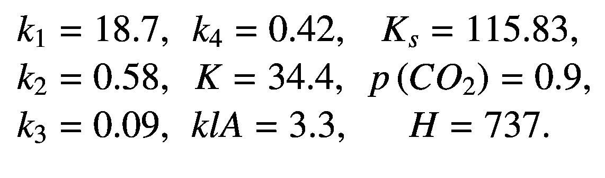

一致的初始条件向量如下：

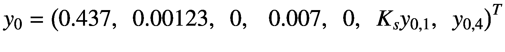

基于上述微分方程及其初始条件，我们开发了一个名为`F_NOBEL.m`的脚本（使用龙格-库塔法）和一个 Simulink 模型`AKZO_NOBEL.mdl`，如图 5-6 所示。该练习的仿真结果见图 5-7 和图 5-8。

图 5-8：阿克苏诺贝尔问题的仿真结果（子图显示）
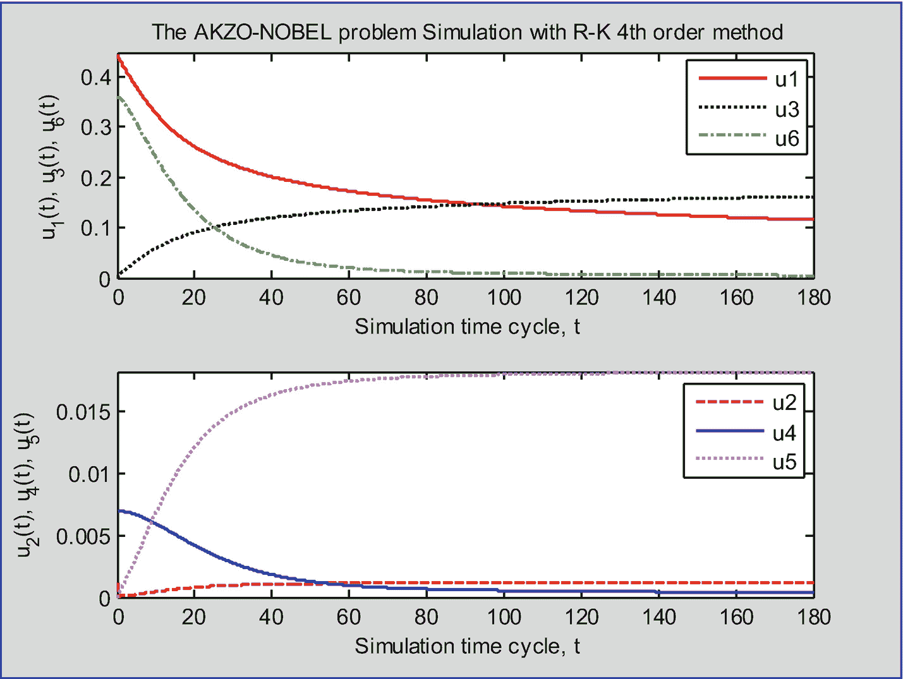

图 5-7：阿克苏诺贝尔问题的仿真结果（单图显示）
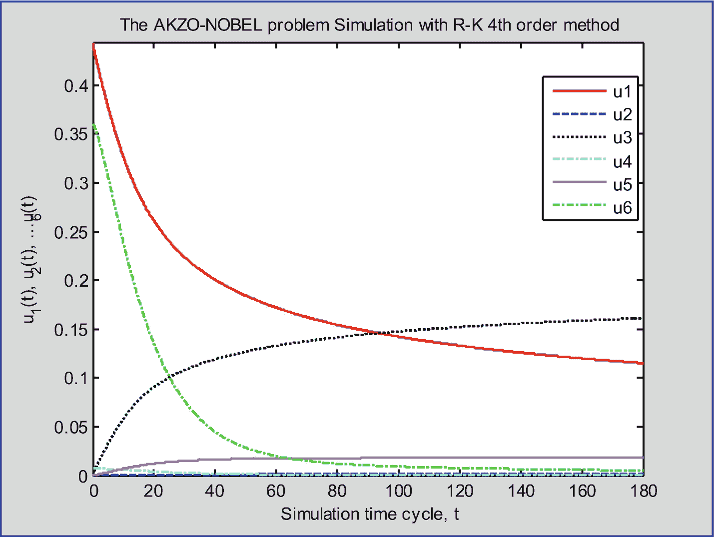

图 5-6：阿克苏诺贝尔问题的 Simulink 模型 (`AKZO_NOBEL.mdl`)
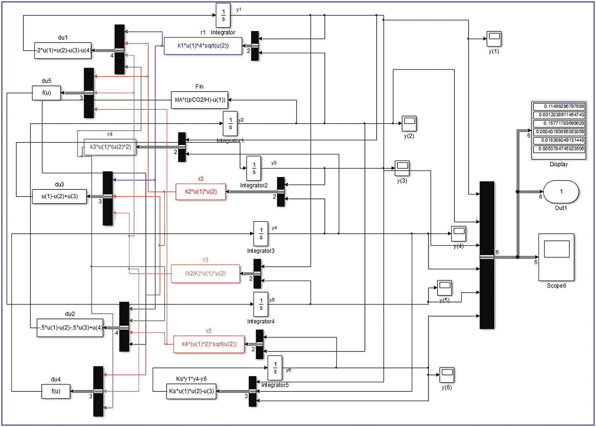

```
function F_ANOBEL
% HELP: Akzo-NOBEL Problem.
% Akzo-NOBEL implemented via Runge-Kutta Method in scripts
clearvars, close all
% ICs:
Ks=115.83; y(1,:)=[.437, .00123, 0, .007, 0, Ks*.437*.007];
% NOTE: VERY important to show the ICs with proper indexing,
% such as, y(1, :) or y(:,:)or :# of rows & :# of columns.
% Otherwise, anonymous function evaluation gives an error on
% matrix dimensions exceed ....
tstart=0;
hstep=.1;
tend=180;
t=hstart:hstep:hend;
for ii=1:length(t)-1
k1=F_anobel(y(ii,1),y(ii,2),y(ii,3), y(ii,4), y(ii,5), y(ii,6));
k2=F_anobel(y(ii,1)+hstep*k1(:,1)/2, y(ii,2)+hstep*k1(:,2)/2,...
y(ii,3)+hstep*k1(:,3)/2, y(ii,4)+hstep*k1(:,4)/2,...
y(ii,5)+hstep*k1(:,5)/2, y(ii,6)+hstep*k1(:,6)/2);
k3=F_anobel(y(ii,1)+hstep*k2(:,1)/2,y(ii,2)+hstep*k2(:,2)/2,...
y(ii,3)+hstep*k2(:,3)/2, y(ii,4)+hstep*k2(:,4)/2,...
y(ii,5)+hstep*k2(:,5)/2, y(ii,6)+hstep*k2(:,6)/2);
k4=F_anobel(y(ii,1)+hstep*k3(:,1), y(ii,2)+hstep*k3(:,2), ...
y(ii,3)+hstep*k3(:,3)/2, y(ii,4)+hstep*k3(:,4)/2,...
y(ii,5)+hstep*k3(:,5)/2, y(ii,6)+hstep*k3(:,6)/2);
y(ii+1,:)=y(ii,:)+hstep*(k1+2*k2+2*k3+k4)/6;
end
plot(t, y(:,1), 'r', t, y(:,2), 'b--', t, y(:,3),'k:', t, y(:,4),...
'c-.', t, y(:,5),'m', t, y(:,6), 'g-.', 'linewidth', 1.5 )
axis tight, legend ('u1', 'u2','u3','u4','u5','u6')
title('The AKZO-NOBEL problem Simulation with R-K 4th order method')
xlabel('Simulation time cycle, t'),
ylabel('u_1(t), u_2(t), ...u_6(t)')
figure; subplot(211)
plot(t,y(:,1),'r',t,y(:,3),'k:', t, y(:,6),'g-.','linewidth', 1.5)
axis tight, legend ('u1', 'u3','u6')
title('The AKZO-NOBEL problem Simulation with R-K 4th order method')
xlabel('Simulation time cycle, t'),
ylabel('u_1(t), u_3(t), u_6(t)')
subplot '212'
plot(t, y(:,2),'r--',t, y(:,4),'b',t,y(:,5),'m:','linewidth', 1.5)
axis tight; legend('u2','u4','u5','best')
xlabel('Simulation time cycle, t')
ylabel('u_2(t), u_4(t), u_5(t)')
function F=F_anobel(y1,y2,y3,y4,y5,y6)
k1=18.7; k2=.58; k3=.09; k4=.42; K=34.4; klA=3.3;
Ks=115.83; pCO2=.9; H=737;
F=[-2*k1*y1⁴*y2^.5+k2*y3*y4-(k2/K*y1*y5)-(k3*y1*y4²),...
-0.5*(k1*y1⁴*y2^.5)-(k3*y1*y4²)- ... 0.5*(k4*y6²*y2^.5)+(klA*(pCO2/H-y2)),...
(k1*y1⁴*y2^.5)-k2*y3*y4+(k2/K*y1*y5),...
-k2*y3*y4+(k2/K*y1*y5)-2*(k3*y1*y4²),...
k2*y3*y4-(k2/K*y1*y5)+(k4*y6²*y2^.5), Ks*y1*y4-y6];
```

从图 5-6 中使用 `ode23tb` 求解器的 Simulink 模型 (`AKZO_NOBEL.mdl`)，在仿真结束时获得的 `y_i` 最终值如下（相对误差容限默认为 `10^(-3)`）：

*   0.1149929679…

*   0.0012038611…

*   0.15771718369…

*   0.00040180095…

*   0.01836804913…

*   0.0053784745…

将相对误差容限收紧至 `10^(-10)`，使用 `ode15s` 求解器仿真 180 秒后，得出的 `y_i` 最终值如下：

*   0.1150237271…

*   0.001203853338…

*   0.1577023801…

*   0.00040169047…

*   0.018356971283…

*   0.0053778600…

下面是另一个使用 MATLAB 的 `ode15s` 刚性问题 ODE 求解器进行阿克苏诺贝尔问题仿真的替代解决方案脚本 (`AN_ode15s.m`)。该脚本更为全面，并能提供更多输出图。

```
```
% AN_ode15s.m 使用 ODE15S 求解器
% 系数：
k1=18.7; k2=.58; k3=.09; k4=.42; K=34.4; klA=3.3; Ks=115.83; pCO2=.9; H=737;
% 匿名函数：
F_NAN=@(t, y)([-2*k1*y(1)⁴*y(2)^.5+k2*y(3)*y(4)-...
((k2/K)*y(1)*y(5))-(k3*y(1)*y(4)²);
-0.5*(k1*y(1)⁴*y(2)^.5)-(k3*y(1)*y(4)²)-...
.5*(k4*y(6)²*y(2)^.5)+(klA*(pCO2/H-y(2)));
(k1*y(1)⁴*y(2)^.5)-k2*y(3)*y(4)+(k2/K*y(1)*y(5));
-k2*y(3)*y(4)+(k2/K*y(1)*y(5))-2*(k3*y(1)*y(4)²);
k2*y(3)*y(4)-(k2/K*y(1)*y(5))+(k4*y(6)²*y(2)^.5); ...
Ks*y(1)*y(4)-y(6)]);
% 初始条件：
y0=[.437, .00123, 0, .007, 0, Ks*.437*.007];
hstart=0;
hstep=.1;
hend=180;
t=hstart:hstep:hend;
[tout, Yout]=ode15s(F_NAN, t, y0);
plot(tout, Yout, 'linewidth', 1.5),
legend('y_1', 'y_2','y_3','y_4','y_5','y_6'), grid on,
title('使用 ODE15s 求解器进行 Akzo-Nobel 问题仿真')
xlabel('时间'), ylabel('y_i(t)')
figure,
subplot(411), plot(tout, Yout(:,1), 'r-', 'linewidth', 1.5),
title('Akzo-Nobel 问题：变量 y(1)'), grid on
subplot(412), plot(tout, Yout(:,2), 'b-', 'linewidth', 1.5),
title('Akzo-Nobel 问题：变量 y(2)'), grid on
subplot(413), plot(tout, Yout(:,3), 'k-', 'linewidth', 1.5),
title('Akzo-Nobel 问题：变量 y(3)'), grid on
subplot(414), plot(tout, Yout(:,4), 'm-', 'linewidth', 1.5),
title('Akzo-Nobel 问题：变量 y(4)'), grid on
figure
subplot(211), plot(tout, Yout(:,5), 'b-', 'linewidth', 1.5),
title('Akzo-Nobel 问题：变量 y(5)'), grid on
subplot(212), plot(tout, Yout(:,6), 'm-', 'linewidth', 1.5),
title('Akzo-Nobel 问题：变量 y(6)'), grid on
figure, plot(tout, Yout(:,2), 'b-', 'linewidth', 1.5),
title('Akzo-Nobel 问题：y(2) 查看 [0,3] 区间内的变化'),
grid on; xlim([0, 3])
```

请注意，此处未显示上一步脚本使用求解器 `ode15s` 得到的计算结果图。这些图留待您自行获取，并与 Simulink 模型（图 5-6）的输出结果（图 5-7、图 5-8）进行比较。本章开发的三个仿真模型，即基于四阶龙格-库塔法的脚本、Simulink 模型（使用 `ode23tb`、`ode15s`）以及 Akzo-Nobel 问题使用 `ode15s` 求解器的仿真脚本，均得到了高度收敛的结果，最终解之间的差异较小，小于 0.1%。因此，可以得出结论：就本练习而言，所有这些方法在精度方面都是合适的，仅仅在计算时间成本上有所不同。

## HIRES 问题

高辐照响应（HIRES）问题源于植物生理学，取自 W. Lioen 和 H. de Swart [2] 编纂的 ODE 测试问题集。HIRES 问题是刚性微方程程的一个测试问题，也是验证数值模拟方法效率时使用最广泛的测试模拟问题之一。该问题由八个变量组成，其公式如下：

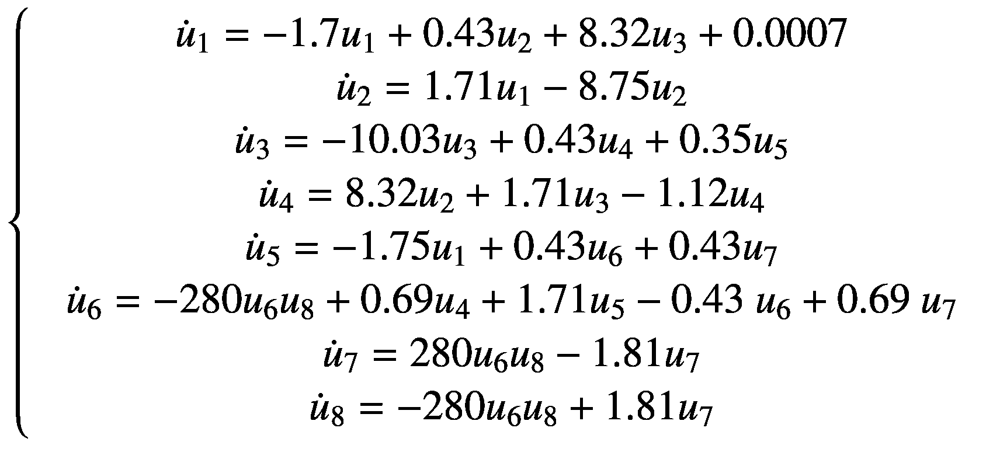

初始条件为 `u1 = 1`, `u2 = 0`, `u3 = 0`, `u4 = 0`, `u5 = 0`, `u6 = 0`, `u7 = 0`, `u8 = 0.0057`。HIRES 问题的实现相当直接，因为它采用一阶 ODE 的形式。为该问题开发的仿真模型（`HIRES_EM.m`、`HIRES_RK.m`）仅通过脚本实现，包含了前向欧拉法和四阶/五阶龙格-库塔法。仿真结果如图 5-9 所示。


图 5-9 使用前向欧拉法求解 HIRES 问题

```
function HIRES_EM
%HELP. HIRES_EM.m 使用欧拉前向法求解 HIRES 问题
% 初始条件：
u=[1 0 0 0 0 0 0 .0057];
tstart=0;
hstep=.01;
tend=321.8122;
% 需要在 [0, 321.8122] 区间内积分，
% 但为了更好地可视化，我们可以限制在 5.8122
t=tstart:hstep:tend;
g=zeros(numel(t), 8);
for ii=1:length(t)-1
g(ii,:)=Gee(u(ii,1), u(ii,2), u(ii,3), u(ii,4), u(ii,5), ...
u(ii,6), u(ii,7), u(ii,8));
u(ii+1, :)=u(ii,:)+g(ii,:)*hstep;
end
figure
plot(t, u(:,1), 'r', t, u(:,2), 'b--',t, u(:,3),'g:',...
t, u(:,4),'c-.',t, u(:,5),'m',...
t, u(:,6),'g-.',t, u(:,7), 'b:', t,u(:,8),'k', 'linewidth', 1.5 ), axis tight
legend ('u_1', 'u_2','u_3','u_4','u_5','u_6','u_7','u_8')
xlim([0, 25]),
title('使用欧拉前向法求解 HIRES 问题')
xlabel('时间'), ylabel('u_i(t)')
% 注意：在 [10, 18] 时间区间内观察到有趣的现象。
% u6、u7、u8 存在一定的不稳定性。
function F=Gee(u1,u2,u3,u4,u5,u6,u7,u8)
F=[-1.7*u1+.43*u2+8.32*u3+.0007; 1.71*u1-8.75*u2;
-10.03*u3+.43*u4+.035*u5; 8.32*u2+1.71*u3-1.12*u4;
-1.75*u5+.43*u6+.43*u7;-280*u6*u8+.69*u4+1.71*u5-.43*u6+.69*u7;
280*u6*u8-1.81*u7; -280*u6*u8+1.81*u7];
return
```

# 使用 Runge-Kutta 方法求解 HIRES 问题

## MATLAB 代码

```matlab
function HIRES_RK
%HIRES_RK.m 使用 Runge-Kutta 方法脚本求解 hires 问题
u=[1 0 0 0 0 0 0 .0057]; % 初始条件
tstart=0;
hstep=.01;
tend=321.8122;
% 需要在 [0, 321.8122] 区间内积分，
% 但为了更好的可视化效果，可以限制在 5.8122
t=tstart:hstep:tend;
for ii=1:length(t)-1
k1=ff(u(ii,1), u(ii,2),u(ii,3), u(ii,4), u(ii,5), u(ii,6),...
u(ii,7), u(ii,8));
k2=ff(u(ii,1)+hstep*k1(:,1)/2,u(ii,2)+hstep*k1(:,2)/2,...
u(ii,3)+hstep*k1(:,3)/2,u(ii,4)+hstep*k1(:,4)/2,...
u(ii,5)+hstep*k1(:,5)/2,u(ii,6)+hstep*k1(:,6)/2, ...
u(ii,7)+hstep*k1(:,7)/2,u(ii,8)+hstep*k1(:,8)/2);
k3=ff(u(ii,1)+hstep*k2(:,1)/2,u(ii,2)+hstep*k2(:,2)/2, ...
u(ii,3)+hstep*k2(:,3)/2,u(ii,4)+hstep*k2(:,4)/2,...
u(ii,5)+hstep*k2(:,5)/2,u(ii,6)+hstep*k2(:,6)/2, ...
u(ii,7)+hstep*k2(:,7)/2,u(ii,8)+hstep*k2(:,8)/2);
k4=ff(u(ii,1)+hstep*k3(:,1),u(ii,2)+hstep*k3(:,2), ...
u(ii,3)+hstep*k3(:,3)/2,u(ii,4)+hstep*k3(:,4)/2,...
u(ii,5)+hstep*k3(:,5)/2,u(ii,6)+hstep*k3(:,6)/2, ...
u(ii,7)+hstep*k3(:,7)/2,u(ii,8)+hstep*k3(:,8)/2);
u(ii+1,:)=u(ii,:)+hstep*(k1+2*k2+2*k3+k4)/6;
end
plot(t, u(:,:), 'linewidth', 1.5), axis([0 321 0, 0.8])
title('使用 Runge-Kutta 方法求解 HIRES 问题')
figure; subplot(311)
plot(t, u(:,1),'r:',t,u(:,4),'b-.',t,u(:,6),'m','linewidth',1.5 ), ylabel('u_i(t)')
title('使用 Runge-Kutta 方法求解 HIRES 问题')
legend ('u_1','u_4','u_6'), axis([0, 25 0 0.8])
subplot(312)
plot( t, u(:,7), 'b',t, u(:,8),'k-.','linewidth', 1.5)
legend ('u_7','u_8'), ylabel('u_i(t)'), xlim([0, 5]),
subplot(313)
plot(t, u(:,2),'b--',t,u(:,3),'k:',t,u(:,5),'m-','linewidth',1.5)
xlabel('t'), ylabel('u_i(t)'), legend ('u_2','u_3','u_5')
xlim([0, 15])
function f=ff(u1, u2, u3, u4, u5, u6, u7, u8)
f=[-1.7*u1+.43*u2+8.32*u3+.0007,1.71*u1-8.75*u2,...
-10.03*u3+.43*u4+.035*u5, 8.32*u2+1.71*u3-1.12*u4, ...
-1.75*u5+.43*u6+.43*u7,-280*u6*u8+.69*u4+1.71*u5-.43*u6+.69*u7,...
280*u6*u8-1.81*u7, -280*u6*u8+1.81*u7];
end
```

## 方法说明与结果分析

使用前向欧拉方法计算的变量`u[6]`、`u[7]`、`u[8]`的数值解中存在相当多的不稳定区域（图 5-10）。

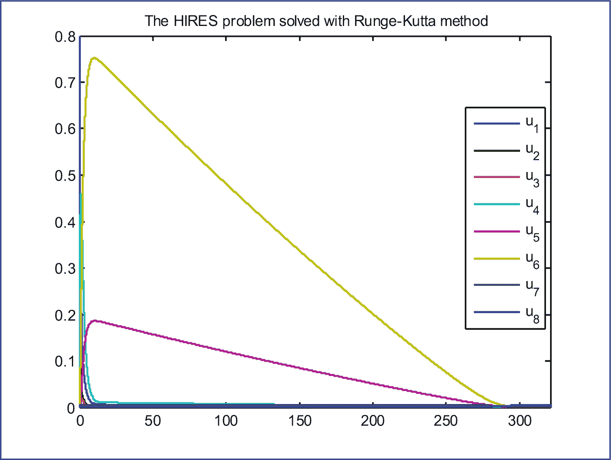

图 5-10：使用 4/5 阶 Runge-Kutta 方法求解 HIRES 问题。

从使用前向欧拉方法（图 5-9）和 Runge-Kutta 方法（图 5-10、图 5-11）对 HIRES 问题的模拟中，可以清楚地看到，对于此类高阶刚性耦合常微分方程问题，前向欧拉方法可能导致相当不稳定的结果。除了这两种方法，还可以在 `Simulink` 中轻松开发另一个仿真模型。

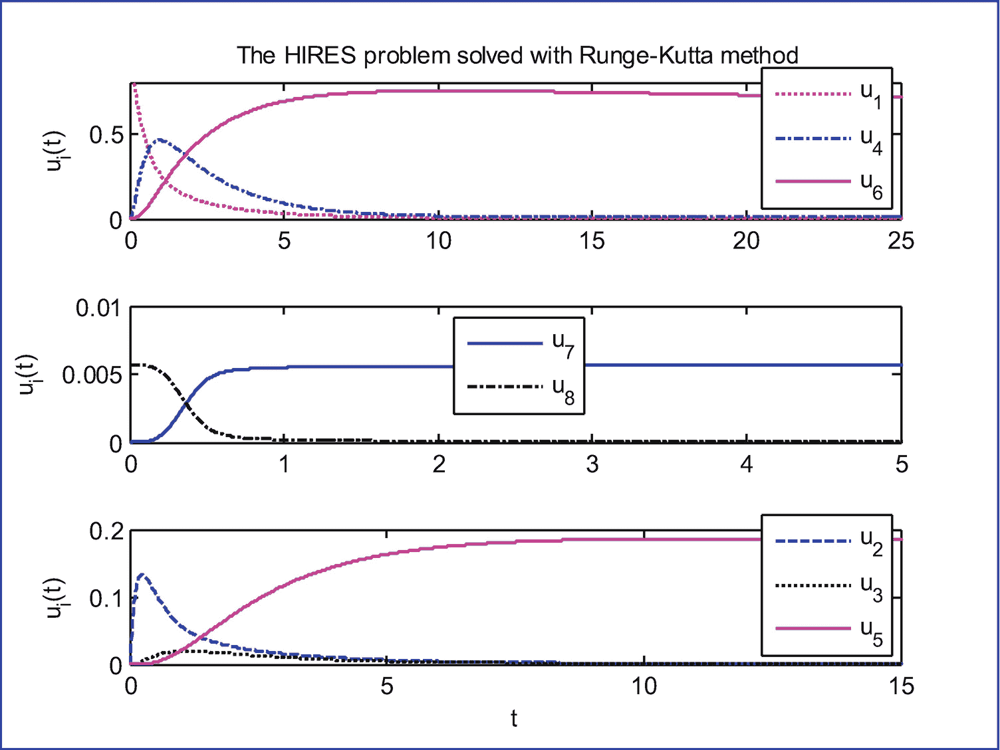

图 5-11：以子图形式展示的 4/5 阶 Runge-Kutta 方法求解的 HIRES 问题解。

从高阶和耦合常微分方程的仿真中，我们可以得出结论：使用 `MATLAB` 内置的常微分方程求解器、使用 `Simulink` 模型，以及基于欧拉或 `Runge-Kutta` 方法编写脚本来数值求解此类常微分方程或耦合系统，与求解一阶或二阶常微分方程类似。然而，为了仿真的效率和准确性，我们必须谨慎选择求解方法，并小心调整内置常微分方程求解器的设置。

# 参考文献

[1] Edsberg, L., “Integration package for chemical kinetics,” in *Stiff Differential Systems*, Willoughby, R. A., ed., Plenum Press, New York (1974), pp. 81–94.

[2] Lioen, W., de Swart, H., “Test for initial value problem solvers,” CWI Report MAS-R9832, ISSN 1386-3703, Amsterdam (1998).
