# 7. 常微分方程求解方法的比较分析

在前几章中，我们讨论了求解一阶、二阶、高阶及耦合常微分方程初值问题的几种不同方法及 MATLAB/Simulink 内置函数，这些方程有显式定义和隐式定义两种形式，并给出了相应示例。综合所有讨论过的方法，我们可以概括出六种利用 MATLAB/Simulink 工具、函数、工具箱以及脚本编写来求解初值问题的不同途径。

*   使用符号数学工具箱中的 `dsolve()` 进行解析解搜索
*   使用符号数学工具箱中名为 `laplace` 和 `ilaplace` 的拉普拉斯变换进行解析解搜索
*   使用 MuPAD 笔记（符号数学工具箱）结合 `ODE` 和 `ODE::SOLVE` 进行解析解搜索
*   使用内置 ODEx 求解器进行数值解搜索，例如：`ode15s`、`ode23`、`ode45`、`ode113` 等
*   使用 Simulink 模型进行数值解搜索，该模型包含几种不同的固定步长与变步长求解器，例如：`ode2`、`ode4`、`ode8`、`ode15s`、`ode45` 等
*   通过基于欧拉法、休恩法、米尔恩法、亚当斯-巴什福思法、亚当斯-莫尔顿法、龙格-库塔法、泰勒级数展开法及其他方法编写脚本进行数值解搜索

接下来，我们通过求解下列二阶显式定义的非齐次常微分方程来展示所有六种方法，然后比较结果的精度与效率。

### 示例 1

以下是示例问题：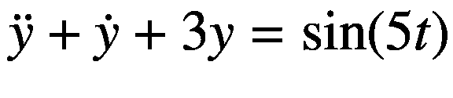, 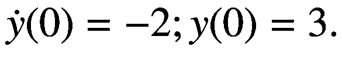

我们首先采用两种方法：使用 `dsolve()` 进行解析求解，以及使用符号数学工具箱中的 `laplace` 和 `ilaplace` 工具。该练习的解决方案可在 `COMPARE_ODE_Solvers.m`、`COMPARE_ODE_Solvers_MUPAD.mn` 和 `COMPARE_ODE_Solvers_sim.slx` 文件中找到。脚本 `COMPARE_ODE_Solvers.m` 使用以下方法进行计算：`dsolve()`、`laplace/ilaplace`、`ode45/ode113` 以及欧拉/亚当斯-莫尔顿方法。该脚本从 Simulink 模型（`COMPARE_ODE_Solvers_sim.slx`，如图 7-5 所示）中调用使用 `ode8` 的数值解。根据解析公式计算得到的数值解显示在图 7-1 和 7-2 中。

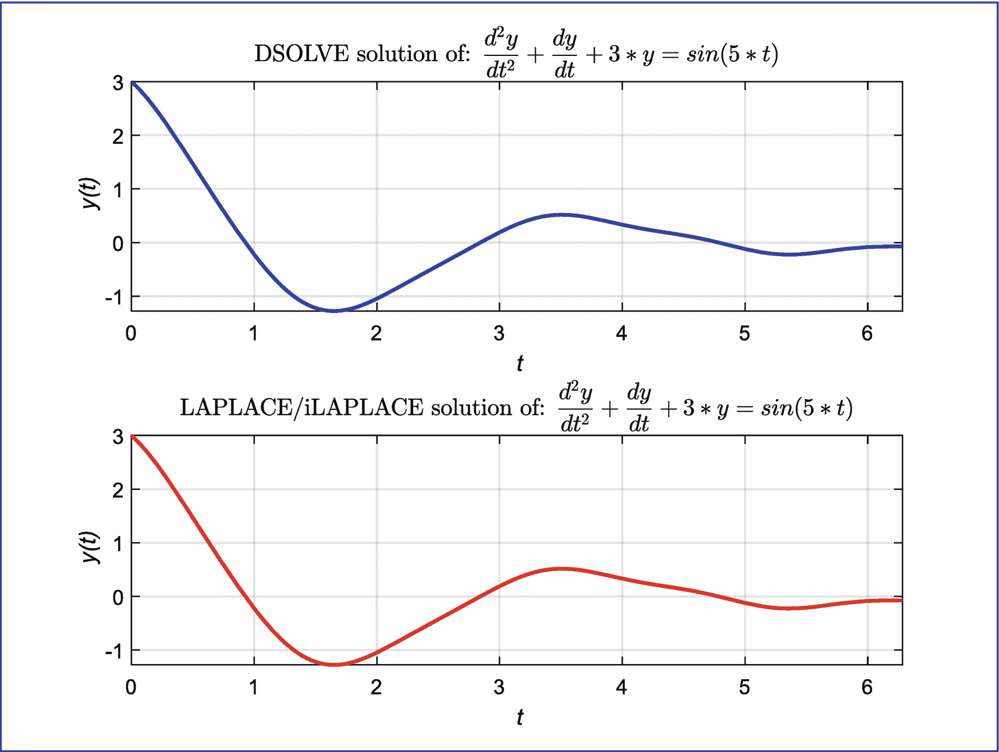

**图 7-1** 使用 `dsolve()` 以及 `laplace` 和 `ilaplace` 计算的解析解

```matlab
% COMPARE_ODE_Solvers.m
close all; clearvars
% Part 1
%% 1st Solution Approach: DSOLVE
syms t s Y y(t)
Dy=diff(y, t);
D2y=diff(y, t, 2);
Equation = D2y==sin(5*t)-Dy-3*y;
ICs = [y(0)==3, Dy(0)==-2];
Solution_dsolve=dsolve('D2y+Dy+3*y-sin(5*t)=0', 'y(0)=3','Dy(0)+2=0');
disp('Symbolic MATH dsolve function output is: ')
pretty(Solution_dsolve)
% display plot of the solution of dsolve and compare it with LT
figure;
subplot(211)
fplot(Solution_dsolve, [0, 2*pi], 'b-', 'linewidth', 1.5)
title('DSOLVE solution of: $$ \frac{d²y}{dt²}+\frac{dy}{dt}+3*y=sin(5*t) $$', 'interpreter', 'latex')
grid on
ylabel('\it y(t)'), xlabel('\it t')
%% 2nd Solution Approach: Laplace Transforms laplace/ilaplace
% Define symbolic variables' names
syms t s Y y(t)
assume([Y, t]>0)
Dy=diff(y, t);
D2y=diff(y, t, 2);
Equation = D2y==sin(5*t)-Dy-3*y;
% Laplace Transforms
LT_Y=laplace(Equation, t, s);
% Substitute the arbitrary unknown Yand Initial Conditions
LT_Y=subs(LT_Y,laplace(y(t),t, s),Y);
LT_Y=subs(LT_Y,y(0),3);
LT_Y=subs(LT_Y,subs(diff(y(t), t), t),-2);
% Solve for Y unknown
disp('Laplace Transforms of the given 2nd Order ODE with ICs')
Y=solve(LT_Y, Y)  %#ok
Solution_Laplace=ilaplace(Y);
disp('Solution found using Laplace Transforms is:')
Solution_Laplace=simplify(Solution_Laplace);
pretty(Solution_Laplace)
subplot(212)
fplot(Solution_Laplace, [0, 2*pi], 'r-', 'linewidth', 1.5); grid on
title('LAPLACE/iLAPLACE solution of: $$ \frac{d²y}{dt²}+\frac{dy}{dt}+3*y=sin(5*t) $$', 'interpreter', 'latex')
ylabel('\it y(t)'), xlabel('\it t')
```

```
Symbolic MATH dsolve function output is:
/   1/2   \
| 11    t |
1532 cos| ------- |
\    2    /   22 sin(5 t)   5 cos(5 t)
------------------- - ----------- - ---------- -
/ t \           509          509
509 exp| - |
\ 2 /
/   1/2   \
1/2    | 11    t |
284 11    sin| ------- |
\    2    /

/ t \
5599 exp| - |
\ 2 /
Laplace Transforms of the given 2nd Order ODE with ICs
(3*s + 5/(s² + 25) + 1)/(s² + s + 3)
Solution found using Laplace Transforms is:
(1532*exp(-t/2)*(cos((11^(1/2)*t)/2) - (71*11^(1/2)*sin((11^(1/2)*t)/2))/4213))/509 - (22*sin(5*t))/509 - (5*cos(5*t))/509
/                              /   1/2   \ \
|                       1/2    | 11    t | |
|    /   1/2   \   71 11    sin| ------- | |
|    | 11    t |               \    2    / |
1532 | cos| ------- | - ----------------------- |
\    \    2    /            4213           /   22 sin(5 t)
------------------------------------------------- - ----------- -
/ t \                          509
509 exp| - |
\ 2 /
5 cos(5 t)
```

因此，问题的解析解如下：

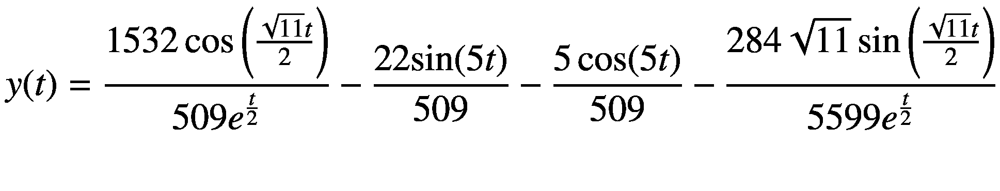

给定 ODE 的解析解也可以在 MuPAD 笔记（`COMPARE_ODE_Solvers_MUPAD.mn`）中使用以下 MuPAD 命令求解：

```
Third Approach with MuPAD:
ODE_eqn:=ode({y”(t)+y'(t)+3*y(t)=sin(5*t),y(0)=3,y'(0)=-2}, y(t))
```

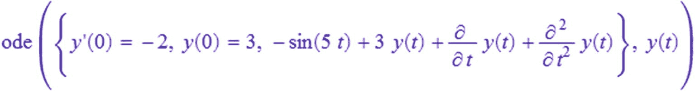

在笔记中执行：

```
Solution:=ode::solve(ODE_eqn)
simplify(Solution)
```

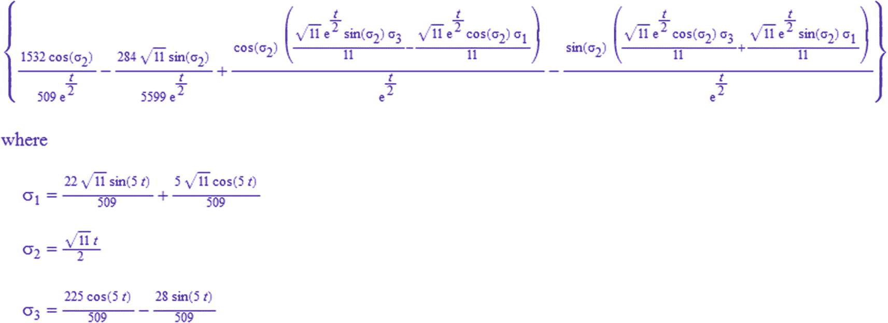

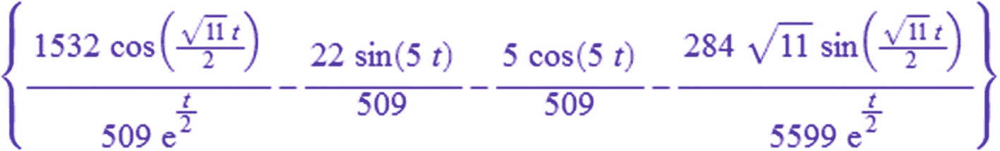

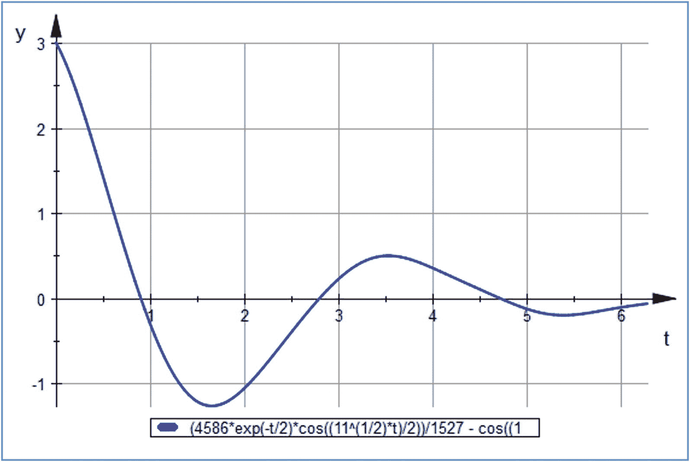

**图 7-2** 在 MuPAD 笔记中计算的练习解

绘制解的图像：

```
plot(Solution, #G, #L, t=0..2*PI)
```

请注意，通过三种方法（`dsolve()`、`laplace/ilaplace` 和符号数学工具箱的 MuPAD 笔记）找到的给定二阶初值问题的解析解表达式在公式上有所不同；但是，通过一些代数变换和简化，可以从所有三种方法的解中获得相同的格式。

### 第四种方法：使用内置的 ODEx 求解器

第四种方法是使用内置的 ODEx 求解器（`ode15s`、`ode23`、`ode23tb`、`ode45` 和 `ode113`）计算数值解。让我们看看使用 `ode45` 和 `ode113` 求解器计算给定问题的数值解，如下所示：

```matlab
%% Part 3. 4th Solution Approach: ODE45, ODE113 solvers

Ys=@(t, y)([y(2);-(y(2)+3*y(1))+sin(5*t)]);

ICs=[3, -2];

timeSPAN=0:pi/100:2*pi;

options_ODE=odeset('RelTol', 1e-6, 'AbsTol', 1e-8);

[t1, y_ODE45]=ode45(Ys, timeSPAN, ICs, options_ODE);

[t2, y_ODE113]=ode113(Ys, timeSPAN, ICs, options_ODE);

figure('name', 'ODEx solvers 1')

subplot(211)

plot(t1, y_ODE45(:,1), 'bo', t2, y_ODE113(:,1), 'k-')

ylabel('\it y(t)'), xlabel('\it t')

title('ODE45 and ODE113 solutions of: $$ \frac{d²y}{dt²}+\frac{dy}{dt}+3*y=sin(5*t) $$', 'interpreter', 'latex')

grid on

legend('\it ode45', 'ode113')

axis tight

subplot(212)

plot(t1, y_ODE45(:,2), 'bo', t2, y_ODE113(:,2), 'k-')

ylabel('\it $$ \frac{dy}{dt} $$', 'interpreter', 'latex'), xlabel('\it t')

title('ODE45 and ODE113 solutions of: $$ \frac{d²y}{dt²}+\frac{dy}{dt}+3*y=sin(5*t) $$', 'interpreter', 'latex')

grid on

legend('\it dy with ode45','\it dy with ode113', 'location', 'best')

axis tight

figure('name', 'ODEx solvers 2')

plot(y_ODE45(:,1), y_ODE45(:,2),'bo', ...

y_ODE113(:,1), y_ODE113(:,2), 'r-')

title('Phase plot of:  $$ \frac{d²y}{dt²}+\frac{dy}{dt}+3*y=sin(5*t) $$', 'interpreter', 'latex')

legend('\it ode45', 'ode113'), grid on

axis tight; shg

xlabel('\it y(t)')

ylabel('\it $$ \frac{dy}{dt} $$', 'interpreter', 'latex')
```

图 7-3 和图 7-4 显示了使用 `ode45` 和 `ode113` 求解器获得的数值解绘图。

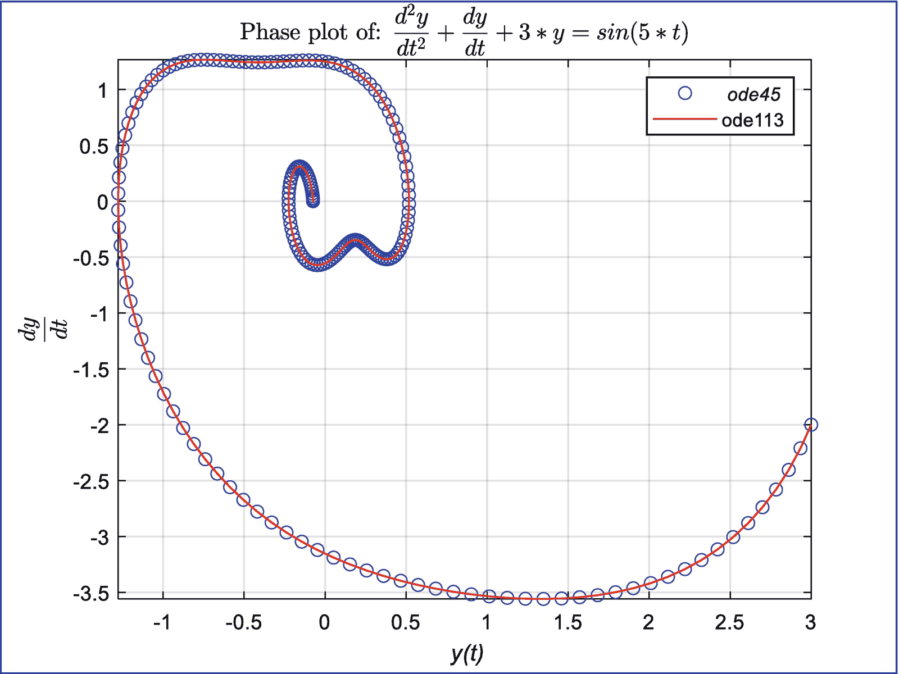

**图 7-4** 使用 `ode45` 和 `ode113` 计算的数值解（相图）

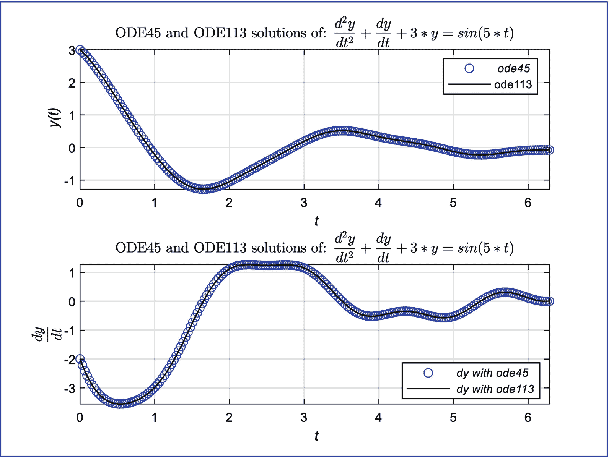

**图 7-3** 使用 `ode45` 和 `ode113` 计算的数值解

### 第五种方法：Simulink 建模

下一种方法是 Simulink 建模。给定练习的模型如图 7-5 所示。请注意，两个初始条件是通过 `Integrator` 和 `Integrator1` 模块输入的。此外，在模型设置中设置了固定步长求解器（`ode8`，Dormand-Prince 算法）和固定步长 `pi/100`。

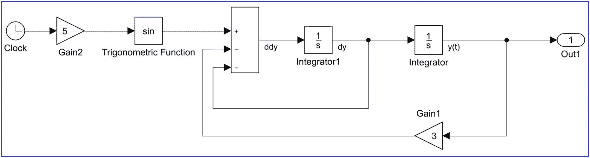

**图 7-5** 给定问题的 Simulink 模型 `COMPARE_ODE_Solvers_sim.slx`

运行模型的脚本代码如下：

```matlab
%% Part 4. 5th Solution Approach: Simulink modeling

%{

NB: This model uses ODE solver ODE8 in simulation.

A solver type can be altered if needed for a better/faster solution search.

This cell first recalls and then executes the Simulink model

COMPARE_ODE_Solvers_sim.slx that is to be put in a current directory

of MATLAB from the archived folder.

A fixed step is set to pi/100.

%}

%set_param('COMPARE_ODE_Solvers_sim','Solver','ode8','StopTime','2*pi');

[tout, SIMout]=sim('COMPARE_ODE_Solvers_sim.slx');
```

### 第六种方法：使用脚本

最后一种方法是基于欧拉法和亚当斯-莫尔顿法编写脚本。

```matlab
%% Part 5. 6th Solution Approach: scripts using Euler's Method

t0=0;                  % start time

tend=2*pi;             % end time

h=pi/100;              % time step

t=t0:h:tend;           % time space

steps=length(t);       % # of steps

y=[3, -2];             % ICs: u0 at t0

for k=2:steps

f=[y(k-1,2), sin(5*t(k-1))-3*y(k-1,1)-y(k-1,2)];

y(k,:)=y(k-1,:)+h*f;

end
```

# Part 6

## 6th solution approach: scripts - 5-step Adams-Moulton method

```matlab
t0=0;                   % start time
tend=2*pi;              % end time
h=pi/100;               % time step
t=t0:h:tend;            % time space
steps=length(t);        % # of steps
Fn(1,:)=[3, -2];        % ICs: u0 at t0
% function is defined via anonymous function handle:
Fcn =@(t, y1, y2)([y2, sin(5*t)-y2-3*y1]);

for ii=1:steps-4
    % 1st: Predicted value by EULER's forward method
    Fn(ii+1,:)=Fn(ii,:)+h*Fcn(t(ii), Fn(ii, 1),Fn(ii,2));
    
    % 2nd: Corrected value by trapezoidal rule
    Fn(ii+1,:)=Fn(ii,:)+(h/2)*(Fcn(t(ii+1),Fn(ii+1,1),Fn(ii+1,2))+...
        Fcn(t(ii),Fn(ii,1),Fn(ii,2)));
    
    % 3rd: Predicted solution:
    Fn(ii+2,:)=Fn(ii+1,:)+(3*h/2)*Fcn(t(ii+1),Fn(ii+1,1),Fn(ii+1,2))-...
        (h/2)*Fcn(t(ii),Fn(ii,1),Fn(ii,2));
    
    % 3rd: Corrected ADAMS-Moulton method:
    Fn(ii+2,:)=Fn(ii+1,:)+h*((5/12)*Fcn(t(ii+2),Fn(ii+2,1),Fn(ii+2,2))+...
        (2/3)*Fcn(t(ii+1),Fn(ii+1,1),Fn(ii+1,2))-...
        (1/12)*Fcn(t(ii),Fn(ii,1),Fn(ii,2)));
    
    % Predicted solution:
    Fn(ii+3,:)=Fn(ii+2,:)+h*((23/12)*Fcn(t(ii+2),Fn(ii+2,1),Fn(ii+2,2))...
        -(4/3)*Fcn(t(ii+1),Fn(ii+1,1),Fn(ii+1,2))+...
        (5/12)*Fcn(t(ii),Fn(ii,1),Fn(ii,2)));
    
    % Corrected solution by ADAMS-Moulton method 4-step from here:
    Fn(ii+3,:)=Fn(ii+2,:)+h*((3/8)*Fcn(t(ii+3),Fn(ii+3,1),Fn(ii+3,2))+...
        (19/24)*Fcn(t(ii+2),Fn(ii+2,1),Fn(ii+2,2))-...
        (5/24)*Fcn(t(ii+1),Fn(ii+1,1),Fn(ii+1,2))+...
        (1/24)*Fcn(t(ii),Fn(ii,1),Fn(ii,2)));
    
    % Predicted solution:
    Fn(ii+4,:)=Fn(ii+3,:)+h*((55/24)*Fcn(t(ii+3),Fn(ii+3,1),Fn(ii+3,2)) ...
        -(59/24)*Fcn(t(ii+2),Fn(ii+2,1),Fn(ii+2,2))+...
        (37/24)*Fcn(t(ii+1),Fn(ii+1,1),Fn(ii+1,2))-...
        (3/8)*Fcn(t(ii),Fn(ii,1),Fn(ii,2)));
    
    % Corrected solution by ADAMS-Moulton 5-step method from here:
    Fn(ii+4,:)=Fn(ii+3,:)+ ...
        h*((251/720)*Fcn(t(ii+4),Fn(ii+4,1),Fn(ii+4,2))+...
        (646/720)*Fcn(t(ii+3),Fn(ii+3,1),Fn(ii+3,2))-...
        (264/720)*Fcn(t(ii+2),Fn(ii+2,1),Fn(ii+2,2))+...
        (106/720)*Fcn(t(ii+1),Fn(ii+1,1),Fn(ii+1,2))-...
        (19/720)*Fcn(t(ii),Fn(ii,1),Fn(ii,2)));
end
```

## Numerical values from DSOLVE and LAPLACE/iLAPLACE

```matlab
SDsolve  = eval(Solution_dsolve);
SLaplace = eval(Solution_Laplace);

figure('name', 'Compare ALL 1')
plot(t, SDsolve, 'bx-'); grid on, hold on,
xlabel('\it t'), ylabel('\it y(t)')
plot(t, SLaplace, 'ro-')
plot(t, y_ODE45(:,1), 'm^--')
plot(t, y_ODE113(:,1), 'k<-')
plot(tout, SIMout(:,1), 'gd-')
plot(t, y(:,1), 'linewidth', 2)
plot(t, Fn(:,1), 'b--', 'linewidth', 1.5), grid minor
title('Solutions of: $$ \frac{d²y}{dt²}+\frac{dy}{dt}+3*y=sin(5*t) $$', 'interpreter', 'latex')
legend('dsolve','Laplace Transforms','ODE45','ODE113',...
    'Simulink', 'Euler','Adams-Moulton'),
xlim([0, 2*pi]), hold off

figure('name', 'Compare ALL 2')
plot(y_ODE45(:,1), y_ODE45(:,2), 'mo'); grid on, hold on,
xlabel('\it y(t)'), ylabel('\it $$ \frac{dy}{dt} $$', ... 'interpreter', 'latex')
plot(y_ODE113(:,1), y_ODE113(:,2), 'k<')
plot(SIMout(:,1), SIMout(:,2), 'gd')
plot(y(:,1), y(:,2), 'linewidth', 2)
plot(Fn(:,1), Fn(:,2),'b--', 'linewidth', 1.5), grid minor
title('Phase plot of: $$ \frac{d²y}{dt²}+\frac{dy}{dt}+3*y=sin(5*t) $$', ...
    'interpreter', 'latex')
legend('ODE45','ODE113', 'Simulink', 'Euler','Adams-Moulton'),
axis tight, hold off
```

# Part 7. Residuals are computed

```matlab
Res_ode45=abs(SDsolve)-abs(y_ODE45(:,1)');
Res_ode113=abs(SDsolve)-abs(y_ODE113(:,1)');
Res_sim=abs(SDsolve)-abs(SIMout(:,1)');
Res_Euler=abs(SDsolve)-abs(y(:,1)');
Res_AM=abs(SDsolve)-abs(Fn(:,1)');
Res_LTSD=abs(SLaplace)-abs(SDsolve);

figure('name', 'Residuals')
subplot(311)
plot(t, Res_ode45, 'r-',t,Res_ode113, 'k-.', t, Res_sim, 'b-')
hold on
plot(t, Res_LTSD, 'g--', 'linewidth', 1.5)
title('\it Residuals'), ylabel('\it Residual values')
legend('ode45','ode113','Simulink', 'Laplace', 'location', 'best')

subplot(312)
plot(t, Res_Euler, 'k-'), hold on
plot(t, Res_LTSD, 'g--', 'linewidth', 1.5)
ylabel('\it Residual values')
legend('Euler', 'Laplace', 'location', 'best')

subplot(313)
```

```matlab
plot(t, Res_AM, 'm-', 'linewidth', 1.5), hold on

plot(t, Res_LTSD, 'g--', 'linewidth', 1.5)

ylabel('\it Residual values')

xlabel('\it t')

legend('Adams-Moulton', 'Laplace', 'location', 'best')

xlim([0, 2*pi]), shg
```

通过执行脚本 `COMPARE_ODE_Solvers.m` 和 Simulink 模型（`COMPARE_ODE_Solvers_sim.mdl`，如图 7-5 所示），可以得到图 7-6、图 7-7 和图 7-8 所示的绘图。它们展示了数值解以及各数值方法相对于解析解值的残差。

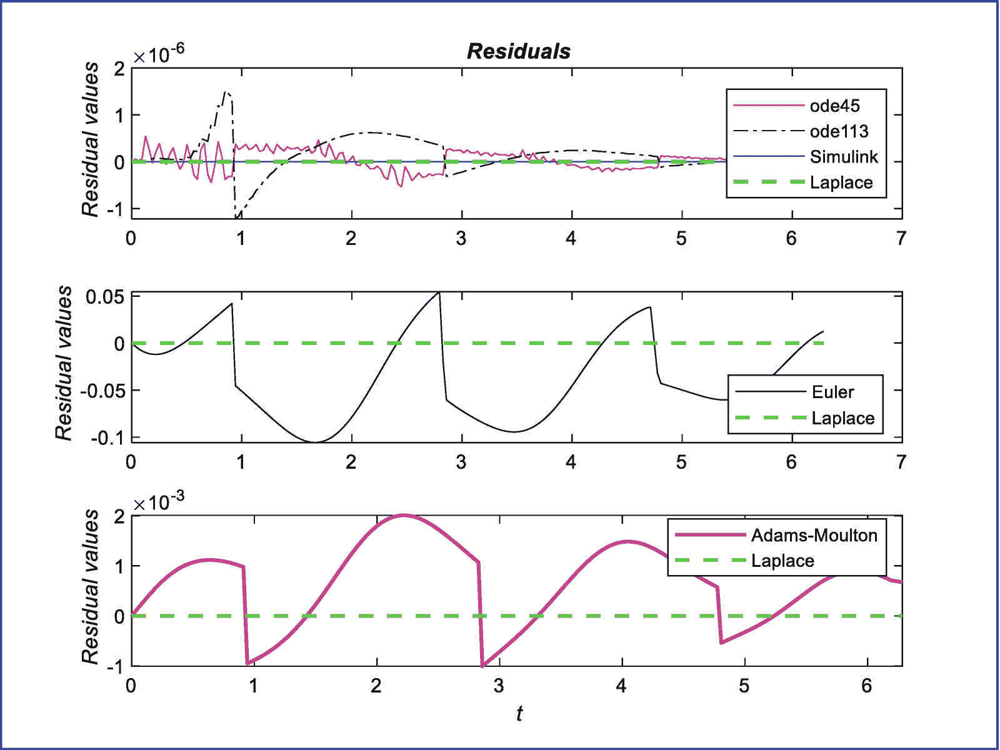
**图 7-8** 数值解相对于解析解的残差

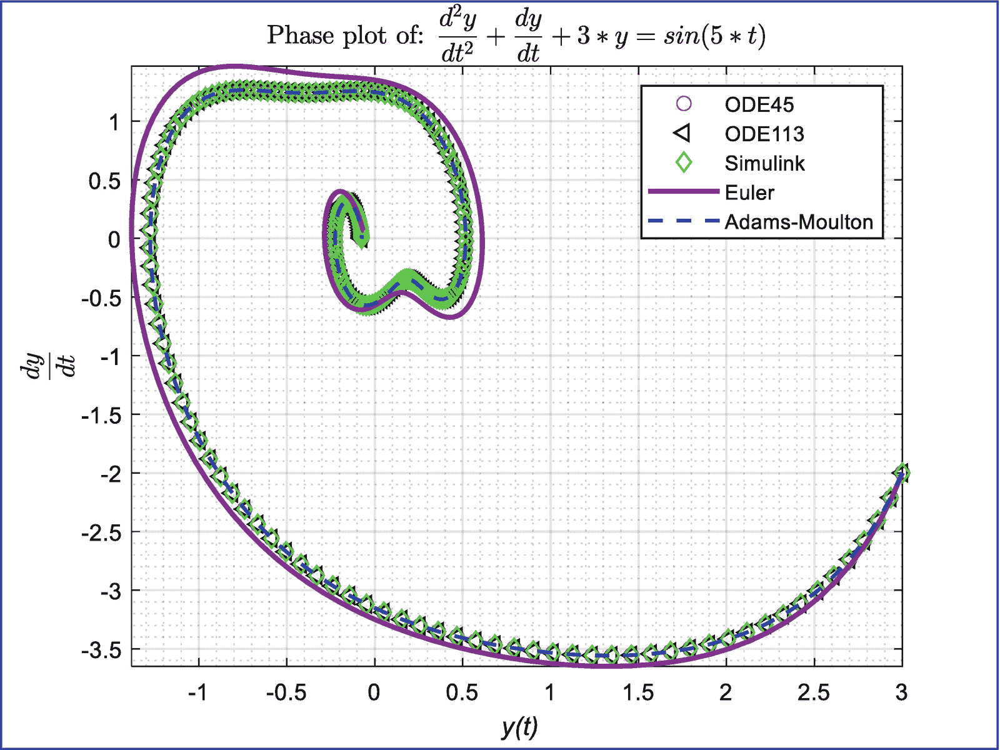
**图 7-7** 由 `ode45`、`ode113`、Simulink、欧拉法和亚当斯-莫尔顿法计算的解的相图 (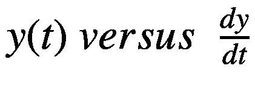)

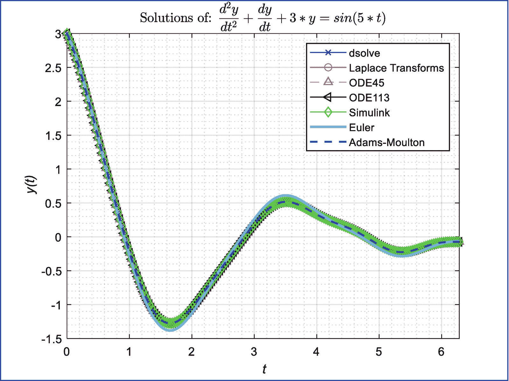
**图 7-6** 使用 `dsolve()`、`laplace/ilaplace`、`ode45`/`ode113`、Simulink (`ode8`)、欧拉法和亚当斯-莫尔顿法找到的所有数值解

在这个初值问题求解方法的比较分析练习中，从六种方法获得的仿真结果收敛得相对较好（图 7-6 和 7-7）。同时，存在一定的误差范围，如图 7-8 的残差图所示。从残差可以看出，欧拉法产生的误差最大，但在较长的仿真时间内，误差趋于减小。最精确的数值解来自 Simulink 模型（`COMPARE_ODE_Solvers_sim.mdl`）。其他数值方法的结果与解析解收敛得非常好，以至于小于 2 × 10^(−3) 的误差可以通过采用更小的时间步长进一步减小；另一方面，减小步长会显著增加计算时间。

综合在具体线性/非线性、刚性/非刚性、齐次/非齐次 ODE 示例（第 1 章至第 7 章）中演示的解析和数值求解初值问题方法的所有要点，可以得出以下结论性意见：
-   在为给定问题选择任何方法之前，有必要确定给定的 ODE 问题类型，即刚性/非刚性。
-   并非所有初值问题都能解析求解。如果可以解析求解，则应采用 `dsolve()`、`laplace` 和 `ilaplace` 等工具。如果给定的初值问题是非齐次的，并且受到不连续外力的作用，那么拉普拉斯变换（`laplace/ilaplace`）是最合适的方法。
-   如果数值求解方法是唯一的选择，则应根据给定的 ODE 类型仔细考虑解的搜索空间并选择合适的步长。如果给定问题的解搜索空间非常大，建议先通过基准测试数值方法在较小的搜索空间内工作，然后选择最合适的方法。
-   考虑给定任务的优先级：精度与速度的权衡。
-   在处理微分代数方程时，重写给定的隐式 ODE 并定义其一致的初始条件是首要步骤。此外，建议在 Simulink 中建模，然后比较两种方法（`ode15i` 与 Simulink）计算出的解。
-   建议使用几种不同的方法计算数值解。我们甚至看到，例如，MATLAB 的一些推荐求解器在刚性问题上可能会产生误导性的数值解。此外，建议相应地调整内置 ODEx 求解器（`ode15s`、`ode23`、`ode45`、`ode113` 等）的设置，并提供雅可比矩阵以提高所选求解器处理刚性 ODE 的效率。

## 演练习题

以下是一些可以尝试的练习。

### 练习 1

以下为二阶非齐次常微分方程的初值问题：
*   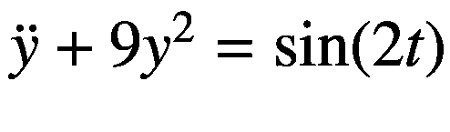，`y(0) = 0` 且 ，`t ∈ [0, 3π]`
*   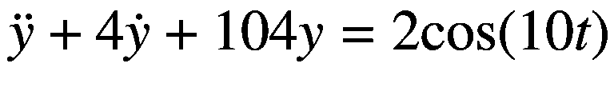，`y(0) = 0` 且 ，`t ∈ [0, 5π]`
*   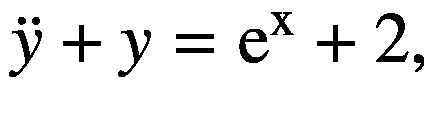 `y(0) = 0` 且 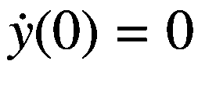，`x ∈ [0, 13]`
*   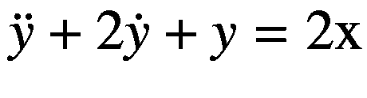， 且 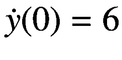，`x ∈ [0, 15]`
*   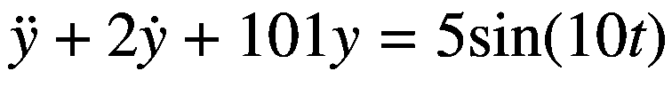，`y(0) = 0` 且 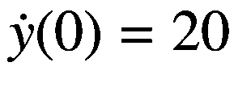，`t ∈ [0, 5π]`

首先，使用以下方法求解上述每一个二阶常微分方程：
1.  编写基于前向欧拉法的脚本
2.  编写基于四阶亚当斯-莫尔顿方法的脚本
3.  编写基于四阶龙格-库塔方法的脚本
4.  使用 MATLAB 内置的 ODE 求解器 `ode23`、`ode45` 和 `ode113`，并相应地调整其设置，即相对和绝对误差容限
5.  构建一个 Simulink 模型并使用求解器 `ode3`

然后，比较从 (a) 到 (e) 找到的所有解，并找出哪一种方法最有效、最准确（正确且误差最小）。

最后，是否可以使用 `dsolve()` 和拉普拉斯变换（`laplace` 和 `ilaplace`）计算给定问题的解析解？如果可以，则将解析解与从 (a) 到 (e) 找到的数值解绘制在同一张图上。

### 练习 2

首先，求解此处给出的二阶非齐次常微分方程问题：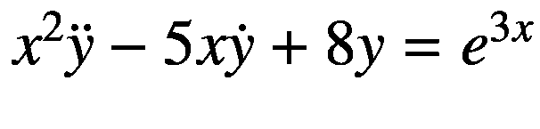，`y(1) = 0`，且 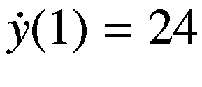，`x ∈ [1, 15]`。注意初始点在 `x = 1`。使用以下方法：
1.  编写基于后向欧拉法的脚本
2.  编写基于五步亚当斯-巴什福斯方法的脚本
3.  编写基于米尔恩方法的脚本
4.  编写基于改进欧拉法的脚本
5.  使用 MATLAB 内置的 ODE 求解器：`ode23`、`ode45`、`ode113`
6.  构建一个 Simulink 模型并使用求解器 `ode2`
7.  比较从 (a) 到 (e) 找到的所有解，并确定哪种方法最合适、最高效

接下来，是否可以使用 `dsolve()` 和拉普拉斯变换（`laplace` 和 `ilaplace`）计算给定问题的解析解？如果可以，则将解析解与从 (a) 到 (e) 找到的数值解绘制在同一张图上。

最后，是否可以使用 MuPAD 计算给定问题的解析解？如果可以，则将其与使用 `dsolve()` 和拉普拉斯变换（`laplace` 和 `ilaplace`）找到的解析解进行比较。

### 练习 3

首先，求解此处给出的二阶非齐次非线性常微分方程：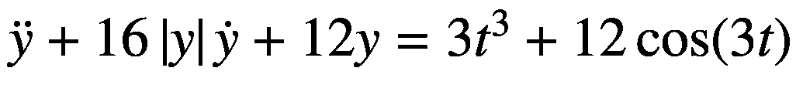，`y(0) = −1` 且 ，`x ∈ [0, 13]`。使用以下方法：
1.  编写基于拉尔斯顿方法和米尔恩方法的脚本
2.  编写基于四阶亚当斯-莫尔顿方法的脚本
3.  编写基于龙格-库塔-吉尔方法的脚本
4.  使用 MATLAB 内置的 ODE 求解器：`ode23`、`ode45`、`ode113`
5.  构建一个 Simulink 模型并使用求解器 `ode4`

接下来，通过绘制 `t` 与 `y(t)` 以及 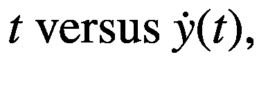 的关系图，比较从 (a) 到 (e) 找到的所有解，并找出哪种方法最合适（正确且误差最小）且效率最高。

### 练习 4

首先，求解此处给出的二阶非齐次非线性常微分方程的初值问题：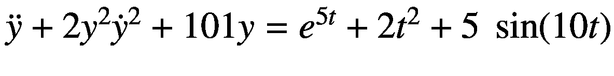，`y(0) = 0` 且 ，`t ∈ [0, 6π]`。使用以下方法：
1.  编写基于休恩方法的脚本
2.  编写基于五阶亚当斯-莫尔顿方法的脚本
3.  编写基于龙格-库塔-吉尔方法的脚本
4.  使用 MATLAB 内置的 ODE 求解器：`ode23`、`ode45`、`ode113`
5.  构建一个 Simulink 模型并使用求解器 `ode14x`

接下来，比较从 (a) 到 (e) 找到的所有解，并找出哪种方法效率最高。如有必要，可采取更小的时间步长。

最后，是否可以使用 `dsolve()` 和拉普拉斯变换（`laplace` 和 `ilaplace`）计算给定问题的解析解？

### 练习 5

首先，求解此处给出的二阶非齐次非线性常微分方程：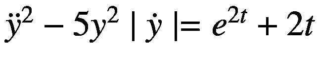，`y(0) = 1` 且 ，`t ∈ [0, 13]`。使用以下方法：
1.  编写基于米尔恩方法的脚本
2.  编写基于五步亚当斯-巴什福斯方法的脚本
3.  编写基于龙格-库塔-费尔伯格方法的脚本
4.  使用 MATLAB 内置的 ODE 求解器：`ode23`、`ode45`、`ode113`
5.  构建一个 Simulink 模型并使用求解器 `ode1`

接下来，比较从 (a) 到 (e) 找到的所有解，并找出哪种方法效率最高。

### 练习 6

根据基尔霍夫定律，串联电阻-电感-电容 (RLC) 电路中的电荷方程如下：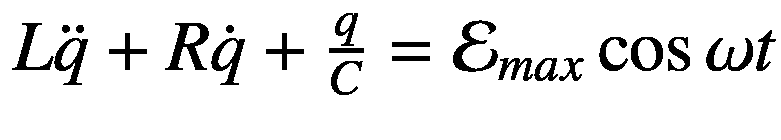。

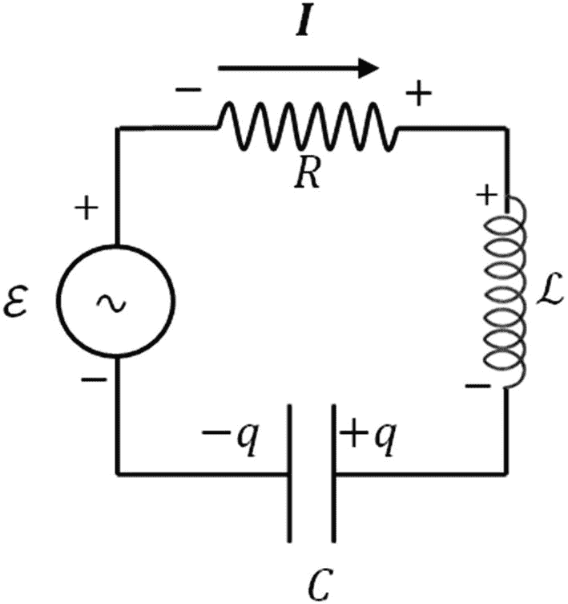

其中，对于 `t ∈` [0, 4π]，有 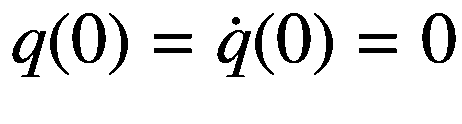。

电动势：`ε[max]` = 110 [V]
电阻：`R` = 7.17 [Ω]
电容：`C` = 50 × 10^(−3) [F]
电枢电感：![$$ \mathcal{L}=9.53\ast {10}^{-4}\left[H\right] $$](images/490522_1_En_7_Chapter/490522_1_En_7_Chapter_TeX_IEq26.png)
频率：`ω` = 60 [Hz]

首先，请完成以下操作：
1.  通过编写基于改进欧拉法和拉尔斯顿法的脚本，求解 `q(t)` 的数值解。
2.  通过编写基于五阶亚当斯-莫尔顿法的脚本，求解 `q(t)` 的数值解。
3.  通过编写基于四阶龙格-库塔-吉尔法的脚本，求解 `q(t)` 的数值解。
4.  使用 MATLAB 内置的 ODE 求解器：`ode23`、`ode45`、`ode113`，求解 `q(t)` 的数值解。
5.  通过构建 Simulink 模型并使用求解器 `ode8`，求解 `q(t)` 的数值解。
6.  比较从 (a) 到 (e) 找到的所有解，找出哪种方法最高效且正确/合适。如有必要，采用合理更小的时间步长，并指定（合适的）初始步长、相对容差和绝对容差。

然后，是否可以使用 `dsolve()` 和拉普拉斯变换（`laplace` 和 `ilaplace`）计算该问题的解析解？如果可以，请将解析解与从 (a) 到 (e) 找到的数值解绘制在同一张图上。

最后，是否可以使用 MuPAD 笔记计算该问题的解析解？如果可以，将其与使用 `dsolve()` 和拉普拉斯变换（`laplace` 和 `ilaplace`）找到的解析解进行比较。

### 练习 7

首先，求解此处给出的四阶非齐次常微分方程的初值问题（IVP）：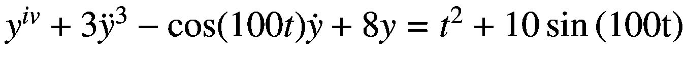，初始条件为 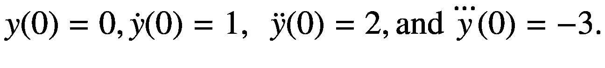，对于 `t ∈` [0, 3π]。请使用以下方法：
1.  通过编写基于亨恩法的脚本求解该问题。
2.  通过编写基于五阶亚当斯-莫尔顿法的脚本求解该问题。
3.  通过编写基于龙格-库塔-吉尔法的脚本求解该问题。
4.  使用 MATLAB 内置的 ODE 求解器，特别是 `ode23`、`ode45` 和 `ode113` 求解该问题。同时设置相对和绝对误差容限。
5.  使用 MATLAB 内置的 ODE 求解器，特别是 `ode23s`、`ode15s` 和 `ode23tb` 求解该问题。仅通过绘图获取该问题的数值解。（提示：使用 `odeset` 为 `@odeplot` 设置 `OutputFcn`）。
6.  通过构建使用求解器 `ode2` 的 Simulink 模型来求解该问题。

最后，比较从 (a) 到 (f) 找到的所有解，找出哪种方法最高效且充分。

### 练习 8

求解此处给出的四阶非齐次常微分方程的初值问题（IVP）：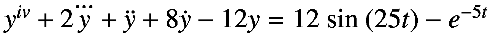，初始条件为 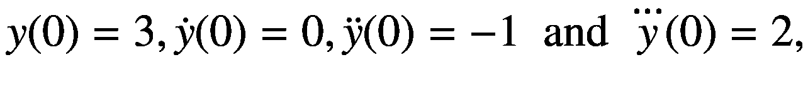，对于 `t ∈` [0, 5π]。请使用以下方法：
1.  通过编写基于欧拉前向法的脚本求解该问题。
2.  通过编写基于五阶亚当斯-巴什福思法的脚本求解该问题。
3.  通过编写基于龙格-库塔-费尔伯格法的脚本求解该问题。
4.  使用 MATLAB 内置的 ODE 求解器，特别是 `ode23s`、`ode15s` 和 `ode113` 求解该问题。同时设置相对和绝对容差。
5.  使用 MATLAB 内置的 ODE 求解器，特别是 `ode23`、`ode45` 和 `ode23tb` 求解该问题。仅通过绘图获取该问题的数值解。（提示：使用 `odeset` 为 `@odeplot` 设置 `OutputFcn`）。
6.  通过构建使用求解器 `ode8` 的 Simulink 模型来求解该问题。
7.  比较从 (a) 到 (f) 找到的所有解，并明确指出哪种方法最高效且合适。

### 练习 9

求解以下耦合常微分方程组定义的数值解：
1.  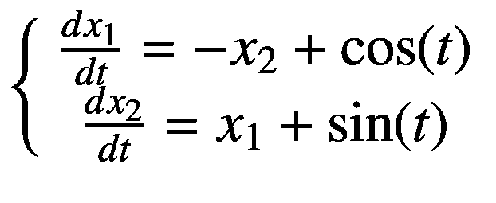，初始条件为：`x1 = 2.5`，`x2 = 3.5`，`t ∈` [1, 13]。
2.  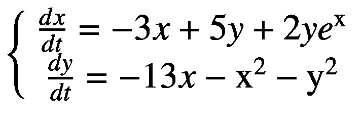，初始条件为：`x(0.5) = 2`，`y(0.5) = −2`，`t ≤ 5.55`。
3.  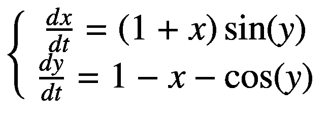，初始条件为：![$$ x\left(\frac{\pi }{4}\right)=1.25,\kern0.5em y\left(\frac{\pi }{4}\right)=0.75,\kern0.75em t\ \epsilon\ \left[\frac{\pi }{4},\frac{7\pi }{2}\right]. $$](images/490522_1_En_7_Chapter/490522_1_En_7_Chapter_TeX_IEq34.png)

对于每个方程组，请执行以下任务：
-   编写一个关于耦合方程组的匿名函数。
-   编写一个关于耦合方程组的内联函数。
-   创建一个函数文件，例如命名为 `CoupleODE.m`。
-   通过构建一个使用定步长求解器 `ode3` 的 Simulink 模型（例如命名为 `CoupledODEsim.mdl`）来求解该问题。
-   使用 `ode23`、`ode45` 和 `ode113` 求解该问题的数值解。比较来自 ODE 求解器与 Simulink 模型的解，并检查每种方法的效率。采用更小的时间步长，调整相对和绝对容差，并从 m 文件中仿真您创建的 Simulink 模型（`CoupledODEsim.mdl`）。（提示：使用 `sim()` 和 `simset()`）。
-   通过编写基于中点法则的脚本求解给定耦合系统的数值解，并将其数值解与从 `ode23`、`ode45`、`ode113` 以及 Simulink 模型获得的解进行比较。

### 练习 10

利用拉普拉斯变换（`laplace` 和 `ilaplace`），求解以下在非连续强制函数下的二阶非齐次常微分方程：
1.  `¨y + 5y = h(t), y(0) = 0, ẏ(0) = 0`，其中 `h(t) = { 0, (t-3)/3, 13 }` 对应 `{ 0 ≤ t < 3, 3 ≤ t < 11, t ≥ 11 }`
2.  `¨y + 5ẏ + 5y = g(t), y(0) = 0, ẏ(0) = 2`，其中 `g(t) = { 5, 0 }` 对应 `{ π ≤ t < 3π, 0 ≤ t < π 且 t ≥ 3π }`
3.  `ẍ + 5ẋ + (5/6)x = u(t), x(0) = 0, ẋ(0) = 0`，其中 `u(t) = { sin(t), 0 }` 对应 `{ 0 ≤ t < 2π, t ≥ 2π }`

绘制足够长时间范围内解析解的数值结果。

### 练习 11

使用以下方法模拟罗伯逊问题：
1.  使用 `ode15s` 和 `ode113` 解算器，并编写一个基于 Adams-Moulton 方法的脚本来模拟罗伯逊问题模型，并比较数值解。哪种方法最适合该问题？
2.  通过编写基于改进欧拉法和 Runge-Kutta-Fehlberg 法的脚本来模拟 Akzo-Nobel 问题。比较这两种方法的仿真结果。
3.  通过构建一个使用变步长解算器 `ode23` 的 Simulink 模型，并使用解算器 `ode15s` 来模拟 HIRES 问题。如有必要，调整两个模型中的相对和绝对误差容限，并比较它们的数值解。哪种方法更合适，为什么？

### 练习 12

求解给定的一阶常微分方程隐式定义的初值问题：
1.  `(y′)² + xy′ − y = 2x`，`y(2) = −1`，其中 `x ∈ [2, 15]`。注意初始点不在 0 而在 2。
2.  `y(y′)³ + 5ty′ − 3y = 2t`，`y(1) = −2`，其中 `t ∈ [1, 15]`。注意初始点不在 0 而在 1。
    -   使用 MATLAB 解算器 `ode15i`。
    -   构建一个 Simulink 模型。
    -   比较 `ode15i` 和 Simulink 模型的结果。

### 练习 13

求解由以下方程定义的二阶常微分方程隐式定义的初值问题：
1.  创建问题的 Simulink 模型。
2.  使用 MATLAB 内置的 ODE 解算器 `ode15i` 和 `decic`。
3.  比较 (a) 和 (b) 求得的数值解，并找出哪种方法最有效。如有必要，采用更小的时间步长。
4.  是否可以使用 `dsolve()` 或拉普拉斯变换（`laplace` 和 `ilaplace`）来评估该问题的解析解？

-   `3ÿ² - 2ÿ + e^(2t)ẏ - 12y = 0, y(0) = 2, ẏ(0) = 2e², t ∈ [0, 25]`
-   `3ÿ³ - 2yÿ + ẏ - 13y = e^(3t), y(0) = 5, ẏ(0) = 3e⁴, t ∈ [0, 15]`
